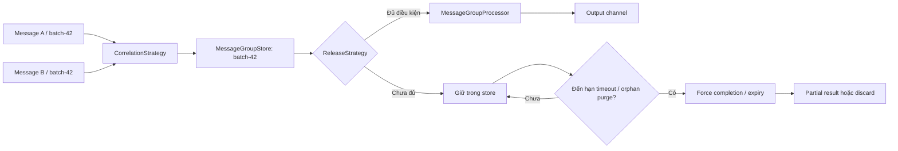
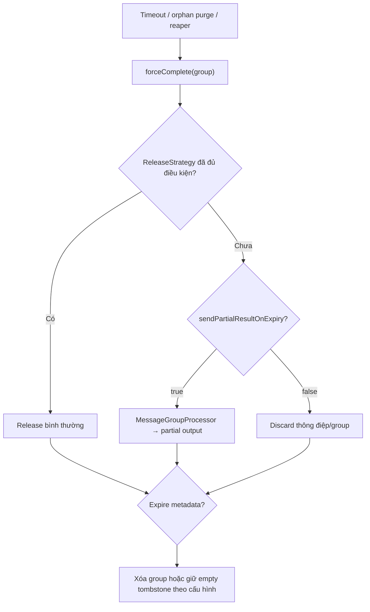
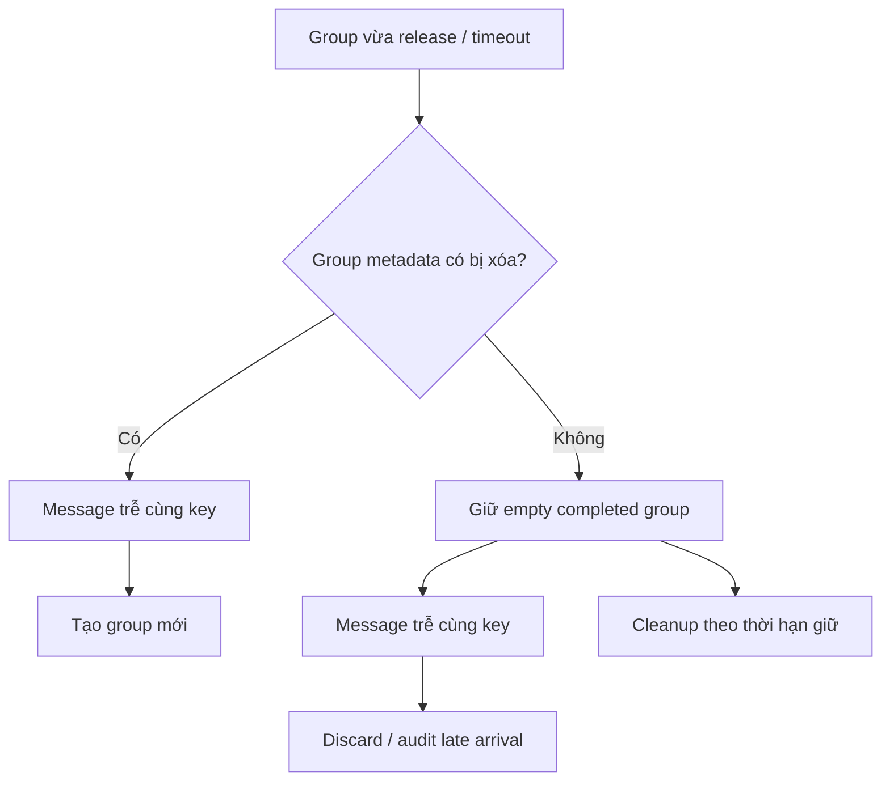
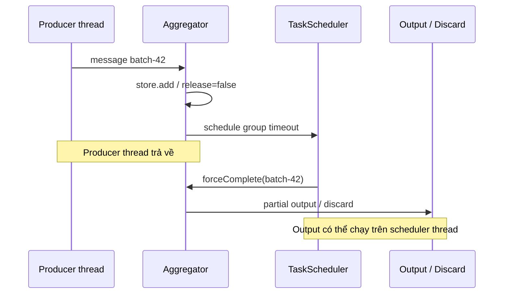

# Message group orphan và timeout trong Spring Integration

## Mục tiêu và ngữ cảnh

Trong module **SPRING_INTEGRATION_RUNTIME**, việc điều phối message không kết thúc khi một consumer đã nhận được message. Với **Aggregator** hoặc **Resequencer**, runtime còn phải giữ nhiều message có cùng correlation key trong `MessageGroupStore`, đợi đủ điều kiện `ReleaseStrategy` rồi mới tiếp tục flow. Nếu một phần dữ liệu bị mất, nguồn ngừng gửi, consumer dừng hoặc ứng dụng khởi động lại, group có thể tồn tại rất lâu mà không được giải phóng.

Bài thuộc chương **Correlation runtime**, tập trung vào **orphaned message group** (nhóm thông điệp bị bỏ lại, không còn cơ hội hoàn thành thông thường) và các cơ chế **timeout/expiration**. Các vấn đề liên quan tới channel, endpoint, poller, executor, transaction, retry, message store, lỗi và hiệu năng được giải thích tại những nơi chúng thay đổi hành vi runtime của group.

Sau bài này, bạn có thể:

- Phân biệt group **đang chờ hợp lệ**, group **thiếu message**, group **orphan** và **empty group metadata** còn được giữ sau khi hoàn thành.
- Giải thích vai trò của `CorrelationStrategy`, `ReleaseStrategy`, `MessageGroupStore` và `AbstractCorrelatingMessageHandler`.
- Dùng `groupTimeout`, `groupTimeoutExpression`, `expireTimeout`, `expireDuration` và `MessageGroupStoreReaper` đúng tình huống.
- Quyết định **partial release**, discard, lưu trạng thái từ chối late arrival và thời hạn xóa group.
- Thiết kế correlation key ổn định, quản lý message đến muộn và restart khi store bền vững.
- Chẩn đoán group tồn đọng, scheduler không chạy, lỗi trong nhánh expiry, transaction, khóa group và nguy cơ duplicate output.
- Viết integration test cho complete, incomplete, timeout, late arrival, recovery sau restart và chạy song song.

Ví dụ chính theo **Spring Integration 6.5.x, Spring Framework 6.x và Java 17+**. API/cấu hình có thể thay đổi giữa các phiên bản; phần code giới thiệu đúng trách nhiệm của từng thành phần và ghi rõ khi nào cần thêm adapter hoặc store.

## 1. Một message group được tạo và giải phóng như thế nào?

Một aggregator có ba câu hỏi cốt lõi:

1. **Nhóm vào đâu?** `CorrelationStrategy` tạo group key từ message, thông thường dựa trên header `correlationId`. Có thể cấu hình dùng business key như `orderId` hoặc `batchId`.
2. **Đã đủ để trả kết quả chưa?** `ReleaseStrategy` quyết định khi nào group có thể release. Với message được splitter gắn sequence headers đầy đủ, mặc định thường là `SimpleSequenceSizeReleaseStrategy`.
3. **Kết quả và trạng thái được xử lý ở đâu?** `MessageGroupStore` giữ các messages và metadata; `MessageGroupProcessor` tạo output; endpoint gửi output hoặc xử lý expiry/discard theo cấu hình.



Điểm cần nhớ: một message được channel nhận **không có nghĩa** group hoàn thành. Nếu release strategy đang chờ ba phần nhưng chỉ đến hai phần, chúng sẽ tồn tại trong store cho đến khi có điều kiện khác buộc xử lý.

### Bốn trạng thái dễ bị nhầm

| Trạng thái | Bản chất | Xử lý thích hợp |
|---|---|---|
| **Open group** | Chưa release, vẫn đang chờ phần tiếp theo | Giữ group trong store; có timeout hoặc SLA rõ |
| **Incomplete group** | Thiếu một hoặc nhiều phần so với điều kiện release | Timeout rồi partial release hoặc discard theo nghiệp vụ |
| **Orphaned group** | Group còn trong store nhưng các sự kiện/trigger để hoàn tất có thể không bao giờ xảy ra, thường sau restart | Dùng purge/reaper hoặc công cụ phục hồi có kiểm soát |
| **Empty completed group** | Messages đã release, nhưng metadata nhóm được giữ để nhận biết late arrivals | Giữ trong cửa sổ chống late arrival, sau đó xóa metadata |

`Orphan` không phải một Java exception hoặc trạng thái được framework gắn cờ cho mọi group. Đó là một **tình huống vận hành**: một group không còn tiến triển như dự kiến. Một group còn mở vài giây có thể hoàn toàn bình thường nếu SLA cho phép nhiều phút.

## 2. Nguyên nhân tạo group bị bỏ lại

### Thiếu message trong chuỗi

Một splitter chia dữ liệu thành 4 phần; phía sau chỉ nhận các phần 1, 2 và 4:

```text
correlationId = batch-42
sequenceSize  = 4

seq=1   → group batch-42
seq=2   → group batch-42
seq=3   → mất khi upstream lỗi / bị filter / gửi sai channel
seq=4   → group batch-42

ReleaseStrategy cần đủ 4 phần → group chờ mãi nếu không timeout.
```

Không thể sửa bằng cách chỉ tăng poller concurrency. Phải xác minh message thứ ba bị mất ở đâu, có thể redeliver hay không và business chấp nhận kết quả thiếu phần hay không.

### Sai correlation hoặc release strategy

Ví dụ hai flow cùng ghi `batchId=42` vào một store chung dù đại diện cho hai công việc khác nhau. Messages bị trộn vào cùng group; `ReleaseStrategy` tính sai số lượng hoặc chờ sequence size không tương thích.

Ngược lại, nếu `CorrelationStrategy` dùng một message ID thay đổi liên tục, mỗi phần tạo một group khác, nên **không group nào** đủ điều kiện release.

### Khởi động lại với store bền vững

Store JDBC/MongoDB có thể giữ group từ trước restart, nhưng những lịch `ScheduledFuture` theo từng `groupTimeout` đã được tạo trong tiến trình cũ **không phải đối tượng được lưu bền vững cùng message group**. Nếu sau restart không có message mới tới group, timer cũ cũng không tự tiếp tục.

Từ Spring Integration 5.4, các correlation handlers có hỗ trợ dọn group orphan trong persistent store thông qua `expireTimeout`, `purgeOrphanedGroups()` và lịch `expireDuration`. Đây là lý do quan trọng để phân biệt **timeout khi đang chạy** với **sweeper sau restart**.

### Những nguyên nhân runtime khác

- Consumer endpoint hoặc poller bị dừng; message không còn tới aggregator.
- Filter/transformer làm mất hoặc đổi `correlationId`, `sequenceNumber` hoặc `sequenceSize`.
- Lỗi trước điểm lưu message, rollback message store hoặc xử lý redelivery sai.
- Group chứa message từ nhiều tenant/flow mà key không có namespace.
- Một publisher thất bại và nguồn không redeliver; hoặc một message vượt giới hạn kích thước.
- Store/transaction/lock concurrency không phù hợp khiến thêm message hoặc release bị trì hoãn.
- Từng message mới luôn đến trước timeout nên cơ chế timeout theo *inactivity* liên tục dời lịch.

## 3. Các cơ chế timeout khác nhau

Có ba cơ chế chính, với ý nghĩa khác nhau về thời gian và cách kích hoạt:

| Cơ chế | Kiểm tra khi nào? | Nhắm tới | Hạn chế |
|---|---|---|---|
| `groupTimeout(long)` hoặc `groupTimeoutExpression(...)` | Đặt lịch riêng sau khi một group nhận message mà chưa release | Một group đang mở không nhận thêm message trong khoảng chờ | Timer trong tiến trình; có thể không còn sau restart |
| `expireTimeout(long)` + `expireDuration(Duration)` | Quét group cũ từ store khi startup và định kỳ nếu có duration | Group orphan lưu bền vững không được kích hoạt lại | Độ trễ phụ thuộc chu kỳ quét; cần store riêng đúng handler |
| `MessageGroupStoreReaper` | Scheduler gọi `run()` theo lịch, dùng `MessageGroupStore.expireMessageGroups(...)` | Những group quá cũ trong store, kể cả cleanup empty groups | Không chạy nếu không được schedule; độ trễ có thể dài hơn timeout |

**Không nên cấu hình cả ba như ba chính sách độc lập vô tình mâu thuẫn**. Một hệ thống có thể dùng `groupTimeout` cho message groups đang hoạt động và orphan purge cho restart, nhưng chính sách partial/discard/retention phải nhất quán.

### 3.1. `groupTimeout` là inactivity timeout

Giả sử group timeout là 10 giây:

```text
t = 00s: đến phần #1; đặt timer t=10s
t = 07s: đến phần #2; hủy timer cũ; đặt timer t=17s
t = 16s: đến phần #3; hủy timer cũ; đặt timer t=26s
t = 26s: không có phần mới → force completion (nếu chưa release)
```

Khi message mới đến, một `ScheduledFuture` còn lại cho group được hủy và lịch mới được tạo nếu `ReleaseStrategy` vẫn chưa release. Đây là thời gian chờ **từ lần đến gần nhất**, không phải deadline tuyệt đối tính từ lúc nhận phần đầu.

Với flow có các heartbeat/phần cập nhật đến đều đặn nhưng thiếu một phần bắt buộc, timeout theo inactivity có thể không bao giờ đạt. Nếu muốn deadline tính từ lúc tạo group, dùng biểu thức dựa trên `MessageGroup.getTimestamp()` hoặc mốc thời gian nghiệp vụ, và hiểu cách group timestamp được cập nhật/giữ lại.

### 3.2. `groupTimeoutExpression` cho deadline động

Biểu thức được đánh giá trên `MessageGroup`:

```java
// Java DSL: hết hạn sau 10 giây kể từ khi group được tạo.
.groupTimeoutExpression(
        "new java.util.Date(timestamp + 10000)")
```

Khi dùng `Date` làm thời điểm tuyệt đối, deadline dựa trên timestamp của group. Spring Integration từ 5.5 cho phép `groupTimeoutExpression` đánh giá thành `java.util.Date`, bên cạnh giá trị số khoảng chờ.

Có thể trả `null` để không schedule trong một điều kiện, hoặc tính thời gian dựa trên group size/headers. Cần thận trọng với giá trị 0 và âm vì chúng có thể gây force completion ngay hoặc bỏ lịch tùy API/kiểu biểu thức; đừng dùng giá trị này như cách ngầm định vô hiệu hóa mọi timeout.

### 3.3. `expireTimeout` là tuổi cho orphan purge

`expireTimeout(300_000L)` và `expireDuration(Duration.ofMinutes(1))` có thể được dùng để quét những group cũ hơn khoảng 5 phút, theo chu kỳ 1 phút (ngoài lần quét khi khởi động). Purge gọi logic **forceComplete** và tuân theo lựa chọn partial/discard/expiration tương ứng.

Khi diễn giải tuổi group, cần kiểm tra store đang dùng và các timestamp của `MessageGroup`/store. Đây là kiểm tra tuổi/trạng thái group trong store, không có nghĩa mọi message có business event time cũ hơn 5 phút phải bị discard.

Nếu ứng dụng cần SLA 30 giây nhưng chu kỳ quét là 10 phút, một orphan có thể sống lâu hơn SLA. Ngược lại, đặt purge quá ngắn có thể xóa group hợp lệ đang nhận dữ liệu chậm.

## 4. Khi timeout: partial release hay discard?

Khi task timeout bắt đầu, Spring Integration có thể hỏi `ReleaseStrategy` thêm lần nữa. Nếu vẫn chưa release, expiry được xử lý theo chính sách:



| Tùy chọn | Ý nghĩa | Khi nào phù hợp |
|---|---|---|
| `sendPartialResultOnExpiry(true)` | Phát phần dữ liệu đã nhận dưới dạng kết quả aggregator khi hết hạn | Report có thể thiếu phần, nhưng vẫn hữu ích khi kèm trạng thái partial |
| `sendPartialResultOnExpiry(false)` | Mặc định: không phát partial output; có thể gửi phần bị bỏ đến discard channel | Thanh toán, đối soát hoặc tác vụ yêu cầu đầy đủ dữ liệu |
| `discardChannel(...)` | Nơi nhận thông điệp bị loại bỏ hoặc đến muộn theo cấu hình | Quarantine, audit, cảnh báo, replay có kiểm soát |
| `discardIndividuallyOnExpiry(false)` | Từ 6.5: có thể gửi nguyên group bị bỏ như một message chứa danh sách messages | Cần lưu một sự kiện failure cho toàn group (chỉ có hiệu lực khi partial=false và có discard channel) |
| `expireGroupsUponTimeout(true)` | Mặc định của **aggregator**: hoàn tất do timeout rồi xóa toàn bộ group | Chấp nhận việc message tới sau có thể tạo group mới |
| `expireGroupsUponTimeout(false)` | Giữ metadata của group hoàn tất để late arrivals bị loại theo thời gian giữ | Không muốn group cũ vô tình bắt đầu một chu kỳ mới |
| `expireGroupsUponCompletion(false)` | Mặc định của aggregator khi hoàn thành bình thường: giữ empty group | Ngăn late arrivals tái tạo kết quả sau normal release |
| `minimumTimeoutForEmptyGroups(long)` | Có thể giữ empty group lâu hơn trước khi reaper/cleanup xóa | Cần cửa sổ chống late arrivals có giới hạn |

**“Expired” và “completed” không đồng nghĩa.** Khi group bị xóa hoàn toàn, store không còn nhớ key đã hoàn tất. Một message đến sau với cùng key có thể tạo một group mới. Khi metadata completed được giữ lại, message đến muộn có thể được discard theo hợp đồng aggregator.

**Nhận partial output không có nghĩa xử lý nghiệp vụ thành công.** Downstream cần biết dữ liệu đang thiếu gì, ví dụ group dự kiến 5 phần nhưng chỉ nhận 3. Kết quả mặc định của aggregator không nhất thiết mang cờ `partial=true` theo hợp đồng ứng dụng; nếu trạng thái này quan trọng, hãy thiết kế payload/header hoặc output processor riêng và kiểm thử chúng.

### Bảng quyết định nghiệp vụ

| Nghiệp vụ | Khi thiếu phần | Đề xuất |
|---|---|---|
| Báo cáo thống kê mỗi phút | Dữ liệu một số nguồn thiếu vẫn có ích | Partial release, gắn chất lượng/mức đầy đủ |
| Thanh toán theo nhiều sự kiện | Thiếu một bước có thể làm sai số tiền | Discard/quarantine, phục hồi bằng transaction/workflow |
| Tổng hợp kết quả nhiều API | Cho phép trả một phần nhưng phải nói rõ dịch vụ không trả lời | Partial kèm diagnostics, timeout upstream rõ |
| Đồng bộ trạng thái kho | Không thể tạo snapshot từ dữ liệu thiếu | Không phát snapshot sai; lưu sự kiện thiếu để retry/reconcile |
| Ghép request/reply của gateway | Caller có deadline | Kiểm tra gateway timeout và đường error/partial response, tránh chờ vô hạn |

## 5. Ví dụ thực hành: timeout và message đến muộn

Ví dụ dưới đây dùng Spring Integration Java DSL với hai channel: input và output; một queue riêng nhận các message bị discard. Mục tiêu là quan sát *inactivity timeout* và cách giữ group metadata để từ chối late arrival.

```java
import org.springframework.context.annotation.AnnotationConfigApplicationContext;
import org.springframework.context.annotation.Bean;
import org.springframework.context.annotation.Configuration;
import org.springframework.integration.channel.DirectChannel;
import org.springframework.integration.channel.QueueChannel;
import org.springframework.integration.config.EnableIntegration;
import org.springframework.integration.dsl.IntegrationFlow;
import org.springframework.messaging.Message;
import org.springframework.messaging.MessageChannel;
import org.springframework.messaging.PollableChannel;
import org.springframework.messaging.support.MessageBuilder;

@Configuration
@EnableIntegration
public class CorrelationTimeoutDemo {

    @Bean
    public MessageChannel batchParts() {
        return new DirectChannel();
    }

    @Bean
    public PollableChannel aggregatedBatches() {
        return new QueueChannel();
    }

    @Bean
    public PollableChannel discardedParts() {
        return new QueueChannel();
    }

    @Bean
    public IntegrationFlow aggregateBatches() {
        return IntegrationFlow.from("batchParts")
                .aggregate(spec -> spec
                        .correlationExpression("headers['batchId']")
                        .releaseStrategy(group -> group.size() >= 3)
                        .groupTimeout(800L)
                        .sendPartialResultOnExpiry(true)
                        .expireGroupsUponCompletion(false)
                        .expireGroupsUponTimeout(false)
                        .discardChannel("discardedParts"))
                .channel("aggregatedBatches")
                .get();
    }

    public static void main(String[] args) {
        try (var ctx = new AnnotationConfigApplicationContext(
                CorrelationTimeoutDemo.class)) {

            MessageChannel input =
                    ctx.getBean("batchParts", MessageChannel.class);
            PollableChannel output =
                    ctx.getBean("aggregatedBatches", PollableChannel.class);
            PollableChannel discard =
                    ctx.getBean("discardedParts", PollableChannel.class);

            sendPart(input, "order-42", "A");
            sendPart(input, "order-42", "B");

            // Không có phần C: sau khoảng 800 ms không có message mới,
            // group được force-complete và trả partial output.
            Message<?> partial = output.receive(4_000);
            System.out.println(
                    partial == null ? "no result" : partial.getPayload());

            // Group đã hoàn tất nhưng còn metadata, vì
            // expireGroupsUponTimeout(false).
            sendPart(input, "order-42", "C");
            Message<?> late = discard.receive(1_000);
            System.out.println(
                    late == null ? "no late message"
                            : "late=" + late.getPayload());
        }
    }

    private static void sendPart(
            MessageChannel input, String batchId, String part) {
        input.send(MessageBuilder.withPayload(part)
                .setHeader("batchId", batchId)
                .build());
    }
}
```

Kết quả dự kiến trong runtime không quá tải:

- Hai message `A`, `B` được giữ trong cùng group `order-42`.
- Vì `releaseStrategy(group -> group.size() >= 3)` chưa đúng, timer force-complete group khi không còn message mới trong khoảng 800 ms.
- `sendPartialResultOnExpiry(true)` cho phép phát payload gồm hai phần. Cấu trúc và thứ tự của collection do output processor/store quyết định; không nên assert rằng output có thứ tự `A` rồi `B` nếu chưa cấu hình ordering.
- `expireGroupsUponTimeout(false)` giữ group metadata; `C` đến sau bị xem là late arrival và có thể đi vào `discardedParts`.
- Vì ví dụ **không có reaper**, metadata đã hoàn thành có thể tiếp tục ở trong memory cho đến khi context đóng. Ở production cần chính sách cleanup.

Ví dụ có ý nghĩa minh họa, chưa phải một bộ kiểm thử được chạy qua Gradle trong STEP 4. Dữ liệu thực nên có thứ tự/sequence và business ID đủ rõ để phát hiện thiếu phần.

### Muốn không phát partial output

Đổi:

```java
.sendPartialResultOnExpiry(false)
.expireGroupsUponTimeout(false)
.discardChannel("discardedParts")
```

Group thiếu phần sẽ không phát kết quả tổng hợp sang `aggregatedBatches`; các message cũ được đưa theo chính sách discard nếu có channel tương ứng. Nếu cần nhận **một sự kiện chứa toàn group thay vì mỗi message riêng**, từ Spring Integration 6.5 có thể thêm:

```java
.discardIndividuallyOnExpiry(false)
```

Hãy kiểm tra kiểu payload thực tế ở discard consumer, bởi khi chọn cả group, payload là danh sách messages, không phải payload của một phần đơn lẻ.

### Kiểm tra normal release

Gửi `A`, `B`, `C` đủ nhanh (trước khi timeout). `releaseStrategy` sẽ cho group hoàn thành bình thường và phát một message qua output. Khi `expireGroupsUponCompletion(false)`, metadata sẽ được giữ lại để phát hiện message thứ tư đến muộn.

Trong hệ thống thật, chỉ dựa trên `group.size() >= 3` không xác minh được ba phần là các `sequenceNumber` khác nhau; có thể có duplicate event. Khi nguồn có sequence headers đáng tin cậy, dùng release strategy dựa trên sequence, cùng idempotency/deduplication nếu redelivery xảy ra.

## 6. MessageGroupStore bền vững và orphan sau restart

Aggregator có thể giữ trạng thái trong memory (như `SimpleMessageStore`) hoặc trong một persistent `MessageGroupStore` (ví dụ `JdbcMessageStore`/MongoDB). Khi cần phục hồi group qua restart, store in-memory là chưa đủ.

```text
Trước restart:
  Group batch-99 (2/3) ở JDBC store
  Timer groupTimeout trong JVM
  ↓ JVM dừng bất thường
Sau restart:
  Group batch-99 vẫn ở JDBC store
  Timer ScheduledFuture cũ đã mất
  Không còn message mới tới batch-99
  ↓
  Group có nguy cơ orphan nếu không có purge/reaper
```

### Cấu hình orphan purge gắn với aggregator

Bên trong một aggregator Java DSL đã cấu hình `messageStore(store)`, có thể thêm:

```java
// store là MessageGroupStore chỉ dành cho aggregator này.
.aggregate(spec -> spec
        .messageStore(store)
        .groupTimeout(30_000L)
        .sendPartialResultOnExpiry(false)
        .discardChannel("expiredParts")
        .expireTimeout(300_000L)
        .expireDuration(java.time.Duration.ofMinutes(1)))
```

Ý nghĩa:

- `groupTimeout(30_000)`: group đang hoạt động mà không có message mới trong 30 giây được lên lịch force-completion.
- `expireTimeout(300_000)`: nhóm cũ khoảng 5 phút trong store được xem xét purge.
- `expireDuration(Duration.ofMinutes(1))`: chạy quét định kỳ; ngoài ra purge có thể được gọi khi correlation handler khởi động.
- `sendPartialResultOnExpiry(false)`: nhóm không đủ điều kiện release sẽ được discard theo chính sách đã thiết kế.
- Store vẫn cần **database schema, transaction manager, cấu hình serialization và connection pool** tương ứng nếu là JDBC; snippet chỉ minh họa phương pháp đặt TTL.

Cần đánh giá cả thời gian quét, lịch làm việc và trường hợp group update gần hạn. `expireTimeout` không thay thế cấu hình retention của database cho audit/recovery records.

### Vì sao không dùng cùng MessageGroupStore cho nhiều aggregators?

`AbstractCorrelatingMessageHandler` đăng ký expiry callback gắn với handler. Nếu hai aggregator khác nhau chia sẻ cùng một **instance** store và đều dựa vào quét expiry, callback của handler này có thể cố release/discard group do handler kia tạo.

Spring Integration đã có kiểm tra từ 5.0.10 để tránh một số trường hợp chia sẻ store không an toàn, nhưng thiết kế tốt vẫn là:

- Mỗi correlation endpoint có **MessageGroupStore riêng về mặt logic**.
- Nếu cùng DB vật lý, dùng region/table/collection namespace thích hợp với implementation, và group key cũng cần namespace theo flow/tenant.
- Với nhiều application instances, dùng cơ chế lock đồng bộ đủ mạnh để hai instances không đồng thời sửa cùng group.
- Kiểm tra recovery và purge khi scale up/down hoặc rolling restart.

Không tự tạo key `batchId` chỉ bằng số đếm cục bộ không bền vững: sau restart có thể trùng với group cũ. Dùng business ID duy nhất hoặc key bao gồm namespace, tenant, flow và batch version.

## 7. MessageGroupStoreReaper: quét group quá hạn theo lịch

`org.springframework.integration.store.MessageGroupStoreReaper` là `Runnable` nhận `MessageGroupStore`. Khi `run()` được gọi, nó dùng timeout để yêu cầu store tìm các groups quá tuổi và kích hoạt callback.

```java
import org.springframework.context.annotation.Bean;
import org.springframework.integration.store.MessageGroupStore;
import org.springframework.integration.store.MessageGroupStoreReaper;

@Bean
public MessageGroupStoreReaper orphanGroupReaper(
        MessageGroupStore aggregationStore) {

    MessageGroupStoreReaper reaper =
            new MessageGroupStoreReaper(aggregationStore);
    reaper.setTimeout(60_000L); // Group cũ hơn khoảng 60 giây.
    reaper.setExpireOnDestroy(false);
    return reaper;
}
```

**Tạo bean chưa đủ**: reaper cần được gọi theo lịch, ví dụ một `@Scheduled(fixedDelay = 10_000L)` dùng reference tới `orphanGroupReaper`, hoặc cấu hình scheduler tương đương. Khi chạy định kỳ, timeout 60 giây không có nghĩa nó sẽ chạy đúng tại giây thứ 60; độ trễ còn phụ thuộc lần chạy kế tiếp và khả năng scheduler đáp ứng.

Ví dụ lịch:

```java
@Component
public class ReaperSchedule {

    private final MessageGroupStoreReaper reaper;

    public ReaperSchedule(MessageGroupStoreReaper orphanGroupReaper) {
        this.reaper = orphanGroupReaper;
    }

    @Scheduled(fixedDelay = 10_000L)
    public void purge() {
        reaper.run();
    }
}
```

Đoạn trên cần `@EnableScheduling` hoặc cấu hình tương đương; application phải có store phù hợp và aggregator sử dụng chính store đó. Scheduler của reaper, group timeout và error publishing cũng cần được quản lý về lifecycle.

### `expireTimeout` hay reaper?

- Ưu tiên **`expireTimeout` + `expireDuration`** khi muốn aggregator chủ động làm sạch những group cũ thuộc nó, đặc biệt sau restart.
- Dùng **`MessageGroupStoreReaper`** khi cần lịch quét chủ động của store, cleanup empty groups hoặc điều khiển job expiry riêng.
- Nếu kết hợp cả hai, tránh đặt các ngưỡng mâu thuẫn khiến group bị xử lý trước thời hạn nghiệp vụ.
- Với store lớn, đo chi phí truy vấn/quét; index dữ liệu expiration và giới hạn tần suất để tránh làm nghẽn DB.

**Chú ý lúc shutdown:** expiry callback có thể được kích hoạt trong lifecycle shutdown. Nếu `sendPartialResultOnExpiry(true)` và dispatcher/endpoint downstream đã dừng, việc phát partial output khi shutdown có thể thất bại. Hãy kiểm tra `setExpireOnDestroy(...)`, thứ tự lifecycle và liệu shutdown cần cố phát partial result hay ưu tiên giữ group bền vững để hồi phục.

## 8. Message đến muộn và giữ empty-group metadata

Có hai chính sách khác nhau:



**Mặc định của aggregator:**

- Hoàn thành bình thường: `expireGroupsUponCompletion(false)`, giữ metadata để biết group đã complete.
- Bị force-complete bởi timeout: `expireGroupsUponTimeout(true)`, thường xóa group.
- Vì thế cùng một late message có thể được đối xử **khác nhau** theo cách group ban đầu hoàn thành.

Nếu nghiệp vụ không được phép tạo output mới cho một order đã tổng hợp, cân nhắc `expireGroupsUponTimeout(false)`. Nhưng giữ tombstones mãi sẽ làm store tăng kích thước. Cần thời hạn giữ dựa trên nguồn, worst-case redelivery và SLA.

### Đặt thời gian giữ empty groups

`minimumTimeoutForEmptyGroups(...)` hỗ trợ giữ metadata group trống thêm một khoảng nhất định trước khi reaper hoặc cơ chế cleanup xóa. Ví dụ nếu downstream có thể gửi message chậm đến 5 phút, nên giữ metadata ít nhất đủ cho cửa sổ này; sau đó dọn để tránh memory/DB growth.

Một nhóm metadata cũ cuối cùng bị xóa thì late message **có thể tạo lại group**, nên nếu cần chống duplicate vĩnh viễn, cơ chế deduplication phải nằm ở business storage hoặc inbox/idempotency key bền vững, không chỉ ở aggregator metadata.

### Đừng đồng nhất discard với error

Message bị discard có thể do policy hợp lệ (đến muộn, nhóm thiếu phần), trong khi exception cho thấy xử lý lỗi kỹ thuật. Có thể tách các kênh:

```text
aggregatedResults   → downstream hợp lệ hoặc partial (theo contract)
expiredParts        → dữ liệu hết hạn / quarantine
lateArrivals        → audit, kiểm tra duplication
errorChannel        → lỗi scheduler/store/handler phát sinh exception
```

Nếu muốn phân biệt discard do hết hạn và discard do đến muộn, cần thêm metadata/context trong custom handler hoặc dùng các endpoint/processor riêng theo khả năng cấu hình của flow; không giả định tất cả discard messages có sẵn cùng một reason header.

## 9. Group timeout liên quan đến thread, transaction và error flow

`groupTimeout` và orphan purge chạy qua `TaskScheduler`/job quét, **khác thread** với message mới đi vào trên `DirectChannel` trong các trường hợp thông thường.



Những hệ quả:

- Transaction gắn với thread producer **không tự lan** sang task scheduler expiry.
- Nếu output handler phía sau chạy đồng bộ và chậm, nó có thể làm nghẽn scheduler và trì hoãn timeout của các groups khác.
- Khi store JDBC cần transaction cho `forceComplete`, có thể cấu hình **forceReleaseAdvice**/transaction advice dành cho expiry; advice này khác với advice xử lý message đến bình thường.
- Khi lock của group còn được giữ lúc gửi output, downstream gọi ngược aggregator hoặc một flow tương quan có thể gây deadlock. Cân nhắc `releaseLockBeforeSend(true)` nếu đúng mô hình, sau khi kiểm tra race/concurrency.
- Với nhiều application instances cùng store, cần `LockRegistry` dùng chung phù hợp, hoặc cơ chế phân vùng/single owner, để một group không bị force-release hai lần.

### Lỗi trong nhánh expiry chạy ở đâu?

Nếu scheduler kích hoạt force-completion rồi downstream ném exception, caller đã gửi phần message trước đó **không thể bắt lỗi ấy từ `send()`**. Cần kiểm tra `TaskScheduler` có `MessagePublishingErrorHandler` hoặc error handler phù hợp để phát lỗi sang `errorChannel`, khi adapter/framework hỗ trợ.

Một số dấu hiệu:

| Dấu hiệu | Nguyên nhân có thể |
|---|---|
| Timeout được schedule nhưng không có output | Scheduler chưa chạy, task bị hủy vì message mới, hoặc `sendPartialResultOnExpiry(false)` |
| Expiry output thất bại, chỉ có log scheduler | Error handler của scheduler không publish sang error flow mong muốn |
| Group release nhiều lần | Lock/transaction/retry không đúng, metadata bị xóa khiến late arrival tạo group mới |
| Group store bị lock lâu | Downstream I/O chạy đồng bộ trong khi đang giữ lock group |
| Group còn tồn sau shutdown | Store persistent và cleanup chưa chạy/không cấu hình; hành vi có thể được chủ động giữ để phục hồi |

Nếu expiry phải gọi remote API, cần đưa việc giao nhận sang queue/outbox hoặc một worker để không giữ lock/group store transaction trong thời gian network. Cơ chế idempotency quan trọng vì có thể có race giữa message mới, timer timeout và replay sau restart.

## 10. Message store, transaction, retry và bảo đảm xử lý

Đặt trạng thái group trong persistent store chỉ giúp tồn tại qua restart; nó không tự tạo exactly-once processing.

Ví dụ source gửi part #2 hai lần vì ack trễ, trong khi part #3 không tới. Nếu release strategy chỉ dựa trên `group.size()`, các duplicate messages khác ID có thể làm group “đủ số” dù chưa có dữ liệu #3.

Một thiết kế chắc chắn hơn:

1. Dùng business `batchId`/`orderId` làm correlation key ổn định.
2. Gắn `partId` hoặc `sequenceNumber` xác định duy nhất từng phần.
3. Xác thực `sequenceSize` hoặc expected count từ một nguồn đáng tin cậy.
4. Dùng release strategy phù hợp; nếu cần dedup, thực hiện bằng inbox/unique constraints hoặc bộ lọc idempotent.
5. Quy định TTL/replay window và điều kiện hết hạn.
6. Sau timeout, lưu business status `PARTIAL`/`EXPIRED`/`RECONCILIATION_REQUIRED` ngoài ephemeral group nếu cần audit bền vững.
7. Các output hoặc side effects bên ngoài phải idempotent theo group version/event ID.

### Nơi đặt transaction

| Vị trí | Tác động |
|---|---|
| Transaction trong inbound/poller | Có thể bao việc nhận part và cập nhật store nếu cùng thread/resource phù hợp |
| `ExecutorChannel` trước aggregator | Tạo ranh giới thread; transaction của producer không tự đi theo worker |
| Transaction của `MessageGroupStore` | Bảo đảm tính nhất quán update nhóm theo resource, khi được cấu hình đúng |
| `forceReleaseAdvice` khi timeout | Có thể thiết lập transaction riêng cho hoạt động forced release |
| Downstream HTTP/DB sau aggregation | Không tự nằm trong transaction gốc; cần boundary riêng, retry/idempotency |

Nếu nguồn message ack trước khi part được lưu bền vững, crash có thể làm mất part. Nếu part được lưu nhưng source chưa ack, redelivery có thể tạo duplicate. Cần kiểm thử cả hai điểm lỗi với adapter và broker thật.

### Khi nào retry hữu ích?

- Lỗi tạm thời khi lưu group vào JDBC store: retry giới hạn theo chính sách DB và transaction boundary.
- Timeout do **thiếu message**: retry ngay một handler không làm message còn thiếu tự xuất hiện. Cần đánh giá nguồn, yêu cầu resend hoặc quyết định partial/discard.
- Lỗi khi phát output do downstream không sẵn sàng: retry có thể có ý nghĩa nhưng phải bảo đảm release và side effect idempotent.
- Lỗi trong scheduled expiry: cần retry/recovery đặc biệt và tránh thả group vào trạng thái nửa vời.

## 11. Quan sát orphan groups và hiệu năng

Một group chứa nhiều payload lớn và tồn tại lâu có thể tốn memory/disk hơn message chưa xử lý thông thường. Cần giám sát **số group, tuổi và độ đầy**, không chỉ số messages đến endpoint.

| Chỉ số | Câu hỏi vận hành |
|---|---|
| Số groups đang mở | Có bao nhiêu batch chưa hoàn thành? |
| `oldestOpenGroupAge` | Batch cũ nhất đã chờ bao lâu so với SLA? |
| Số messages mỗi group, `expectedCount` | Đang thiếu bao nhiêu phần? |
| Timeout và orphan purge count | Có nhóm nào bị đóng bởi thời gian thay vì đủ dữ liệu? |
| Partial output và discard count | Nghiệp vụ mất bao nhiêu dữ liệu? |
| Late arrival count | Upstream có đang gửi chậm/redeliver nhiều? |
| MessageGroupStore size và DB latency | Store có phình to hoặc bị lock không? |
| Scheduler backlog/delay | Expiry thực tế có trễ so với TTL? |
| Release/forceComplete error rate | Có phát output thất bại do transaction hoặc downstream? |

**Thận trọng với metrics tags:** correlation key/`batchId` có số giá trị rất lớn; đưa chúng vào log/trace/audit có kiểm soát, không làm metric tag tạo series không giới hạn. Tags nên dùng endpoint ID, component type, outcome và nhóm lỗi có cardinality thấp.

### Phép tính dung lượng đơn giản

Giả sử throughput có 100 groups/phút, mỗi group tồn tại 30 phút, mỗi group giữ trung bình 8 messages x 5 KB:

```text
Số group xấp xỉ: 100 groups/phút × 30 phút = 3.000 groups
Payload thô:      3.000 × 8 × 5 KB       = 120.000 KB (~117 MiB)
```

Đây chỉ là ví dụ theo Little's Law với thời gian lưu trung bình ổn định; chưa tính headers, serialization, indexes, object overhead và tombstones. Nếu timeout/reaper không chạy, thời gian giữ tăng không giới hạn và storage có thể phình dần.

### Các câu hỏi chẩn đoán khi group không release

1. Group đang ở store nào? Có persistent không? Có bao nhiêu messages và timestamps?
2. Correlation strategy dùng header nào, có bị đổi hoặc mất ở transformer/router không?
3. Release strategy đang đòi `sequenceSize`/expectedCount bao nhiêu?
4. Có duplicate part khiến `group.size()` sai không?
5. `groupTimeout` có được cấu hình? Có message mới liên tục dời lịch không?
6. Nếu restart, orphan purge hoặc reaper có chạy không?
7. `sendPartialResultOnExpiry` và `discardChannel` đang được cấu hình thế nào?
8. Group metadata có bị xóa khi timeout không? Late message có tạo group mới?
9. Scheduler, lock registry và transaction của store có lỗi hoặc tắc không?
10. Output/error channel có subscriber, queue capacity và consumer còn chạy không?

## 12. Kiểm thử các trường hợp quan trọng

### 12.1. Complete group

Gửi ba messages cùng `batchId` trước thời hạn. Xác nhận:

- `ReleaseStrategy` true và phát một output theo contract.
- Không phát partial/discard ngoài ý muốn.
- Group metadata được giữ hoặc xóa chính xác theo `expireGroupsUponCompletion`.
- Message cùng key đến sau đi theo policy late arrival.

### 12.2. Incomplete group và inactivity timeout

Chỉ gửi hai messages khi yêu cầu ba. Nhận output/discard với timeout test đủ rộng, xác nhận không release sớm. Gửi phần thứ hai cách phần đầu một khoảng nhỏ hơn `groupTimeout` để xác nhận timer được đặt lại.

Với ví dụ `CorrelationTimeoutDemo`, `PollableChannel.receive(4_000)` là một cách chờ hữu hạn; đừng dùng `Thread.sleep` không giới hạn hoặc khẳng định timer chính xác tới mili giây trên CI.

### 12.3. Timeout sau restart

Dùng persistent `MessageGroupStore` với schema thật:

1. Khởi chạy ứng dụng, tạo group chưa đủ phần, xác nhận row/group tồn tại.
2. Dừng tiến trình hoặc mô phỏng crash **trước timeout**.
3. Khởi động lại, không gửi thêm message vào group.
4. Xác nhận `expireTimeout`/`expireDuration` hoặc reaper xử lý orphan sau tuổi quy định.
5. Kiểm tra partial/discard và idempotency của downstream; xác nhận không bị release hai lần.

Không thể kiểm chứng restart scenario đầy đủ nếu chỉ dùng `SimpleMessageStore` in-memory.

### 12.4. Late arrivals và tombstones

- Đặt `expireGroupsUponTimeout(false)`, gửi part đến muộn: xác nhận discard.
- Đợi cleanup xóa metadata, gửi cùng key: quan sát group mới có thể được tạo.
- Nếu nghiệp vụ cấm xử lý trùng sau cleanup, chứng minh inbox/unique business key vẫn chặn được.
- Đo sự tăng trưởng empty groups nếu không có policy dọn dẹp.

### 12.5. Concurrency, transaction và error channel

- Hai producer cùng gửi messages cho một group; xác nhận release không lặp và lock registry hoạt động đúng.
- Dùng nhiều app instances cùng persistent store; kiểm tra distributed locking/ownership.
- Giả lập JDBC lock timeout trong `forceComplete` và quan sát scheduler error handler.
- Cho downstream chậm hoặc ném exception khi partial release; quan sát có giữ lock hoặc mất event không.
- Xác minh inbound adapter không acknowledge part trước khi việc ghi store được bảo đảm theo contract.

### Bảng kỳ vọng kiểm thử

| Tình huống | Kỳ vọng |
|---|---|
| 3/3 parts trước timeout | Release bình thường |
| 2/3 parts, partial=true | Partial output sau timeout |
| 2/3 parts, partial=false | Discard/quarantine theo cấu hình |
| Có part mới trước inactivity timeout | Timer cũ được hủy/dời lịch |
| Restart khi group ở persistent store | Group được giữ, orphan purge xử lý theo hạn |
| Late part khi tombstone còn | Discard, không tạo group mới |
| Late part sau khi xóa tombstone | Có thể tạo group mới; dedup ngoài aggregator bảo vệ nghiệp vụ |
| Scheduler lỗi hoặc dừng | Timeout có thể chậm/không chạy; phải quan sát alarm |
| Concurrent send + expire | Một kết quả nghiệp vụ hợp lệ theo locking/idempotency, không phát duplicate side effects |

## 13. Checklist production

- [ ] Correlation key duy nhất theo flow/tenant/batch/version và ổn định qua retry/restart.
- [ ] Release strategy phản ánh số phần/sequence thực sự, có dedup khi redelivery.
- [ ] Có SLA chờ message, chọn rõ inactivity timeout hay deadline tuyệt đối.
- [ ] Cấu hình partial release/discard theo hợp đồng nghiệp vụ, không ngầm coi partial là success.
- [ ] Có discard channel và quy trình replay/quarantine cho message đến muộn hoặc hết hạn.
- [ ] Dùng persistent `MessageGroupStore` nếu cần giữ group qua restart.
- [ ] Có orphan cleanup bằng `expireTimeout/expireDuration` hoặc reaper được schedule thực sự.
- [ ] Không chia sẻ cùng instance `MessageGroupStore` giữa nhiều correlation endpoints có expiry callbacks.
- [ ] Chọn `expireGroupsUponTimeout` và `expireGroupsUponCompletion` theo chính sách late arrivals.
- [ ] Giữ tombstone đủ lâu nhưng có giới hạn cleanup và storage capacity.
- [ ] Scheduler/forceComplete có error handler, transaction và lock semantics phù hợp.
- [ ] Hạn chế xử lý remote chậm trong lúc giữ lock hoặc transaction của group store.
- [ ] Multi-instance có distributed locking/partitioning để không release hai lần.
- [ ] Outbound side effects idempotent với business group/event ID.
- [ ] Theo dõi open groups, oldest age, partial, discard, late arrivals, storage size và scheduler delays.
- [ ] Có test complete, timeout, restart, late arrivals, concurrency và recovery failure.

## Tài liệu tham khảo

- [Spring Integration Reference — Aggregator](https://docs.spring.io/spring-integration/reference/aggregator.html): cấu hình release, group timeout, expiry, orphan purge, MessageGroupStoreReaper và late arrivals.
- [Spring Integration 6.5.x Javadoc — AbstractCorrelatingMessageHandler](https://docs.spring.io/spring-integration/docs/6.5.1/api/org/springframework/integration/aggregator/AbstractCorrelatingMessageHandler.html): API `setGroupTimeoutExpression`, `setExpireTimeout`, `purgeOrphanedGroups`, `setSendPartialResultOnExpiry`, quản lý lock.
- [Spring Integration 6.5.x Javadoc — CorrelationHandlerSpec](https://docs.spring.io/spring-integration/docs/6.5.0/api/org/springframework/integration/dsl/CorrelationHandlerSpec.html): Java DSL cho timeout, expiry, discard, lock registry.
- [Spring Integration 6.5.x Javadoc — AggregatorSpec](https://docs.spring.io/spring-integration/docs/6.5.0/api/org/springframework/integration/dsl/AggregatorSpec.html): cấu hình Aggregator và `expireGroupsUponCompletion`.
- [Spring Integration Javadoc — MessageGroupStoreReaper](https://docs.spring.io/spring-integration/docs/6.5.0/api/org/springframework/integration/store/MessageGroupStoreReaper.html): cơ chế quét store theo lịch.
- [Spring Integration Reference — Message Store](https://docs.spring.io/spring-integration/reference/message-store.html): lựa chọn in-memory và persistent stores.
- [Spring Integration Reference — Error Handling](https://docs.spring.io/spring-integration/reference/error-handling.html): lỗi từ scheduler, errorChannel và recovery.

**Ghi nhớ:** Một group không hoàn thành có thể là dữ liệu đến chậm, thiếu phần hoặc một orphan còn lưu sau restart. `groupTimeout` xử lý group đang hoạt động, `expireTimeout/expireDuration` và `MessageGroupStoreReaper` giúp quét state cũ; `sendPartialResultOnExpiry` quyết định partial hay discard; còn các cấu hình giữ/xóa metadata quyết định late arrival có được coi là group mới hay không. Muốn runtime ổn định, phải thiết kế đồng thời **correlation key, release criteria, timeout, persistence, late arrival, lock, error flow và idempotency**.

