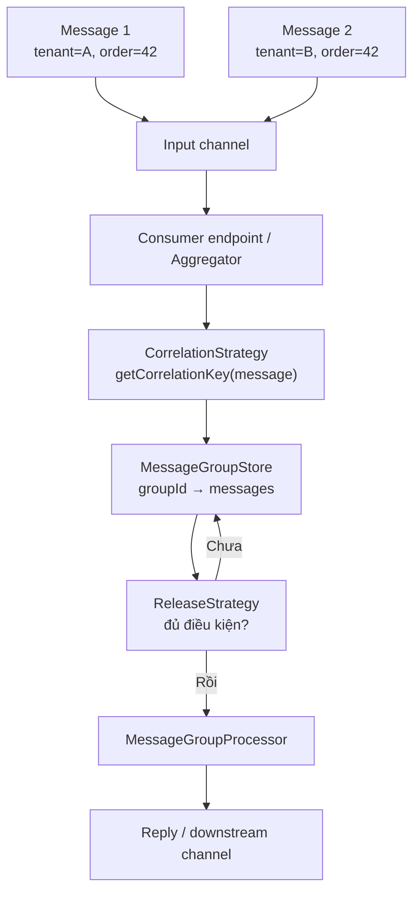
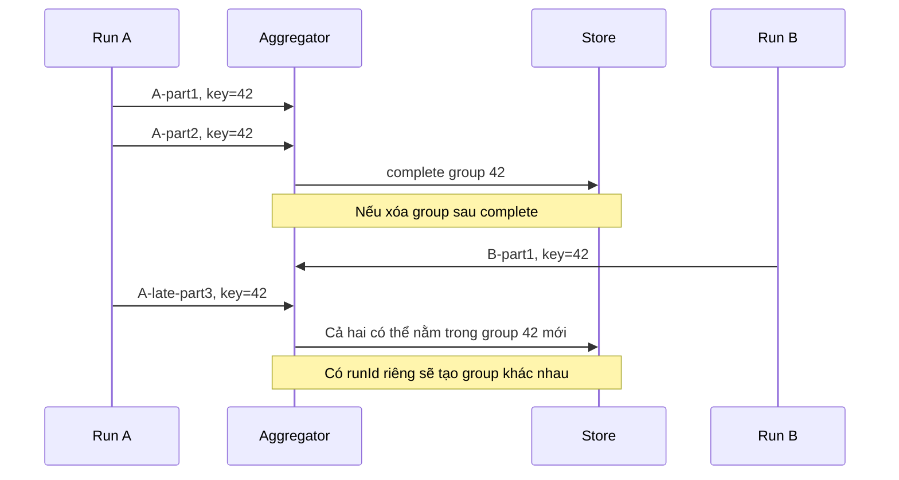
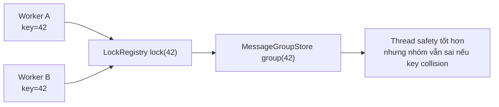

# Correlation key collision trong Spring Integration Runtime

## 1. Vấn đề: cùng correlation key, khác nghiệp vụ

Trong **Spring Integration Runtime**, một số endpoint xử lý message độc lập, nhưng các thành phần như **aggregator**, **resequencer** hoặc **delayer** cần giữ trạng thái để nối nhiều message của cùng một tác vụ. Spring Integration sử dụng một **correlation key** để chọn `MessageGroup` mà message phải tham gia.

**Correlation key collision** xảy ra khi **hai tác vụ lẽ ra độc lập lại được ánh xạ vào cùng một khóa nhóm** trong cùng phạm vi lưu trữ. Ví dụ hai tenant đều có `orderId = "ORD-42"`; nếu aggregator chỉ nhóm theo `orderId`, các phần của đơn hàng tenant A có thể bị gộp với tenant B. Điều này có thể dẫn đến tổng hợp sai, phát reply quá sớm, mất phần chưa hoàn thành, lẫn dữ liệu khách hàng, tồn nhóm mãi hoặc tạo lỗi khó tái hiện dưới tải cao.

Bài **Correlation key collision** thuộc chương **Correlation runtime** của module `SPRING_INTEGRATION_RUNTIME`. Phạm vi bài bao gồm cách Spring Integration chạy message flow qua `MessageChannel`, endpoint, consumer, poller và executor; cách kiểm soát vòng đời `IntegrationFlow`, transaction, retry, message store, error handling, correlation, threading, hiệu năng và trạng thái vận hành khi phát hiện collision.

**Sau bài học, bạn sẽ có thể:**

1. Phân biệt collision **ngữ nghĩa nghiệp vụ**, collision **ID tái sử dụng** và **trùng hashCode kỹ thuật**.
2. Nắm hợp đồng `CorrelationStrategy`, `ReleaseStrategy`, `MessageGroupStore` và luật xử lý message tới muộn.
3. Chạy ví dụ Java tái hiện hai tenant có cùng `orderId` bị gom sai.
4. Thiết kế khóa nhóm tường minh theo tenant, flow, batch/generation; tránh rủi ro khi serialize khóa.
5. Chẩn đoán hiện tượng nhóm bị trộn, release sớm, drop late message, deadlock/lock contention và heap tăng.
6. Hiểu hệ quả của retry, redelivery, shared message store, distributed locking và gateway reply path.

Ví dụ dùng **Spring Integration 6.x** (đối chiếu tài liệu 6.5), Java 17+ và `spring-integration-core`. Một số cấu hình timeout, expiry và store tùy phiên bản hay loại endpoint; cần kiểm tra API thực tế trước khi áp dụng vào production.

## 2. Correlation trong kiến trúc runtime

### 2.1. Correlation khác routing và message ID

| Thành phần | Câu hỏi được trả lời | Ví dụ |
|---|---|---|
| `MessageHeaders.ID` | Đây là message instance nào? | Một UUID gắn với message |
| `IntegrationMessageHeaderAccessor.CORRELATION_ID` | Message thuộc **nhóm** nào? | ID của đợt split hoặc business batch |
| `SEQUENCE_NUMBER` / `SEQUENCE_SIZE` | Message là phần nào và kỳ vọng bao nhiêu phần? | Phần 2/3 |
| `replyChannel` | Gửi **kết quả** tới đâu? | Temporary channel của gateway |
| `errorChannel` | Gửi **lỗi** tới đâu? | `errorChannel` hoặc channel riêng |
| Business key (`tenantId`, `orderId`) | Tác vụ liên quan đến thực thể nào? | tenant A, order 42 |
| Processing run/batch ID | Đây là **lượt xử lý** nào của business key? | `run-2026-11-22-A` |

Một `Message` có thể mang cùng `orderId` với nhiều message khác; nhưng điều đó **không tự cho phép** chúng nằm cùng một `MessageGroup`. Nếu nghiệp vụ xử lý lại một order theo nhiều đợt, mỗi đợt cần một khóa nhóm khác dù cùng order ID.

`replyChannel` cũng không phải correlation key. Gateway có thể phát temporary reply channel để trả kết quả cho từng caller, nhưng một aggregator vẫn cần khóa phù hợp để **gom đúng** message và release đủ nhóm. Correlation sai có thể khiến reply đi về caller không mong đợi hoặc khiến caller timeout.

### 2.2. Đường đi của key trong aggregator



Với `AggregatingMessageHandler`, `CorrelationStrategy` xác định key; `MessageGroupStore` giữ những message có cùng key; `ReleaseStrategy` quyết định thời điểm group đã sẵn sàng tạo đầu ra.

Spring Integration mặc định sử dụng `HeaderAttributeCorrelationStrategy` đọc `IntegrationMessageHeaderAccessor.CORRELATION_ID`. Release strategy mặc định hiện đại dùng `SimpleSequenceSizeReleaseStrategy` dựa trên sequence headers. Những mặc định này phù hợp với pattern splitter-aggregator thông thường, nơi splitter gắn correlation/sequence headers cho từng chuỗi; chúng **không tự đảm bảo** một custom business key sẽ phân biệt được các tenant/lượt xử lý.

### 2.3. Hợp đồng `CorrelationStrategy`

```java
package org.springframework.integration.aggregator;

@FunctionalInterface
public interface CorrelationStrategy {
    Object getCorrelationKey(Message<?> message);
}
```

Khóa trả về:

- **Phải khác `null`**. Khi không thể xác định key, strategy nên ném exception sớm.
- Cần `equals()` và `hashCode()` phù hợp khi dùng làm key trong map. Với object custom, chọn kiểu **immutable**.
- Phải giữ **cùng giá trị và cùng ý nghĩa** cho tất cả message thuộc một logical group.
- Phải **khác nhau** giữa hai logical groups cần tách biệt trong phạm vi một `MessageGroupStore`/namespace đang dùng.

Điểm quan trọng: **hai giá trị có cùng `hashCode()` nhưng `equals()` trả `false` không tự trở thành cùng nhóm trong một `HashMap` chuẩn**. Khi nói collision trong bài này, vấn đề chính là **hai tác vụ độc lập thực sự cho ra cùng correlation key (theo `equals()`)**, hoặc không giữ được nhận dạng key khi đi qua ranh giới lưu trữ.

## 3. Collision xuất hiện từ đâu?

### 3.1. Những nguồn thường gặp

| Nguồn | Ví dụ | Hệ quả |
|---|---|---|
| Chỉ dùng ID cục bộ | `orderId="42"` có ở tenant A và B | Hai tenant bị gộp |
| Tái sử dụng key qua các đợt | Order 42 chạy batch sáng và tối | Phần cũ và mới bị trộn, hoặc đợt mới bị drop |
| Khóa quá thô | Dùng `country="VN"` cho mọi đơn hàng | Một group nhận lượng message rất lớn |
| Rút gọn/truncate khóa | Chỉ giữ 8 ký tự đầu UUID | Nhiều key khác nhau có thể thành cùng chuỗi |
| Chuẩn hóa sai | Toàn bộ ID bị lowercase/trim khi ID có phân biệt chữ hoa/thường | Các thực thể riêng biệt trở thành cùng key |
| Dùng giờ làm key | `LocalDate.now()` hoặc số phút của timestamp | Tất cả message cùng thời điểm bị nhập nhóm |
| Header bị ghi đè | Transformer/enricher copy `correlationId` từ request không liên quan | Group sai về mặt nghiệp vụ |
| Không có namespace | Hai aggregators chia sẻ store và dùng cùng `"42"` | State của hai stage có thể chồng lấn |
| Key object mutable | Thay field sau khi đã dùng làm map key | Không tìm được group hoặc group bị tách lạ |
| Serializer/representation khác | Cùng ID được mã hóa thành `"00042"` hoặc `42L` | Đáng ra cùng nhóm lại bị tách; reverse mapping cũng có thể gộp nhầm |
| Retry/replay không có run ID | Retry của job cũ gặp job mới cùng business key | Trộn message giữa hai thế hệ xử lý |

**Lưu ý thuật ngữ:** collision không đồng nghĩa duplicate message. Hai message thuộc **hai tác vụ khác nhau** nhưng có **key bằng nhau** là collision; hai lần giao **cùng một logical message** do broker redelivery là duplicate/retry và cần idempotency. Cả hai vấn đề có thể đồng thời xảy ra.

### 3.2. Vì sao bug này khó thấy?

Ở môi trường dev, chỉ có một tenant và mỗi `orderId` được xử lý một lần nên key ngắn vẫn “chạy đúng”. Trong production, hai nguồn message đồng thời tạo group khác ý nghĩa với cùng key, và thứ tự đến quyết định nhóm nào release trước.

Một lỗi dạng “thỉnh thoảng trả nhầm dữ liệu” dễ xuất hiện khi:

- Dùng `ExecutorChannel` hoặc nhiều poller consumers nên thứ tự arrival thay đổi.
- Đọc/ghi group qua persistent store chung ở nhiều pods.
- Nhóm cũ vẫn chờ phần thiếu, trong khi nhóm mới sử dụng lại key.
- Callback retry hoặc DLQ replay đưa message đến muộn vào group có key trùng.
- Cleanup group được cấu hình khác giữa các môi trường.

Thêm thread lock có thể làm thao tác lên group đúng về mặt đồng bộ, nhưng **không sửa được cách nhóm sai**.

## 4. Minh họa collision qua MessageGroupStore

Trước khi dựng flow aggregator, có thể chứng minh một cách đơn giản rằng group store chỉ thấy **groupId** và các message được thêm vào; store không biết tenant nào “nên” được phép nằm cùng nhóm.

```java
import org.springframework.integration.store.SimpleMessageStore;
import org.springframework.messaging.Message;
import org.springframework.messaging.support.MessageBuilder;

public class CollisionInStoreDemo {

    static Message<String> part(String tenant, String order, String step) {
        return MessageBuilder.withPayload(tenant + ":" + order + ":" + step)
                .setHeader("tenantId", tenant)
                .setHeader("orderId", order)
                .build();
    }

    public static void main(String[] args) {
        SimpleMessageStore store = new SimpleMessageStore();

        Message<String> a = part("A", "42", "validate");
        Message<String> b = part("B", "42", "charge");

        // BUG: chỉ dùng orderId; cả A và B tạo groupId "42".
        String keyA = (String) a.getHeaders().get("orderId");
        String keyB = (String) b.getHeaders().get("orderId");
        store.addMessageToGroup(keyA, a);
        store.addMessageToGroup(keyB, b);

        System.out.println(keyA.equals(keyB)); // true
        System.out.println(store.getMessageGroupCount()); // 1
        System.out.println(store.messageGroupSize("42")); // 2
        System.out.println(store.getMessagesForGroup("42"));
    }
}
```

**Quan sát:** store có một group với hai message thuộc hai tenant. Không có exception: đối với API `MessageGroupStore`, bạn đã yêu cầu đưa cả hai message vào đúng group ID `"42"`.

Đây mới là phép thử **lưu nhóm**, chưa có `ReleaseStrategy` hay xử lý reply. Nhưng nó giải thích nguyên nhân của bug thật: nếu aggregator dùng cùng cách tạo key, `getMessageGroup("42")` chứa các phần sai.

**Sửa ngay ở phép thử:**

```java
String keyA = "orders|tenant=A|order=42|run=1";
String keyB = "orders|tenant=B|order=42|run=1";

store.addMessageToGroup(keyA, a);
store.addMessageToGroup(keyB, b);

System.out.println(store.messageGroupSize(keyA)); // 1
System.out.println(store.messageGroupSize(keyB)); // 1
```

Đoạn trên minh họa tách key. Với dữ liệu tự do chứa các ký tự `|` hoặc `=`, ghép chuỗi bằng delimiter có thể tạo nhập nhằng; production nên dùng encoding không nhập nhằng, một kiểu composite key immutable hoặc ID nhóm được cấp phát trước theo từng lượt xử lý.

## 5. Thực hành thực tế: aggregator gom nhầm hai tenant

### 5.1. Tạo một flow có lỗi correlation

Ví dụ dưới đây dùng Java DSL của Spring Integration 6.x. `releaseStrategy(group -> group.size() == 2)` chỉ phục vụ demo: hai message vào cùng group thì phát một reply. Cấu hình `expireGroupsUponCompletion(true)` để bài thử có thể nhận group ID mới sau khi nhóm hoàn thành; trong production cần cân nhắc kỹ late arrivals (mục 8).

```java
import org.springframework.beans.factory.annotation.Qualifier;
import org.springframework.context.annotation.Bean;
import org.springframework.context.annotation.Configuration;
import org.springframework.integration.channel.DirectChannel;
import org.springframework.integration.channel.QueueChannel;
import org.springframework.integration.config.EnableIntegration;
import org.springframework.integration.dsl.IntegrationFlow;
import org.springframework.integration.store.MessageGroupStore;
import org.springframework.integration.store.SimpleMessageStore;
import org.springframework.messaging.MessageChannel;
import org.springframework.messaging.PollableChannel;

@Configuration
@EnableIntegration
public class CollisionFlowConfig {

    @Bean("collision.input")
    MessageChannel input() {
        return new DirectChannel();
    }

    @Bean("collision.output")
    PollableChannel output() {
        return new QueueChannel();
    }

    @Bean("collision.store")
    MessageGroupStore store() {
        return new SimpleMessageStore();
    }

    @Bean
    IntegrationFlow collisionFlow(
            @Qualifier("collision.store") MessageGroupStore store) {

        return IntegrationFlow.from("collision.input")
                .aggregate(a -> a
                        // SAI: "orderId" không có tenant/run namespace.
                        .correlationStrategy(
                                m -> m.getHeaders().get("orderId"))
                        .releaseStrategy(group -> group.size() == 2)
                        .messageStore(store)
                        .expireGroupsUponCompletion(true))
                .channel("collision.output")
                .get();
    }
}
```

`CorrelationStrategy` trả header `orderId`. Nếu hai tenant cùng dùng ID `"42"`, chúng có cùng group key. Vì release strategy chỉ đếm số message, **hai phần từ hai tenant khác nhau cũng làm nhóm đủ điều kiện phát**.

### 5.2. Gửi hai message và xem reply bị trộn

```java
import java.util.Collection;
import org.springframework.context.annotation.AnnotationConfigApplicationContext;
import org.springframework.integration.channel.QueueChannel;
import org.springframework.messaging.Message;
import org.springframework.messaging.MessageChannel;
import org.springframework.messaging.support.MessageBuilder;

public class CollisionFlowDemo {

    static Message<String> part(String tenant, String order, String step) {
        return MessageBuilder.withPayload(tenant + ":" + step)
                .setHeader("tenantId", tenant)
                .setHeader("orderId", order)
                .build();
    }

    public static void main(String[] args) {
        try (var context = new AnnotationConfigApplicationContext(
                CollisionFlowConfig.class)) {

            MessageChannel input =
                    context.getBean("collision.input", MessageChannel.class);
            QueueChannel output =
                    context.getBean("collision.output", QueueChannel.class);

            input.send(part("A", "42", "inventory"));
            input.send(part("B", "42", "payment"));

            Message<?> reply = output.receive(1_000);
            if (reply == null) {
                throw new IllegalStateException("Expected aggregated reply");
            }

            Collection<?> values = (Collection<?>) reply.getPayload();

            System.out.println(values);
            System.out.println(values.contains("A:inventory")); // true
            System.out.println(values.contains("B:payment"));   // true
        }
    }
}
```

**Kết quả:** một reply chứa phần của cả A và B. Không cần cố định thứ tự hai phần trong collection; thứ tự xử lý message có thể khác theo store/processor và thread.

**Đây là lỗi logic**, ngay cả khi method không ném exception. Nếu nghiệp vụ dùng group làm cơ sở xuất hóa đơn hoặc tính tiền, đây có thể là sự cố nghiêm trọng. Tìm lỗi bằng exception logs đơn thuần sẽ không đủ.

### 5.3. Sửa correlation strategy ngay tại điểm tạo group

Một cách nhanh là dùng khóa composite có đủ chiều phân biệt:

```java
.aggregate(a -> a
        .correlationStrategy(m -> {
            String tenant = CorrelationKeys.requireHeader(m, "tenantId");
            String order = CorrelationKeys.requireHeader(m, "orderId");
            String run = CorrelationKeys.requireHeader(m, "processingRunId");
            return new CorrelationKey("orders-aggregate", tenant, order, run);
        })
        .releaseStrategy(group -> group.size() == 2)
        .messageStore(store)
        .expireGroupsUponCompletion(true))
```

Với các helper:

```java
import java.io.Serializable;
import org.springframework.messaging.Message;

record CorrelationKey(
        String stage,
        String tenantId,
        String orderId,
        String processingRunId) implements Serializable {}

final class CorrelationKeys {
    private CorrelationKeys() {}

    static String requireHeader(Message<?> message, String name) {
        Object value = message.getHeaders().get(name);
        if (!(value instanceof String text) || text.isBlank()) {
            throw new IllegalArgumentException(
                    "Missing or invalid correlation header: " + name);
        }
        return text;
    }
}
```

`CorrelationKey` dạng `record` có `equals()`/`hashCode()` dựa trên cả bốn trường, immutable và không nhập nhằng vì delimiter. Nó phân biệt:

- `orders-aggregate / A / 42 / run-1`
- `orders-aggregate / B / 42 / run-1`
- `orders-aggregate / A / 42 / run-2`

**Hợp đồng bắt buộc:** upstream phải gắn `processingRunId` **một lần khi bắt đầu một logical run**, sau đó giữ nguyên cho mọi phần. Nếu tạo UUID mới trên **mỗi split part**, các message không bao giờ gom lại. Nếu luôn dùng `"run-1"` cho tất cả đợt, collision lại xuất hiện.

Ví dụ gửi part đã sửa:

```java
Message<String> part = MessageBuilder.withPayload("A:inventory")
        .setHeader("tenantId", "A")
        .setHeader("orderId", "42")
        .setHeader("processingRunId", "run-1")
        .build();
```

Khi dùng **persistent store**, một `record` Java có thể chưa phù hợp với cách store/serializer lưu group key. Hãy kiểm tra hợp đồng key của backend và chiến lược serialization. Có thể dùng string encoding có cấu trúc ổn định hoặc một UUID/batch ID được phát hành và lưu trong domain; không tùy tiện thay đổi định dạng key giữa các phiên bản deploy khi còn groups chưa xử lý.

## 6. Thiết kế correlation key không collision

### 6.1. Phân biệt business entity và một lượt xử lý

Một hóa đơn, tài khoản hoặc order có thể được xử lý lại nhiều lần. Một **entity ID** không phải lúc nào cũng là một **correlation ID** đủ an toàn.

Thiết kế một khóa nên trả lời bốn câu hỏi:

| Câu hỏi | Trường đại diện | Vì sao cần |
|---|---|---|
| Nhóm thuộc flow/stage nào? | `flowId` hoặc `stage` | Tránh hai aggregator chia sẻ store cùng group ID |
| Dữ liệu của ai? | `tenantId`, namespace tổ chức | Tránh trộn ID cục bộ giữa tenant |
| Tác vụ nào? | `orderId`, `invoiceId`, `requestId` | Xác định business object hoặc workflow |
| Lượt xử lý nào? | `processingRunId`, `batchId`, `generation` | Tách lần xử lý cũ, retry, replay và lần chạy mới |

Không phải hệ thống nào cũng cần đủ bốn trường: nếu hệ thống phát một `requestId` duy nhất trên toàn cụm cho **mỗi logical run** và mỗi aggregator có store riêng, một ID đó có thể đủ. **Điều quan trọng là đảm bảo bất biến “một logical group ↔ một key trong scope store”** chứ không phải cố thêm trường cho dài.

Lập một bảng thực thể để quyết định:

| Message | Tenant | Order | Run | Stage | Khóa an toàn |
|---|---|---|---|---|---|
| A/part 1 | A | 42 | r1 | calculate | calculate/A/42/r1 |
| A/part 2 | A | 42 | r1 | calculate | calculate/A/42/r1 |
| B/part 1 | B | 42 | r1 | calculate | calculate/B/42/r1 |
| A/part 1 chạy lại | A | 42 | r2 | calculate | calculate/A/42/r2 |
| A/part 1 downstream | A | 42 | r1 | settle | settle/A/42/r1 |

Ở ví dụ này, chỉ hai phần của **cùng tenant, order, run và stage** mới có khóa bằng nhau.

### 6.2. Nguồn tạo processingRunId

`processingRunId` phải được cấp bởi thành phần **biết ranh giới logical run**, thường là inbound coordinator, workflow service hoặc bước trước splitter.

- **Đúng:** tạo một UUID khi bắt đầu xử lý order; mọi part từ splitter và các lần retry của **cùng run** giữ cùng ID.
- **Sai:** tạo một UUID mới mỗi khi một part được nhận; một logical run biến thành nhiều group không hoàn tất.
- **Sai:** tái dùng `orderId` làm run ID cho mọi lần xử lý; các thế hệ message có thể va chạm.
- **Tùy nghiệp vụ:** DLQ replay có thể tiếp tục **cùng run** hoặc tạo **run mới**. Quyết định này phải dựa trên việc state cũ còn được giữ hay đã được đóng sạch, đồng thời được lưu trong metadata.

Nếu splitter tự tạo `correlationId` dựa trên message ID đầu vào và tạo sequence headers, nên giữ các header đó qua downstream trừ khi có lý do thay thế. Nếu upstream chủ động dùng custom `correlationId`, phải bảo đảm nó không bị ghi đè bởi một bước transform/enrich khác.

### 6.3. Khóa composite phải có equals/hashCode ổn định

Khóa custom phải immutable và ổn định trong suốt đời group. Với Java 17, `record` phù hợp trong memory store:

```java
record GroupKey(
        String flow,
        String tenantId,
        String workflowId,
        String runId) {}
```

Hai record có cùng giá trị các trường là cùng khóa; khác bất kỳ trường nào thì khác key. Không dùng object mutable có setter cho field tham gia `hashCode()` nếu object đã được dùng làm group ID.

Một lưu ý thường bị hiểu nhầm:

```java
System.out.println("FB".hashCode() == "Ea".hashCode()); // true
System.out.println("FB".equals("Ea"));                  // false
```

Trong `HashMap` chuẩn, hai String trên **không** trở thành một group chỉ vì cùng hash. Vấn đề collision nghiệp vụ là các thông điệp trả về **key bằng nhau theo `equals()`** trong khi không phải cùng tác vụ.

Với persistent store, phải cân nhắc định dạng/serializer của group ID, kiểu dữ liệu sau restart, encoding, versioning và tương thích khi rolling deploy. Một Java record có `implements Serializable` không tự đảm bảo mọi JDBC/Redis/MongoDB implementation đều dùng cùng representation; cần thử thực tế.

### 6.4. Từ chối missing hoặc invalid key từ đầu

Không nên có fallback quá rộng:

```java
// SAI: mọi request thiếu tenantId bị gom vào "public".
String tenant = (String) headers.getOrDefault("tenantId", "public");
```

Đối với dữ liệu đa tenant, một giá trị mặc định khiến nhiều message lỗi **va vào cùng group**. Nên ném lỗi xác định, gửi vào error channel/quarantine và sửa nguồn header:

```java
Object tenant = message.getHeaders().get("tenantId");
if (!(tenant instanceof String t) || t.isBlank()) {
    throw new IllegalArgumentException("Missing tenantId");
}
```

Không nhét secret/token/raw customer email vào group key để bù cho thiếu unique ID. Các key này có thể xuất hiện trong logs, metrics hoặc cơ sở dữ liệu lưu group; cần định nghĩa identifier an toàn.

## 7. Collision tác động đến release strategy như thế nào?

Collision không chỉ “nhóm sai”. Nó có thể làm **điều kiện kết thúc** trở nên sai.

### 7.1. Release sớm do số phần bị đếm lẫn

Giả sử hai order đều kỳ vọng 3 phần:

```text
Group key đang dùng: orderId = 42

A: part-1 (seq=1/3) ---+
B: part-2 (seq=2/3) ---+--> group "42"
A: part-3 (seq=3/3) ---+

ReleaseStrategy thấy size = 3, có thể release.
Kết quả trộn A và B; A thiếu part-2, B thiếu part-1/3.
```

Khi dùng `group.size() >= 3` hoặc release theo số message đơn thuần, lỗi này rất dễ xảy ra. Với `SimpleSequenceSizeReleaseStrategy` mặc định từ Spring Integration 5.0, thư viện dùng thông tin sequence; **không nên mặc định mọi duplicate sequence number đều bị phát hiện và từ chối** theo cách mà chiến lược cũ có thể làm. Phải test với phiên bản cụ thể.

Một phần `seq=2` của tenant B không “đại diện” được cho `seq=2` của tenant A chỉ vì có cùng sequence number.

### 7.2. Group không bao giờ đủ điều kiện

Các collision khác khiến group chờ mãi:

- `sequenceSize` giữa hai run khác nhau; release logic không biết kỳ vọng nào là đúng.
- Một custom release strategy tìm một marker độc nhất nhưng marker của run này bị lẫn với dữ liệu run khác.
- Hai message có cùng sequence index bị ghi nhận như hai phần trùng mà release logic vẫn còn thiếu một phần khác.
- Message đến sau expiry và được gom vào một group mới không có đầu/cuối đầy đủ.

Điều đó tạo **message group backlog**, tăng `MessageStore` memory, tăng số group tồn tại và có thể dẫn đến `OutOfMemoryError`. Một `groupCapacity` không chữa được identity sai; nó chỉ giới hạn số message trong mỗi group, không giới hạn toàn bộ số group.

### 7.3. Bảo vệ tính hợp lệ của group lúc release

Một release strategy có thể kiểm tra thêm consistency, ví dụ tất cả message có cùng tenant/run theo quy ước:

```java
import org.springframework.integration.aggregator.ReleaseStrategy;
import org.springframework.integration.store.MessageGroup;
import org.springframework.messaging.Message;

ReleaseStrategy strictRelease = group -> {
    if (group.size() != 3) {
        return false;
    }

    Object tenant = null;
    Object run = null;
    for (Message<?> item : group.getMessages()) {
        Object t = item.getHeaders().get("tenantId");
        Object r = item.getHeaders().get("processingRunId");
        if (t == null || r == null) {
            throw new IllegalStateException("Missing identity header");
        }
        if (tenant != null && !tenant.equals(t)) {
            throw new IllegalStateException("Mixed tenant group");
        }
        if (run != null && !run.equals(r)) {
            throw new IllegalStateException("Mixed run group");
        }
        tenant = t;
        run = r;
    }
    return true;
};
```

Đây là **hàng rào phát hiện sớm**, không thay thế correlation strategy đúng. Nếu một group đã bị trộn, callback ném exception cần error handling rõ ràng: ghi nhận group key, cách ly message, ngăn replay loop và tránh để group bị kẹt vô hạn. Không coi `return false` là cách xử lý dữ liệu sai vì như vậy message có thể bị giữ mãi.

## 8. Completed group, late arrival và key reuse

Một trong những nguồn khó nhất của collision là **khóa đã từng hợp lệ nhưng được dùng lại sau khi group hoàn thành**.

### 8.1. Cùng key sau khi release

Ở aggregator, khi group release, các message chưa release được xử lý và loại khỏi group; nếu đã complete, store có thể giữ lại **metadata nhóm completed**. Theo Spring Integration 6.x, `expireGroupsUponCompletion` mặc định `false`.

Hai cách cấu hình có hệ quả trái ngược:

| Cấu hình | Nhóm sau khi hoàn thành | Message đến muộn/cùng key |
|---|---|---|
| `expireGroupsUponCompletion(false)` (mặc định) | Có thể giữ metadata group completed để nhận diện late arrival | Message cùng group ID bị discard theo cấu hình |
| `expireGroupsUponCompletion(true)` | Xóa group hoàn chỉnh khỏi store | Message mới cùng key có thể **tạo group mới** |
| Group được expire/reap sau một thời gian | Metadata không còn | Message cũ đến rất muộn có thể tạo group mới |

Như vậy:

- Giữ tombstone giúp chống các message muộn từ một run đã complete, nhưng **một run hợp lệ mới tái dùng key có thể bị discard**.
- Xóa tombstone giúp dùng lại key, nhưng **message muộn của run cũ có thể trộn với run mới**.
- Chỉ thay đổi cờ expiry không giải quyết được thiết kế key; **khóa phải chứa run ID khi nghiệp vụ có nhiều thế hệ**.



### 8.2. Group timeout và reaper

`groupTimeout` và `MessageGroupStoreReaper` giúp xử lý nhóm không hoàn tất. Tùy cấu hình, timeout có thể:

- Cho phép phát partial result.
- Bỏ các message trong group vào discard path.
- Đánh dấu completed hoặc xóa group.
- Để lại metadata/tombstone trong thời gian nhất định nhằm nhận diện late arrivals.

Cần thiết kế **chính sách late arrival theo SLA**. Ví dụ các phần được phép đến trễ tối đa 30 phút; có thể giữ tombstone ít nhất trong khoảng đó rồi dọn state. Nếu producer còn retry sau 24 giờ, chỉ dựa trên timeout 30 phút là chưa đủ để ngăn dữ liệu cũ bị gom nhầm: cần có **run ID/version** và quy tắc xử lý message quá hạn.

Bất kỳ expiry nào cũng ảnh hưởng heap/DB. Giữ metadata quá lâu làm group count tăng; xóa quá sớm làm late arrival khó phân biệt. Chọn thời hạn theo business SLA và đo `group age`, late message rate, discard count, expiry count.

### 8.3. Discard không đồng nghĩa xử lý xong nghiệp vụ

Khi aggregator discard message đến một group đã complete, nó có thể đi vào `discardChannel` nếu được cấu hình. Nếu không có consumer recovery, thông tin đó có thể không được xử lý theo mong muốn nghiệp vụ. Cần có đường audit/quarantine/DLQ, business key và giải pháp replay an toàn.

Nếu nhánh aggregator không sinh reply vì group chờ mãi hoặc discard dữ liệu quan trọng, gateway upstream có thể timeout. Một timeout của gateway không chứng minh message đã bị hủy; group có thể còn sống hoặc được release về sau.

## 9. Message store chia sẻ và namespace giữa endpoint

### 9.1. Dùng chung store có thể tạo collision giữa flow

Nếu hai aggregator dùng chung `MessageGroupStore`, cả hai có thể cùng truy cập group ID `"order-42"`. Nếu cùng format key nhưng khác mục đích:

```text
Flow 1: order-42 -> kiểm tra tồn kho
Flow 2: order-42 -> tổng hợp hóa đơn

Shared MessageGroupStore:
    groupId = order-42
    messages = inventory parts + invoice parts  <-- lẫn stage
```

Dù hai flow là các endpoint khác nhau, nếu dùng cùng store và group ID, state có thể bị đụng nhau. Thiết kế namespace rõ như `"inventory/<runId>"` và `"invoice/<runId>"`, hoặc dùng message stores độc lập khi lifecycle không cần liên thông.

**Không có collision giữa hai group ID bằng nhau trong hai store hoàn toàn tách biệt** chỉ vì chuỗi ID giống nhau. Đối tượng cần xem là **scope của message store/aggregator**, chứ không phải tính duy nhất toàn bộ thế giới một cách vô điều kiện.

### 9.2. LockRegistry giải quyết race, không giải quyết identity

Spring Integration sử dụng `LockRegistry` để khóa thao tác trên nhóm theo group ID. Với aggregator chạy nhiều thread, cơ chế lock giúp tránh hai thread đồng thời sửa group sai cách. Mặc định dùng `DefaultLockRegistry` trong JVM; khi shared persistent store được dùng qua nhiều process, cần cơ chế **distributed lock** phù hợp theo hướng dẫn của store.

Tuy nhiên:

- Nếu hai logical runs trả về cùng key, lock chỉ khiến **hai luồng được serialize vào cùng một group sai**.
- Distributed lock không tự bổ sung `tenantId`, `runId` hay namespace.
- Khi nhiều aggregator/stages chia sẻ cùng lock registry, phải theo dõi lock wait, contention và thứ tự khóa để tránh deadlock.
- Không dùng một key constant như `"all"` cho cả hệ thống: mọi request bị tuần tự hóa trên cùng group lock, throughput giảm mạnh ngay cả khi không có nhiều group.



### 9.3. Mỗi pod có store riêng cũng cần thiết kế

Nếu mỗi pod dùng `SimpleMessageStore` riêng, cùng group key ở hai pods **không nhập nhóm giữa các pod**; thay vào đó các parts của **cùng một logical group** có thể bị phân tán và **không bao giờ gom đủ**. Đây là lỗi **partitioning/affinity**, không phải collision theo nghĩa “hai run cùng group”.

Để scale đúng, cần một trong các chiến lược:

- Key-based routing bảo đảm toàn bộ parts cùng logical group đến cùng instance.
- Shared durable `MessageGroupStore` và distributed locking phù hợp.
- Backend/broker làm aggregation ở nơi nhất quán.
- Phân vùng theo correlation ID ổn định nếu transport hỗ trợ key partitioning.

Việc thêm distributed lock mà vẫn dùng **in-memory store riêng cho từng pod** không làm các group phân tán tự được hợp nhất.

## 10. Retry, redelivery, transaction và threading

### 10.1. Retry không sửa collision key

Giả sử một part đã được aggregator lưu vào group `key=42`, nhưng downstream phát exception. Một retry advice có thể gọi lại một phần flow; broker có thể redeliver message, hoặc người vận hành replay từ DLQ. Nếu key sai, message retry vẫn quay lại **cùng group sai** hoặc nhóm mới dùng lại key.

Phân biệt rõ:

| Trường hợp | Identity mong muốn | Biện pháp |
|---|---|---|
| Retry **cùng logical part** sau lỗi tạm thời | Giữ cùng `runId` và logical part ID | Dedup/idempotency, chính sách retry |
| Redelivery từ broker của message đã được ghi group | Vẫn cùng run/part | Tránh duplicate contribution, transaction/ACK đúng |
| Replay sau DLQ của **run cũ** còn group | Quyết định có tiếp tục group cũ hay quarantine | Kiểm tra trạng thái group trước khi replay |
| **Chạy lại nghiệp vụ từ đầu** | Thường dùng `processingRunId` mới | Tạo generation/run mới, không chồng state cũ |
| Message đến sau completed group | Có thể là late duplicate hoặc phần thực sự mới | Tombstone, expiry, audit/discard logic |

`MessageHeaders.ID` thường thay đổi khi dựng message mới; do đó chỉ dùng `MessageHeaders.ID` để dedup **logical event** có thể không đủ nếu upstream tạo lại cùng business event thành message mới. Muốn dedup phải có business event ID hoặc stable part ID.

### 10.2. Sequence headers không giải quyết key trùng

Một `@Splitter` có thể gắn `correlationId`, `sequenceNumber`, `sequenceSize`. Các header này dùng để tổ chức một chuỗi được tạo khi split.

Nếu một processor sau splitter **thay đổi `correlationId` bằng một ID nghiệp vụ quá rộng**, sequence number của hai chuỗi độc lập có thể bị trộn. Không dựa vào tính “đúng” của sequence headers để sửa lỗi correlation strategy; key phải xác định đúng group trước.

### 10.3. Transaction và ACK

Một số flow đặt aggregator ngay sau `QueueChannel` với polling consumer, kết hợp `TransactionInterceptor`. Ranh giới transaction có thể bao gồm thao tác ghi persistent store, phát reply và acknowledgement của transport nếu các tài nguyên/transaction managers được cấu hình hỗ trợ. Nhưng không thể mặc định tất cả transport và store dùng chung một transaction.

Hai tình huống có thể xảy ra:

1. Đã ghi message vào `MessageGroupStore`, nhưng transaction của consumer rollback; message có thể được redeliver. Cần biết store có transaction thực sự hay không.
2. Group đã release và downstream có side effect, nhưng caller không nhận reply; caller retry tạo một run mới hoặc gửi lại run cũ. Nếu không có idempotency, hệ thống có thể xử lý trùng.

**Correlation key chính xác là điều kiện cần, chưa đủ để bảo đảm exactly-once.** Cần bảo vệ idempotency ở nghiệp vụ, xác định transaction boundary và kiểm tra semantics của từng adapter.

### 10.4. Executor làm biến đổi thứ tự arrival

`ExecutorChannel` và poller concurrency có thể khiến message đến aggregator không theo thứ tự `sequenceNumber`. Nếu release strategy dựa trên `sequenceSize` và có đủ parts, nó thường có thể release mà không cần part tới đúng thứ tự. Nhưng:

- Collision có thể làm nhóm phát sớm dựa trên các parts thuộc run khác.
- Duplicate hoặc missing part có thể làm release không xảy ra hoặc sai điều kiện.
- Tất cả thread cùng key có thể tranh lock, tăng latency dù CPU không cao.
- Reply đến muộn sau timeout gateway có thể bị bỏ ở caller, trong khi group/downstream đã chạy.

Để debug, log `messageId`, `correlationId`, `processingRunId`, `sequenceNumber`, `sequenceSize`, tên endpoint, tên thread và timestamp theo một trace; không chỉ in payload.

## 11. Kịch bản thực tế: hai hệ thống cùng dùng mã đơn hàng

Một nhà bán hàng đa tenant nhận hai giao dịch:

```text
tenant: shop-A
order: ORD-42
run:   payment-r001
parts: reserve-inventory, debit-payment, confirm-delivery

tenant: shop-B
order: ORD-42
run:   payment-r089
parts: reserve-inventory, debit-payment, confirm-delivery
```

Nếu hệ thống chỉ nhóm theo `orderId`, sáu parts được đặt cùng `groupId="ORD-42"`. Một custom release strategy nhận ba parts đầu có thể tưởng nhóm hoàn thành, dù kết quả chứa parts của hai shop. Các parts còn lại có thể bị discard nếu tombstone giữ lại, hoặc tạo group mới nếu group được expire.

Để sửa **tại nguồn**, coordinator cấp một `processingRunId` ổn định cho từng giao dịch; mọi part dùng một key:

```text
payments.v1|shop-A|ORD-42|payment-r001
payments.v1|shop-B|ORD-42|payment-r089
```

Khi chọn String key, không chỉ đơn thuần nối các giá trị do client nhập bằng dấu `|`; dùng định dạng chuẩn có version/escaping/length-prefix hoặc dùng một opaque group ID duy nhất được phát hành và lưu cùng metadata. Nếu metadata cần cross-check, tạo một mapping `groupId → tenantId, orderId, runId` và xác minh trước release.

Một quy trình recovery khi đã phát hiện nhóm trộn:

1. **Ngừng producer/consumer hoặc tạm dừng flow liên quan** để giảm phát sinh nhóm lỗi; xác định phạm vi tác động.
2. Ghi lại key, message IDs, tenant/run IDs, nguồn message và timestamp của nhóm đáng ngờ.
3. Tránh tự động release hoặc xóa group bị trộn khi chưa có bản ghi để audit/replay; bảo vệ dữ liệu nhạy cảm.
4. Kiểm tra downstream side effects (ví dụ đã debit payment hay chưa) bằng business ID; không suy từ số reply.
5. Sửa correlation strategy và cách phát sinh run ID, tạo mapping cho event cũ/nếu cần migration.
6. Reprocess có idempotency và theo contract ACK/transaction; không phát lại hàng loạt mà thiếu kiểm soát.

Lưu ý: **đừng “sửa” production group bằng cách đổi group ID trực tiếp trong store khi aggregator đang chạy**. Group metadata, locks, sequence state, expiry callbacks và trạng thái đã release có thể không còn khớp. Quá trình migration cần được thiết kế như một thay đổi dữ liệu có quy trình và dừng/điều phối endpoint phù hợp.

## 12. Chẩn đoán correlation key collision trong runtime

### 12.1. Triệu chứng và nguyên nhân

| Triệu chứng | Khả năng nguyên nhân | Bằng chứng cần tìm |
|---|---|---|
| Reply chứa dữ liệu hai tenant | Key thiếu `tenantId`, dùng order ID cục bộ | Một group có header tenant khác nhau |
| Reply phát trước khi đủ parts của một run | Group trộn parts từ nhiều run | Nhiều `processingRunId` trong một group |
| Nhiều parts đến nhưng không có reply | Key của cùng run không ổn định, group bị tách | Một run ID xuất hiện trong nhiều group IDs |
| Message bị discard dù job mới | Completed tombstone với key cũ; key reuse | `isComplete`/metadata, discard events |
| Group mới có dữ liệu cũ | `expireGroupsUponCompletion=true` hoặc reaper xóa tombstone quá sớm | Timestamp của run cũ và mới cùng key |
| Group count và heap tăng | Nhiều group chờ thiếu parts hoặc correlation quá chi tiết | Group age, count, release rate |
| Một group rất lớn, throughput thấp | Key quá thô như `"all"` hoặc tenant-only | Size, lock wait, queue depth |
| Chỉ lỗi khi nhiều pods | Shared store thiếu distributed lock, hoặc split parts phân tán nhiều stores | Store backend, pod ID, LockRegistry |
| Gateway timeout nhưng aggregator đã release | Reply routing/correlation lẫn lộn hoặc downstream chậm | `replyChannel`, group output và timeline |
| Lỗi xuất hiện sau DLQ replay | Run ID bị tái dùng; old group chưa cleanup | Replay metadata, group completion/expiry |
| Dữ liệu không release khi sequence đủ | Duplicate/missing sequence, custom release sai | `sequenceNumber`, `sequenceSize`, release decision |
| Exception vì correlation key null | Thiếu header hoặc custom strategy trả null | Input headers và stack trace ở correlation strategy |

### 12.2. Quy trình điều tra từng bước

1. **Xác định điểm giữ state:** aggregator/resequencer nào đang xử lý, `MessageGroupStore` bean nào được inject, group ID đến từ strategy nào.
2. **Kiểm tra key thực tế:** tại điểm trước aggregator, ghi lại **key đã resolve**, scope (stage/store), tenant, business ID, run ID, nhưng mask dữ liệu nhạy cảm.
3. **Lấy snapshot group:** các message IDs, timestamps, nhóm header identity, sequence numbers và group completion/expiry metadata.
4. **Kiểm tra bất biến:** trong một group có nhiều tenant, run, stage hay không? Một run có bị chia vào nhiều keys không?
5. **So release và cleanup:** group có được release trước khi đủ parts, bị completed, discard hoặc expire không?
6. **Đối chiếu concurrency:** tên thread, pod, lock registry, in-memory/shared store; xác định lock contention/race hoặc split parts.
7. **Kiểm tra downstream:** replyChannel, business side effects, transaction/ACK, retry và DLQ replay.
8. **Tách lỗi logic và lỗi hạ tầng:** collision thường không ném exception; lỗi memory/timeout chỉ là hậu quả.
9. **Chọn khắc phục:** sửa key generator, version namespace/run ID, dọn group cũ an toàn, thêm validation và regression tests.

### 12.3. Quan sát có giới hạn chi phí

`SimpleMessageStore` có thể được hỏi về group:

```java
import org.springframework.integration.store.SimpleMessageStore;
import org.springframework.integration.store.MessageGroup;

SimpleMessageStore store = ...;

System.out.println(store.getMessageGroupCount());
System.out.println(store.getMessageCountForAllMessageGroups());

Object suspectKey = "42";
MessageGroup group = store.getMessageGroup(suspectKey);

System.out.println(group.size());
System.out.println(group.isComplete());
System.out.println(group.getGroupId());
```

Với shared persistent backend, một số counters là **optional** và có thể ném `UnsupportedOperationException`; việc tải cả group lớn vào memory để debug cũng có thể tốn tài nguyên. Ưu tiên metrics/snapshot nhỏ, metadata APIs và truy vấn có giới hạn.

Các chỉ số hữu ích:

| Metric | Gợi ý điều tra |
|---|---|
| Active group count / completed tombstone count | Nhiều groups chưa release hoặc tombstone tồn lâu |
| Group age p95/p99 | Group chờ quá SLA |
| Messages per group p95/p99/max | Key quá thô hoặc missing release |
| Late arrival/discard count | Key reuse, expiry quá sớm hoặc upstream chậm |
| Correlation key missing/invalid count | Header production/propagation lỗi |
| Group identity mismatch count | Collision thực tế được phát hiện |
| Correlation lock wait time | Hot key, concurrency bottleneck |
| Retry/redelivery/replay count | Duplicate parts hoặc run mới dùng key cũ |
| Gateway reply timeout | Nhóm chờ mãi hoặc reply routing sai |

**Không log key raw nếu chứa thông tin nhạy cảm**, và không dùng mọi `groupId` làm label Prometheus/Micrometer vì cardinality có thể bùng nổ. Dùng aggregate count, stage/tenant class có kiểm soát và trace ID trong log khi cần điều tra.

## 13. Kiểm thử bảo vệ correlation strategy

Một hệ thống có test happy path chỉ một tenant vẫn có thể bị collision. Nên thêm các case **độc lập giữa nhiều tenant/run/stage**.

### 13.1. Bảng kiểm thử tối thiểu

| Test case | Kỳ vọng |
|---|---|
| Cùng tenant/order/run/stage, hai parts | **Cùng key**, đúng một group |
| Khác tenant nhưng cùng order/run/stage | **Khác key** |
| Cùng tenant/order nhưng khác run | **Khác key** |
| Cùng tenant/order/run nhưng khác aggregator stage | **Khác key** khi dùng chung store |
| Thiếu tenant/run header | Exception sớm và error path phù hợp |
| Header không đúng kiểu/blank | Không tự fallback sang key chung |
| Message thuộc cùng run đến đảo thứ tự | Vẫn gom đúng group |
| Concurrent parts cùng key | Không mất/corrupt group và release một cách nhất quán |
| Retry/redelivery cùng logical event | Không tạo duplicate side effect |
| Old part đến sau group hoàn thành | Không trộn với run mới |
| Rolling restart với persistent store | Key và serializer vẫn tương thích |
| Nhiều pods/same correlation | Parts được đưa về cùng store/partition đúng |

### 13.2. Unit test khóa ghép không cần Spring Context

Có thể tách khóa thành một hàm thuần Java và kiểm tra invariant. Ví dụ giả định `CorrelationKey` ở mục 5:

```java
public class CorrelationKeyAssertions {

    static CorrelationKey key(
            String stage, String tenant, String order, String run) {
        return new CorrelationKey(stage, tenant, order, run);
    }

    public static void main(String[] args) {
        var a1 = key("orders-aggregate", "A", "42", "r1");
        var a2 = key("orders-aggregate", "A", "42", "r1");
        var b1 = key("orders-aggregate", "B", "42", "r1");
        var aNextRun = key("orders-aggregate", "A", "42", "r2");
        var aOtherStage = key("orders-settlement", "A", "42", "r1");

        assert a1.equals(a2);
        assert a1.hashCode() == a2.hashCode();
        assert !a1.equals(b1);
        assert !a1.equals(aNextRun);
        assert !a1.equals(aOtherStage);

        // Hoặc dùng if / AssertionError nếu không bật JVM flag -ea.
    }
}
```

Trong môi trường thực tế, dùng JUnit/AssertJ và test property-based nếu có nhiều định dạng ID. **Không dựa vào `assert` Java khi JVM không chạy với `-ea`**; chọn assertion library đáng tin cậy trong CI.

### 13.3. Integration test hai tenant cùng orderId

Dùng `CollisionFlowConfig` mục 5, gửi `A:inventory` và `B:payment`; xác nhận kết quả **bị trộn** ở flow lỗi để chứng minh test bắt đúng bug. Sau đó đổi correlation strategy sang composite key và bổ sung đủ hai parts cho mỗi tenant:

```text
A/r1: inventory, payment  -> output chỉ có A
B/r1: inventory, payment  -> output chỉ có B
```

Nếu vẫn giữ `releaseStrategy(group -> group.size() == 2)`, đảm bảo mỗi run phát đúng hai parts. Kiểm tra **hai replies riêng**, không chỉ kiểm tra tổng bốn payload. Với `QueueChannel` nhận replies, thứ tự replies giữa hai run không được coi là contract khi dùng executor/poller; so sánh theo group/metadata nghiệp vụ.

Đặt thêm test late message: sau khi một group completed, gửi part trễ của run cũ và part đầu run mới. Kết quả không được trộn. Đây là bài test quan trọng để phân biệt “composite key đủ unique” với “chỉ đổi `expireGroupsUponCompletion`”.

## 14. Checklist khi đưa vào production

- **Định nghĩa scope group:** cùng stage, tenant, workflow ID và processing run nếu cần.
- **Key ổn định qua mọi part/retry của cùng run:** phát ID một lần, giữ nguyên qua splitter/transformer.
- **Khóa khác nhau cho hai run độc lập:** không tái dùng key nghiệp vụ quá thô.
- **Fail fast nếu thiếu identity header:** không gộp lỗi vào `"unknown"` hoặc `"default"`.
- **Tương thích persistent store:** serialization, key format/version, shared store namespace và distributed locking.
- **Bảo vệ release:** kiểm tra size, sequence, run consistency; dùng exception/audit cho nhóm trộn thay vì chờ mãi.
- **Chính sách late arrivals:** chọn `expireGroupsUponCompletion`, reaper/timeout và discard path dựa trên SLA.
- **Giữ idempotency và transaction/ACK rõ ràng:** correlation không tự loại retry duplicate.
- **Theo dõi group/lock/backlog:** group count, age, identity mismatch, discard, gateway timeout và heap.
- **Kiểm thử đa tenant + đa run + concurrent + replay:** tránh chỉ test một chuỗi đơn giản.

Với **Correlation key collision**, mục tiêu lớn nhất là giữ đúng bất biến: **các message thuộc cùng một logical run được gom lại; các logical runs độc lập phải luôn tách biệt trong phạm vi state store tương ứng**. Khi bất biến này được bảo đảm, release strategy, expiry, lock, transaction và reply flow mới có cơ sở để vận hành đúng.

## 15. Tài liệu chính thức để đối chiếu

- [Spring Integration Reference – Aggregator](https://docs.spring.io/spring-integration/reference/6.5/aggregator.html): mặc định `CORRELATION_ID`, `SimpleSequenceSizeReleaseStrategy`, `CorrelationStrategy`, group completion, late arrivals, lock và expiry.
- [Spring Integration Reference – Java DSL Aggregators and Resequencers](https://docs.spring.io/spring-integration/reference/dsl/java-aggregators.html): ví dụ `.aggregate(a -> a.correlationStrategy(...).releaseStrategy(...))`.
- [Spring Integration 6.5 – CorrelationStrategy Javadoc](https://docs.spring.io/spring-integration/docs/6.5.0/api/org/springframework/integration/aggregator/CorrelationStrategy.html): hợp đồng `getCorrelationKey(Message<?>)`, xử lý key null.
- [Spring Integration Reference – Message Store](https://docs.spring.io/spring-integration/reference/message-store.html): state group, storage, locking và metadata.
- [Spring Integration 6.5 – SimpleMessageStore Javadoc](https://docs.spring.io/spring-integration/docs/6.5.0/api/org/springframework/integration/store/SimpleMessageStore.html): các phương thức `getMessageGroup`/`messageGroupSize` và giới hạn memory.
- [Spring Integration 6.5 – MessageGroupStore Javadoc](https://docs.spring.io/spring-integration/docs/6.5.0/api/org/springframework/integration/store/MessageGroupStore.html): group metadata, counts và expiry.
- [Spring Integration Reference – Error Handling](https://docs.spring.io/spring-integration/reference/error-handling.html): error channel và xử lý exception khi correlation/release thất bại.
