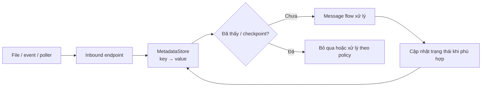
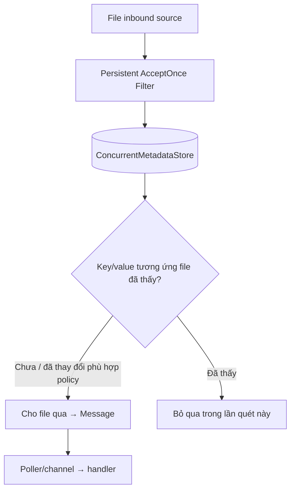
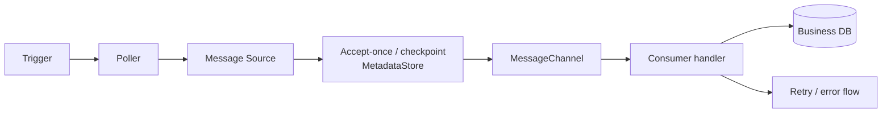

# MetadataStore và trạng thái nhỏ cần tồn tại trong Spring Integration

## 1. Vì sao message flow cần ghi nhớ một lượng trạng thái nhỏ?

Giả sử một file inbound adapter quét thư mục `/data/orders` mỗi phút. Nó đã xử lý `orders-42.csv`, nhưng ứng dụng khởi động lại giữa ca vận hành. Nếu bộ lọc chỉ nhớ những file đã thấy bằng một `Set` trong bộ nhớ, sau restart ứng dụng có thể nhận lại chính file đó và tạo đơn hàng trùng. Tương tự, một message consumer phải nhớ `eventId` đã xử lý, hoặc một nguồn dữ liệu cần nhớ **checkpoint** để tiếp tục từ vị trí gần nhất.

Trong **Spring Integration Runtime**, `MetadataStore` là abstraction lưu các cặp **`String key → String value`** để phục vụ chính những yêu cầu ấy. Nó đặc biệt phù hợp với dữ liệu điều khiển nhỏ: marker file đã thấy, checkpoint nguồn, giá trị phiên bản, ID sự kiện đã ghi nhận hoặc thuộc tính phối hợp giữa các lần chạy. Khi chọn implementation bền vững, trạng thái có thể sống qua việc dừng/chạy lại endpoint hoặc restart JVM.

Mục tiêu bài học:

1. Hiểu hợp đồng `MetadataStore` và `ConcurrentMetadataStore`, các thao tác `get`, `put`, `remove`, `putIfAbsent` và `replace`.
2. Chọn đúng store cho trạng thái trong memory, file properties, JDBC hoặc backend chia sẻ.
3. Ứng dụng metadata store cho persistent accept-once filter, checkpoint và idempotent receiver.
4. Phân tích chính xác giới hạn transaction, threading, retry, redelivery và crash window.
5. Thiết kế key, namespace, cleanup, concurrency, monitoring và quy trình khắc phục sự cố.

Bài thuộc chương **Metadata store** của module `SPRING_INTEGRATION_RUNTIME`. Các phần về channel, endpoint, consumer, poller, executor, lỗi và correlation được dùng để giải thích **khi nào** trạng thái được đọc/ghi và **điều gì xảy ra nếu xử lý ngắt quãng**.

## 2. MetadataStore là gì và không phải gì?

### 2.1. Hợp đồng dữ liệu

Interface `org.springframework.integration.metadata.MetadataStore` có ba thao tác cơ bản:

```java
public interface MetadataStore {
    String get(String key);
    void put(String key, String value);
    String remove(String key);
}
```

- `get(key)` trả giá trị kiểu `String` hoặc `null` nếu key chưa có.
- `put(key, value)` ghi hoặc cập nhật một giá trị; đây **không phải** thao tác chỉ-ghi-nếu-vắng-mặt.
- `remove(key)` xóa key và trả giá trị cũ, nếu có.

Store lưu **metadata dạng chuỗi**, không mặc định lưu toàn bộ `Message<?>`, nhóm message, Java object hoặc bản sao transaction. Nó cũng không đồng nghĩa với cache có TTL tự động. Giới hạn kích thước, độ bền, tính nhất quán và tốc độ phụ thuộc implementation/backend.



Sơ đồ chỉ là logic minh họa. **Thời điểm ghi marker** phụ thuộc từng component. Không suy ra mọi adapter luôn ghi marker *sau* khi handler nghiệp vụ thành công.

### 2.2. Phân biệt ba abstraction thường gặp

| Abstraction | Dữ liệu lưu | Dùng khi |
| --- | --- | --- |
| `MetadataStore` | Các cặp chuỗi key/value nhỏ | Remember-once, checkpoint, processing marker, trạng thái kỹ thuật. |
| `MessageStore` | `Message<?>` và payload/headers theo message ID | Claim check hoặc nhu cầu giữ bản thân message. |
| `MessageGroupStore` | Các message theo correlation group và metadata nhóm | Aggregator, resequencer, trạng thái release/complete. |

Ví dụ: `"source:sftp:lastSeen" → "2026-11-22T01:00:00Z"` là dữ liệu metadata hợp lý. Một tập 5.000 message cần chờ đủ sequence để tổng hợp nên nằm trong `MessageGroupStore`; toàn bộ đơn hàng JSON có kích thước nhiều MB cũng không phải nội dung phù hợp của một entry metadata.

### 2.3. MetadataStore không phải cơ chế exactly-once

Một marker `"event:E-123" → "processed"` chỉ mô tả điều ứng dụng **tin** là đã xảy ra. Nếu ghi marker và cập nhật database nghiệp vụ không cùng atomic transaction, mất điện ở giữa hai thao tác có thể khiến marker và kết quả thật lệch nhau.

Vì thế `MetadataStore` hỗ trợ **nhớ trạng thái và phối hợp**, nhưng không tự cấp các bảo đảm exactly-once, atomic commit đa hệ thống hoặc rollback broker acknowledgment.

## 3. ConcurrentMetadataStore: cập nhật an toàn khi nhiều consumer chạy song song

Trong runtime có nhiều thread, executor, poller hoặc nhiều instance, hai consumer có thể đọc cùng một key gần như đồng thời:

```text
Consumer A: get("event:E-123") -> null
Consumer B: get("event:E-123") -> null
Consumer A: thực hiện side effect
Consumer B: cũng thực hiện side effect
Consumer A: put("event:E-123", "done")
Consumer B: put("event:E-123", "done")
```

Đoạn `get()` rồi `put()` riêng rẽ **không nguyên tử**. `ConcurrentMetadataStore` mở rộng `MetadataStore` với các thao tác có điều kiện:

```java
public interface ConcurrentMetadataStore extends MetadataStore {
    String putIfAbsent(String key, String value);
    boolean replace(String key, String oldValue, String newValue);
}
```

| Thao tác | Ý nghĩa | Dùng cho |
| --- | --- | --- |
| `putIfAbsent(key, value)` | Chỉ ghi khi key chưa tồn tại; trả `null` nếu ghi mới, ngược lại trả giá trị đã có | Claim/đánh dấu đã thấy mà tránh race trong cùng phạm vi atomic của store. |
| `replace(key, oldValue, newValue)` | Chỉ đổi nếu giá trị hiện tại đúng `oldValue`; trả `boolean` | Compare-and-set để chống ghi đè trạng thái vừa bị consumer khác cập nhật. |
| `remove(key)` | Xóa entry theo key | Cần thiết kế ownership vì xóa không có điều kiện theo giá trị trong interface cơ bản. |

**Lưu ý quan trọng:** Atomicity chỉ có ý nghĩa trong **phạm vi chia sẻ của implementation**. Một `SimpleMetadataStore` dùng `ConcurrentHashMap` có thể điều phối thread trong **một JVM**, nhưng hai replica mỗi replica có một instance store riêng vẫn có thể cùng claim event. Dùng backend chung hỗ trợ CAS/locking thích hợp khi nhiều JVM cùng xử lý nguồn dữ liệu.

### 3.1. Ví dụ Java nhỏ: key và compare-and-set

```java
import org.springframework.integration.metadata.ConcurrentMetadataStore;
import org.springframework.integration.metadata.SimpleMetadataStore;

public class MetadataStoreDemo {
    public static void main(String[] args) {
        // Demo trong cùng một JVM; trạng thái mất khi restart.
        ConcurrentMetadataStore store = new SimpleMetadataStore();

        String key = "orders-source:checkpoint";
        store.put(key, "offset-100");

        String previous = store.get(key);
        boolean advanced = store.replace(key, previous, "offset-101");

        System.out.println(advanced);       // true nếu không ai đổi key
        System.out.println(store.get(key));  // offset-101

        String eventKey = "orders:event:E-123";
        String first = store.putIfAbsent(eventKey, "claimed");
        String second = store.putIfAbsent(eventKey, "claimed");

        System.out.println(first == null);      // true: claim đầu
        System.out.println(second);              // claimed: claim lặp
        System.out.println(store.replace(
                eventKey, "claimed", "completed")); // true
    }
}
```

Ở ví dụ, `SimpleMetadataStore` hỗ trợ các thao tác concurrent theo contract tại JVM hiện tại. Việc trả về `true` từ `replace` là bằng chứng về **giá trị metadata**, không chứng minh dữ liệu nghiệp vụ bên ngoài đã commit thành công.

Nếu cần chuyển một checkpoint từ `offset-100` lên `offset-101` trong nhiều worker, hãy dùng vòng lặp optimistic concurrency khi `replace` thất bại, đồng thời kiểm tra luật ordering và source partition. Không tự động chuyển xuống offset cũ hơn hoặc “thắng” bằng cách gọi `put` vô điều kiện.

## 4. Chọn implementation phù hợp vòng đời runtime

| Implementation | Nơi lưu | Ưu điểm | Giới hạn cần quản lý |
| --- | --- | --- | --- |
| `SimpleMetadataStore` | Memory trong một JVM | Nhẹ, dễ kiểm thử, không cần hạ tầng ngoài | Mất khi restart; không chia sẻ giữa replicas. |
| `PropertiesPersistingMetadataStore` | Java properties/file | Có thể giữ key/value trên đĩa | Cần hiểu cơ chế `flush`, filesystem và concurrent write; không mặc định an toàn multi-node. |
| `JdbcMetadataStore` | Database quan hệ | Durability, có thể dùng chung DB và transaction manager thích hợp | Cần schema, connection, transaction, contention và quản lý region. |
| `RedisMetadataStore` | Redis | Truy cập nhanh từ nhiều instance với backend chung | Phụ thuộc tính bền vững, failover và policy eviction/persistence của Redis. |
| Các implementation khác được hỗ trợ ở phiên bản sử dụng | Backend cụ thể | Có thể đồng bộ với hạ tầng sẵn có | Phải kiểm tra hợp đồng atomic CAS, persistence và cleanup. |

Không nên mô tả store bằng một nhãn duy nhất như “persistent” rồi bỏ qua cấu hình. Ví dụ Redis có thể cấu hình eviction hoặc mất dữ liệu chưa được persist trong một số tình huống; file properties có thể chưa flush; JDBC có thể commit tách khỏi transaction cập nhật đơn hàng.

### 4.1. Khi nào dùng store nào?

- **Unit test/demo:** `SimpleMetadataStore` để tập trung kiểm tra key/logic.
- **Ứng dụng một instance, trạng thái nhỏ, không cần ghi nhiều:** file properties có thể đủ, nếu bảo đảm flush và backup.
- **Nhiều replicas, trạng thái cần bền vững và đang dùng JDBC:** `JdbcMetadataStore` là lựa chọn thường gặp, đặc biệt khi cần phối hợp với dữ liệu nghiệp vụ trong DB.
- **Hạ tầng chia sẻ tập trung vào low latency:** Redis có thể phù hợp, nhưng phải xác minh durability và consistency theo yêu cầu.

### 4.2. Phân biệt persistence với transactional atomicity

**Persistence** nghĩa là entry sống qua restart theo cấu hình backend. **Transactional atomicity** nghĩa là update metadata và một thao tác khác cùng commit hoặc rollback như một đơn vị.

Ví dụ `JdbcMetadataStore` và bảng nghiệp vụ cùng dùng `DataSourceTransactionManager`, cùng resource và transaction boundary phù hợp thì có thể commit cùng nhau. Nếu metadata ở Redis còn nghiệp vụ ở PostgreSQL, hai cập nhật đó không tự thành một transaction. Đừng giả định Spring tự cung cấp XA/distributed transaction khi bạn truyền hai store khác nhau cho hai component.

## 5. Ví dụ JDBC: lưu checkpoint bền vững

`JdbcMetadataStore` là lựa chọn phù hợp khi cần key/value qua restart, nhiều consumer dùng chung dữ liệu và backend JDBC đã được vận hành.

**Cấu hình Java:**

```java
import javax.sql.DataSource;
import org.springframework.context.annotation.Bean;
import org.springframework.context.annotation.Configuration;
import org.springframework.integration.jdbc.metadata.JdbcMetadataStore;
import org.springframework.integration.metadata.ConcurrentMetadataStore;

@Configuration
public class MetadataConfiguration {
    @Bean
    public ConcurrentMetadataStore ordersMetadataStore(DataSource dataSource) {
        JdbcMetadataStore store = new JdbcMetadataStore(dataSource);
        store.setRegion("orders-ingest");
        return store;
    }
}
```

Đoạn trên giả định database đã được tạo schema bảng `INT_METADATA_STORE` (hoặc prefix/schema tùy cấu hình) theo script đúng phiên bản Spring Integration. `setRegion(...)` cho phép phân vùng logic giữa những tính năng cùng dùng một store backend; các key trong từng region vẫn cần đặt tên rõ ràng. Tạo bean không tự tạo bảng database cho bạn.

**Dùng checkpoint để tiếp tục poll sau restart:**

```java
import org.springframework.integration.metadata.ConcurrentMetadataStore;

public final class CursorRepository {
    private static final String KEY = "orders-feed:last-committed-offset";
    private final ConcurrentMetadataStore metadataStore;

    public CursorRepository(ConcurrentMetadataStore metadataStore) {
        this.metadataStore = metadataStore;
    }

    public String lastCommittedOffset() {
        return metadataStore.get(KEY); // null nếu chưa có checkpoint
    }

    public void saveCheckpoint(String offset) {
        metadataStore.put(KEY, offset);
    }
}
```

Đây là API lưu trạng thái, **không phải** giải pháp tự động đồng bộ offset với broker. `saveCheckpoint` chỉ được gọi vào đúng thời điểm ứng dụng quyết định đã xử lý thành công các phần trước offset đó; với nhiều consumer, cần thêm logic kiểm tra tính tăng dần và CAS để không ghi checkpoint lùi.

### 5.1. Checkpoint phải mang ngữ nghĩa rõ ràng

| Thiết kế key/value | Vấn đề |
| --- | --- |
| `"orders:lastOffset" → "1042"` | Nếu nguồn có nhiều partition, một offset tổng không đủ đại diện mọi partition. |
| `"orders:partition-2:lastOffset" → "1042"` | Có thể dùng khi mỗi partition có checkpoint độc lập; cần thống nhất commit semantics. |
| `"orders:lastSeenTime" → "2026-11-22T01:00:00Z"` | Timestamp trùng nhau có thể khiến bỏ sót bản ghi nếu không có tie-breaker. |
| `"orders:lastId" → "E-123"` | Phải biết nguồn đảm bảo order/uniqueness theo ID hay không. |

Một cursor tốt phải mô tả **tiến độ đã hoàn tất**, không chỉ message mới nhất đã nhìn thấy. Khi đọc theo timestamp, thường cần kết hợp timestamp và unique source ID để xử lý các event cùng thời điểm, hoặc dùng watermark với khoảng trùng và idempotency.

## 6. Persistent accept-once: nhớ file đã từng được nhận

Đây là một ứng dụng điển hình của metadata store trong file polling. Bộ lọc dạng *persistent accept-once* ghi metadata của file đã qua bộ lọc, để lần quét tiếp theo và lần khởi động lại có thể tránh nhận lặp theo đặc tính filename/modified time của filter.

### 6.1. Luồng xử lý



Ví dụ bean để kết nối filter với store:

```java
import org.springframework.context.annotation.Bean;
import org.springframework.context.annotation.Configuration;
import org.springframework.integration.file.filters.FileSystemPersistentAcceptOnceFileListFilter;
import org.springframework.integration.metadata.ConcurrentMetadataStore;

@Configuration
public class FileFilterConfiguration {
    @Bean
    public FileSystemPersistentAcceptOnceFileListFilter ordersFileFilter(
            ConcurrentMetadataStore ordersMetadataStore) {
        // Prefix giúp phân biệt nguồn/file filter trong store dùng chung.
        return new FileSystemPersistentAcceptOnceFileListFilter(
                ordersMetadataStore, "local-orders:");
    }
}
```

Sau đó gắn `ordersFileFilter` vào file inbound adapter/flow theo cơ chế cấu hình của adapter đang dùng. Tên bean filter không tự động khiến mọi poller dùng filter đó.

### 6.2. “Đã thấy” khác “nghiệp vụ đã commit”

Persistent accept-once filter có thể ghi marker **khi chấp nhận file để phát message**, trước khi consumer downstream cập nhật database. Nếu handler sau đó thất bại, marker vẫn có thể tồn tại. Khi ấy, dù database chưa ghi đơn, lần poll tiếp theo có thể bỏ qua file do filter cho rằng nó đã được nhận.

Để xử lý đúng, phải xác định chính sách recovery:

1. Có cơ chế rollback/loại marker khỏi filter khi lỗi hay không?
2. Có đưa file tới thư mục lỗi, gửi lại bằng adapter riêng hoặc tạo một bản ghi cần retry hay không?
3. Có cần xử lý file theo **idempotent business key** dù filter có thể phát lại?
4. Store có thực sự flush/commit marker trước restart hay không?

**Không tuyên bố accept-once filter tự bảo đảm exactly-once nghiệp vụ.** Nó giúp hạn chế nhận file trùng trong phạm vi key/value của filter. Việc xử lý thành công, transaction, retry và lưu trữ dữ liệu vẫn thuộc responsibility của flow.

### 6.3. Tên file, mtime và key

Các filter persistent thường dùng tổ hợp đường dẫn/tên file và thời gian sửa cuối (`lastModified`) để nhận diện phiên bản file. Điều này hữu ích khi file được cập nhật và cần nhận lại, nhưng vẫn có rủi ro timestamp granularity, đổi đường dẫn, copy/rename, thao tác ghi file chưa hoàn tất và clock của nguồn.

Một pipeline file vững vàng có thể kết hợp:

- Bộ lọc temporary/ready-file (ví dụ chỉ nhận file đã được rename từ tên tạm).
- Persistent accept-once filter và prefix/region duy nhất theo nguồn.
- Kiểm soát transaction hoặc recovery marker khi handler thất bại.
- Business idempotency để tránh tạo đơn trùng dù file được nhận lại.

Với SFTP/FTP, phải chọn bộ lọc persistent tương ứng remote file metadata; không dùng bộ lọc `FileSystem...` cho đối tượng file phía máy chủ từ xa.

## 7. MetadataStore trong idempotent receiver

Một consumer xử lý sự kiện `OrderCreated` thường cần quy tắc: **mỗi business event chỉ tạo ra một thay đổi nghiệp vụ**, ngay cả khi nguồn gửi lại message do lỗi mạng, timeout hoặc broker redelivery. Spring Integration hỗ trợ *idempotent receiver* thông qua `IdempotentReceiverInterceptor` và chiến lược lựa chọn như `MetadataStoreSelector`.

### 7.1. Chọn khóa chống trùng

```text
Message #1: eventId=E-123, orderId=SO-42, deliveryAttempt=1
Message #2: eventId=E-123, orderId=SO-42, deliveryAttempt=2

MetadataStore:
  orders:processed:E-123 -> value tùy strategy
```

Hai delivery có thể khác `MessageHeaders.ID` và timestamp, nhưng cùng **business event ID**. Vì vậy khóa xử lý trùng cần dựa vào contract ổn định, ví dụ `eventId`, `sourceId` và `partitionId`; không mặc định dùng message ID kỹ thuật vừa được tạo ở lần delivery hiện tại.

### 7.2. Ví dụ khai báo interceptor

```java
import org.springframework.context.annotation.Bean;
import org.springframework.context.annotation.Configuration;
import org.springframework.integration.handler.advice.IdempotentReceiverInterceptor;
import org.springframework.integration.metadata.ConcurrentMetadataStore;
import org.springframework.integration.selector.MetadataStoreSelector;
import org.springframework.messaging.Message;

@Configuration
public class IdempotentConfiguration {
    @Bean
    public IdempotentReceiverInterceptor orderIdempotentAdvice(
            ConcurrentMetadataStore ordersMetadataStore) {

        MetadataStoreSelector selector = new MetadataStoreSelector(
                ordersMetadataStore,
                (Message<?> message) -> {
                    Object eventId = message.getHeaders().get("eventId");
                    if (eventId == null) {
                        throw new IllegalArgumentException("Missing eventId");
                    }
                    return "orders:event:" + eventId;
                });

        return new IdempotentReceiverInterceptor(selector);
    }
}
```

Sau khi định nghĩa, advice cần **được gắn vào endpoint/handler** tương ứng trong IntegrationFlow hoặc annotation configuration. Chỉ khai báo bean chưa làm mọi consumer tự bật idempotency.

Các điểm cần kiểm tra khi dùng interceptor:

- Selector quyết định message **có được đánh dấu là duplicate** hay không.
- Hành vi với duplicate còn phụ thuộc interceptor/configuration: một số flow gắn marker duplicate rồi cho message đi tiếp để consumer quyết định, một số chọn discard. Vì vậy đừng coi “đã kiểm tra idempotent” đồng nghĩa luôn **chặn** message.
- Cấu hình rollback metadata khi downstream handler ném lỗi ảnh hưởng việc message có được nhận lại ở lần retry sau không. Cần thử nghiệm riêng success, handler failure và lỗi xảy ra ở nhánh async.
- MetadataStore ghi một marker không đồng nghĩa tất cả side effect nghiệp vụ đã hoàn thành. Khi thao tác payment/database nằm ở backend khác, cần thêm transaction/idempotency ở backend nghiệp vụ.

### 7.3. Rủi ro khi “claim trước” và “ghi marker sau”

| Thời điểm ghi metadata | Nếu JVM crash giữa chừng | Hệ quả |
| --- | --- | --- |
| **Trước** khi chạy side effect | Marker đã ghi, nghiệp vụ chưa làm | Delivery sau có thể bị nhận nhầm là duplicate; mất việc. |
| **Sau** khi chạy side effect | Nghiệp vụ thành công, marker chưa ghi | Delivery sau có thể chạy lại side effect; xử lý trùng. |
| Cùng transaction DB với business update | Nếu hai thao tác thật sự cùng local DB transaction | Có thể commit/rollback cùng nhau, giảm crash window trong DB đó. |
| Marker ở Redis, side effect ở dịch vụ thanh toán | Không có transaction chung theo mặc định | Cần idempotency key của bên thanh toán, recovery và reconciliation. |

`ConcurrentMetadataStore.putIfAbsent` chỉ giải quyết **race giữa các consumer đang claim cùng key** ở phạm vi store. Nó không tự giải quyết crash window và không tạo atomicity giữa Redis/JDBC và dịch vụ ngoài.

## 8. Thiết kế khóa và giá trị metadata

Key không phải chi tiết nhỏ: key sai làm **false duplicate** (bỏ qua việc cần làm) hoặc **missed duplicate** (lặp lại việc đã làm).

### 8.1. Namespace phải đại diện đúng nguồn và mục đích

| Mẫu key | Ý nghĩa | Nhận xét |
| --- | --- | --- |
| `orders:file:/data/orders/a.csv` | Marker file ở một adapter cụ thể | Phải thống nhất chuẩn hóa path/case/rename policy. |
| `orders:event:warehouse-7:E-123` | Business event theo source ID | Tránh trùng ID giữa những upstream độc lập. |
| `feed:orders:partition-2:cursor` | Checkpoint theo partition | Tránh ghi đè offset của partition khác. |
| `payments:request:E-123` | Marker theo operation thanh toán | Không nên dùng chung namespace với marker nhận file. |
| `tenant:42:source:sftp:lastSeen` | Phân vùng logical tenant/source | Tenant ID trong key không thay thế xác thực/quyền truy cập. |

Với `JdbcMetadataStore` có `region`, nên dùng cả **region theo chức năng** và **key dễ truy vết**. Hai ứng dụng chia sẻ một database nhưng không thống nhất region/key có thể ghi đè marker của nhau.

### 8.2. Chuẩn hóa kiểu và độ dài

Vì key/value đều là `String`:

- Đặt format được xác định như ISO-8601 UTC, integer dạng decimal, version có thứ tự hoặc ID cố định.
- Khi cập nhật offset, tránh so sánh lexicographic giữa `"9"` và `"10"`; cần parse số theo contract.
- Đừng phụ thuộc `toString()` của một Java object có thể thay đổi khi nâng cấp version.
- Không lưu payload dài, object serialize, raw access token hoặc thông tin cá nhân trực tiếp vào key/value nếu không cần.
- Kiểm tra độ dài cột JDBC/giới hạn backend, character encoding và cách escape delimiter.

### 8.3. Retention, TTL và cleanup

MetadataStore cơ bản **không định nghĩa TTL chung** cho mọi implementation. Nếu muốn giữ event marker 90 ngày, cần cơ chế cleanup của backend hoặc job ứng dụng tương ứng. Việc xóa marker làm event cũ **có thể được nhận lại**; retention phải ít nhất tương ứng với khoảng tối đa mà upstream có thể redeliver hoặc replay, cộng chính sách reconciliation.

Ví dụ khi một nguồn có khả năng phát lại event sau nhiều tháng, TTL 7 ngày cho idempotency marker thường chưa đủ. Ngược lại, lưu mỗi event ID vô thời hạn làm tăng dung lượng store và chi phí index/query.

### 8.4. Ownership và stale claim

Một pattern `putIfAbsent(key, "claimed")` có thể khiến entry “claimed” tồn tại mãi nếu worker crash. Để cho phép takeover, cần thiết kế **lease/expiry với owner token**, thời điểm hết hạn và thao tác atomic tương ứng của backend. Không thể giải quyết race an toàn bằng:

```java
// KHÔNG AN TOÀN trên nhiều worker: người khác có thể đã claim lại
// giữa get() và remove().
if ("claimed".equals(store.get(eventKey))) {
    store.remove(eventKey);
}
```

Vì interface cơ bản không có compare-and-delete, nếu cần thu hồi claim theo owner hoặc TTL thật sự, phải dùng chức năng backend/transaction hoặc workflow chuyên biệt. Tránh ghi nhận “completed” trước khi side effect thực sự hoàn tất và tránh xóa marker của worker khác.

## 9. Metadata store trong poller, transaction và retry

`MetadataStore` hoạt động ở nơi component gọi API. Nó **không mở thread, không tự mở transaction và không tự phát lại message**. Tác dụng thực tế phụ thuộc vị trí ghi/read trong flow.



### 9.1. Threading và transaction boundary

| Thành phần | Cách thực thi thường gặp | Điều cần nhớ về metadata |
| --- | --- | --- |
| `DirectChannel` | Handler chạy trên thread sender | Có thể tham gia transaction upstream nếu cùng transaction manager và propagation phù hợp. |
| `ExecutorChannel` | Consumer chạy trên worker thread | Transaction gắn với thread upstream không tự truyền; marker ghi ở producer có thể đã commit trước khi worker xử lý. |
| `QueueChannel` + poller | Poller lấy message khi đến lịch | Nếu filter/marker nằm trước queue, nhận message thành công chưa có nghĩa handler sau poller thành công. |
| Transactional poller | Advice có thể bao quanh `receive()` và đoạn xử lý đồng bộ | Chỉ rollback marker nếu backend metadata thực sự tham gia cùng transaction phù hợp. |
| JMS/Kafka inbound adapter | Ack/offset theo container/transport | MetadataStore không tự rollback ack/offset broker. |

Ví dụ:

```text
File poller
  → filter ghi key "file:A"
  → ExecutorChannel (handoff thành công)
  → worker gọi saveOrder() và thất bại
```

Worker thất bại **sau** handoff không khiến metadata đã ghi từ poller tự rollback. Nếu cần bảo đảm message không mất, hãy chọn kiến trúc có durable queue/outbox, recovery của filter hoặc protocol delivery riêng; đồng thời dùng business idempotency.

### 9.2. Retry advice và điều kiện rollback marker

Nếu một handler được bọc bởi `RequestHandlerRetryAdvice`, nó có thể gọi lại handler khi ném exception. Tuy nhiên:

- Retry handler **không mặc định gọi lại** inbound accept-once filter hoặc thao tác poller nhận file.
- Nếu metadata store ghi marker khi nhận file, retry handler chỉ lặp lại phần downstream; marker không nhất thiết được sửa.
- Nếu marker JDBC và business update cùng dùng một transaction mở bao ngoài, rollback có thể hoàn tác marker. Nếu retry xảy ra **bên trong transaction đã rollback-only**, attempt tiếp có thể không commit được.
- Một `ErrorMessageSendingRecoverer` gửi ErrorMessage sau retry cạn không tự đảm bảo metadata đã rollback hoặc file đã sẵn sàng xử lý lại.

Với nghiệp vụ cần tính nhất quán cao, mô hình retry bao ngoài **từng transaction mới** thường phù hợp cho lỗi DB tạm thời; phải kiểm tra propagation và phạm vi advice, đặc biệt khi poller đã mở transaction.

### 9.3. Checkpoint tại thời điểm nào?

Ví dụ một polling consumer đọc các event theo offset:

```text
read offset=1042
  → xử lý event
  → commit database nghiệp vụ
  → ghi checkpoint offset=1042
```

Trong thiết kế dùng hai backend khác nhau, crash **sau DB commit nhưng trước checkpoint** khiến event 1042 có thể xử lý lại. Đây là điểm chấp nhận được nếu consumer idempotent. Ngược lại, nếu checkpoint được ghi **trước** business commit, crash có thể khiến event 1042 bị bỏ qua dù chưa xử lý.

Trong local JDBC transaction đúng cách:

```text
BEGIN TX
  INSERT processed_events(event_id)
  UPDATE orders
  UPDATE INT_METADATA_STORE (checkpoint)
COMMIT TX
```

Cả ba tác vụ có thể commit cùng nhau **nếu** chúng dùng cùng database/resource và transaction manager thực sự chi phối các thao tác. Khi broker ack nằm ngoài transaction đó, vẫn cần policy redelivery/idempotency.

## 10. Correlation và vai trò của metadata nhỏ

`correlationId` trong message headers giúp nối các message thuộc cùng một nghiệp vụ. Bạn có thể lưu metadata bổ sung theo key dựa trên correlation ID, ví dụ:

```text
flow:checkout:SO-42:lastNotificationState → SENT
flow:checkout:SO-42:version                → 5
flow:checkout:SO-42:lastActivity            → 2026-11-22T01:00:00Z
```

Nhưng `MetadataStore` **không phải aggregator**: nó không có release strategy, không tự giữ một tập `Message<?>` theo group và không quyết định số phần đã đến đủ. Với use case “gộp 5 thông điệp” hoặc “resequencer nhớ phần đã release”, dùng `MessageGroupStore`/endpoint tương ứng.

Nếu tạo hàng trăm key cho mỗi correlation group, cần cân nhắc rằng dữ liệu đã vượt qua khái niệm “trạng thái nhỏ”. Khi ấy một record database domain hoặc group store có thể dễ quản lý consistency, retention và query hơn.

## 11. Quan sát, bảo mật và hiệu năng

### 11.1. Những metric hữu ích

| Tín hiệu | Dấu hiệu cần quan tâm |
| --- | --- |
| Số entry theo region/namespace | Key tăng mãi do thiếu retention hoặc thay đổi format key. |
| Tỷ lệ accept/duplicate | Duplicate tăng do broker redelivery, retry, file rename hoặc lỗi mapping. |
| Độ trễ `get`/`putIfAbsent`/`replace` | DB/Redis quá tải khiến poller throughput giảm. |
| Số lần CAS conflict | Nhiều consumer tranh chấp cùng checkpoint hoặc hot key. |
| Tuổi checkpoint và source lag | Poller vẫn chạy nhưng trạng thái tiến độ không cập nhật. |
| Số stale claimed entries | Worker crash và không có cơ chế cleanup/takeover hợp lệ. |
| Tỷ lệ lỗi flush/commit | Marker có thể chưa bền vững dù code gọi `put` xong. |
| Retry và dead-letter count | Luồng error/recovery đang ảnh hưởng trạng thái metadata. |

Đừng nhầm metric của store với metric nghiệp vụ: “marker đã ghi” và “đơn hàng đã commit” cần được đo riêng. Trong production, thêm `eventId`/`traceId` và tên endpoint khi log, nhưng tránh in toàn bộ key nếu key chứa PII.

### 11.2. Hiệu năng

- Poller tần suất cao cùng cập nhật một key sẽ tạo contention; phân vùng key theo source/partition nếu contract cho phép.
- JDBC store phụ thuộc index, connection pool, transaction timeout và tần suất commit.
- File properties cần flush đúng thời điểm; flush mỗi event có thể tốn I/O, flush quá thưa tăng cửa sổ mất marker khi crash.
- Redis phụ thuộc network latency, persistence/eviction policy và size/key cardinality.
- Không dùng một key duy nhất làm checkpoint toàn cầu nếu nhiều partition có tiến độ độc lập.
- Khi nhiều replica cùng truy cập store, kiểm thử failover và contention thay vì chỉ thử một instance.

### 11.3. Quyền tin cậy và dữ liệu nhạy cảm

Metadata nhỏ vẫn có thể tiết lộ tên file, customer ID, tenant, trạng thái thanh toán hoặc lịch xử lý. Nên:

1. Không lưu token, password, raw authorization header, số thẻ hoặc dữ liệu nhạy cảm không cần thiết.
2. Hash hoặc chuẩn hóa key khi cần, nhưng vẫn đảm bảo collision resistance và khả năng gỡ lỗi.
3. Hạn chế quyền truy cập backend, bảo vệ backup và log.
4. Không tin header `eventId` từ nguồn ngoài như bằng chứng đã xác thực; validate và namespace theo source/tenant được xác minh.
5. Thiết kế retention phù hợp nghiệp vụ và giới hạn lưu trữ.

## 12. Bảng chẩn đoán lỗi thường gặp

| Triệu chứng | Nguyên nhân khả dĩ | Cách kiểm tra |
| --- | --- | --- |
| File bị xử lý lại sau restart | `SimpleMetadataStore`, properties chưa flush, không dùng persistent filter, key format đổi | Kiểm tra implementation, marker trong backend và cơ chế persist. |
| File không được xử lý lại dù handler trước thất bại | Accept-once marker đã ghi trước downstream failure | Đối chiếu timeline marker/handler, filter rollback/recovery và trạng thái business. |
| Hai replicas cùng xử lý event | Hai instance store riêng, `get`+`put` race, backend CAS không atomic | Kiểm tra shared store, `putIfAbsent`, transaction và concurrency. |
| Event đã commit nhưng bị xử lý lại | Checkpoint chưa commit, broker redelivery, key retention quá ngắn | Xác định commit order và idempotency key. |
| Checkpoint nhảy lùi | Workers update không có CAS/ordering theo partition | Parse offset, dùng compare-and-set và phân vùng key. |
| Poller dừng tiến độ dù vẫn chạy | Stale claim, lock contention, store connection lỗi | Kiểm tra age của marker, error channel, connection và health backend. |
| `JdbcMetadataStore` báo lỗi SQL | Thiếu schema/bảng, sai region/prefix, quyền DB, transaction conflict | Kiểm tra schema đúng phiên bản, index, exception và connection. |
| Redis mất marker | Eviction hoặc durability/failover không đáp ứng yêu cầu | Kiểm tra policy eviction, persistence, replication/failover. |
| Properties store mất cập nhật | Chưa flush, crash trước flush, nhiều processes cùng ghi file | Kiểm tra flush lifecycle và giới hạn multi-process. |
| Retry chạy mãi với event cũ | Marker rollback trước mọi retry hoặc upstream liên tục redeliver poison message | Giới hạn retry, DLQ, stable event ID, policy error/recovery. |
| Metadata tăng không giới hạn | Chưa cleanup, TTL không có, key tạo theo mỗi delivery ID | Thiết kế namespace, retention và kiểm soát cardinality. |
| Transaction DB rollback nhưng marker vẫn còn | Marker lưu ở backend khác hoặc nằm ngoài transaction boundary | Xác minh resource, transaction manager, threading và propagation. |

Quy trình điều tra:

1. Xác định **component** nào đọc/ghi store: inbound filter, idempotent receiver, custom handler hay checkpoint service.
2. Ghi lại **key chính xác, region, value, nơi lưu** và timestamp trước/sau thao tác.
3. Xác định **thread và transaction boundary**: poller, `DirectChannel`, `ExecutorChannel` hay broker listener.
4. Đối chiếu **business commit, marker commit, source ack**; không kết luận từ một log `put` đơn lẻ.
5. Kiểm tra **retry/redelivery** và exception trên `errorChannel`, gồm thời điểm crash có thể xảy ra.
6. Kiểm tra **CAS/conflicts, flush/persistence, cleanup/TTL, schema/backend health**.
7. Sửa contract và chạy thử lại theo tình huống restart, race, timeout, duplicate và failure injection.

## 13. Bài tập thực hành

### Bài A — Nhớ trạng thái đơn giản

1. Chạy `MetadataStoreDemo` với `SimpleMetadataStore`, ghi marker/checkpoint.
2. Tạo hai thread cùng gọi `putIfAbsent("event:E-123", "claimed")` và đếm số thread nhận `null`. Với một shared store nguyên tử, chỉ một thread claim thành công.
3. Chuyển sang hai process độc lập, mỗi process có `SimpleMetadataStore`, quan sát vì sao điều kiện chống trùng không còn hiệu lực giữa hai JVM.
4. Thay bằng một shared persistent `ConcurrentMetadataStore` và lặp lại concurrency test.

### Bài B — Restart với file inbound

1. Tạo một file `orders.csv` ở thư mục inbound, cấu hình persistent accept-once filter dùng một shared store có độ bền phù hợp.
2. Poll hai lần, xác minh file chỉ được chấp nhận theo policy hiện tại.
3. Restart ứng dụng, poll lại và quan sát marker còn giữ không.
4. Giả lập lỗi downstream ngay sau khi file được chấp nhận, kiểm tra marker và thiết kế recovery rõ ràng.
5. Thay đổi nội dung/modified time của file và kiểm tra điều kiện filter có nhận lại không.

### Bài C — Crash window và checkpoint

1. Mô phỏng đọc event 1042, ghi DB thành công rồi crash trước `saveCheckpoint`. Khởi động lại và quan sát event 1042 được nhận lại.
2. Đặt marker trước khi ghi DB, crash ngay sau marker. Chứng minh cách này có nguy cơ bỏ sót việc.
3. Dùng cùng local JDBC transaction cho business update, processed-event record và metadata checkpoint; gây exception trước commit và xác nhận cả ba rollback.
4. Thêm một side effect HTTP nằm ngoài DB transaction và giải thích vì sao rollback DB không hoàn tác request HTTP.

### Câu hỏi tự đánh giá

1. Khi nào dùng `MetadataStore` thay vì `MessageGroupStore`?
2. Vì sao `get` rồi `put` không bảo vệ hai consumer tranh nhau nhận cùng event?
3. `putIfAbsent` bảo đảm điều gì và **không** bảo đảm điều gì nếu worker crash ngay sau claim?
4. Vì sao `SimpleMetadataStore` không đủ cho hai replicas?
5. Persistent file filter có chứng minh downstream business transaction đã commit thành công không?
6. Vì sao checkpoint phải được tách theo partition khi nguồn có nhiều partition?
7. Khi JDBC store và DB nghiệp vụ dùng hai transaction managers khác nhau, điều gì có thể sai?
8. Vì sao metadata có TTL ngắn hơn thời gian replay tối đa của upstream làm duplicate event nguy hiểm?
9. Transaction của poller có tự động truyền qua `ExecutorChannel` không?
10. Làm cách nào phân biệt lỗi CAS race, thiếu flush và lỗi broker redelivery trong production?

## 14. Tài liệu tham khảo

- [Spring Integration Reference — Metadata Store](https://docs.spring.io/spring-integration/reference/meta-data-store.html)
- [Spring Integration Reference — Message Store](https://docs.spring.io/spring-integration/reference/message-store.html)
- [Spring Integration Reference — File Reading và File Filters](https://docs.spring.io/spring-integration/reference/file/reading.html)
- [Spring Integration Reference — Idempotent Receiver](https://docs.spring.io/spring-integration/reference/handler-advice/idempotent-receiver.html)
- [Spring Integration Reference — Transaction Support](https://docs.spring.io/spring-integration/reference/transactions.html)
- [Spring Integration API — MetadataStore](https://docs.spring.io/spring-integration/api/org/springframework/integration/metadata/MetadataStore.html)
- [Spring Integration API — ConcurrentMetadataStore](https://docs.spring.io/spring-integration/api/org/springframework/integration/metadata/ConcurrentMetadataStore.html)
- [Spring Integration API — JdbcMetadataStore](https://docs.spring.io/spring-integration/api/org/springframework/integration/jdbc/metadata/JdbcMetadataStore.html)
