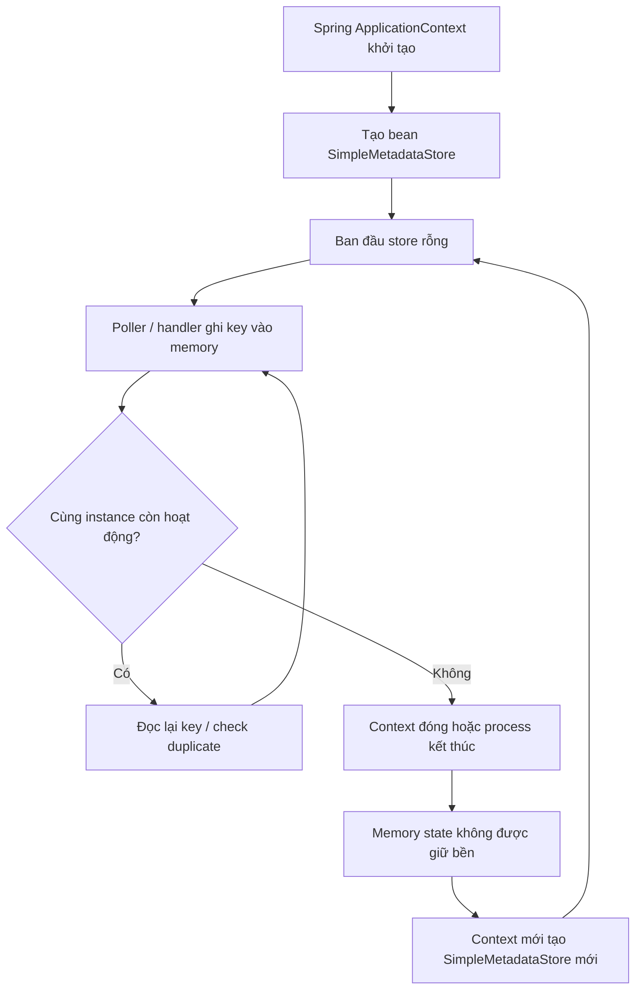
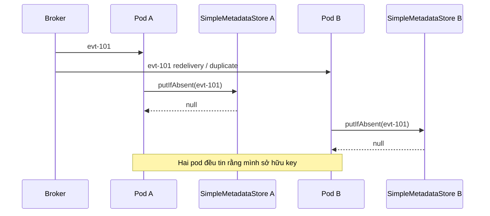
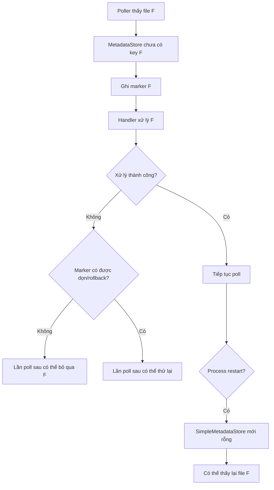

# SimpleMetadataStore và memory lifecycle trong Spring Integration

## 1. Vì sao metadata trong bộ nhớ là một quyết định runtime?

Trong module `SPRING_INTEGRATION_RUNTIME`, Spring Integration chạy và điều phối message qua **channel, endpoint, consumer, poller và executor**. Ngoài payload, runtime còn cần ghi nhớ những thông tin nhỏ để lần xử lý tiếp theo ra quyết định: file đã thấy, offset đã đọc, khóa idempotency, trạng thái kiểm tra trùng hoặc checkpoint của một nguồn dữ liệu.

`SimpleMetadataStore` là một triển khai **lưu metadata trong bộ nhớ tiến trình**. Nó hữu ích vì có ít phụ thuộc, truy cập nhanh và phù hợp để thử nghiệm. Tuy nhiên, một key xuất hiện trong `SimpleMetadataStore` chỉ có ý nghĩa khi ta hiểu **đối tượng store đó sống bao lâu, được bao nhiêu consumer chia sẻ, khi nào dữ liệu bị xóa và điều gì xảy ra khi ứng dụng khởi động lại**.

Ví dụ một service xử lý sự kiện `order-paid-202`:

- Lần đầu handler nhận sự kiện, đánh dấu `orders:v1:order-paid-202` đã thấy rồi thực hiện công việc.
- Cùng message bị phát lại trong cùng JVM, handler phát hiện key và có thể bỏ qua.
- Process bị restart; bean `SimpleMetadataStore` mới không còn key cũ.
- Nguồn gửi lại sự kiện, handler có nguy cơ chạy lần nữa, dù tác dụng nghiệp vụ đã commit từ lần đầu.

**Đó là giới hạn của memory lifecycle**, không phải lỗi của cơ chế retry. Khi yêu cầu cần khôi phục sau restart, phải chọn store bền vững hoặc thiết kế thêm cơ chế idempotency/khôi phục bên ngoài.

### Mục tiêu học tập

Sau bài này, bạn có thể:

1. Giải thích `MetadataStore`, `ConcurrentMetadataStore` và `SimpleMetadataStore`, cùng những thao tác cơ bản.
2. Vẽ được vòng đời từ khởi tạo bean, dùng chung qua nhiều endpoint, cập nhật key, xóa key, đến khi context/process kết thúc.
3. Phân tích rủi ro khi nhiều thread dùng cùng store, nhiều instance dùng store riêng và key tồn tại quá lâu.
4. Thiết kế thử nghiệm minh họa duplicate detection với `putIfAbsent`, `replace` và cleanup khi lỗi.
5. Phân biệt “metadata đã được ghi” với “nghiệp vụ đã commit”, đồng thời chọn thời điểm chuyển sang kho bền vững.
6. Gắn kiến thức này với poller, retry, message store, transaction, correlation và quan sát runtime.

## 2. MetadataStore lưu cái gì?

Trong Spring Integration, **metadata store** là nơi lưu các cặp **key → value** dạng `String` để hỗ trợ quyết định xử lý. Nó không phải kho lưu payload của `Message<?>` và cũng không tự cung cấp message queue.

| Abstraction / thành phần | Nội dung chính | Vai trò |
|---|---|---|
| `MetadataStore` | Key/value metadata | `put`, `get`, `remove` một marker hoặc checkpoint. |
| `ConcurrentMetadataStore` | Metadata với thao tác cạnh tranh nguyên tử | `putIfAbsent` và `replace` theo giá trị cũ; hữu ích khi nhiều thread claim cùng key. |
| `SimpleMetadataStore` | Metadata trong bộ nhớ local JVM | Triển khai đơn giản của `ConcurrentMetadataStore`, không cung cấp persistence qua restart. |
| `MessageStore` / `MessageGroupStore` | Message hoặc group state | Lưu payload, headers, correlation/group state; hợp đồng khác metadata store. |
| `JdbcMetadataStore` hoặc store chia sẻ bền vững khác | Metadata tại database/hệ thống lưu trữ chung | Hướng lựa chọn khi cần duy trì key qua restart hoặc chia sẻ giữa instance. |

**Đừng dùng `SimpleMetadataStore` như thể nó là `SimpleMessageStore`.** Một key `"last-file" → "invoice.csv"` không đồng nghĩa store còn giữ byte của file, cũng không chứa nguyên `Message<?>`. Nếu file gốc bị xóa, metadata không tự phục hồi được payload.

Ví dụ metadata trong một hệ thống:

```text
source:invoices:last-file        -> invoice-2026-11-22.csv
source:orders:last-offset        -> 8842
idempotent:loyalty:v1:evt-202    -> PROCESSED
poller:sync:last-success         -> 2026-11-22T01:00:00Z
```

Các khóa này minh họa cách **ứng dụng** đặt tên và lưu value; Spring Integration không tự tạo ra chúng chỉ vì đã khai báo `SimpleMetadataStore`. Từng adapter/filter hoặc code riêng quyết định ý nghĩa của mỗi cặp key/value.

### API thao tác cơ bản

```java
import org.springframework.integration.metadata.ConcurrentMetadataStore;
import org.springframework.integration.metadata.SimpleMetadataStore;

ConcurrentMetadataStore store = new SimpleMetadataStore();

// Ghi đè giá trị của key.
store.put("source:orders:last-offset", "42");

// Đọc: trả null nếu không có key.
String offset = store.get("source:orders:last-offset"); // "42"

// Chỉ ghi khi key chưa tồn tại; trả về giá trị đã tồn tại nếu có.
String previous = store.putIfAbsent(
        "source:orders:last-offset", "43");             // "42"

// Compare-and-set: chỉ đổi nếu giá trị hiện tại đúng "42".
boolean changed = store.replace(
        "source:orders:last-offset", "42", "43");       // true

// Xóa key; sau đó không còn marker trong store.
String removed = store.remove("source:orders:last-offset"); // "43"
```

Với `putIfAbsent`, khi key chưa tồn tại, kết quả là `null` và key mới được thêm. Nếu key đã tồn tại, phương thức trả giá trị cũ và không thay đổi nó. Với `replace`, chỉ một caller có thể thắng khi nhiều thread cùng cố đổi từ cùng giá trị cũ sang giá trị mới trên một shared instance, theo hợp đồng của thao tác nguyên tử.

`put` và `get` đơn lẻ không tạo ra một transaction nhiều thao tác. Đặc biệt, chuỗi `get(key) == null` rồi `put(key, value)` **không nguyên tử** nếu có nhiều thread.

## 3. Vòng đời bộ nhớ: từ bean creation đến restart

Một `SimpleMetadataStore` thông thường giữ metadata trong cấu trúc map đồng thời của tiến trình. Các entry được giữ bởi đối tượng store còn sống, không tự được ghi xuống ổ đĩa và cũng không có cơ chế tự xóa theo TTL trong `SimpleMetadataStore`.



### Vòng đời theo phạm vi Spring bean

**Bean singleton trong một `ApplicationContext`:** mặc định, một bean singleton được dùng lại cho nhiều lần xử lý trong cùng context. Nếu nhiều endpoint nhận **cùng đối tượng bean**, chúng nhìn thấy cùng key/value và có thể phối hợp qua API concurrent.

**Tạo `new SimpleMetadataStore()` ở mỗi lần gọi:** mỗi đối tượng có map riêng, nên các call không còn chia sẻ metadata. Khai báo store làm bean và inject vào consumer giúp tránh lỗi này.

**Tạo hai bean khác nhau:** dù cả hai đều mang kiểu `SimpleMetadataStore`, state không tự gộp. Một handler ghi key vào store A không khiến handler sử dụng store B nhìn thấy key đó.

**Đóng context hoặc restart JVM:** nếu không có thành phần ngoài persist/restore state, một instance mới bắt đầu rỗng. Không thể mong metadata được “nhặt lại” chỉ từ tên bean trùng với tên cũ.

**GC và giữ dữ liệu:** trong lúc bean vẫn giữ tham chiếu đến map, các entry còn lại không bị garbage collector thu hồi chỉ vì lâu không được đọc. Muốn giải phóng, cần xóa entry có chủ đích, loại bỏ cả store khi lifecycle kết thúc, hoặc chuyển sang kiến trúc lưu trữ có chính sách retention.

### Sự kiện nào *không* tự xóa key?

| Sự kiện runtime | Key trong `SimpleMetadataStore` |
|---|---|
| Handler trả kết quả bình thường | Giữ nguyên, trừ khi handler/filter chủ động xóa hoặc cập nhật. |
| Handler ném exception | Key đã ghi trước đó vẫn có thể còn; transaction DB không tự rollback map. |
| Poller chạy chu kỳ mới | Vẫn đọc được key của chu kỳ trước nếu dùng cùng store instance. |
| Một thread executor kết thúc | Key không tự biến mất vì thread đã kết thúc. |
| Message hết timeout ở gateway | Key không tự hết hạn theo reply timeout. |
| Message bị đưa sang error channel | Key không tự được revert bởi error handling. |
| ApplicationContext/JVM được tạo lại | Map local mới không chứa key cũ nếu không tự nạp lại. |

Bảng này giải thích vì sao lỗi ở bước “đánh dấu đã thấy” có thể trở thành lỗi recovery ở lần retry tiếp theo.

## 4. Demo có thể chạy: chia sẻ metadata giữa các message trong một JVM

Ví dụ sau minh họa **deduplication có phạm vi in-memory** qua một `DirectChannel`. Đây là bài thực hành về lifecycle và concurrency, **không phải thiết kế đảm bảo exactly-once nghiệp vụ qua restart**.

Giả định ứng dụng có Spring Context và `spring-integration-core`. Các public class/record đặt trong những file `.java` riêng dưới package `example.integration`. Dùng Java 17+ cho kiểu `record`.

### 4.1. Tạo channel và singleton metadata store

```java
package example.integration;

import org.springframework.context.annotation.Bean;
import org.springframework.context.annotation.ComponentScan;
import org.springframework.context.annotation.Configuration;
import org.springframework.integration.channel.DirectChannel;
import org.springframework.integration.config.EnableIntegration;
import org.springframework.integration.metadata.ConcurrentMetadataStore;
import org.springframework.integration.metadata.SimpleMetadataStore;
import org.springframework.messaging.MessageChannel;

@Configuration
@EnableIntegration
@ComponentScan(basePackageClasses = DemoEventHandler.class)
public class DemoConfig {

    @Bean("eventsIn")
    public MessageChannel eventsIn() {
        return new DirectChannel();
    }

    @Bean
    public ConcurrentMetadataStore demoMetadataStore() {
        return new SimpleMetadataStore();
    }
}
```

Mọi lần handler được inject bằng `demoMetadataStore` trong cùng context sẽ tham chiếu cùng instance. Không tạo một store mới bên trong `handle()`.

### 4.2. Message và handler

```java
package example.integration;

public record DemoEvent(String eventId, String description) {}
```

```java
package example.integration;

import org.springframework.integration.annotation.MessageEndpoint;
import org.springframework.integration.annotation.ServiceActivator;
import org.springframework.integration.metadata.ConcurrentMetadataStore;

@MessageEndpoint
public class DemoEventHandler {

    private final ConcurrentMetadataStore store;

    public DemoEventHandler(ConcurrentMetadataStore store) {
        this.store = store;
    }

    @ServiceActivator(inputChannel = "eventsIn")
    public void handle(DemoEvent event) {
        if (event.eventId() == null || event.eventId().isBlank()) {
            throw new IllegalArgumentException("eventId must not be blank");
        }

        String key = "demo:v1:" + event.eventId();
        String previous = store.putIfAbsent(key, "IN_PROGRESS");

        if (previous != null) {
            System.out.println("Already claimed: " + key
                    + ", current state=" + previous);
            return;
        }

        try {
            performDemoWork(event);
            store.replace(key, "IN_PROGRESS", "DONE");
        } catch (RuntimeException failure) {
            // Chỉ minh họa cho thao tác demo không có side effect bên ngoài.
            store.remove(key);
            throw failure;
        }
    }

    private void performDemoWork(DemoEvent event) {
        System.out.println("Handled: " + event.eventId()
                + " - " + event.description());
    }
}
```

Hành vi dự kiến:

- Lần đầu `eventId = "evt-101"`: `putIfAbsent` trả `null`, handler thực hiện `performDemoWork` và đổi state sang `DONE`.
- Lần thứ hai trong cùng context: `putIfAbsent` trả `"DONE"`, handler đi vào nhánh phát hiện duplicate.
- Hai thread cùng nhận `evt-101`: với cùng instance `SimpleMetadataStore`, chỉ một thread giành quyền thêm key qua `putIfAbsent`; thread khác nhìn thấy giá trị đang có.
- Nếu code demo ném `RuntimeException` trước khi hoàn thành, nhánh `catch` xóa key để lần xử lý khác có thể thử lại.

**Giới hạn quan trọng:** nhánh `catch` xóa marker chỉ an toàn với *demo work* không có side effect không thể hoàn tác. Nếu business đã gọi API thanh toán hoặc commit DB rồi mới ném lỗi, xóa marker có thể khiến retry **thực hiện side effect lần hai**. Nếu duplicate xuất hiện trong lúc marker còn `IN_PROGRESS` mà source đã ack ngay, duplicate đó có thể bị bỏ qua dù attempt đầu sau đó thất bại. Những tình huống này cần state machine/lease và transaction hoặc idempotency ở tài nguyên đích; `SimpleMetadataStore` đơn lẻ không giải quyết được.

### 4.3. Gửi lại cùng sự kiện rồi tạo context mới

```java
package example.integration;

import org.springframework.context.annotation.AnnotationConfigApplicationContext;
import org.springframework.messaging.MessageChannel;
import org.springframework.messaging.support.MessageBuilder;

public class DemoMain {

    public static void main(String[] args) {
        for (int run = 1; run <= 2; run++) {
            try (var context =
                    new AnnotationConfigApplicationContext(DemoConfig.class)) {

                MessageChannel channel =
                        context.getBean("eventsIn", MessageChannel.class);

                var event = new DemoEvent("evt-101", "metadata lifecycle");
                channel.send(MessageBuilder.withPayload(event).build());
                channel.send(MessageBuilder.withPayload(event).build());
            }
        }
    }
}
```

Mỗi lần tạo context ở ví dụ này, message đầu tiên được xử lý, message thứ hai nhận diện là duplicate. Đến vòng lặp thứ hai, **context mới** sở hữu `SimpleMetadataStore` mới nên `evt-101` được xử lý lại. Hãy thử đặt breakpoint ở constructor và `putIfAbsent` để quan sát key biến mất sau khi context cũ kết thúc.

Chạy ví dụ trực tiếp không yêu cầu database hay broker, vì cả channel lẫn metadata đều nằm trong memory. Điều đó cũng chính là **giới hạn recovery** của bài demo.

## 5. Điều gì xảy ra khi hai consumer hoặc hai instance cùng nhận một key?

### 5.1. Cùng JVM, cùng store

`ConcurrentMetadataStore.putIfAbsent` giúp hai thread cạnh tranh một key mà không cần tự làm quy trình đọc rồi ghi:

```text
Thread A -> putIfAbsent("demo:v1:evt-101", "IN_PROGRESS") -> null
Thread B -> putIfAbsent("demo:v1:evt-101", "IN_PROGRESS") -> "IN_PROGRESS"

A được claim; B nhìn thấy đã có owner.
```

Đây là **atomicity của một thao tác map**, không phải transaction bao phủ cả `handler + database + queue ack`. Nếu hai handler dùng **hai store instance** khác nhau, cả hai `putIfAbsent` có thể trả `null` vì chúng không cùng một map.

### 5.2. Hai JVM/pod



Nhân bản ứng dụng bằng Kubernetes, rolling deploy hoặc chạy hai application context **không** biến các in-memory store thành shared store. Khi cần claim chung, chọn metadata store dùng tài nguyên chung (ví dụ JDBC/Redis tùy hệ thống), hoặc dùng unique constraint/inbox tại database nghiệp vụ.

### 5.3. Những nhầm lẫn cần tránh

| Điều quan sát | Kết luận đúng |
|---|---|
| Hai thread không cùng xử lý một event khi chạy local | Chỉ chứng minh logic cạnh tranh trong một JVM/chung store ở bài thử. |
| Restart làm event được xử lý lại | Hợp đồng in-memory đã mất state; cần recovery ngoài JVM. |
| Dùng một bean singleton | Chia sẻ trong một context, không phải cluster-wide. |
| Có `putIfAbsent` | Một key được claim nguyên tử trong store đó, không bảo đảm business effect đúng một lần. |
| Có `@Transactional` ở handler | JDBC transaction không tự rollback thay đổi trong map của `SimpleMetadataStore`. |

## 6. Cách metadata bị giữ quá lâu: memory growth

Một `SimpleMetadataStore` không tự giới hạn số entry. Nếu mỗi request có ID mới, số key có thể tăng liên tục:

```text
Tốc độ sự kiện mới  = 100 event/giây
Thời gian không dọn = 1 ngày
Số key mới          = 100 × 86.400 = 8.640.000
```

Đây là **8,64 triệu entry**, chưa tính các key cho source khác hoặc retry. Dù value chỉ là `"DONE"`, map phải giữ key, value, entry, hash/bucket và các object Java liên quan. Sử dụng heap không thể tính chính xác chỉ bằng byte UTF-8 của chuỗi.

Ước lượng sơ bộ:

\[
N \approx \lambda \times T_{\text{retention}}
\]

\[
M_{\text{approx}} \approx N \times (S_{\text{key}} + S_{\text{value}} + S_{\text{object/entry}})
\]

Trong đó `λ` là tốc độ key mới mỗi giây, `T` là thời gian giữ key, còn `S` chỉ là giá trị ước lượng. Java version, String representation, map layout, GC, uniqueness của object và overhead của heap có thể làm sai lệch con số. Dùng **heap profiler hoặc bài tải thực tế** để xác định giới hạn an toàn.

### Dấu hiệu cần quan sát

- Heap used tăng theo **số event ID duy nhất**, không giảm sau GC thông thường.
- GC pause dài, allocation rate tăng khi key/value dài hoặc nhiều message.
- Full GC vẫn không giải phóng entry đang được map giữ tham chiếu.
- Sau restart mức dùng heap giảm, nhưng **khả năng nhận diện duplicate cũng biến mất**.
- Tỷ lệ duplicate detection giảm bất thường sau rolling restart, dù tốc độ redelivery không đổi.

**Không kết luận memory leak chỉ vì heap tăng.** Khi ứng dụng chủ ý lưu mỗi event ID vĩnh viễn thì đó là **growth do retention policy**, khác với object bị giữ ngoài ý muốn. Cần định nghĩa thời điểm key hết giá trị nghiệp vụ để chọn giải pháp.

### Xóa key an toàn hay chỉ dời lỗi sang tương lai?

Gọi `store.remove(key)` giải phóng state nhưng cũng cho phép cùng event được chấp nhận lại. Với idempotency, chỉ xóa sau khi **cửa sổ redelivery/replay** đã qua hoặc khi có tầng durable khác bảo vệ.

Nếu một poller dùng key làm checkpoint, xóa key có thể khiến poller đọc lại từ đầu. Nếu key đại diện trạng thái “đã xử lý” của workflow, xóa trong lúc một worker đang chạy có thể cho worker thứ hai claim lại cùng công việc.

Khi cần TTL, size cap hoặc eviction theo thời gian, hãy thiết kế **cơ chế lifecycle riêng** hoặc chọn store hỗ trợ retention phù hợp; `SimpleMetadataStore` không tự cung cấp TTL hay job cleanup. Cleanup theo timer thường cũng không đủ để đảm bảo an toàn nếu cần phối hợp giữa nhiều thread hoặc instance.

## 7. Quan hệ với poller, file filter, checkpoint và executor

Một số thành phần Spring Integration dựa trên metadata để nhớ **đối tượng đã đọc hoặc trạng thái từ lần poll trước**. Ví dụ các filter nhận diện file đã chấp nhận, checkpoint hoặc offset tracker có thể dùng `MetadataStore` / `ConcurrentMetadataStore` theo hợp đồng của thành phần cụ thể.

Lưu ý từ “persistent” trong tên một loại filter hoặc tracker **không tự bảo đảm dữ liệu bền vững** nếu chính metadata store được inject vẫn là memory-only.

| Kịch bản | `SimpleMetadataStore` có ích gì? | Rủi ro lifecycle |
|---|---|---|
| File poller trong một JVM | Ghi dấu file đã thấy để hạn chế xử lý lặp giữa các vòng poll. | Restart có thể quét lại file cũ nếu không có kho bền vững/cleanup nguồn. |
| Idempotent receiver | Nhận diện key đã gặp trong cùng instance. | Tác dụng nghiệp vụ có thể lặp sau restart hoặc sang pod khác. |
| Offset/cursor của source | Ghi nhớ vị trí cuối vừa đọc trong vòng đời hiện tại. | Sau restart checkpoint bị mất; cần định nghĩa replay/start position. |
| ExecutorChannel với nhiều worker | Atomic `putIfAbsent` có thể giảm xử lý trùng khi dùng chung store bean. | Transaction ở thread khác không rollback marker; worker chết có thể để key `IN_PROGRESS` vô thời hạn. |
| Gateway request–reply | Lưu metadata bổ trợ cho việc theo dõi request. | Key không tự hết hạn khi gateway reply timeout; return address không nên được lưu như checkpoint lâu dài. |
| Retry/advice chain | Marker có thể giúp phát hiện attempt trùng. | Ghi marker trước work rồi gặp exception có thể khiến retry bị bỏ qua. |

**Checkpoint và ack là hai quyết định khác nhau.** Một offset được ghi vào `SimpleMetadataStore` trước khi handler hoàn tất có thể nhảy qua message chưa xử lý sau một lỗi. Ngược lại, nếu ghi sau khi xử lý, message có thể được đọc lại khi process chết giữa business commit và checkpoint. Muốn bảo toàn kết quả, cần chiến lược transaction, retry và idempotency phù hợp với nguồn.

### Ví dụ timeline của poller



Đây là **mô hình lý giải** chứ không phải cam kết thứ tự thao tác của mọi file filter. Có filter cập nhật marker khi **accept** trước khi message đi tới handler; có cấu hình retry/recovery riêng. Phải xem đúng contract của adapter và nơi xử lý exception.

## 8. Idempotent receiver: metadata “đã thấy” khác “đã hoàn thành”

Bộ lọc/`IdempotentReceiverInterceptor` dùng key để phát hiện duplicate. Nhưng cần trả lời hai câu hỏi khác nhau:

1. **Seen:** key này đã từng xuất hiện trong metadata store chưa?
2. **Completed:** tác dụng nghiệp vụ của key này đã commit thành công chưa?

Một marker `seen` được ghi quá sớm có thể khiến một message **chưa hoàn thành** bị coi là duplicate ở lần retry sau.

```text
Attempt 1:
  putIfAbsent(eventId) thành công
  gọi database => exception, transaction rollback
  metadata key vẫn còn trong SimpleMetadataStore

Attempt 2:
  putIfAbsent(eventId) thấy key có sẵn
  flow bỏ qua event
  => nghiệp vụ chưa hoàn tất nhưng không được xử lý lại
```

Dù đổi sang một metadata store bền vững, vấn đề vẫn tồn tại nếu **marker và business effect không commit cùng một transaction**, hoặc không có trạng thái/cơ chế phục hồi đủ mạnh.

### Hướng xử lý theo mức yêu cầu

| Yêu cầu | Giải pháp có thể dùng | Giới hạn cần nói rõ |
|---|---|---|
| Demo hoặc xử lý tạm chỉ trong JVM | `SimpleMetadataStore` + `putIfAbsent` | Mất metadata khi restart; không bảo vệ side effect sau crash. |
| Chống trùng qua restart và nhiều instance | Shared/persistent `ConcurrentMetadataStore` | Nếu business effect ở tài nguyên khác, atomicity không tự có. |
| Xử lý DB cần đúng một lần tác dụng nghiệp vụ | Inbox table/unique business key + cập nhật nghiệp vụ trong **cùng DB transaction** | Vẫn có thể redelivery; xử lý duplicate theo contract. |
| Có external API/email/payment | Idempotency key tại provider, outbox/inbox hoặc workflow có reconciliation | Không có transaction JDBC local nào rollback HTTP call đã hoàn tất. |
| Công việc lâu có nhiều worker | `IN_PROGRESS/COMPLETED` kèm lease, ownership và recovery | Lease hết hạn không chứng minh side effect cũ chưa xảy ra; cần fencing/đối soát. |

**`correlationId`** dùng liên kết message trong splitter/aggregator; nó không tự là idempotency key. Một flow có thể phát nhiều message khác nhau nhưng cùng correlation ID. Hãy dùng **business event ID ổn định** cùng namespace của consumer/operation, ví dụ `loyalty-award:v1:evt-202`.

## 9. Phân biệt memory consistency, thread safety và persistence

Ba đặc tính thường bị đánh đồng:

| Đặc tính | `SimpleMetadataStore` trong một JVM | Khi cần nhiều instance/restart |
|---|---|---|
| **Thread safety** của thao tác store | `putIfAbsent`/`replace` giúp phối hợp truy cập đồng thời trên cùng object. | Mỗi instance có state riêng; phải dùng store chung nếu muốn phối hợp liên JVM. |
| **Atomicity** của một thao tác key/value | Có với các thao tác concurrent được cung cấp. | Không tương đương transaction nhiều key hay DB transaction. |
| **Durability** khi process chết | Không được bảo đảm. | Cần persistence, commit/flush/backup đúng cách. |
| **Consistency** với business database | Không có atomic commit tự động giữa map với JDBC. | Cần transaction/resource design, hoặc chấp nhận eventual consistency và recovery. |
| **Eviction/TTL** | Không có mặc định. | Chọn retention policy riêng hoặc store hỗ trợ. |

Đối với `ConcurrentMetadataStore`, `replace(key, expected, newValue)` là mô hình **compare-and-set** ở cấp entry. Nó hữu ích khi cập nhật checkpoint có điều kiện nhưng không thay thế transactional monotonic offset. Nếu hai worker đang xử lý offset 100 và 101, một quy tắc “ghi offset mới nhất mà không so thứ tự” có thể làm checkpoint **lùi về 100** khi worker chậm ghi sau; cần thuật toán bảo toàn thứ tự do ứng dụng thiết kế.

## 10. Khi nào nên chuyển từ SimpleMetadataStore sang store bền vững?

Có thể dùng ma trận lựa chọn sau:

| Điều kiện | Tiếp tục `SimpleMetadataStore` | Nên chuyển store/thiết kế |
|---|---|---|
| State chỉ cần trong một lần chạy ứng dụng | Phù hợp | Chưa cần thiết. |
| Metadata có thể tái tạo an toàn từ nguồn | Có thể phù hợp sau khi định nghĩa replay | Dùng durable nếu chi phí replay quá lớn hoặc có side effect nhạy cảm. |
| Restart có thể xảy ra bất kỳ lúc nào và không được xử lý trùng | Không phù hợp một mình | Shared persistent store hoặc business ledger transaction. |
| Nhiều pod cần nhìn thấy cùng key | Không | Store chia sẻ, lock/unique constraint hoặc broker semantics phù hợp. |
| Số key tăng không giới hạn | Không phù hợp nếu không cleanup | TTL/retention/partition hoặc persistence có dung lượng quản lý được. |
| Yêu cầu RPO gần 0 cho checkpoint | Không | Store có durability đã kiểm chứng, transaction/ack phù hợp. |
| Metadata chứa secrets hoặc dữ liệu nhạy cảm | Tránh đưa raw value vào memory/log ngay cả khi thử nghiệm | Key opaque, quyền truy cập, mã hóa và retention theo chính sách. |

Trong hệ thống thật, `JdbcMetadataStore` là một lựa chọn khi đã có database dùng chung; một số ứng dụng dùng Redis hoặc kho shared khác cho metadata. Cần kiểm tra contract, điều kiện atomic của `putIfAbsent`/`replace`, schema/namespace, tính bền vững (persistence configuration), timeout và hành vi khi kho bị mất kết nối. **“Chạy trên Redis/DB” không tự chứng minh RPO bằng 0 hoặc atomically coupled với business DB.**

### Kế hoạch migration ngắn

1. Liệt kê tất cả key namespace, consumer nào ghi/đọc, ý nghĩa của value và thời gian giữ.
2. Xác định nếu key cũ không còn thì nguồn có replay không; liệu replay gây side effect trùng không.
3. Quyết định start-up behavior khi chuyển sang store mới: backfill key, replay có kiểm soát, hay bắt đầu một epoch/version key mới.
4. Cấu hình persistent store và kiểm tra **nhiều instance cạnh tranh cùng key**, restart giữa chừng, transaction/ack.
5. Kiểm chứng metric duplicate và số lượng business effect trước/sau khi chuyển; có quy trình rollback deployment mà không phá semantics của key.

**Đừng giả định chỉ đổi kiểu bean là migrate được metadata cũ.** Dữ liệu in-memory của process cũ không tự chuyển sang database; khi triển khai rolling update, các instance dùng hai loại store có thể đưa ra quyết định khác nhau.

## 11. Quan sát, đo lường và chẩn đoán memory lifecycle

Khi flow hoạt động bất thường, ghi lại thông tin theo **business event ID** và **thời điểm xử lý**, không chỉ theo message UUID của framework.

| Tín hiệu | Ý nghĩa |
|---|---|
| Số key duy nhất được claim theo phút | Tốc độ growth của metadata. |
| Duplicate count và duplicate ratio | Tần suất cùng key trở lại. |
| Số key `IN_PROGRESS` quá lâu | Worker có thể chết hoặc flow thiếu cơ chế hoàn tất/recovery. |
| Heap used, GC pause, heap dump | Tìm memory pressure và map giữ entry lâu. |
| Số lần restart/context recreation | Giải thích sự sụt giảm đột ngột của duplicate protection. |
| Executor queue length/poller delay | Xác định thread hoặc lịch xử lý ảnh hưởng thời điểm marker được cập nhật. |
| Business commit count theo event ID | Phân biệt số lần handler chạy với số lần side effect thực hiện. |

`ConcurrentMetadataStore` không quy định chung một API `size()` để quan sát mọi implementation. Nếu muốn metric số entry, có thể sử dụng bộ đếm ứng dụng, metric riêng hoặc các công cụ kiểm tra của implementation; đừng giả định mọi store cho phép duyệt key hoặc đọc toàn bộ nội dung.

### Chẩn đoán qua triệu chứng

| Triệu chứng | Nguyên nhân có thể | Cách xác minh |
|---|---|---|
| Sau redeploy, sự kiện cũ xử lý lại | Store local memory được tạo mới. | So timestamp restart với lần đầu nhận event; xem store implementation. |
| Hai pod đều xử lý cùng event | Hai `SimpleMetadataStore` độc lập. | So instance ID và key đã claim trên từng pod. |
| Retry bỏ qua event dù DB đã rollback | Marker “seen” còn trong map. | Log trạng thái key sau failure; xem cleanup/recovery path. |
| Heap tăng liên tục | Key tăng theo số event; không có TTL/remove. | Profiling heap và so với tốc độ key mới. |
| Một file không được poll lại sau lỗi | Filter đã đánh dấu accepted trước khi handler hoàn tất. | Theo dõi key, trạng thái file, retry/rollback của poller. |
| File cũ xuất hiện lại sau restart | Metadata filter không được persist. | Kiểm tra file source, filter/store và vòng đời context. |
| Mất marker dù chưa restart JVM | Các component dùng khác store instance hoặc có code xóa key. | Kiểm tra bean identity, scope, cleanup code. |
| Gateway timeout nhưng marker vẫn `IN_PROGRESS` | Gateway timeout không hủy công việc/marker mặc định. | Theo dõi thread handler, retry, completion và TTL policy. |

## 12. Bài thực hành kiểm chứng từng ranh giới lifecycle

Dùng code ở mục 4 và một nguồn message test kiểm soát được:

1. **Cùng context:** gửi `evt-101` hai lần; kiểm tra một lần `Handled` và một lần `Already claimed`.
2. **Context mới:** đóng context, tạo mới rồi gửi `evt-101`; quan sát handler chạy lại.
3. **Hai store riêng:** tạo hai `SimpleMetadataStore` và cùng `putIfAbsent("evt-101","IN_PROGRESS")`; cả hai có thể thành công vì key ở hai map khác nhau.
4. **Concurrency:** dùng nhiều thread gửi cùng event vào cùng bean channel/store; quan sát chỉ một thread claim trong cùng JVM, nhưng nhánh duplicate cần được xử lý theo hợp đồng.
5. **Failure path:** làm `performDemoWork` ném `RuntimeException` trước khi tạo side effect; xem `remove` cho phép thử lại. Sau đó giả lập side effect đã commit trước khi lỗi để giải thích vì sao pattern này không đảm bảo exactly-once.
6. **Memory growth:** gửi số event ID duy nhất tăng dần ở môi trường test; quan sát heap, thời gian GC và tốc độ tăng key. Không chạy bài tải không giới hạn trên môi trường dùng chung.
7. **Poller:** dùng metadata store này làm backend cho filter/checkpoint phù hợp; xử lý một file, restart, quan sát điều gì xảy ra với file cũ.
8. **Persistent alternative:** trên một môi trường thử tách biệt, cấu hình metadata store bền vững; chạy lại bài restart/2-instance rồi kiểm chứng marker còn và đồng thời không claim trùng.
9. **Replay quá thời hạn:** chủ động xóa một marker rồi phát lại event; chỉ ra khi nào cleanup là hợp lệ và khi nào làm lặp business effect.

Mỗi ca nên ghi:

| Trường theo dõi | Câu hỏi |
|---|---|
| `eventId`/key namespace | Cùng logical event có giữ nguyên key không? |
| Instance/context ID | Handler nào dùng cùng store object? |
| Thread name | Có cạnh tranh trên cùng map hay không? |
| Store value trước/sau | `null`, `IN_PROGRESS`, `DONE` hay đã xóa? |
| Transaction/business result | Nghiệp vụ đã commit, rollback hay chưa chạy? |
| Error/retry path | Ai quyết định attempt tiếp theo? |
| Sau restart | Key có còn không, message có thể replay lại không? |

## 13. Quy tắc cần ghi nhớ

- `SimpleMetadataStore` là **metadata store in-memory**, phù hợp thử nghiệm và state tạm trong một JVM; metadata **không tự sống qua restart**.
- Với bean singleton trong cùng context, nhiều handler có thể chia sẻ một store. Hai pod hoặc hai bean khác nhau vẫn có state độc lập.
- `ConcurrentMetadataStore.putIfAbsent`/`replace` hỗ trợ thao tác key nguyên tử trong shared store, nhưng **không tạo transaction** với database, broker hay external API.
- Mỗi key là một quyết định **retention**; không TTL/eviction mặc định nghĩa là số entry có thể tăng theo số event duy nhất và gây memory pressure.
- “Message đã thấy” **không đồng nghĩa** “tác dụng nghiệp vụ đã commit”. Retry, redelivery và crash giữa các mốc có thể gây mất xử lý hoặc xử lý trùng.
- Muốn khôi phục qua restart, chia sẻ nhiều instance hoặc bảo vệ side effect quan trọng, cần **persistent/shared store cùng chính sách transaction, ack và idempotency phù hợp**, không chỉ thay tên bean.
- Khi điều tra lỗi, đối chiếu **store instance, key/value, thời điểm commit, thread và restart** với log của poller, endpoint, executor và error flow.

### Tài liệu tham khảo chính thức

- [Spring Integration Reference — Metadata Store](https://docs.spring.io/spring-integration/reference/meta-data-store.html): vai trò và các triển khai metadata store.
- [Spring Integration API — SimpleMetadataStore](https://docs.spring.io/spring-integration/api/org/springframework/integration/metadata/SimpleMetadataStore.html): lớp lưu metadata in-memory.
- [Spring Integration API — ConcurrentMetadataStore](https://docs.spring.io/spring-integration/api/org/springframework/integration/metadata/ConcurrentMetadataStore.html): `putIfAbsent`, `replace` và contract concurrent.
- [Spring Integration Reference — Idempotent Receiver](https://docs.spring.io/spring-integration/reference/handler-advice/idempotent-receiver.html): chọn khóa, duplicate handling và giới hạn của advice.
- [Spring Integration Reference — Transaction Support](https://docs.spring.io/spring-integration/reference/transactions.html): phạm vi transaction và ranh giới thread trong flow.
