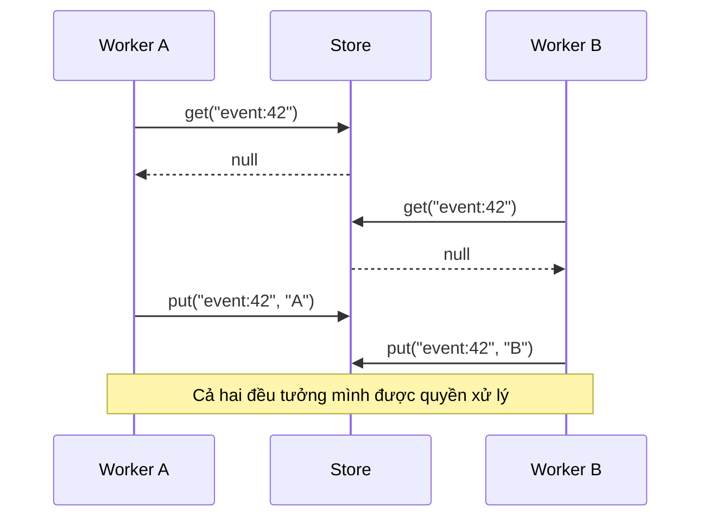
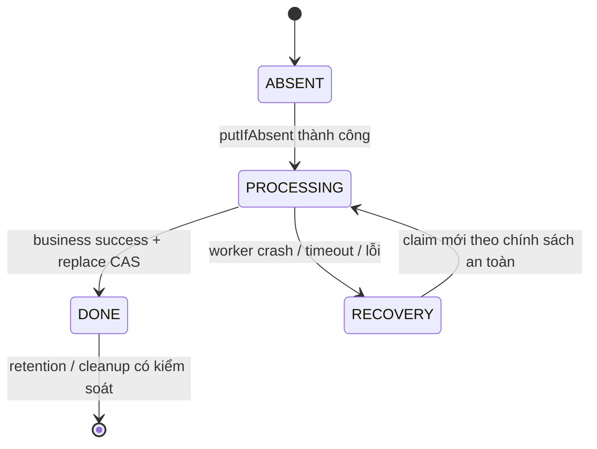
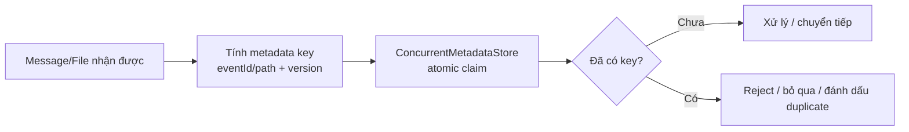

# ConcurrentMetadataStore cho nhiều thread hoặc instance

## 1. Bài toán: nhiều consumer cùng nhìn thấy một công việc

Trong Spring Integration, một message có thể được xử lý lại khi broker redeliver, poller retry, ứng dụng khởi động lại hoặc hai producer gửi cùng sự kiện. Nếu có nhiều worker hoặc nhiều instance của dịch vụ, một thao tác như **ghi nhận thanh toán**, **đồng bộ file**, **tạo đơn** có thể bị thực hiện trùng.

Ví dụ, message mang `eventId=evt-2026-001` được giao cho worker A và B gần như đồng thời. Cả hai đều kiểm tra một biến `processed=false`, rồi cùng ghi đơn hàng. Kiểm tra và ghi qua hai thao tác không nguyên tử tạo ra *race condition*.

Spring Integration cung cấp hợp đồng **`ConcurrentMetadataStore`** để thực hiện các thao tác metadata có điều kiện, phục vụ nhiều use case như *accept-once*, idempotency, claim/checkpoint và quản lý dấu mốc. Điểm quan trọng nằm ở hai thao tác **`putIfAbsent`** và **`replace`**: chúng giúp nhiều luồng cạnh tranh trên một **khóa metadata** mà vẫn phân biệt ai giành được quyền cập nhật.

Bài thuộc chương **Metadata store** của module **SPRING_INTEGRATION_RUNTIME**. Mục tiêu không dừng ở API: ta cần biết tác động của `DirectChannel`, `ExecutorChannel`, polling consumer, transaction, retry, message store, vòng đời `IntegrationFlow` và trạng thái runtime khi một message bị xử lý lặp.

> **Phân biệt hai mức bảo đảm:** `ConcurrentMetadataStore` mô tả thao tác metadata có điều kiện. Nó **không tự động biến lời gọi database, HTTP, broker và xử lý nghiệp vụ thành một transaction phân tán**. Kết quả chống trùng còn phụ thuộc nơi đặt bước claim, độ bền và tính nguyên tử của backend, cách khôi phục sau crash, cùng khóa idempotency.

## 2. MetadataStore và ConcurrentMetadataStore khác nhau thế nào?

`MetadataStore` trong `org.springframework.integration.metadata` lưu các cặp **`String key` / `String value`**, với các thao tác cơ bản như `get`, `put` và `remove`. `ConcurrentMetadataStore` mở rộng hợp đồng đó bằng thao tác ghi có điều kiện, hướng tới sử dụng an toàn khi có nhiều tác nhân cùng sửa **một khóa**.

| API | Ý nghĩa | Phù hợp với concurrent processing? |
| --- | --- | --- |
| `get(key)` | Đọc giá trị hiện tại hoặc `null` nếu không có | Chỉ đọc; không đặt được quyền sở hữu chỉ bằng một lần `get`. |
| `put(key, value)` | Ghi giá trị và trả giá trị cũ theo hợp đồng store | Không bảo vệ thao tác “nếu chưa có thì ghi” khỏi race. |
| `remove(key)` | Xóa khóa và trả giá trị trước đó nếu có | Xóa **không có điều kiện**, cần thận trọng khi owner có thể đã thay đổi. |
| `putIfAbsent(key, value)` | Chỉ ghi nếu khóa chưa tồn tại; trả `null` khi ghi thành công, hoặc giá trị đã tồn tại | Dùng để tranh quyền tạo một dấu mốc hoặc claim duy nhất. |
| `replace(key, oldValue, newValue)` | Chỉ thay nếu giá trị đang bằng `oldValue`; trả `boolean` | Dùng cho chuyển trạng thái theo kiểu compare-and-set (CAS). |

Các thao tác có điều kiện phải được **implementation** thực thi nguyên tử trên phạm vi mà backend của nó hỗ trợ. Một đối tượng trong bộ nhớ có thể an toàn giữa các thread trong **một JVM**, trong khi một store chia sẻ trên JDBC/Redis có thể cho nhiều JVM cùng cạnh tranh nếu implementation dùng cơ chế atomic thích hợp.

### Tại sao `get` rồi `put` là sai?



Một lần `get` độc lập không khóa việc `put` sau đó. Dùng `putIfAbsent` sẽ cho **chỉ một tác nhân thắng việc tạo khóa** theo phạm vi atomic của store:

```mermaid
sequenceDiagram
    participant A as Worker A
    participant S as ConcurrentMetadataStore
    participant B as Worker B
    A->>S: putIfAbsent("event:42", "A")
    S-->>A: null (ghi thành công)
    B->>S: putIfAbsent("event:42", "B")
    S-->>B: "A" (khóa đã tồn tại)
    Note over A,B: A nhận quyền xử lý; B phải theo chính sách duplicate
```

Hai lời gọi có thể đến theo thứ tự ngược lại; **không được giả định A luôn thắng**. Điều đúng cần kiểm tra là nhiều lần tranh cùng key chỉ cho một lần tạo khóa thành công trong điều kiện backend hoạt động đúng.

## 3. Khác biệt giữa nhiều thread và nhiều instance

Một số implementation thường gặp:

| Lựa chọn | Phạm vi trạng thái | Khi nên dùng | Giới hạn quan trọng |
| --- | --- | --- | --- |
| `SimpleMetadataStore` | Bộ nhớ của **một instance/JVM** | Demo, ứng dụng một instance, cần phối hợp các thread cục bộ | Instance khác có map riêng; restart làm mất trạng thái. |
| `JdbcMetadataStore` | Bảng dữ liệu chung khi các instance kết nối đến **cùng database/schema/namespace** | Nhiều instance và cần trạng thái qua restart | Phải khởi tạo schema, cấu hình transaction, kết nối và kiểm tra độ trễ/khả năng cạnh tranh. |
| Store chia sẻ trên Redis hoặc backend khác có implementation phù hợp | Theo phạm vi backend dùng chung | Nhiều instance, cần thao tác atomic trên shared store | Phải xác minh consistency, durability, expiry, failover và semantics compare-and-set của implementation cụ thể. |
| `PropertiesPersistingMetadataStore` hoặc lựa chọn lưu file | Theo cơ chế ghi/đọc file và đồng bộ hóa của implementation | Một số tác vụ checkpoint cục bộ | Không mặc định an toàn giữa nhiều process cùng sửa một file. |

**Cùng một interface không tạo cùng mức bảo đảm.** Hai Spring Boot instance, mỗi instance có một `SimpleMetadataStore` riêng, đều có thể thấy `putIfAbsent("event:42", ...) == null`, bởi mỗi instance chỉ quan sát map của chính nó.

Đối với deployment nhiều instance, cần bảo đảm **tất cả các instance dùng cùng backend và cùng namespace**, và xác minh backend triển khai `putIfAbsent`/`replace` nguyên tử **qua các tiến trình**. Chỉ triển khai các instance chung một database nhưng trỏ đến bảng, vùng dữ liệu hoặc prefix khác nhau vẫn làm xuất hiện nhiều “người thắng”.

## 4. Ví dụ Java: một khóa chỉ có một thread giành được

Ví dụ tối thiểu sau dùng `SimpleMetadataStore` để chứng minh atomic claim trong một JVM. Đây là đoạn Java chạy trong ứng dụng đã có thư viện Spring Integration:

```java
import java.util.concurrent.CountDownLatch;
import java.util.concurrent.ExecutorService;
import java.util.concurrent.Executors;
import java.util.concurrent.TimeUnit;
import java.util.concurrent.atomic.AtomicInteger;

import org.springframework.integration.metadata.ConcurrentMetadataStore;
import org.springframework.integration.metadata.SimpleMetadataStore;

public class ConcurrentClaimDemo {

    public static void main(String[] args) throws Exception {
        ConcurrentMetadataStore store = new SimpleMetadataStore();
        String key = "job:v1:evt-2026-001";

        int workers = 8;
        AtomicInteger winners = new AtomicInteger();
        CountDownLatch ready = new CountDownLatch(workers);
        CountDownLatch go = new CountDownLatch(1);
        ExecutorService executor = Executors.newFixedThreadPool(workers);

        try {
            for (int i = 0; i < workers; i++) {
                final int workerId = i;

                executor.submit(() -> {
                    ready.countDown();
                    go.await();

                    String existing = store.putIfAbsent(
                        key, "PROCESSING:worker-" + workerId);

                    if (existing == null) {
                        winners.incrementAndGet();
                        System.out.println("Winner: worker-" + workerId);
                    } else {
                        System.out.println(
                            "Loser: worker-" + workerId +
                            ", current=" + existing);
                    }
                    return null;
                });
            }

            ready.await();
            go.countDown();
            executor.shutdown();

            if (!executor.awaitTermination(10, TimeUnit.SECONDS)) {
                throw new IllegalStateException("Workers chua ket thuc");
            }
            System.out.println("Winners: " + winners.get()); // 1
        } finally {
            executor.shutdownNow();
        }
    }
}
```

Quan sát cần rút ra:

- Với `putIfAbsent` đúng hợp đồng, **một** worker nhận `null` và trở thành chủ sở hữu ban đầu; các worker khác nhận lại giá trị đang có.
- Tên worker thắng thay đổi giữa các lần chạy: không dự đoán thứ tự thread.
- Trạng thái `PROCESSING` vẫn ở store sau demo; muốn retry hoặc dọn khóa phải có **chính sách vòng đời**. Không tự gọi `remove(key)` sau mỗi xử lý mà chưa xét race.
- Thử nghiệm này **chưa chứng minh** an toàn trên nhiều JVM vì tất cả thread dùng cùng một `SimpleMetadataStore` trong bộ nhớ.

## 5. Chuyển trạng thái an toàn bằng `replace`

Giả sử một worker đã claim khóa với token `PROCESSING:run-17`. Sau khi nghiệp vụ thành công, worker muốn ghi `DONE:run-17`. Cách đơn giản `put(key, "DONE")` có thể ghi đè trạng thái mới do một worker khác đã tạo sau cơ chế phục hồi. `replace` giúp tránh kiểu ghi đè đó:

```java
ConcurrentMetadataStore store = /* bean được inject */;
String key = "job:v1:evt-2026-001";
String myToken = "PROCESSING:run-17";

String previous = store.putIfAbsent(key, myToken);

if (previous == null) {
    // Worker này nhận claim; thực hiện nghiệp vụ tại đây.
    boolean transitioned =
        store.replace(key, myToken, "DONE:run-17");

    if (!transitioned) {
        throw new IllegalStateException(
            "Metadata state da thay doi, can doi chieu ket qua");
    }
} else {
    // Giá trị cũ cho biết đã xử lý xong hay đang có người xử lý.
    System.out.println("Existing state: " + previous);
}
```

`replace(key, expected, updated)` có ngữ nghĩa **compare-and-set (CAS)**: chỉ worker nhìn thấy `expected` ở thời điểm cập nhật mới có quyền chuyển trạng thái. Nó đặc biệt hữu ích cho bộ trạng thái `NEW → PROCESSING → DONE` hoặc `PROCESSING → FAILED`.

Nhưng CAS **không tự chứng minh side effect được thực hiện một lần**. Nếu worker đã gọi API tạo đơn hàng thành công rồi crash **trước** `replace(..., "DONE")`, metadata có thể còn `PROCESSING`. Khi một worker khác khôi phục, phải kiểm tra kết quả nghiệp vụ bằng một khóa idempotency ở phía tài nguyên đích hoặc dùng transaction/outbox thích hợp.

### Vì sao không dùng `remove(key)` để nhả claim tùy tiện?

`remove(key)` của `MetadataStore` không mang tham số `expectedValue`. Một worker chậm có thể xóa khóa sau khi cơ chế phục hồi đã chuyển quyền xử lý sang worker khác. Trạng thái mới bị xóa và worker thứ ba lại giành quyền, tạo xử lý trùng.

Nếu yêu cầu **chỉ owner hiện tại được nhả claim**, cần có cơ chế compare-and-delete/lease/fencing do backend hỗ trợ, hoặc chuyển sang trạng thái có điều kiện bằng `replace` và dọn dẹp an toàn theo chính sách riêng. Không suy ra `ConcurrentMetadataStore` có API xóa nguyên tử theo owner khi interface không công bố thao tác đó.

## 6. Tích hợp với IntegrationFlow: idempotent handler

Ví dụ này nhận `OrderEvent` từ `orders.in`. Một handler dùng `ConcurrentMetadataStore` để claim event ID, thực hiện side effect giả lập, rồi chuyển trạng thái sang `DONE`. Kết quả gửi sang `orders.results` để kiểm tra.

```java
import java.util.UUID;

import org.springframework.integration.metadata.ConcurrentMetadataStore;

public class EventProcessor {

    public record OrderEvent(String tenantId, String eventId) {}

    private final ConcurrentMetadataStore store;

    public EventProcessor(ConcurrentMetadataStore store) {
        this.store = store;
    }

    public String handle(OrderEvent event) {
        if (event.tenantId() == null || event.tenantId().isBlank()
                || event.eventId() == null || event.eventId().isBlank()) {
            throw new IllegalArgumentException("Thieu tenantId hoac eventId");
        }

        // Namespace tách theo nghiệp vụ, phiên bản khóa và tenant.
        String key = "orders:v1:" + event.tenantId() + ":" + event.eventId();
        String token = "PROCESSING:" + UUID.randomUUID();

        String prior = store.putIfAbsent(key, token);
        if (prior != null) {
            return prior.startsWith("DONE:")
                ? "ALREADY_DONE"
                : "IN_PROGRESS";
        }

        try {
            // Trong demo, không gọi hệ thống ngoài.
            System.out.println("Process event " + event.eventId());

            boolean markedDone =
                store.replace(key, token, "DONE:" + event.eventId());

            if (!markedDone) {
                throw new IllegalStateException(
                    "Claim khong con do worker nay so huu");
            }
            return "PROCESSED";
        } catch (RuntimeException failure) {
            // Cố ý không remove(key) vô điều kiện.
            // Record PROCESSING cần reconciliation/recovery riêng.
            throw failure;
        }
    }
}
```

Cấu hình Java DSL:

```java
import org.springframework.context.annotation.Bean;
import org.springframework.context.annotation.Configuration;
import org.springframework.beans.factory.annotation.Qualifier;
import org.springframework.integration.channel.DirectChannel;
import org.springframework.integration.channel.QueueChannel;
import org.springframework.integration.config.EnableIntegration;
import org.springframework.integration.dsl.IntegrationFlow;
import org.springframework.integration.metadata.ConcurrentMetadataStore;
import org.springframework.integration.metadata.SimpleMetadataStore;
import org.springframework.messaging.MessageChannel;
import org.springframework.messaging.PollableChannel;

@Configuration
@EnableIntegration
public class EventFlowConfig {

    @Bean
    ConcurrentMetadataStore claimStore() {
        // Một JVM: dùng để học và test.
        return new SimpleMetadataStore();
    }

    @Bean
    EventProcessor eventProcessor(
            @Qualifier("claimStore") ConcurrentMetadataStore claimStore) {
        return new EventProcessor(claimStore);
    }

    @Bean("orders.in")
    MessageChannel ordersInput() {
        return new DirectChannel();
    }

    @Bean("orders.results")
    PollableChannel results() {
        return new QueueChannel(100);
    }

    @Bean
    IntegrationFlow ordersFlow(EventProcessor processor) {
        return IntegrationFlow.from("orders.in")
            .handle(processor, "handle")
            .channel("orders.results")
            .get();
    }
}
```

Thử gửi cùng event nhiều lần:

```java
import org.springframework.messaging.Message;
import org.springframework.messaging.MessageChannel;
import org.springframework.messaging.PollableChannel;
import org.springframework.messaging.support.GenericMessage;

MessageChannel input = context.getBean("orders.in", MessageChannel.class);
PollableChannel output = context.getBean(
    "orders.results", PollableChannel.class);

var event = new EventProcessor.OrderEvent("tenant-A", "evt-42");

input.send(new GenericMessage<>(event));
Message<?> first = output.receive(1_000); // payload: "PROCESSED"

input.send(new GenericMessage<>(event));
Message<?> duplicate = output.receive(1_000); // payload: "ALREADY_DONE"
```

`context` là `ApplicationContext` đang chạy. Vì `DirectChannel` đồng bộ, handler thực hiện claim và trả reply trước khi lời gọi `send` kết thúc trong ví dụ. Nếu đặt `ExecutorChannel` ở đầu vào, hai message có thể được xử lý gần như đồng thời: `putIfAbsent` vẫn quyết định ai claim trước, nhưng producer có thể nhận kết quả bất đồng bộ qua nhánh output thay vì kết quả tức thời.

**Giới hạn của demo:** thao tác nghiệp vụ chỉ là `System.out.println`, vì vậy không có side effect thật để kiểm chứng tính idempotent. Nếu thay bằng ghi database hoặc HTTP, phải bổ sung cơ chế giao dịch/idempotency ở tài nguyên đó. Trạng thái `IN_PROGRESS` cũng không đồng nghĩa event đã hoàn tất; không được acknowledge vĩnh viễn hoặc loại bỏ message chỉ dựa trên chuỗi trả về này nếu nghiệp vụ yêu cầu phục hồi.

## 7. Đổi sang shared store cho nhiều instance

Khi chạy nhiều replica, thay `SimpleMetadataStore` bằng implementation có backend dùng chung. Ví dụ với **`JdbcMetadataStore`**, giả định ứng dụng đã có `DataSource` và đã tạo schema metadata đúng với phiên bản Spring Integration:

```java
import javax.sql.DataSource;
import org.springframework.context.annotation.Bean;
import org.springframework.integration.jdbc.metadata.JdbcMetadataStore;
import org.springframework.integration.metadata.ConcurrentMetadataStore;

@Bean
ConcurrentMetadataStore claimStore(DataSource dataSource) {
    return new JdbcMetadataStore(dataSource);
}
```

Đây là **phương án thay thế** bean `claimStore()` trong ví dụ phần 6; không đăng ký đồng thời hai bean cùng tên. Cần sử dụng đúng dependency Spring Integration JDBC, tạo bảng/constraint bằng migration phù hợp, và bảo đảm **mọi replica kết nối đến cùng database và vùng dữ liệu mong muốn**. Kiểm tra trực tiếp bằng cách chạy hai instance tranh cùng key: chỉ một instance được báo tạo khóa thành công.

Nếu dùng một implementation dựa trên Redis hoặc cơ sở dữ liệu khác, phải kiểm tra nó có thực sự triển khai `ConcurrentMetadataStore` và có atomic semantics trên **nhiều tiến trình**. Không suy luận an toàn phân tán chỉ từ tên “metadata store” hoặc việc có cache chung.

### Khi nào chọn JDBC, khi nào chọn Redis?

| Tiêu chí | Shared JDBC metadata store | Redis-backed metadata store |
| --- | --- | --- |
| Đồng bộ nhiều instance | Có thể dùng constraint và thao tác có điều kiện trên database | Có thể dùng primitive atomic của Redis nếu implementation hỗ trợ đúng hợp đồng. |
| Durability | Tùy cấu hình transaction, backup và database | Tùy persistence, replication và failover policy của Redis. |
| Độ trễ | Có round trip SQL, index/lock contention | Thường thấp trên workload phù hợp; vẫn có round trip và giới hạn backend. |
| Cleanup | Cần quy trình retention/GC cho key cũ | Có thể có TTL ở backend, nhưng không phải mọi `ConcurrentMetadataStore` đều cung cấp TTL qua interface. |
| Khi đồng bộ với business DB | Có thể phối hợp cùng transaction manager khi cùng tài nguyên và phạm vi | Thường là tài nguyên khác; phải phân tích nhất quán/dual-write. |

Không có lựa chọn nào mặc định bảo đảm “exactly once” xuyên hệ thống. Hãy chọn theo yêu cầu phục hồi và **kiểm chứng bằng failure injection**, không dựa trên latency khi chạy bình thường.

## 8. Metadata state và thời điểm crash

Cùng một khóa `orders:v1:tenant-A:evt-42` có thể đi qua các trạng thái:



Cần phân tích ít nhất bốn tình huống:

| Thời điểm sự cố | Metadata có thể đang là gì? | Rủi ro | Cách ứng phó |
| --- | --- | --- | --- |
| Crash **trước** `putIfAbsent` | Không có key | Message có thể redeliver, worker khác claim | Thường xử lý lại được nếu input còn bền vững. |
| Crash **sau claim, trước side effect** | `PROCESSING` | Event có thể bị chặn mãi nếu không có recovery | Xác định stale claim và cho phép reclaim có điều kiện. |
| Crash **sau side effect, trước `DONE`** | `PROCESSING` | Worker khác có thể làm lại side effect | Idempotency ở DB/API đích, transactional outbox hoặc đối chiếu kết quả. |
| Crash **sau `DONE`, trước ack input** | `DONE` | Broker có thể redeliver event | Worker mới đọc `DONE` và bỏ qua có kiểm soát. |

Điểm khó nhất là **không thể phân biệt chắc chắn** “crash trước side effect” với “crash sau side effect” chỉ bằng một khóa `PROCESSING` trong metadata. Vì vậy, recovery cần nguồn sự thật khác: bảng nghiệp vụ có unique constraint, API đích hỗ trợ idempotency key, transactional outbox, hoặc kiểm tra kết quả đã commit.

### Không tự giả định có TTL hoặc lease

`ConcurrentMetadataStore` không định nghĩa TTL, gia hạn lease, fencing token hay chuyển quyền chủ sở hữu khi worker mất kết nối. Một backend có thể cung cấp chức năng đó qua API riêng, nhưng không được xem nó là tính năng chung của interface.

Nếu muốn reclaim một claim cũ:

1. Lưu token có định danh worker và thời điểm claim theo định dạng rõ ràng.
2. Xác định theo chính sách vận hành rằng claim **đã quá hạn và có thể khôi phục**; tránh dựa hoàn toàn vào đồng hồ của hai máy nếu lệch giờ.
3. Đọc giá trị cũ và dùng `replace(key, observedValue, newToken)` để chỉ một worker thắng reclaim.
4. Ngăn worker cũ tiếp tục ghi side effect sau khi bị thu hồi quyền; cần **fencing/kiểm tra quyền ở tài nguyên đích**, không chỉ CAS trên metadata.
5. Giữ retention/dedupe phù hợp cho `DONE` và message redelivery.

Một `replace` CAS giúp tránh hai worker cùng **nhận claim mới**, nhưng không ngăn một worker cũ vẫn còn đang chạy hoàn tất side effect. Đây là khác biệt giữa atomic metadata update và distributed lock có fencing.

## 9. Quan hệ với Idempotent Receiver và file filters

Spring Integration có các thành phần sử dụng metadata để giảm xử lý trùng, ví dụ **idempotent receiver** hoặc các bộ lọc **persistent accept-once** cho file/remote file. Những thành phần này thường tính **key** từ thuộc tính message/file, lưu dấu mốc đã gặp và loại message trùng theo chính sách.



**Ví dụ về chọn key cho file:**

- `path` đơn thuần phù hợp khi một đường dẫn chỉ có ý nghĩa “đã xử lý một lần trong đời”.
- `path + modified time` phù hợp hơn nếu file có thể thay nội dung tại cùng đường dẫn; cần cân nhắc độ phân giải timestamp và tính nhất quán nguồn.
- `path + content hash` giúp phát hiện thay đổi nội dung nhưng có chi phí đọc/hash dữ liệu.
- Prefix như `file-sync:v2:tenantA:` ngăn hai ứng dụng vô tình chia sẻ chung khóa.

**MetadataStore và MessageStore khác nhiệm vụ:**

| Loại store | Chứa gì? | Câu hỏi giải quyết |
| --- | --- | --- |
| `ConcurrentMetadataStore` | Dấu mốc hoặc trạng thái dạng cặp key/value chuỗi | Event/file/key đã được claim hay xử lý chưa? |
| `MessageStore` | `Message<?>` được lưu để nhận lại/tra cứu | Payload và headers nào đang được giữ? |
| `MessageGroupStore` | Nhóm message theo correlation key cùng trạng thái nhóm | Fragment nào thuộc nhóm, đã đủ để release chưa? |

Một metadata key **không thay thế** toàn bộ message payload trong queue hoặc trạng thái nhóm trong aggregator. Đối với hệ thống có broker, metadata cho dedupe thường đi cùng nguồn message bền vững và cơ chế acknowledgement riêng.

## 10. Thread, poller, retry và transaction: ranh giới thực tế

Metadata CAS vẫn là thao tác CAS dù handler được gọi trên thread nào, nhưng **thời điểm claim** và **phạm vi transaction** quyết định hành vi khi lỗi.

| Đường chạy | Ai gọi claim? | Điều cần kiểm tra |
| --- | --- | --- |
| `DirectChannel` → handler | Thread gọi `send`, nếu flow đồng bộ | Exception có thể lan về producer; nhiều producer vẫn có thể cạnh tranh trên store. |
| `ExecutorChannel` → handler | Worker của executor | Claim xảy ra sau dispatch, producer có thể trả về trước; xử lý lỗi trong worker/error channel. |
| `QueueChannel` + poller | Thread của polling consumer hoặc executor poller | Message đã được dequeue chưa; rollback receive có được hỗ trợ không. |
| Nhiều instance đọc broker | Consumer ở mỗi instance | Tất cả phải dùng chung atomic store và thống nhất namespace/key. |

### Retry gặp trạng thái `PROCESSING`

Giả sử worker A đã `putIfAbsent` thành công, xử lý DB lỗi và exception đi vào retry advice. Nếu retry **toàn handler**, lần thử tiếp theo có thể gọi lại `putIfAbsent` và thấy `PROCESSING` của lần trước, rồi tự đánh dấu `IN_PROGRESS` và dừng. Đây là bug logic, không phải bằng chứng lỗi đã được giải quyết.

Có vài lựa chọn thiết kế:

- Đặt **claim một lần bên ngoài vùng retry** và retry riêng phần side effect được bảo vệ.
- Cho phép cùng owner token thực hiện lại attempt khi chính sách retry xác định vẫn là một công việc đang sở hữu, nhưng phải bảo vệ khỏi worker khác.
- Chuyển `PROCESSING` sang trạng thái thất bại có điều kiện và dùng recovery job để quyết định reclaim sau đối chiếu.

### Metadata và database transaction

Nếu `JdbcMetadataStore` và bảng nghiệp vụ dùng **cùng database/transaction manager**, thao tác metadata và cập nhật nghiệp vụ **có thể** tham gia cùng transaction khi thực hiện trên cùng thread và đúng tài nguyên. Nhưng vẫn phải xác minh chính sách SQL/transaction của implementation, thời điểm ack từ broker và propagation của advice/poller. Nếu metadata ở Redis còn nghiệp vụ ở JDBC, hai thao tác thường **không thuộc một local transaction**.

Đặt `TransactionInterceptor` ở handler không tự bao cả thao tác nhận message từ broker hoặc hàng đợi. Chuyển qua `ExecutorChannel` có thể làm transaction context của producer không còn trên worker. **Đừng xem một lần CAS thành công là commit của nghiệp vụ.**

Với yêu cầu side effect có tính duy nhất, ưu tiên **unique constraint** hoặc idempotency key ngay tại cơ sở dữ liệu/đích cuối, và dùng metadata làm lớp phối hợp hoặc giảm tải. Trường hợp ghi DB + phát event nên cân nhắc **transactional outbox**.

## 11. Quan sát runtime, hiệu năng và cleanup

Khi metadata store bị dùng chung bởi nhiều worker, cần đo nhiều hơn tỷ lệ “đã thấy key”:

| Metric / tín hiệu | Ý nghĩa |
| --- | --- |
| Claim attempts / wins / conflicts | Bao nhiêu worker cố claim, bao nhiêu thắng, bao nhiêu nhận duplicate. |
| Pending/PROCESSING key count và tuổi lớn nhất | Có claim nào bị treo sau lỗi hoặc worker crash không. |
| DONE key count và tốc độ cleanup | Store có tăng vô hạn vì retention không. |
| `putIfAbsent` / `replace` latency (p50, p95, p99) | Backend có trở thành nút thắt khi tải tăng không. |
| Database lock wait/unique-constraint conflicts, Redis errors | Có tranh chấp, lỗi kết nối hoặc failover ảnh hưởng atomic operation không. |
| Retry/redelivery và duplicate side effects | Khả năng idempotency thực tế, không chỉ số CAS thắng. |
| Executor active threads, queue depth, poll delay | Áp lực runtime ảnh hưởng thời điểm claim/finish. |
| Error channel deliveries / failures | Lỗi xử lý hoặc lỗi publish error có được quan sát và phục hồi không. |

Ví dụ: một dịch vụ nhận **500 message/giây**, trong đó **10%** là duplicate có cùng event ID đã được đánh `DONE`, thì số lần `putIfAbsent` có thể vẫn xấp xỉ **500 lần/giây** mặc dù chỉ khoảng **450 message/giây** đi vào nghiệp vụ. Metadata store phải đủ sức chịu toàn bộ số lần kiểm tra/claim, kể cả duplicate. Nếu nhiều worker tranh cùng **một key nóng**, contention có thể gây latency cao dù tổng thông lượng chưa lớn.

### Dọn metadata có kiểm soát

Không giữ trạng thái `DONE` vô hạn nếu storage có giới hạn, nhưng cũng không xóa quá sớm khi broker có thể redeliver. Retention phải dài hơn **cửa sổ replay/duplicate thực tế** hoặc dựa trên một ID không tái sử dụng và dữ liệu nghiệp vụ có unique constraint bền vững.

Đối với trạng thái `PROCESSING`, **không xóa hàng loạt theo tuổi một cách mù quáng**. Worker có thể còn thực thi chậm, retry đang chạy hoặc giao dịch đang chờ lock. Nếu xóa key khi side effect chưa kết thúc, một worker khác có thể claim và thực thi trùng. Cần có chính sách lease/reconciliation/fencing đã được kiểm chứng.

## 12. Bảng chẩn đoán lỗi điển hình

| Triệu chứng | Nguyên nhân có khả năng | Hướng kiểm tra / sửa |
| --- | --- | --- |
| Hai instance đều xử lý một event | Mỗi instance dùng `SimpleMetadataStore` riêng, namespace khác nhau hoặc key không giống nhau | Log store implementation/backend, key và instance; thử CAS cùng key xuyên JVM. |
| Hai thread cùng xử lý dù đã kiểm tra store | Dùng `get` rồi `put`, không dùng `putIfAbsent` hoặc có đường bypass | Tìm toàn bộ đường claim, thay thao tác không nguyên tử bằng CAS. |
| Duplicate bị đánh thành “đã xong” khi vẫn đang chạy | Gộp `PROCESSING` và `DONE` thành một trạng thái | Phân biệt “in progress” và “completed”, thiết kế ack/retry thích hợp. |
| Event bị treo mãi sau crash | Token `PROCESSING` không có recovery | Đo tuổi pending, tạo reconciliation theo chính sách. |
| Nghiệp vụ bị lặp sau restart dù `DONE` từng tồn tại | Store in-memory, mất dữ liệu, cleanup quá sớm hoặc dùng backend/namespace khác | Kiểm tra durability, retention và các khóa đã được lưu. |
| Worker cũ ghi xong sau khi worker mới reclaim | Không có fencing tại tài nguyên nghiệp vụ | Dùng fencing token/ownership enforcement hoặc idempotency ở đích. |
| CAS thành công nhưng DB không có dữ liệu | Metadata và nghiệp vụ không cùng transaction; crash giữa hai bước | Kiểm tra commit, recovery và idempotent DB constraint. |
| Database đã ghi nhưng metadata vẫn `PROCESSING` | Crash/lỗi khi `replace` thành `DONE` | Reconcile từ business DB rồi chuyển trạng thái có điều kiện. |
| `remove` làm event bị xử lý lại | Xóa không có điều kiện khi owner có thể thay đổi | Dùng state transition CAS, retention và dọn dẹp an toàn. |
| Throughput giảm khi tăng worker | Shared store thành hotspot, connection pool thiếu hoặc key contention cao | Đo CAS latency, lock wait, DB pool, executor queue. |
| Duplicates xuất hiện khi dùng file adapter | Key chỉ dựa filename, mtime không ổn định hoặc state store không bền | Kiểm tra accept-once filter, key prefix, modified time/hash. |
| Lỗi nằm ở worker, producer không thấy | Có `ExecutorChannel`/poller; exception chuyển sang thread khác | Đọc error channel, trace ID, failed message và worker logs. |

Khi chẩn đoán, ghi lại **metadata key**, **giá trị trước/sau CAS**, **instance ID**, **thread name**, **message ID**, **trace/correlation ID** và **root cause**. Không ghi thông tin nhạy cảm trong key hoặc value; cần ẩn/mã hóa ID nghiệp vụ trước khi log nếu có yêu cầu bảo mật.

## 13. Bài thực hành theo mức độ tăng dần

**Bài 1 — Chứng minh một winner trong một JVM.** Chạy ví dụ `ConcurrentClaimDemo` với 8 và 32 workers. Xác nhận tổng winner bằng 1 khi tất cả sử dụng cùng `SimpleMetadataStore` và cùng key. Thay bằng kiểu `get` rồi `put` có độ trễ chủ động trong môi trường thử nghiệm và ghi lại race.

**Bài 2 — Phân biệt PROCESSING và DONE.** Chạy `EventFlowConfig`, gửi hai `OrderEvent` cùng ID. Lần thứ nhất trả `PROCESSED`, lần hai trả `ALREADY_DONE`. Sửa code thử nghiệm để dừng ngay sau claim rồi gửi lại: vì sao lúc này kết quả nên là `IN_PROGRESS` chứ không được kết luận đã xử lý xong?

**Bài 3 — Hai instance.** Chạy hai instance dùng `SimpleMetadataStore`, gửi cùng event vào cả hai; ghi nhận mỗi instance có thể đều xử lý. Sau đó thay bằng shared `JdbcMetadataStore`, dùng chung schema/namespace, thử cạnh tranh đồng thời và xác minh chỉ một claim thắng.

**Bài 4 — Phục hồi sau crash.** Gây crash sau side effect nhưng trước bước `replace(..., "DONE")`. Khởi động lại, quan sát metadata và dữ liệu nghiệp vụ. Thiết kế recovery job **đối chiếu trạng thái đích** trước khi reclaim; kiểm tra nếu side effect đã hoàn tất thì không thực hiện lại.

**Bài 5 — Cạnh tranh khi reclaim.** Cho hai worker cùng đọc một token cũ rồi cùng gọi `replace(key, oldToken, newToken)` với hai token khác nhau. Kiểm tra chỉ một worker thắng CAS. Giải thích vì sao vẫn cần fencing đối với worker cũ còn sống.

**Bài 6 — Retry đúng phạm vi.** Thêm retry advice vào flow qua `ExecutorChannel`. Đặt một lỗi tạm thời sau claim, quan sát nếu retry toàn handler thì có thể tự gặp `PROCESSING`. Di chuyển phạm vi claim/retry hoặc truyền ownership token theo thiết kế và so sánh kết quả.

**Bài 7 — Retention và quan sát.** Giả lập một lượng lớn key `DONE`, một ít key `PROCESSING` treo. Lập chính sách dọn dẹp kết hợp cửa sổ redelivery, trạng thái nghiệp vụ và mức độ an toàn; đo CAS latency, store size và tỷ lệ duplicate qua mỗi lần chạy.

### Câu hỏi tự kiểm tra

1. Vì sao `get` rồi `put` không thay thế được `putIfAbsent` khi nhiều thread cùng tranh một key?
2. `replace(key, oldValue, newValue)` giúp giải quyết race nào? Nó chưa giải quyết race nào?
3. Vì sao `SimpleMetadataStore` không phù hợp để đồng bộ dedupe cho nhiều JVM?
4. Khi dùng shared `JdbcMetadataStore`, các instance phải thống nhất những yếu tố nào?
5. Có thể kết luận side effect đã chạy thành công khi thấy `PROCESSING` không?
6. Worker crash sau khi ghi DB nhưng trước khi cập nhật `DONE` sẽ gây rủi ro gì?
7. Tại sao `remove(key)` sau khi bắt exception có thể phá claim của một worker khác?
8. Vì sao cần idempotency key/unique constraint ở tài nguyên đích dù đã có metadata CAS?
9. Metadata store khác `MessageStore` và `MessageGroupStore` thế nào?
10. Nếu broker retry 24 giờ, bạn sẽ chọn retention `DONE` và chính sách dọn key như thế nào?
11. Khi thêm `ExecutorChannel`, phần nào của transaction và đường lỗi thay đổi?
12. Metric nào giúp nhận ra metadata backend đang giới hạn throughput?

**Nguyên tắc vận hành:** sử dụng `ConcurrentMetadataStore` để thực hiện claim và chuyển trạng thái có điều kiện theo **khóa ổn định**, chọn implementation phù hợp với **phạm vi thread hay instance**, và quản lý đầy đủ vòng đời `PROCESSING/DONE`. Kết hợp thông tin từ transaction, retry, message store, error channel và correlation để phục hồi các tình huống crash hoặc redelivery. Muốn bảo đảm side effect chỉ xảy ra một lần, phải bổ sung **idempotency và ranh giới giao dịch tại tài nguyên nghiệp vụ**, không dừng ở thao tác metadata nguyên tử.
