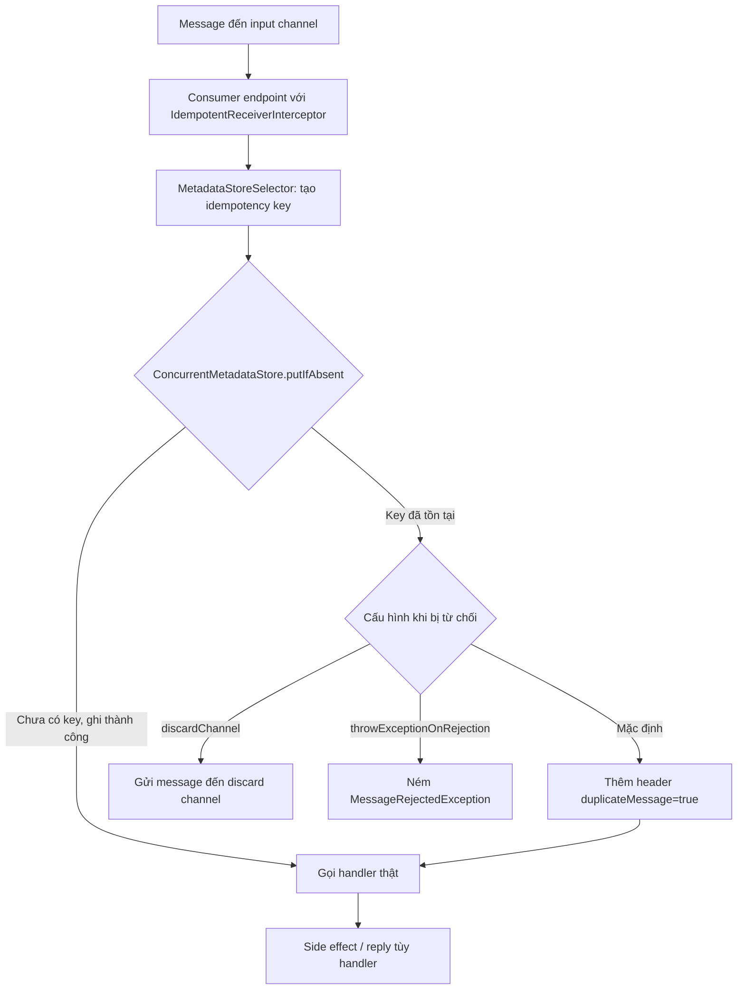
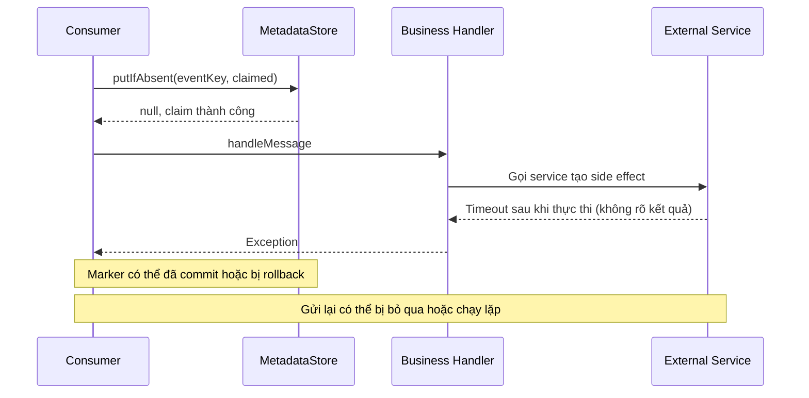

# Idempotent receiver dựa trên MetadataStore trong Spring Integration

## 1. Bài toán: một message có thể đến nhiều lần

Giả sử dịch vụ nhận sự kiện `PaymentCaptured(eventId="evt-204", orderId="ORD-42")`. Handler cập nhật trạng thái đơn hàng và phát thông báo. Nếu broker gửi lại message vì consumer timeout, nguồn gửi lặp sau reconnect hoặc người vận hành replay một bản ghi, cùng nghiệp vụ có thể được thực hiện hai lần. Một thao tác tăng số dư, gửi email hoặc ghi nhận thanh toán lặp có thể tạo hậu quả nghiêm trọng dù mỗi lần xử lý Java đều chạy thành công.

**Idempotent receiver** là mẫu Enterprise Integration Pattern mà consumer xử lý các lần giao lặp của **cùng một sự kiện nghiệp vụ** theo cách không tạo thêm tác động nghiệp vụ không mong muốn. Trong Spring Integration, `MetadataStore` ghi nhớ khóa đã thấy, còn `IdempotentReceiverInterceptor` và `MetadataStoreSelector` hỗ trợ nhận diện message lặp tại một **message handler endpoint**.

Đây là chủ đề thuộc chương **Metadata store** của module **SPRING_INTEGRATION_RUNTIME**. Để vận dụng đúng, phải gắn việc chống trùng với cách flow chạy qua channel, endpoint, consumer, poller và executor, đồng thời hiểu transaction, retry, message store, recovery, correlation và trạng thái nhiều instance tại runtime.

Sau bài học, bạn có thể:

1. Phân biệt **message delivery trùng** với **business event trùng** và chọn idempotency key phù hợp.
2. Sử dụng `ConcurrentMetadataStore.putIfAbsent(...)` để kiểm tra và ghi nhận khóa một cách nguyên tử.
3. Gắn `IdempotentReceiverInterceptor` vào đúng endpoint; phân biệt hành vi mặc định *đánh dấu duplicate* với *loại bỏ duplicate*.
4. Chọn store in-memory hoặc persistent/distributed và kiểm thử chạy đồng thời, restart, rollback, lỗi handler.
5. Xác định giới hạn giữa ghi metadata và side effect để thiết kế idempotency an toàn trong hệ thống phân tán.

> **Phiên bản:** Phần API và ví dụ nhắm tới Spring Integration **6.5.x** (Spring Framework 6.x, Java 17+). Các ví dụ cố ý tách cấu hình phục vụ học tập khỏi các cam kết giao dịch và độ bền cần kiểm thử khi triển khai thật.

## 2. Vai trò của các thành phần

| Thành phần | Package/API | Ý nghĩa trong flow |
| --- | --- | --- |
| `MetadataStore` | `org.springframework.integration.metadata.MetadataStore` | Hợp đồng key/value kiểu `String`: `get`, `put`, `remove`. |
| `ConcurrentMetadataStore` | `org.springframework.integration.metadata.ConcurrentMetadataStore` | Mở rộng bằng `putIfAbsent` và `replace(key, oldValue, newValue)` **nguyên tử theo implementation**. |
| `SimpleMetadataStore` | `org.springframework.integration.metadata.SimpleMetadataStore` | Store mặc định trên map trong bộ nhớ, atomic trong cùng instance; mất dữ liệu khi context/process ngừng. |
| `JdbcMetadataStore` | `org.springframework.integration.jdbc.metadata.JdbcMetadataStore` | Store JDBC bền vững, hỗ trợ chia sẻ giữa instance và transaction với DataSource thích hợp. |
| `MetadataStoreSelector` | `org.springframework.integration.selector.MetadataStoreSelector` | Tạo khóa/value từ message; quyết định message mới hay duplicate bằng `ConcurrentMetadataStore`. |
| `IdempotentReceiverInterceptor` | `org.springframework.integration.handler.advice.IdempotentReceiverInterceptor` | `HandleMessageAdvice` được gắn vào lời gọi `MessageHandler.handleMessage(...)`, xử lý khi selector từ chối. |
| `MessageChannel` / consumer endpoint | Spring Messaging / Integration | Đưa message đến handler; channel không tự biến mọi consumer thành idempotent. |

**Không nhầm ba loại dữ liệu:** `MetadataStore` thường chỉ giữ **dấu vết/khóa**, `MessageStore` có thể lưu nguyên message hoặc message group, còn bảng nghiệp vụ giữ **kết quả xử lý**. Dữ liệu trong một store không tự rollback hay đồng bộ với hai store còn lại.

## 3. Đường chạy và ba cách xử lý duplicate



**Điểm dễ nhầm nhất:** mặc định `IdempotentReceiverInterceptor` **không chặn** message lặp. Khi selector từ chối, interceptor tạo message có header `IntegrationMessageHeaderAccessor.DUPLICATE_MESSAGE` với giá trị `true` rồi vẫn chuyển đến handler. Handler hoặc downstream phải tự đọc header để tránh side effect.

Các lựa chọn:

| Cấu hình interceptor | Message duplicate được xử lý ra sao? | Khi nên dùng |
| --- | --- | --- |
| Không cấu hình discard/throw | Handler vẫn được gọi, header `duplicateMessage=true`. | Cần phân nhánh, trả trạng thái “đã xử lý”, hoặc logic hợp nhất kết quả. |
| `setDiscardChannel(...)` hoặc `setDiscardChannelName(...)` | Message bị từ chối được gửi vào discard channel; handler đích không được gọi. | Muốn tách duplicate ra nhánh đo lường, kiểm tra hoặc bỏ qua. |
| Discard vào `nullChannel` | Duplicate được bỏ qua. | Event notification không yêu cầu reply cho duplicate. |
| `setThrowExceptionOnRejection(true)` | Ném `MessageRejectedException`, kể cả khi có discard channel (sau khi gửi discard). | Cần báo lỗi cho caller theo hợp đồng rõ ràng; phải tránh broker retry vô hạn. |

**Phân biệt với `MessageFilter`:** filter loại message theo selector tại một endpoint filter, còn idempotent receiver là **advice gắn vào handler**. Có thể dùng `MetadataStoreSelector` cho cả hai, nhưng cấu trúc flow và cách trả lỗi/reply khác nhau.

**Về reply:** nếu duplicate bị discard, handler không phát reply nghiệp vụ; gateway đồng bộ đang chờ reply có thể timeout, trừ khi thiết kế duplicate branch có phản hồi phù hợp. Vì vậy không mặc định cấu hình `nullChannel` cho một request-reply gateway cần trả trạng thái idempotent.

## 4. Kiểm tra và ghi khóa phải nguyên tử

Cách kiểm tra sau **không an toàn** nếu có hai thread hoặc hai instance:

```java
// Ví dụ sai: check-then-act không nguyên tử.
if (store.get(key) == null) {
    store.put(key, "seen");
    processBusinessEvent(); // Hai thread có thể cùng đi vào nhánh này.
}
```

Hai consumer cùng đọc khi key chưa có sẽ đều nhận `null`, sau đó cùng gọi nghiệp vụ. API `ConcurrentMetadataStore` cung cấp thao tác gộp kiểm tra và ghi:

```java
import org.springframework.integration.metadata.ConcurrentMetadataStore;

boolean firstDelivery(ConcurrentMetadataStore store, String eventKey) {
    String previous = store.putIfAbsent(eventKey, "claimed");
    return previous == null;
}
```

`putIfAbsent(key, value)` trả về `null` khi ghi mới thành công, trả **giá trị cũ** nếu key đã tồn tại. Điều này cho phép nhiều consumer tranh cùng một key nhưng chỉ một consumer được “claim” tại thời điểm thao tác nguyên tử thành công — **trong phạm vi bảo đảm của store đã chọn**.

`MetadataStoreSelector` dùng chính kiểu thao tác này: từ `MessageProcessor<String>` tạo key và value (mặc định value lấy từ header `timestamp`, biểu diễn dạng hex), sau đó gọi `putIfAbsent`. Một message được **chấp nhận** nghĩa là khóa đã được **ghi vào store**, không có nghĩa business handler đã hoàn tất thành công.

Điểm này dẫn đến hai cửa sổ lỗi:

- **Ghi marker thành công, handler chưa chạy hoặc chạy rồi thất bại:** các lần giao sau có thể bị xem là duplicate và bỏ qua dù nghiệp vụ chưa xong.
- **Handler đã tạo side effect, marker chưa được commit hoặc bị rollback:** lần giao sau có thể được coi là mới và thực hiện side effect lần nữa.

Để xử lý đúng phải có **transaction cùng tài nguyên**, business idempotency key, trạng thái xử lý riêng hoặc cơ chế reconciliation tùy use case. Chỉ dùng `putIfAbsent` không tạo bảo đảm exactly-once đầu-cuối.

## 5. Thiết kế idempotency key và value

Khóa tốt xác định **cùng một đơn vị công việc nghiệp vụ** qua retry, restart và các nguồn có khả năng gửi trùng.

| Lựa chọn key | Đánh giá | Cách dùng đúng |
| --- | --- | --- |
| `eventId` do producer cấp ổn định | Phù hợp nếu được đảm bảo duy nhất trong namespace. | Thêm `tenantId`, loại event hoặc source để tránh trùng giữa nhà phát. |
| `orderId` | Thường quá rộng: một order có thể có nhiều event hợp lệ. | Chỉ phù hợp khi nghiệp vụ cho phép đúng một sự kiện loại đó/order. |
| `correlationId` | Thường dùng chung cho một nhóm/chuỗi message. | Dùng để trace; không tự coi là idempotency key duy nhất. |
| `MessageHeaders.ID` | Có thể thay đổi khi message được dựng lại/redeliver. | Chỉ dùng nếu nguồn bảo đảm ổn định qua mọi lần retry cần khử trùng. |
| `hash(payload)` | Nhạy với thứ tự trường, whitespace/serialization và va chạm. | Chỉ dùng khi có canonicalization, chiến lược hash và hợp đồng rõ. |
| `file + rowNumber` / `source + sequence` | Hợp lý cho file/stream có offset ổn định. | Xác định rõ file version và vùng nguồn để không bỏ lỡ dữ liệu mới. |

Ví dụ namespace: `payment-captured:v1:tenant-7:evt-204`. Namespace giúp tránh việc hai loại handler dùng chung key nhưng ý nghĩa xử lý khác nhau. Nên giữ độ dài key trong giới hạn store (ví dụ DDL mặc định của `JdbcMetadataStore` dùng cột `METADATA_KEY VARCHAR(255)`), tránh đưa PII/token thô vào key/log.

**Value** có thể là timestamp, version hoặc sequence. Nếu chỉ cần “đã từng thấy key”, giá trị có thể là một marker. Khi cần giữ “version lớn nhất đã nhận”, kết hợp `MetadataStoreSelector.compareValues(...)` với `ConcurrentMetadataStore.replace(...)` để cập nhật có điều kiện. Version phải so sánh theo kiểu số/thứ tự được định nghĩa rõ, không dùng so sánh chuỗi mặc định cho `"10"` và `"9"`.

## 6. Ví dụ Spring Integration Java DSL: chặn event trùng

Ta xây dựng flow nhận payload `String` và header `eventId`, `tenantId`; business handler giả lập tăng bộ đếm khi thực sự được gọi. Advice dùng `MetadataStoreSelector` và `SimpleMetadataStore` để giữ marker, rồi gửi duplicate tới `nullChannel`. Đây là **cấu hình học tập trong một JVM**, không bảo vệ xuyên restart hoặc giữa các instance.

```java
import java.util.concurrent.atomic.AtomicInteger;

import org.springframework.beans.factory.annotation.Qualifier;
import org.springframework.context.annotation.Bean;
import org.springframework.context.annotation.Configuration;
import org.springframework.integration.annotation.EnableIntegration;
import org.springframework.integration.channel.DirectChannel;
import org.springframework.integration.dsl.IntegrationFlow;
import org.springframework.integration.handler.advice.IdempotentReceiverInterceptor;
import org.springframework.integration.handler.MessageProcessor;
import org.springframework.integration.metadata.ConcurrentMetadataStore;
import org.springframework.integration.metadata.SimpleMetadataStore;
import org.springframework.integration.selector.MetadataStoreSelector;
import org.springframework.messaging.MessageChannel;

@Configuration
@EnableIntegration
class IdempotentPaymentConfiguration {

    static class PaymentHandler {
        private final AtomicInteger calls = new AtomicInteger();

        public void handle(String paymentId) {
            calls.incrementAndGet();
            // Trong thực tế: cập nhật DB theo business key và transaction.
        }

        int calls() {
            return calls.get();
        }
    }

    @Bean
    PaymentHandler paymentHandler() {
        return new PaymentHandler();
    }

    @Bean
    MessageChannel paymentsInput() {
        return new DirectChannel();
    }

    @Bean("paymentDedupeStore")
    ConcurrentMetadataStore paymentDedupeStore() {
        return new SimpleMetadataStore();
    }

    @Bean
    IdempotentReceiverInterceptor idempotentPaymentAdvice(
            @Qualifier("paymentDedupeStore") ConcurrentMetadataStore store) {

        MessageProcessor<String> keyStrategy = message -> {
            Object eventId = message.getHeaders().get("eventId");
            Object tenantId = message.getHeaders().get("tenantId");
            if (!(eventId instanceof String id) || id.isBlank()
                    || !(tenantId instanceof String tenant) || tenant.isBlank()) {
                throw new IllegalArgumentException(
                        "Both eventId and tenantId headers are required");
            }
            return "payment-captured:v1:" + tenant + ":" + id;
        };

        MetadataStoreSelector selector = new MetadataStoreSelector(
                keyStrategy, store);
        IdempotentReceiverInterceptor advice =
                new IdempotentReceiverInterceptor(selector);

        // Duplicate bị đưa vào nullChannel, không gọi paymentHandler.
        advice.setDiscardChannelName("nullChannel");
        return advice;
    }

    @Bean
    IntegrationFlow paymentFlow(
            PaymentHandler paymentHandler,
            IdempotentReceiverInterceptor idempotentPaymentAdvice) {

        return IntegrationFlow.from("paymentsInput")
                .handle(paymentHandler, "handle",
                        endpoint -> endpoint.advice(idempotentPaymentAdvice))
                .get();
    }
}
```

Để sử dụng ví dụ này, gửi message có cùng `eventId` hai lần:

```java
import org.springframework.context.ApplicationContext;
import org.springframework.messaging.MessageChannel;
import org.springframework.messaging.support.MessageBuilder;

void demo(ApplicationContext context) {
    MessageChannel input =
            context.getBean("paymentsInput", MessageChannel.class);

    input.send(MessageBuilder.withPayload("PAY-42")
            .setHeader("tenantId", "tenant-7")
            .setHeader("eventId", "evt-204")
            .build());

    input.send(MessageBuilder.withPayload("PAY-42")
            .setHeader("tenantId", "tenant-7")
            .setHeader("eventId", "evt-204")
            .build());

    IdempotentPaymentConfiguration.PaymentHandler handler =
            context.getBean(IdempotentPaymentConfiguration.PaymentHandler.class);

    // Trong cùng ApplicationContext, sau khi DirectChannel xử lý:
    // handler.calls() == 1
}
```

Flow hoạt động theo thứ tự:

1. `DirectChannel` dispatch message tới endpoint, cùng thread của sender trong cấu hình thông thường.
2. `IdempotentReceiverInterceptor` gọi selector tạo key `payment-captured:v1:tenant-7:evt-204`.
3. Với message đầu, `putIfAbsent` trả `null`; handler được gọi một lần.
4. Với message sau, store trả marker trước đó; interceptor gửi duplicate tới `nullChannel` và **không** gọi handler.
5. `send()` có thể hoàn tất bình thường với cả hai lần gửi. Điều này chỉ xác nhận xử lý ở tầng message dispatch; không tự chứng minh thanh toán đã được ghi nhận chính xác trong database.

Nếu không gọi `setDiscardChannelName("nullChannel")` thì duplicate **vẫn tới handler** với header `duplicateMessage=true`. Việc tự viết logic trong handler để kiểm tra header là một phương án khác, nhất là khi cần trả reply trạng thái đã xử lý trước đó.

### 6.1. Ví dụ handler tự nhận diện header duplicate

Khi cố ý giữ cấu hình mặc định (không discard), method có thể nhận nguyên `Message<?>`:

```java
import org.springframework.integration.IntegrationMessageHeaderAccessor;
import org.springframework.messaging.Message;

public void handle(Message<String> message) {
    boolean duplicate = Boolean.TRUE.equals(
            message.getHeaders().get(
                    IntegrationMessageHeaderAccessor.DUPLICATE_MESSAGE));

    if (duplicate) {
        // Bỏ qua side effect hoặc tải trạng thái đã xử lý để trả cho caller.
        return;
    }
    // Thực hiện nghiệp vụ cho event được selector chấp nhận.
}
```

Lưu ý: hành vi này chỉ có ý nghĩa nếu handler được gắn advice tương ứng. Header `duplicateMessage` là dấu hiệu do advice thêm vào, không phải chứng cứ về tình trạng giao dịch thành công ở hệ thống ngoài.

## 7. Kiểm thử đơn vị, đồng thời và wiring thực tế

### 7.1. Kiểm tra selector giữ đúng khóa

Đây là test đơn vị chạy không cần Spring context:

```java
import org.junit.jupiter.api.Test;
import org.springframework.integration.metadata.SimpleMetadataStore;
import org.springframework.integration.selector.MetadataStoreSelector;
import org.springframework.messaging.support.MessageBuilder;
import static org.junit.jupiter.api.Assertions.*;

@Test
void selectorRejectsSameEventButAcceptsDifferentEvent() {
    var store = new SimpleMetadataStore();
    var selector = new MetadataStoreSelector(
            message -> (String) message.getHeaders().get("eventId"), store);

    var first = MessageBuilder.withPayload("pay")
            .setHeader("eventId", "evt-204").build();
    var same = MessageBuilder.withPayload("pay")
            .setHeader("eventId", "evt-204").build();
    var another = MessageBuilder.withPayload("pay")
            .setHeader("eventId", "evt-205").build();

    assertTrue(selector.accept(first));
    assertFalse(selector.accept(same));
    assertTrue(selector.accept(another));
    assertNotNull(store.get("evt-204"));
}
```

### 7.2. Kiểm tra nhiều worker tranh cùng key

Hai lời gọi `get()` + `put()` có thể gây race; một test đồng thời làm rõ giá trị của `putIfAbsent`:

```java
import java.util.ArrayList;
import java.util.List;
import java.util.concurrent.CountDownLatch;
import java.util.concurrent.ExecutorService;
import java.util.concurrent.Executors;
import java.util.concurrent.Future;
import org.junit.jupiter.api.Test;
import org.springframework.integration.metadata.ConcurrentMetadataStore;
import org.springframework.integration.metadata.SimpleMetadataStore;
import static org.junit.jupiter.api.Assertions.*;

@Test
void onlyOneConcurrentCallerClaimsKey() throws Exception {
    ConcurrentMetadataStore store = new SimpleMetadataStore();
    int workers = 16;
    CountDownLatch start = new CountDownLatch(1);

    ExecutorService executor = Executors.newFixedThreadPool(workers);
    try {
        List<Future<Boolean>> results = new ArrayList<>();
        for (int i = 0; i < workers; i++) {
            results.add(executor.submit(() -> {
                start.await();
                return store.putIfAbsent("event:204", "claimed") == null;
            }));
        }
        start.countDown();

        int accepted = 0;
        for (Future<Boolean> result : results) {
            if (result.get()) {
                accepted++;
            }
        }
        assertEquals(1, accepted);
    }
    finally {
        executor.shutdownNow();
    }
}
```

**Lưu ý về concurrency test:** `finally` giải phóng executor kể cả khi assertion lỗi. Trong test tích hợp thật, nên chặn tất cả futures bằng timeout thay vì chờ vô hạn và giải phóng latch nếu một worker thất bại trước khi bắt đầu. Đoạn trên kiểm tra atomicity của `SimpleMetadataStore` trong một JVM, không phải tính bền vững khi restart.

Test trên kiểm tra atomicity **trong một JVM**. Để kiểm chứng nhiều instance, dùng `JdbcMetadataStore` hay một persistent/distributed `ConcurrentMetadataStore` và chạy nhiều application contexts/tiến trình dùng chung backend.

### 7.3. Kiểm thử flow thay vì chỉ selector

Test selector cho biết `putIfAbsent` đúng. Test IntegrationFlow còn phải xác minh **advice đã gắn vào đúng endpoint**. Với `@SpringJUnitConfig` và config ở mục 6, gửi hai message cùng key qua `paymentsInput`, rồi assert `paymentHandler.calls() == 1`. Gửi một eventId khác, assert số calls tăng thêm một. Gửi thiếu `eventId`, xác minh input bị từ chối trước khi thực hiện nghiệp vụ; có thể có `MessagingException` bọc lỗi do key strategy ném.

Khi chuyển sang `ExecutorChannel` hoặc `QueueChannel` có poller, không assert counter ngay lập tức sau `send()` vì handler có thể chạy thread khác. Dùng `CountDownLatch`, await có timeout và collector theo business key; tránh `Thread.sleep` cố định. Đồng thời kiểm tra error channel/recovery vì lỗi trong consumer async không nhất thiết truyền ngược vào `send()`.

## 8. Cập nhật metadata theo version với `compareValues`

Một số sự kiện không cần lưu từng ID vĩnh viễn. Ví dụ một file có từng dòng theo số thứ tự, hoặc một nguồn gửi version đơn điệu cho mỗi entity. `MetadataStoreSelector` từ Spring Integration 5.3 hỗ trợ `compareValues(BiPredicate<String, String>)`, với tham số đầu là **giá trị cũ**, tham số thứ hai là **giá trị mới**:

```java
import org.springframework.integration.metadata.ConcurrentMetadataStore;
import org.springframework.integration.selector.MetadataStoreSelector;

MetadataStoreSelector versionSelector(ConcurrentMetadataStore store) {
    return new MetadataStoreSelector(
            message -> "order-status:" + message.getHeaders().get("orderId"),
            message -> String.valueOf(message.getHeaders().get("version")),
            store)
            .compareValues((oldVersion, newVersion) ->
                    Long.parseLong(newVersion) > Long.parseLong(oldVersion));
}
```

Khi store đã giữ value `"8"`, version `"9"` được chấp nhận và có thể thay value theo compare-and-set; version `"7"` hoặc `"8"` bị từ chối. Việc cập nhật nguyên tử giúp nhiều consumer không cùng thay một value dựa trên bản đọc cũ.

**Bẫy thứ tự:** nếu version 9 được selector nhận trước, nhưng handler xử lý chậm, version 10 có thể hoàn tất nghiệp vụ trước. Marker “version mới nhất đã nhận” không bảo đảm **business state được áp dụng theo cùng thứ tự hoàn tất**. Nếu cập nhật trạng thái đơn hàng yêu cầu version chỉ tiến, bảng nghiệp vụ cũng cần điều kiện kiểu `UPDATE ... WHERE stored_version < incoming_version` trong transaction, hoặc xử lý tuần tự theo key.

**Bẫy dữ liệu:** ví dụ version chỉ minh họa API. Production cần validate `orderId`, version phải có, là số dương, không vượt giới hạn, và xác định hành vi khi xuất hiện event thiếu version hoặc source reset sequence. Nếu xóa marker khi còn message version cũ trên queue, chúng có thể được nhận lại như mới.

## 9. Chọn MetadataStore phù hợp với vòng đời runtime

| Store | Bền sau restart? | Atomicity và phạm vi chia sẻ | Khi nào phù hợp? |
| --- | --- | --- | --- |
| `SimpleMetadataStore` mặc định | Không với map trong RAM. | `putIfAbsent` nguyên tử trong cùng instance; mỗi JVM có bản ghi riêng. | Demo, test, ứng dụng một instance không cần ghi nhớ sau restart. |
| `PropertiesPersistingMetadataStore` | Có thể lưu file khi `flush()` hoặc đóng context đúng cách. | Atomicity trong đối tượng map hiện tại; không tự giải quyết phân tán nhiều process chia sẻ một file. | Tình huống ít tải, không đặt yêu cầu mạnh về crash hoặc multi-node. |
| `JdbcMetadataStore` | Có, nếu DB commit và còn dữ liệu. | `ConcurrentMetadataStore` với thao tác nguyên tử nhờ DB/transaction; chia sẻ giữa instance. | Consumer nhiều node và dữ liệu nghiệp vụ có thể cùng JDBC transaction. |
| `RedisMetadataStore` | Phụ thuộc cấu hình persistence/replication của Redis. | Thao tác atomic theo backend; chia sẻ giữa JVM. | Tốc độ cao, cần thiết kế TTL/eviction, failure và khả năng mất dữ liệu của Redis. |
| MongoDB/Hazelcast/ZooKeeper MetadataStore | Theo store và cách triển khai. | Xem bảo đảm atomic, consistency, durability, partition của từng backend. | Có sẵn hạ tầng phù hợp và đã kiểm chứng semantics cần thiết. |

**“Implements ConcurrentMetadataStore” không đồng nghĩa “cluster-safe”.** `SimpleMetadataStore` dùng map cục bộ nên hai ứng dụng độc lập vẫn có thể cùng claim key. Store dựa trên database/Redis chia sẻ mới phối hợp giữa nhiều node, và ngay cả khi đó phải thiết kế hành vi khi backend tạm không truy cập được.

### 9.1. Chuyển ví dụ sang `JdbcMetadataStore`

Để nâng ví dụ mục 6 lên persistent store, thay **duy nhất bean** `paymentDedupeStore` bằng implementation JDBC (không khai báo đồng thời hai bean cùng tên):

```java
import javax.sql.DataSource;
import org.springframework.beans.factory.annotation.Qualifier;
import org.springframework.context.annotation.Bean;
import org.springframework.context.annotation.Configuration;
import org.springframework.integration.jdbc.metadata.JdbcMetadataStore;
import org.springframework.integration.metadata.ConcurrentMetadataStore;
import org.springframework.jdbc.datasource.DataSourceTransactionManager;
import org.springframework.transaction.PlatformTransactionManager;

@Configuration
class PersistentDedupeConfig {
    @Bean("paymentDedupeStore")
    ConcurrentMetadataStore paymentDedupeStore(DataSource dataSource) {
        JdbcMetadataStore jdbc = new JdbcMetadataStore(dataSource);
        jdbc.setRegion("PAYMENT_RX_V1");
        return jdbc;
    }

    @Bean
    PlatformTransactionManager paymentTransactionManager(DataSource dataSource) {
        return new DataSourceTransactionManager(dataSource);
    }
}
```

Code này giả định DataSource và database có schema Spring Integration JDBC phù hợp. DDL mặc định cho metadata có bảng `INT_METADATA_STORE` với các cột như `METADATA_KEY`, `METADATA_VALUE`, `REGION` và primary key trên `(METADATA_KEY, REGION)`. Spring Integration 6.5 cung cấp script schema theo RDBMS; triển khai bằng migration riêng trước khi chạy application. `JdbcMetadataStore` có thể kiểm tra bảng khi khởi động và báo lỗi sớm nếu thiếu.

`setRegion("PAYMENT_RX_V1")` tách namespace trong bảng; **giữ ổn định qua restart** nếu muốn nhận diện các key cũ. Nếu cùng vùng lưu có nhiều loại luồng, vẫn nên đặt prefix vào idempotency key để phản ánh loại tác động nghiệp vụ.

Trong Spring Boot có thể đã tồn tại bean transaction manager tương thích DataSource; khi đó **tái sử dụng** bean hiện có thay vì khai báo `paymentTransactionManager` như ví dụ. Nếu ứng dụng có nhiều DataSource/transaction manager, cần chỉ định rõ manager gắn với store và business writes.

**Không tự động gán “đã xử lý” cho dữ liệu chỉ vì có dòng trong `INT_METADATA_STORE`.** Theo contract `MetadataStoreSelector`, dòng có thể xuất hiện ngay lúc claim trước handler; tùy transaction, nó chỉ có hiệu lực bền vững sau commit.

## 10. Transaction, retry và rủi ro “đã đánh dấu nhưng chưa xử lý”

Đây là giới hạn quan trọng nhất của mẫu này tại runtime.



### 10.1. Khi marker và dữ liệu nghiệp vụ cùng transaction JDBC

Nếu dùng `JdbcMetadataStore` và handler cập nhật **cùng DataSource**, thiết kế tốt có thể là:

1. Consumer bắt đầu transaction **trước khi** interceptor claim key.
2. Interceptor gọi `putIfAbsent` (tham gia cùng transaction).
3. Handler ghi bảng nghiệp vụ thông qua JDBC cùng DataSource/transaction.
4. Khi thành công, cả metadata marker và business write cùng commit; khi lỗi ném ra, **cả hai cùng rollback**.

Với `QueueChannel` backed bởi JDBC store và polling consumer, transaction của **poller** có thể bao phủ `receive()`, advice và xử lý đồng bộ tiếp theo. Khi rollback, cả thao tác lấy message khỏi queue, marker metadata và dữ liệu nghiệp vụ trong cùng database có thể được hoàn tác. Điều này yêu cầu đúng DataSource, transaction manager và ranh giới thread.

**Bẫy cấu hình:** chỉ gắn `@Transactional` lên method handler **không bảo đảm** marker đã được ghi trong cùng transaction, bởi idempotent advice có thể gọi selector **trước** khi method bắt đầu transaction. Nếu dùng transaction advice cho endpoint, hãy kiểm tra thứ tự advice thực tế để transaction bao trùm cả selector **và** business update, hoặc chọn transaction tại poller. Đặt `ExecutorChannel` giữa poller và handler tạo thread boundary; transaction của thread poller không tự lan sang worker thread.

### 10.2. Retry advice có thể làm thay đổi kết quả

Giả sử `IdempotentReceiverInterceptor` chạy **bên trong** retry advice. Attempt đầu tiên claim key, handler ném lỗi; attempt thứ hai quay lại selector và thấy key đã có, nên bị coi là duplicate. Nếu interceptor có `nullChannel`, handler có thể **không được retry thật sự**. Nếu idempotent advice bọc **ngoài** retry, nó có thể claim một lần rồi để retry advice bên trong gọi lại handler, nhưng vẫn cần transaction/idempotency phù hợp.

Vì vậy, hãy:

- Xác định advice nào bao advice nào; kiểm thử số lần **business handler** được gọi, không chỉ số lần retry template hoạt động.
- Xác định marker commit/rollback vào thời điểm nào so với callback retry.
- Không dùng `SimpleMetadataStore` để chứng minh transaction rollback marker, vì dữ liệu trong map RAM không tham gia transaction JDBC.
- Phân loại lỗi tạm thời với lỗi validation vĩnh viễn, đặt max attempts/backoff có giới hạn và thiết kế recovery riêng.

Một số kết quả lỗi điển hình:

| Lỗi xảy ra lúc nào? | Trạng thái có thể gặp | Biện pháp chính |
| --- | --- | --- |
| Claim marker bền vững rồi crash trước handler | Event bị đánh dấu đã thấy nhưng business chưa chạy. | Cùng transaction hoặc trạng thái `IN_PROGRESS/DONE` có lease, retry/reconciliation. |
| Handler ghi JDBC rồi marker bị rollback | Event phát lại có thể gây ghi lặp. | Transaction chung và unique business key. |
| Handler gọi HTTP thành công nhưng nhận timeout | Không biết side effect đã có hay chưa. | Idempotency key tại **dịch vụ nhận**, query trạng thái, reconciliation. |
| Advice recovery nuốt lỗi và ack message | Message có thể biến mất khỏi nguồn dù business chưa thành công. | Recovery bền vững, có business key và quy trình replay. |
| Marker còn trong RAM nhưng application restart | Marker mất, cùng event được nhận như mới. | Persistent/distributed store + bảo vệ idempotency trong business data. |
| Key bị xóa quá sớm | Redelivery muộn trở thành message “mới”. | Retention phù hợp với cửa sổ redelivery/replay. |

### 10.3. Idempotency tại tầng business vẫn là tuyến phòng thủ cuối

Nếu giao dịch thanh toán có business event ID `evt-204`, một bảng inbox có unique constraint trên `(consumer_name, event_id)` có thể giúp đảm bảo không áp dụng cùng event hai lần ngay trong business transaction. Với lệnh gửi tới dịch vụ ngoài, truyền một **idempotency key ổn định** theo API contract của phía nhận và có quy trình tra cứu kết quả chưa rõ.

Một số hệ thống dùng trạng thái `NEW → PROCESSING → DONE/FAILED` cùng lease và xử lý timeout để khôi phục công việc dang dở. Đó là **workflow/idempotency protocol của ứng dụng**, không phải chức năng tự có của `MetadataStoreSelector` (vốn chủ yếu kiểm tra key/value). Nếu cần exactly-once effect mạnh trong hệ thống phân tán, phải thiết kế inbox/outbox, unique constraints và transaction/broker semantics riêng.

## 11. Expiration, cleanup và thay đổi schema/key qua phiên bản

Một persistent store tích lũy marker theo thời gian. Nếu một ngày có một triệu event ID mới và giữ vô hạn, bảng/Redis keys sẽ tăng nhanh. Cần quyết định **thời gian giữ marker** dựa trên:

- Khoảng thời gian broker có thể redeliver, kể cả sau outage và consumer restart.
- Khoảng thời gian cho phép replay thủ công hoặc backfill từ upstream.
- Thời gian một business event còn ý nghĩa và khả năng bị gửi lại.
- Sức chứa, chi phí tra cứu, backup, replication và yêu cầu audit.

`MetadataStore` không có TTL đồng nhất ở interface; hỗ trợ TTL/eviction tùy backend hoặc do ứng dụng làm riêng. `PropertiesPersistingMetadataStore` thường lưu file khi đóng context bình thường hoặc gọi `flush()`, nên không phù hợp với yêu cầu chống trùng mạnh sau crash bất ngờ nếu không có chiến lược đồng bộ phù hợp.

**Không cleanup theo kiểu “lấy timestamp rồi `remove(key)`” một cách mù quáng khi có worker khác đang xử lý.** Việc xóa key sau lần kiểm tra có thể race với worker mới. Cần chính sách retention, trạng thái hoàn tất, điều kiện xóa an toàn, isolation hoặc CAS/lease do store hỗ trợ. `ConcurrentMetadataStore` có `replace(old,new)` nguyên tử; `remove(key)` trong interface cơ sở không cung cấp điều kiện “chỉ xóa nếu value vẫn là X”.

Khi đổi key strategy, ví dụ từ `eventId` sang `tenantId:eventId`, dữ liệu cũ không còn khớp key mới. Hãy đưa version/namespace vào thiết kế, chủ động migration, drain hoặc chấp nhận khoảng thời gian có thể nhận lại event cũ. Thay `region` của JDBC store cũng làm các marker cũ không được nhìn thấy bởi vùng mới.

## 12. Quan sát runtime và chẩn đoán

Theo dõi những tín hiệu sau ở **đúng endpoint**:

| Tín hiệu | Câu hỏi cần trả lời |
| --- | --- |
| Số message được selector chấp nhận | Có bao nhiêu key mới trong một khoảng thời gian? |
| Số duplicate bị discard hoặc đánh dấu | Có redelivery bất thường, nguồn gửi lặp hay replay ngoài kế hoạch không? |
| Thời gian và lỗi của `putIfAbsent`/`replace` | Metadata backend có latency/lock contention/thất bại kết nối không? |
| Số business handler invocations | Có thật sự giảm số lần thực thi khi duplicate tăng không? |
| Lỗi handler sau claim | Có marker “đã thấy” nhưng nghiệp vụ chưa được ghi nhận không? |
| Recovery/dead-letter và backlog | Poison message có được cách ly hay cứ quay lại không? |
| Tỷ lệ idempotency key rỗng/không hợp lệ | Hợp đồng producer có bị vi phạm hoặc thiếu metadata không? |
| Kích thước và độ tuổi marker | TTL/retention có phù hợp với retry và dung lượng không? |
| `correlationId` và business key | Có thể nối event, attempts và business outcome qua các tầng không? |

Quy trình điều tra khi một event “không được xử lý”:

1. Kiểm tra input có thật sự đến channel/endpoint không; có consumer subscriber hay poller đang chạy không?
2. Lấy business event ID và tính **đúng key strategy** (bao gồm tenant, source, version, region).
3. Đối chiếu key trong store và xem value/trạng thái; xác định marker được ghi khi nào và có commit không.
4. Xem advice được cấu hình `discardChannel`, `throwExceptionOnRejection` hay chế độ chỉ gắn header. Nếu chỉ gắn header, handler có xử lý duplicate đúng không?
5. Kiểm tra exception, retry, transaction manager, thread boundary, recovery callback và ack của nguồn.
6. Tra cứu business state cuối cùng và hệ thống ngoài để xác định có xử lý thành công trước timeout hay chưa.
7. Kiểm tra việc store restart, dùng sai region, key migration, TTL/cleanup hoặc mất dữ liệu.

| Triệu chứng | Nguyên nhân phổ biến | Hướng khắc phục |
| --- | --- | --- |
| Handler vẫn chạy hai lần dù đã bật interceptor | Chế độ mặc định chỉ đánh dấu `duplicateMessage`, không discard. | Thêm discard channel hoặc kiểm tra header trong handler. |
| Sau restart handler chạy lại event cũ | Dùng `SimpleMetadataStore` hoặc marker chưa được flush/commit. | Chuyển persistent store và kiểm tra durability. |
| Hai pod cùng xử lý event ID | Mỗi pod có store in-memory riêng, hoặc chọn key khác nhau. | Backend `ConcurrentMetadataStore` dùng chung và key strategy nhất quán. |
| Event không được xử lý sau một lỗi đầu | Marker claim đã commit trước khi business handler lỗi. | Thiết kế transaction chung hoặc recovery/inbox đảm bảo reprocessing. |
| Retry dường như chỉ gọi handler một lần | Advice idempotent nằm trong retry và chặn attempt tiếp theo. | Kiểm tra advice order và marker transaction. |
| Store có key nhưng không có dữ liệu nghiệp vụ | Claim trước side effect rồi crash, hoặc xử lý bên ngoài transaction. | Audit log, rollback, reconciliation và idempotency tầng business. |
| Duplicate tăng sau deploy | Namespace/region/key strategy đổi hoặc backend mất marker. | Giữ chiến lược key ổn định, migration có kiểm soát. |
| Gateway timeout khi gửi event trùng | Duplicate bị discard, không có reply. | Thiết kế reply “already processed” hoặc trả kết quả lưu trước đó. |

**Về logs và metrics:** đừng log nguyên payload chứa PII hoặc đưa `eventId` duy nhất vào metric label (sẽ làm cardinality tăng mạnh). Nên dùng metric tổng hợp theo endpoint, tenant tier/source, loại lỗi; business key chỉ xuất hiện trong trace/log được bảo vệ.

## 13. Bài tập thực hành và câu hỏi tự kiểm tra

**Bài tập 1 — Hành vi mặc định:** bỏ dòng `advice.setDiscardChannelName("nullChannel")` khỏi ví dụ. Đổi handler sang nhận `Message<String>`, đếm số lần thấy `duplicateMessage=true`. Gửi hai message cùng key và lý giải vì sao method vẫn có hai invocations.

**Bài tập 2 — Chặn duplicate:** bật `nullChannel` trở lại, assert cùng một `eventId` hai lần chỉ gọi business handler một lần; event khác thì tăng bộ đếm. Gửi cùng eventId nhưng tenant khác và xác minh hai key riêng biệt.

**Bài tập 3 — ConcurrentMetadataStore:** thực thi test 16 threads ở mục 7; sửa nó thành check-then-put để quan sát race (tăng tải/lặp test nếu cần). Sau đó chuyển sang hai Spring contexts dùng chung JDBC/Redis store và kiểm tra chỉ một key được claim.

**Bài tập 4 — Tình huống crash:** cho handler ném lỗi ngay sau khi selector đã claim key; gửi lại message. Quan sát `SimpleMetadataStore` còn marker và có thể bỏ qua message thứ hai. Đề xuất phương án khắc phục đúng yêu cầu nghiệp vụ.

**Bài tập 5 — Rollback JDBC:** thay store bằng `JdbcMetadataStore` và thêm một bảng business trên cùng DataSource. Đặt transaction bao cả claim và business update; ép rollback rồi gửi lại. Kiểm tra marker và row đều rollback, lần nhận sau có thể xử lý.

**Bài tập 6 — Advice ordering:** kết hợp `RequestHandlerRetryAdvice` và `IdempotentReceiverInterceptor`. Đổi vị trí advice, cho handler lỗi hai lần rồi thành công. So sánh calls, marker và recovery; giải thích nguy cơ marker chặn retry.

**Bài tập 7 — Version:** dùng `compareValues` cho các event version 9, 8, 10 của cùng order. Kiểm tra version nào được nhận; thêm kiểm thử đồng thời và điều kiện cập nhật business state monotonic.

**Bài tập 8 — Retention và replay:** mô phỏng upstream redelivery sau 14 ngày; thiết kế retention 30 ngày rồi xóa marker an toàn. Phân tích trường hợp replay 60 ngày và phương án kiểm tra business state trước khi xử lý.

**Câu hỏi tự kiểm tra:**

1. `MetadataStore` khác `ConcurrentMetadataStore` ở bảo đảm gì?
2. Tại sao `get() == null` rồi `put()` không đủ chống xử lý trùng đồng thời?
3. Mặc định `IdempotentReceiverInterceptor` làm gì với message bị selector từ chối?
4. Vì sao dùng `MessageHeaders.ID` hoặc `correlationId` làm idempotency key có thể sai?
5. Khi marker ghi thành công nhưng handler crash, lần redelivery có nguy cơ gì?
6. Vì sao `JdbcMetadataStore` và business `JdbcTemplate` chỉ an toàn khi transaction bao đúng cả hai?
7. Làm sao kết hợp idempotent advice với retry advice để không bỏ qua attempt quan trọng?
8. `compareValues` ngăn metadata version giảm có đủ đảm bảo business state áp dụng đúng thứ tự không?
9. Tại sao persistent metadata store không tự tạo exactly-once side effect tới HTTP service?

## 14. Tài liệu tham khảo chính thức

- Spring Integration 6.5 — [Idempotent Receiver Enterprise Integration Pattern](https://docs.spring.io/spring-integration/reference/6.5/handler-advice/idempotent-receiver.html): ba hành vi khi duplicate, cấu hình advice.
- Spring Integration 6.5 — [Metadata Store](https://docs.spring.io/spring-integration/reference/6.5/meta-data-store.html): mục đích, default in-memory, các implementation và lifecycle.
- Spring Integration 6.5 — [JDBC Metadata Store](https://docs.spring.io/spring-integration/reference/6.5/jdbc/metadata-store.html): transaction, schema, atomicity nhiều instance.
- Spring Integration 6.5 API — [`MetadataStoreSelector`](https://docs.spring.io/spring-integration/docs/6.5.0/api/org/springframework/integration/selector/MetadataStoreSelector.html): các constructor, `compareValues`, giá trị timestamp mặc định.
- Spring Integration 6.5 API — [`IdempotentReceiverInterceptor`](https://docs.spring.io/spring-integration/docs/6.5.0/api/org/springframework/integration/handler/advice/IdempotentReceiverInterceptor.html): `setDiscardChannel`, `setThrowExceptionOnRejection`.
- Spring Integration 6.5 API — [`ConcurrentMetadataStore`](https://docs.spring.io/spring-integration/docs/6.5.0/api/org/springframework/integration/metadata/ConcurrentMetadataStore.html): `putIfAbsent` và `replace`.
- Spring Integration 6.5 API — [`JdbcMetadataStore`](https://docs.spring.io/spring-integration/docs/6.5.0/api/org/springframework/integration/jdbc/metadata/JdbcMetadataStore.html): constructor, region, table prefix và transaction.
