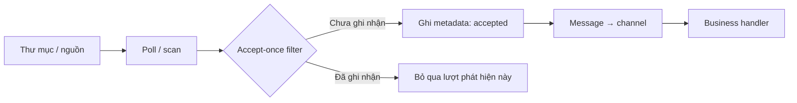
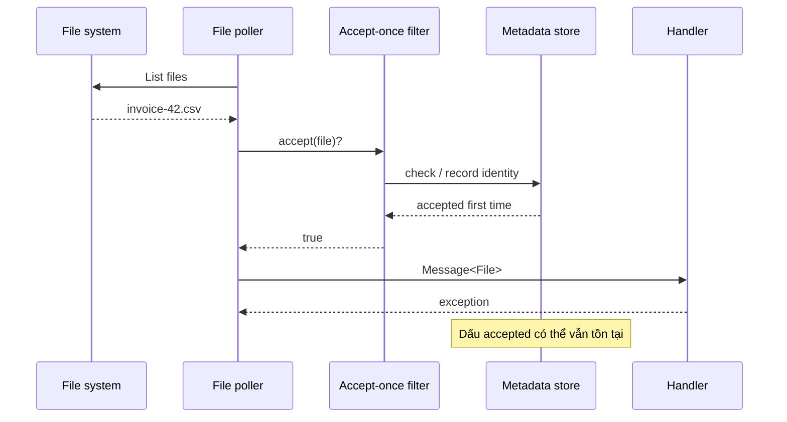
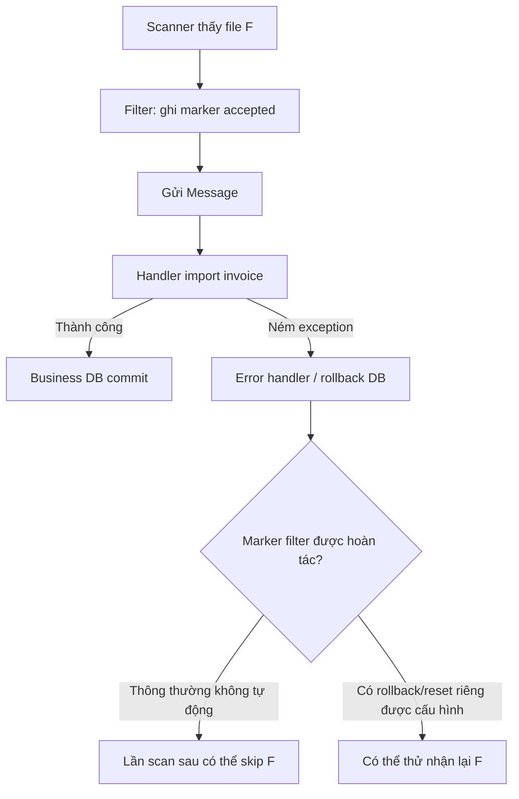
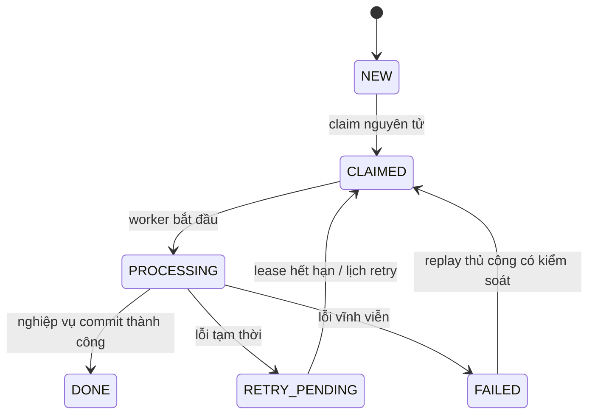
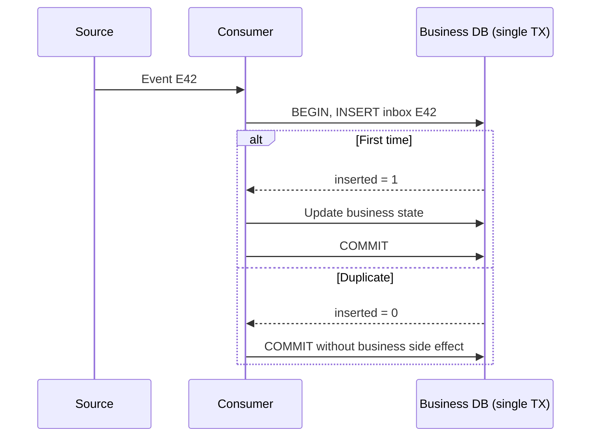
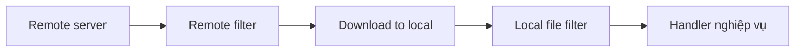
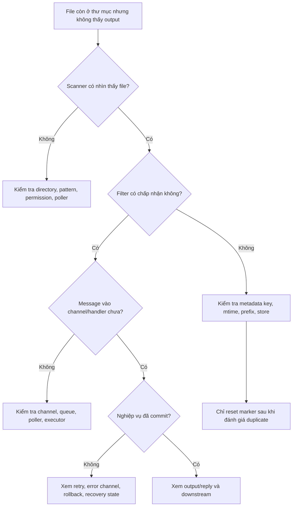
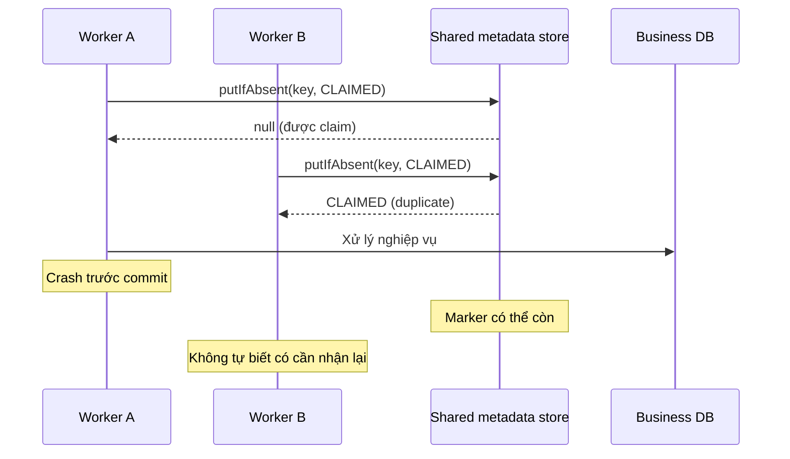

# Accept-once pattern và trạng thái đã xử lý

Trong **Spring Integration runtime**, message có thể đi từ nguồn vào channel, được poller lấy ra, chuyển qua consumer endpoint rồi mới tới handler. Khi poller đọc một thư mục hoặc một nguồn có khả năng trả về cùng một bản ghi nhiều lần, hệ thống cần tránh nhập lại dữ liệu đã thấy. **Accept-once pattern** giải quyết bước đầu tiên: nhận diện một đối tượng đã được *chấp nhận* hay chưa.

Tuy nhiên, có một ranh giới rất quan trọng: **“đã chấp nhận” không đồng nghĩa “đã xử lý nghiệp vụ thành công”**. Một file có thể được Accept-Once filter đánh dấu từ lúc quét thư mục, nhưng handler phía sau lại timeout. Nếu thiếu transaction hoặc cơ chế recovery phù hợp, lần poll tiếp theo có thể bỏ qua file đó dù chưa xử lý xong.

Bài thuộc chương **Metadata store**, trong module `SPRING_INTEGRATION_RUNTIME`. Nội dung tập trung vào Accept-Once filter, `MetadataStore`, `ConcurrentMetadataStore`, trạng thái đã xử lý, các giới hạn khi retry/redelivery, cách vận hành trên nhiều instance và quy trình chẩn đoán message “biến mất” hoặc bị xử lý lặp.

## 1. Bài toán: một nguồn có thể xuất hiện nhiều lần

Giả sử dịch vụ định kỳ đọc thư mục `incoming/`. File `invoice-42.csv` có mặt trong cả ba lượt quét:

```text
10:00:00  scan #1 -> invoice-42.csv
10:00:05  scan #2 -> invoice-42.csv
10:00:10  scan #3 -> invoice-42.csv
```

Nếu mỗi lần quét đều chuyển file cho handler, một hóa đơn có thể được nhập ba lần. Accept-once filter ghi nhớ một **danh tính hoặc phiên bản** của file đã được chấp nhận để những lần quét sau không phát lại cùng đầu vào một cách vô tình.



Biểu đồ cho thấy metadata được ghi ở **bước chọn đầu vào**, trước khi handler xác nhận thành công. Đây chính là lý do không thể chỉ nhìn trạng thái filter để kết luận công việc đã hoàn tất.

### 1.1. Phân biệt bốn trạng thái

| Thuật ngữ | Ý nghĩa | Có chứng minh xử lý nghiệp vụ thành công không? |
| --- | --- | --- |
| **Discovered** | Poller/scanner nhìn thấy đối tượng | Không |
| **Accepted** | Bộ lọc cho đối tượng đi vào flow | Không |
| **Processing** | Một consumer đang thực hiện nghiệp vụ | Chưa |
| **Processed/Completed** | Điều kiện thành công nghiệp vụ được commit/xác nhận | Có, **nếu** trạng thái này được ghi đúng ranh giới giao dịch |

Một hệ thống có thể sử dụng thêm `FAILED`, `RETRY_PENDING`, `QUARANTINED`, nhưng đó là **trạng thái nghiệp vụ do ứng dụng thiết kế**, không phải những trạng thái tự động có sẵn của tất cả Accept-Once filter.

## 2. Accept-once là “lọc ứng viên”, không phải exactly-once delivery

Trong Spring Integration, Accept-Once thường được biểu diễn bởi một `FileListFilter` cho inbound file adapter. Filter trả lời: “Đối tượng này có đủ điều kiện để đưa vào nguồn xử lý lần này không?”.



Trong trường hợp xử lý thất bại, liệu metadata được rollback hay xóa hay không phụ thuộc **filter, source và code xử lý lỗi cụ thể**. Không nên suy ra rằng handler ném exception sẽ tự gọi lại filter hoặc tự trả file vào hàng đợi nguồn.

Đặc biệt:

- **At-most-once selection**: bản ghi đã được đánh dấu có thể không được chọn lại dù lần trước thất bại.
- **At-least-once processing**: nguồn/broker có thể giao lại sau rollback, nên handler phải chấp nhận duplicate.
- **Exactly-once business effect**: muốn đạt hiệu quả không nhân đôi tác dụng phụ cần idempotency, transaction, deduplication và hợp đồng nghiệp vụ phù hợp.

Accept-once filter **không tự biến** các thao tác HTTP, ghi DB, gửi email hoặc publish message thành một giao dịch exactly-once.

## 3. Các lớp Accept-Once thường gặp

Spring Integration có các bộ lọc cho nguồn file nội bộ và nguồn remote như FTP/SFTP. Tên class, constructor và khả năng cập nhật phiên bản phụ thuộc loại nguồn và phiên bản thư viện.

| Thành phần | Trạng thái ghi nhớ ở đâu? | Trường hợp phù hợp | Giới hạn |
| --- | --- | --- | --- |
| `AcceptOnceFileListFilter` | Trong bộ nhớ instance của filter | Demo, nguồn đơn giản, một tiến trình | Restart làm mất tập đã thấy; không chia sẻ giữa node |
| `FileSystemPersistentAcceptOnceFileListFilter` | Qua `ConcurrentMetadataStore` | File nội bộ cần giữ trạng thái scan sau restart | Chỉ bền vững nếu store bền vững; vẫn không chứng minh handler thành công |
| Các persistent accept-once filter cho FTP/SFTP | Qua metadata store tương ứng | Tránh tải lại remote file đã được chọn | Phải hiểu cách xác định file/modified timestamp và cả filter local |
| `IdempotentReceiverInterceptor` + `MetadataStoreSelector` | Qua metadata store được cấu hình | Chống xử lý duplicate tại consumer endpoint | Vị trí kiểm tra nằm trong flow; kết quả tùy cách xử lý duplicate |

```text
                 Ranh giới chọn đối tượng          Ranh giới xử lý message
Remote/File scan -> FileListFilter -> inbound channel -> IdempotentReceiver -> handler
                      |                                     |
                  accepted key                          business key
```

Chọn đúng vị trí bảo vệ là điều quan trọng. File filter hoạt động theo khái niệm **file** hoặc đối tượng của nguồn; idempotent receiver hoạt động theo **message nghiệp vụ**. Một đơn hàng có thể được nhận từ hai file khác nhau, hoặc một file chứa nhiều đơn hàng; khi đó hai loại khóa dedup không tương đương.

## 4. MetadataStore và ConcurrentMetadataStore

`org.springframework.integration.metadata.MetadataStore` là giao diện lưu cặp `key → value`. Trong các tình huống nhiều thread hoặc nhiều instance cần cạnh tranh nhận cùng một công việc, giao diện `ConcurrentMetadataStore` cung cấp các thao tác kiểu **compare-and-set** như:

- `putIfAbsent(key, value)`: chỉ ghi khi chưa có key.
- `replace(key, oldValue, newValue)`: chỉ thay nếu value hiện tại đúng kỳ vọng.
- Cùng các thao tác `get`, `put` và `remove` theo giao diện metadata store.

Các thao tác điều kiện giúp hạn chế race condition: không phải hai worker đều đọc thấy “chưa có” rồi cùng nhận việc. Nhưng **atomicity thực tế chỉ ở phạm vi mà backend bảo đảm**. `SimpleMetadataStore` an toàn cho nhiều thread trong **một JVM**, không tự đồng bộ giữa hai ứng dụng chạy trên hai máy khác nhau.

### 4.1. Ví dụ rất nhỏ với SimpleMetadataStore

```java
import org.springframework.integration.metadata.ConcurrentMetadataStore;
import org.springframework.integration.metadata.SimpleMetadataStore;

public class FirstClaimExample {
    public static void main(String[] args) {
        ConcurrentMetadataStore store = new SimpleMetadataStore();
        String key = "inbound:v1:invoice-42";

        String first = store.putIfAbsent(key, "ACCEPTED");
        String second = store.putIfAbsent(key, "ACCEPTED");

        System.out.println(first == null);   // true: lần đầu chiếm được key
        System.out.println(second == null);  // false: key đã có
        System.out.println(store.get(key));   // ACCEPTED
    }
}
```

Ở ví dụ trên, `"ACCEPTED"` **chỉ là value do ứng dụng đặt để minh họa**, không phải định dạng metadata bắt buộc của Spring Integration file filter. Không nên tự sửa value của các entry do bộ lọc framework quản lý khi chưa biết định dạng và quy tắc so sánh của nó.

### 4.2. Metadata store khác message store

| | Metadata store | Message store / message group store |
| --- | --- | --- |
| Mục đích chính | Lưu khóa/giá trị trạng thái, checkpoint, marker | Giữ message, queue hoặc group của message |
| Đối tượng lưu điển hình | `source:file/version → marker` | Payload, headers và metadata của message |
| Đủ để replay message sau crash? | **Không**, nếu chỉ lưu marker | Có thể, nếu backing store và transaction hỗ trợ |
| Ví dụ | `SimpleMetadataStore`, `JdbcMetadataStore` | `JdbcChannelMessageStore`, `JdbcMessageStore` |

Metadata store giúp trả lời **“đã nhìn/đã nhận đối tượng này chưa?”**, còn message store có thể giữ **“đối tượng đang chờ xử lý nào?”**. Tùy yêu cầu độ tin cậy, cần cả hai hoặc một mô hình inbox có trạng thái riêng.

### 4.3. Chọn backend

| Backend minh họa | Đặc điểm | Khi sử dụng cần kiểm tra |
| --- | --- | --- |
| `SimpleMetadataStore` | Trong RAM, dễ thiết lập | Mất khi restart, không dùng để đồng bộ cluster |
| `PropertiesPersistingMetadataStore` | Lưu dạng properties trên filesystem | Đồng bộ nhiều instance, flush/persist, quyền ghi |
| `JdbcMetadataStore` | Dùng bảng JDBC | Schema, transaction, SQL concurrency, retention |
| `RedisMetadataStore` | Chia sẻ qua Redis | Atomic commands, key namespace, persistence/eviction |

**Bền vững** và **concurrent** là hai thuộc tính riêng. Một store ghi được ra ổ đĩa chưa chắc an toàn khi hai JVM cùng cập nhật; một store concurrent trong RAM chưa chắc giữ được key sau restart. Hãy kiểm tra đặc tính backend cụ thể trước khi chạy nhiều instance.

## 5. Ví dụ: FileSystemPersistentAcceptOnceFileListFilter

Giả sử một poller đọc file tại `./incoming` và muốn nhớ những file đã được chọn qua nhiều lượt quét. `FileSystemPersistentAcceptOnceFileListFilter` là một lựa chọn cho **file nội bộ**. Ví dụ Java 17+ dưới đây dùng Spring Integration file adapter và Spring Integration DSL; ứng dụng cần `spring-integration-file` trên classpath.

```java
import java.io.File;
import java.time.Duration;

import org.springframework.context.annotation.Bean;
import org.springframework.context.annotation.Configuration;
import org.springframework.integration.annotation.EnableIntegration;
import org.springframework.integration.dsl.IntegrationFlow;
import org.springframework.integration.dsl.Pollers;
import org.springframework.integration.file.FileReadingMessageSource;
import org.springframework.integration.file.filters.FileSystemPersistentAcceptOnceFileListFilter;
import org.springframework.integration.metadata.ConcurrentMetadataStore;
import org.springframework.integration.metadata.SimpleMetadataStore;

@Configuration
@EnableIntegration
public class FileAcceptOnceConfig {

    @Bean
    ConcurrentMetadataStore inboundMetadataStore() {
        // Demo: trong RAM. Production cần backend bền vững nếu phải qua restart.
        return new SimpleMetadataStore();
    }

    @Bean
    IntegrationFlow invoiceFileFlow(ConcurrentMetadataStore inboundMetadataStore) {
        FileReadingMessageSource source = new FileReadingMessageSource();
        source.setDirectory(new File("./incoming"));
        source.setAutoCreateDirectory(true);
        source.setFilter(
                new FileSystemPersistentAcceptOnceFileListFilter(
                        inboundMetadataStore, "invoice-import:v1:"));

        return IntegrationFlow
                .from(source, endpoint ->
                        endpoint.poller(Pollers.fixedDelay(Duration.ofSeconds(3))))
                .handle(File.class, (file, headers) -> {
                    System.out.println("Accepted file: " + file.getName());
                    // Thay bằng import thật + giao dịch / idempotency phù hợp.
                    return null;
                })
                .get();
    }
}
```

**Lưu ý về ví dụ:** `SimpleMetadataStore` được dùng để quan sát semantics nhưng **không bền vững qua restart**. Thay bằng một `ConcurrentMetadataStore` bền vững và chia sẻ đúng cách khi cần khôi phục hoặc chạy nhiều replica. Ví dụ chưa hề xác nhận dữ liệu hóa đơn đã commit; handler chỉ in log.

### 5.1. Điều gì được ghi khi file được chấp nhận?

Một persistent file filter thường dùng **thông tin nhận diện file và phiên bản/modified timestamp** để so sánh với metadata lưu trước đó. Vì vậy nếu file đổi nội dung và timestamp thay đổi, cùng đường dẫn **có thể được chấp nhận lại** tùy implementation. Đây là hành vi khác với “mỗi đường dẫn chỉ chạy đúng một lần mãi mãi”.

```text
scan #1: ./incoming/invoice-42.csv, mtime=T1 -> accepted
scan #2: ./incoming/invoice-42.csv, mtime=T1 -> duplicate, skip
scan #3: ./incoming/invoice-42.csv, mtime=T2 -> có thể được accept lại
```

Không được giả định timestamp chính xác tuyệt đối: file system có độ phân giải thời gian khác nhau, producer có thể giữ nguyên timestamp sau khi thay nội dung, đồng bộ remote có thể cập nhật timestamp và file có thể đang được ghi dở. Nếu tính đúng đắn phụ thuộc **phiên bản nội dung**, hãy cân nhắc content hash, version từ hệ thống nguồn hoặc nghiệp vụ invoice ID, thay vì chỉ dựa vào đường dẫn và mtime.

### 5.2. Ổn định file trước khi nhận

Không nên cho poller đọc một file lớn đang được producer ghi chưa xong. Các kỹ thuật phổ biến:

1. Producer ghi vào tên tạm (`.tmp`), hoàn tất rồi **rename atomically** sang tên cuối nếu file system hỗ trợ.
2. Dùng lọc tuổi file như `LastModifiedFileListFilter` khi phù hợp để tránh quá mới.
3. Có marker riêng như `.ready` hoặc giao thức xác nhận từ producer.
4. Kiểm tra kích thước/checksum khi nghiệp vụ cần tính toàn vẹn.

**Accept-once không phải file-stability filter.** Nếu nó đánh dấu file ở lúc còn ghi dở, bản thân việc được nhận một lần chưa chứng minh payload hợp lệ.

## 6. Đường lỗi: “đã accept nhưng chưa process”

Xét một file được đưa qua `FileReadingMessageSource → DirectChannel → ServiceActivator`:



Trong trường hợp thông thường, marker filter được ghi **trước** khi business transaction commit. Nếu database rollback mà marker không rollback, metadata tạo một **khoảng trống mất việc**: không có kết quả nghiệp vụ, nhưng file lại không được chọn.

| Thời điểm crash/lỗi | Marker accept-once | Kết quả nghiệp vụ | Rủi ro |
| --- | --- | --- | --- |
| Trước khi filter chấp nhận | Chưa ghi | Chưa làm | File có thể được nhận lần sau |
| Sau khi filter chấp nhận, trước khi handler chạy | Đã ghi | Chưa làm | File bị skip khi quét lại |
| Handler thất bại, DB rollback | Có thể vẫn ghi | Chưa commit | Mất cơ hội retry nếu không có recovery |
| DB commit thành công, nhưng phản hồi/ack cuối bị mất | Có thể còn marker hoặc nguồn redeliver | Đã commit | Duplicate nếu không có business idempotency |
| Sau khi mọi thứ hoàn tất | Đã ghi | Đã commit | Trạng thái hợp lệ nếu key/retention đúng |

Vì vậy khi thiết kế cần tách **source acceptance** khỏi **business completion**. Một transaction ở handler không tự nối metadata store và nguồn file thành transaction nguyên tử. Nếu muốn “nhận → xử lý → đánh dấu DONE” có tính nhất quán, cần một mô hình giao dịch hoặc workflow riêng.

## 7. IdempotentReceiverInterceptor: kiểm soát ở consumer

File filter hoạt động ở mức nguồn. Nhưng duplicate cũng có thể xuất hiện sau khi message đã vào hệ thống: broker redelivery, producer gửi lại cùng event, retry qua gateway hoặc một file chứa bản ghi trùng. Khi đó, Spring Integration cung cấp `IdempotentReceiverInterceptor`, thường phối hợp với `MetadataStoreSelector` để chọn message theo khóa nghiệp vụ.

```text
Broker / HTTP / File reader
    -> Message (eventId=E42)
    -> IdempotentReceiverInterceptor
         -> MetadataStoreSelector: key=E42
         -> metadata store
    -> handler / duplicate policy
```

Ví dụ về cách xây dựng bộ chọn bằng khóa `eventId`:

```java
import org.springframework.context.annotation.Bean;
import org.springframework.context.annotation.Configuration;
import org.springframework.integration.handler.advice.IdempotentReceiverInterceptor;
import org.springframework.integration.metadata.ConcurrentMetadataStore;
import org.springframework.integration.selector.MetadataStoreSelector;

@Configuration
class ReceiverDedupConfiguration {

    @Bean
    IdempotentReceiverInterceptor orderDedupAdvice(
            ConcurrentMetadataStore metadataStore) {

        MetadataStoreSelector selector = new MetadataStoreSelector(
                message -> message.getHeaders().get("eventId"),
                metadataStore);

        return new IdempotentReceiverInterceptor(selector);
    }
}
```

Advice có thể được gắn vào **handler endpoint** bằng cơ chế advice chain của Spring Integration. Chẳng hạn, trong Java DSL, tại endpoint có thể dùng `endpoint -> endpoint.advice(orderDedupAdvice)`. Đặt nó ở **đúng endpoint**: lời gọi handler khác trong cùng IntegrationFlow không tự động kế thừa advice này.

### 7.1. Duplicate bị xử lý như thế nào?

Không nên nhầm **selector báo duplicate** với **message chắc chắn bị drop**. `IdempotentReceiverInterceptor` có cơ chế gắn dấu duplicate (thường qua header `duplicateMessage`) và các lựa chọn discard hoặc ném exception khi bị từ chối. Hành vi còn phụ thuộc cấu hình của advice; **với cấu hình mặc định, duplicate có thể vẫn tới handler với dấu duplicate**, vì vậy handler không được bỏ qua việc kiểm tra chính sách.

| Chính sách | Cách hành xử | Dùng khi nào |
| --- | --- | --- |
| Đánh dấu duplicate rồi cho flow tiếp tục | Handler có thể đọc header và quyết định bỏ qua/ghi audit | Muốn quan sát và xử lý riêng message trùng |
| Đưa sang discard channel | Tách message trùng khỏi đường nghiệp vụ | Có flow audit/discard rõ |
| Ném exception | Caller hoặc transaction error handling tiếp quản | Chỉ khi hệ thống thực sự muốn coi duplicate là lỗi |
| Dùng business inbox với unique key | Một transaction DB kiểm tra “đã xử lý” và cập nhật dữ liệu | Cần idempotency gắn với commit nghiệp vụ |

Để tránh mất message khi handler thất bại, **đừng coi metadata được ghi bởi selector là bằng chứng đã DONE**. Tùy chính sách, có thể cần điều khiển việc xử lý duplicate qua DB inbox, hoặc chỉ đánh dấu kết quả thành công sau khi transaction commit.

## 8. Vì sao putIfAbsent là cần nhưng chưa đủ?

Giả sử hai consumer cùng nhận event `ORDER-42` và đều chạy:

```java
// Sai nếu không có đồng bộ: hai worker có thể đều thấy null.
if (store.get("order:" + orderId) == null) {
    processOrder(orderId);
    store.put("order:" + orderId, "DONE");
}
```

Hai worker có thể cùng đọc `null` rồi cùng chạy. Dùng `putIfAbsent` làm bước **claim nguyên tử** sẽ hạn chế race giữa các worker **nếu tất cả dùng cùng backend có bảo đảm atomicity**:

```java
String key = "order-import:v1:" + orderId;
String prior = store.putIfAbsent(key, "CLAIMED");

if (prior == null) {
    processOrder(orderId);
} else {
    System.out.println("Already claimed: " + key);
}
```

Nhưng mã minh họa trên **chưa an toàn khi crash**:

- Nếu process dừng sau `CLAIMED`, marker có thể tồn tại mãi; không worker nào thử lại.
- Nếu process hoàn thành nhưng app crash trước ghi trạng thái `DONE`, một hệ thống có timeout lease có thể chạy lại.
- Nếu tự xóa marker lúc thất bại, worker khác có thể đã chiếm lại key; xóa thiếu điều kiện có thể phá claim của worker mới.
- Nếu phần nghiệp vụ và marker nằm ở **hai tài nguyên khác nhau**, không có atomic commit chỉ nhờ `putIfAbsent`.

Muốn một workflow phân tán đáng tin cậy, thường cần **lease có owner/version**, thời điểm hết hạn, compare-and-set khi đổi trạng thái, và kết quả nghiệp vụ **idempotent**. Generic metadata store không tự cung cấp một state machine đầy đủ chỉ bởi các phương thức `get`/`put`.

### 8.1. State machine gợi ý khi cần xử lý lại an toàn



Đây là **mô hình nghiệp vụ đề xuất**, không phải các trạng thái được `SimpleMetadataStore` hay `AcceptOnceFileListFilter` tạo sẵn. Các transition cần được ghi an toàn dưới concurrency và được phép replay khi hợp đồng nghiệp vụ đồng ý.

## 9. Giải pháp bền vững: business inbox trong cùng transaction

Nếu mục tiêu là **“mỗi sự kiện đơn hàng chỉ gây một lần cập nhật business DB”**, có thể dùng **inbox table** với unique constraint và cập nhật nghiệp vụ trong **cùng transaction DB**.

Ví dụ PostgreSQL:

```sql
CREATE TABLE processed_event (
    event_id VARCHAR(128) PRIMARY KEY,
    processed_at TIMESTAMPTZ NOT NULL DEFAULT NOW()
);

-- Trong cùng transaction với thay đổi nghiệp vụ:
BEGIN;

INSERT INTO processed_event (event_id)
VALUES ('ORDER-42:CREATED')
ON CONFLICT (event_id) DO NOTHING;

-- Ứng dụng kiểm tra số hàng được INSERT:
--   1 row  -> thực hiện UPDATE/INSERT nghiệp vụ
--   0 rows -> duplicate; không áp dụng tác dụng phụ lần hai

-- Sau khi cập nhật nghiệp vụ thành công:
COMMIT;
```

**Cần kiểm tra số hàng đã insert** trước khi chạy nghiệp vụ; đoạn SQL là minh họa trình tự transaction, không phải một stored procedure hoàn chỉnh. Nếu handler ném exception và transaction rollback, cả marker `processed_event` và các thay đổi DB nghiệp vụ đều rollback. Khi nguồn redeliver, event có thể được thử lại mà không bị một marker `DONE` giả chặn.



Đây là cách giảm duplicate **tác dụng phụ trong cùng DB**. Nếu handler còn gửi HTTP request, payment hoặc email, những thao tác ngoài DB transaction vẫn cần idempotency key ở downstream, outbox hoặc cơ chế đối soát riêng.

**Giới hạn quan trọng:** inbox chỉ thực sự chống xử lý trùng khi mọi worker cùng tranh chấp trên **unique key ở một hệ thống lưu trữ nhất quán**, và marker cùng cập nhật nghiệp vụ có ranh giới transaction đúng. Không nên tin vào `SELECT` kiểm tra trước rồi mới `INSERT` mà không có unique constraint.

## 10. Retry, rollback và redelivery ảnh hưởng thế nào?

Accept-once filter, retry advice và broker redelivery có thể xuất hiện trong cùng hệ thống nhưng ở các thời điểm khác nhau:

```text
File scan:
  Accept-once -> accepted marker
      |
      v
Message handler:
  attempt #1 -> lỗi
  attempt #2 -> lỗi
  RecoveryCallback -> ghi error record

Broker source (ở flow khác):
  delivery #1 -> handler lỗi -> rollback
  delivery #2 -> handler chạy lại
```

| Tình huống | Có làm metadata accept-once tự đổi trạng thái không? | Cần gì thêm? |
| --- | --- | --- |
| Handler retry cùng một message | Không mặc nhiên | Chặn side effect duplicate trong từng attempt |
| Poller transaction rollback DB | Không tự rollback metadata store ở nguồn khác | Cùng transaction resource hoặc cơ chế recovery |
| Broker redelivery | Filter ở upstream có thể không chạy lại | Idempotency tại consumer |
| Recovery callback chỉ ghi log rồi trả | Marker accept-once vẫn có thể tồn tại | Durable error record/replay policy |
| File đổi timestamp | Persistent filter có thể accept phiên bản mới | Business dedup nếu nội dung vẫn là cùng hóa đơn |
| Ứng dụng restart với `SimpleMetadataStore` | Dấu đã thấy mất | Dùng store bền vững + nghiệp vụ idempotent |

Đừng cộng dồn retry của HTTP client, `RequestHandlerRetryAdvice` và broker redelivery mà không tính tổng lượt gọi downstream. Một message có thể đi qua nhiều attempt và nhiều delivery; giá trị `accepted` của một file không phản ánh các con số này.

## 11. File remote: hai ranh giới accept-once

Với FTP/SFTP inbound synchronization, nhiều hệ thống có hai giai đoạn:



**Remote filter** ngăn tải lại remote file đã thấy; **local filter** điều khiển file nội bộ nào được phát vào flow. Có hai trạng thái “đã thấy” khác nhau. Nếu chỉ nhìn metadata remote, không thể kết luận local import thành công.

Các tình huống cần thử:

- Download lỗi giữa chừng: filter/adapter có rollback acceptance hoặc reset marker không? Cần xác minh theo loại remote file filter và phiên bản.
- Download thành công nhưng handler lỗi: local file còn đó, nhưng local filter có chặn phát lại không?
- Remote file cùng tên được cập nhật: modified timestamp/version có đủ để nhận diện bản mới không?
- Hai replica cùng đồng bộ một thư mục: metadata store có thật sự shared/atomic không?
- Một file được tải về với tên tạm rồi rename: local filter sẽ nhìn tên/timestamp nào?

Không nên chỉnh tay các key do remote filter quản lý theo phỏng đoán. Các filter có thể dùng prefix, đường dẫn và timestamp với định dạng riêng. Khi cần replay, phải xác định **key thực tế của đúng filter**, tác động tới cả remote và local stage, và chống duplicate nghiệp vụ.

## 12. Namespace, phiên bản và vòng đời metadata key

Một metadata store dùng chung có thể phục vụ nhiều adapter và flow. Nếu tất cả cùng tạo key `invoice-42.csv`, hai nguồn độc lập có thể **va chạm key**:

```text
Sai:
  invoice-42.csv -> ACCEPTED

Tốt hơn về nguyên tắc:
  tenant-A:import-invoices:v1:invoice-42.csv -> marker
  tenant-B:import-invoices:v1:invoice-42.csv -> marker
```

Các persistent filter thường nhận **prefix** khi cấu hình. Prefix nên ổn định cho cùng nguồn, khác nhau giữa các nguồn và có phiên bản khi thay đổi chiến lược danh tính. Đổi prefix sẽ khiến những key trước đó **không còn khớp**, có thể gây quét và xử lý lại hàng loạt file. Đây là một thay đổi cần kế hoạch migration/replay.

### 12.1. Khi nào xóa marker?

Không có một thời hạn giữ marker đúng cho mọi hệ thống:

| Tình huống | Chính sách gợi ý |
| --- | --- |
| File chỉ tồn tại ngắn hạn, có kho lưu đã import | Có thể archive/delete file sau xử lý, giữ business dedup đủ lâu |
| Cùng tên file được tái sử dụng theo chu kỳ | Dùng key gồm version/batch thay vì xóa tùy tiện |
| Retry thủ công file lỗi | Xác minh business state trước; reset đúng marker hoặc tạo replay job |
| Metadata store tăng vô hạn | Lập retention/compaction dựa trên policy đã hoàn tất |
| Nhiều instance đang hoạt động | Dừng/điều phối consumer trước khi thao tác key thủ công |

**Xóa marker chỉ khiến bộ lọc xem đối tượng là chưa thấy**, không xóa tác dụng phụ đã commit. Nếu file đã được nhập một phần, replay có thể gây duplicate hoặc ghi đè dữ liệu. Vì vậy, thao tác “reset accept once” phải đi kèm kiểm tra business idempotency và audit.

## 13. Quan sát runtime: phân biệt accepted và processed

Trong quá trình vận hành, metric `filesAccepted` có thể tăng trong khi `invoicesCommitted` không tăng. Không nên dùng một metric thay cho metric kia.

| Metric/log | Đo điều gì? | Dấu hiệu bất thường |
| --- | --- | --- |
| `sourceDiscovered` | File/bản ghi được scanner nhìn thấy | Tăng nhanh nhưng accepted thấp |
| `filterAccepted` | Đối tượng qua bộ lọc | Cao hơn business completed trong thời gian dài |
| `filterRejectedDuplicate` | Bị skip vì đã thấy | Tăng đột ngột sau restart/config đổi |
| `handlerAttempt` | Số lượt handler chạy | Cao hơn số business event (retry/redelivery) |
| `businessCommitted` | Số nghiệp vụ đã hoàn thành | Thấp hơn accepted mà không có pending/recovery |
| `retryPending` / `quarantined` | Công việc chưa xử lý xong | Backlog tăng bất thường |
| `metadataStoreErrors` | Lỗi IO/DB/Redis khi ghi marker | Source có thể bị chặn hoặc lặp phát |

Cần gắn các khóa hữu ích vào log: `sourceId`, `filePath` hoặc remote path, `businessId`, `metadataKey` (nếu đã chuẩn hóa an toàn), `messageId`, `correlationId`, attempt và trạng thái cuối. Tránh log payload nhạy cảm hay toàn bộ tài liệu hóa đơn.

### 13.1. Chẩn đoán “file có nhưng không được xử lý”



Thứ tự điều tra này giúp phân biệt ba vấn đề khác nhau: **filter chặn từ đầu**, **message bị kẹt trong runtime**, và **handler đã chạy nhưng transaction/side effect thất bại**.

## 14. Vận hành nhiều instance và trường hợp crash

Với một ứng dụng chạy ba replica, cả ba có thể nhìn thấy cùng một file trên shared filesystem. Nếu mỗi replica dùng `SimpleMetadataStore` riêng, **mỗi instance có thể accept một lần**, dẫn tới ba lần xử lý cùng đối tượng. Khi dùng một shared `ConcurrentMetadataStore` có thao tác atomic phù hợp, chỉ một instance thường lấy được marker tại một thời điểm, nhưng điều đó **chưa giải quyết crash giữa acceptance và commit**.



Để phục hồi, thiết kế phải trả lời: **claim sống bao lâu**, ai có quyền lấy lại, cách biết worker cũ thật sự đã dừng, có cần fencing token, và làm sao bảo đảm cập nhật nghiệp vụ không bị nhân đôi. Nếu chỉ gắn TTL cho metadata, key có thể hết hạn trong khi worker cũ vẫn đang chạy, dẫn tới **hai worker cùng xử lý**.

Các yêu cầu production thường gồm:

1. Shared atomic claim cho nhiều instance, nếu source cho phép cạnh tranh.
2. Lease/version hoặc ownership an toàn khi chuyển quyền.
3. Durable pending/recovery queue nếu công việc không được phép mất.
4. Business inbox/dedup có unique constraint và transaction phù hợp.
5. Giới hạn retry, DLQ/quarantine cho lỗi vĩnh viễn.
6. Monitoring khi `ACCEPTED` tồn tại quá lâu nhưng không có `DONE`.

## 15. Ma trận kiểm thử

| Kịch bản | Với Accept-once đơn thuần | Điều cần kiểm tra thêm |
| --- | --- | --- |
| Poller quét cùng file hai lần trong một JVM | Lần sau có thể bị skip | Đúng identity/version |
| Restart với filter trong RAM | File có thể được accept lại | Idempotent business handler |
| Restart với persistent filter và store bền vững | Có thể giữ marker đã accept | Nếu lần trước handler lỗi thì replay thế nào? |
| File cùng tên thay modified timestamp | Persistent filter có thể xem là bản mới | Business duplicate hay version thật? |
| Handler lỗi sau khi file được accept | Marker có thể vẫn tồn tại | Error record và đường replay |
| Hai replica quét cùng thư mục, store riêng | Có thể xử lý hai lần | Shared atomic store |
| Shared metadata store nhưng worker crash sau claim | Có thể mắc kẹt marker | Lease/recovery policy |
| Broker redelivery cùng eventId | File filter không ngăn ở consumer | Inbox/idempotent receiver |
| DB commit xong, message ack thất bại | Event được giao lại | Unique business event key |
| Reset prefix hoặc xóa marker hàng loạt | Nhiều file có thể được accept lại | Kế hoạch dedup và replay |

## 16. Bài thực hành

### Bài 1 — Accept-once trong RAM

Tạo `FileReadingMessageSource` với `AcceptOnceFileListFilter` hoặc dùng `SimpleMetadataStore` để quan sát claim. Đặt hai file vào thư mục, bật poller và chờ hai lượt quét. Ghi số lượng message mà handler nhận; khởi động lại để quan sát khác biệt nếu marker chỉ tồn tại trong RAM.

### Bài 2 — Persistent filter và timestamp

Đổi sang `FileSystemPersistentAcceptOnceFileListFilter` với backend `ConcurrentMetadataStore` bền vững. Poll cùng file qua restart; sau đó cập nhật mtime có chủ đích. Giải thích trường hợp nào được chấp nhận lại và vì sao đó không có nghĩa invoice mới.

### Bài 3 — Crash sau accept, trước commit

Cho handler ném exception ngay sau khi filter chấp nhận một file. Quan sát message còn được phát lại không, marker còn không và business DB có commit không. Thiết kế một recovery record kèm business key thay vì tự động xóa toàn bộ metadata.

### Bài 4 — Hai consumer cùng event ID

Gửi cùng một `eventId` vào hai consumer chạy song song. So sánh code `get()` rồi `put()` với `putIfAbsent()` trên shared `ConcurrentMetadataStore`. Sau đó crash worker đã claim, phân tích vì sao CAS vẫn chưa đủ để bảo đảm completion.

### Bài 5 — Inbox với transaction

Tạo bảng `processed_event` có unique key. Cho hai worker thử xử lý cùng một event và cập nhật một bảng nghiệp vụ trong cùng transaction. Xác minh chỉ một cập nhật business được commit. Thử ném exception để rollback; lần redelivery sau phải được phép xử lý lại.

### Bài 6 — Remote và local filter

Với một luồng SFTP inbound trong môi trường thử nghiệm, quan sát metadata remote và local. Mô phỏng download thành công nhưng handler thất bại; xác định phải reset hay replay ở tầng nào mà không làm nhập trùng những file đã thành công.

### Bài 7 — Quan sát vận hành

Thiết kế dashboard tối thiểu: discovered, accepted, duplicate rejected, attempts, completed, failed, retry pending. Tạo một lỗi có chủ đích và giải thích vì sao số `accepted` tăng nhưng số `completed` không tăng; xác định cảnh báo cần bật.

## 17. Các sai lầm thường gặp

| Sai lầm | Hệ quả | Cách sửa |
| --- | --- | --- |
| Hiểu “accepted” là “đã commit nghiệp vụ” | Mất việc khi handler lỗi | Tách dấu nhận đầu vào và trạng thái DONE |
| Dùng `SimpleMetadataStore` cho nhiều replica | Mỗi instance accept một lần | Shared concurrent backend |
| Dùng file name làm business idempotency key tuyệt đối | Cùng invoice ở hai tên file vẫn trùng | Dùng business ID hoặc content version thích hợp |
| Xóa marker sau mọi exception | Có thể phát lại cả tác dụng phụ đã commit | Kiểm tra business state và xử lý replay có kiểm soát |
| Không có expiry/recovery cho marker CLAIMED | Crash khiến công việc kẹt vô hạn | Lease, ownership, pending queue |
| Đặt TTL ngắn mà không có fencing/idempotency | Hai worker chạy cùng việc | Thiết kế ownership và unique constraint |
| Dựa vào timestamp để khẳng định nội dung không đổi | Bỏ sót file cập nhật hoặc xử lý lại ngoài ý muốn | Version/content hash khi cần |
| Mặc định IdempotentReceiverInterceptor luôn drop duplicate | Duplicate có thể vẫn vào handler | Cấu hình discard/reject và kiểm tra header |
| Nhầm MetadataStore với MessageStore | Có marker nhưng không còn payload để replay | Lưu message/recovery record phù hợp |
| Đổi prefix tùy tiện trong production | Toàn bộ nguồn có thể được accept lại | Kế hoạch migration, dedup và giám sát |

## 18. Câu hỏi tự kiểm tra

1. **Accept-once bảo đảm điều gì?** Một filter có thể không chấp nhận lại cùng đối tượng/phiên bản trong phạm vi trạng thái mà nó lưu; không bảo đảm handler thành công.
2. **`SimpleMetadataStore` giữ trạng thái sau restart không?** Không, dữ liệu mặc định nằm trong bộ nhớ JVM.
3. **Vì sao cần `putIfAbsent()` khi nhiều worker?** Để claim một key theo kiểu atomic khi backend cùng chia sẻ và hỗ trợ semantics đó.
4. **Đã ghi marker `ACCEPTED`, DB rollback thì file có được nhận lại không?** Không được giả định; marker có thể vẫn còn.
5. **`JdbcChannelMessageStore` và `JdbcMetadataStore` có cùng vai trò không?** Không; một bên lưu message của queue, bên kia lưu metadata key-value.
6. **Dùng mtime để phát hiện file mới có tuyệt đối chính xác không?** Không; còn độ phân giải timestamp, cập nhật nội dung và cách producer ghi file.
7. **IdempotentReceiverInterceptor có mặc định tương đương business transaction không?** Không.
8. **Hai replica dùng SimpleMetadataStore riêng có phối hợp claim không?** Không.
9. **Khi crash sau claim, nên làm gì?** Có lease/recovery và xác minh business state trước khi replay; không xóa key mù quáng.
10. **Cách mạnh để chống duplicate update trong một DB?** Inbox/unique business event key cùng transaction với cập nhật nghiệp vụ.

## 19. Tổng kết

**Accept-once là một bước giảm trùng lặp đầu vào, không phải trạng thái hoàn tất xử lý.** Trong Spring Integration, các file filter và metadata store giúp ghi nhớ đối tượng đã được chọn; `ConcurrentMetadataStore` giúp phối hợp claim khi chạy song song theo khả năng backend; `IdempotentReceiverInterceptor` mở rộng việc chống duplicate tới mức message.

Muốn một flow đáng tin cậy, hãy thiết kế riêng **identity của nguồn**, **khóa nghiệp vụ**, **trạng thái ACCEPTED/PROCESSING/DONE**, **transaction và idempotency**, **đường retry/recovery**, **chính sách reset marker** và **observability**. Khi một file “đã thấy nhưng chưa ra kết quả”, phải lần theo **scan → filter → metadata store → channel → handler → commit/error flow** thay vì chỉ nhìn một dấu Accept-Once.
