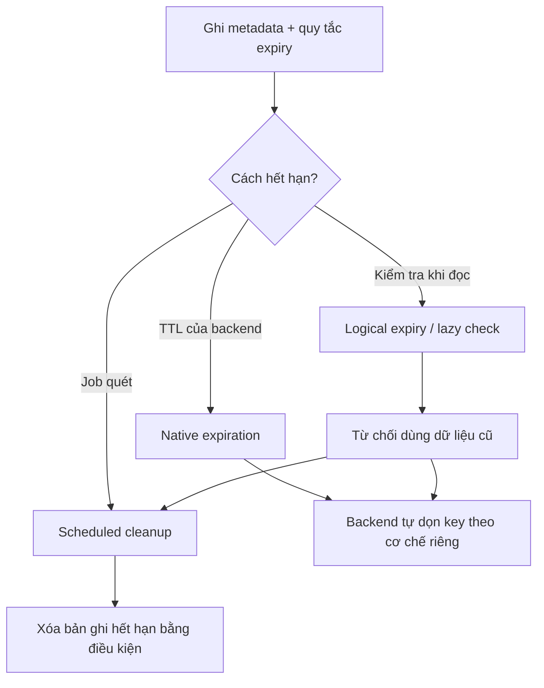
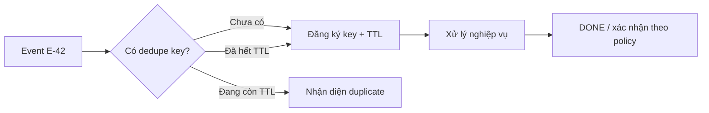

# TTL và cleanup metadata trong Spring Integration

## Mục tiêu học tập

Một Spring Integration flow thường cần ghi lại **trạng thái nhỏ**: lần cuối poll một nguồn, dấu vết file đã xử lý, khóa chống nhận trùng, checkpoint hoặc dấu hiệu một tác vụ đang được giữ bởi worker. Những giá trị này có thể được lưu bằng `MetadataStore`. Nhưng khi ứng dụng chạy nhiều tuần hoặc nhiều tháng, metadata cũ sẽ tích lũy, thay đổi ý nghĩa hoặc ngăn một message hợp lệ được xử lý. Câu hỏi khi đó là **giữ metadata bao lâu, khi nào coi là hết hiệu lực và dọn nó như thế nào mà không làm hỏng tính đúng đắn của flow?**

Bài **TTL và cleanup metadata** thuộc chương **Metadata store** của module **SPRING_INTEGRATION_RUNTIME**. Chúng ta sẽ kết hợp mô hình `MetadataStore` với message flow, channel, endpoint, consumer, poller và executor; phân tích ảnh hưởng của transaction, retry, message store, error flow và correlation đến quá trình hết hạn và dọn metadata.

Sau bài học, bạn có thể:

- Phân biệt **TTL**, hết hạn về mặt logic (*logical expiration*) và việc xóa bản ghi thực tế (*physical cleanup*).
- Giải thích tại sao hợp đồng `MetadataStore` không tự bảo đảm TTL, và lựa chọn cách triển khai cho in-memory, JDBC hoặc Redis.
- Chọn thời điểm bắt đầu tính TTL, điều kiện gia hạn, thời gian giữ dấu vết idempotency và chính sách cleanup.
- Đọc và ghi metadata có thời hạn bằng Java; xây một job dọn bản ghi hết hạn có giới hạn tải.
- Chỉ ra các race condition giữa cleanup, worker, retry và redelivery, nhất là khi nhiều instance cùng xử lý.
- Đo độ trễ cleanup, phát hiện metadata stale, và kiểm thử expiry/replay sau restart.

## 1. TTL thực sự là gì?

**TTL (time to live)** là khoảng thời gian một bản ghi được phép có hiệu lực theo hợp đồng của ứng dụng hoặc backend. Nếu đặt TTL là 10 phút từ thời điểm ghi `t0`, thì thời điểm hết hạn là `t0 + 10 phút`.

```text
t0 = 10:00           10:10                10:13
|-------------------|--------------------|
ghi metadata        TTL kết thúc         cleanup chạy
                    |
                    +-- metadata hết hạn logic;
                        bản ghi vật lý có thể vẫn nằm trong store
```

Có ba mốc cần phân biệt:

1. **`createdAt` hoặc `updatedAt`:** mốc bắt đầu tính thời gian; có thể là lúc tạo lần đầu, lần cập nhật cuối hoặc sự kiện nghiệp vụ.
2. **`expiresAt`:** thời điểm metadata không còn hợp lệ đối với các lượt xử lý mới.
3. **`deletedAt`:** thời điểm backend hoặc job cleanup thực sự xóa bản ghi.

Trong thiết kế có kiểm tra expiry khi đọc, ta có thể đạt điều kiện `now >= expiresAt` và coi bản ghi **không còn hợp lệ ngay**, dù database vẫn còn hàng. Ngược lại, nếu chỉ có cron xóa mỗi giờ và mọi consumer cứ `get()` rồi tin giá trị còn tồn tại, metadata đã quá TTL vẫn có thể được dùng thêm gần một giờ.

### 1.1. TTL tính từ lúc nào?

| Chính sách | Thời điểm đặt lại deadline | Phù hợp | Rủi ro cần kiểm soát |
| --- | --- | --- | --- |
| **Absolute TTL** | Chỉ từ lúc tạo/lần phát hành đầu | Mã xác nhận, khóa dedupe cho một khoảng cố định | Không được tự gia hạn ngoài ý muốn |
| **Sliding TTL** | Gia hạn khi có hoạt động hợp lệ | Phiên làm việc, lease hoặc cache đang được dùng | Truy cập quá thường xuyên làm dữ liệu tồn tại mãi |
| **Business deadline** | Theo mốc nghiệp vụ đã tính sẵn | Workflow chờ thanh toán đến giờ hết hạn | Đổi deadline phải có quy tắc rõ |
| **Retention sau hoàn thành** | Đếm từ lúc trạng thái DONE | Lưu dấu vết chống xử lý trùng hoặc tra soát | Dọn sớm khiến replay cũ bị coi là mới |
| **Retention sau lỗi** | Đếm từ lần thất bại cuối/đóng sự cố | Error metadata phục vụ điều tra | Kéo dài vô hạn nếu liên tục cập nhật lỗi |

Không có một giá trị TTL tối ưu cho mọi key. Ví dụ, metadata về một batch đang chạy cần sống đủ dài để các worker hoàn thành, còn dấu vết một file đã xử lý có thể phải được giữ lâu hơn chu kỳ file đó còn xuất hiện ở nguồn.

### 1.2. TTL khác timeout và retry delay

- **Timeout:** giới hạn thời gian một request, poll hoặc tác vụ được chờ.
- **Retry delay/backoff:** thời gian tạm dừng trước khi thực hiện attempt kế tiếp.
- **TTL:** thời hạn hiệu lực hoặc lưu giữ của metadata.
- **Cleanup interval:** chu kỳ tìm và xóa những bản ghi đã hết hạn.

Nếu handler mất 5 phút, retry có thể diễn ra sau 2 phút và metadata lease hết hạn sau 1 phút, worker thứ hai có thể tưởng tài nguyên đang rảnh dù worker thứ nhất vẫn xử lý. TTL ngắn không thay thế cơ chế khóa có fencing/renewal.

## 2. MetadataStore cung cấp những gì?

`MetadataStore` của Spring Integration dùng để đọc/ghi **chuỗi key → chuỗi value**, không phải cơ chế lưu trực tiếp mọi `Message<?>`. Các thao tác cốt lõi là `get(key)`, `put(key, value)` và `remove(key)`.

```java
import org.springframework.integration.metadata.MetadataStore;
import org.springframework.integration.metadata.SimpleMetadataStore;

MetadataStore store = new SimpleMetadataStore();

store.put("si:files:invoice:2026-11-22.csv", "processed");
String state = store.get("si:files:invoice:2026-11-22.csv");
String removed = store.remove("si:files:invoice:2026-11-22.csv");

System.out.println(state);   // processed
System.out.println(removed); // processed (giá trị cũ)
```

`SimpleMetadataStore` là kho in-memory thích hợp cho demo hoặc test; nội dung trong bộ nhớ không bền vững sau restart. Trong ứng dụng thực, những metadata cần giữ qua restart hoặc chia sẻ giữa nhiều replica thường dùng implementation với backend như JDBC hoặc Redis, tùy dependency/cấu hình.

Hợp đồng cơ bản **không định nghĩa một phương thức TTL chung** như `put(key, value, Duration)` hoặc `expire(key, Duration)`. Vì vậy, chỉ vì bạn chọn `MetadataStore` không có nghĩa metadata sẽ tự hết hạn sau một khoảng thời gian. Một backend có thể có tính năng TTL ở tầng riêng, nhưng cách bật, scope và độ chính xác phụ thuộc implementation.

### 2.1. ConcurrentMetadataStore

`ConcurrentMetadataStore` mở rộng các khả năng cập nhật có điều kiện như `putIfAbsent(key, value)` và `replace(key, oldValue, newValue)`. Những thao tác này có ích khi nhiều consumer cần tránh ghi đè hoặc tranh chấp cùng một key:

```java
import org.springframework.integration.metadata.ConcurrentMetadataStore;

ConcurrentMetadataStore concurrentStore = /* bean có hỗ trợ CAS */ null;

// Minh họa hợp đồng: putIfAbsent trả về null nếu ghi mới thành công.
String previous = concurrentStore.putIfAbsent(
        "si:jobs:ORD-42", "worker-a");
boolean claimed = previous == null;

boolean updated = concurrentStore.replace(
        "si:jobs:ORD-42", "worker-a", "worker-a:processing");
```

Đoạn này minh họa ngữ nghĩa thao tác, **không phải chương trình chạy độc lập** (biến `concurrentStore` cần được inject bằng bean thật). So với chuỗi `get() -> if null -> put()`, thao tác nguyên tử theo hợp đồng implementation giúp giảm race condition trong trường hợp cạnh tranh.

Tuy nhiên, `ConcurrentMetadataStore` **không tự cấp TTL phân tán, lease renewal hay fencing token**. Điều kiện một key hết hạn theo thời gian vẫn cần được thiết kế và thực thi đúng ở backend.

### 2.2. MetadataStore khác MessageStore

| Cơ chế | Key/value điển hình | Dùng khi nào |
| --- | --- | --- |
| `MetadataStore` | `String key -> String value` | Checkpoint, dấu vết idempotency, trạng thái nhỏ |
| `ConcurrentMetadataStore` | Chuỗi key/value có thao tác cập nhật có điều kiện | Metadata có cạnh tranh giữa nhiều worker |
| `MessageStore` | UUID của message ID → `Message<?>` | Giữ và lấy lại message |
| `MessageGroupStore` | Group ID → nhiều message | Aggregator, resequencer, state của message group |
| Error store/DLQ | Khóa lỗi/bản ghi nghiệp vụ → dữ liệu phục hồi | Điều tra, sửa lỗi, replay có kiểm soát |

Xóa một metadata key **không tự xóa message** trong `MessageStore`, không tự ack broker và không làm một `IntegrationFlow` dừng chạy.

## 3. Vì sao metadata bị stale?

Metadata stale là dữ liệu còn tồn tại nhưng đã hết ý nghĩa, chẳng hạn:

- Dấu vết “file đã xử lý” còn giữ cho một file mới cùng tên nhưng có nội dung mới.
- Checkpoint trỏ đến vị trí cũ dù nguồn dữ liệu đã được reset.
- Key “đang xử lý” còn sau khi worker crash.
- Dấu vết chống nhận trùng bị dọn quá sớm khiến một message cũ được chấp nhận lần nữa.
- Bản ghi phiên làm việc hoặc correlation của workflow đã đóng nhưng vẫn nằm trong store.
- Key có prefix/version cũ sau khi ứng dụng nâng cấp, không còn được code mới đọc nữa.

Không phải stale nào cũng giải quyết bằng **xóa nhanh hơn**. Ví dụ checkpoint của inbound adapter thường cần tồn tại qua restart để tránh xử lý lại dữ liệu đã đọc; xóa checkpoint vì “quá 24 giờ” có thể gây reprocessing toàn bộ nguồn. Ngược lại, một lease lỗi có thể cần được thu hồi để hệ thống chạy tiếp.

### 3.1. Lập bản đồ các loại metadata

Trước khi đặt TTL, ghi rõ mục đích và chủ sở hữu của từng nhóm key:

| Loại key | Ví dụ | Chính sách gợi ý | Khi hết hạn có thể xảy ra gì? |
| --- | --- | --- | --- |
| Dedupe/idempotency | `si:dedupe:order:ORD-42` | Giữ dài hơn cửa sổ redelivery/replay cần chặn | Message cũ có thể được nhận lại |
| Poller checkpoint | `si:poller:orders:cursor` | Thường không TTL tùy tiện; quản lý theo vòng đời nguồn | Đọc lại, bỏ qua hoặc sai vị trí |
| Inbound file filter | `si:file:processed:<path>` | Phù hợp vòng đời file và cách so sánh timestamp | File ở nguồn có thể bị xử lý lại |
| Lease/claim tạm | `si:lease:job:42` | TTL ngắn có renew và chống owner cũ ghi tiếp | Hai worker có thể cùng xử lý |
| Cache trạng thái phụ | `si:lookup:sku:42` | TTL theo độ mới dữ liệu | Cache miss và gọi backend |
| Lỗi đang chờ tra soát | `si:error:order:ORD-42` | Theo chính sách lưu lỗi/retention | Mất bằng chứng/khả năng replay |
| Correlation state phụ | `si:workflow:run:abc` | Theo deadline của workflow và xử lý late arrival | Không còn đối chiếu được message đến muộn |

Đặt **prefix có namespace và phiên bản schema**, ví dụ `si:runtime:v1:dedupe:tenant-a:ORD-42`, để nhiều flow không vô tình đè key của nhau. Đừng đặt `orderId` làm key chung nếu nhiều tenant có thể dùng cùng giá trị.

## 4. Ba chiến lược TTL và cleanup



| Chiến lược | Tác động lúc đọc | Tác động lên dung lượng | Điểm cần cẩn thận |
| --- | --- | --- | --- |
| **Logical TTL / lazy check** | Đọc bản ghi rồi so `expiresAt`; từ chối khi quá hạn | Không tự giải phóng dữ liệu | Dễ tồn dư nếu không có cleanup |
| **Native backend TTL** | Backend tự coi key hết hạn theo semantics riêng | Có thể giải phóng dữ liệu nền | Expiry có thể không diễn ra đúng từng mili giây; API/namespace phải đúng |
| **Scheduled cleanup** | Nếu consumer không check expiry, vẫn có thể thấy bản ghi stale trước lượt dọn | Dọn theo đợt, kiểm soát tải | Race với tác vụ refresh, multi-instance, DB contention |

Hai chiến lược có thể phối hợp: **kiểm tra expiry trên đường đọc để bảo đảm đúng hợp đồng**, đồng thời **job nền xóa vật lý** nhằm giữ dung lượng ổn định. Nếu backend cung cấp TTL native phù hợp, có thể không cần job xóa riêng cho chính những key đó; vẫn cần quan sát trạng thái và hiệu quả của cơ chế expiry.

## 5. Ví dụ Java: TTL logic trên MetadataStore

Ta có thể đóng gói deadline vào giá trị `String` của `MetadataStore`. Ví dụ này giúp hiểu semantics của TTL mà không cần Redis hay database; phù hợp cho test và một application instance đơn giản.

```java
import java.time.Clock;
import java.time.Duration;
import java.util.Optional;

import org.springframework.integration.metadata.MetadataStore;
import org.springframework.integration.metadata.SimpleMetadataStore;

final class ExpiringMetadataView {
    private final MetadataStore store;
    private final Clock clock;

    ExpiringMetadataView(MetadataStore store, Clock clock) {
        this.store = store;
        this.clock = clock;
    }

    void put(String key, String value, Duration ttl) {
        if (ttl.isNegative() || ttl.isZero()) {
            throw new IllegalArgumentException("ttl must be positive");
        }

        long expiresAtMillis =
                Math.addExact(clock.millis(), ttl.toMillis());

        // Format demo: <expiresAtMillis>|<value>
        store.put(key, expiresAtMillis + "|" + value);
    }

    Optional<String> getFresh(String key) {
        String encoded = store.get(key);
        if (encoded == null) {
            return Optional.empty();
        }

        int separator = encoded.indexOf('|');
        if (separator <= 0) {
            throw new IllegalStateException("Malformed metadata");
        }

        long expiresAtMillis = Long.parseLong(
                encoded.substring(0, separator));

        // Ngay khi quá hạn, caller không được sử dụng giá trị này.
        if (clock.millis() >= expiresAtMillis) {
            return Optional.empty();
        }

        return Optional.of(encoded.substring(separator + 1));
    }
}

// Ví dụ dùng:
MetadataStore store = new SimpleMetadataStore();
Clock start = Clock.systemUTC();
ExpiringMetadataView view = new ExpiringMetadataView(store, start);

view.put("si:runtime:v1:cache:SKU-42", "available", Duration.ofMinutes(10));

Optional<String> state =
        view.getFresh("si:runtime:v1:cache:SKU-42");
```

**Giới hạn quan trọng của ví dụ:**

1. `getFresh()` trả `Optional.empty()` khi hết hạn, nhưng **không xóa** key khỏi `SimpleMetadataStore`. Nó thể hiện logical expiry, chưa phải cleanup.
2. `put()` ghi đè giá trị hiện có; không có chính sách claim độc quyền, CAS, chống race hoặc transaction trong wrapper.
3. Giá trị chứa dấu phân cách `|` vẫn được giữ sau dấu đầu tiên; định dạng này chỉ để học. Production nên có schema/version và validation rõ ràng.
4. Kiểu `Clock` được inject giúp dùng `Clock.fixed` hoặc `Clock.offset` trong test, thay vì phải chờ thời gian thật.
5. Với nhiều instance, đồng hồ của các node có thể lệch. Nếu deadline quyết định quyền sở hữu công việc, nên dùng mốc thời gian nhất quán ở backend hoặc cơ chế lease chuyên biệt.

### 5.1. Kiểm thử hết hạn mà không cần sleep

```java
import java.time.Clock;
import java.time.Duration;
import java.time.Instant;
import java.time.ZoneOffset;

import org.springframework.integration.metadata.MetadataStore;
import org.springframework.integration.metadata.SimpleMetadataStore;

MetadataStore store = new SimpleMetadataStore();
Clock t0 = Clock.fixed(
        Instant.parse("2026-11-22T00:00:00Z"), ZoneOffset.UTC);

new ExpiringMetadataView(store, t0).put(
        "demo:key", "active", Duration.ofMinutes(10));

Clock before = Clock.offset(t0, Duration.ofMinutes(9));
Clock after = Clock.offset(t0, Duration.ofMinutes(11));

System.out.println(new ExpiringMetadataView(store, before)
        .getFresh("demo:key")); // Optional[active]

System.out.println(new ExpiringMetadataView(store, after)
        .getFresh("demo:key")); // Optional.empty
```

Thử nghiệm này chứng minh **logic đánh giá deadline**, không chứng minh bản ghi vật lý đã biến mất. Sau khi hết hạn, `store.get("demo:key")` vẫn có thể trả chuỗi đã lưu cho đến khi có bước cleanup.

### 5.2. Vì sao không remove ngay trong getFresh?

Giả sử worker A đọc ra bản ghi cũ, chuẩn bị xóa. Trong lúc đó worker B cập nhật cùng key bằng một deadline mới. Nếu A gọi `store.remove(key)` không có điều kiện, A có thể xóa luôn bản ghi mới của B:

```text
A: get(key) -> expiresAt=10:00 (stale)
B: put(key, "expiresAt=11:00|processing")
A: remove(key) -> xóa cả bản ghi mới!
```

Do đó, ví dụ `getFresh` chỉ **bỏ qua dữ liệu hết hạn**. Cleanup trong hệ thống cạnh tranh cần thao tác xóa có điều kiện dựa trên giá trị/deadline hiện tại và bảo đảm nguyên tử của backend. `ConcurrentMetadataStore.replace(...)` không nên được ngộ nhận là API `remove(key, expectedValue)` phổ quát.

## 6. Native TTL với Redis: dùng đúng tầng API

Redis có cơ chế expiry riêng cho key. Với **dữ liệu TTL do ứng dụng sở hữu**, có thể dùng Spring Data Redis để đặt value và TTL trong cùng thao tác. Điều này thể hiện native expiration của backend; nó **không có nghĩa mọi implementation `MetadataStore` tự nhận một `Duration`**.

```java
import java.time.Duration;

import org.springframework.data.redis.core.StringRedisTemplate;

final class RedisTtlMetadata {
    private final StringRedisTemplate redis;

    RedisTtlMetadata(StringRedisTemplate redis) {
        this.redis = redis;
    }

    void rememberRecentEvent(String eventKey) {
        String key = "si:runtime:v1:recent-event:" + eventKey;

        // SET kèm TTL: value tồn tại tối đa 15 phút theo Redis.
        redis.opsForValue().set(key, "seen", Duration.ofMinutes(15));
    }

    boolean seenRecently(String eventKey) {
        String key = "si:runtime:v1:recent-event:" + eventKey;
        return "seen".equals(redis.opsForValue().get(key));
    }
}
```

Ở đây key nằm trong một **namespace riêng thuộc quyền ứng dụng**. Không dùng đoạn code này để tự sửa key vật lý nội bộ của `RedisMetadataStore` nếu chưa kiểm tra prefix, serializer và hợp đồng implementation. Việc có bean `RedisMetadataStore` không làm lời gọi `MetadataStore.put(key, value)` trong ví dụ mục 2 tự có TTL 15 phút.

### 6.1. Atomic put-if-absent với TTL

Đối với một dấu vết chống nhận trùng **trong một cửa sổ thời gian giới hạn**, ứng dụng có thể cần thao tác “chỉ ghi nếu key chưa tồn tại, đồng thời đặt TTL”:

```java
import java.time.Duration;

import org.springframework.data.redis.core.StringRedisTemplate;

boolean firstWithinWindow(
        StringRedisTemplate redis,
        String tenantId,
        String eventId) {

    String key = "si:runtime:v1:dedupe:"
            + tenantId + ":" + eventId;

    Boolean accepted = redis.opsForValue().setIfAbsent(
            key, "seen", Duration.ofHours(24));

    return Boolean.TRUE.equals(accepted);
}
```

Khi backend hỗ trợ thao tác nguyên tử tương ứng, `setIfAbsent` kèm TTL giúp tránh khoảng trống giữa `SETNX` và `EXPIRE`. Tuy nhiên, nó chỉ cung cấp **chống nhận trùng trong thời gian key còn hiệu lực**, không cung cấp exactly-once mãi mãi. Sau 24 giờ, key có thể hết hạn và cùng `eventId` có thể được chấp nhận lại.

Với nghiệp vụ quan trọng, phải quyết định xem có được đánh dấu `seen` **trước** khi thực hiện side effect hay không. Nếu ghi `seen` thành công rồi worker crash trước khi xử lý nghiệp vụ, lần gửi lại có thể bị chặn dù công việc chưa hoàn thành. Khi cần, hãy dùng mô hình trạng thái `PENDING/PROCESSING/DONE`, transaction/queue phù hợp hoặc idempotency ở hệ thống đích, thay vì chỉ một key `seen`.

### 6.2. TTL không phải distributed lock an toàn

Một TTL key dùng làm lease không đủ để bảo đảm một worker cũ ngừng ghi khi lease hết hạn. Worker A có thể treo GC lâu hơn TTL; worker B lấy được lease mới; A tỉnh lại và vẫn gọi API. Khi thao tác có side effect, cần cơ chế **fencing token**, cập nhật có điều kiện hoặc bảo vệ tại resource đích.

Cũng không được gọi `redis.delete(key)` từ một owner cũ mà không xác nhận quyền sở hữu: key có thể đã hết hạn và được owner mới chiếm. Xóa an toàn cần compare-and-delete nguyên tử theo token hoặc một cơ chế lock/lease đã được kiểm chứng.

## 7. Scheduled cleanup: ví dụ với bảng JDBC do ứng dụng sở hữu

Không phải backend nào cũng có expiry native phù hợp. Với metadata được lưu trong **bảng nghiệp vụ riêng** của ứng dụng, có thể ghi cột `expires_at` và chạy job dọn theo batch. Ví dụ dưới đây minh họa với PostgreSQL; đây **không phải schema nội bộ mặc định của `JdbcMetadataStore`**.

```sql
CREATE TABLE integration_metadata_expiring (
    metadata_key   VARCHAR(255) PRIMARY KEY,
    metadata_value TEXT NOT NULL,
    expires_at     TIMESTAMPTZ NOT NULL,
    updated_at     TIMESTAMPTZ NOT NULL DEFAULT CURRENT_TIMESTAMP
);

CREATE INDEX idx_metadata_expiring_expires
    ON integration_metadata_expiring (expires_at);
```

Đọc một key chỉ khi còn hiệu lực:

```sql
SELECT metadata_value
FROM integration_metadata_expiring
WHERE metadata_key = :key
  AND expires_at > CURRENT_TIMESTAMP;
```

Điều kiện `expires_at > CURRENT_TIMESTAMP` làm cho logical expiry có hiệu lực **ngay tại thời điểm query**, dù cron cleanup chưa chạy. Nếu nhiều service dùng chung DB, sử dụng đồng hồ của DB cho điều kiện so sánh giúp tránh một số khác biệt clock giữa các application instance.

### 7.1. Job dọn theo batch và điều kiện expiry ở thời điểm DELETE

```java
import org.springframework.jdbc.core.JdbcTemplate;
import org.springframework.scheduling.annotation.Scheduled;
import org.springframework.stereotype.Component;

@Component
class ExpiredMetadataCleaner {
    private final JdbcTemplate jdbc;

    ExpiredMetadataCleaner(JdbcTemplate jdbc) {
        this.jdbc = jdbc;
    }

    @Scheduled(fixedDelay = 60_000)
    public void removeExpiredBatch() {
        // PostgreSQL, bảng metadata riêng do ứng dụng quản lý.
        // Không DELETE trực tiếp từ bảng nội bộ của JdbcMetadataStore.
        int removed = jdbc.update("""
            DELETE FROM integration_metadata_expiring AS m
            WHERE m.expires_at <= CURRENT_TIMESTAMP
              AND m.metadata_key IN (
                  SELECT x.metadata_key
                  FROM integration_metadata_expiring AS x
                  WHERE x.expires_at <= CURRENT_TIMESTAMP
                  ORDER BY x.expires_at
                  LIMIT 500
              )
            """);

        // Dùng logger/metrics production; đây là code minh họa.
        System.out.println("Expired metadata removed: " + removed);
    }
}
```

Cần cấu hình `@EnableScheduling` trong application, `JdbcTemplate` và bảng đã tạo. Mỗi lượt xóa **tối đa 500** bản ghi để tránh một job kéo dài vô hạn. Nếu backlog lớn, có thể chạy nhiều batch theo ngân sách thời gian/giới hạn số vòng, hoặc tăng tần suất theo năng lực DB.

Điều kiện `m.expires_at <= CURRENT_TIMESTAMP` trong chính lệnh DELETE rất quan trọng: một bản ghi đã được gia hạn gần thời điểm cleanup không nên bị xóa chỉ vì nó được chọn theo thông tin cũ. Cần xác nhận semantics lock/isolation và điều kiện cập nhật thực tế của backend khi nhiều process cùng thao tác; với một workflow quan trọng, kiểm thử tình huống refresh và cleanup chạy song song.

**Không áp dụng SQL này lên bảng nội bộ của `JdbcMetadataStore`**. Khi dùng `JdbcMetadataStore`, cần hiểu schema, key namespace, hợp đồng giao dịch và cơ chế cleanup được hỗ trợ ở phiên bản/thư viện đang triển khai. Nếu muốn TTL chung theo `expires_at`, một bảng ứng dụng có schema rõ ràng thường dễ kiểm soát hơn việc thêm/xóa tùy ý cột và hàng của store dùng chung.

### 7.2. Cleanup nhiều replica

Nếu mọi pod đều chạy cùng `@Scheduled`, nhiều cleaner có thể cùng quét DB. Lệnh DELETE có điều kiện và transaction phù hợp giảm nguy cơ sai dữ liệu, nhưng có thể tạo tải thừa và contention. Với bảng lớn, dùng **một worker cleanup được điều phối**, distributed scheduler/leader election hoặc khóa công việc phù hợp; đo thời gian quét và số bản ghi xóa.

Một job cleanup nên xử lý được failure: mất DB, timeout hoặc xung đột không được làm application ngừng xử lý mãi. Nhưng cũng phải cảnh báo khi cleanup lỗi kéo dài khiến bảng tăng vượt giới hạn. Không viết job “bắt mọi exception rồi log một lần” mà không có cơ chế quan sát.

## 8. TTL tác động thế nào đến idempotency?

Một `MetadataStore` thường được dùng để giữ thông tin hỗ trợ **idempotent receiver** hoặc **persistent accept-once filter**. Khi metadata hết hạn, sự kiện hoặc file trước đây từng bị chặn có thể được xem như mới.



Sơ đồ minh họa một cửa sổ dedupe; chính sách “đăng ký trước khi xử lý” có thể làm mất tác vụ khi worker crash sau đăng ký, nên production phải chọn hợp đồng phù hợp.

### 8.1. Chọn TTL theo cửa sổ redelivery thực tế

Giả sử broker có thể redeliver trong tối đa 3 ngày và đội vận hành có thể replay từ DLQ trong 7 ngày. Đặt dedupe TTL chỉ 1 giờ sẽ không chặn duplicate đến sau đó. Một phương án có thể là giữ idempotency record ít nhất bằng **cửa sổ redelivery + replay được phép**, có xét thời gian phát lại do con người thao tác và nhu cầu tra soát.

Nhưng giữ một key `seen` 30 ngày cũng không tự đảm bảo xử lý đúng nếu side effect ở DB hoặc API không có unique constraint. Hãy thiết kế idempotency theo **business key**, không phụ thuộc duy nhất vào metadata TTL.

### 8.2. Persistent file filters và rủi ro đọc lại file

Trong Spring Integration, các mô hình lọc file/remote file dùng persistent metadata để nhớ đã thấy những mục nào. Nếu dọn metadata của một file còn tồn tại trên nguồn, filter có thể chấp nhận file lần nữa theo quy tắc so sánh của nó. Điều này có thể hữu ích khi cố ý reprocess, nhưng có thể gây duplicate nếu vô tình áp dụng TTL toàn cục.

Vì vậy, chính sách cleanup cần hiểu **chính xác metadata key do adapter/filter sở hữu**. Không quét xóa toàn bộ key có prefix chung chỉ vì một nhóm key khác có TTL ngắn. Nếu xóa vì thay đổi deployment hoặc khôi phục sự cố, phải xác định nguồn có còn dữ liệu cũ hay không.

### 8.3. Trạng thái PENDING, DONE và TTL khác nhau

Một mô hình thực tế có thể dùng trạng thái:

```text
ABSENT
   -> PENDING (đã nhận; có worker xử lý)
   -> DONE (nghiệp vụ đã commit)
   -> EXPIRED / ARCHIVED (sau retention)
```

`PENDING` có thể cần lease/heartbeat để phát hiện worker chết, nhưng **không nên xóa record DONE theo cùng TTL của PENDING** nếu còn cửa sổ redelivery. Việc worker mất lease không có nghĩa công việc trước đó chưa tạo side effect. Đọc trạng thái nghiệp vụ ở backend bền vững trước khi reassign hoặc replay.

## 9. Transaction, thread và rollback

Metadata cleanup có thể chạy ở thread scheduler, trong khi handler thực thi ở thread của sender, executor hoặc poller. Đây là các transaction boundary khác nhau.

| Vị trí | Thao tác metadata | Nguy cơ |
| --- | --- | --- |
| Trước `DirectChannel` đồng bộ | Ghi key rồi gửi message | Handler lỗi nhưng key đã commit trước |
| Trong handler có transaction | Lưu metadata cùng xử lý DB (nếu thật sự cùng resource/manager) | Exception bị catch có thể làm transaction không rollback |
| Sau `ExecutorChannel` | Worker đọc/ghi store ở thread khác | Transaction của caller thường không tự truyền sang worker |
| Poller đọc nguồn | Checkpoint/accept-once state trước hoặc sau xử lý | Ack/rollback của nguồn có thể không đồng bộ với metadata |
| Error flow/recovery | Lưu trạng thái lỗi rồi ack source | Nếu ghi error metadata thất bại mà vẫn ack sẽ mất cơ hội replay |
| Scheduler cleanup | Xóa key hết hạn, có thể trùng thời điểm worker update | Race với refresh/claim, contention hoặc xóa sai key |

### 9.1. Một kịch bản mất message do xóa trạng thái sớm

```text
10:00 Worker A nhận message ORD-42, lưu "seen" TTL 10 phút
10:01 Worker A gọi API tạo order thành công
10:02 Worker A crash trước khi ghi trạng thái DONE
10:10 Key "seen" hết hạn
10:11 Broker phát lại ORD-42
10:11 Worker B không thấy key -> tạo order lần nữa
```

TTL không giải quyết vấn đề “đã tạo order hay chưa?”. Cần khóa nghiệp vụ, unique constraint, API idempotency key, trạng thái bền vững hoặc workflow bù trừ. Đây là lý do **expiration policy không được tách khỏi transaction và khả năng redelivery**.

### 9.2. Retry và fail-open/fail-closed khi store lỗi

Nếu `MetadataStore` (ví dụ JDBC/Redis backend) tạm thời không truy cập được, có ít nhất hai chính sách:

- **Fail-closed:** từ chối hoặc tạm hoãn xử lý khi không xác minh được dedupe/ownership; bảo vệ khỏi duplicate nhưng giảm availability.
- **Fail-open:** cho xử lý dù không đọc được key; cải thiện availability nhưng có rủi ro side effect lặp.

Không có một lựa chọn đúng cho mọi luồng. Với chuyển tiền hoặc khấu trừ tồn kho, fail-closed thường có cơ sở mạnh nếu thiếu lớp idempotency khác; với thống kê có thể xây lại, fail-open có thể chấp nhận được. Phải gắn quyết định này vào hợp đồng nghiệp vụ và cảnh báo lỗi store, không để nó xuất hiện ngẫu nhiên từ một `catch(Exception)`.

## 10. Cleanup an toàn khi nhiều thread và nhiều instance

### 10.1. Race giữa đọc, gia hạn và xóa

```text
T1 Cleanup: đọc key K, thấy expiresAt=10:00
T2 Worker:  gia hạn K đến 11:00
T1 Cleanup: remove(K) không điều kiện
Kết quả:  metadata đang hợp lệ bị mất
```

Cần ưu tiên thao tác backend **có điều kiện ngay tại thời điểm cập nhật/xóa** (ví dụ `DELETE WHERE key=? AND expires_at<=now` trên JDBC), hoặc token/compare-and-delete nguyên tử với key lease. Không sửa logic bằng cách thêm `Thread.sleep`: chờ không loại bỏ race.

Nếu dùng Redis native expiry, Redis sẽ quản lý thời điểm key hết hạn, nhưng race giữa owner cũ và owner mới vẫn có thể xảy ra ở thao tác nghiệp vụ. Đối với lease, cần owner token và (nếu thực sự bảo vệ tài nguyên ghi) fencing tại downstream.

### 10.2. Clock skew và thời gian

Nếu một node đặt `expiresAt` bằng đồng hồ địa phương sai 5 phút, các node khác có thể coi key đã hết hạn quá sớm hoặc quá muộn. Tốt hơn là dùng clock nhất quán của datastore cho TTL/conditional SQL, hoặc đồng bộ thời gian ứng dụng và đo độ lệch. Trong unit test, dùng `Clock.fixed` để mô phỏng trước/sau deadline.

Sử dụng timestamp UTC/epoch trong metadata. Timezone hiển thị chỉ nên ảnh hưởng báo cáo, không làm thay đổi logic so sánh deadline.

### 10.3. Cleanup theo lô và giới hạn tải

Một job cleanup chạy xóa hàng triệu bản ghi trong một transaction có thể gây lock, I/O spike và ảnh hưởng poller/consumer. Với bảng lớn:

1. Tạo index đúng theo `expires_at` và namespace cần quét.
2. Xóa theo batch nhỏ, giới hạn tổng số batch/thời gian mỗi lượt.
3. Cấu hình tần suất phù hợp và tránh để nhiều replica cùng chạy không điều phối.
4. Đo số bản ghi hết hạn còn tồn, thời gian quét, lỗi DB và lag cleanup.
5. Kiểm tra backup/retention/archiving nếu metadata cần phục vụ audit.

Nếu metadata cần lưu để điều tra, **archive có kiểm soát trước khi delete** theo chính sách pháp lý/vận hành; không biến TTL thành lệnh xóa tự động mọi dữ liệu chứng cứ khi chưa chốt thời hạn.

## 11. Lifecycle của IntegrationFlow và metadata

Spring Integration có thể start/stop endpoint, đăng ký hoặc gỡ `IntegrationFlow` động. Việc flow dừng **không bảo đảm** metadata tương ứng tự bị xóa. Ngược lại, startup không có nghĩa mọi key được tạo mới.

| Sự kiện runtime | Câu hỏi cần trả lời về metadata |
| --- | --- |
| Startup/restart | Khôi phục checkpoint cũ hay bắt đầu lại? Store có bền vững không? |
| Stop consumer/poller | Có nên giữ trạng thái đã xử lý hoặc lease chưa hoàn thành? |
| Redeploy version mới | Prefix/schema cũ có còn được đọc? Có migration hoặc cleanup? |
| Xóa một dynamic flow | Metadata nào thuộc flow này, metadata nào được chia sẻ với flow khác? |
| Thay đổi partition/tenant | Có chuyển key namespace để tránh trộn state không? |
| Disaster recovery | Có cần phục hồi store cùng với message broker/DB nghiệp vụ tại một thời điểm phù hợp không? |

Một chiến lược phổ biến là version hóa prefix và **dọn key cũ theo kế hoạch migration** sau khi xác nhận không còn consumer nào sử dụng. Không nên xóa prefix cũ ngay khi deploy nếu đang có message đang chờ hoặc có thể redeliver bằng schema cũ.

## 12. Quan sát và chẩn đoán TTL/cleanup

TTL liên quan đến **tính đúng đắn** lẫn **dung lượng vận hành**. Nên theo dõi đồng thời các tín hiệu sau:

| Tín hiệu | Ý nghĩa | Cách diễn giải |
| --- | --- | --- |
| `metadata.keys.active` | Số key còn hiệu lực theo policy | Tăng nhanh bất thường có thể do ghi trùng hoặc TTL quá dài |
| `metadata.keys.expired_pending` | Số key đã hết hạn logic nhưng chưa bị dọn | Nếu tăng liên tục, cleanup đang tụt lại |
| `metadata.cleanup.deleted` | Số bản ghi được xóa mỗi lượt | Bằng 0 có thể bình thường hoặc job không chạy |
| `metadata.cleanup.duration` | Thời gian thực hiện cleanup | Tăng có thể do DB chậm hoặc backlog lớn |
| `metadata.cleanup.error` | Số lỗi job hoặc backend | Giúp phát hiện cleanup ngừng hoạt động |
| `metadata.get.miss` / `metadata.get.stale` | Không tìm thấy so với tìm thấy nhưng quá hạn | Phân biệt thiếu key và logical expiry |
| `metadata.write.conflict` | CAS/put-if-absent không thành công | Quan sát mức tranh chấp giữa worker |
| `dedupe.reaccepted` | Event cũ được nhận lại sau expiry | Phát hiện TTL ngắn hơn cửa sổ replay |
| `idempotency.duplicate` | Side effect bị chặn do business key | Kiểm chứng lớp bảo vệ nghiệp vụ |
| `checkpoint.replay` | Dữ liệu nguồn bị đọc lại sau cleanup | Dễ phát hiện xóa nhầm checkpoint/filter state |

Đây là **tên metric đề xuất cho ứng dụng**, không mặc nhiên là metric có sẵn từ Spring Integration. Tránh đưa `messageId`, `correlationId`, `orderId` hoặc cả key metadata vào metric labels do cardinality rất cao; dùng log/tracing có kiểm soát để truy một sự kiện.

### 12.1. Bảng chẩn đoán theo triệu chứng

| Triệu chứng | Nguyên nhân thường gặp | Kiểm tra đầu tiên |
| --- | --- | --- |
| Key đã quá TTL nhưng `get()` vẫn trả giá trị | Chỉ lưu deadline trong value, không check khi đọc; cron chưa dọn | `expiresAt`, code `getFresh`, scheduler/namespace |
| Metadata biến mất sớm | TTL quá ngắn, time skew, cleanup race | Mốc ghi, deadline, worker refresh, native expiry |
| Restart làm tất cả key biến mất | Dùng `SimpleMetadataStore` | Implementation và backend thực tế |
| Một event cũ được xử lý lại | Dedupe key hết hạn trước redelivery/replay | TTL và chính sách lưu message nguồn |
| File trên remote được tải lại | Xóa nhầm persistent accept-once metadata | Prefix của filter, thời gian tồn tại file nguồn |
| Cleanup job vẫn chạy nhưng table tăng | Batch quá nhỏ, lịch quá thưa, lưu nhanh hơn dọn | Incoming rate, expired_pending, delete throughput |
| Hai worker cùng xử lý một job | Lease hết hạn, owner cũ vẫn chạy, thiếu fencing | Owner token, deadline, heartbeat, trạng thái downstream |
| Job cleanup làm DB chậm | Xóa hàng loạt, thiếu index, nhiều replica chạy | Query plan, lock wait, batch size, scheduler |
| Có `ErrorMessage` sau cleanup | Cleanup làm mất checkpoint hoặc trạng thái correlation cần thiết | Error cause, key, endpoint, retry/transaction |
| Dọn key nhưng vẫn còn message | Nhầm `MetadataStore` với `MessageStore` | Store API và vòng đời của message |
| Key quá hạn nhưng broker chưa redeliver | TTL không điều khiển broker ack | Consumer/adapter transaction, nack, visibility timeout |
| Một key mới bị cleanup xóa | Check-then-remove race | Điều kiện xóa nguyên tử, cập nhật expiry đồng thời |

### 12.2. Trình tự điều tra một sự cố TTL

1. Lấy `businessKey`, `correlationId`, endpoint và metadata key liên quan.
2. Xác định ai tạo key, giá trị mang thông tin gì, TTL bắt đầu lúc nào và deadline thật là bao nhiêu.
3. Kiểm tra implementation: `SimpleMetadataStore`, persistent metadata store hay backend TTL được gọi trực tiếp.
4. So sánh **logical expiry** với **physical deletion**, kiểm tra scheduler/native expiry và clock.
5. Nếu thấy message trùng/mất, kiểm tra transaction/ack/redelivery/retry cùng idempotency ở downstream.
6. Khi có nhiều worker, rà lại các thao tác claim, renew, conditional delete và người sở hữu hiện tại.
7. Đối chiếu trạng thái nghiệp vụ đã commit trước khi reset key hoặc replay message; ghi lại biện pháp khắc phục và thêm metric cảnh báo.

## 13. Bài thực hành có hướng dẫn

### Bài A — Logical TTL bằng Clock.fixed

Dùng `SimpleMetadataStore` và class `ExpiringMetadataView` ở mục 5. Lưu một key với TTL 10 phút. Tạo hai clock trước và sau deadline, gọi `getFresh()`, sau đó gọi trực tiếp `store.get()`.

**Kết quả mong đợi:** trước deadline trả giá trị, sau deadline trả `Optional.empty()`, nhưng raw value vẫn còn trong store. Người học phân biệt rõ logical expiry và cleanup vật lý.

### Bài B — Native TTL với Redis

Dùng namespace riêng `si:runtime:v1:recent-event:` và `StringRedisTemplate`, lưu event với TTL ngắn trong môi trường test. Đọc lại trước/sau expiry, xác minh key biến mất theo Redis. Sau đó thử `setIfAbsent` kèm TTL cho một `eventId` giống nhau.

**Kết quả mong đợi:** native expiry không cần đọc `expiresAt` từ value; key trùng bị chặn trong cửa sổ TTL nhưng có thể được nhận lại sau khi key hết hạn. Phân biệt với idempotency bền vững ở DB nghiệp vụ.

### Bài C — Cleanup trên bảng JDBC ứng dụng

Tạo bảng `integration_metadata_expiring` ở PostgreSQL test, thêm 1.200 hàng đã hết hạn và 100 hàng còn hiệu lực. Chạy `removeExpiredBatch()` nhiều lượt, theo dõi row count, thời gian query và số hàng bị xóa mỗi lượt.

**Kết quả mong đợi:** tối đa 500 bản ghi bị xóa trong mỗi lượt; hàng còn hiệu lực vẫn tồn tại; cần ít nhất ba lượt để xóa hết 1.200 bản ghi hết hạn. Thử gia hạn một key ngay khi job cleanup chạy để kiểm tra điều kiện xóa.

### Bài D — TTL ảnh hưởng đến dedupe và replay

Giả lập broker giao lại message cùng `orderId` sau 30 phút trong khi dedupe TTL là 10 phút. Cho handler gọi fake API tạo đơn hàng. Quan sát hậu quả khi key đã hết hạn, sau đó bổ sung unique business key/idempotency key ở downstream.

**Kết quả mong đợi:** TTL 10 phút không chặn duplicate sau 30 phút; lớp idempotency nghiệp vụ mới bảo vệ khỏi side effect lặp.

### Bài E — Race khi cleanup và worker gia hạn

Mô phỏng worker A đọc `expiresAt` đã cũ, worker B gia hạn key, rồi A gọi `remove(key)`. Sau đó thay bằng một thao tác backend xóa có điều kiện theo `expiresAt` hiện tại, kiểm tra kết quả trên JDBC test hoặc backend phù hợp.

**Kết quả mong đợi:** phương án check-then-remove có thể xóa sai dữ liệu mới; conditional delete nguyên tử giữ lại bản ghi đã gia hạn.

### Bài F — Cleanup khi poller và executor đang chạy

Đặt metadata checkpoint/dedupe vào một luồng inbound polling adapter và một handler chạy qua `ExecutorChannel`. Cho handler lỗi, thử retry và redelivery; theo dõi thời điểm ghi key, trạng thái metadata, transaction của worker và lúc cleanup được chạy.

**Kết quả mong đợi:** metadata TTL không tự quyết định việc ack hoặc rollback nguồn; cùng một key có thể được truy cập từ nhiều thread/transaction, nên chính sách cleanup phải gắn với lifecycle xử lý thực.

## 14. Câu hỏi tự kiểm tra

1. TTL khác với chu kỳ cleanup như thế nào? Vì sao một key đã hết TTL vẫn có thể còn trong database?
2. `MetadataStore` có API TTL chung `put(key, value, Duration)` không?
3. Sự khác nhau giữa `MetadataStore`, `MessageStore` và `MessageGroupStore` là gì?
4. Vì sao `getFresh()` trong ví dụ không trực tiếp gọi `remove(key)` nếu metadata đã stale?
5. Khi nào Redis `setIfAbsent` kèm TTL phù hợp để chống nhận trùng? Hạn chế của nó với exactly-once là gì?
6. Vì sao một lease có TTL vẫn cần owner token hoặc fencing trong một hệ thống nhiều worker?
7. Xóa metadata của persistent file filter có thể gây tác động gì nếu file nguồn vẫn tồn tại?
8. Dedupe TTL nên quan hệ thế nào với cửa sổ redelivery và replay?
9. Vì sao việc ghi metadata `seen` trước handler có thể khiến một message không được xử lý sau khi worker crash?
10. Khi `ExecutorChannel` đổi thread, transaction của caller có tự bao phủ các thao tác store ở worker không?
11. Vì sao một job cleanup chạy trên mọi replica có thể gây contention dù SQL là DELETE theo điều kiện?
12. Nếu bản ghi được gia hạn ngay trước cleanup, điều kiện nào phải được kiểm tra **tại thời điểm xóa**?
13. Những metric nào giúp phân biệt “key đã quá hạn logic” với “job dọn vật lý chưa kịp chạy”?
14. Khi nào nên giữ checkpoint lâu dài thay vì đặt TTL ngắn?
15. TTL hết hạn có đồng nghĩa message nguồn đã được ack, xử lý thành công hoặc được phép replay an toàn không?

**Ghi nhớ:** `MetadataStore` giữ những giá trị trạng thái nhỏ theo key, còn **TTL** và **cleanup** là chính sách vòng đời cần được thiết kế có chủ đích. Hãy tách **hết hạn logic** khỏi **xóa vật lý**, đặt TTL theo cửa sổ nghiệp vụ, dùng thao tác có điều kiện khi có concurrency, giữ idempotency/transaction/ack đúng hợp đồng và đo backlog cleanup. Xóa metadata đúng thời gian chưa đủ để bảo đảm message đã được xử lý đúng.

