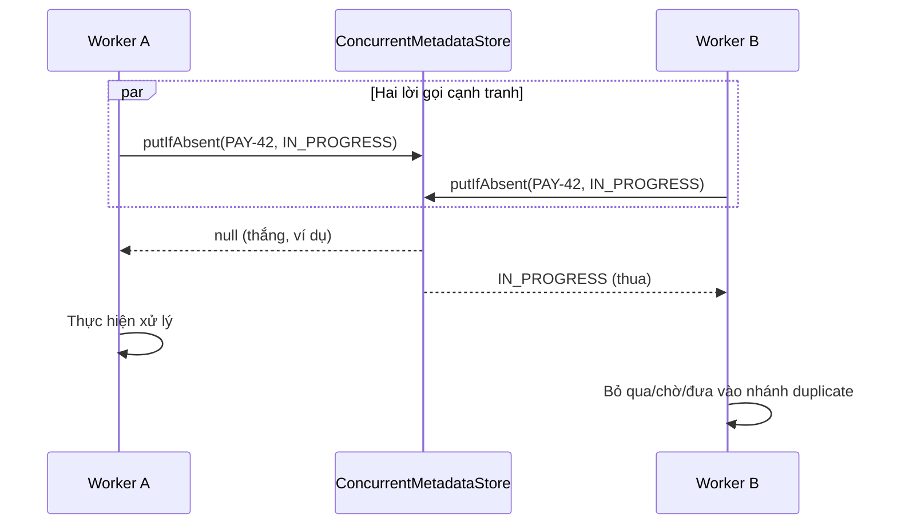
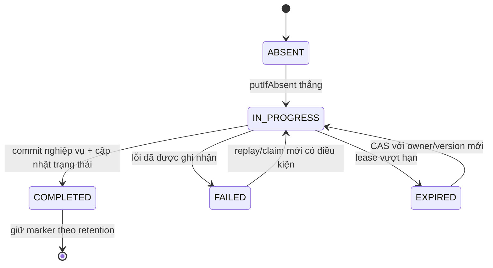

# Atomic put-if-absent và race condition trong Spring Integration

## 1. Bài toán: hai consumer cùng thấy một message “chưa xử lý”

Trong chương **Metadata store** của module **SPRING_INTEGRATION_RUNTIME**, một trường hợp điển hình là hai consumer nhận cùng một sự kiện từ hai poller hoặc thread khác nhau. Cả hai đều muốn kiểm tra event đã xử lý chưa để không tạo hóa đơn, gửi email hoặc trừ tiền hai lần.

Giả sử event có khóa nghiệp vụ `payment:PAY-42`. Một đoạn code tưởng như hợp lý:

```java
// CÁCH SAI khi có nhiều thread hoặc nhiều instance
if (metadataStore.get("payment:PAY-42") == null) {
    paymentService.charge("PAY-42");       // Side effect
    metadataStore.put("payment:PAY-42", "done");
}
```

Đây là lỗi **check-then-act (TOCTOU: time of check → time of use)**: kiểm tra rồi hành động là **hai bước không nguyên tử**. Hai thread có thể cùng đọc `null` trước khi bất kỳ thread nào ghi `done`.

```mermaid
sequenceDiagram
    participant A as Worker A
    participant S as MetadataStore
    participant B as Worker B
    A->>S: get(PAY-42)
    S-->>A: null
    B->>S: get(PAY-42)
    S-->>B: null
    A->>A: charge(PAY-42)
    B->>B: charge(PAY-42)
    A->>S: put(PAY-42, done)
    B->>S: put(PAY-42, done)
    Note over A,B: Cả hai cùng xử lý; giá trị cuối cùng vẫn chỉ là done
```

Nhìn vào store sau sự cố chỉ thấy một key `done`, nhưng **hai side effect đã xảy ra**. `synchronized` quanh đoạn code trên chỉ cứu được những thread cùng dùng **một monitor trong một JVM**; nó không bảo vệ hai application instance khác nhau.

Giải pháp ở tầng khóa metadata là **atomic put-if-absent**: việc “nếu chưa có key thì thêm key” diễn ra trong **một thao tác nguyên tử** của `ConcurrentMetadataStore`. Tuy nhiên, giành quyền xử lý và thực sự hoàn thành nghiệp vụ vẫn là hai việc riêng; phần cuối sẽ chỉ rõ các tình huống crash và replay.

## 2. MetadataStore và ConcurrentMetadataStore khác nhau thế nào?

Spring Integration cung cấp các contract key/value để lưu thông tin nhỏ, thường là dấu vết kiểm tra trùng, timestamp của feed/file đã xử lý hoặc một checkpoint.

| Thành phần | API chủ yếu | Ý nghĩa | Khả năng bảo vệ race |
| --- | --- | --- | --- |
| `MetadataStore` | `get(key)`, `put(key,value)`, `remove(key)` | Đọc/ghi/xóa key/value dạng chuỗi | **Không cung cấp** thao tác kiểm tra-và-ghi nguyên tử trong interface |
| `ConcurrentMetadataStore` | Kế thừa `MetadataStore`, thêm `putIfAbsent` và `replace` | Atomically insert và compare-and-set | Bảo vệ các thao tác này theo khả năng triển khai của store |
| `MessageStore` / `MessageGroupStore` | Lưu message hoặc nhóm message | Queue, aggregator, resequencer, claim-check | Mục tiêu khác metadata key/value |
| `LockRegistry` | Lấy lock theo key | Phối hợp critical section | Cần registry chung nếu khóa giữa các JVM |
| Bảng idempotency nghiệp vụ | Unique key, state, transaction | Bảo vệ side effect và quy trình khôi phục | Phụ thuộc transaction và invariant của ứng dụng |

**`ConcurrentMetadataStore` không phải một map chứa toàn bộ message.** Giao diện này lưu khóa và giá trị `String`. Đừng cố đưa một payload nghiệp vụ lớn hoặc một `Throwable` đã serialize vào metadata chỉ để đánh dấu message lỗi.

### Chữ ký API quan trọng

```java
public interface ConcurrentMetadataStore extends MetadataStore {
    String putIfAbsent(String key, String value);
    boolean replace(String key, String oldValue, String newValue);
}
```

Các phương thức cơ bản inherited từ `MetadataStore`:

```java
String get(String key);
void put(String key, String value);
String remove(String key);
```

Đây là **chữ ký rút gọn để học**, bỏ qua annotation nullability/Javadoc cụ thể theo phiên bản; không cần tự khai báo lại interface khi dùng thư viện.

- `putIfAbsent(key,value)` **trả `null` khi thêm thành công** vì key trước đó chưa tồn tại. Nếu key đã có, trả **giá trị cũ** và không ghi đè.
- `replace(key,oldValue,newValue)` trả `true` nếu giá trị hiện tại **đúng bằng** `oldValue` và thay thành `newValue`; trả `false` nếu key không có hoặc giá trị đã đổi.
- `get` rồi `put` không trở thành atomic chỉ vì cùng gọi trên một `ConcurrentMetadataStore`.
- `put(key,value)` là ghi không có điều kiện; có thể phá trạng thái do worker khác vừa ghi.
- `remove(key)` theo interface cơ bản **không có điều kiện so khớp giá trị cũ**. Xóa nhầm khóa vừa được worker khác giành quyền là một dạng race quan trọng.

Javadoc chính thức xác nhận kết quả trả về của `putIfAbsent` và `replace`. Khi dùng Spring Integration 6.x/7.x, hãy đối chiếu đúng phiên bản dependency trong ứng dụng.

## 3. Atomic put-if-absent chặn race như thế nào?

Với hai worker cùng gọi:

```java
String previous = store.putIfAbsent("payment:PAY-42", "IN_PROGRESS");
boolean acquired = previous == null;
```

Chỉ **một** worker thắng khi cả hai cùng thao tác vào **một store thực sự dùng chung** và implementation bảo đảm atomicity.



Đây là **atomic claim** cho một key. Nó có lợi trong cả xử lý đồng thời trong JVM lẫn nhiều instance **khi store backend hỗ trợ chia sẻ và atomicity liên instance**.

Tính nguyên tử của `putIfAbsent` chỉ nằm ở thao tác ghi key/value. Nó **không** khiến đoạn `paymentService.charge(...)` bên ngoài tự trở thành một phần của transaction metadata. Nếu worker thắng claim rồi chết trước khi hoàn tất, trạng thái `IN_PROGRESS` có thể còn mãi. Nếu side effect đã thành công nhưng worker chết trước khi đánh dấu hoàn tất, replay có thể gây xử lý lặp nếu không có idempotency ở nơi tạo side effect.

## 4. Ví dụ Java nhỏ: chọn đúng một worker xử lý

Một service dùng `ConcurrentMetadataStore` thay vì cặp `get + put`:

```java
import org.springframework.integration.metadata.ConcurrentMetadataStore;

public final class EventClaimService {

    private final ConcurrentMetadataStore store;

    public EventClaimService(ConcurrentMetadataStore store) {
        this.store = store;
    }

    public boolean tryClaim(String tenantId, String eventId) {
        String key = "incoming:" + tenantId + ":" + eventId;
        return store.putIfAbsent(key, "IN_PROGRESS") == null;
    }

    public boolean markCompleted(String tenantId, String eventId) {
        String key = "incoming:" + tenantId + ":" + eventId;
        return store.replace(key, "IN_PROGRESS", "COMPLETED");
    }
}
```

Giả định mã này chỉ chạy **một lượt claim thành công cho mỗi key**, không có lease hoặc ghi đè trạng thái từ các quy trình khác. `replace` từ `IN_PROGRESS` sang `COMPLETED` cho biết key **đang ở đúng trạng thái chờ**; nếu trả `false`, phải điều tra vì key có thể đã bị đổi hoặc không tồn tại.

Dùng `tenantId + eventId` có ý nghĩa khi event ID không phải duy nhất toàn hệ thống. Với những nguồn có offset, file name hoặc revision, khóa nghiệp vụ phải phản ánh **định nghĩa “trùng”**. Ví dụ `message.getHeaders().getId()` thường **không phù hợp làm idempotency key xuyên replay**: message ID có thể thay đổi khi tạo lại message, dù cùng yêu cầu nghiệp vụ.

### Ví dụ filter ở method endpoint

```java
import org.springframework.integration.annotation.Filter;
import org.springframework.integration.annotation.MessageEndpoint;
import org.springframework.integration.annotation.ServiceActivator;
import org.springframework.messaging.Message;

@MessageEndpoint
public class IncomingEventEndpoint {

    private final EventClaimService claims;
    private final PaymentService paymentService;

    public IncomingEventEndpoint(
            EventClaimService claims,
            PaymentService paymentService) {
        this.claims = claims;
        this.paymentService = paymentService;
    }

    @Filter(
        inputChannel = "incomingPayments",
        outputChannel = "uniquePayments",
        discardChannel = "duplicatePayments")
    public boolean accept(Message<PaymentEvent> message) {
        PaymentEvent event = message.getPayload();
        return claims.tryClaim(event.tenantId(), event.eventId());
    }

    @ServiceActivator(inputChannel = "uniquePayments")
    public void process(PaymentEvent event) {
        paymentService.processIdempotently(event);
        if (!claims.markCompleted(event.tenantId(), event.eventId())) {
            throw new IllegalStateException("Metadata state changed");
        }
    }
}
```

Ở đây, `PaymentEvent` và `PaymentService` là **kiểu nghiệp vụ do ứng dụng định nghĩa**, ví dụ:

```java
public record PaymentEvent(
        String tenantId,
        String eventId,
        String paymentId
) {}

public interface PaymentService {
    void processIdempotently(PaymentEvent event);
}
```

Luồng cần có các channel `incomingPayments`, `uniquePayments`, `duplicatePayments` và consumer thích hợp; `discardChannel` có thể nối `nullChannel` hoặc endpoint ghi metric duplicate. **Đây chỉ là ví dụ claim-and-filter**, không phải giải pháp exactly-once đã hoàn chỉnh. Claim được ghi **trước** xử lý: nếu worker chết sau filter, key vẫn ở `IN_PROGRESS`. `PaymentService` cũng phải tự chống xử lý lặp, hoặc có một transaction/idempotency record chung phù hợp.

Đặc biệt với `ExecutorChannel` hoặc poller: lời gọi filter và xử lý ở hai endpoint có thể không nằm trong cùng transaction/thread. Nếu handler bị retry nhưng filter không chạy lại, state và số attempt có thể khác với suy đoán chỉ dựa trên thứ tự message.

## 5. Race kiểu compare-and-set: cập nhật không ghi đè lẫn nhau

`putIfAbsent` giải quyết **thêm key mới**. Khi nhiều worker cần thay đổi giá trị đã tồn tại, dùng `replace(key, expectedOld, newValue)` làm **compare-and-set (CAS)**.

Giả sử key `feed:partner-A:lastOffset` có giá trị `"100"`:

```text
Worker A đọc "100"; muốn ghi "101".
Worker B đọc "100"; muốn ghi "102".

Nếu cả hai dùng put():
  A.put("101"); B.put("102") hoặc ngược lại.
  Giá trị cuối phụ thuộc scheduling, có thể đi lùi.

Nếu dùng replace():
  A.replace(key, "100", "101") → true, ví dụ A thắng.
  B.replace(key, "100", "102") → false, vì hiện tại là "101".
  B phải đọc lại, kiểm tra offset và thử lại nếu nghiệp vụ cho phép.
```

Ví dụ cập nhật checkpoint số tăng dần:

```java
import org.springframework.integration.metadata.ConcurrentMetadataStore;

public final class OffsetCheckpoint {

    private final ConcurrentMetadataStore store;

    public OffsetCheckpoint(ConcurrentMetadataStore store) {
        this.store = store;
    }

    public void advance(String sourceId, long candidate) {
        String key = "offset:" + sourceId;

        for (;;) {
            String current = store.get(key);

            if (current == null) {
                String previous = store.putIfAbsent(
                        key, Long.toString(candidate));
                if (previous == null) {
                    return;
                }
                // Worker khác vừa khởi tạo; đọc lại.
                continue;
            }

            long known = Long.parseLong(current);
            if (candidate <= known) {
                return; // Không đi lùi.
            }

            if (store.replace(
                    key, current, Long.toString(candidate))) {
                return;
            }
            // CAS thất bại: có worker khác thay đổi key; thử lại.
        }
    }
}
```

Code này đảm bảo checkpoint **tăng đơn điệu** theo `candidate` khi mọi writer dùng cùng protocol và store có atomic CAS. Nó **không** chứng minh đã xử lý đầy đủ tất cả message có offset nhỏ hơn `candidate`. Nếu xử lý song song offset 103 trước 102 rồi lưu 103, việc bỏ qua 102 sau restart có thể làm mất công việc. Khi lưu tiến độ nguồn, phải quyết định rõ **contiguous committed offset**, không chỉ `max(offset)` đã nhìn thấy.

Trong production, vòng CAS cần giới hạn retry/backoff hoặc chuyển sang cơ chế điều phối khác nếu contention quá cao; vòng lặp vô hạn có thể đốt CPU khi nhiều writer tranh nhau.

## 6. MetadataStoreSelector và IdempotentReceiverInterceptor

Spring Integration có sẵn mẫu **Idempotent Receiver**:

- `MetadataStoreSelector` dùng key/value strategy và một `ConcurrentMetadataStore` để quyết định một message nên được tiếp nhận hay bị xem là trùng.
- `IdempotentReceiverInterceptor` là advice quanh message handler có thể đánh dấu header duplicate hoặc theo cấu hình discard/throw khi không chấp nhận.
- Có thể cấu hình trong Java/XML/DSL theo phiên bản dự án, thay vì tự viết toàn bộ cơ chế lọc.

Theo reference, `MetadataStoreSelector` mặc định thường chấp nhận khi key chưa tồn tại. Với `compareValues` (Spring Integration 5.3+), có thể chấp nhận message mới nếu một `BiPredicate<String,String>` cho phép thay giá trị cũ bằng giá trị mới bằng thao tác nguyên tử tương ứng. Điều này hữu ích cho checkpoint theo thứ tự hoặc file reader.

**Lưu ý hành vi mặc định của interceptor:** duplicate không nhất thiết bị bỏ hẳn. Theo cấu hình, interceptor có thể gắn header `duplicateMessage` để downstream biết; nếu khai báo `discardChannel` hoặc `throwExceptionOnRejection=true`, duplicate sẽ bị loại hoặc ném lỗi trước handler. Phải kiểm tra cấu hình cụ thể thay vì xem “idempotent interceptor” là đồng nghĩa với “không bao giờ chạy duplicate”.

### Tại sao filter `get(key) == null` không đủ?

Một ví dụ filter chỉ kiểm tra:

```xml
<!-- KHÔNG AN TOÀN với hai consumer chạy đồng thời nếu dùng check-then-act -->
<int:filter input-channel="input"
            output-channel="unique"
            expression="@metadataStore.get(headers.businessKey) == null"/>
```

Khi hai message có cùng key vào gần nhau, cả hai filter có thể cho qua. Kể cả sau đó có một endpoint khác gọi `put`, lỗ hổng vẫn còn. Thay bằng một **bước claim nguyên tử** trước khi cho tiếp tục, hoặc dùng `MetadataStoreSelector`/idempotent advice được cấu hình đúng.

Nhưng một filter atomically claim rồi mới xử lý sẽ tạo **cửa sổ IN_PROGRESS**. Để đảm bảo xử lý nghiệp vụ cuối cùng hoàn tất sau crash, cần transaction hoặc quy trình recovery bên dưới.

## 7. Store implementation quyết định phạm vi atomicity

Một thao tác có cùng tên `putIfAbsent` không có cùng phạm vi bảo vệ nếu hai worker dùng **hai backend riêng**.

| Implementation | State ở đâu? | Atomic giữa nhiều thread? | Dùng chung an toàn qua nhiều JVM? | Restart |
| --- | --- | --- | --- | --- |
| `SimpleMetadataStore` | `ConcurrentHashMap` trong JVM | Có, trong instance store | **Không** nếu mỗi JVM dùng store riêng | Mất khi JVM/context dừng |
| `PropertiesPersistingMetadataStore` | Trạng thái và file properties | Có thao tác concurrent theo implementation | Không coi file chung là distributed CAS an toàn khi chưa kiểm chứng locking/filesystem | Phụ thuộc flush/đóng bình thường |
| `JdbcMetadataStore` | Bảng DB với key/region | Có, transaction + unique key | Có khi dùng chung DB, đúng transaction/configuration | Bền theo durability DB |
| `RedisMetadataStore` | Redis shared keyspace | Có cho thao tác hỗ trợ atomic | Có nếu dùng Redis chung, với giới hạn của cluster/version | Phụ thuộc Redis persistence |
| `MongoDbMetadataStore`, ZooKeeper/Hazelcast stores | Backend tương ứng | Theo contract/interface và backend | Phụ thuộc cấu hình cluster và semantics | Theo tính bền vững backend |

`SimpleMetadataStore` là lựa chọn tốt cho unit test concurrency **trong một JVM**. Nó không tự “đồng bộ với database” và sau restart các key `IN_PROGRESS`/`COMPLETED` đều mất.

`PropertiesPersistingMetadataStore` thường flush ra file khi application context đóng bình thường; có thể gọi `flush()` tường minh. **Không xem flush khi shutdown là bảo đảm khi container bị kill đột ngột**. Nhiều process dùng chung một file properties cũng không tương đương một service distributed CAS như JDBC/Redis được cấu hình đúng.

Với `RedisMetadataStore`, tài liệu Spring Integration có cảnh báo cụ thể: `replace()` không dùng được trong một số cấu hình **Redis Cluster** vì cơ chế `WATCH` cần cho atomicity không được hỗ trợ theo implementation. Nếu workflow cần CAS, kiểm tra thực tế trên đúng topology/version Redis trước khi chọn backend.

## 8. JdbcMetadataStore: put-if-absent trên nhiều instance

Khi hai service instance cùng kết nối một relational DB, `JdbcMetadataStore` là lựa chọn phổ biến vì `putIfAbsent` và `replace` được hỗ trợ với atomicity dựa trên transaction/unique key.

Ví dụ cấu hình bean cho Spring Integration 6.x/7.x:

```java
import javax.sql.DataSource;
import org.springframework.context.annotation.Bean;
import org.springframework.context.annotation.Configuration;
import org.springframework.integration.jdbc.metadata.JdbcMetadataStore;
import org.springframework.integration.metadata.ConcurrentMetadataStore;

@Configuration
public class MetadataStoreConfiguration {

    @Bean("paymentMetadataStore")
    public ConcurrentMetadataStore paymentMetadataStore(
            DataSource dataSource) {

        JdbcMetadataStore store = new JdbcMetadataStore(dataSource);
        store.setRegion("PAYMENT_IDEMPOTENCY_V1");
        return store;
    }
}
```

Ứng dụng cần dependency `spring-integration-jdbc`, datasource, transaction manager phù hợp và schema metadata đúng phiên bản database. DDL minh họa từ reference JDBC:

```sql
CREATE TABLE INT_METADATA_STORE (
    METADATA_KEY VARCHAR(255) NOT NULL,
    METADATA_VALUE VARCHAR(4000),
    REGION VARCHAR(100) NOT NULL,
    CONSTRAINT INT_METADATA_STORE_PK
        PRIMARY KEY (METADATA_KEY, REGION)
);
```

**Khóa duy nhất gồm `(METADATA_KEY, REGION)`.** Hai instance dùng cùng region và cùng business key sẽ tranh cùng một entry. Nếu instance A dùng `PAYMENT_IDEMPOTENCY_V1` còn instance B dùng `PAYMENT_IDEMPOTENCY_V2`, hai bên có thể **cùng thắng claim** do khác region, dù chúng nhìn thấy cùng database.

Các hệ CSDL có cú pháp, lock hint và mức isolation khác nhau. `JdbcMetadataStore` hỗ trợ cấu hình `lockHint` (mặc định `FOR UPDATE` trên nhiều database) và prefix bảng; xem DDL/query phù hợp vendor thay vì copy nguyên SQL cho mọi nơi.

### Giao dịch và điểm commit rất quan trọng

Theo reference JDBC metadata store, một thay đổi trong transaction chưa commit chưa phải một checkpoint đã được bảo đảm tồn tại sau crash. Nếu transaction rollback, các thay đổi metadata nằm trong transaction cũng có thể rollback.

Trường hợp nguy hiểm:

```text
Worker A:
  Tx.begin
  putIfAbsent(PAY-42, IN_PROGRESS) → thắng
  gọi gateway thanh toán → đã trừ tiền ở hệ thống ngoài
  DB transaction rollback vì lỗi
  marker metadata biến mất

Worker B sau đó:
  putIfAbsent(PAY-42, IN_PROGRESS) → lại thắng
  gọi gateway thanh toán lần nữa
```

Vì vậy **atomic put-if-absent không phải exactly-once side effect**. Với thanh toán, hệ thống đối tác nên nhận **idempotency key ổn định** và ứng dụng cần trạng thái nghiệp vụ bền vững để đối soát. Nếu việc cập nhật metadata và side effect nằm trong **cùng một local DB transaction thật sự**, có thể loại trừ một số cửa sổ sai lệch; nếu side effect là HTTP/broker, cần chiến lược giao dịch phân tán hoặc outbox/reconciliation thích hợp.

## 9. Thiết kế state machine thay cho một cờ “done”

Một metadata value `done` giúp deduplicate cơ bản nhưng không thể trả lời “đang xử lý”, “đã xử lý xong hay mới claim?” và “claim này đã hết hạn chưa?”.

Mô hình có thể dùng:



Đây là **mô hình trạng thái của ứng dụng**, không phải enum bắt buộc của Spring Integration. `ConcurrentMetadataStore` lưu giá trị `String`; nếu cần lưu owner, version, deadline, reason hoặc attempt, ta có thể encode một giá trị có phiên bản rõ ràng hoặc dùng bảng nghiệp vụ chuyên dụng.

Ví dụ giá trị:

```text
IN_PROGRESS|owner=node-A-12|version=17|leaseUntil=2026-11-22T10:00:00Z
COMPLETED|version=18|completedAt=2026-11-22T09:59:30Z
```

Nếu giá trị có owner/version, thao tác `replace(key, oldValue, newValue)` làm CAS theo **toàn bộ chuỗi oldValue**. Chỉ worker đang sở hữu version phù hợp mới cập nhật thành công. Dù vậy:

- **Không tự remove sau lỗi** vì một worker khác có thể đã tiếp quản khóa sau khi lease hết hạn.
- **Không kéo dài lease bằng `put`** vì có thể ghi đè owner mới.
- Cần đồng hồ và chính sách lease hợp lý. Nếu process cũ vẫn chạy sau khi mất lease, nó vẫn có thể thực hiện side effect ngoài store: cần **fencing token** hoặc idempotency ở hệ thống đích.
- `replace` là atomic CAS trên một key, **không phải multi-key transaction**.

Với state machine giàu nghiệp vụ, một bảng có `status`, `owner`, `version`, `lease_until`, unique business key và transaction thường dễ bảo trì, truy vấn, cảnh báo và audit hơn việc nhồi tất cả vào một String.

## 10. Cẩn thận với “giải phóng khóa” bằng remove()

Giả sử worker A đã claim key rồi bị treo. Sau thời hạn, B phát hiện claim hết hạn và dùng CAS thay từ `A/v1` sang `B/v2`. Ngay sau đó, A “tỉnh lại” và gọi `store.remove(key)` trong `finally`.

Kết quả: A xóa **claim hợp lệ của B** vì `remove(key)` không kiểm tra owner.

```text
A: putIfAbsent(key, "A/v1")     → thắng
A: bị treo
B: replace(key, "A/v1", "B/v2") → thắng
A: remove(key)                  → xóa trạng thái B!
C: putIfAbsent(key, "C/v3")     → lại thắng
```

Giải pháp:

- Hạn chế remove; giữ marker `COMPLETED` đủ lâu theo cửa sổ redelivery/replay.
- Dùng CAS chuyển trạng thái có version, sau đó cleanup bằng job được điều phối và quy tắc không làm hỏng claim mới.
- Nếu cần “conditional delete”, dùng API/backend hỗ trợ delete so khớp owner/version (ví dụ SQL `DELETE ... WHERE key=? AND version=?` hoặc script nguyên tử tương ứng). **Giao diện `ConcurrentMetadataStore` cơ bản không cung cấp conditional remove**.
- Có thể không xóa entry ngay cả khi fail; thay bằng `FAILED` và quy trình retry có điều kiện, tránh worker thứ ba tự vượt qua logic recovery.

Các trường hợp này là bài toán **quyền sở hữu công việc**; chỉ biết cách gọi `putIfAbsent` chưa đủ để thiết kế lease.

## 11. Message flow, executor, poller và error channel

Race condition đến từ **điểm fan-out và concurrency** trong runtime:

| Nguồn song song | Cách tạo race | Cần xem gì? |
| --- | --- | --- |
| `ExecutorChannel` | Nhiều worker xử lý các message có chung business key | Pool size, queue wait, thất bại trong handler |
| `QueueChannel` + poller | Có thể nhiều consumer/poller hoặc nhiều lần poll | Transaction, max messages per poll, re-delivery |
| Broker inbound consumers | Nhiều instance/partition/subscription nhận lại cùng event | Ack, broker redelivery, idempotency key |
| `PublishSubscribeChannel` | Nhiều subscriber cùng nhận một sự kiện | Subscriber nào có trách nhiệm side effect, ai chỉ đo metric |
| Retry advice | Handler được gọi lại cùng input sau exception | Marker IN_PROGRESS có được reuse đúng không? |
| Restart và replay | Store trong memory mất, pending message được giao lại | Persistence, lease, cleanup, schema compatibility |
| Dynamic `IntegrationFlow` | Endpoint dừng/đăng ký lại khi công việc chưa xong | Key/region và lifecycle của claim còn nhất quán không? |

Với `DirectChannel` đồng bộ, lỗi handler thường propagate về thread gọi `send()`. Với `ExecutorChannel` hoặc poller, lỗi có thể đi qua `ErrorMessage` và `errorChannel` theo cơ chế framework. **Kết quả của `putIfAbsent` không được dùng để thay thế error handling**: người thắng claim có thể thất bại trong quá trình xử lý, và người thua claim vẫn có thể cần biết trạng thái cuối hoặc chờ kết quả.

Nếu xử lý lỗi bằng recovery callback và callback trả bình thường, transaction của poller có thể commit, dù business operation chưa hoàn tất. Muốn rollback metadata với business DB, cần đảm bảo chúng tham gia cùng transaction phù hợp. Muốn lưu dead letter khi retry cạn, ghi một failure record bền vững có correlation và idempotency key; đừng chỉ đưa `Throwable` vào `errorChannel` rồi coi như đã khôi phục.

### Đừng dùng Redis/JDBC store như khóa cho tất cả flow một cách mù quáng

Một metadata key thường chỉ bảo vệ **một business event**. Aggregator/resequencer cần `MessageGroupStore` và `LockRegistry` phù hợp để bảo vệ chuỗi cập nhật group state. Metadata store không tự đồng bộ các thao tác nhóm nhiều message hay thứ tự release.

Khi tương quan nhiều message, cần phân biệt:

- `correlationId`: dùng để gom các fragment thuộc cùng group.
- `idempotencyKey`: dùng để xác định business command đã xử lý hay chưa.
- `messageId`: định danh một message cụ thể của framework.
- `ownerId` / `leaseVersion`: dùng quản lý quyền xử lý tạm thời khi có nhiều worker.

Có thể dùng các key giống nhau về mặt chuỗi trong demo, nhưng production nên định nghĩa ý nghĩa và vòng đời riêng để tránh reuse sai.

## 12. Khi nào cần transaction thay cho chỉ CAS?

Một thao tác CAS đảm bảo **điều kiện trên một key**. Transaction hữu ích khi cần bảo toàn bất biến giữa nhiều row, nhiều bước hoặc metadata và nghiệp vụ.

Giả sử một worker muốn:

1. Claim event.
2. Ghi invoice.
3. Đánh dấu event hoàn tất.
4. Phát event `invoiceCreated`.

Nếu metadata và invoice cùng một database, có thể dùng transaction để giảm cửa sổ sai lệch; bước phát event ra broker vẫn cần outbox hoặc xác nhận phù hợp. Nếu khác database hoặc có API ngoài, không có “atomic put-if-absent rồi mọi thứ sẽ exactly-once”.

Một mẫu DB đơn giản là **unique business key** trên bảng tác vụ:

```sql
CREATE TABLE processed_commands (
    command_key  VARCHAR(160) PRIMARY KEY,
    status       VARCHAR(24) NOT NULL,
    version      BIGINT NOT NULL,
    updated_at   TIMESTAMP NOT NULL
);
```

Với DB phù hợp, có thể claim bằng insert có unique key; một transaction song song sẽ phải tuân thủ ràng buộc duy nhất. Để chuyển trạng thái, dùng update có điều kiện:

```sql
UPDATE processed_commands
   SET status = 'COMPLETED',
       version = version + 1,
       updated_at = CURRENT_TIMESTAMP
 WHERE command_key = :key
   AND status = 'IN_PROGRESS'
   AND version = :expectedVersion;
```

Đây là **SQL minh họa logic**, không phải DDL của `JdbcMetadataStore`. Nếu update được 0 row thì không được mặc nhiên coi là thành công; worker có thể đã mất quyền sở hữu. Khi cần audit, message replay hoặc pause/resume, bảng nghiệp vụ rõ trạng thái thường phù hợp hơn metadata String ngắn.

## 13. Concurrency test: chứng minh chỉ một worker thắng

Một bài lab cơ bản sử dụng `SimpleMetadataStore` để kiểm tra atomicity **trong một JVM**, không cần kết nối database. Đặt nhiều thread chờ cùng một latch, sau đó đồng thời gọi `putIfAbsent` trên cùng key:

```java
import java.util.ArrayList;
import java.util.List;
import java.util.concurrent.CountDownLatch;
import java.util.concurrent.ExecutorService;
import java.util.concurrent.Executors;
import java.util.concurrent.Future;
import java.util.concurrent.atomic.AtomicInteger;

import org.springframework.integration.metadata.ConcurrentMetadataStore;
import org.springframework.integration.metadata.SimpleMetadataStore;

public final class AtomicClaimDemo {

    public static void main(String[] args) throws Exception {
        ConcurrentMetadataStore store = new SimpleMetadataStore();
        ExecutorService workers = Executors.newFixedThreadPool(16);
        CountDownLatch start = new CountDownLatch(1);
        AtomicInteger winners = new AtomicInteger();

        try {
            List<Future<?>> tasks = new ArrayList<>();
            for (int i = 0; i < 64; i++) {
                tasks.add(workers.submit(() -> {
                    start.await();
                    String previous =
                            store.putIfAbsent("event:42", "IN_PROGRESS");
                    if (previous == null) {
                        winners.incrementAndGet();
                    }
                    return null;
                }));
            }

            start.countDown();
            for (Future<?> task : tasks) {
                task.get(); // Chờ mọi task; exception làm test thất bại.
            }

            if (winners.get() != 1) {
                throw new AssertionError(
                        "Expected one winner, got " + winners.get());
            }

            System.out.println("Winners = " + winners.get());
        } finally {
            workers.shutdown();
        }
    }
}
```

**Kỳ vọng:** 64 task cạnh tranh nhưng chỉ có **một** task tăng `winners`; các task khác nhận giá trị đã tồn tại. Nếu muốn minh họa check-then-act sai, tạo hai thread có barrier **sau lệnh `get()` nhưng trước `put()`**, để cả hai chắc chắn đọc `null`; không cần phụ thuộc may rủi scheduling.

Lưu ý: test trên `SimpleMetadataStore` **không chứng minh** behavior của JDBC/Redis trên nhiều máy. Đó chỉ là kiểm tra một implementation in-memory với các thread chia sẻ cùng object.

### Integration test hai instance

Để kiểm chứng `JdbcMetadataStore` thực sự bảo vệ nhiều instance:

1. Chạy hai ứng dụng hoặc hai context riêng dùng chung database/metadata table.
2. Cấu hình **cùng region** và cùng key `payment:PAY-42`.
3. Dùng barrier ngoài (hoặc đồng bộ gửi request) để hai instance cùng claim.
4. Xác nhận đúng một lời gọi trả `null` và chỉ một business handler được phép chạy.
5. Rollback transaction của instance thắng; kiểm tra kết quả và cơ chế retry sau rollback theo đúng isolation.
6. Restart một instance, xác nhận metadata đã commit vẫn còn và không phát sinh duplicate do startup.
7. Thử version rollout đổi region/key format; quan sát nguy cơ cả hai bản cùng xử lý event trong giai đoạn rolling deployment.

Khi dùng Redis, lặp lại bài test trên **đúng topology** (standalone, Sentinel, Cluster). Riêng thao tác `replace` cần kiểm tra giới hạn implementation với Redis Cluster.

## 14. Những race đáng kiểm thử ngoài putIfAbsent

| Race | Điều kiện kích hoạt | Cách phòng vệ |
| --- | --- | --- |
| Check-then-act | Hai thread cùng `get(null)` | Dùng `putIfAbsent` atomic |
| Lost update | Hai worker cùng ghi checkpoint bằng `put` | Dùng `replace` CAS và retry có kiểm soát |
| ABA | Value đổi A → B → A, CAS với oldValue=A lại thành công | Gắn version tăng đơn điệu trong value hoặc DB row |
| Stale cleanup | Worker cũ gọi `remove(key)` sau khi mất lease | Conditional delete có owner/version, tránh remove vô điều kiện |
| Crash after claim | Claim còn `IN_PROGRESS` nhưng handler chưa xong | Lease/recovery và audit |
| Crash after side effect | External operation thành công, marker chưa commit | Idempotency ở đích, outbox/reconciliation |
| Duplicate delivery | Broker retry/redelivery hoặc replay | Stable business key và dedup policy |
| Region mismatch | Hai instance dùng region khác nhau | Config migration với namespace thống nhất |
| Store unavailable | DB/Redis lỗi khi claim | Không cho xử lý side effect khi chưa xác định claim |
| Hot key | Nhiều worker tranh cùng key | Backoff, phân vùng theo business key, đo contention |
| Checkpoint nhảy cóc | Offset 103 commit trước 102 | Ghi contiguous committed offset thay vì chỉ max |

### Quy tắc xử lý “store unavailable”

Nếu `putIfAbsent` ném exception vì database/Redis không sẵn sàng, **không được coi nó như trả `null`**. “Không kiểm tra được trùng” khác “key chắc chắn chưa tồn tại”. Với luồng có side effect quan trọng, hãy fail closed: ném lỗi để retry/backoff hoặc đưa vào recovery path đúng cấu hình, không xử lý mù rồi mong store được cập nhật sau.

Nếu store trả về old value `IN_PROGRESS`, việc bỏ qua ngay có thể cũng không đủ. Cần quyết định event đang được xử lý hợp lệ bởi worker khác hay bị kẹt vì worker đã chết; có thể trả “đang xử lý”, chờ trạng thái cuối hoặc điều phối retry bằng lease.

## 15. Observability: đừng để một key ẩn che toàn bộ lỗi

Để vận hành atomic claim, theo dõi các chỉ số:

| Metric đề xuất (ứng dụng tự định nghĩa) | Diễn giải |
| --- | --- |
| `metadata_claim_attempts_total` | Tổng số lần cố claim |
| `metadata_claim_wins_total` | Số lần `putIfAbsent` trả `null` |
| `metadata_claim_conflicts_total` | Số lần đã có giá trị |
| `metadata_claim_errors_total` | Lỗi đọc/ghi store |
| `metadata_cas_failures_total` | Số `replace` trả false |
| `metadata_operation_latency` | Thời gian thao tác vào backend (p95/p99) |
| `metadata_in_progress_age` | Tuổi claim lâu nhất/chờ lâu |
| `business_duplicate_suppressed_total` | Sự kiện trùng bị loại đúng policy |
| `business_side_effect_duplicate_total` | Sự cố side effect trùng được phát hiện |

Các tên trên là **đề xuất đo của ứng dụng**, không phải metric Spring Integration mặc định.

Đừng đưa `paymentId`, `eventId`, `correlationId` làm Micrometer tags khi cardinality lớn. Những giá trị này nên nằm ở log/tracing có kiểm soát. Tags phù hợp hơn là `flow`, `result=won|existing|error`, `storeType`, `exceptionType` đã chuẩn hóa.

Trường hợp cần phân tích một event cụ thể, log nên chứa: business key, source message ID, correlation ID, worker/instance ID, attempt/replay count, kết quả claim/CAS, transaction outcome và kết quả nghiệp vụ. Với payload nhạy cảm, không log nguyên token, thông tin thanh toán hoặc dữ liệu cá nhân.

## 16. Checklist áp dụng trong runtime

Trước khi gọi `putIfAbsent` là “xong idempotency”, hãy trả lời:

1. **Key là gì?** Nó đại diện event, command hay payment? Có ổn định qua retry/replay/restart không?
2. **Phạm vi atomicity?** Các worker có chia sẻ cùng **instance store hoặc backend/region thực sự** không?
3. **Khi claim thắng rồi crash?** Có state để khôi phục claim treo không? Ai được quyền tiếp quản và sau bao lâu?
4. **Khi side effect xong rồi crash?** Có idempotency ở downstream hoặc transaction/outbox tránh thực thi trùng không?
5. **Khi CAS thất bại?** Có xử lý conflict rõ ràng, retry giới hạn và tránh ghi đè bằng `put` không?
6. **Khi dọn metadata?** TTL/retention có dài hơn cửa sổ replay/redelivery không? Cleanup có thể xóa claim mới không?
7. **Khi store hỏng?** Có fail closed, retry và error channel thích hợp không?
8. **Khi triển khai nhiều instance?** Có dùng cùng region, schema, version và transaction manager tương thích?
9. **Khi message đến theo thứ tự khác?** Offset/checkpoint có phản ánh contiguous completion thay vì max seen không?
10. **Khi điều tra?** Có metric, log theo correlation ID và bài test song song/restart không?

`Atomic put-if-absent` là công cụ nền tảng để loại bỏ race *hai worker cùng thấy key chưa tồn tại*. `replace` mở rộng nó thành cập nhật có điều kiện trên một key. Để xây một message flow đáng tin cậy, cần đặt hai phép toán này đúng chỗ trong thiết kế **channel → endpoint/consumer → poller/executor → transaction/retry/error flow**, kết hợp với metadata persistence, lifecycle, business idempotency và khả năng khôi phục sau crash.

## Tài liệu tham khảo

- [Spring Integration Reference — Metadata Store](https://docs.spring.io/spring-integration/reference/meta-data-store.html)
- [Spring Integration API — ConcurrentMetadataStore](https://docs.spring.io/spring-integration/api/org/springframework/integration/metadata/ConcurrentMetadataStore.html)
- [Spring Integration Reference — JDBC Metadata Store](https://docs.spring.io/spring-integration/reference/jdbc/metadata-store.html)
- [Spring Integration Reference — Redis Metadata Store](https://docs.spring.io/spring-integration/reference/redis.html)
- [Spring Integration Reference — Idempotent Receiver](https://docs.spring.io/spring-integration/reference/handler-advice/idempotent-receiver.html)

