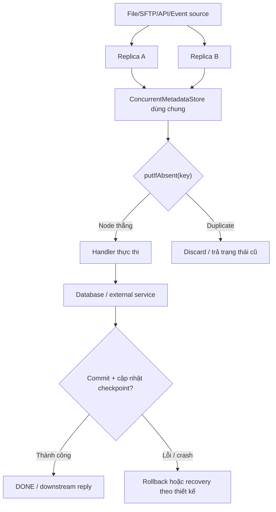

# Chọn store bền vững cho scale out trong Spring Integration

## 1. Bài toán: nhiều instance phải dùng chung trạng thái xử lý

Khi một ứng dụng Spring Integration chạy trên **một JVM**, một `SimpleMetadataStore` trong bộ nhớ có thể đủ để nhớ file đã đọc, feed entry đã xử lý hoặc mã yêu cầu từng xuất hiện. Nhưng khi triển khai nhiều replica trên Kubernetes/VM, mỗi instance có bộ nhớ riêng. Một instance đã đánh dấu file `invoice.csv` là processed không có nghĩa instance còn lại biết điều đó; khi restart, các entry trong bộ nhớ cũng biến mất.

Trong chương **Metadata store** của module `SPRING_INTEGRATION_RUNTIME`, bài học **Chọn store bền vững cho scale out** tập trung vào cách lựa chọn backend metadata khi runtime điều phối message qua channel, endpoint, consumer, poller và executor, rồi thực hiện transaction, retry, recovery và correlation.

Câu hỏi trọng tâm là: **trạng thái nào phải còn sau restart, phải được nhiều instance nhìn thấy, và phải được cập nhật như thế nào khi hai instance cùng cạnh tranh?**

Tình huống mẫu:

- Hai replica cùng quét một thư mục SFTP. Cả hai thấy `daily-17.csv`.
- Cả hai cố nhận file đó để tải xuống và xử lý.
- Nếu mỗi replica có store riêng, cả hai có thể xử lý cùng file.
- Một metadata store dùng chung với thao tác claim nguyên tử có thể cho đúng một replica giành key.
- Nhưng nếu replica giành key **crash sau khi claim, trước khi xử lý xong**, cần chính sách rollback/lease/recovery; thao tác atomic một mình không giải quyết được.

**Mục tiêu học tập**

1. Phân biệt `MetadataStore`, `ConcurrentMetadataStore`, `MessageStore` và distributed lock.
2. So sánh JDBC, Redis, MongoDB, Hazelcast, ZooKeeper và file store dưới góc độ scale out.
3. Xây khóa metadata và region rõ ràng, an toàn cho nhiều tenant/flow/replica.
4. Cấu hình `JdbcMetadataStore` và `RedisMetadataStore`, nhận biết yêu cầu schema, transaction và tính nhất quán.
5. Thử nghiệm claim nguyên tử, crash/restart, rollback, redelivery, xung đột và failover.
6. Thiết kế idempotency cùng business transaction, monitoring, retention và kế hoạch migration.

> **Phiên bản tham chiếu:** Spring Integration 6.5, Spring Framework 6.x, Java 17+; tên API/SQL bên dưới đối chiếu theo tài liệu và Javadoc của phiên bản 6.5. Với backend Redis, JDBC driver hoặc client cluster, cần xác nhận hành vi trên đúng phiên bản triển khai.

## 2. MetadataStore lưu cái gì, và không lưu cái gì?

`org.springframework.integration.metadata.MetadataStore` là giao diện **key/value String** dùng lưu metadata điều phối; nó không phải kho lưu message payload hay transaction log tổng quát.

```java
package org.springframework.integration.metadata;

public interface MetadataStore {
    void put(String key, String value);
    String get(String key);
    String remove(String key);
}
```

Các ứng dụng điển hình:

- **Idempotent receiver:** nhớ `requestId`/`eventId` đã được nhận để phát hiện duplicate.
- **File/FTP/SFTP inbound adapter:** nhớ danh sách hoặc thời điểm cập nhật file đã xem để tránh đọc lại ngoài ý muốn.
- **Feed inbound adapter:** lưu dấu mốc feed entry/timestamp đã xử lý.
- **Checkpoint/offset nghiệp vụ:** lưu vị trí đã hoàn thành khi nguồn không có cơ chế transaction/ack phù hợp.
- **Leader/coordination state đơn giản:** lưu key điều phối nếu lựa chọn backend có semantics cạnh tranh phù hợp; bài toán lease/fencing phức tạp có thể đòi distributed lock chuyên dụng.

Không dùng metadata store như sau:

| Nhu cầu | Thành phần phù hợp hơn |
|---|---|
| Lưu toàn bộ `Message<?>`, payload, headers và queue bền vững | `MessageStore` hoặc `ChannelMessageStore`, ví dụ `JdbcChannelMessageStore` |
| Lưu `MessageGroup` của aggregator/resequencer | `MessageGroupStore`, ví dụ `JdbcMessageStore` |
| Khóa phân tán có owner, lease, fencing rõ ràng | `LockRegistry` phân tán hoặc cơ chế khóa của backend |
| Gửi event đáng tin cậy sau commit DB | Transactional outbox + publisher/consumer có idempotency |
| Lưu business truth và tra cứu trạng thái đơn hàng | Bảng/document nghiệp vụ, có unique constraint và transaction đúng |
| Lưu key/value checkpoint, marker, revision đơn giản | `MetadataStore` / `ConcurrentMetadataStore` |

**Không nhầm "persistent" với "exactly once".** Metadata store có thể tồn tại sau restart, nhưng request vẫn có thể được xử lý hai lần khi caller retry, acknowledgment mất hoặc một process chết đúng giữa việc cập nhật metadata và thực hiện side effect. Muốn hợp đồng xử lý cuối cùng đúng, cần phân tích toàn bộ boundary.

## 3. Từ MetadataStore tới ConcurrentMetadataStore

`ConcurrentMetadataStore` mở rộng giao diện cơ bản bằng hai thao tác có semantics nguyên tử:

```java
package org.springframework.integration.metadata;

public interface ConcurrentMetadataStore extends MetadataStore {
    String putIfAbsent(String key, String value);
    boolean replace(String key, String oldValue, String newValue);
}
```

**Giải thích contract:**

- `putIfAbsent(k, v)`: ghi cặp mới chỉ khi key chưa tồn tại; trả `null` nếu ghi thành công, hoặc trả **giá trị cũ** nếu đã có key.
- `replace(k, old, next)`: chỉ ghi giá trị mới nếu giá trị hiện tại đúng bằng `old`; trả `true` khi cập nhật thành công.

Ví dụ khi hai replica tranh một file:

```text
Replicas: A và B cùng thấy key = "ftp:daily-17.csv"

A: putIfAbsent(key, "CLAIMED:A") -> null     (A giành được)
B: putIfAbsent(key, "CLAIMED:B") -> "CLAIMED:A" (B bị từ chối)

Chỉ một replica tạo marker đầu tiên nếu cả hai dùng
cùng backend có putIfAbsent nguyên tử trên cùng key/region.
```

### Vì sao không dùng get rồi put?

**Sai trong scale out:**

```java
if (metadataStore.get(key) == null) {
    metadataStore.put(key, value);
    process();
}
```

Hai node có thể cùng đọc `null` trước khi node nào ghi, dẫn tới cả hai cùng xử lý.

**Đúng cho bước claim:**

```java
String previous = concurrentMetadataStore.putIfAbsent(key, value);
if (previous == null) {
    process();
} else {
    // Đã tồn tại entry; xử lý nhánh duplicate/đang xử lý.
}
```

Điểm giới hạn: `putIfAbsent` bảo đảm **claim tại một thời điểm**; đoạn `process()` có thể lỗi hoặc chết giữa chừng. Việc key tồn tại không đồng nghĩa nghiệp vụ đã commit. Bởi vậy thiết kế cần phân biệt `CLAIMED`, `DONE` và deadline/recovery, hoặc đưa claim + nghiệp vụ vào cùng DB transaction khi phù hợp.

### Local atomicity khác distributed atomicity

`SimpleMetadataStore` cũng triển khai `ConcurrentMetadataStore` nhưng chỉ chứa state **trong một JVM**. Hai replica có thể đều nhận `null` từ store riêng của chúng. Tương tự, một file properties độc lập trên mỗi pod không tạo ra trạng thái chia sẻ.

Để scale out, cần **một backend chung thực sự**; mọi replica phải cùng kết nối tới một namespace dữ liệu và cùng dùng key/region. Cũng cần kiểm tra backend bảo đảm atomicity trong topology đang dùng, không chỉ thấy Java interface.

## 4. Kiến trúc scale out và các failure window



Có bốn thời điểm đặc biệt:

| Điểm lỗi | State có thể quan sát | Rủi ro |
|---|---|---|
| Trước claim | Chưa có key | Node khác có thể xử lý, thường không mất dữ liệu. |
| Sau claim, trước business write | Có marker, chưa có side effect | Lần thử sau bị xem là duplicate **dù chưa làm xong** nếu không có rollback/recovery. |
| Sau business commit, trước cập nhật marker hoàn tất | Business đã thực hiện, marker vẫn `CLAIMED` | Retry có thể lặp side effect hoặc kẹt vì key. |
| Sau commit, trước gửi reply/ack | Business và metadata đã có thể commit | Caller/broker retry vì không nhận reply, cần idempotent response. |

**Bền vững** nghĩa là dữ liệu store tồn tại theo cam kết của backend sau restart; **nhất quán** nghĩa là hai node không ghi tranh một key sai semantics; **recovery** nghĩa là hệ thống biết xử lý trạng thái dở dang. Cả ba phải được xem riêng.

## 5. So sánh các lựa chọn backend

| Backend | Điểm mạnh | Điểm cần xác minh khi scale out | Phù hợp |
|---|---|---|---|
| `SimpleMetadataStore` | Tối giản, rất nhanh, không phụ thuộc hạ tầng | Chỉ RAM của một JVM; restart/multi-node mất đồng thuận | Dev, unit test, một instance và metadata có thể tái tạo |
| `PropertiesPersistingMetadataStore` | Ghi xuống file properties, không cần database | Mặc định thường flush khi đóng context bình thường; crash có thể mất thay đổi chưa flush; file/shared mount và locking phức tạp | App một node hoặc công cụ nhỏ, tránh dùng làm cơ chế tranh claim giữa pods |
| `JdbcMetadataStore` | Có `ConcurrentMetadataStore`, transaction, constraint; dễ phối hợp cùng DB nghiệp vụ | Schema, index, row lock/SQL vendor, pool, deadlock, latency và connection failures | **Ưu tiên khi đã có RDBMS, cần metadata + business DB commit/rollback cùng nhau** |
| `RedisMetadataStore` | Store dùng chung, thao tác key/value nhanh, phù hợp cập nhật nhiều | Redis persistence/failover, eviction, namespace, semantics `replace()` trên **Redis Cluster** | Checkpoint/idempotency cần độ trễ thấp và đã vận hành Redis phù hợp |
| `MongoDbMetadataStore` | Dùng chung hạ tầng MongoDB, atomicity của các operation tương ứng | Unique index, write concern, transaction cùng business collection, network partitions | Hệ thống dùng MongoDB làm nền dữ liệu chính |
| `HazelcastMetadataStore` | Distributed map, có thể tích hợp cluster in-memory | Persistence, backup, split-brain, fencing và giới hạn concurrency cụ thể | Tổ chức đã vận hành Hazelcast với chính sách durability rõ |
| `ZookeeperMetadataStore` | Dùng cho dữ liệu coordination nhỏ, có thể quan sát thay đổi | Throughput/size, session semantics, quorum, vận hành và hot path | Metadata điều phối/control-plane quy mô nhỏ |
| Backend khác (ví dụ AWS DynamoDB qua integration hỗ trợ) | Quản lý dịch vụ cloud, điều kiện ghi atomic | Conditional-write semantics, SDK/version, IAM, độ trễ/chi phí, TTL, IAM partition scope | Hệ thống đã dùng nền tảng đó và có implementation tương thích |

**Không có một backend tốt nhất cho mọi trường hợp.** Với RDBMS nghiệp vụ, JDBC thường cho mô hình transaction dễ lý giải nhất. Với nhiều adapter poll cần tốc độ lookup cao, Redis có thể phù hợp nếu topology và yêu cầu consistency khớp API đang dùng. Một backend shared nhưng không đủ bền hoặc không hỗ trợ CAS trong topology thực tế có thể tạo cảm giác an toàn sai.

### 5.1. Những lưu ý đặc biệt với Redis Cluster

Tài liệu Spring Integration 6.5 nêu rõ: `RedisMetadataStore.replace()` dựa trên cơ chế Redis `WATCH` và **không hỗ trợ thay thế trên Redis Cluster** trong implementation được mô tả. Điều này quan trọng vì một số persistent file-list filter dùng `replace()` để xử lý **file có cùng tên nhưng thời điểm sửa đổi thay đổi**.

Nếu kiến trúc dùng Redis Cluster:

1. Kiểm tra component thực tế có gọi `replace()` hay không, không chỉ `putIfAbsent()`.
2. Không giả định mọi operation của `ConcurrentMetadataStore` đều hoạt động trên Redis Cluster.
3. Có thể chọn JDBC hoặc backend khác khi cần compare-and-set đó, hay một implementation được kiểm chứng trên topology mục tiêu.
4. Kiểm thử thay đổi file cùng tên, failover và concurrency trên **Redis Cluster thật** nếu đó là cấu hình production.

Ngoài ra, Redis persistence `RDB`/`AOF`, replication acknowledgment, eviction policy và thời điểm failover ảnh hưởng việc marker có thể mất sau crash. `ConcurrentMetadataStore` là contract method, không tự cấu hình durability của Redis server.

### 5.2. Properties file và shared volume

Cùng trỏ hai replica tới một shared filesystem file **không có nghĩa** `PropertiesPersistingMetadataStore` trở thành distributed database. Mỗi process có cache, flush lifecycle và file locking riêng; ghi đè file có thể mất cập nhật. Dù một `PropertiesPersistingMetadataStore` triển khai concurrent operations trong một JVM, không suy ra multi-process atomicity. Dùng JDBC/Redis hoặc store phân tán thực sự nếu nhiều replica cùng claim.

## 6. Bảng chọn store theo yêu cầu thực tế

Trước khi chọn công nghệ, trả lời các câu hỏi:

| Yêu cầu | Điều phải xác nhận | Hướng lựa chọn |
|---|---|---|
| Cần chia sẻ state giữa nhiều pod? | Các pod dùng **cùng** store vật lý, region/key tương thích? | JDBC, Redis, MongoDB hoặc distributed backend |
| Cần atomic claim khi hai pod tranh một key? | `putIfAbsent` thật sự atomic ở topology hiện tại? | `ConcurrentMetadataStore` có backend đúng |
| Cần CAS update trên cùng key? | `replace` hoạt động với topology? | JDBC hoặc backend xác nhận CAS, lưu ý Redis Cluster |
| Metadata và DB write phải rollback cùng nhau? | Cùng DataSource và transaction manager? | JDBC khi phối hợp một local transaction |
| Không có DB chung? | Có Redis/MongoDB/distributed service được quản trị tốt? | Chọn backend phù hợp và thiết kế recovery |
| Chịu được mất checkpoint sau crash không? | RPO checkpoint thực tế, persistence, fsync/replication | Cấu hình durability và test kill/restart |
| Số key cực lớn hoặc nhiều namespace? | Memory/index, cardinality, retention và query patterns | Capacity test, key partition/region, TTL/cleanup |
| Muốn trả kết quả idempotent sau retry? | Có business result store/unique key không? | Metadata + persisted business result/outbox |
| Có nhiều node đọc file đổi nội dung? | Cần so sánh timestamp/version, không chỉ existence | CAS `replace` và filter có chính sách reprocessing |

**Một quy tắc thực dụng:** nếu metadata thật sự là điều kiện chấp nhận lệnh ghi vào business database, cố gắng đặt kiểm tra/claim và business write trong **một transaction có thể rollback toàn bộ**. Nếu backend metadata khác database nghiệp vụ, phải định nghĩa recovery khi hai bên commit không đồng thời.

## 7. Ví dụ 1: cấu hình JdbcMetadataStore dùng chung cho nhiều replica

### 7.1. Dependency và schema

Ví dụ Spring Boot 3.x, Java 17+, Spring Integration 6.5. Dùng Spring Boot dependency management để chọn các phiên bản tương thích:

```groovy
dependencies {
    implementation 'org.springframework.boot:spring-boot-starter-integration'
    implementation 'org.springframework.boot:spring-boot-starter-jdbc'
    implementation 'org.springframework.integration:spring-integration-jdbc'
    runtimeOnly 'org.postgresql:postgresql'
    testImplementation 'org.springframework.boot:spring-boot-starter-test'
    testRuntimeOnly 'com.h2database:h2'
}
```

Spring Integration JDBC đi kèm script schema theo RDBMS vendor. DDL H2 minh họa của metadata store:

```sql
CREATE TABLE INT_METADATA_STORE (
    METADATA_KEY VARCHAR(255) NOT NULL,
    METADATA_VALUE VARCHAR(4000),
    REGION VARCHAR(100) NOT NULL,
    CONSTRAINT INT_METADATA_STORE_PK
        PRIMARY KEY (METADATA_KEY, REGION)
);

CREATE TABLE orders_processed (
    event_id VARCHAR(128) NOT NULL,
    tenant_id VARCHAR(64) NOT NULL,
    amount BIGINT NOT NULL,
    CONSTRAINT orders_processed_pk PRIMARY KEY (tenant_id, event_id)
);
```

Trong production dùng migration tool như Flyway/Liquibase hoặc scripts chính thức tương ứng với database vendor. **Không** đưa DDL H2 vào PostgreSQL một cách máy móc; kiểm tra kiểu dữ liệu, index và schema. Cần khởi tạo bảng trước khi `JdbcMetadataStore` start vì trong Spring Integration 6.5 store có bước kiểm tra tồn tại bảng khi khởi động.

### 7.2. Đặt bean metadataStore và region

```java
import javax.sql.DataSource;

import org.springframework.context.annotation.Bean;
import org.springframework.context.annotation.Configuration;
import org.springframework.integration.jdbc.metadata.JdbcMetadataStore;

@Configuration
class MetadataConfiguration {

    @Bean("metadataStore")
    JdbcMetadataStore metadataStore(DataSource dataSource) {
        JdbcMetadataStore store = new JdbcMetadataStore(dataSource);
        store.setRegion("orders-v1");
        return store;
    }
}
```

Các đặc điểm:

- Tên bean `metadataStore` có ý nghĩa: nhiều adapter nếu không được truyền store cụ thể sẽ tìm bean **đúng tên này**; nếu không có thường tạo `SimpleMetadataStore` riêng.
- `region` là namespace logic trong bảng metadata; cùng `METADATA_KEY` nhưng region khác sẽ không tranh nhau.
- **Tất cả replica xử lý cùng flow** phải dùng cùng connection database, cùng region và cùng quy tắc tạo key.
- Nếu thay `region` khi deploy, app có thể xem toàn bộ key cũ như **chưa từng được xử lý**, gây đọc lại hàng loạt. Hãy lập kế hoạch migration trước.
- Có thể đổi `tablePrefix`/`lockHint` theo database; mọi node phải dùng schema và SQL tương thích.

Hạ tầng Spring transaction phải hoạt động và `JdbcMetadataStore` dùng được transaction manager với `DataSource` này. Khi cần kết hợp nhiều `DataSource`, chọn transaction manager rõ ràng; nếu store và business data ở hai DB khác nhau thì local transaction của DB này không tự bao phủ DB kia.

### 7.3. Claim và xử lý trong cùng local DB transaction

Ví dụ tối giản đặt claim và business insert trong cùng service activator, dùng `DirectChannel` đồng bộ. Khi xảy ra unchecked exception và transaction được proxy áp dụng đúng, cả metadata row lẫn business row đều rollback.

```java
public record OrderEvent(
        String tenantId,
        String eventId,
        long amount
) {
}
```

```java
import org.springframework.integration.annotation.ServiceActivator;
import org.springframework.integration.metadata.ConcurrentMetadataStore;
import org.springframework.jdbc.core.JdbcTemplate;
import org.springframework.stereotype.Component;
import org.springframework.transaction.annotation.Transactional;

@Component
public class OrderConsumer {
    private final ConcurrentMetadataStore metadataStore;
    private final JdbcTemplate jdbc;

    public OrderConsumer(ConcurrentMetadataStore metadataStore,
                         JdbcTemplate jdbc) {
        this.metadataStore = metadataStore;
        this.jdbc = jdbc;
    }

    @Transactional
    @ServiceActivator(inputChannel = "orders.in", requiresReply = "true")
    public String accept(OrderEvent event) {
        String tenant = require(event.tenantId(), "tenantId");
        String id = require(event.eventId(), "eventId");
        String key = tenant.length() + ":" + tenant
                + ":event:" + id.length() + ":" + id;
        String signature = Long.toString(event.amount());

        String previous = metadataStore.putIfAbsent(key, signature);
        if (previous != null) {
            if (!previous.equals(signature)) {
                throw new IllegalArgumentException(
                        "Same event identity with different amount");
            }
            return "DUPLICATE:" + id;
        }

        jdbc.update(
                "INSERT INTO orders_processed(event_id, tenant_id, amount) "
                        + "VALUES (?, ?, ?)",
                id, tenant, event.amount());

        if (id.startsWith("FAIL-")) {
            throw new IllegalStateException("Simulated DB rollback");
        }

        return "APPLIED:" + id;
    }

    private static String require(String value, String name) {
        if (value == null || value.isBlank()) {
            throw new IllegalArgumentException("Missing " + name);
        }
        return value;
    }
}
```

Với schema ví dụ, khóa chính nghiệp vụ là composite `(tenant_id,event_id)`: hai tenant có thể dùng cùng một `eventId` hợp lệ. Metadata key cũng dùng tenant + event ID, bảo đảm phạm vi nhận diện trùng ở hai tầng nhất quán. Trong ứng dụng thật cũng nên so sánh toàn bộ fingerprint payload quan trọng, không chỉ `amount`.

Một gateway demo:

```java
import org.springframework.integration.annotation.MessagingGateway;

@MessagingGateway(defaultRequestChannel = "orders.in")
public interface OrderGateway {
    String accept(OrderEvent event);
}
```

Spring Boot cần bật xử lý Integration annotations và component scanning phù hợp (ví dụ `@EnableIntegration` và `@IntegrationComponentScan` hoặc auto-configuration tương ứng), khai báo `orders.in` là channel phù hợp. Hai replica nhận request qua load balancer có thể chạy cùng code, DB store/region chung.

**Điều kiện để semantics transactional thực sự đúng:** lời gọi `OrderConsumer.accept()` phải đi qua Spring AOP proxy, dùng cùng transaction manager/DataSource cho `JdbcMetadataStore` và `JdbcTemplate`, không cắt qua `ExecutorChannel` trước khi hoàn tất transaction này. Không tự gọi `this.accept(...)` rồi nghĩ `@Transactional` luôn có hiệu lực.

### 7.4. Kiểm thử commit và rollback

Mục tiêu không chỉ assert response mà **truy vấn trạng thái đã commit** bên ngoài transaction của handler.

```java
@SpringBootTest
class MetadataStoreIntegrationTest {

    @Autowired OrderGateway gateway;
    @Autowired JdbcTemplate jdbc;

    int businessRows(String tenant, String id) {
        Integer count = jdbc.queryForObject(
                "SELECT COUNT(*) FROM orders_processed "
                        + "WHERE tenant_id = ? AND event_id = ?",
                Integer.class, tenant, id);
        return count == null ? 0 : count;
    }

    @Test
    void successfulClaimCommitsOnce() {
        var event = new OrderEvent("tenant-a", "EVT-1", 100);

        assertEquals("APPLIED:EVT-1", gateway.accept(event));
        assertEquals("DUPLICATE:EVT-1", gateway.accept(event));
        assertEquals(1, businessRows("tenant-a", "EVT-1"));
    }

    @Test
    void failedHandlerRollsBackClaimAndBusinessWrite() {
        var event = new OrderEvent("tenant-a", "FAIL-2", 100);

        assertThrows(RuntimeException.class,
                () -> gateway.accept(event));
        assertEquals(0, businessRows("tenant-a", "FAIL-2"));

        // Kiểm tra đúng marker của event lỗi, không đếm cả region:
        String failedKey = "8:tenant-a:event:6:FAIL-2";
        Integer metadataRows = jdbc.queryForObject(
                "SELECT COUNT(*) FROM INT_METADATA_STORE "
                        + "WHERE REGION = ? AND METADATA_KEY = ?",
                Integer.class, "orders-v1", failedKey);
        assertEquals(0, metadataRows);
    }
}
```

Ở test thật, tránh assert toàn bộ region có 0 entry nếu test khác có dữ liệu; hãy truy vấn theo **key cụ thể** hoặc mỗi test dùng region/database độc lập. Không đặt `@Transactional` trên test method vì transaction test tự rollback có thể che dấu việc handler không commit. Các đoạn code giả định có JUnit, Spring Boot Test imports và schema đã sẵn; để test song song cần một database/test context cô lập.

### 7.5. Vì sao không phải exactly once end-to-end?

Ví dụ JDBC đảm bảo claim + insert trong **một local DB transaction**, nhưng:

- Lời gọi HTTP/JMS tới service ngoài thực hiện trong method không tự rollback cùng DB.
- Reply gửi qua gateway sau khi method commit có thể bị mất; caller retry.
- `DUPLICATE` chỉ cho biết marker đã tồn tại; nếu caller cần **cùng kết quả nghiệp vụ như lần đầu**, phải lưu/tra cứu kết quả đã commit.
- Việc xóa marker sớm cho phép xử lý lại; giữ marker mãi sẽ khiến store tăng trưởng.
- Trong môi trường nhiều replica, transaction isolation, khóa, deadlock và throughput của cùng key cần được stress test.

Với nghiệp vụ bắt buộc phát event ra ngoài, cân nhắc **transactional outbox**: ghi business row + outbox row trong cùng DB transaction; publisher lấy outbox và gửi có retry, consumer idempotent theo event ID.

## 8. Ví dụ 2: RedisMetadataStore cho checkpoint chia sẻ

Khi hệ thống đã vận hành Redis phù hợp, có thể khai báo một store dùng chung:

```groovy
dependencies {
    implementation 'org.springframework.boot:spring-boot-starter-integration'
    implementation 'org.springframework.integration:spring-integration-redis'
    implementation 'org.springframework.boot:spring-boot-starter-data-redis'
}
```

```java
import org.springframework.context.annotation.Bean;
import org.springframework.context.annotation.Configuration;
import org.springframework.data.redis.connection.RedisConnectionFactory;
import org.springframework.integration.redis.metadata.RedisMetadataStore;

@Configuration
class RedisMetadataConfiguration {

    @Bean("metadataStore")
    RedisMetadataStore metadataStore(
            RedisConnectionFactory connectionFactory) {
        return new RedisMetadataStore(
                connectionFactory, "orders:metadata:v1");
    }
}
```

`RedisMetadataStore` dùng Redis hash namespace/region. Bản đồ đặt key bên trong Redis của store không giống toàn bộ key namespace ứng dụng; hãy chuẩn hóa cả **Redis hash region** lẫn **logical metadata key**.

Ví dụ claim:

```java
String key = "tenant-a:event:EVT-1";
String current = metadataStore.putIfAbsent(key, "SEEN");
if (current == null) {
    // Được phép thực hiện bước tiếp theo theo policy đã thiết kế.
} else {
    // Đã có claim/checkpoint; không tự động suy ra DONE.
}
```

**Khác với JDBC cùng transaction:** Redis update và business SQL update thông thường **không** thuộc một local transaction manager. Nếu claim Redis thành công nhưng DB thất bại, marker có thể vẫn còn, dẫn đến suppress các lần xử lý sau. Cần thiết kế bằng recovery, lease+fencing/expiry phù hợp, transaction/outbox ở một nguồn sự thật, hoặc đổi sang JDBC metadata store.

Một số lưu ý:

- **Redis Cluster:** không dựa vào `replace()` của `RedisMetadataStore` theo tài liệu 6.5, đặc biệt với file list filters cần CAS.
- **Durability:** kiểm tra AOF/RDB, replication/failover và eviction; không đặt marker có yêu cầu lâu dài trong namespace dễ bị eviction.
- **TTL:** không giả định `MetadataStore` chung có API TTL cho từng key; nếu phải expire, thiết kế scheduler/cleanup hoặc cơ chế backend rõ ràng. Redis hash region không tương đương TTL độc lập cho từng field.
- **Namespace:** nhiều team dùng chung Redis phải tách hash name, key prefix và ACL để tránh xóa nhầm metadata.

## 9. File adapters và persistent accept-once filter

Một ứng dụng scale out thường gặp là nhiều replica cùng thăm dò SFTP/FTP/file. Persistent accept-once filter lưu **marker file** trong metadata store để giảm khả năng tải/xử lý lặp. Trên một nguồn file có `lastModified`/version thay đổi, một số filter cần thao tác `replace()` để chấp nhận lại file đã đổi.

```text
SFTP remote directory: /incoming
        |
        v
Replica A poll ---------+
                        +--> Shared ConcurrentMetadataStore
Replica B poll ---------+        |
                                 +--> atomic accept-once marker
        |
        v
Download / local filter / handler / output
```

Phân biệt các tầng:

- **Remote filter:** chọn remote file nào cần tải; metadata có thể phản ánh tên remote file và phiên bản/timestamp.
- **Local filter:** tránh phát đi nhiều lần cùng một file đã tải ở local directory.
- **Xử lý nghiệp vụ:** parse file, ghi DB và gửi downstream; có thể thất bại sau khi filter đã đánh dấu.
- **Recoverable source:** khi tải/xử lý thất bại, phải xác định khi nào marker được xóa/thay thế, file vẫn tồn tại hay đã bị chuyển/chôn ở thư mục khác.

**Khóa phải có identity đủ mạnh.** Chỉ dùng tên file `daily.csv` là nguy hiểm nếu nhiều remote host/tenant/directory đều có file cùng tên. Nên bao gồm nguồn, thư mục, file path và version/timestamp theo semantics filter mà adapter hỗ trợ.

### Cạm bẫy khi scale out file polling

1. Hai replica cùng poll một SFTP server nhưng mỗi node có store in-memory: tải trùng.
2. Dùng store chung nhưng một node claim thành công rồi crash trước khi xử lý: file có thể bị bỏ qua mãi nếu marker không được khôi phục.
3. Dùng metadata store chung nhưng local directory mỗi pod khác nhau: metadata cho “đã tải” không chứng minh file có ở pod khác.
4. Lưu checkpoint remote riêng nhưng không có idempotency downstream: file tải một lần vẫn có thể tạo event/row trùng qua retry.
5. File được ghi đè với cùng tên: filter cần biết nội dung/version thay đổi; chỉ `putIfAbsent` có thể không đủ.
6. Chạy filter dùng `replace()` trên Redis Cluster như đã nêu: topology không hỗ trợ operation mong muốn.

Nếu cần bảo đảm mỗi file tạo đúng một business effect, dùng business file ID/fingerprint và unique constraint downstream; đừng xem marker của file filter là bảo đảm toàn bộ pipeline xử lý xong.

## 10. Idempotent Receiver và MetadataStoreSelector

Spring Integration hỗ trợ `IdempotentReceiverInterceptor`: một advice ở `MessageHandler.handleMessage()` được kết hợp với `MetadataStoreSelector` để quyết định message đã từng được chấp nhận hay chưa.

**Điểm dễ hiểu sai:** theo mặc định, nếu selector từ chối, interceptor có thể **đặt header `duplicateMessage=true` và vẫn cho message tới handler**. Chỉ khi cấu hình `discardChannel` hoặc `throwExceptionOnRejection=true`, duplicate mới bị từ chối khỏi handler. Phải kiểm tra contract của advice trước khi nói “đã bật idempotent interceptor nên handler không thấy duplicate”.

Ví dụ selector có store được tiêm vào:

```java
import org.springframework.integration.selector.MetadataStoreSelector;
import org.springframework.integration.metadata.ConcurrentMetadataStore;
import org.springframework.messaging.Message;

MetadataStoreSelector selector =
        new MetadataStoreSelector(
                message -> (String) message.getHeaders().get("eventId"),
                metadataStore);
```

Trong ứng dụng thực, kiểm tra header `eventId` không được null/trống trước khi dùng; selector dùng value strategy mặc định từ header timestamp. Nếu cần chấp nhận bản cập nhật theo version, có thể cấu hình `compareValues(BiPredicate<String,String>)` để CAS giá trị cũ và mới. Không dùng timestamp của thời điểm nhận làm business version khi thứ tự sự kiện không đảm bảo.

**Thời điểm đánh dấu:** selector có thể claim metadata **trước** khi business handler xử lý. Nếu handler thất bại nhưng metadata claim không cùng transaction và không được recovery, message retry có thể bị xem là duplicate mặc dù chưa hoàn tất. Với exactly-once business effect, cần transaction chung hoặc trạng thái phân biệt `PROCESSING`/`COMPLETED` có lease và idempotency.

### Checkpoint số dòng: CAS theo version

Giả sử đọc một file lớn từng dòng, key là `fileId` và value là số thứ tự dòng cuối đã commit. Khi nhận một dòng mới, chỉ chấp nhận số thứ tự lớn hơn checkpoint cũ:

```java
selector.compareValues(
        (oldValue, newValue) ->
                Long.parseLong(newValue) > Long.parseLong(oldValue));
```

Cách này phù hợp nếu newValue thực sự là số thứ tự dòng và kiểm tra nghiệp vụ yêu cầu chỉ tăng. **Nhưng CAS của metadata chỉ an toàn cho việc cập nhật checkpoint;** nếu line N được claim trước khi DB write commit mà process crash, lần retry của line N có thể bị skip. Đồng bộ checkpoint và nghiệp vụ bằng transaction hoặc thiết kế resume có replay + dedup.

## 11. Transaction, retry và recovery: nơi atomic claim chưa đủ

### 11.1. JDBC cùng transaction

```mermaid
sequenceDiagram
    participant R as Replica A
    participant MS as JDBC MetadataStore
    participant DB as Business DB
    R->>MS: BEGIN TX; putIfAbsent(requestId)
    MS-->>R: claimed
    R->>DB: INSERT business row
    alt success
        R->>MS: COMMIT TX
        Note over MS,DB: Metadata và business row cùng commit nếu chung resource
    else exception
        R->>MS: ROLLBACK TX
        Note over MS,DB: Marker và row rollback
    end
```

Nếu transaction manager dùng cùng DB, thao tác metadata và business SQL có thể rollback/commit như một đơn vị. Đây là lựa chọn mạnh khi mục tiêu là xử lý DB idempotent giữa nhiều replica.

### 11.2. Redis + SQL: hai resource độc lập

```text
t0: Redis putIfAbsent(eventId) -> claim OK
t1: Business SQL INSERT -> fail / rollback
t2: Retry eventId -> Redis reports already claimed
t3: Handler is skipped -> lost business operation
```

Giải pháp có thể là:

- Dùng JDBC metadata trong cùng DB business.
- Dùng bảng inbox/idempotency và unique constraint trong DB business làm nguồn truth; Redis chỉ làm cache/optimization.
- Dùng lease/claim có expiry + fencing token và trạng thái nghiệp vụ truy vấn được; lease hết hạn **không** được khiến hai worker cùng side-effect không idempotent.
- Kết hợp outbox/inbox, backoff, retry và reconcile job theo business ID.

**Không tự động xóa marker trên mọi exception.** Khi side effect ngoài DB đã thành công nhưng lỗi xảy ra lúc gửi reply, việc xóa marker có thể khiến retry lặp side effect. Trước khi clear claim, phải biết trạng thái thật của nghiệp vụ hoặc có cơ chế bù/kiểm soát trùng.

### 11.3. Transaction + ExecutorChannel/QueueChannel

Spring transaction thông thường gắn với thread. Một transaction mở trên sender qua `DirectChannel` có thể bao trùm handler cùng thread; nhưng qua `ExecutorChannel` hoặc `QueueChannel`, consumer thường chạy trong thread khác.

Hệ quả:

- Nếu metadata được claim ở sender trước khi bàn giao async, claim có thể commit **trước** business task.
- Nếu worker thất bại, transaction sender không tự rollback.
- Khi poller dùng nguồn transactional, thao tác receive và handler đồng bộ có thể tham gia transaction của poller.
- Nếu muốn claim và business commit cùng nhau, đặt chúng ở **cùng một transaction boundary phía worker**, hoặc cấu hình coordinated transaction thực sự thay vì giả định context tự truyền qua thread.

## 12. Namespace, key design và retention

### 12.1. Thiết kế key có chiều phân biệt

Một key tốt nên phân biệt ít nhất:

```text
environment / application / flow / tenant / source / business identity / version
```

Ví dụ:

```text
prod:billing:invoice-import:tenant-7:sftp-a:/incoming/2026-11.csv:v3
prod:billing:order-events:tenant-7:order-9081:event-12
```

Khi key gồm thành phần tự do, nối bằng dấu `:` có thể đụng nhau. Nên chuẩn hóa encoding, dùng escaping/length-prefix hoặc hash của một tuple có schema/version rõ. Không đưa secrets/PII thô vào key nếu backend logs/metrics có thể lộ key.

### 12.2. Region khác với key prefix

Trong `JdbcMetadataStore`, bảng có các cột `METADATA_KEY` và `REGION`; unique constraint dùng **cặp hai trường**, vì vậy hai region được phân biệt ở DB. Với `RedisMetadataStore`, region là Redis hash key; từng metadata key nằm trong hash đó.

Cần quyết định:

- Các replica cùng flow dùng cùng region để tranh key.
- Các môi trường `dev/staging/prod` dùng region/backend riêng.
- Các flow khác nhau không reuse key khi semantics khác nhau.
- Khi đổi logic key version, có kế hoạch dual-read/migration/rollback deploy, tránh “reset” mọi checkpoint.

### 12.3. Retention không phải một nút "clear all"

Metadata tích lũy theo thời gian. Nếu mọi event ID được giữ mãi, store không ngừng tăng. Nếu xóa quá sớm, một event cũ được replay có thể tạo side effect trùng.

Chọn retention dựa trên:

1. Thời gian broker/source có thể gửi lại message.
2. Thời gian tối đa có backfill/manual replay.
3. SLA xử lý và độ trễ late message.
4. Thời gian dữ liệu nghiệp vụ cần chống duplicate.
5. Yêu cầu audit/compliance và khả năng restore snapshot.

Có thể lưu timestamp/expiry trong value và chạy cleanup job có kiểm soát; `MetadataStore` cơ bản không cung cấp chuẩn TTL trên từng key. Với một số backend, việc xóa key cần tránh race với worker đang xử lý. Nếu retention làm mất khả năng chống duplicate, tầng business phải tiếp tục bảo vệ bằng unique constraint lâu dài hoặc archive idempotency.

## 13. Kiểm thử thật trước khi scale out

Không chỉ kiểm tra Java interface được inject; cần kiểm thử backend thật và failure modes liên quan.

### 13.1. Test concurrency hai instance tranh cùng một key

Dùng hai instance `JdbcMetadataStore` trỏ tới **cùng một database và region**, với transaction management thực. Kịch bản:

1. Khởi tạo metadata table sạch, chọn key mới `test:tenant-a:EVT-100`.
2. Hai worker ở thread khác nhau đồng thời gọi `putIfAbsent(key, "SEEN")`.
3. Kiểm tra **chỉ một** worker nhận `null`.
4. Kiểm tra worker còn lại nhận giá trị cũ; chỉ một business effect được commit.
5. Đọc DB từ connection riêng sau khi hai transaction kết thúc.
6. Lặp lại qua hai JVM/process thực nếu deployment production là multi-node.

JUnit phác thảo assertion:

```java
ExecutorService pool = Executors.newFixedThreadPool(2);
try {
    CountDownLatch ready = new CountDownLatch(2);
    CountDownLatch go = new CountDownLatch(1);

    Callable<String> contender = () -> {
        ready.countDown();
        if (!go.await(5, TimeUnit.SECONDS)) {
            throw new TimeoutException("Start barrier timeout");
        }
        return store.putIfAbsent("test:EVT-100", "SEEN");
    };

    Future<String> first = pool.submit(contender);
    Future<String> second = pool.submit(contender);

    assertTrue(ready.await(5, TimeUnit.SECONDS));
    go.countDown();

    String a = first.get(10, TimeUnit.SECONDS);
    String b = second.get(10, TimeUnit.SECONDS);

    assertTrue((a == null && "SEEN".equals(b))
            || (b == null && "SEEN".equals(a)));
} finally {
    pool.shutdownNow();
}
```

Đoạn trên minh họa **race/claim operation** và cần imports JUnit/concurrency phù hợp. Dùng `try/finally` để đóng pool cả khi assertion fail; có thể dùng Testcontainers PostgreSQL/Redis để kiểm tra semantics thực, đồng thời kiểm soát fixture không trùng key.

### 13.2. Test crash/restart và rollback

| Test | Cách mô phỏng | Kỳ vọng |
|---|---|---|
| Restart một node sau commit | Node A claim + commit, stop; node B đọc lại cùng key | Node B thấy marker, không claim lại nếu retention chưa hết |
| Rollback JDBC | Claim + business write trong transaction rồi throw | Key và business row đều không có sau rollback |
| Crash sau claim tách resource | Redis claim thành công, business SQL chưa commit, kill worker | Recovery phát hiện unfinished, tránh skip vĩnh viễn |
| Claim khi backend mất kết nối | Ngắt Redis/DB đúng lúc claim | Không mặc định “fail open”; quyết định dừng/retry/đưa DLQ theo policy |
| Redis failover | Ghi marker, failover primary, đọc từ replica/new primary | Xác nhận durability/RPO và tránh làm lại side effect |
| Hai key cùng tenant khác source | Tạo entry với namespace khác | Không đụng nhau |
| Đổi region khi rolling deploy | Có cả version cũ và mới chạy | Không tạo hai bộ lọc độc lập vô ý |
| TTL/cleanup race | Xóa marker khi worker còn chạy | Có fencing/unique constraint hoặc chiến lược bảo vệ |
| File same-name modified | Gửi cùng file với mtime/version mới | Filter/CAS xử lý đúng thay đổi |
| Load + hot key | Nhiều worker cùng key, nhiều key khác | Latency, DB lock wait và pool không vượt SLO |

**Không dùng `Thread.sleep()` cố định** để kết luận race/restart đã hoàn tất. Dùng latch, deadline, transaction completion signal và kiểm tra dữ liệu đã commit.

### 13.3. Kiểm chứng nguy cơ duplicate và lost work

Mỗi test cố gắng chứng minh hai điều song song:

- **Không làm trùng:** cùng business ID dù retry/2 nodes vẫn tối đa một effect nghiệp vụ đã commit.
- **Không làm mất:** nếu attempt chưa hoàn tất, message có cách được thử lại hoặc được ghi nhận trạng thái thất bại/recovery; metadata marker không chặn vô thời hạn.

Một hệ thống chỉ đảm bảo một vế chưa đủ để vận hành tin cậy.

## 14. Quan sát và vận hành store phân tán

### Các chỉ số cần theo dõi

| Nhóm tín hiệu | Ý nghĩa |
|---|---|
| `metadata.putIfAbsent.accepted` và `rejected` | Tỷ lệ claim và duplicate, xu hướng replay bất thường |
| `metadata.replace.cas.failed` | Contention hoặc checkpoint out-of-order |
| Latency `get/putIfAbsent/replace` theo P95/P99 | Store trở thành nút nghẽn poller/handler |
| DB connection pool wait, deadlocks, lock wait | JDBC saturation và cạnh tranh hot keys |
| Redis memory, eviction, AOF/replication lag, failover | Nguy cơ mất state hoặc tăng lỗi truy cập |
| Số metadata entries theo region/age | Dung lượng, retention, orphan markers |
| Số marker `CLAIMED` quá hạn | Recovery bị kẹt, worker crash |
| Count errorChannel, retry, DLQ | Tương quan store errors và outcome nghiệp vụ |
| Số side effect trùng theo business ID | Kiểm chứng idempotency thực tế |
| Sự kiện deployment chuyển region/schema | Phát hiện checkpoint reset ngoài ý muốn |

Các metric trên là **đề xuất instrumentation**, không phải tên metric Spring Integration tự phát sẵn. Spring Integration management/Micrometer có thể quan sát channel, handler và poller nếu cấu hình; metadata-specific metrics thường phải tự thêm quanh store/client.

### Checklist khi thấy hai pod xử lý cùng file

1. Cả hai pod có cùng endpoint/adapter và đúng cùng region/namespace không?
2. Store có thật sự shared? Có pod nào fallback về `SimpleMetadataStore` khi thiếu bean không?
3. Filter dùng `ConcurrentMetadataStore` đúng không? Có thao tác `get(); put()` rời rạc?
4. Key có gồm source, tenant, path, version như mong muốn không?
5. Có pod nào dùng Redis Cluster trong khi filter gọi `replace()` không?
6. Marker được commit khi nào so với tải file, parse, DB write, publish?
7. Có retry/redelivery hoặc rolling deploy đổi region, key format, schema không?
8. Nếu metadata đúng nhưng business trùng, có thiếu idempotency ở DB/outbox không?

### Checklist khi thấy file không bao giờ được xử lý lại sau lỗi

1. Marker đã được claim trước business transaction?
2. Handler throw hay exception bị advice/recovery nuốt?
3. Marker có nằm ở backend khác DB nghiệp vụ, không rollback cùng nhau?
4. Có cleanup/recovery cho claim chưa hoàn tất không?
5. Poller/endpoint đã started, source còn file hay đã di chuyển?
6. File-list filter có giữ local state/cache không đồng bộ với distributed store?
7. Có thể replay an toàn bằng business key và unique constraint không?

Đừng xóa toàn bộ metadata table/Redis hash để “chữa nhanh”: hành động đó có thể khiến toàn bộ file và event cũ được đọc lại, tạo tải đột ngột và duplicate business effects.

## 15. Đề xuất kiến trúc theo từng tình huống

**Tình huống A — Nhiều pod đọc SFTP và ghi vào PostgreSQL.** Chọn `JdbcMetadataStore` trên PostgreSQL khi mong muốn chia sẻ metadata và transaction với dữ liệu nghiệp vụ. Thiết kế remote/local filters, checkpoint và processing transaction rõ ràng. Dù có metadata, đặt unique constraint theo business file ID ở downstream.

**Tình huống B — Feed polling độc lập, tải lớn, đã có Redis vận hành ổn định.** Có thể dùng `RedisMetadataStore` nếu không cần CAS chưa được hỗ trợ ở topology và đã định nghĩa RPO/persistence/failover. Khóa phải gắn nguồn, partition và feed item; đo latency/capacity thực.

**Tình huống C — Một ứng dụng đơn lẻ muốn ghi checkpoint khi dừng.** `PropertiesPersistingMetadataStore` có thể đủ nếu chấp nhận mất thay đổi chưa flush khi crash và không cần nhiều process tranh claim. Nếu yêu cầu resume đáng tin cậy sau crash, nên chọn backend bền vững hơn.

**Tình huống D — Nhiều consumer xử lý order events có side effect thanh toán.** Không xem key marker là nguồn truth duy nhất. Dùng bảng inbox/idempotency cùng transaction với business state, outbox để phát event và status query sau timeout. Metadata store có thể hỗ trợ filter nhưng không thay thế database business contract.

**Tình huống E — Nhiều replica gom message group hoặc tạo queue bền vững.** Chọn `MessageGroupStore`/`ChannelMessageStore` tương ứng cùng distributed locking, transaction và correlation; `MetadataStore` chỉ quản lý marker/checkpoint, không mang nội dung group.

## 16. Câu hỏi tự kiểm tra

**1.** Vì sao `SimpleMetadataStore` có `putIfAbsent` nhưng không đủ để hai pod tránh xử lý trùng?  
**Đáp án:** Nó chỉ nguyên tử trong một JVM; mỗi pod có state riêng, không có shared coordination.

**2.** Hai pod cùng đọc `get(key)==null` rồi đều gọi `put(key, "YES")`. Sai ở đâu?  
**Đáp án:** Read và write là hai thao tác rời rạc có race. Dùng `ConcurrentMetadataStore.putIfAbsent()` trên backend có atomicity thực sự.

**3.** `JdbcMetadataStore` có thể cùng rollback với business insert không?  
**Đáp án:** Có khi cả hai tham gia cùng transaction thực, cùng resource/transaction manager; phải test ngoài transaction để chứng minh.

**4.** Một Redis metadata marker được ghi thành công, sau đó database ghi đơn hàng lỗi. Redis marker có tự rollback không?  
**Đáp án:** Không theo local transaction JDBC mặc định. Cần recovery hoặc lựa chọn transaction/inbox khác.

**5.** Vì sao không nên dùng `PropertiesPersistingMetadataStore` trên NFS làm giải pháp claim phân tán?  
**Đáp án:** File persistence và concurrency trong JVM không tạo ra atomicity giữa nhiều process/cache cùng ghi trên shared filesystem.

**6.** Spring Integration 6.5 có lưu ý gì về `RedisMetadataStore.replace()` trên Redis Cluster?  
**Đáp án:** Implementation không hỗ trợ thao tác đó trên Redis Cluster theo tài liệu; cần backend/topology phù hợp nếu component dựa vào CAS.

**7.** Có `ConcurrentMetadataStore` dùng chung nghĩa là idempotent receiver mặc định bỏ duplicate khỏi handler?  
**Đáp án:** Không. `IdempotentReceiverInterceptor` có thể chỉ đánh dấu header `duplicateMessage=true`; muốn bỏ phải cấu hình discard/throw hoặc logic trong handler.

**8.** Vì sao không dùng metadata key `"daily.csv"` trong hệ thống nhiều tenant/SFTP host?  
**Đáp án:** Các file khác nguồn nhưng cùng tên sẽ trùng key; phải bao gồm nguồn, tenant, path và version cần thiết.

**9.** Nếu đã commit DB nhưng reply bị mất, có thể xóa marker để caller retry tự động xử lý lại không?  
**Đáp án:** Không nên. Side effect đã có thể hoàn thành; phải tra cứu business status hoặc dựa vào idempotency key để trả lại kết quả cũ.

**10.** Khi chọn store cho `Aggregator` để giữ `MessageGroup` qua restart, nên dùng `JdbcMetadataStore`?  
**Đáp án:** Không. Cần `MessageGroupStore` phù hợp, như `JdbcMessageStore`; metadata store chỉ giữ key/value checkpoint.

## 17. Tài liệu tham khảo chính thức

1. [Spring Integration 6.5 — Metadata Store](https://docs.spring.io/spring-integration/reference/6.5/meta-data-store.html): contract, lookup bean `metadataStore`, các backend, idempotent receiver.
2. [Spring Integration 6.5 — JDBC Metadata Store](https://docs.spring.io/spring-integration/reference/6.5/jdbc/metadata-store.html): schema, transaction, atomicity, prefix/region, lock hints và startup check.
3. [Spring Integration 6.5 — Redis Support](https://docs.spring.io/spring-integration/reference/6.5/redis.html): `RedisMetadataStore`, region/hash và hạn chế `replace()` trong Redis Cluster.
4. [Spring Integration API 6.5 — MetadataStore](https://docs.spring.io/spring-integration/docs/6.5.0/api/org/springframework/integration/metadata/MetadataStore.html): các method key/value.
5. [Spring Integration API 6.5 — ConcurrentMetadataStore](https://docs.spring.io/spring-integration/docs/6.5.0/api/org/springframework/integration/metadata/ConcurrentMetadataStore.html): semantics atomic `putIfAbsent`/`replace`.
6. [Spring Integration API 6.5 — JdbcMetadataStore](https://docs.spring.io/spring-integration/docs/6.5.0/api/org/springframework/integration/jdbc/metadata/JdbcMetadataStore.html): `SmartLifecycle`, constructor, setRegion và schema check.
7. [Spring Integration API 6.5 — RedisMetadataStore](https://docs.spring.io/spring-integration/docs/6.5.0/api/org/springframework/integration/redis/metadata/RedisMetadataStore.html): Redis constructors và các thao tác lưu.
8. [Spring Integration 6.5 — Idempotent Receiver](https://docs.spring.io/spring-integration/reference/6.5/handler-advice/idempotent-receiver.html): interceptor, `MetadataStoreSelector`, duplicate header và cấu hình discard.
9. [Spring Integration Reference — Message Store](https://docs.spring.io/spring-integration/reference/message-store.html): sự khác nhau với lưu message/group.
10. [Spring Integration Reference — Transaction Support](https://docs.spring.io/spring-integration/reference/transactions.html): transaction boundary, poller và thread.
