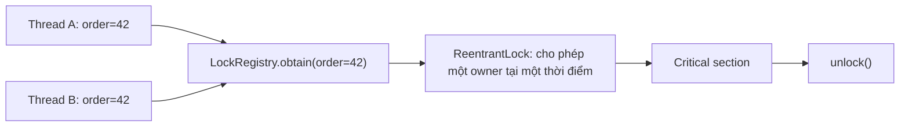
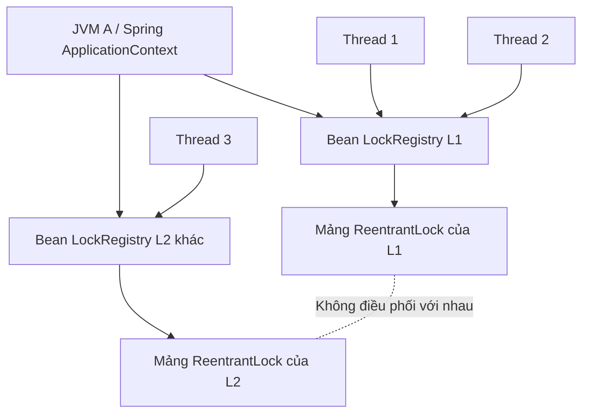
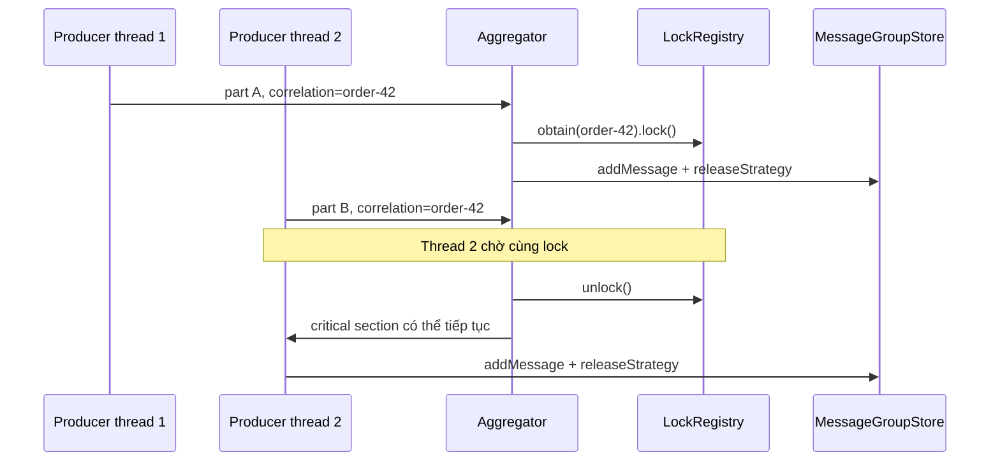
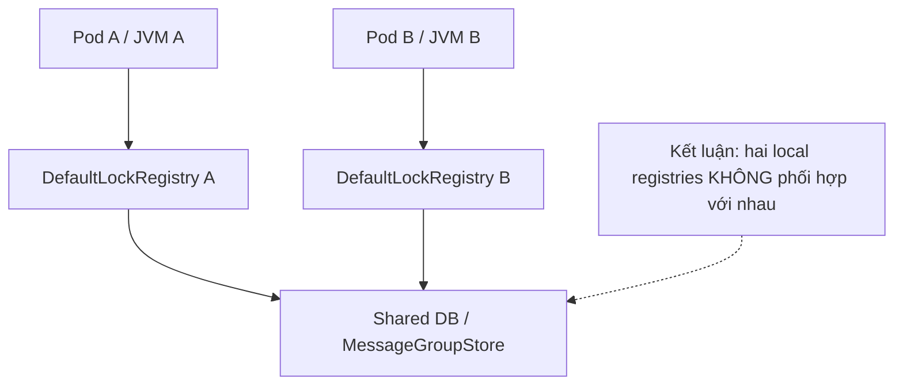

# DefaultLockRegistry trong cùng JVM của Spring Integration

## Mục tiêu và ngữ cảnh

Trong module **SPRING_INTEGRATION_RUNTIME**, các message flow có thể đồng thời chạy trên nhiều thread nhờ `DirectChannel` có nhiều producer, `ExecutorChannel`, poller và các consumer endpoint. Khi nhiều message cùng thao tác một trạng thái chia sẻ — chẳng hạn một order, một nhóm thông điệp của aggregator hay một bộ đếm — cần ngăn các thao tác đọc/sửa/ghi đè lên nhau.

Chương **Lock registry** giới thiệu `org.springframework.integration.support.locks.LockRegistry` và implementation mặc định `DefaultLockRegistry`. Bài này chỉ tập trung vào cách **DefaultLockRegistry điều phối lock trong một JVM**, không đánh đồng nó với distributed lock hay database transaction.

Sau bài học, bạn có thể:

- Giải thích cách `DefaultLockRegistry` ánh xạ một lock key vào `ReentrantLock` và vì sao hai key khác nhau có thể tranh cùng lock.
- Dùng `obtain(Object)`, `lock()`, `tryLock(...)`, `unlock()` và `executeLocked(...)` đúng hợp đồng.
- Cấu hình lock registry cho aggregator hoặc `LockRequestHandlerAdvice` trong Spring Integration.
- Nhận diện transaction boundary, thread ownership, deadlock, lock contention và nguy cơ xử lý trùng.
- Phân biệt một registry chia sẻ trong cùng JVM với nhiều instance registry và với các JVM/container độc lập.
- Đo, kiểm thử và xử lý những trường hợp: đồng thời cùng key, khác key bị hash collision, lỗi khi giữ lock, timeout khi đợi và restart.

Ví dụ API phù hợp **Spring Integration 6.5.x** và **Java 17+**. Một số helper, như `LockRegistry.executeLocked()`, được bổ sung từ Spring Integration 6.2. Khi dùng phiên bản khác, tra Javadoc đúng version.

## 1. Vì sao message flow cần lock?

Hãy xét service xử lý hai message cùng `orderId=ORD-42`:

```text
Thread A: đọc order version 5
Thread B: đọc order version 5
Thread A: tăng số lần xử lý → 6, ghi lại
Thread B: tăng số lần xử lý → 6, ghi lại

Kỳ vọng: 7
Kết quả có thể: 6 (lost update)
```

Nếu những thao tác này chỉ dùng shared state trong cùng JVM, một lock đúng key có thể khiến mỗi thread xử lý lần lượt. Điều này quan trọng với aggregator: hai phần của cùng một `correlationId` không được đồng thời cập nhật/release một message group thiếu đồng bộ.



Tuy nhiên, **lock registry không tự sửa được race condition chỉ vì nó tồn tại dưới dạng Spring bean**. Mọi đường thao tác vào cùng shared state phải thực sự sử dụng cùng registry, cùng quy tắc tạo key và cùng vùng bảo vệ.

### Ba phạm vi độc lập

| Phạm vi | Ai đảm bảo? | Lock registry có thay thế được không? |
|---|---|---|
| Thread synchronization | `java.util.concurrent.locks.Lock` | Có, nếu mọi thread dùng đúng cùng instance registry và key |
| Database commit/rollback | `PlatformTransactionManager`, DB transaction | Không; unlock không có nghĩa commit |
| Đồng bộ giữa các JVM/pod | Shared/distributed lock implementation | `DefaultLockRegistry` **không** giải quyết |

Một thread nắm `DefaultLockRegistry` vẫn có thể bị lỗi DB, crash tiến trình hoặc gọi HTTP thành công rồi rollback DB. Lock trong JVM không cung cấp durability, retry, business idempotency hay atomicity với nguồn message.

## 2. LockRegistry và DefaultLockRegistry

Abstraction chung:

```java
package org.springframework.integration.support.locks;

public interface LockRegistry {
    java.util.concurrent.locks.Lock obtain(Object lockKey);
    // Từ 6.2: các default methods executeLocked(...).
}
```

`DefaultLockRegistry` là implementation **in-memory**, final class, sử dụng một mảng `ReentrantLock` được tạo khi khởi tạo registry.

```java
import org.springframework.integration.support.locks.DefaultLockRegistry;
import org.springframework.integration.support.locks.LockRegistry;

LockRegistry registry = new DefaultLockRegistry();
```

Điều đặc biệt cần hiểu đúng: **Spring Integration 6.5 không cấp một lock độc lập cho mỗi key**. Nó dùng **striped locking** bằng một mảng có số phần tử cố định.

### Công thức ánh xạ

```java
int stripeIndex = lockKey.hashCode() & mask;
Lock lock = locks[stripeIndex];
```

Đây là mô hình hóa thuật toán trong Javadoc, không phải toàn bộ mã nguồn framework. Với constructor không tham số:

```text
mask = 0xFF = 255 (nhị phân: 1111_1111)
số lock = mask + 1 = 256
stripeIndex = lockKey.hashCode() & 0xFF
```

Vì thế:

- Cùng `lockKey` với hash code ổn định sẽ chọn **cùng ReentrantLock** trên cùng registry.
- Hai key khác nhau, thậm chí có `equals()==false`, vẫn có thể chọn **cùng stripe** nếu các bit hash sau mask trùng nhau.
- Hash collision tạo **contention giả** (không làm mất tính loại trừ), chứ không tạo hai locks không an toàn cho cùng key.
- Mỗi registry instance có mảng locks riêng. Hai `new DefaultLockRegistry()` hoàn toàn độc lập, dù nằm trong cùng JVM.

### Ví dụ collision có thể tái hiện

```java
LockRegistry registry = new DefaultLockRegistry(0x3); // 4 stripes

// Java String "Aa" và "BB" có cùng hashCode.
System.out.println("Aa".hashCode() == "BB".hashCode()); // true

boolean sameLock = registry.obtain("Aa") == registry.obtain("BB");
System.out.println(sameLock); // true
```

Ví dụ này cho thấy **một lock vật lý có thể đại diện cho nhiều business keys**. Nếu thread A xử lý `Aa` và thread B xử lý `BB`, chúng sẽ tuần tự dù không cùng business entity.

**Không nên suy ra** rằng collision gây trộn group data: mỗi business key vẫn được giữ riêng trong store/mapping nếu correlation logic đúng. Collision chỉ làm giảm mức độ song song của các critical sections.

## 3. Chọn mask: số stripe chứ không phải dung lượng cache

`DefaultLockRegistry` có hai constructor:

```java
DefaultLockRegistry small = new DefaultLockRegistry();
DefaultLockRegistry larger = new DefaultLockRegistry(0x3ff);
```

| Constructor | Mask | Số `ReentrantLock` | Ghi chú |
|---|---|---:|---|
| `new DefaultLockRegistry()` | `0xFF` | 256 | Mặc định |
| `new DefaultLockRegistry(0x3)` | `0x3` | 4 | Chỉ để minh họa/test collision |
| `new DefaultLockRegistry(0x3ff)` | `0x3FF` | 1.024 | Giảm xác suất collision khi nhiều keys hoạt động đồng thời |
| `new DefaultLockRegistry(0xfff)` | `0xFFF` | 4.096 | Nhiều stripes hơn, dùng bộ nhớ cố định lớn hơn |

Mask hợp lệ theo Javadoc là dạng `2^n - 1` với `n` từ 1 tới 31. Không được truyền “số locks” trực tiếp: `new DefaultLockRegistry(1024)` **không** nghĩa là 1.024 locks; mask phải là `1023` nếu muốn 1.024 stripes.

Không tăng mask tối đa mà không tính toán: registry cấp phát cả mảng locks lúc khởi tạo, nên quá nhiều stripes tốn bộ nhớ. Đồng thời không thể kỳ vọng 1.024 stripes cho throughput gấp bốn lần mặc định; bottleneck có thể là DB, message store, network, executor hoặc cùng một hot key.

### Khác với JdbcLockRegistry và RedisLockRegistry

Một số implementation khác có cache locks theo key, TTL, `setCacheCapacity(...)` hoặc `expireUnusedOlderThan(...)`. **Đừng sao chép các method đó sang `DefaultLockRegistry` 6.5**: class mặc định này chỉ có cấu hình mask và `obtain(Object)` cùng các default methods của interface.

Điểm thuận lợi của striped locking là bộ nhớ **bị chặn theo số stripes**, không tăng tỷ lệ thuận với số correlation keys. Đổi lại, các key có hash collision phải chờ nhau.

## 4. Cách sử dụng thủ công an toàn

### 4.1. `obtain` rồi `lock/unlock`

```java
import java.util.concurrent.locks.Lock;
import org.springframework.integration.support.locks.LockRegistry;

public final class LocalOrderCounter {

    private final LockRegistry locks;
    private final java.util.Map<String, Integer> counts =
            new java.util.concurrent.ConcurrentHashMap<>();

    public LocalOrderCounter(LockRegistry locks) {
        this.locks = locks;
    }

    public int increase(String orderId) {
        Lock lock = locks.obtain(orderId);
        lock.lock();
        try {
            int next = counts.getOrDefault(orderId, 0) + 1;
            counts.put(orderId, next);
            return next;
        }
        finally {
            lock.unlock();
        }
    }
}
```

Ví dụ dùng `ConcurrentHashMap` vì hai key thuộc hai stripes khác nhau **có thể được cập nhật đồng thời**; `HashMap` thường không an toàn cho trường hợp đó. Mỗi chuỗi đọc–tăng–ghi của **cùng một key** vẫn phải qua cùng lock protocol. Nếu code khác thay đổi trạng thái mà bỏ qua khóa, tính nguyên tử của thao tác tổng hợp không còn được đảm bảo. Với counter đơn giản, `ConcurrentHashMap<String, AtomicInteger>` có thể đủ mà không cần registry riêng.

**Quy tắc bắt buộc:** `unlock()` trong `finally` sau khi chắc chắn đã acquire lock. Không `unlock` khi `tryLock` trả `false`; nếu không có quyền sở hữu, `ReentrantLock` có thể ném `IllegalMonitorStateException`.

### 4.2. `tryLock` có timeout

```java
import java.util.concurrent.TimeUnit;
import java.util.concurrent.locks.Lock;

Lock lock = registry.obtain("order:ORD-42");

boolean acquired = false;
try {
    acquired = lock.tryLock(500, TimeUnit.MILLISECONDS);
    if (!acquired) {
        // Ví dụ: đẩy message vào retry queue / báo bận;
        // không thực hiện side effect khi chưa có lock.
        return;
    }

    updateOrderLocally();
}
catch (InterruptedException ex) {
    Thread.currentThread().interrupt();
    // Ghi nhận interruption/để tầng gọi quyết định retry.
    throw new IllegalStateException("Đang chờ lock thì bị ngắt", ex);
}
finally {
    if (acquired) {
        lock.unlock();
    }
}
```

Đoạn này là minh họa method body: `registry` và `updateOrderLocally()` được giả định đã có. Đặt thời gian đợi lock phù hợp với gateway/poller SLA và độ trễ end-to-end. Khi không lấy được lock, cần một **outcome rõ ràng** (requeue, timeout, error flow hoặc phản hồi busy), không được tự gọi business operation ngoài vùng được bảo vệ.

### 4.3. `LockRegistry.executeLocked`

Từ Spring Integration 6.2, interface có tiện ích `executeLocked` để giảm nguy cơ quên unlock:

```java
import org.springframework.integration.support.locks.DefaultLockRegistry;
import org.springframework.integration.support.locks.LockRegistry;

LockRegistry registry = new DefaultLockRegistry();

registry.executeLocked("order:ORD-42", () -> {
    // Chạy khi đã nắm lock.
    performLocalCriticalSection();
});
```

Biến thể có thời gian chờ:

```java
import java.time.Duration;
import java.util.concurrent.TimeoutException;

try {
    registry.executeLocked(
            "order:ORD-42",
            Duration.ofMillis(250),
            () -> performLocalCriticalSection());
}
catch (TimeoutException ex) {
    // Không lấy được lock trong giới hạn chờ.
    scheduleRetryForOrder("ORD-42");
}
catch (InterruptedException ex) {
    Thread.currentThread().interrupt();
    throw new IllegalStateException("Interrupted while waiting", ex);
}
```

`performLocalCriticalSection()` và `scheduleRetryForOrder(...)` là API ứng dụng minh họa. `executeLocked` bảo đảm gọi `unlock` theo vòng đời task; exception từ task có thể truyền ra caller. Nó **không tự rollback DB, không biến task thành transaction và không tự publish `ErrorMessage`**.

Có cả overload nhận `CheckedCallable<T,E>` để trả kết quả.

### So sánh ba cách

| Cách | Khi nào dùng? | Điều cần kiểm tra |
|---|---|---|
| `lock()` | Cần đợi cho đến khi acquire và tự quản lý critical section | Có thể đợi không giới hạn; `finally` phải unlock |
| `tryLock(timeout, unit)` | Endpoint/gateway có giới hạn thời gian | Xử lý `false`, `InterruptedException` và unlock có điều kiện |
| `executeLocked(key, task)` | Muốn API gọn, giảm sai sót unlock | Có thể block; handling exception/task duration vẫn do ứng dụng quyết định |
| `executeLocked(key, Duration, task)` | Muốn bounded wait theo API Spring Integration | Có thể ném `TimeoutException`, không phải group timeout |

## 5. Vì sao phải dùng cùng một instance registry?

Hai worker cùng JVM chỉ đồng bộ được nếu dùng **cùng instance** `DefaultLockRegistry`.



Trường hợp sai:

```java
public void workerOne(String key) {
    new DefaultLockRegistry().executeLocked(key, this::doWork);
}

public void workerTwo(String key) {
    new DefaultLockRegistry().executeLocked(key, this::doWork);
}
```

Mỗi lần tạo registry mới là tạo mảng `ReentrantLock` mới. Hai methods trên **không chia sẻ khóa**, dù key bằng nhau, trong cùng process.

Cấu hình đúng là đăng ký bean dùng chung:

```java
@Configuration
class LockRegistryConfig {

    @Bean
    LockRegistry localLockRegistry() {
        return new DefaultLockRegistry(0x3ff);
    }
}
```

Sau đó inject **đúng bean** vào các handlers cùng bảo vệ một shared resource:

```java
@Service
public class OrderCoordinator {
    private final LockRegistry localLockRegistry;

    public OrderCoordinator(LockRegistry localLockRegistry) {
        this.localLockRegistry = localLockRegistry;
    }

    public void update(String orderId) throws InterruptedException {
        localLockRegistry.executeLocked(orderId,
                () -> updateSharedInMemoryState(orderId));
    }
}
```

Ví dụ yêu cầu application có method `updateSharedInMemoryState` và dependency management thích hợp. Với nhiều `ApplicationContext` trong cùng JVM, mỗi context có thể tạo bean registry riêng; không được coi “cùng JVM” là tự động chia sẻ nếu instance khác.

## 6. Tích hợp với Aggregator và correlation

Spring Integration dùng `LockRegistry` để điều phối cập nhật các message groups theo resolved correlation key. Một aggregator thường được cấu hình mặc định với **`DefaultLockRegistry` in-memory**.



Với đúng một aggregator và registry trong JVM, các cập nhật group cùng key được tuần tự hóa. Đây là bảo vệ **thao tác với group state**, không bảo đảm về số lượng messages, ordering end-to-end hoặc việc downstream side effect chỉ chạy một lần.

### Java DSL sử dụng LockRegistry

Ví dụ một aggregator gom ba phần cùng `batchId`:

```java
import org.springframework.context.annotation.Bean;
import org.springframework.context.annotation.Configuration;
import org.springframework.integration.channel.DirectChannel;
import org.springframework.integration.config.EnableIntegration;
import org.springframework.integration.dsl.IntegrationFlow;
import org.springframework.integration.support.locks.DefaultLockRegistry;
import org.springframework.integration.support.locks.LockRegistry;
import org.springframework.messaging.MessageChannel;

@Configuration
@EnableIntegration
public class AggregatorLockConfig {

    @Bean
    public MessageChannel batchParts() {
        return new DirectChannel();
    }

    @Bean
    public LockRegistry batchGroupLocks() {
        return new DefaultLockRegistry(0x3ff);
    }

    @Bean
    public IntegrationFlow batchAggregationFlow(
            LockRegistry batchGroupLocks) {

        return IntegrationFlow.from("batchParts")
                .aggregate(spec -> spec
                        .correlationExpression("headers['batchId']")
                        .releaseStrategy(group -> group.size() >= 3)
                        .lockRegistry(batchGroupLocks))
                .handle(message -> System.out.println(
                        "GROUP OUTPUT: " + message.getPayload()))
                .get();
    }
}
```

Cách khai báo này minh họa API `CorrelationHandlerSpec.lockRegistry(...)`. Ví dụ group size 3 chỉ phù hợp khi dữ liệu không bị redelivery hoặc bạn đã có deduplication. Để ghép sequence chính xác, nên dùng header `sequenceNumber`/`sequenceSize` và strategy phù hợp.

**Không** nên dùng riêng `DefaultLockRegistry` cho các application replicas cùng thao tác một **persistent `MessageGroupStore` chia sẻ**: mỗi replica sẽ có registry local riêng nên hai instances vẫn có thể đồng thời thay đổi/release cùng một group. Cần một shared/distributed lock registry hoặc kiến trúc phân vùng một group về một owner duy nhất.

### Deadlock giữa hai aggregators

Giả sử hai aggregators A và B dùng cùng registry và gửi output đồng bộ qua `DirectChannel`, một luồng giữ khóa A rồi vào B, trong khi luồng khác giữ khóa B rồi vào A:

```text
Thread 1: giữ L_A → chờ L_B
Thread 2: giữ L_B → chờ L_A

=> Deadlock
```

Spring Integration có hướng xử lý trong tài liệu aggregator:

1. Dùng registry **khác nhau cho các aggregators** không cần bảo vệ chung một store (nhưng mỗi registry phải vẫn đúng phạm vi chia sẻ của aggregator tương ứng).
2. Đặt `ExecutorChannel` hoặc `QueueChannel` ở output để downstream chạy sau trong thread khác, làm giảm nested locking đồng bộ.
3. Cân nhắc `releaseLockBeforeSend(true)` để aggregator nhả group lock trước khi gửi output.

Ví dụ DSL:

```java
.aggregate(spec -> spec
        .lockRegistry(batchGroupLocks)
        .correlationExpression("headers['batchId']")
        .releaseStrategy(group -> group.size() >= 3)
        .releaseLockBeforeSend(true))
```

**Đánh đổi:** nhả lock trước output có thể tăng mức đồng thời nhưng thay đổi điểm serialization của các side effects downstream. Cần kiểm tra dedup, ordering, interleaving và cách hai group versions được release. Không bật chỉ để che deadlock mà không phân tích flow.

## 7. Dùng DefaultLockRegistry với LockRequestHandlerAdvice (6.5+)

Từ Spring Integration 6.5, `LockRequestHandlerAdvice` giúp khóa **lời gọi service handler** theo một lock key lấy từ request message. Đó là cách dùng `LockRegistry` ở tầng endpoint, thay vì gọi `obtain()` thủ công trong logic nghiệp vụ.

```java
import java.util.Objects;

import org.springframework.context.annotation.Bean;
import org.springframework.context.annotation.Configuration;
import org.springframework.integration.handler.advice.LockRequestHandlerAdvice;
import org.springframework.integration.support.locks.DefaultLockRegistry;
import org.springframework.integration.support.locks.LockRegistry;

@Configuration
public class OrderLockAdviceConfig {

    @Bean
    public LockRegistry localOrdersRegistry() {
        return new DefaultLockRegistry(0x3ff);
    }

    @Bean
    public LockRequestHandlerAdvice orderLockAdvice(
            LockRegistry localOrdersRegistry) {

        return new LockRequestHandlerAdvice(
                localOrdersRegistry,
                message -> Objects.requireNonNull(
                        message.getHeaders().get("orderId"),
                        "Header orderId is required"));
    }
}
```

Gắn advice vào consumer endpoint:

```java
@ServiceActivator(
        inputChannel = "ordersIn",
        adviceChain = "orderLockAdvice")
public void processOrder(Message<String> message) {
    // Xử lý một order ở một thời điểm trong cùng registry/JVM.
    String orderId = String.valueOf(
            message.getHeaders().get("orderId"));
    updateOrderCache(orderId, message.getPayload());
}
```

Các phương thức `processOrder` và `updateOrderCache` thuộc bean service ứng dụng cần tạo; cần định nghĩa input channel `ordersIn`. Mẫu trên dùng một key là `orderId` và ném lỗi khi thiếu header, tránh đi vào vùng không bảo vệ.

**Nếu key callback trả `null`**, mặc định `LockRequestHandlerAdvice` bỏ qua locking quanh service call; nếu có `discardChannel`, nó có thể chuyển message không có key sang nhánh discard. Với dữ liệu nghiệp vụ bắt buộc khóa, cần kiểm tra key sớm thay vì âm thầm xử lý không lock.

Một timeout khi đợi lock có thể cấu hình qua `setWaitLockDurationExpressionString(...)` theo tài liệu:

```java
orderLockAdvice.setWaitLockDurationExpressionString("'PT1S'");
```

`PT1S` là biểu diễn ISO-8601 duration một giây. Khi timeout, error handling cần được thiết kế tại endpoint: không nên “thử lại ngay vô hạn” vì sẽ giữ worker hoặc tăng queue backlog.

### Scope của advice

`LockRequestHandlerAdvice` bảo vệ **lời gọi handler được advise**. Nó không tự bao mọi downstream handler, response gửi sau đó hoặc một transaction đã chạy từ trước. Nếu application tạo thread mới trong method rồi trả về trước khi thread kết thúc, lock thường được nhả khi method return, **không** đợi công việc async do bạn tự spawn hoàn thành.

Với một `MessageHandler` gọi remote API trong nhiều giây, khóa có thể bị giữ xuyên HTTP. Điều này làm các message cùng stripe chờ nhau, kể cả hai business keys khác nhau bị collision. Ưu tiên chỉ bảo vệ phần truy cập state ngắn; remote call nên nằm ngoài critical section khi có thể.

## 8. LockRegistry khác transaction, retry, message store và idempotency

Một vùng lock đúng có thể tránh race giữa các threads trong JVM. Nhưng “thread-safe” không có nghĩa mọi side effect được commit đúng hoặc replay an toàn.

| Tầng runtime | Trách nhiệm | DefaultLockRegistry giúp gì? | Điều vẫn phải thiết kế |
|---|---|---|---|
| `DirectChannel` | Chuyển message đồng bộ | Tuần tự critical section khi hai callers dùng cùng registry | Retry/error propagation của caller |
| `ExecutorChannel` | Chạy handler trong worker | Chặn race trên shared state JVM | Pool sizing, queue backlog, cancellation |
| Poller / `QueueChannel` | Nhận message theo lịch | Phối hợp hai poller/worker trong cùng JVM khi dùng cùng registry | Ack/redelivery, transaction, scheduling |
| Aggregator | Mutate/release message group | Serialize group updates theo lock key | Release strategy, persistent store, expiry và late arrivals |
| JDBC transaction | Commit/rollback database | Không thay thế transaction | Isolation, unique constraint, version, rollback |
| `RequestHandlerRetryAdvice` | Thử lại handler khi lỗi | Có thể bảo vệ các attempts nếu advice được kết hợp đúng phạm vi | Max attempts, backoff, transaction ordering |
| `MessageGroupStore` | Lưu group state | Bảo vệ thao tác in-JVM theo key | Durability và multi-instance ownership |
| Remote API | Side effect ở hệ thống ngoài | Không ngăn replica khác gọi API | Idempotency key, outbox, timeout, compensation |

### Lock rồi transaction?

```text
Acquire local lock
  BEGIN DB transaction
  UPDATE row
  COMMIT DB transaction
Release local lock
```

Phù hợp cho critical section thật ngắn khi tất cả writers trong cùng JVM dùng cùng lock. Nhưng một tiến trình khác có thể cập nhật DB mà không lấy lock này. Do đó DB unique constraints, optimistic locking/`@Version` hoặc isolation đúng vẫn là hàng phòng vệ bắt buộc cho dữ liệu chia sẻ giữa các ứng dụng.

### Transaction rồi lock?

```text
BEGIN DB transaction
  Đợi lock 3 giây
  UPDATE row
COMMIT DB transaction
```

Transaction có thể giữ DB connection/transaction context trong lúc đợi local lock, gây nghẽn pool. Nếu ứng dụng cần lock trước DB transaction, nên thiết kế boundary rõ ràng và thực sự kiểm tra thứ tự advice/transaction manager. Không dùng local lock như giải pháp cho distributed consistency.

### Retry khi còn giữ lock

Nếu `RequestHandlerRetryAdvice` nằm **bên trong** lock advice, một thread có thể giữ lock xuyên nhiều attempts và thời gian backoff. Nếu retry nằm **bên ngoài** lock advice, mỗi attempt có thể acquire/release riêng, cho phép các message khác xen vào giữa attempts. Hai mô hình có hiệu ứng khác nhau lên ordering, fairness và idempotency.

```text
LockAdvice → RetryAdvice → handler
  một lock giữ trong nhiều attempts

RetryAdvice → LockAdvice → handler
  mỗi attempt acquire/release một lần
```

Không có một thứ tự tốt cho mọi nghiệp vụ. Nếu mỗi attempt thao tác cùng shared in-memory state, cần xem invariant nào phải được giữ giữa attempts; nếu các attempts gọi remote chậm, không nên giữ lock quá rộng chỉ vì muốn serialization.

### Lock không chống duplicate sau restart

Mảng `ReentrantLock` biến mất khi JVM dừng. Nếu process bị kill sau khi HTTP thành công nhưng trước khi DB lưu trạng thái, message redelivery vẫn có thể kích hoạt side effect lần nữa. Sử dụng **business idempotency key** và persistent inbox/outbox khi yêu cầu tính đúng đắn qua crash.

## 9. Đo thử bằng nhiều threads trong cùng JVM

Ví dụ dưới đây là Java 17 độc lập (có `spring-integration-core` trên classpath). Nhiều threads cùng cập nhật một shared counter dưới cùng key; giá trị `maxConcurrentInCriticalSection` phải bằng 1.

```java
import java.util.ArrayList;
import java.util.List;
import java.util.concurrent.Callable;
import java.util.concurrent.CountDownLatch;
import java.util.concurrent.ExecutorService;
import java.util.concurrent.Executors;
import java.util.concurrent.Future;
import java.util.concurrent.TimeUnit;
import java.util.concurrent.atomic.AtomicInteger;

import org.springframework.integration.support.locks.DefaultLockRegistry;
import org.springframework.integration.support.locks.LockRegistry;

public class LocalLockDemo {

    public static void main(String[] args) throws Exception {
        LockRegistry registry = new DefaultLockRegistry();

        AtomicInteger active = new AtomicInteger();
        AtomicInteger peak = new AtomicInteger();
        AtomicInteger count = new AtomicInteger();

        ExecutorService pool = Executors.newFixedThreadPool(8);
        CountDownLatch start = new CountDownLatch(1);
        List<Future<?>> futures = new ArrayList<>();

        try {
            for (int i = 0; i < 24; i++) {
                futures.add(pool.submit((Callable<Void>) () -> {
                    start.await();

                    registry.executeLocked("order:ORD-42", () -> {
                        int inside = active.incrementAndGet();
                        peak.accumulateAndGet(inside, Math::max);
                        try {
                            Thread.sleep(10L);
                            count.incrementAndGet();
                        }
                        finally {
                            active.decrementAndGet();
                        }
                    });
                    return null;
                }));
            }

            start.countDown();
            for (Future<?> future : futures) {
                future.get(); // Propagate exception từ worker.
            }
        }
        finally {
            pool.shutdown();
            if (!pool.awaitTermination(5, TimeUnit.SECONDS)) {
                pool.shutdownNow();
            }
        }

        System.out.println("count=" + count.get());
        System.out.println("peak=" + peak.get());

        if (count.get() != 24 || peak.get() != 1) {
            throw new AssertionError("Critical section not serialized");
        }
    }
}
```

Mong đợi:

```text
count=24
peak=1
```

Ví dụ dùng một key nên tất cả tasks vào cùng một stripe. Để kiểm thử concurrency của **khác key**, cho hai tasks lấy keys có stripe khác nhau và dùng latch đợi cả hai đã vào critical section; khi đó có thể đồng thời chạy. Không dựa vào `Thread.sleep` để khẳng định một lịch chạy luôn xảy ra, vì thread scheduling không quyết định trước.

### Chứng minh hai registries độc lập

```java
LockRegistry registryOne = new DefaultLockRegistry();
LockRegistry registryTwo = new DefaultLockRegistry();

System.out.println(
        registryOne.obtain("same-key")
                == registryTwo.obtain("same-key")); // false
```

Dù key giống hệt, hai locks thuộc hai registry instances khác nhau. Đây là lỗi phổ biến khi mỗi service tự `new DefaultLockRegistry` thay vì inject một Spring singleton bean.

### Kiểm chứng collision tạo contention

```java
LockRegistry striped = new DefaultLockRegistry(0x3);

// "Aa" và "BB" có Java String hash giống nhau.
assert striped.obtain("Aa") == striped.obtain("BB");
```

Tránh dùng `assert` trong code vận hành vì mặc định JVM có thể tắt assertions. Trong unit test, dùng JUnit `assertSame(...)` hoặc AssertJ `isSameAs(...)` để chứng minh object identity. Mục đích của test này là **khẳng định sharing do stripe collision**, không phải kiểm tra sự đúng đắn của business correlation.

## 10. Khi nào DefaultLockRegistry không đủ?

### Multi-JVM, nhiều pods hoặc nhiều Spring contexts



Nếu hai pods cập nhật cùng `JdbcMessageStore` hoặc cùng business record, mỗi pod có một mảng locks riêng. Không có shared state giữa các locks, nên cả hai pods có thể đồng thời giữ `Lock` cho cùng key. DefaultLockRegistry **không an toàn như một distributed mutex**.

Các lựa chọn ở phạm vi cluster gồm:

- `JdbcLockRegistry` nếu có database chung, cấu hình repository và isolation phù hợp.
- `RedisLockRegistry` khi hệ thống dùng Redis và chấp nhận các semantics về TTL/renewal/failure của implementation.
- `ZookeeperLockRegistry` hoặc `HazelcastLockRegistry` nếu có hạ tầng tương ứng.
- Các cơ chế partition/owner nhất quán hoặc DB-level optimistic locking nếu không cần distributed mutex trên mọi thao tác.

Lựa chọn phụ thuộc durability, failure model, leader ownership, load, latency và nhu cầu fencing/idempotency. **Đổi registry không tự tạo exactly-once effects**; khi lease hết hạn và worker cũ vẫn chạy, vẫn cần tránh old owner ghi đè mới.

### Trong cùng JVM nhưng hai registry instances

Ngay cả khi không có multi-JVM, hai `ApplicationContext` hoặc hai bean factory methods tạo ra hai `DefaultLockRegistry` khác nhau. Chúng không phối hợp dù cùng process.

Phạm vi chính xác nên nói là: **các threads/callers chia sẻ cùng một instance registry trong một JVM**. Đừng gọi nó là “JVM-global lock” nếu application tạo nhiều registries.

### Khi workload chỉ cần DB consistency

Nếu hai instances cập nhật cùng DB row, ràng buộc unique và optimistic locking có thể phù hợp hơn distributed locks. Local locks đôi khi giúp giảm contention trong một instance, nhưng DB vẫn phải bảo vệ invariant xuyên instances.

## 11. Lock contention, deadlock và hiệu năng

### 11.1. Contention do hot key

Nếu một `orderId` nhận quá nhiều messages, chúng đều phải tuần tự trên cùng lock. Tăng stripe count không giúp vì **cùng key vẫn chọn cùng stripe**. Cần cân nhắc tách entity, sharding work theo business key, giảm critical-section duration hoặc chuyển sang xử lý tuần tự theo partition.

### 11.2. Contention do hash collision

Hai key khác nhau có cùng `hashCode() & mask`. Tăng số stripes có thể giảm xác suất xung đột nhưng không loại bỏ hoàn toàn; một số hash codes vốn phân bố kém ở các bit thấp, nên cần xem key format/hash design trước khi tăng mảng lên rất lớn.

Với 256 stripes và nhiều keys đang hoạt động đồng thời, sự va chạm là bình thường. Số keys lớn hơn số stripes chắc chắn tồn tại collision theo nguyên lý Dirichlet. Đây là **trade-off thiết kế** của DefaultLockRegistry.

### 11.3. Deadlock vì nested locks

```text
Thread A: acquire lock(order-A), chờ lock(order-B)
Thread B: acquire lock(order-B), chờ lock(order-A)
```

Để giảm rủi ro:

1. Không nắm lock khi gọi code có thể quay lại một handler/aggregator khác rồi xin lock thứ hai.
2. Quy định thứ tự acquire nhất quán khi thực sự cần nhiều keys (ví dụ sort stable keys), nhưng lưu ý striped collision có thể khiến hai keys tương ứng cùng physical lock và tính reentrant thay đổi biểu hiện.
3. Giữ critical section nhỏ; tránh network call, blocking queue hoặc callback ngoài tầm kiểm soát dưới lock.
4. Tại aggregator, cân nhắc `releaseLockBeforeSend(true)` hoặc async channel để cắt nested call stack; kiểm tra semantics trước khi đổi.
5. Dùng `tryLock` có timeout và kênh xử lý thất bại khi một wait không thể kéo dài vô hạn.

### 11.4. ReentrantLock có ownership theo thread

`ReentrantLock` cho phép **cùng thread** lock nhiều lần, nhưng mỗi lần acquire phải được cân bằng bằng `unlock`. Thread khác không được unlock thay.

**Không** chuyển `Lock` đang được giữ qua `CompletableFuture` rồi để callback ở executor thread khác unlock. Điều này có thể ném `IllegalMonitorStateException`, trong khi việc giữ lock qua callback async còn dễ gây starvation/deadlock.

### 11.5. Thread dump và metrics

Một số tín hiệu hữu ích:

| Tín hiệu | Ý nghĩa khả dĩ | Hành động |
|---|---|---|
| Nhiều threads `WAITING`/`TIMED_WAITING` trên `ReentrantLock` | Tranh lock/hot key/collision | Xem owner thread, thời gian giữ và phân phối keys |
| p99 handler latency tăng nhưng DB nhanh | Đợi lock hoặc network trong critical section | Đo lock wait riêng với thời gian service |
| Executor queue backlog | Workers đợi lock lâu hoặc đang retry | Rút ngắn critical section/điều chỉnh concurrency |
| Group release chậm | Lock trên message group hoặc downstream output block | Kiểm tra `releaseLockBeforeSend`/store/consumer |
| Deadlock cảnh báo ở thread dump | Nested lock order không nhất quán | Tìm cycle owner/waiter, sửa call graph |
| Một pod luôn chạy nhanh, pod kia cập nhật đè | Không có shared lock giữa pods | Dùng distributed ownership/DB consistency |

Có thể thu thread dump trong môi trường phù hợp bằng JDK `jcmd <pid> Thread.print` hoặc `jstack <pid>`, sau đó tìm `ReentrantLock`, thread owner và chỗ nào đang giữ lock. Đo phần **wait duration** và **hold duration** riêng để biết cần tăng stripes hay phải sửa handler chậm.

## 12. Quan hệ với error flow, retry và lifecycle

Một lock không làm handler tự xử lý exception. Nếu bên trong critical section ném lỗi, `finally` hoặc `executeLocked` phải giải phóng lock; exception được xử lý theo contract hiện hành:

- `DirectChannel` thường truyền exception về caller của `send()`.
- `ExecutorChannel`/poller có error handler riêng hoặc phát `ErrorMessage` qua `errorChannel` khi được cấu hình phù hợp.
- `LockRequestHandlerAdvice` gặp lock wait timeout thì exception phải được định tuyến hoặc retry có giới hạn.
- `RequestHandlerRetryAdvice` có thể lặp lại handler; chọn thứ tự advice để không giữ lock suốt backoff khi không cần.
- Transaction rollback không tự undo một remote call đã hoàn tất dù lock được giữ đúng.

### Lifecycle và restart

Không có thứ gọi là “lock còn sống vĩnh viễn” qua JVM shutdown. Khi process dừng hoặc restart, `ReentrantLock` biến mất cùng mảng của registry. Nhưng **một thread chết khi chưa unlock không làm `ReentrantLock` tự nhả trong JVM còn chạy**: các threads khác vẫn có thể bị kẹt. `DefaultLockRegistry` không có cơ chế TTL lease hoặc tự thu hồi lock từ thread bị chết; phải dùng `finally` để giải phóng sau khi đã acquire.

Nếu một thread vẫn sống nhưng quên unlock, các threads khác có thể bị chặn lâu vô hạn. Không thiết kế việc sửa lỗi bằng `expireUnusedOlderThan` vì API đó thuộc các registry expirable khác, không phải DefaultLockRegistry.

Khi dynamic `IntegrationFlow` bị stop/unregister, các handler/consumers không nhận message mới nhưng các công việc đang chạy có thể vẫn chưa kết thúc. Đừng giả định `stop()` tự unlock mọi `Lock` giữ trong code custom; phải bảo đảm `finally` và chính sách shutdown thread.

## 13. Bài tập và chiến lược kiểm thử

### Bài 1 — Cùng key được tuần tự hóa

Dùng `LocalLockDemo` với 24 tasks, 8 threads:

1. Chạy thử và xác nhận `count=24`, `peak=1`.
2. Thử bỏ lock khỏi critical section và lặp lại kiểm thử nhiều lần: có thể thấy `peak>1` hoặc race; lỗi concurrency không bắt buộc xuất hiện trong mọi lần chạy.
3. Thử `executeLocked` và manual `lock/finally/unlock`, so sánh kết quả.
4. Tạo một task cố tình ném exception trong critical section; xác nhận task tiếp theo vẫn acquire lock được.

### Bài 2 — Hai key khác nhau nhưng cùng stripe

1. Dùng `new DefaultLockRegistry(0x3)`.
2. Xác nhận `"Aa"` và `"BB"` có cùng hash code và cùng `Lock` instance.
3. Dùng latch để giữ lock của `Aa` trong thread A và gọi `tryLock` cho `BB` từ thread B: kỳ vọng B không lấy được lock trong thời gian A đang giữ.
4. Đổi thành keys có stripe khác nhau, xác nhận cả hai threads có thể cùng vào critical section.

### Bài 3 — Hai registries không bảo vệ chung state

1. Tạo `DefaultLockRegistry registryA` và `registryB`.
2. Cho hai threads cùng key nhưng dùng registry khác nhau; xác nhận `obtain(key)` trả hai locks khác nhau.
3. Thay thành một Spring singleton `@Bean LockRegistry` inject vào cả hai services; xác nhận serialization.

### Bài 4 — Aggregator và release lock

1. Tạo aggregator với `.lockRegistry(batchGroupLocks)` và các messages trùng `batchId` đến từ nhiều threads.
2. Kiểm tra không xảy ra release đồng thời/duplicate do race nội bộ.
3. Cho downstream đồng bộ gọi vào một aggregator khác; kiểm tra khả năng nested locking và deadlock qua thread dump.
4. Cân nhắc `releaseLockBeforeSend(true)`, sau đó kiểm thử lại ordering, interleaving và side effects.

### Bài 5 — Timeout và recovery

1. Giữ một lock đủ lâu, dùng `executeLocked(key, Duration.ofMillis(100), ...)` từ thread khác; xác nhận `TimeoutException`.
2. Cho critical section ném exception; xác nhận lock được nhả.
3. Cấu hình `LockRequestHandlerAdvice` với key header và bounded wait; kiểm tra kênh xử lý khi thiếu key hoặc lock timeout.
4. Chạy hai JVM/pods riêng trên cùng DB; xác nhận DefaultLockRegistry **không** điều phối giữa hai processes, rồi áp dụng shared lock/DB consistency theo yêu cầu.

### Assertions quan trọng

```java
// Pseudocode cho JUnit/AssertJ:
// assertThat(peakInCriticalSection).isEqualTo(1);
// assertThat(tasksCompleted).isEqualTo(taskCount);
// assertThat(registry.obtain("Aa"))
//     .isSameAs(registry.obtain("BB")); // Với mask 0x3
// assertThat(registryOne.obtain("key"))
//     .isNotSameAs(registryTwo.obtain("key"));
// assertThatCode(() -> registry.executeLocked("key", task))
//     .doesNotThrowAnyException();
```

Đừng để unit tests chỉ dựa trên `Thread.sleep` hoặc thời gian chạy “có vẻ nhanh”. Dùng `CountDownLatch`/`CyclicBarrier`/`Future.get` với timeout và assertions về **số thread đang trong critical section**. Tài liệu có mục tiêu minh họa; test tích hợp với JDBC/Redis/Zookeeper thực tế vẫn cần cho distributed scenarios.

## 14. Checklist production

- [ ] Đã xác định **shared state** cần bảo vệ và tất cả writers cùng tuân theo một lock protocol.
- [ ] Các handlers cần phối hợp **cùng JVM** inject đúng một instance `LockRegistry`.
- [ ] Không nhầm `DefaultLockRegistry` với JVM-global lock nếu có nhiều `ApplicationContext`/instances.
- [ ] Hiểu default mask `0xFF` tạo 256 stripes; key khác nhau có thể hash collision.
- [ ] Nếu tuning, mask đúng dạng `2^n - 1`; không nhầm mask với số locks.
- [ ] Dùng stable immutable keys, không dùng object có `hashCode` thay đổi trong lúc xử lý.
- [ ] Luôn unlock trong `finally` hoặc dùng `executeLocked`; xử lý interruption và timeout.
- [ ] Critical section ngắn; tránh blocking network I/O hoặc retry sleep trong vùng lock.
- [ ] Không giữ `ReentrantLock` qua callback async rồi unlock từ thread khác.
- [ ] Aggregator sử dụng lock registry đúng phạm vi; phân biệt group store shared và single-JVM.
- [ ] Nested aggregators có lock order hoặc `releaseLockBeforeSend`/async output được kiểm thử.
- [ ] Không dùng DefaultLockRegistry làm distributed mutex cho các pods/JVM khác nhau.
- [ ] Vẫn dùng DB transaction, optimistic locking, unique constraints và idempotency khi phù hợp.
- [ ] Theo dõi lock wait/hold times, hot keys, collisions, executor backlog và deadlocks.
- [ ] Test cùng key, khác key/collision, exception, timeout, restart và multi-instance.
- [ ] Error flow, retry policy và lifecycle shutdown không tạo threads treo hoặc side effects trùng.

## Tài liệu tham khảo

- [Spring Integration 6.5.0 Javadoc — DefaultLockRegistry](https://docs.spring.io/spring-integration/docs/6.5.0/api/org/springframework/integration/support/locks/DefaultLockRegistry.html): thuật toán masked hash code, 256 locks mặc định, constructor mask và `obtain`.
- [Spring Integration 6.5.0 Javadoc — LockRegistry](https://docs.spring.io/spring-integration/docs/6.5.0/api/org/springframework/integration/support/locks/LockRegistry.html): contract `obtain` và overloads `executeLocked`.
- [Spring Integration 6.5 Reference — Distributed Locks](https://docs.spring.io/spring-integration/reference/6.5/distributed-locks.html): local và distributed registry, helper APIs, semantics của lock key.
- [Spring Integration Reference — Aggregator](https://docs.spring.io/spring-integration/reference/aggregator.html): mặc định lock registry in-memory, group synchronization và cách tránh deadlock.
- [Spring Integration Reference — Lock Advice](https://docs.spring.io/spring-integration/reference/6.5/handler-advice/lock.html): `LockRequestHandlerAdvice` và bounded wait theo key.
- [Spring Integration 6.5.x Javadoc — AbstractCorrelatingMessageHandler](https://docs.spring.io/spring-integration/docs/6.5.1/api/org/springframework/integration/aggregator/AbstractCorrelatingMessageHandler.html): API registry và `releaseLockBeforeSend`.
- [Java SE — ReentrantLock](https://docs.oracle.com/en/java/javase/17/docs/api/java.base/java/util/concurrent/locks/ReentrantLock.html): thread ownership, reentrancy và timeout.

**Ghi nhớ:** `DefaultLockRegistry` là bộ khóa **in-memory dạng striped** trong **một instance registry của một JVM**. Mặc định 256 `ReentrantLock` được chọn bằng `hashCode() & 0xFF`, nên một key luôn vào cùng stripe khi hash ổn định, nhưng các key khác nhau có thể cùng stripe. Registry giúp đồng bộ critical section giữa những threads chia sẻ nó; không thay thế transaction, distributed coordination, message persistence, error recovery hoặc idempotency.

