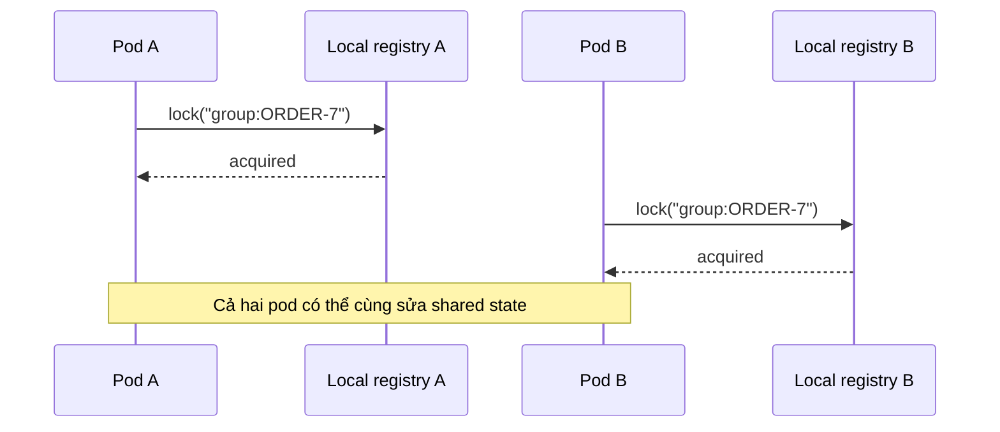
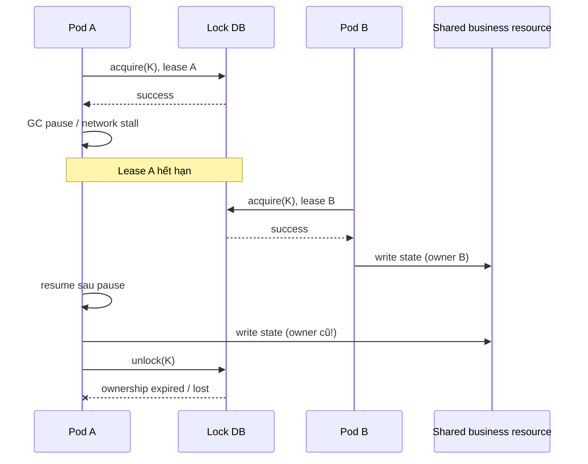
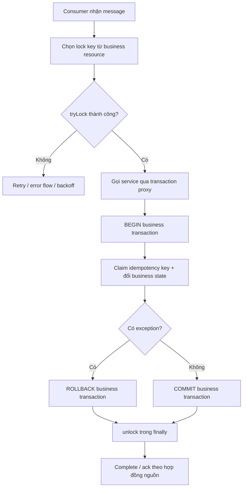

# JdbcLockRegistry hoặc distributed lock trong Spring Integration

## 1. Bài toán: hai instance cùng sửa một trạng thái

Trong module `SPRING_INTEGRATION_RUNTIME`, Spring Integration điều phối message qua **channel, endpoint, consumer, poller và executor**. Khi ứng dụng mở rộng thành nhiều JVM hoặc nhiều pod, hai consumer có thể cùng xử lý message liên quan đến **cùng một tài nguyên**: một message group của aggregator, một tác vụ phát báo cáo hoặc một mã hàng tồn kho. `synchronized` và `ReentrantLock` trong một JVM không đủ bảo vệ tài nguyên chung của toàn cụm.

Ví dụ hai instance cùng nhận các sự kiện cập nhật một hóa đơn:

```text
Pod A nhận event E1, key = invoice:INV-42
Pod B nhận event E2, key = invoice:INV-42

Nếu cả hai cùng đọc trạng thái cũ rồi cập nhật,
kết quả cuối có thể sai hoặc message group bị sửa đồng thời.
```

**Distributed lock** giúp các instance có thể **phối hợp quyền đi vào vùng xử lý độc quyền theo cùng lock key**, thông qua một hệ thống lưu trữ dùng chung. `JdbcLockRegistry` là một triển khai của Spring Integration sử dụng database để phối hợp khóa; các lựa chọn khác gồm Redis và ZooKeeper.

Khóa phân tán chỉ là **một phần** của tính đúng đắn: lease có thể hết hạn, worker có thể dừng giữa chừng và broker có thể gửi lại message sau khi transaction đã commit. Vì vậy bài này luôn phân biệt **mutual exclusion**, **transaction**, **retry/redelivery**, **idempotency** và **khả năng khôi phục**.

### Sau bài học, bạn có thể

1. Giải thích `LockRegistry.obtain(key)` và khác biệt giữa `DefaultLockRegistry` nội bộ với `JdbcLockRegistry` dùng chung.
2. Cấu hình `DefaultLockRepository`, bảng `INT_LOCK`, region, transaction manager và `JdbcLockRegistry`.
3. Viết một handler giữ lock **trên đúng thread đang thực thi nghiệp vụ**, dùng `tryLock` và `unlock` an toàn.
4. Phân tích lease/TTL, `renewLock`, lock ownership, lỗi khi unlock và giới hạn của “chỉ một owner”.
5. Chọn JDBC/Redis/ZooKeeper theo kiến trúc, số lượng khóa, độ trễ và yêu cầu availability.
6. Chẩn đoán contention, deadlock, lock expiry, transaction rollback, message replay và dữ liệu không nhất quán.

## 2. Các khái niệm và hợp đồng cần phân biệt

| Khái niệm | Ý nghĩa | Điều **không** được suy ra |
|---|---|---|
| `LockRegistry` | Registry trả về `Lock` gắn với một khóa logic qua `obtain(Object)`. | Gọi `obtain` **chưa** giành quyền sở hữu lock; phải `lock()` hoặc `tryLock()`. |
| `DefaultLockRegistry` | Dùng lock trong bộ nhớ của một registry/JVM, dựa trên Java concurrency. | Không đồng bộ các pod/JVM độc lập. |
| `JdbcLockRegistry` | Registry phối hợp lock qua database dùng chung, có local lock và record sở hữu ở JDBC. | Không tự tạo transaction cho nghiệp vụ và không tự chống duplicate business event. |
| `LockRepository` / `DefaultLockRepository` | Truy cập record lock qua SQL, owner, region và TTL. | Không phải `MessageStore` hay nơi giữ payload. |
| `Lock key` | Tên tài nguyên cần bảo vệ, ví dụ `inventory:SKU-1` hoặc correlation key của aggregator. | Không nhất thiết là message ID; hai message khác nhau có thể phải dùng **cùng** lock key. |
| `Lease / TTL` | Khoảng thời gian quyền sở hữu còn hiệu lực trong store, cho phép phục hồi lock khi owner chết. | TTL không phải thời gian chờ `tryLock` và không bảo đảm worker cũ đã dừng. |
| `Transaction` | Unit of work commit/rollback trên resource được transaction manager hỗ trợ. | Có lock không làm HTTP/email và JDBC tự atomic. |
| `Idempotency key` | Danh tính logic của một yêu cầu dùng để ngăn side effect trùng. | Không thể thay thế bằng lock key nếu có nhiều sự kiện hợp lệ cùng tài nguyên. |

Một `Lock` tiêu chuẩn là giao diện `java.util.concurrent.locks.Lock`, có các thao tác quen thuộc:

```java
Lock lock = lockRegistry.obtain("inventory:SKU-1");
boolean acquired = lock.tryLock(2, TimeUnit.SECONDS);

if (acquired) {
    try {
        performCriticalWork();
    } finally {
        lock.unlock();
    }
}
```

Đoạn trên là **mẫu sử dụng**; `lockRegistry` và `performCriticalWork()` được cấp bởi ứng dụng. `tryLock(2, ...)` giới hạn **thời gian chờ lấy khóa**, không kéo dài TTL. Nếu không lấy được lock, phải có chính sách fail/retry/đưa message trở lại queue, không âm thầm coi nghiệp vụ đã hoàn tất.

## 3. Từ lock cục bộ sang distributed lock

### 3.1. Khi ứng dụng chỉ chạy một JVM

```java
import org.springframework.integration.support.locks.DefaultLockRegistry;
import org.springframework.integration.support.locks.LockRegistry;

LockRegistry registry = new DefaultLockRegistry();
Lock lock = registry.obtain("group:ORDER-7");

lock.lock();
try {
    updateGroupState();
} finally {
    lock.unlock();
}
```

`DefaultLockRegistry` giúp nhiều thread **chia sẻ cùng registry instance** không cùng lúc sửa trạng thái cùng key. Nhưng pod A và pod B có hai registry riêng:



Dù key giống nhau, các map/Java lock trên hai JVM **không chia sẻ owner**. Một database hoặc Redis store chung không tự giải quyết vấn đề nếu code vẫn dùng `DefaultLockRegistry` local.

### 3.2. Khi nhiều instance cần bảo vệ cùng tài nguyên

Các instance phải cùng tuân thủ giao thức locking và sử dụng **cùng phạm vi khóa**: chung backend, tương thích key/region/prefix, các thao tác acquire/renew/release được triển khai nhất quán.

```mermaid
sequenceDiagram
    participant A as Pod A
    participant B as Pod B
    participant DB as Shared database / INT_LOCK
    A->>DB: acquire("group:ORDER-7")
    DB-->>A: success, owner A
    B->>DB: acquire("group:ORDER-7")
    DB-->>B: busy; retry/wait
    A->>A: update shared group
    A->>DB: release("group:ORDER-7")
    DB-->>A: released
    B->>DB: acquire("group:ORDER-7")
    DB-->>B: success, owner B
    B->>B: update shared group
```

Thực tế `JdbcLockRegistry` còn phối hợp một **local `ReentrantLock`** với record JDBC; sơ đồ tập trung vào giao thức quyền sở hữu trên backend.

**Điều kiện đúng:** mọi node tham gia phải dùng khóa cùng ý nghĩa. Nếu pod A khóa `"inventory:SKU-1"` còn pod B khóa `"sku:SKU-1"`, chúng vẫn có thể chạy đồng thời dù dùng chung database.

## 4. JdbcLockRegistry hoạt động như thế nào?

`JdbcLockRegistry` dựa trên `LockRepository`; triển khai có sẵn là `DefaultLockRepository`. Khi cố giành lock, repository dùng các thao tác SQL trên bảng lock để phối hợp owner giữa các tiến trình. Khi owner hoàn tất, nó giải phóng record sở hữu; khi owner chết và không release được, **lease expiry** cho phép tiến trình khác thử lấy lại theo chính sách TTL.

Một cấu trúc bảng điển hình của **Spring Integration 7.x** là:

```sql
-- Minh họa cấu trúc từ tài liệu chính thức (ví dụ H2).
-- Khi chạy PostgreSQL/MySQL/... hãy dùng schema script đúng
-- phiên bản Spring Integration và DBMS của dự án.
CREATE TABLE INT_LOCK (
    LOCK_KEY CHAR(36) NOT NULL,
    REGION VARCHAR(100) NOT NULL,
    CLIENT_ID CHAR(36),
    CREATED_DATE TIMESTAMP NOT NULL,
    EXPIRED_AFTER TIMESTAMP NOT NULL,
    CONSTRAINT INT_LOCK_PK PRIMARY KEY (LOCK_KEY, REGION)
);
```

| Cột/khái niệm | Công dụng |
|---|---|
| `LOCK_KEY` | Định danh khóa đã được registry chuyển sang biểu diễn lưu trữ. Không tự giả định chính là chuỗi business key chưa xử lý. |
| `REGION` | Phân vùng khóa. Cùng key nhưng region khác **không tranh cùng một lock record**. |
| `CLIENT_ID` | Định danh owner/repository tham gia, phục vụ xác thực quyền sở hữu lock. |
| `CREATED_DATE` và `EXPIRED_AFTER` | Metadata thời gian của lock/lease theo schema và phiên bản. |
| Khóa chính `(LOCK_KEY, REGION)` | Ngăn hai owner cùng có record khóa hợp lệ cho một phạm vi tại một thời điểm theo giao thức SQL. |

**Chi tiết phiên bản:** `EXPIRED_AFTER` được bổ sung trong API/schema **Spring Integration 7.0** để hỗ trợ TTL theo từng lock. Dự án dùng **6.x** có schema/contract TTL khác; không áp một DDL 7.x nguyên xi cho 6.x. Khi nâng cấp từ 6.x lên 7.x, phải chạy **migration đúng phiên bản và loại database**, xử lý dữ liệu cũ/giá trị cột mới theo công cụ migration trước khi đổi application binary. Đừng chỉ thêm cột `NOT NULL` trực tiếp vào bảng đang có dữ liệu mà bỏ qua bước backfill.

`DefaultLockRepository` cần bean được Spring quản lý để hoàn tất lifecycle và transaction setup. Từ các phiên bản 6.x, có thể truyền một `PlatformTransactionManager` phù hợp thay vì dựa vào lựa chọn mặc định trong application context.

### Region, prefix, client ID

- **Region** là namespace logic, ví dụ `inventory-v1` hoặc `aggregator-orders-v1`. Mọi instance phối hợp cùng nghiệp vụ phải dùng **cùng region**; vùng khác dùng để tách phạm vi lock.
- **Prefix** là tiền tố bảng SQL, mặc định `INT_`. Nếu dùng bảng khác, repository phải cấu hình đúng prefix và chạy schema tương ứng. Prefix cũng phải giống nhau giữa các instance tham gia.
- **Client ID** dùng phân biệt repository/owner. Nếu định danh owner bị tái sử dụng sai hoặc nhiều registry chia sẻ cùng repository không đúng hợp đồng, có thể làm hỏng semantics sở hữu.

**Không dùng chung một `DefaultLockRepository` instance cho nhiều `JdbcLockRegistry` instance riêng biệt.** Chúng có local lock khác nhau, trong khi repository giữ cùng owner identity; tài liệu API cảnh báo điều này có thể vi phạm hợp đồng `Lock`. Trong cùng application context, thường tạo **một registry bean** và inject vào các component cần phối hợp theo namespace phù hợp.

## 5. Cấu hình Spring Integration với JdbcLockRegistry

Ví dụ dùng Java 17+, Spring Integration JDBC, Spring JDBC, Spring transaction và một JDBC `DataSource` kết nối tới database dùng chung bởi **cả hai instance**. Giả định module có dependency `spring-integration-core`, `spring-integration-jdbc`, driver JDBC và các thư viện Spring tương ứng; cấu hình kết nối/credentials được ứng dụng cung cấp. Nếu Spring Boot đã tạo `JdbcTemplate` hoặc transaction manager, hãy dùng bean có sẵn thay cho bean trùng.

### 5.1. Bean transaction manager, repository, registry và channel

```java
package example.integration;

import java.time.Duration;
import javax.sql.DataSource;

import org.springframework.context.annotation.Bean;
import org.springframework.context.annotation.ComponentScan;
import org.springframework.context.annotation.Configuration;
import org.springframework.integration.channel.DirectChannel;
import org.springframework.integration.config.EnableIntegration;
import org.springframework.integration.jdbc.lock.DefaultLockRepository;
import org.springframework.integration.jdbc.lock.JdbcLockRegistry;
import org.springframework.jdbc.core.JdbcTemplate;
import org.springframework.jdbc.support.JdbcTransactionManager;
import org.springframework.messaging.MessageChannel;
import org.springframework.transaction.PlatformTransactionManager;
import org.springframework.transaction.annotation.EnableTransactionManagement;

@Configuration
@EnableIntegration
@EnableTransactionManagement
@ComponentScan(basePackageClasses = {
        InventoryEndpoint.class, InventoryCommandService.class
})
public class JdbcDistributedLockConfig {

    @Bean("inventoryIn")
    public MessageChannel inventoryIn() {
        return new DirectChannel();
    }

    @Bean("transactionManager")
    public PlatformTransactionManager transactionManager(DataSource dataSource) {
        return new JdbcTransactionManager(dataSource);
    }

    @Bean
    public JdbcTemplate jdbcTemplate(DataSource dataSource) {
        return new JdbcTemplate(dataSource);
    }

    @Bean
    public DefaultLockRepository inventoryLockRepository(
            DataSource dataSource,
            PlatformTransactionManager transactionManager) {

        DefaultLockRepository repository =
                new DefaultLockRepository(dataSource);
        repository.setTransactionManager(transactionManager);
        repository.setRegion("inventory-v1");
        return repository;
    }

    @Bean
    public JdbcLockRegistry inventoryLockRegistry(
            DefaultLockRepository inventoryLockRepository) {

        JdbcLockRegistry registry =
                new JdbcLockRegistry(inventoryLockRepository);
        registry.setIdleBetweenTries(Duration.ofMillis(200));
        return registry;
    }
}
```

Giải thích các ràng buộc:

1. **Hai instance phải cùng JDBC backend** và cùng schema `INT_LOCK`. Nếu mỗi pod kết nối vào database riêng, lock không được chia sẻ.
2. `setRegion("inventory-v1")` phải giống nhau trên mọi instance xử lý cùng SKU; đổi region sẽ **tách** lock.
3. `JdbcLockRegistry` dùng `DefaultLockRepository` được tạo thành **Spring bean**. Repository được khởi tạo/lifecycle đúng, có khả năng kiểm tra schema table khi khởi động.
4. Transaction manager phải phù hợp với datasource. Transaction dùng cho **record lock** không có nghĩa toàn bộ nghiệp vụ đã được quản lý transaction tự động.
5. `setIdleBetweenTries(Duration.ofMillis(200))` điều chỉnh khoảng nghỉ giữa các lần thử giành lock qua database; giá trị không phải TTL và không phải giới hạn tổng thời gian chờ.

**Version note:** đoạn cấu hình phía trên dùng API lâu đời có trong dòng 6.x trở lên và không phụ thuộc overload TTL riêng của 7.0. Khi triển khai thực, chọn **đúng schema** và dependency version tương thích, không trộn tài liệu của nhiều nhánh.

### 5.2. Dữ liệu ví dụ và idempotency ledger

Ta dùng một hàng tồn kho và một bảng ghi danh tính nghiệp vụ để phân biệt **lock key theo SKU** với **idempotency key theo event**:

```sql
CREATE TABLE inventory_balance (
    sku VARCHAR(80) PRIMARY KEY,
    quantity INTEGER NOT NULL CHECK (quantity >= 0)
);

CREATE TABLE inventory_operation (
    operation_id VARCHAR(120) PRIMARY KEY,
    sku VARCHAR(80) NOT NULL REFERENCES inventory_balance(sku),
    delta INTEGER NOT NULL
);

INSERT INTO inventory_balance(sku, quantity)
VALUES ('SKU-1', 10);
```

Ví dụ sử dụng cú pháp PostgreSQL `ON CONFLICT DO NOTHING`. Với DBMS khác, thay bằng chiến lược unique insert/merge tương ứng. Hãy tạo bảng `INT_LOCK` bằng schema chính thức của **phiên bản Spring Integration đang chạy**.

Message nghiệp vụ:

```java
package example.integration;

public record InventoryDelta(
        String operationId,
        String sku,
        int delta
) {}
```

`operationId` phân biệt từng tác vụ cần được áp dụng một lần; `sku` xác định tài nguyên cần serialize. Hai thao tác hợp lệ khác `operationId` nhưng cùng `sku` **tranh cùng lock**, rồi **đều được phép** thay đổi tồn kho tuần tự.

### 5.3. Handler giành lock trên thread đang thực hiện công việc

```java
package example.integration;

import java.util.concurrent.TimeUnit;
import java.util.concurrent.locks.Lock;

import org.springframework.integration.annotation.MessageEndpoint;
import org.springframework.integration.annotation.ServiceActivator;
import org.springframework.integration.jdbc.lock.JdbcLockRegistry;

@MessageEndpoint
public class InventoryEndpoint {

    private final JdbcLockRegistry lockRegistry;
    private final InventoryCommandService inventoryService;

    public InventoryEndpoint(JdbcLockRegistry lockRegistry,
                             InventoryCommandService inventoryService) {
        this.lockRegistry = lockRegistry;
        this.inventoryService = inventoryService;
    }

    @ServiceActivator(inputChannel = "inventoryIn")
    public void handle(InventoryDelta event) {
        if (event.sku() == null || event.sku().isBlank()) {
            throw new IllegalArgumentException("sku is required");
        }

        String lockKey = "inventory:" + event.sku();
        Lock lock = lockRegistry.obtain(lockKey);
        boolean acquired = false;

        try {
            acquired = lock.tryLock(2, TimeUnit.SECONDS);
            if (!acquired) {
                throw new IllegalStateException(
                        "Lock busy; retry later: " + lockKey);
            }

            // Business service có transaction riêng,
            // được gọi trước khi giải phóng lock.
            inventoryService.applyOnce(event);
        } catch (InterruptedException interrupted) {
            Thread.currentThread().interrupt();
            throw new IllegalStateException(
                    "Interrupted while waiting for " + lockKey, interrupted);
        } finally {
            if (acquired) {
                lock.unlock();
            }
        }
    }
}
```

Các điểm đáng chú ý:

- **Lấy và trả khóa trên cùng thread**. Theo API `java.util.concurrent.locks.Lock` và quy tắc owner của `JdbcLockRegistry`, không tự chuyển `unlock()` sang task của executor khác.
- `tryLock` có thời hạn chờ hữu hạn để không giữ worker vô thời hạn khi có contention. Khi hết thời gian, ta ném exception để caller/error/retry flow xử lý theo hợp đồng.
- Phần `finally` bảo đảm thử giải phóng lock cả khi business logic ném exception. Nếu lock **đã hết hạn và bị owner khác lấy lại**, `unlock` có thể ném lỗi nghiêm trọng về mất ownership; phải quan sát và xử lý tình huống này, không che giấu.
- Nếu đổi `inventoryIn` từ `DirectChannel` sang `ExecutorChannel`, lock vẫn phải **được giành bên trong handler đang chạy trên worker thread**. Giành lock ở producer rồi enqueue sang executor là sai ranh giới.

### 5.4. Transaction cho tác dụng nghiệp vụ, độc lập với lock

```java
package example.integration;

import org.springframework.jdbc.core.JdbcTemplate;
import org.springframework.stereotype.Service;
import org.springframework.transaction.annotation.Transactional;

@Service
public class InventoryCommandService {

    private final JdbcTemplate jdbc;

    public InventoryCommandService(JdbcTemplate jdbc) {
        this.jdbc = jdbc;
    }

    @Transactional(transactionManager = "transactionManager")
    public void applyOnce(InventoryDelta event) {
        if (event.operationId() == null || event.operationId().isBlank()) {
            throw new IllegalArgumentException("operationId is required");
        }

        // Claim business operation trong cùng DB transaction.
        int inserted = jdbc.update(
                "INSERT INTO inventory_operation(operation_id, sku, delta) " +
                "VALUES (?, ?, ?) ON CONFLICT DO NOTHING",
                event.operationId(), event.sku(), event.delta());

        if (inserted == 0) {
            // Duplicate business operation: không áp dụng lại delta.
            return;
        }

        int changed = jdbc.update(
                "UPDATE inventory_balance SET quantity = quantity + ? " +
                "WHERE sku = ? AND quantity + ? >= 0",
                event.delta(), event.sku(), event.delta());

        if (changed != 1) {
            throw new IllegalStateException(
                    "Unknown SKU or insufficient stock: " + event.sku());
        }
    }
}
```

Ở đây, `@Transactional` làm marker `inventory_operation` và update `inventory_balance` commit hoặc rollback cùng nhau. Nếu lỗi sau khi insert marker, rollback trả lại trạng thái để retry có thể thử lại. Nếu một event được redeliver sau commit, `operation_id` trùng sẽ không trừ/cộng kho lần nữa.

**Khóa và ledger bảo vệ hai điều khác nhau:** lock theo `SKU` điều phối **cạnh tranh giữa các instance** khi vào vùng xử lý; ledger theo `operationId` bảo vệ **tác dụng nghiệp vụ khi message bị gửi lại**. Ràng buộc DB và transaction vẫn cần ngay cả khi đang dùng distributed lock, vì lease có thể mất.

Trong hệ thống thật, cùng `operationId` nhưng payload `sku/delta` khác phải được phát hiện như **conflict**, không âm thầm coi là duplicate. Có thể lưu fingerprint của request hoặc kiểm tra bản ghi đã có trước khi trả kết quả duplicate.

### 5.5. Gửi message và quan sát

Trong một Spring-managed component có `ApplicationContext context`:

```java
import org.springframework.messaging.MessageChannel;
import org.springframework.messaging.support.MessageBuilder;

MessageChannel input =
        context.getBean("inventoryIn", MessageChannel.class);

InventoryDelta first =
        new InventoryDelta("op-101", "SKU-1", -2);

InventoryDelta second =
        new InventoryDelta("op-102", "SKU-1", -3);

input.send(MessageBuilder.withPayload(first).build());
input.send(MessageBuilder.withPayload(second).build());
input.send(MessageBuilder.withPayload(first).build()); // redelivery
```

Sau ba lần gửi, database mong đợi:

```sql
SELECT quantity FROM inventory_balance WHERE sku = 'SKU-1';
-- Kết quả: 5 (10 - 2 - 3), không phải 3.

SELECT operation_id, sku, delta
FROM inventory_operation
ORDER BY operation_id;
-- Hai operation: op-101 và op-102.
```

Để **kiểm chứng distributed lock** thật, không đủ gọi tuần tự trong một JVM: hãy chạy **hai application instance** trỏ vào cùng DB và gửi hai event cùng `sku` gần như đồng thời. Đo thời gian acquire/release và kiểm tra mỗi instance được giữ lock trong đúng quãng công việc của nó.

## 6. TTL, renew và lỗi mất quyền sở hữu

### 6.1. Phân biệt thời gian chờ và lease

| Thông số | Ý nghĩa |
|---|---|
| `tryLock(2, SECONDS)` | Thread chờ tối đa khoảng 2 giây để giành lock; nếu thất bại phải quyết định retry/fail. |
| `idleBetweenTries` | Khoảng nghỉ giữa những lần thử SQL acquire, ảnh hưởng độ trễ và áp lực DB khi tranh chấp. |
| TTL/expiration | Thời hạn hiệu lực record sở hữu tại backend; hết hạn cho phép owner khác thu hồi/giành khóa. |
| Renewal | Gia hạn lease trước khi hết hạn nếu **owner hợp lệ** vẫn đang giữ khóa. |
| Business timeout | Giới hạn một lệnh DB/HTTP hoặc SLA nghiệp vụ; không tự đồng bộ với TTL. |

Nếu critical section có thể chạy **lâu hơn TTL**, cần cấu hình TTL phù hợp hoặc gia hạn đúng thời điểm. TTL quá dài khiến hệ thống chờ lâu để phục hồi khi owner chết; TTL quá ngắn dễ làm lock hết hạn khi worker vẫn đang làm việc (GC pause, network chậm, DB failover, thread bị treo).

### 6.2. Gia hạn lock

`JdbcLockRegistry` hỗ trợ `RenewableLockRegistry` và phương thức `renewLock(lockKey)` trong các bản 6.x hiện hành. **Renewal chỉ được thực hiện khi thread hiện tại đang giữ lock.** Đừng đưa `lockRegistry.renewLock(key)` vào một scheduler thread khác rồi mặc định nó có quyền gia hạn cùng lock.

Trong một đoạn xử lý chia thành các chặng và vẫn chạy **cùng thread đang giữ lock**:

```java
Lock lock = lockRegistry.obtain(lockKey);
lock.lock();
try {
    performBoundedStep1();
    lockRegistry.renewLock(lockKey); // cùng thread đang giữ khóa
    performBoundedStep2();
} finally {
    lock.unlock();
}
```

Đoạn code là mẫu minh họa; các method công việc và `lockRegistry`/`lockKey` được cung cấp bởi ứng dụng. Nếu `performBoundedStep1()` có thể kéo dài quá TTL, gọi `renewLock` **sau** bước đó là quá muộn; phải chia công việc hợp lý, chọn TTL đủ dài hoặc dùng chiến lược renewal đã được kiểm thử trên **đúng phiên bản**.

### 6.3. Bổ sung API từ Spring Integration 7.0

Spring Integration **7.0+** có `DistributedLock` với TTL tùy chỉnh theo lần acquire và `JdbcLockRegistry.renewLock(key, Duration)`. Ví dụ **chỉ dành cho 7.x**:

```java
import java.time.Duration;
import java.util.concurrent.TimeUnit;
import org.springframework.integration.support.locks.DistributedLock;

DistributedLock lock = registry.obtain("inventory:SKU-1");

boolean acquired = lock.tryLock(
        2, TimeUnit.SECONDS, Duration.ofSeconds(45));

if (acquired) {
    try {
        executeShortCriticalSection();
    } finally {
        lock.unlock();
    }
}
```

Điều kiện áp dụng: dependency của dự án thuộc 7.0+ và bảng lock đã migration theo schema có `EXPIRED_AFTER`. Đoạn 6.x chỉ hỗ trợ API lock chuẩn và renewal theo contract của phiên bản đó; không copy overload TTL từ 7.x vào 6.x.

### 6.4. Tình huống nguy hiểm: owner cũ vẫn chạy sau TTL



Trong cửa sổ này, **hai worker có thể đều tin rằng mình từng có quyền vào vùng độc quyền**, dù backend thực hiện đúng chính sách lease. Lock không thể tự tắt thread A khi TTL hết hạn. Từ Spring Integration 6.4, `JdbcLockRegistry.JdbcLock.unlock()` có thể ném `ConcurrentModificationException` khi ownership đã hết hạn; đây là tín hiệu **tính toàn vẹn của tài nguyên bảo vệ có thể bị ảnh hưởng**, không phải một lỗi log mức thấp có thể bỏ qua.

Để bảo vệ tài nguyên nhạy cảm:

- Ưu tiên **ràng buộc database, transaction và idempotency** cho thay đổi nghiệp vụ.
- Nếu tài nguyên đích có thể kiểm tra **fencing token tăng đơn điệu**, cấp token theo lần giành lease và từ chối thao tác từ owner/token cũ. `JdbcLockRegistry` thông thường không tự cung cấp fencing token có thể dùng cho mọi hệ thống đích; cần một thiết kế bổ sung.
- Nếu không có fencing, cân nhắc version/optimistic concurrency, compare-and-set, kiểm tra ownership sát điểm commit và cơ chế đối soát.
- Chọn TTL dựa trên **p99 critical-section duration + GC/network pause + margin**, theo số đo thực tế; không giả định thời gian trung bình đủ an toàn.
- Không cố “sửa” bằng cách bắt rồi bỏ qua lỗi `unlock` do mất ownership.

## 7. Lock và transaction: hai ranh giới độc lập

`JdbcLockRegistry` dùng các thao tác SQL để quản lý lock record. `PlatformTransactionManager` của phần nghiệp vụ lại quyết định transaction của **dữ liệu ứng dụng**. Kể cả khi cùng database, việc acquire/release và commit nghiệp vụ phải được hiểu theo hợp đồng riêng.



Trong ví dụ `InventoryEndpoint`, service transactional kết thúc trước khi `unlock`. Nếu exception xảy ra, transaction của service rollback và lock vẫn được release ở `finally`. Nhưng crash có thể xảy ra **sau commit, trước ack**: source phát lại event và idempotency ledger quyết định không áp dụng lần hai.

**Không giữ distributed lock qua một đường gọi bất đồng bộ mà không kiểm soát được lúc hoàn tất.** Ví dụ:

```text
Thread A: acquire(K) -> send sang ExecutorChannel -> unlock(K)
Thread B:                  ... xử lý thực tế sau đó ...
```

Thread B chưa chắc đã chạy khi A giải phóng khóa. Nếu cần bảo vệ công việc ở B, **B phải acquire và release** trên thread của mình. Một transaction ở thread A cũng không tự truyền qua `ExecutorChannel`.

### Khi lock và retry gặp nhau

- `tryLock` timeout: đây thường là **tranh chấp tài nguyên**, có thể retry sau backoff, giới hạn attempt và ghi metric; đừng retry vòng lặp chặt gây tải DB.
- Nghiệp vụ ném exception: rollback theo `@Transactional`/advice; sau khi release lock, retry có thể thử lại. Đặt retry **bên ngoài** hoặc **bên trong** vùng lock là quyết định nghiệp vụ: giữ khóa qua toàn bộ nhiều attempt kéo dài thời gian chặn owner khác.
- Worker chết: TTL có thể cho instance khác giành lock, nhưng message cần có khả năng redelivery/recovery từ nguồn. **Lock registry không lưu payload và không tự replay message.**
- Error flow nhận exception: xử lý message lỗi không đồng nghĩa business state đã rollback; cần biết transaction bắt đầu/kết thúc trên thread nào.

Một lỗi phổ biến là lấy được lock rồi xem đó là bằng chứng event chưa được xử lý. **Lock chỉ nói ai có quyền xử lý tài nguyên tại thời điểm đó**, còn ledger/idempotency hoặc trạng thái nghiệp vụ mới xác định event đã hoàn thành hay chưa.

## 8. Aggregator, resequencer và MessageGroupStore dùng lock như thế nào?

Với một **aggregator**, nhiều message có chung `correlationId` được lưu vào `MessageGroupStore`. Trước khi thêm message, kiểm tra điều kiện release, hoàn tất nhóm hoặc expire group, endpoint dùng `LockRegistry` để bảo vệ vùng thao tác nhóm theo correlation key. Các endpoint như **resequencer** cũng có nhu cầu đồng bộ nhóm tương tự.

Nếu aggregator A và B chạy ở **hai application instance** cùng truy cập **persistent shared MessageGroupStore**, dùng `DefaultLockRegistry` của riêng từng instance là không đủ. Cần cấu hình một **shared lock registry** phù hợp, chẳng hạn `JdbcLockRegistry` trỏ tới database dùng chung và cùng namespace/region.

```text
Pod A                         Pod B
  aggregator                    aggregator
      |                             |
      +---- shared LockRegistry ----+
                    |
              JDBC INT_LOCK
                    |
          shared MessageGroupStore
```

Một ví dụ XML của endpoint aggregator (fragment, yêu cầu khai báo namespace Spring Integration và bean tương ứng):

```xml
<int:aggregator
        id="orderAggregator"
        input-channel="orderPartsIn"
        output-channel="ordersComplete"
        message-store="sharedGroupStore"
        lock-registry="jdbcLockRegistry"
        release-lock-before-send="true"/>
```

Đoạn này minh họa **binding** giữa aggregator, shared group store và distributed lock; các channel/bean phải tồn tại, đồng thời phải cấu hình correlation/release phù hợp với sequence của message. `release-lock-before-send` cần được đánh giá theo phiên bản và flow: giải phóng lock trước khi dispatch output có thể giúp tránh deadlock downstream, nhưng cũng làm thay đổi phạm vi độc quyền khi các bước khác tiếp tục.

### Deadlock giữa các aggregator

Khi `aggregator1` gửi đồng bộ tới `aggregator2` qua `DirectChannel` và hai endpoint dùng chung registry/key không phù hợp, nhiều thread có thể lấy khóa **khác thứ tự**, tạo vòng chờ:

```text
Thread T1 giữ lock A -> chờ lock B
Thread T2 giữ lock B -> chờ lock A
```

Tài liệu Spring Integration nêu các chiến lược thường dùng:

1. Dùng **registry riêng cho từng aggregator** trong cùng flow, nhưng vẫn chia sẻ đúng registry/namespace **giữa các instance của cùng aggregator**.
2. Đặt ranh giới bất đồng bộ bằng `ExecutorChannel` hoặc `QueueChannel` ở output để downstream chạy ở thread khác; lúc đó thiết kế lại transaction/recovery tương ứng.
3. Cấu hình `releaseLockBeforeSend` khi endpoint hỗ trợ và trường hợp sử dụng phù hợp.

Distributed lock **không thay thế message group store bền vững**. Nếu state group chỉ nằm trong RAM từng pod, lock có đồng bộ giỏi đến đâu cũng không bảo đảm các pod đọc cùng lịch sử message.

## 9. Chọn JdbcLockRegistry, RedisLockRegistry hay lựa chọn khác?

| Phương án | Phạm vi | Lợi thế thường gặp | Đổi lại / lưu ý |
|---|---|---|---|
| `DefaultLockRegistry` | Một registry/JVM | Không cần dịch vụ ngoài, độ trễ thấp | Không đồng bộ nhiều process; mất local state khi restart. |
| `JdbcLockRegistry` | Các instance dùng chung RDBMS/region | Tận dụng database đang vận hành; SQL/transaction/backup/monitoring quen thuộc | Mỗi acquire/retry/renew tác động DB; contention, pool, lock-table schema/TTL, DB outage. |
| `RedisLockRegistry` | Các instance dùng chung Redis backend/namespace | Thường phù hợp khi cần lock phân tán với latency thấp | Lease expiry, Redis availability/failover, pub-sub/spin behavior, persistence/semantics của Redis cần kiểm thử. |
| `ZookeeperLockRegistry` | Các client dùng chung ZooKeeper ensemble | Phối hợp theo session/ephemeral nodes phù hợp use case cluster | Cần vận hành ensemble, session timeout, connection loss và phức tạp vận hành. |
| `DynamoDbLockRegistry` từ Spring Cloud AWS | Các ứng dụng dùng chung DynamoDB | Phù hợp nếu hạ tầng vận hành chủ yếu trên AWS | Dependency/hợp đồng khác Spring Integration core; cần đọc tài liệu Spring Cloud AWS và kiểm thử lease/throughput. |
| Lock/claim ngay trong business DB | Theo row hoặc business key có unique/CAS | Đảm bảo tính đúng ở nơi lưu state, đơn giản hơn khi chỉ cần một DB | Không tự điều phối external system; lock row lâu có thể tăng contention/deadlock. |

**Nguyên tắc chọn:** bắt đầu từ **tài nguyên thực cần bảo vệ** và SLA, không bắt đầu từ tên công nghệ:

- Nếu chỉ cần **một DB row được cập nhật đúng**, optimistic locking/unique constraint/transaction có thể là giải pháp rõ ràng hơn distributed lock bên ngoài.
- Nếu nhiều instance cùng thao tác **message group** trong shared store, dùng shared lock registry theo hỗ trợ của endpoint là hợp lý.
- Nếu đã có RDBMS ổn định và mức contention vừa phải, JDBC lock giúp tránh thêm hạ tầng riêng.
- Nếu số lần acquire lớn hoặc cần độ trễ thấp, đo Redis/giải pháp khác cùng workload và failure; không tuyên bố lựa chọn nào luôn nhanh hơn.
- Nếu mất backend lock làm cả luồng dừng, thiết kế backoff/error flow và giám sát availability. Không fallback âm thầm sang local lock vì như thế phá semantics distributed.

## 10. Key design, contention và chi phí hệ thống

### 10.1. Khóa đúng độ hạt

| Lock key | Kết quả |
|---|---|
| `inventory:SKU-1` | Mọi thay đổi trên một SKU tuần tự, SKU khác có thể chạy song song. |
| `inventory:*` | Khóa quá rộng: mọi SKU tranh nhau, throughput giảm. |
| `message:<randomUUID>` | Khóa quá hẹp: mỗi message có key khác nhau, không bảo vệ shared SKU. |
| `aggregator:ORDER-7` | Bảo vệ group tương ứng nếu mọi instance dùng cùng quy ước correlation. |
| `billing:invoice:INV-42` | Đặt namespace rõ tránh va chạm với lock của module khác. |

Không nên dùng payload có dữ liệu bí mật để làm raw lock key hoặc log nguyên key chứa PII. Chuẩn hóa case/encoding của key trước khi acquire. Nếu key quá dài hoặc biến động không kiểm soát, phải đo overhead local cache và DB.

### 10.2. Độ trễ và áp lực lên database

- `JdbcLockRegistry` có chu kỳ thử SQL; giá trị `idleBetweenTries` thấp dễ tạo nhiều request khi contention, giá trị cao có thể tăng latency acquire.
- Thời gian giữ lock dài làm tăng `wait time` của những worker dùng cùng key; theo dõi **p95/p99 critical section duration** và **lock acquisition latency**.
- Connection pool phải đủ cho business SQL, lock operations và các poller/consumer khác; quá ít connection có thể khiến luồng chờ pool hoặc tạo áp lực timeout.
- Cần định nghĩa giới hạn chờ, retry backoff, số worker cạnh tranh và policy xử lý message khi không giành được khóa.
- Nếu có nhiều key mới liên tục, registry có local cache của đối tượng lock; `setCacheCapacity` và `expireUnusedOlderThan(...)` cho phép quản lý các entry không còn dùng. **Cache eviction không có nghĩa xóa mọi record lease đang được giữ trong database**.

**Không hardcode giả định default cache capacity hoặc TTL giữa các phiên bản.** Cấu hình rõ theo yêu cầu và kiểm tra chính xác API/version; mức mặc định có thể thay đổi.

### 10.3. Lock ordering

Nếu một tác vụ cần hai khóa, ví dụ `warehouse:A` và `warehouse:B`, phải thống nhất thứ tự toàn hệ thống:

```text
Đúng: luôn lấy lock theo key đã sort:
       lock("warehouse:A") -> lock("warehouse:B")

Sai:  Thread 1 lấy A rồi chờ B;
      Thread 2 lấy B rồi chờ A.
```

Khi thao tác fail, release theo thứ tự ngược lại và chỉ unlock những khóa đã thật sự lấy được. Nếu không bắt buộc phải giữ đồng thời hai khóa, đơn giản hóa critical section để giảm nguy cơ deadlock.

## 11. Sự cố runtime và cách phục hồi

| Tình huống | Điều có thể xảy ra | Hành động phù hợp |
|---|---|---|
| Lock đang bận | `tryLock` timeout, handler ném exception, message có thể retry | Dùng backoff, giới hạn attempt, metric wait time; không coi là nghiệp vụ đã xử lý. |
| Pod chết trước `unlock` | Record lock còn đến khi TTL/khả năng reclaim cho phép owner khác lấy | Chờ TTL có giới hạn, giám sát owner, redelivery và idempotency của message. |
| Pod pause dài hơn TTL | Owner khác lấy lock, pod cũ có thể tiếp tục và ghi | Fencing/version/transaction; coi unlock ownership failure là nghiêm trọng. |
| DB ngừng hoạt động | Acquire/renew/release thất bại hoặc chậm | Không fallback local; error flow, circuit/backoff, cảnh báo và kiểm chứng tính toàn vẹn. |
| Table `INT_LOCK` thiếu/sai schema | Repository khởi động/SQL operation thất bại | Dùng script schema của đúng phiên bản/DBMS; kiểm tra migration. |
| Hai pod cấu hình khác `region`/`prefix` | Không tranh cùng record lock | So cấu hình và các biến môi trường từng instance. |
| Hai registry dùng chung repository bean sai | Local locking có thể không tương thích với owner record chung | Mỗi registry riêng phải có repository theo đúng contract; ưu tiên một registry bean dùng chung trong context. |
| `unlock` gặp `ConcurrentModificationException` | Ownership đã hết hạn/bị thay đổi, dữ liệu bảo vệ có thể đã race | Ghi nhận incident, đối soát business state, kiểm tra TTL và critical section. |
| Worker mất transaction hoặc retry sau commit | Có thể xuất hiện lại message và side effect trùng | Kiểm tra transaction, ack, ledger idempotency, không dựa một mình vào distributed lock. |
| Cùng lock key bị giữ quá lâu | Hot key/critical section chậm hoặc deadlock | Đo thời gian hold, thread dump, SQL latency và lock ordering. |

**Khi điều tra, cần dựng timeline chung theo business key:**

```text
message_received
  -> lock_wait_started
  -> lock_acquired(owner, key, region)
  -> business_tx_started
  -> business_tx_committed/rolled_back
  -> unlock_attempted/succeeded/failed
  -> message_acked/retried
```

Các mốc này phải được **instrument**; Spring Integration không mặc định tạo đủ log nghiệp vụ theo format đó. Cần lưu correlation/event ID để nối log xuyên thread, nhưng tránh log payload nhạy cảm hoặc credential database.

## 12. Bài thực hành kiểm chứng cluster lock

Chuẩn bị một database dùng chung, schema `INT_LOCK` đúng phiên bản, schema nghiệp vụ ở mục 5, và **hai instance ứng dụng** có cùng cấu hình `region`. Dùng test environment; không gây crash/lock contention trên môi trường production.

1. **Một instance, một key:** gửi `op-101`, kiểm tra acquire → transaction commit → unlock; quantity từ 10 thành 8.
2. **Hai instance, cùng SKU:** đồng thời gửi `op-102` và `op-103` trên `SKU-1`; đo thứ tự acquire, đảm bảo không có hai owner hợp lệ cùng xử lý trong lease còn hiệu lực.
3. **Hai SKU khác nhau:** gửi hai event trên `SKU-1` và `SKU-2`; kiểm tra khóa theo key không chặn nhầm toàn bộ inventory. Tạo row cho `SKU-2` trước khi chạy.
4. **Duplicate delivery:** gửi lại `op-101`; quan sát ledger chặn tác dụng trùng dù handler vẫn có thể acquire lock lần nữa.
5. **Lock timeout:** giữ một lock đủ lâu trên pod A, cho pod B `tryLock` với timeout ngắn; xác minh B chọn retry/error flow, không ack thành công một cách sai.
6. **Crash owner:** tắt pod đang giữ lock ở một bước kiểm soát, chờ TTL/reclaim theo cấu hình; xác minh pod khác lấy được lock rồi recovery nghiệp vụ phù hợp.
7. **Lease expiry khi owner chưa chết:** cố tình đặt TTL ngắn trong môi trường test, tạo pause dài, sau đó quan sát dấu hiệu ownership lost. Không coi test hoàn tất nếu chỉ nhìn thấy pod B acquire thành công mà không kiểm tra dữ liệu.
8. **Sai region:** đổi region của pod B, lặp thử concurrency và chứng minh hai pod không còn phối hợp đúng; khôi phục config thống nhất.
9. **Database outage:** chặn tạm DB trong lúc acquire/renew, quan sát exception, backoff, cảnh báo và hành vi sau khi DB phục hồi.
10. **Aggregator có shared group store:** nếu module có flow aggregator, chạy hai pod với shared `MessageGroupStore` và shared lock registry; kiểm tra group release, correlation, duplicate và deadlock khi nối downstream.

Với mỗi thử nghiệm, ghi:

| Trường đo | Câu hỏi |
|---|---|
| Key, region, owner/client ID | Hai instance có thực sự tranh một tài nguyên khóa không? |
| Thread name, pod ID | Ai đã gọi acquire/renew/unlock? Có đổi thread giữa chừng không? |
| Acquisition attempts/wait time | Tranh chấp có khiến query DB tăng cao không? |
| TTL, renewal, elapsed hold time | Có nguy cơ lease hết hạn khi vẫn làm việc không? |
| Business transaction result | Commit hay rollback? Record nghiệp vụ có nhất quán không? |
| Message delivery/ack | Sau crash có redelivery và duplicate không? |
| Exception/error channel | Timeout, SQL lỗi, mất owner hay lỗi nghiệp vụ? |
| End state | Quan sát dữ liệu cuối, không chỉ log lock acquisition. |

## 13. Checklist khi chọn và vận hành distributed lock

- Xác định **tài nguyên cần độc quyền**, phân biệt lock key (resource) với idempotency key (logical event).
- Nếu chỉ chạy một JVM, `DefaultLockRegistry` có thể đủ; khi dùng **nhiều instance và state chia sẻ**, dùng backend lock registry chung.
- Với JDBC: chọn đúng `DataSource`, `DefaultLockRepository`, `PlatformTransactionManager`, **region/prefix** và migration của schema `INT_LOCK` theo version.
- Acquire và release trong **cùng thread thực thi critical section**; dùng `tryLock` hữu hạn, `finally` và xử lý nghiêm túc lỗi mất ownership.
- Đặt TTL và renewal theo thời lượng thực tế; tính đến GC pause, network/DB failover và lease expiry. **TTL hết hạn không ngắt worker cũ**.
- Đặt transaction và idempotency ở tài nguyên nghiệp vụ; distributed lock **không thay** commit/rollback, ack, DLQ hoặc replay.
- Với aggregator/resequencer đa instance, đồng bộ **cả shared MessageGroupStore và shared lock registry**, kiểm soát deadlock của downstream flow.
- Đo contention, latency, time-held, errors, retry và final business state; kiểm chứng bằng **hai process và fault injection** trước khi vận hành.

### Tài liệu tham khảo chính thức

- [Spring Integration Reference — Distributed Locks](https://docs.spring.io/spring-integration/reference/distributed-locks.html): `LockRegistry`, `DefaultLockRegistry`, distributed backends và API `DistributedLock` từ 7.0.
- [Spring Integration Reference — JDBC Lock Registry](https://docs.spring.io/spring-integration/reference/jdbc/lock-registry.html): `JdbcLockRegistry`, `DefaultLockRepository`, TTL, schema `INT_LOCK`, renewal, cache và ghi chú nâng cấp 7.x.
- [Spring Integration Reference — Aggregator](https://docs.spring.io/spring-integration/reference/aggregator.html): bảo vệ message group, `LockRegistry`, giải pháp tránh deadlock khi dispatch downstream.
- [Spring Integration Reference — Redis Lock Registry](https://docs.spring.io/spring-integration/reference/redis.html): lựa chọn Redis, TTL, release/renewal và các phương thức acquire.
- [Spring Integration Javadoc — DefaultLockRepository](https://docs.spring.io/spring-integration/docs/6.4.x/api/org/springframework/integration/jdbc/lock/DefaultLockRepository.html): bean lifecycle, region, prefix và điều kiện không chia sẻ repository sai cách.
