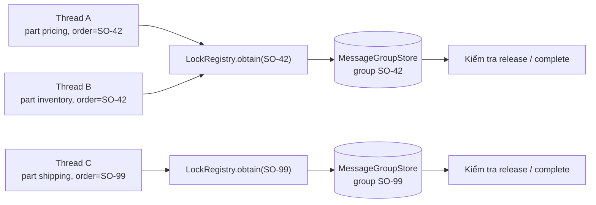
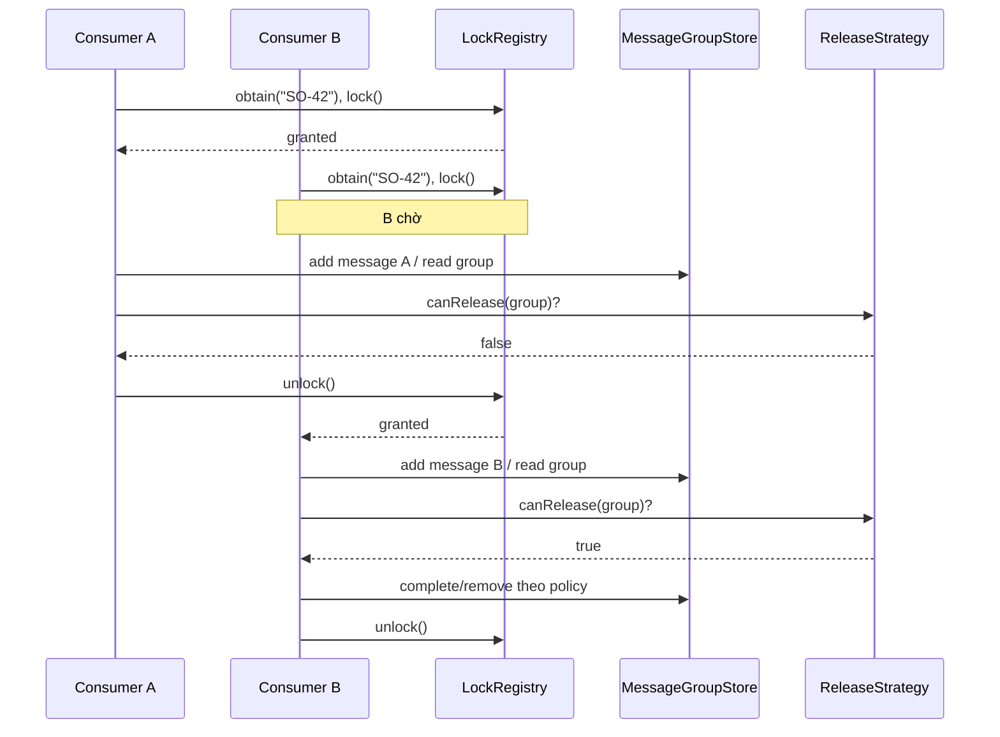
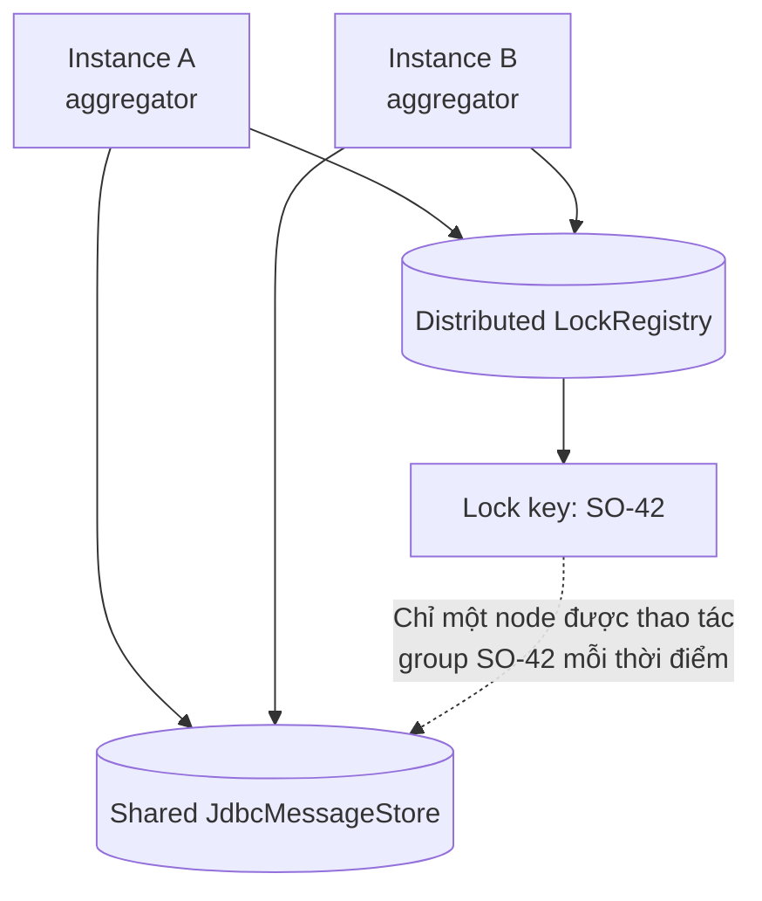
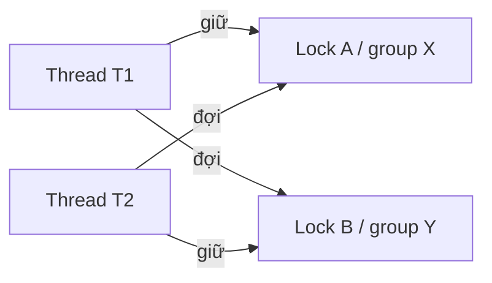
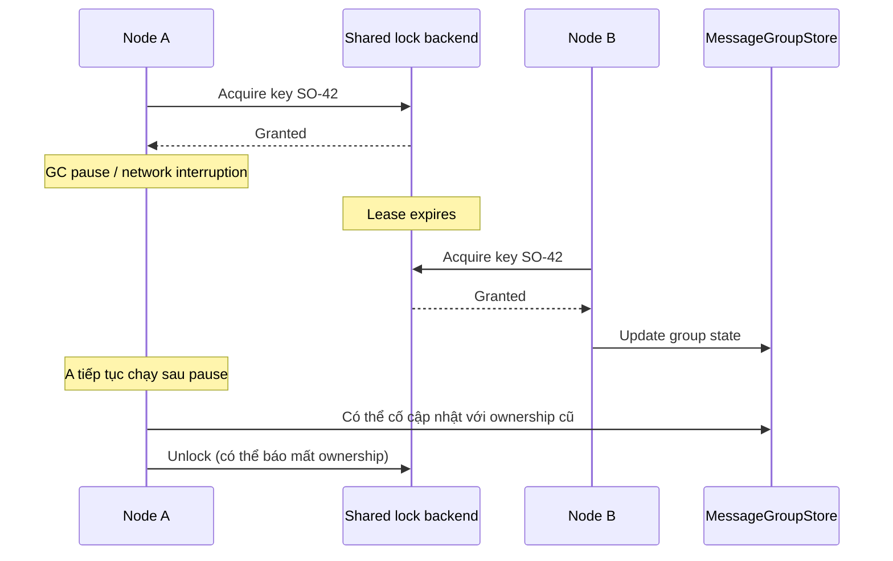

# Lock quanh message group trong Spring Integration Runtime

## 1. Tại sao một message group phải có lock?

Trong Spring Integration, một **aggregator** có thể đợi nhiều message mang cùng `correlationId` để tạo kết quả tổng hợp. Ví dụ đơn hàng `SO-42` cần đủ kết quả kiểm tra giá, tồn kho và vận chuyển. Ba message có thể đến từ ba thread, từ nhiều poller hoặc thậm chí từ các instance ứng dụng khác nhau.

Nếu hai consumer đồng thời đọc và sửa trạng thái nhóm, cả hai có thể cùng thấy “đã đủ ba phần”, rồi cùng release nhóm. Một lần xử lý đơn có thể tạo hai kết quả, hoặc một message đến muộn có thể chen vào giữa lúc nhóm được đánh dấu complete. Để bảo vệ **chuỗi thao tác trên một nhóm** thay vì chỉ bảo vệ từng lệnh ghi riêng lẻ, Spring Integration sử dụng `LockRegistry`.

Trong module **SPRING_INTEGRATION_RUNTIME**, bài này tập trung vào **Lock quanh message group**, thuộc chương **Lock registry**. Nội dung liên hệ trực tiếp với:

- `MessageGroupStore` và các trạng thái waiting, release, complete, expire.
- Correlation, aggregator, resequencer và các consumer xử lý đồng thời.
- `DirectChannel`, `ExecutorChannel`, poller và threading.
- Lock local so với distributed lock khi triển khai nhiều instance.
- Transaction, retry, lỗi runtime, hiệu năng và xử lý deadlock.

Sau bài học, bạn có thể giải thích **khóa gì, khóa khi nào, giữ bao lâu**, cấu hình đúng `LockRegistry` cho một aggregator và chẩn đoán race condition/lock contention trước khi tăng số thread hoặc replica.

## 2. Phân biệt khóa nhóm và việc lưu nhóm

`MessageGroupStore` giữ dữ liệu/metadata của nhóm; `LockRegistry` quyết định **ai được thao tác độc quyền với cùng khóa** ở một thời điểm.



| Thành phần | Câu hỏi nó trả lời | Không thay thế cho |
| --- | --- | --- |
| `CorrelationStrategy` | Message thuộc group ID nào? | Kiểm soát concurrent access. |
| `LockRegistry` | Ai được vào *critical section* của group ID này? | Persistence hoặc transaction. |
| `MessageGroupStore` | Các message và trạng thái nhóm đang ở đâu? | Điều phối quyền sở hữu trên nhiều JVM nếu chưa có lock đúng. |
| `ReleaseStrategy` | Nhóm đã đủ điều kiện phát kết quả chưa? | Khóa hoặc commit giao dịch. |
| `MessageGroupProcessor` | Từ nhóm đang được release tạo payload/message gì? | Idempotency ở hệ thống đích. |
| Transaction manager | Những cập nhật tài nguyên nào commit/rollback cùng nhau? | Tự động khóa phân tán hoặc chuyển transaction qua executor. |

**Lock không phải là dữ liệu nhóm.** Một khóa có thể được thả sau khi method trả về, trong khi `MessageGroup` còn tồn tại nhiều phút hoặc nhiều ngày. Ngược lại, một nhóm đã bị xóa vẫn có thể có nhiều consumer đang chờ lấy khóa cũ, tùy concurrency và đời sống của registry.

### Vì sao chỉ khóa một lệnh `addMessageToGroup(...)` là chưa đủ?

Thao tác nghiệp vụ thường gồm nhiều bước phải được xem như một **critical section**:

```text
1. Xác định groupId theo correlation key
2. Lấy lock ứng với groupId
3. Đọc MessageGroup và kiểm tra trạng thái complete
4. Thêm message mới / cập nhật metadata
5. Đánh giá ReleaseStrategy
6. Nếu đủ: release, cập nhật/remove/complete group theo policy
7. Nhả lock
```

Đây là mô hình giải thích; thứ tự nội bộ chi tiết của handler phụ thuộc implementation/phiên bản. **Điểm bất biến về thiết kế** là những thao tác *check–then–act* trên cùng group cần cơ chế đồng bộ thích hợp. Nếu chỉ đồng bộ `addMessageToGroup` mà không bảo vệ bước đọc trạng thái và quyết định release, hai thread vẫn có thể ra quyết định dựa trên những bản snapshot khác nhau.

## 3. Khóa theo `groupId` thay vì một global lock

Một `LockRegistry` trả về `java.util.concurrent.locks.Lock` tương ứng với **lock key** do caller cung cấp. Với aggregator/resequencer, lock key thường là group ID đã xác định từ `CorrelationStrategy`.

```text
SO-42: Thread A giữ lock; Thread B cùng SO-42 phải chờ
SO-99: Thread C có thể tiến hành song song
SO-77: Thread D có thể tiến hành song song
```

Như vậy group-level locking mang lại hai tính chất:

1. **Mutual exclusion theo nhóm:** thông thường chỉ một thread được chỉnh trạng thái một correlation group tại mỗi thời điểm.
2. **Parallelism giữa các nhóm:** nhiều group khác nhau có thể xử lý đồng thời, không phải dừng toàn bộ store ở một mutex duy nhất.

Điều này phụ thuộc triển khai: một backend lock registry hoặc DB store có thể có thêm contention ở connection pool, row/index, shard hoặc một số khóa hash. `DefaultLockRegistry` nội bộ cũng có chiến lược quản lý/cache lock riêng; không phải vô hạn bộ nhớ hay đảm bảo một lock object độc lập cho từng key về mặt implementation.

### Group ID cần ổn định và cùng contract

| Tình huống | Ảnh hưởng |
| --- | --- |
| Cùng đơn dùng `"SO-42"` ở cả hai node | Có thể dùng cùng một distributed lock key và group ID. |
| Node A dùng `UUID`, node B dùng `String` cho cùng correlation | Có nguy cơ khóa và nhóm không khớp nhau; cần chuẩn hóa ở boundary. |
| Hai aggregators khác mục đích cùng dùng khóa `"SO-42"` trong chung namespace | Dễ tạo contention không cần thiết hoặc chu trình chờ khóa. |
| Key chứa đối tượng mutable với `equals/hashCode` thay đổi | Có thể lấy khóa không nhất quán; nên chuẩn hóa thành ID bất biến. |
| Luồng tái sử dụng group ID sau completion | Có nguy cơ va vào tombstone/late-arriving messages; cân nhắc thêm run/version. |

Spring Integration mặc định dùng `IntegrationMessageHeaderAccessor.CORRELATION_ID` để correlate trong aggregator, trừ khi cung cấp strategy khác. Với kiến trúc dùng nhiều protocol adapters, phải kiểm tra tên và kiểu header sau HTTP/JMS/Kafka mapping.

## 4. API `LockRegistry` và nguyên tắc `try/finally`

Trong Spring Integration 6.x, các API liên quan nằm ở package `org.springframework.integration.support.locks`:

```java
import java.util.concurrent.locks.Lock;
import org.springframework.integration.support.locks.LockRegistry;

// Ý tưởng API:
Lock lock = lockRegistry.obtain(groupId);
lock.lock();
try {
    // Chỉ đọc/sửa group có groupId này ở trong critical section.
} finally {
    lock.unlock();
}
```

`LockRegistry.obtain(Object lockKey)` trả `Lock`; sau đó dùng các method tiêu chuẩn của Java: `lock()`, `tryLock()`, `unlock()`. Phải **nhả lock đúng một lần**, ngay cả khi `ReleaseStrategy`, store hoặc handler ném exception. Không giữ lock trong field chia sẻ rồi cố unlock từ một thread khác; các triển khai lock thường ràng buộc ownership với thread/registry tương ứng.

### 4.1. Ví dụ Java: khóa quanh một thao tác cập nhật nhóm

Đoạn sau minh họa *code tự quản lý group store*. Nếu đã dùng `AggregatingMessageHandler` chuẩn, **không cần** đặt thêm một lock tùy ý quanh `handleMessage`; hãy cấu hình `LockRegistry` trực tiếp cho handler như ở mục 5.

```java
import java.util.concurrent.TimeUnit;
import java.util.concurrent.locks.Lock;
import org.springframework.integration.store.MessageGroup;
import org.springframework.integration.store.MessageGroupStore;
import org.springframework.integration.support.locks.LockRegistry;
import org.springframework.messaging.Message;

public final class GroupWriter {
    private final LockRegistry locks;
    private final MessageGroupStore store;

    public GroupWriter(LockRegistry locks, MessageGroupStore store) {
        this.locks = locks;
        this.store = store;
    }

    public int append(String groupId, Message<?> part) {
        Lock lock = locks.obtain(groupId);
        boolean acquired;
        try {
            acquired = lock.tryLock(2, TimeUnit.SECONDS);
        } catch (InterruptedException ex) {
            Thread.currentThread().interrupt();
            throw new IllegalStateException("Interrupted while waiting for " + groupId, ex);
        }

        if (!acquired) {
            throw new IllegalStateException("Timed out waiting for group " + groupId);
        }

        try {
            MessageGroup group = store.getMessageGroup(groupId);
            if (group != null && group.isComplete()) {
                throw new IllegalStateException("Group already complete: " + groupId);
            }
            store.addMessageToGroup(groupId, part);
            return store.messageGroupSize(groupId);
        } finally {
            lock.unlock();
        }
    }
}
```

**Giới hạn của demo:**

- Đây là thao tác *append* có kiểm tra trạng thái, **chưa phải aggregator** và chưa thực hiện release, output hoặc timeout.
- `getMessageGroup(...)` khi group chưa tồn tại có thể trả group rỗng hoặc `null` tùy contract/implementation; production cần kiểm thử logic tạo group và xử lý group bị xóa đồng thời.
- `tryLock(2, TimeUnit.SECONDS)` là **thời gian tối đa chờ lấy lock**, không phải thời gian TTL của một distributed lock.
- Code không tự làm DB transaction atomic với ack từ message broker; lock không thay thế transaction.
- Tất cả thành phần khác ghi cùng group phải dùng **cùng coordination scheme**; một code path bỏ qua lock làm hỏng giả định mutual exclusion.

## 5. Aggregator và resequencer dùng lock như thế nào?

`AggregatingMessageHandler` kế thừa `AbstractCorrelatingMessageHandler`. Handler này sử dụng `LockRegistry` để đồng bộ thao tác với group tương ứng, nhằm tránh concurrent updates làm lệch state hoặc release trùng. Resequencer cũng dùng cơ chế correlation/group state tương tự, nhưng phát output theo thứ tự sequence thay vì gộp payload thành một kết quả.

Theo Spring Integration Reference, group mutations như thêm/release được bảo vệ bằng khóa. Registry mặc định của mỗi handler là `DefaultLockRegistry` chạy trong memory; nếu những instance cùng cập nhật một `MessageGroupStore` chia sẻ, cần một registry chung ở cấp backend để phối hợp xuyên JVM.



### 5.1. Cấu hình aggregator bằng Java

Ví dụ sau sử dụng `SimpleMessageStore` và `DefaultLockRegistry` để thấy rõ các thành phần. Cần kết nối một subscriber/handler xuống `ordersOut` để nhận kết quả thực tế.

```java
import org.springframework.beans.factory.annotation.Qualifier;
import org.springframework.context.annotation.Bean;
import org.springframework.context.annotation.Configuration;
import org.springframework.integration.annotation.ServiceActivator;
import org.springframework.integration.aggregator.AggregatingMessageHandler;
import org.springframework.integration.aggregator.DefaultAggregatingMessageGroupProcessor;
import org.springframework.integration.channel.DirectChannel;
import org.springframework.integration.store.MessageGroupStore;
import org.springframework.integration.store.SimpleMessageStore;
import org.springframework.integration.support.locks.DefaultLockRegistry;
import org.springframework.integration.support.locks.LockRegistry;
import org.springframework.messaging.MessageChannel;
import org.springframework.messaging.MessageHandler;

@Configuration
public class OrderGroupConfiguration {

    @Bean
    public MessageGroupStore orderGroupStore() {
        return new SimpleMessageStore();
    }

    @Bean
    public LockRegistry orderGroupLockRegistry() {
        return new DefaultLockRegistry();
    }

    @Bean("partsIn")
    public MessageChannel partsIn() {
        return new DirectChannel();
    }

    @Bean("ordersOut")
    public MessageChannel ordersOut() {
        return new DirectChannel();
    }

    @Bean
    @ServiceActivator(inputChannel = "partsIn")
    public MessageHandler orderAggregator(
            MessageGroupStore orderGroupStore,
            LockRegistry orderGroupLockRegistry,
            @Qualifier("ordersOut") MessageChannel ordersOut) {

        AggregatingMessageHandler handler = new AggregatingMessageHandler(
                new DefaultAggregatingMessageGroupProcessor(), orderGroupStore);

        handler.setCorrelationStrategy(
                message -> message.getHeaders().get("orderId"));
        handler.setReleaseStrategy(group -> group.size() >= 3);
        handler.setLockRegistry(orderGroupLockRegistry);
        handler.setOutputChannel(ordersOut);
        return handler;
    }
}
```

**Giải thích:**

1. `orderId` là correlation key; phải có và ổn định trong mọi message cùng nhóm. Validate header trước aggregator thay vì để strategy trả `null`.
2. `group.size() >= 3` chỉ là điều kiện minh họa. Nếu một part được gửi lặp, nhóm có thể đủ số lượng nhưng chưa đủ **loại phần**; production cần release strategy xét part ID và duplicate.
3. `DefaultLockRegistry` bảo vệ concurrent access ở **một instance**, phù hợp demo. Không dùng cấu hình này làm bảo đảm liên JVM.
4. `SimpleMessageStore` không giữ state qua restart. Muốn khôi phục các group đang chờ, cần persistent `MessageGroupStore` như `JdbcMessageStore`.
5. `ordersOut` dùng `DirectChannel`, nên downstream handler chạy đồng bộ; cân nhắc `releaseLockBeforeSend` hoặc tách asynchronous boundary nếu flow lồng các aggregator.

### 5.2. Cấu hình bằng Java DSL hoặc XML

Trong Java DSL, `CorrelationHandlerSpec` có method `lockRegistry(LockRegistry)`; có thể cấu hình cho aggregator/resequencer ở endpoint spec tương ứng.

Với XML (mẫu minh họa, giả định đã khai báo namespaces/beans):

```xml
<int:channel id="partsIn"/>
<int:channel id="ordersOut"/>

<int:aggregator id="orderAggregator"
                input-channel="partsIn"
                output-channel="ordersOut"
                message-store="orderGroupStore"
                lock-registry="orderGroupLockRegistry"
                correlation-strategy-expression="headers['orderId']"
                release-strategy-expression="size() >= 3"
                expire-groups-upon-completion="false"/>
```

Nếu dùng nhiều instance, cả `orderGroupStore` lẫn `orderGroupLockRegistry` phải được chọn và cấu hình **phù hợp với phạm vi chia sẻ**. Chỉ tạo bean tên giống nhau ở hai JVM không biến hai registry in-memory thành một distributed registry.

## 6. Local lock và distributed lock: chọn theo kiến trúc triển khai

### 6.1. Một JVM với `DefaultLockRegistry`

`DefaultLockRegistry` dùng những cơ chế khóa `Lock`/`ReentrantLock` trong bộ nhớ để điều phối thread cùng truy cập một correlation key. Nó phù hợp nếu tất cả message của một nhóm **chỉ có thể được xử lý trong cùng một JVM**.

Ví dụ hai worker của `ExecutorChannel` cùng gửi part vào một aggregator local: lock mặc định giúp tránh việc hai worker cùng thao tác group tại một thời điểm. Nhưng nếu triển khai hai replicas và cùng dùng một `JdbcMessageStore`, mỗi replica có `DefaultLockRegistry` riêng, chúng **không** khóa lẫn nhau. Race có thể vẫn xảy ra trên dữ liệu của cùng group.

### 6.2. Hai hay nhiều JVM dùng shared `MessageGroupStore`



Muốn đồng bộ xuyên node, những điều kiện sau cần **đúng đồng thời**:

1. Instances cùng xử lý một **logical aggregator/resequencer** phải dùng lock backend chung (cùng JDBC table/region hoặc cùng Redis registry key).
2. Correlation key phải được chuẩn hóa giống nhau ở mỗi node.
3. Những instance đó phải truy cập **cùng shared message group state** và tuân thủ cơ chế lock ở mọi code path.
4. Lock phải duy trì ownership đủ lâu cho critical section; việc hết lease không được phép âm thầm tạo hai owner xử lý cùng dữ liệu.
5. Transaction/commit của group store và output flow phải được thiết kế riêng, vì distributed mutex không tự bảo đảm exactly-once.

### 6.3. So sánh các triển khai

| Triển khai | Phạm vi đồng bộ | Khi phù hợp | Điểm cần vận hành |
| --- | --- | --- | --- |
| `DefaultLockRegistry` | Một JVM | Single-instance aggregator hoặc xử lý từng group trên một JVM | Không dùng làm lock phân tán, quan sát lock contention local. |
| `JdbcLockRegistry` + `DefaultLockRepository` | Nhiều JVM cùng database lock table | Đã sử dụng RDBMS để giữ group state | Schema `INT_LOCK`, region, TTL, DB availability, transaction/connection pool. |
| `RedisLockRegistry` | Nhiều JVM cùng Redis | Cần lock distributed qua Redis | Expiry/renewal, network latency, failover, eviction policy. |
| `ZookeeperLockRegistry` (khi có module hỗ trợ) | Nhiều JVM qua ZooKeeper | Hạ tầng đã vận hành ZooKeeper | Session, connection và sự kiện mất ownership. |

Tên triển khai và API nâng cao có thể khác theo phiên bản/dependency. Đối với những workload chỉ chạy trong một instance, registry phân tán đôi khi không đáng chi phí I/O và độ trễ.

## 7. Ví dụ triển khai distributed group lock với JDBC

Giả sử nhiều instances cùng dùng `JdbcMessageStore` cho aggregator đơn hàng. Ta có thể cấu hình `DefaultLockRepository` và `JdbcLockRegistry` để lấy lock qua database.

**`DistributedOrderLockConfiguration.java`**

```java
import javax.sql.DataSource;
import org.springframework.context.annotation.Bean;
import org.springframework.context.annotation.Configuration;
import org.springframework.integration.jdbc.lock.DefaultLockRepository;
import org.springframework.integration.jdbc.lock.JdbcLockRegistry;
import org.springframework.integration.jdbc.store.JdbcMessageStore;
import org.springframework.integration.store.MessageGroupStore;
import org.springframework.integration.support.locks.LockRegistry;
import org.springframework.transaction.PlatformTransactionManager;

@Configuration
public class DistributedOrderLockConfiguration {

    @Bean
    public DefaultLockRepository orderLockRepository(
            DataSource dataSource,
            PlatformTransactionManager transactionManager) {

        DefaultLockRepository repository = new DefaultLockRepository(dataSource);
        repository.setRegion("orders-aggregator");
        repository.setTransactionManager(transactionManager);
        // TTL và retry interval cần chọn theo thời gian xử lý thực tế.
        return repository;
    }

    @Bean
    public LockRegistry orderGroupLockRegistry(
            DefaultLockRepository orderLockRepository) {
        return new JdbcLockRegistry(orderLockRepository);
    }

    @Bean
    public MessageGroupStore orderGroupStore(DataSource dataSource) {
        JdbcMessageStore store = new JdbcMessageStore(dataSource);
        store.setRegion("orders-aggregator");
        return store;
    }
}
```

Kết nối hai bean `orderGroupLockRegistry` và `orderGroupStore` vào aggregator như ở mục 5. Khi đổi từ demo in-memory sang JDBC, chỉ dùng **một** cấu hình bean tương ứng trong cùng application context, tránh hai bean trùng tên.

**Điểm bắt buộc trước khi chạy:**

- Tạo schema Spring Integration cho **JDBC lock repository** và **JDBC message store** đúng database/phiên bản. Khóa distributed thường dùng bảng `INT_LOCK`; bảng lưu message/group là cấu trúc khác.
- Các replicas của **cùng logical aggregator** phải dùng cùng region và lock table, đồng thời truy cập cùng group store data/region. Các logical aggregators khác nhau nên có namespace/registry riêng khi thiết kế cho phép.
- `DefaultLockRepository` có vòng đời Spring bean và cần transaction manager thích hợp; kiểm tra cấu hình transaction thay vì mặc định mọi bean trỏ cùng một manager.
- **Không chia sẻ cùng instance `DefaultLockRepository` giữa nhiều `JdbcLockRegistry` độc lập.** Mỗi registry có phối hợp `ReentrantLock` local; dùng chung repository không đúng contract của implementation.
- Thiết lập TTL/renewal theo thời gian critical section và failover; có khóa hết hạn không có nghĩa dữ liệu group đã an toàn để hai node cùng xử lý.

`JdbcLockRegistry` không làm `JdbcMessageStore` tự động commit trong cùng database transaction với broker ack hoặc gửi HTTP ra ngoài. Lock đảm bảo loại trừ tương hỗ trong phạm vi sở hữu hợp lệ; atomicity của resource cần được thiết kế và kiểm thử riêng.

### 7.1. Schema và lock ownership

Ở các phiên bản 6.x, JDBC lock table điển hình lưu `LOCK_KEY`, `REGION`, `CLIENT_ID` và thời điểm tạo. Unique key/region và các thao tác repository là phần cốt lõi giúp nhiều instance tranh quyền lock.

Nếu node A chết khi đang giữ khóa, repository có cơ chế thời gian sống để node khác **có thể** giành lại khóa hết hạn. Việc node B lấy được lock mới không chứng minh side effect của A đã rollback: A có thể đã gọi HTTP thành công, gửi output hoặc commit vào hệ thống khác trước khi mất kết nối. Vẫn cần business idempotency/fencing nếu cần bảo vệ tài nguyên ngoài store.

## 8. Ví dụ thay thế: `RedisLockRegistry`

Khi các replicas chia sẻ Redis, một lựa chọn khác là:

```java
import org.springframework.context.annotation.Bean;
import org.springframework.context.annotation.Configuration;
import org.springframework.data.redis.connection.RedisConnectionFactory;
import org.springframework.integration.redis.util.RedisLockRegistry;
import org.springframework.integration.support.locks.LockRegistry;

@Configuration
public class RedisOrderLockConfiguration {

    @Bean
    public LockRegistry orderGroupLockRegistry(
            RedisConnectionFactory connectionFactory) {
        // 120000 ms chỉ là TTL minh họa, không phải cấu hình mặc định.
        return new RedisLockRegistry(
                connectionFactory, "orders-aggregator", 120_000L);
    }
}
```

Đoạn này **chỉ định nghĩa registry**, không tạo `MessageGroupStore`. Muốn aggregator nhiều node hoạt động chính xác, phải đi cùng shared store và correlation contract. Không chạy cấu hình Redis này đồng thời với cấu hình JDBC `orderGroupLockRegistry` ở mục 7 nếu chúng dùng cùng bean name.

`RedisLockRegistry` cho phép Redis giữ thông tin ownership có TTL nhằm giảm nguy cơ khóa tồn tại vĩnh viễn khi node chết. Tuy nhiên:

- Nếu xử lý mất quá nhiều thời gian và **lease hết hạn trước khi unlock**, một node khác có thể nhận cùng khóa; owner cũ có thể gặp exception ở bước unlock. Đây là dấu hiệu có khả năng xảy ra concurrent write, cần coi là sự cố nghiêm trọng.
- `RenewableLockRegistry` có API gia hạn và các phiên bản mới hỗ trợ scheduler tự gia hạn; phải xác minh tính tương thích của version/cơ chế hoạt động trước khi dùng.
- `RedisLockRegistry` là công cụ phối hợp qua network, không phải một `ReentrantLock` trong memory có latency tương đương.
- Cần kiểm thử Redis failover, timeout, connectivity và điều kiện hết hạn; đừng tự đặt TTL cực ngắn chỉ để failover nhanh.

Đặc biệt với lock distributed, **TTL là giới hạn ownership/lease**, còn `tryLock(timeout)` là thời gian **caller chờ lấy lock**. Chúng là hai tham số hoàn toàn khác nhau.

## 9. Deadlock khi hai aggregators cùng giữ khóa

Spring Integration có cảnh báo chính thức về trường hợp hai aggregators dùng chung một lock registry và gửi message đồng bộ:

```text
Flow: ... → aggregatorA → DirectChannel → aggregatorB → ...

Thread T1:
  giữ lock A(group=X)
  → gọi downstream, chờ lock B(group=Y)

Thread T2:
  giữ lock B(group=Y)
  → đi vào đường xử lý cần lock A(group=X)

T1 chờ B; T2 chờ A → DEADLOCK
```



Điều này có thể xảy ra cả khi từng lần gọi `lock()` đều đúng và có `finally`. `finally` chỉ được chạy khi call stack tiến tới đó; deadlock làm các thread đứng chờ lẫn nhau.

### 9.1. Ba cách giảm nguy cơ deadlock

**Cách 1 — Registry riêng cho mỗi logical aggregator.** Đừng dùng một registry namespace cho hai aggregators độc lập chỉ vì group ID có cùng định dạng. Một aggregator có thể chia sẻ registry giữa **các replica của chính nó**, nhưng những aggregator khác trong flow nên có registry/namespace riêng nếu cần để tránh xung đột khóa không liên quan.

**Cách 2 — Tách downstream bằng `ExecutorChannel` hoặc `QueueChannel`.** Nếu A release rồi gửi output qua asynchronous boundary, lời gọi xuống B không còn nhất thiết giữ cùng call stack/lock của A. Đổi lại, transaction và error propagation **không tự xuyên qua** ranh giới thread; phải thiết kế riêng retry, ordering, delivery và backpressure.

**Cách 3 — `releaseLockBeforeSend = true`.** Từ những phiên bản Spring Integration hỗ trợ, handler có thể nhả khóa group **trước khi send output** sang downstream. Điều này giảm thời gian giữ khóa và nguy cơ khóa lồng nhau. Cần kiểm thử thứ tự release/complete, late arrivals và các tình huống downstream lỗi vì output send không còn nằm trong critical section được bảo vệ như trước.

### 9.2. Ví dụ bật `releaseLockBeforeSend`

Nếu dùng `AggregatingMessageHandler` như mục 5, có thể thêm:

```java
handler.setReleaseLockBeforeSend(true);
```

Cấu hình này **không biến output send thành giao dịch nguyên tử**. Nếu gửi ra hệ thống khác và sender chết giữa lúc cập nhật store và publish output, có thể cần outbox hoặc cơ chế idempotency ở consumer đích.

### 9.3. Lock order cố định khi buộc phải giữ nhiều khóa

Nếu business code thực sự cần khóa nhiều group cùng lúc, nên:

1. Chuẩn hóa key thành thứ tự so sánh cố định, ví dụ `"A:SO-42"` trước `"B:SO-42"`.
2. Mọi code path lấy khóa theo cùng thứ tự, bất kể luồng dữ liệu thực tế.
3. Đặt thời gian chờ hữu hạn và có cách xử lý khi không lấy được khóa.
4. Nhả khóa theo thứ tự ngược lại trong `finally`.

Tránh nested lock khi có thể. Đặc biệt không giữ một lock group trong khi thực hiện call ra hệ thống không kiểm soát được thời gian xử lý.

## 10. Lock, transaction và retry không phải một thứ

Đây là điểm thường gây hiểu nhầm khi một aggregator dùng `JdbcMessageStore` và `JdbcLockRegistry`.

| Cơ chế | Nó bảo vệ điều gì? | Nó không bảo đảm điều gì? |
| --- | --- | --- |
| Lock group | Loại trừ xử lý đồng thời theo correlation key khi còn ownership hợp lệ | Thay thế rollback/commit DB; không tự chặn duplicate side effect ngoài store. |
| JDBC transaction | Các thao tác DB cùng transaction commit/rollback theo manager phù hợp | Message broker, HTTP call, email hoặc lock lease luôn thuộc cùng transaction. |
| Retry | Chạy lại handler/transaction theo policy khi thất bại | Lần thử trước chưa tạo side effect; source đã/ chưa ack. |
| Message store | Lưu message/group và metadata qua thời gian | Tự điều phối mọi JVM nếu không có lock đúng. |
| Idempotent consumer | Chặn hoặc trung hòa tác dụng lặp theo business key | Tự cung cấp lock cho mọi thay đổi trên group state. |

### 10.1. Hai trình tự dễ có kết quả khác nhau

```text
Trường hợp A:
  acquire group lock
    begin DB TX
      add message
      update group complete
    commit DB TX
  release group lock

Trường hợp B:
  begin DB TX
    acquire group lock
      add message
      update group complete
    release group lock
  commit DB TX
```

Trong B, **khóa có thể được nhả trước khi transaction commit**. Một node khác được quyền lấy khóa và đọc group state nhưng chưa thấy thay đổi chưa commit của node trước, tùy isolation của database. Cách xử lý chính xác phụ thuộc advice order, transaction manager, cách store truy vấn và registry lock thực tế.

Không suy ra “có lock distributed + có `@Transactional`” đương nhiên bảo đảm atomicity. Hãy xác minh **thứ tự acquire → DB write → commit → unlock** trong integration test và qua log transaction. Nếu cần tối ưu trên dữ liệu chung, có thể kết hợp transaction, optimistic versioning, lock lease và business idempotency.

### 10.2. Retry với lock

Retry ở trong critical section có thể giữ lock cả lúc backoff, khiến các part khác của cùng group phải chờ. Retry bao ngoài có thể nhả rồi lấy lại khóa ở từng attempt, cho phép cập nhật group xen kẽ giữa các lần thử; khi đó phải đọc lại state sau khi lấy khóa mới.

```text
Không nên giả định:
  lock(SO-42)
    retry (sleep 1s, sleep 2s, sleep 4s)
      remoteServiceCall()
  unlock(SO-42)

Định hướng tốt hơn nếu có thể:
  cập nhật group state ngắn gọn dưới lock
  commit/persist đúng cách
  sau đó gọi external service có timeout/idempotency riêng
```

Với database deadlock hoặc serialization failure, thường cần retry **cả transaction mới**, không tiếp tục trong transaction đã rollback-only. Nếu retry source message sau khi group đã release, phải tránh tạo duplicate output; group tombstone và business event ID là hai cơ chế khác nhau nhưng có thể bổ trợ.

### 10.3. Distributed lock không đảm bảo exactly-once

Ví dụ:

```text
Node A giữ lock group SO-42
  → release group và publish PaymentRequested
  → output broker nhận message thành công
  → node A chết trước khi ghi nhận trạng thái hoàn tất ổn định

Node B lấy lock khi lease hết hạn
  → xử lý lại theo trạng thái còn trong store
  → publish PaymentRequested lần nữa
```

Ở đây **không có hai node giữ khóa đồng thời khi lock còn hiệu lực**, nhưng output vẫn có thể bị gửi trùng vì các hệ thống đích không cùng transaction. Các giải pháp như idempotency key (`eventId`), transactional outbox, database unique constraint và trạng thái nghiệp vụ có version được thiết kế cho bài toán này.

## 11. Lease expiry, stale owner và fencing

Distributed lock thường dùng cơ chế TTL/lease để một instance khác có thể tiếp quản khi owner chết. Nhưng timeout giữa hai hệ thống không đồng nghĩa owner cũ đã dừng mọi hoạt động:



Đây là lý do không dùng một TTL quá nhỏ để tăng tốc failover mà bỏ qua worst-case latency, GC pause, database contention và network partition.

**Phân biệt ba mức độ bảo vệ:**

1. **Mutual exclusion trong lúc lock còn hợp lệ:** một owner thao tác tại một thời điểm theo contract backend.
2. **Phát hiện mất lease:** unlock/renew có thể ném lỗi hoặc báo thất bại; cần coi đó là tín hiệu sự cố và đánh dấu xử lý không còn đáng tin.
3. **Fencing tại tài nguyên đích:** backend hoặc business state kiểm tra version/epoch tăng dần để chặn cập nhật của stale owner, kể cả khi node cũ thức dậy sau khi lease đã bị thu hồi.

`LockRegistry` đơn giản **không tự cấp fencing token cho mọi database hoặc external API**. Nếu yêu cầu an toàn cao sau network partition, cần cơ chế kiểm soát phiên bản/ownership ngay tại tài nguyên chịu side effect. Với JDBC, cân nhắc update có `WHERE version = ?`/optimistic lock; với giao dịch ngoài JVM, cần stable operation ID/idempotency key và policy rõ ràng.

### 11.1. Khi nào cần renew lock?

Nếu critical section có thể kéo dài hơn TTL của registry, cân nhắc sử dụng khả năng `RenewableLockRegistry` theo phiên bản. Ví dụ `JdbcLockRegistry` hỗ trợ gia hạn khóa; với Redis, các phiên bản Spring Integration 6.4 có scheduler tùy chọn cho cơ chế renewal.

Không đặt một task renew tùy tiện:

- Renew phải áp dụng **đúng owner/lock key**.
- Nếu renew thất bại, không tiếp tục coi quyền sở hữu là chắc chắn.
- Một network partition có thể làm renew chậm hoặc mất kết nối.
- Việc refresh lease không thay thế transaction timeout; một DB transaction có thể đã rollback-only.

Nếu có thể, **rút ngắn critical section** để không cần giữ distributed lock qua những cuộc gọi I/O dài, timeout hoặc backoff.

## 12. Timeout, expiry và vòng đời `MessageGroup`

Một group có thể chờ message rất lâu, nhưng lock của nó **chỉ cần giữ trong những đoạn cập nhật state**. Không nên giữ khóa từ lúc nhận part đầu tiên cho tới khi nhận part cuối cùng.

```text
10:00:00  part A đến → lock(SO-42) → add A → unlock
10:00:02  part B đến → lock(SO-42) → add B → unlock
10:00:10  group timeout task chạy → lock(SO-42)
          → quyết định partial release / discard / complete
          → unlock
10:00:11  part C đến muộn → lock(SO-42)
          → đánh giá complete/tombstone policy → unlock
```

Các thành phần như `MessageGroupStoreReaper`, `groupTimeout`/`forceComplete` và một consumer nhận part mới có thể hoạt động **đồng thời**. Chúng phải tham gia một cơ chế khóa nhất quán khi sửa cùng group. Nếu timeout task ở node A dùng khóa local còn consumer ở node B dùng registry distributed, vẫn có nguy cơ race trên store chung.

**Phân biệt trạng thái:**

- `ReleaseStrategy` cho phép release khi đủ điều kiện.
- `MessageGroupStore.completeGroup(...)` đánh dấu nhóm đã hoàn tất theo contract store.
- Giữ empty complete group/tombstone giúp nhận biết late arrivals.
- Xóa group làm mất thông tin đã từng hoàn tất; một message đến muộn cùng key có thể bắt đầu group mới.
- Lock được nhả sau thao tác cập nhật; nó không phải marker group complete.

### 12.1. API store-level locking theo phiên bản

Từ Spring Integration **6.5**, `AbstractMessageGroupStore` còn hỗ trợ khóa khi thao tác metadata message group (qua `setLockRegistry(...)`), bên cạnh khóa của `AbstractCorrelatingMessageHandler` ở aggregator/resequencer. Hai tầng này phục vụ phạm vi khác nhau:

- **Handler lock:** phối hợp toàn bộ quyết định thuộc một correlation handler.
- **Store lock:** bảo vệ những thao tác cập nhật group/metadata ở mức implementation khi nhiều thread thao tác.

Đừng giả định việc cấu hình một registry trên aggregator tự động thay thế cấu hình mọi store-level lock. Với deployment nhiều node và phiên bản có hai tầng, phải kiểm tra registry/namespace có tương thích, khả năng reentrancy và thứ tự lấy khóa. Với các bản trước 6.5, không sao chép cấu hình `AbstractMessageGroupStore.setLockRegistry(...)` nếu API chưa có.

### 12.2. Resequencer và message đến sai thứ tự

Resequencer cũng cần giữ trạng thái sequence của group: các part đã nhận, các khoảng thiếu và `lastReleasedMessageSequenceNumber`. Hai consumer cùng thêm sequence 4 và 5 không được tự ý update/release dựa vào các snapshot cũ. Khóa theo group giúp bảo vệ việc đọc–sửa–quyết định, nhưng **không thay thế** stable sequence ID và việc loại duplicate messages.

## 13. Channel và thread: nhìn lock qua runtime

| Thành phần | Hành vi thread thường gặp | Ảnh hưởng tới group lock |
| --- | --- | --- |
| `DirectChannel` | Consumer chạy trên thread sender | Khóa có thể vẫn được giữ khi downstream handler đồng bộ thực thi. |
| `ExecutorChannel` | Handoff sang executor thread | Group state ở aggregator vẫn cần lock; transaction upstream không tự theo worker. |
| `QueueChannel` + poller | Poller nhận và chạy handler trên thread riêng | Nhiều poller có thể tranh khóa của cùng group. |
| `PublishSubscribeChannel` với executor | Subscriber phân tán qua các worker | Những message cùng group có thể đến aggregator đồng thời. |
| Multiple application instances | Mỗi JVM có thread pool/registry local riêng | Muốn khóa xuyên instance phải dùng shared backend lock registry. |
| `MessageGroupStoreReaper` hoặc group timeout | Có thể chạy trên scheduler khác | Expiry callback phải phối hợp với việc add/release cùng group. |

Ví dụ một flow:

```text
Splitter → ExecutorChannel → Aggregator(groupLockRegistry) → DirectChannel
                             |                               |
                             v                               v
                      MessageGroupStore                 Downstream handler
```

Sau split, các part cùng correlation ID có thể được xử lý song song. Khi đến aggregator, lock giúp serialization **cho từng group**. Nhưng nếu downstream qua `DirectChannel` chậm, thời gian giữ lock có thể bị kéo dài; tăng executor threads chỉ làm nhiều worker chờ khóa, không tăng tốc một hot group.

### 13.1. Hiệu năng phụ thuộc key distribution

Nếu 10.000 messages đều thuộc `groupId=ONE`, mỗi lần xử lý cạnh tranh **cùng một khóa**, thông lượng theo một nhóm vẫn bị giới hạn. Nếu 10.000 messages thuộc hàng nghìn group độc lập, các worker có thể tận dụng concurrency tốt hơn.

Đừng cố “phá khóa” bằng cách gắn một random suffix vào group ID nếu nghiệp vụ vẫn yêu cầu toàn bộ part của cùng nhóm phải được release chung. Đó là đổi semantics correlation chứ không phải tối ưu lock.

## 14. Observability và chẩn đoán contention/deadlock

Các signal nên đo theo endpoint, store backend và **logical group**:

| Metric/tín hiệu | Ý nghĩa | Cách điều tra |
| --- | --- | --- |
| Thời gian chờ acquire lock | Nhiều worker tranh quyền hoặc backend lock chậm | Phân bố group ID, thread dump, DB/Redis latency. |
| Thời gian giữ lock | Critical section dài hoặc downstream send chậm | Trace store I/O, `ReleaseStrategy`, processor và output channel. |
| Số lần timeout khi `tryLock` | Caller không lấy được quyền kịp SLA | Kiểm tra hot groups, TTL và số workers. |
| Số lần renew thất bại/unlock lỗi | Owner có thể đã mất lease | Coi là sự cố dữ liệu tiềm ẩn, kiểm tra store & output để reconcile. |
| Số group đang chờ và tuổi group | Backlog do mất part, lock contention hoặc DB chậm | Đối chiếu group size/lastModified với arrival rate. |
| Số message bị discard do late arrival | Timeout hoặc tombstone đang chặn message trễ | Xác minh correlation ID, deadline và retry/redelivery. |
| Lock table size và query latency | JDBC lock storage/quá tải | Kiểm tra schema/index, TTL, cache và connection pool. |
| Redis request latency / key expiry | Network/backend ảnh hưởng tốc độ lock | Kiểm tra failover, expiry, connection pool, renewal scheduler. |
| Deadlock thread dump | Có chuỗi chờ lẫn nhau | Xem những lock A/B đang giữ và thứ tự output routing. |

Không nên log toàn bộ `MessageGroup.getMessages()` khi điều tra. Group có thể lớn và chứa dữ liệu nhạy cảm. Nên log `groupId`, business/event ID, endpoint, thread, attempt, thời gian chờ lock và trạng thái complete sau khi đã lọc PII.

### 14.1. Chẩn đoán Java-level deadlock

Nếu runtime đứng mà CPU không cao, lấy thread dump bằng công cụ JVM phù hợp như `jcmd <pid> Thread.print` hoặc `jstack <pid>` theo quy trình vận hành. Tìm:

- Threads bị `WAITING`/`BLOCKED`, chờ `ReentrantLock` hoặc waiting trong phương thức backend registry.
- Quan hệ “thread T1 giữ khóa X và chờ Y; T2 giữ Y và chờ X”.
- Những call stack của `AbstractCorrelatingMessageHandler`, send qua `DirectChannel`, expiry callback hoặc custom handler.
- Message group IDs/namespaces tương ứng thông qua instrumentation ứng dụng.

**Không kết luận tất cả chờ lock đều là deadlock.** Contention cao cũng khiến thread chờ lâu nhưng cuối cùng vẫn có tiến triển. Một lock phân tán có network/DB latency còn có thể không xuất hiện như Java-level deadlock trong thread dump. Kết hợp thread dump với backend metrics và transaction logs.

### 14.2. Bảng triệu chứng → hướng xử lý

| Triệu chứng | Khả năng thường gặp | Hướng xử lý |
| --- | --- | --- |
| Duplicate aggregated output ở hai replicas | Registry local, shared store không có distributed lock; hoặc output không atomic với state | Kiểm tra registry backend và correlation key; bổ sung idempotency/outbox. |
| Hai part cùng group làm state sai | Check-then-act không cùng critical section; custom code bypass lock | Đưa thao tác qua aggregator/registry thống nhất. |
| Chỉ một group xử lý cực chậm | Hot group, lock held qua downstream I/O | Đo hold time; tối ưu processor/strategy, tách side effect hợp lý. |
| Cả flow treo khi nối hai aggregators | Lock order inversion, synchronous send giữ lock | Registry riêng theo logical endpoint, `releaseLockBeforeSend`, async boundary. |
| `unlock()` báo mất ownership | Lease hết hạn, backend failover hoặc worker pause quá lâu | Coi state có thể đã bị ghi cạnh tranh; reconcile, sửa TTL/renewal. |
| JDBC lock acquire thường timeout | Bảng lock/transaction manager/connection pool chậm, contender nhiều | Theo dõi DB lock waits, retry interval, indexes và pool. |
| Redis lock lỗi sau network partition | Lease/ownership không còn, thời gian xử lý dài | Xem renewal, TTL, failover và fencing/idempotency. |
| Lock được lấy nhưng group state đọc cũ | Transaction commit sau unlock; DB isolation/visibility | Đo transaction boundary, advice order, version checks. |
| Reaper xóa nhóm đúng lúc part mới đến | Group expiry không phối hợp registry hoặc cấu hình timeout không hợp lý | Dùng cùng lock coordination, kiểm tra timeout và late arrival policy. |
| JVM restart rồi duplicate | State store memory, output side effect đã thành công trước crash | Dùng persistent store và stable idempotency key. |
| Scale replicas nhưng throughput không tăng | Nhiều worker cạnh tranh cùng hot correlation ID | Quan sát cardinality group, lock hold time và DB contention. |
| Một logical endpoint bị lock bởi endpoint không liên quan | Chia sẻ registry region/key không đúng | Tách namespace theo logical aggregator trong cùng cụm. |
| Handler đã release nhưng ErrorMessage xuất hiện sau đó | Downstream lỗi sau async handoff hoặc commit thất bại | Theo dõi thread, transaction/ack và error channel độc lập. |

### 14.3. Trình tự điều tra production

1. **Vẽ flow:** splitter, channels, aggregator/resequencer, output, scheduler, message store và error path.
2. **Xác định correlation contract:** nguồn group ID, Java type, namespace, store region và lock key.
3. **Kiểm tra phạm vi registry:** một JVM hay nhiều JVM, backend chung hay khác nhau, có đường ghi nào bypass lock?
4. **Đối chiếu concurrency:** thời gian acquire/hold, group cardinality, số workers, executor saturation, DB/Redis health.
5. **Xác định lifecycle:** group đang chờ, release, complete, expire hoặc đã remove; timeout task có chạy cùng lúc không?
6. **Kiểm tra order/ownership:** nested locks, `releaseLockBeforeSend`, distributed lease/renewal và thread dump.
7. **Kiểm tra transaction/retry:** thời điểm commit so với unlock, redelivery, output publish và idempotency.
8. **Khôi phục có kiểm soát:** reconcile group/output/event IDs, sau đó điều chỉnh concurrency, lock và recovery policy; không xóa lock table thủ công khi chưa hiểu owner/state.

## 15. Bài tập thực hành và test case

### Bài A — Một group được xử lý tuần tự

1. Tạo `SimpleMessageStore` và `DefaultLockRegistry`, gắn vào aggregator `orderId` như mục 5.
2. Tạo ba message của `SO-42` và ba message của `SO-99`; gửi song song từ nhiều thread.
3. Instrument thời điểm lấy/nhả lock, group size và output. Kiểm tra không có hai thread cùng vào critical section `SO-42`.
4. Tăng số threads; quan sát `SO-42` vẫn được serialize, còn `SO-99` có thể tiến hành độc lập.
5. Gửi duplicate `pricing` rồi giải thích vì sao release theo `size() >= 3` chưa đủ an toàn và bổ sung release logic theo part ID.

### Bài B — Hai replicas, một shared group store

1. Cấu hình `JdbcMessageStore` cho hai instance A và B dùng cùng schema/region.
2. Cho mỗi instance một `DefaultLockRegistry` local, gửi part cùng group đồng thời và ghi nhận khả năng race (không giả định lỗi luôn tái hiện).
3. Thay bằng `JdbcLockRegistry` cùng DB lock table/region, tạo phép đo lock wait và xác minh quyền sở hữu theo group.
4. Gây lỗi cho một instance sau khi nó cập nhật group nhưng trước commit; đối chiếu group state sau recovery.
5. Gây failover đúng lúc lease gần hết hạn, kiểm tra owner cũ có dừng cập nhật không; đề xuất cách reconcile nếu ownership không rõ.

### Bài C — Deadlock và thời gian giữ lock

1. Xây luồng `aggregatorA → DirectChannel → aggregatorB` và một nhánh có thể quay lại A hoặc lấy khóa theo thứ tự ngược.
2. Dùng latch để tái hiện hai thread giữ khóa chéo nhau **trong môi trường test**; lấy thread dump và nhận diện chu trình chờ.
3. Tách registry cho A/B rồi thử lại; xem thêm tùy chọn `releaseLockBeforeSend=true`.
4. Đổi output A sang `ExecutorChannel` và quan sát thay đổi về transaction/error path.
5. Đo thời gian giữ lock trước và sau khi loại HTTP call chậm khỏi critical section.

### Bài D — Timeout và message đến muộn

1. Cho group chỉ nhận 2/3 parts rồi kích hoạt `groupTimeout`/expiry callback.
2. Đồng thời gửi part thứ ba từ một thread khác; kiểm tra cơ chế lock quyết định trạng thái nhóm.
3. Giữ complete group metadata để chặn late arrivals; sau đó thử cấu hình xóa group ngay khi hoàn tất.
4. Chứng minh lock không thay thế tombstone và không tránh được duplicate sau khi group bị xóa.

### Câu hỏi tự kiểm tra

1. Vì sao `LockRegistry` cần khóa theo `groupId` thay vì khóa toàn bộ `MessageGroupStore`?
2. `DefaultLockRegistry` có đủ khi hai ứng dụng trên hai JVM cùng thao tác `JdbcMessageStore` không?
3. Khi dùng `JdbcLockRegistry`, vì sao hai replicas phải chia sẻ cùng region nhưng hai aggregators logic khác nhau thường nên tách registry?
4. Nếu `tryLock` timeout, thời gian chờ đó có phải TTL của distributed lock không?
5. Tại sao `try/finally` không đủ để ngăn deadlock giữa hai aggregators?
6. `releaseLockBeforeSend=true` giúp giảm loại deadlock nào và cần kiểm thử thêm điều gì?
7. Vì sao transaction commit sau khi unlock có thể làm node khác đọc group state chưa cập nhật?
8. Một owner hết lease nhưng chưa chết; muốn ngăn stale write ở tài nguyên đích thì cần thiết kế gì?
9. Group đã complete có đồng nghĩa lock cần được giữ vĩnh viễn để chặn late message không?
10. Retry, distributed lock và `MessageGroupStore` có tự bảo đảm exactly-once output không?
11. Khóa ở `AbstractMessageGroupStore` từ 6.5 và khóa ở correlation handler giải quyết phạm vi gì khác nhau?
12. Khi throughput giảm sau khi tăng executor threads, bạn sẽ đo lock wait, lock hold time hay backlog trước?

## 16. Tài liệu tham khảo

- [Spring Integration Reference — Aggregator, Lock Registry và Avoiding Deadlocks](https://docs.spring.io/spring-integration/reference/aggregator.html)
- [Spring Integration Reference — Distributed Locks](https://docs.spring.io/spring-integration/reference/distributed-locks.html)
- [Spring Integration Reference — JDBC Lock Registry](https://docs.spring.io/spring-integration/reference/jdbc/lock-registry.html)
- [Spring Integration Reference — Redis Lock Registry](https://docs.spring.io/spring-integration/reference/redis.html)
- [Spring Integration Reference — Message Store và store-level locking](https://docs.spring.io/spring-integration/reference/message-store.html)
- [Spring Integration 6.4 API — LockRegistry và DefaultLockRegistry](https://docs.spring.io/spring-integration/docs/6.4.x/api/org/springframework/integration/support/locks/package-summary.html)
- [Spring Integration 6.4 API — AbstractCorrelatingMessageHandler](https://docs.spring.io/spring-integration/docs/6.4.x/api/org/springframework/integration/aggregator/AbstractCorrelatingMessageHandler.html)
- [Spring Integration 6.4 API — JdbcLockRegistry](https://docs.spring.io/spring-integration/docs/6.4.x/api/org/springframework/integration/jdbc/lock/JdbcLockRegistry.html)
- [Spring Integration 6.4 API — RedisLockRegistry](https://docs.spring.io/spring-integration/docs/6.4.x/api/org/springframework/integration/redis/util/RedisLockRegistry.html)
