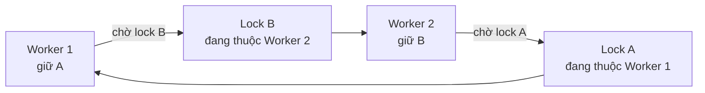
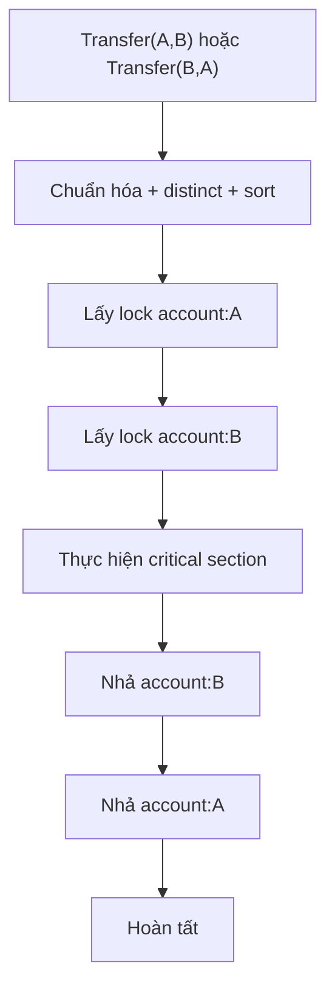
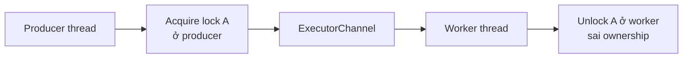
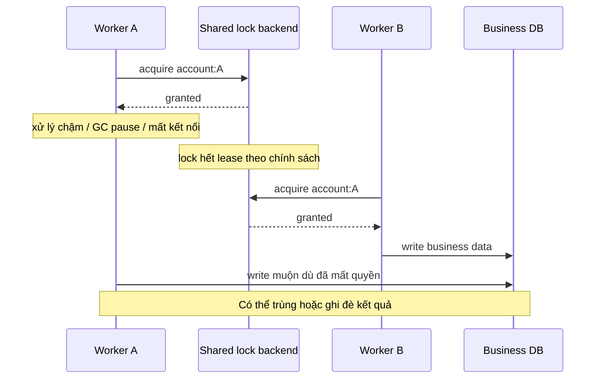

# Deadlock và thứ tự lấy lock

## 1. Vì sao deadlock xuất hiện trong Spring Integration runtime?

Trong Spring Integration, message đi từ producer qua channel đến consumer endpoint, có thể được xử lý trên thread của producer (`DirectChannel`), thread trong executor (`ExecutorChannel`) hoặc thread của poller (`QueueChannel` và polling consumer). Khi nhiều message cùng sửa một tài nguyên như tồn kho, số dư, file, hoặc trạng thái nhóm message, ứng dụng thường dùng **`LockRegistry`** để phối hợp quyền truy cập.

Vấn đề bắt đầu khi một lần xử lý cần **hơn một lock**. Giả sử có hai luồng chuyển tiền giữa tài khoản A và B:

- Worker 1 đang giữ lock `account:A` và chờ `account:B`.
- Worker 2 đang giữ lock `account:B` và chờ `account:A`.

Cả hai đều **giữ khóa đang có trong khi chờ khóa còn lại**. Nếu chúng dùng `lock()` chờ vô hạn và không có cơ chế phá thế bế tắc, hệ thống rơi vào **deadlock**: cả hai không thể tiếp tục cũng không thể tự nhả lock.



Chủ đề này thuộc chương **Lock registry** của module **SPRING_INTEGRATION_RUNTIME**. Ngoài việc giải thích deadlock, chúng ta sẽ thiết kế thứ tự lấy lock, thực hành Java DSL, kiểm tra giao dịch và retry, xử lý lock nhiều instance, rồi chẩn đoán tình trạng thread bị treo hoặc throughput giảm.

> **Nguyên tắc chính:** khi phải giữ nhiều lock cùng lúc, các luồng phải tuân thủ **một thứ tự khóa toàn cục và nhất quán**, không phụ thuộc thứ tự các tài nguyên xuất hiện trong message. Timeout khi chờ lock là lớp bảo vệ bổ sung, **không thay thế** thiết kế thứ tự.

## 2. Deadlock khác lock contention, starvation và livelock

Không phải mọi luồng đang chờ lock đều bị deadlock.

| Hiện tượng | Điều xảy ra | Dấu hiệu |
| --- | --- | --- |
| **Lock contention** | Nhiều worker chờ một lock; owner cuối cùng vẫn nhả khóa | Độ trễ tăng nhưng hệ thống vẫn tiến triển. |
| **Deadlock** | Các worker tạo vòng chờ phụ thuộc lẫn nhau | Nhóm worker không có tiến triển dù tài nguyên bên ngoài có thể vẫn bình thường. |
| **Starvation** | Một worker liên tục không giành được lock do cạnh tranh hoặc chính sách scheduling | Worker khác vẫn tiến triển, nhưng một công việc chờ rất lâu. |
| **Livelock** | Các worker liên tục thử, nhả, thử lại nhưng không hoàn thành công việc | CPU/log/retry tăng mà số việc hoàn thành thấp. |
| **Lock leak / khóa không được nhả** | Code không gọi `unlock()` khi xảy ra exception, hoặc owner mắc kẹt | Các worker khác chờ lâu; không nhất thiết có vòng chờ. |
| **Distributed lock mất lease** | Một worker mất quyền sở hữu do lease hết hạn hoặc kết nối gặp sự cố | Có nguy cơ worker cũ vẫn thực hiện side effect cùng worker mới. |

Bốn điều kiện kinh điển khiến deadlock có thể xảy ra: **mutual exclusion**, **hold-and-wait**, **không có cơ chế tự ý thu hồi lock đang giữ**, và **circular wait**. Trong hệ thống dùng nhiều lock, cách dễ kiểm soát nhất là loại bỏ **circular wait** bằng một quy tắc thứ tự duy nhất.

### Đọc đồ thị chờ lock

Một đồ thị *wait-for* có cạnh `W1 → W2` khi W1 chờ tài nguyên mà W2 đang giữ. Nếu xuất hiện vòng `W1 → W2 → W1`, đó là dấu hiệu deadlock có thể xảy ra trong điều kiện những lock này không tự được thu hồi hoặc hết hạn đúng cách.

Một worker chờ lock do worker khác đang ghi database lâu **chưa đủ** để kết luận deadlock. Hãy xác định owner hiện tại và owner đang chờ cái gì, thay vì chỉ thấy `WAITING` trong thread dump.

## 3. `LockRegistry` thực sự cung cấp gì?

Spring Integration có interface `org.springframework.integration.support.locks.LockRegistry`. Hợp đồng cốt lõi là:

```java
import java.util.concurrent.locks.Lock;
import org.springframework.integration.support.locks.LockRegistry;

LockRegistry registry = /* inject bean */;
Lock lock = registry.obtain("account:A");

lock.lock();
try {
    // Vùng xử lý phải được bảo vệ.
} finally {
    lock.unlock();
}
```

`obtain(Object lockKey)` trả về một `java.util.concurrent.locks.Lock` đại diện cho khóa tương ứng. **`LockRegistry` không tự biết** message nào đang chạy, danh sách tài nguyên nghiệp vụ nào cần khóa, hay thứ tự phải lấy khóa; ứng dụng quyết định điều đó.

Hai loại phạm vi khác nhau:

- `DefaultLockRegistry` giữ cơ chế lock **trong một JVM**. Các thread dùng **cùng instance registry** có thể phối hợp với nhau, nhưng replica khác có registry riêng.
- Các implementation dựa trên backend dùng chung, chẳng hạn `JdbcLockRegistry` hoặc `RedisLockRegistry` trong môi trường có module hỗ trợ, có thể phối hợp **nhiều instance** khi cùng dùng đúng backend/namespace và được cấu hình phù hợp.

Không suy luận rằng một implementation cụ thể hỗ trợ reentrancy, fairness, renewal, timeout hoặc fencing giống tất cả implementation khác. Cần kiểm tra phiên bản đang dùng và ngữ nghĩa của backend.

**Phân biệt với `ConcurrentMetadataStore`:** metadata store cung cấp thao tác như `putIfAbsent`/`replace` trên giá trị chuỗi để giữ dấu mốc hoặc trạng thái; `LockRegistry` cung cấp `Lock` cho **vùng xử lý tới `unlock()`**. Dùng metadata CAS không tự biến thao tác trên hai tài nguyên thành một critical section có khóa; và giữ lock không tự bảo đảm đã commit kết quả nghiệp vụ.

## 4. Vì sao thứ tự khóa phụ thuộc message là nguy hiểm?

Một thiết kế thiếu an toàn cho giao dịch chuyển tiền thường dùng:

```java
// Không an toàn khi có hai giao dịch đảo chiều A -> B và B -> A.
Lock source = registry.obtain("account:" + command.fromAccount());
Lock destination = registry.obtain("account:" + command.toAccount());

source.lock();
try {
    destination.lock(); // Có thể chờ vô hạn nếu worker khác lấy ngược lại.
    try {
        transferMoney(command);
    } finally {
        destination.unlock();
    }
} finally {
    source.unlock();
}
```

Với `Transfer(A,B)`, thread 1 lấy A rồi B; với `Transfer(B,A)`, thread 2 lấy B rồi A. Cặp giao dịch này có thể tạo vòng chờ.

**Không giải quyết bằng cách chỉ đặt `synchronized` vào method** khi ứng dụng chạy nhiều instance: `synchronized` chỉ bảo vệ monitor trong cùng JVM, và phạm vi khóa có thể rộng hơn mong muốn. Cũng không nên dùng thread ID hoặc thời điểm đến để tự thay đổi thứ tự tài nguyên; các worker sẽ không có quy tắc chung.

### Cách sửa: thứ tự toàn cục

Quy định tất cả khóa tài khoản dùng khóa chuẩn hóa, ví dụ:

```text
account:A
account:B
account:C
```

Với bất kỳ danh sách tài khoản nào, thực hiện:

1. Chuẩn hóa khóa (tenant, loại tài nguyên, ID) bằng quy tắc giống nhau ở mọi producer/instance.
2. Bỏ khóa trùng lặp.
3. Sắp xếp theo một **thứ tự toàn cục ổn định**, ví dụ `String.compareTo` trên key chuẩn hóa.
4. Lấy lần lượt theo thứ tự **tăng dần**.
5. Thực hiện nghiệp vụ.
6. Nhả theo thứ tự **ngược lại**, luôn đặt trong `finally`.

Ví dụ: cả `Transfer(A,B)` và `Transfer(B,A)` đều lấy `account:A` rồi `account:B`, bất kể chiều chuyển tiền. Worker đến sau chờ ngay ở `account:A` mà **chưa giữ `account:B`**, nên không tạo vòng chờ A/B như trước.



Thứ tự này phải được áp dụng ở **mọi** đường truy cập cùng tài nguyên, bao gồm handler bình thường, recovery job, scheduled task và logic được gọi sau retry. Một đường đi “ngoại lệ” lấy B rồi A vẫn có thể tái tạo deadlock.

## 5. Tiện ích Java lấy nhiều lock theo thứ tự

Đoạn dưới đây là một helper độc lập để giảm nguy cơ quên sắp xếp, quên nhả lock hoặc xử lý sai khi chỉ lấy được một phần các lock. Nó nhận danh sách khóa đã chuẩn hóa và sử dụng `tryLock` có timeout **cho từng lần lấy lock**.

```java
import java.util.ArrayList;
import java.util.Collection;
import java.util.List;
import java.util.concurrent.Callable;
import java.util.concurrent.TimeUnit;
import java.util.concurrent.TimeoutException;
import java.util.concurrent.locks.Lock;

import org.springframework.integration.support.locks.LockRegistry;

public final class OrderedLocks {

    private OrderedLocks() {}

    public static <T> T call(
            LockRegistry registry,
            Collection<String> keys,
            long waitMillisPerLock,
            Callable<T> task) throws Exception {

        if (waitMillisPerLock <= 0) {
            throw new IllegalArgumentException("Timeout phai duong");
        }

        List<String> ordered = keys.stream()
            .distinct()
            .sorted()
            .toList();

        List<Lock> acquired = new ArrayList<>();

        try {
            for (String key : ordered) {
                Lock lock = registry.obtain(key);

                // Không đợi vô hạn. Khóa đã lấy sẽ được nhả nếu timeout.
                if (!lock.tryLock(waitMillisPerLock, TimeUnit.MILLISECONDS)) {
                    throw new TimeoutException("Khong lay duoc lock: " + key);
                }
                acquired.add(lock);
            }

            return task.call();
        } catch (InterruptedException interrupted) {
            Thread.currentThread().interrupt();
            throw interrupted;
        } finally {
            // Nhả cả khi task lỗi hoặc chỉ lấy được một phần các khóa.
            for (int i = acquired.size() - 1; i >= 0; i--) {
                acquired.get(i).unlock();
            }
        }
    }
}
```

**Những đảm bảo mà helper cung cấp:**

- Cùng tập khóa → cùng thứ tự gọi `obtain` và `tryLock`.
- Nếu một lần `tryLock` hết thời gian chờ, các lock lấy trước được nhả trong `finally`.
- Nếu task ném exception, lock vẫn được nhả.
- Khi bị interrupt trong thao tác chờ có hỗ trợ interrupt, cờ interrupt được khôi phục và exception được chuyển lên caller.
- `distinct()` tránh lấy cùng khóa hai lần, không phụ thuộc implementation có reentrant hay không.

**Những điều helper không bảo đảm:**

- `waitMillisPerLock` **không** giới hạn tổng thời gian chờ khi có nhiều khóa; tổng thời gian có thể gần số khóa nhân thời gian chờ. Cần deadline tổng thể nếu API có SLA chặt.
- Sau khi đã lấy đủ khóa, `task.call()` có thể chạy rất lâu; timeout lấy lock không phải timeout của critical section.
- Nếu các đường khác lấy khóa theo thứ tự trái ngược hoặc dùng registry khác nhau, quy tắc bị phá.
- Với distributed lock có lease, có thể mất quyền sở hữu khi task quá lâu, dù object `Lock` trong Java chưa được `unlock()`.
- Exception từ `unlock()` trong tình huống bất thường cũng cần được quan sát; không được bỏ qua lỗi mất quyền sở hữu trong production.

Cần kiểm tra danh sách key đầu vào **không null/không rỗng** theo quy tắc nghiệp vụ trước khi gọi helper. Ví dụ truyền danh sách rỗng sẽ chạy task mà không lấy lock nào; có thể hợp lệ ở một tiện ích tổng quát nhưng không an toàn cho giao dịch buộc phải có tài nguyên khóa.

## 6. Tái hiện vòng chờ bằng timeout thay vì treo JVM

Không nên viết một bài test tạo deadlock thật bằng hai lời gọi `lock()` vô hạn rồi để JVM treo. Đoạn sau tạo **điều kiện đối nghịch về thứ tự**, nhưng dùng `tryLock` có giới hạn nên cả hai thread có thể thoát và nhả khóa.

```java
import java.util.concurrent.CountDownLatch;
import java.util.concurrent.TimeUnit;
import java.util.concurrent.locks.Lock;

import org.springframework.integration.support.locks.DefaultLockRegistry;
import org.springframework.integration.support.locks.LockRegistry;

public class DeadlockOrderDemo {

    static void oppositeOrder(
            LockRegistry registry,
            String firstKey,
            String secondKey,
            CountDownLatch bothHoldFirst) {

        Lock first = registry.obtain(firstKey);
        Lock second = registry.obtain(secondKey);

        first.lock();
        try {
            bothHoldFirst.countDown();

            // Đảm bảo cả hai thread đã giữ khóa đầu tiên.
            if (!bothHoldFirst.await(2, TimeUnit.SECONDS)) {
                throw new IllegalStateException("Barrier timeout");
            }

            if (second.tryLock(300, TimeUnit.MILLISECONDS)) {
                try {
                    System.out.println("Đã lấy được cả hai khóa");
                } finally {
                    second.unlock();
                }
            } else {
                System.out.println(
                    Thread.currentThread().getName() +
                    " bị chặn ở khóa thứ hai: " + secondKey);
            }
        } catch (InterruptedException e) {
            Thread.currentThread().interrupt();
        } finally {
            first.unlock();
        }
    }

    public static void main(String[] args) throws InterruptedException {
        LockRegistry registry = new DefaultLockRegistry();
        CountDownLatch barrier = new CountDownLatch(2);

        Thread t1 = new Thread(
            () -> oppositeOrder(
                registry, "account:A", "account:B", barrier),
            "worker-A-to-B");

        Thread t2 = new Thread(
            () -> oppositeOrder(
                registry, "account:B", "account:A", barrier),
            "worker-B-to-A");

        t1.start();
        t2.start();
        t1.join();
        t2.join();
    }
}
```

Vì mỗi worker giữ một khóa đầu tiên khác nhau trước khi tiếp tục, lúc thử lấy khóa thứ hai chúng có thể rơi vào **vòng chờ A ↔ B**. `tryLock(300ms)` sẽ cho phép thoát thay vì treo vô hạn; thứ tự in log giữa hai thread không được bảo đảm.

Thử thay cả hai nhánh bằng cách gọi `OrderedLocks.call(registry, List.of("account:A", "account:B"), ...)` với cùng tập khóa. Worker thứ hai có thể chờ khóa A, nhưng worker đầu tiên không bị chặn bởi một worker đang giữ B theo thứ tự đảo ngược. Đó là khác biệt giữa **contention có thể kết thúc** và **deadlock do vòng chờ**.

## 7. Tích hợp vào Spring Integration Java DSL

Bài toán: hai message có thể đồng thời yêu cầu chuyển tiền A → B và B → A. Ta dùng `OrderedLocks` để khóa hai tài khoản theo thứ tự chuẩn hóa, sau đó thực hiện các thay đổi JDBC trong một transaction.

Giả sử ứng dụng có `JdbcTemplate` và `PlatformTransactionManager` cho cùng `DataSource`. Schema demo:

```sql
CREATE TABLE account_balance (
    account_id VARCHAR(40) PRIMARY KEY,
    balance BIGINT NOT NULL
);

CREATE TABLE transfer_log (
    transfer_id VARCHAR(60) PRIMARY KEY,
    from_account VARCHAR(40) NOT NULL,
    to_account VARCHAR(40) NOT NULL,
    amount BIGINT NOT NULL
);

INSERT INTO account_balance (account_id, balance) VALUES ('A', 100);
INSERT INTO account_balance (account_id, balance) VALUES ('B', 100);
```

Service nghiệp vụ sử dụng hai lock và transaction template. `TransactionTemplate.execute(...)` trả về **sau khi hoàn tất commit/rollback nếu nó sở hữu transaction mới**; nhờ đó, trong cấu hình không có transaction ngoài của ví dụ, lock vẫn đang được giữ đến khi giao dịch JDBC hoàn tất.

```java
import java.util.List;

import org.springframework.integration.support.locks.LockRegistry;
import org.springframework.jdbc.core.JdbcTemplate;
import org.springframework.transaction.PlatformTransactionManager;
import org.springframework.transaction.support.TransactionTemplate;

public class TransferService {

    public record TransferCommand(
        String transferId, String fromAccount,
        String toAccount, long amount) {}

    public record TransferResult(String transferId, String status) {}

    private final LockRegistry locks;
    private final JdbcTemplate jdbc;
    private final TransactionTemplate transactions;

    public TransferService(
            LockRegistry locks,
            JdbcTemplate jdbc,
            PlatformTransactionManager manager) {
        this.locks = locks;
        this.jdbc = jdbc;
        this.transactions = new TransactionTemplate(manager);
    }

    public TransferResult process(TransferCommand command) throws Exception {
        if (command.amount() <= 0 ||
            command.fromAccount().equals(command.toAccount())) {
            throw new IllegalArgumentException("Transfer khong hop le");
        }

        List<String> keys = List.of(
            "account:" + command.fromAccount(),
            "account:" + command.toAccount());

        return OrderedLocks.call(locks, keys, 2_000, () ->
            transactions.execute(status -> {
                // Khóa business ID ở bảng log phải unique để chống replay.
                jdbc.update(
                    "INSERT INTO transfer_log " +
                    "(transfer_id, from_account, to_account, amount) " +
                    "VALUES (?, ?, ?, ?)",
                    command.transferId(), command.fromAccount(),
                    command.toAccount(), command.amount());

                int debit = jdbc.update(
                    "UPDATE account_balance SET balance = balance - ? " +
                    "WHERE account_id = ? AND balance >= ?",
                    command.amount(), command.fromAccount(),
                    command.amount());

                if (debit != 1) {
                    throw new IllegalStateException("Khong du so du");
                }

                int credit = jdbc.update(
                    "UPDATE account_balance SET balance = balance + ? " +
                    "WHERE account_id = ?",
                    command.amount(), command.toAccount());

                if (credit != 1) {
                    throw new IllegalStateException(
                        "Tai khoan nhan khong ton tai");
                }

                return new TransferResult(
                    command.transferId(), "TRANSFERRED");
            }));
    }
}
```

**Thứ tự thực thi ở đây cố ý là:** lấy cả hai lock → mở transaction → insert log và cập nhật số dư → transaction hoàn tất → nhả lock. Trong trường hợp có **transaction bên ngoài** mà `TransactionTemplate` với propagation mặc định `REQUIRED` tham gia vào, commit thật có thể diễn ra **sau khi helper đã nhả lock**. Nếu nghiệp vụ cần lock được giữ đến thời điểm commit cuối cùng, phải thiết kế phạm vi transaction bao được bởi lock một cách tường minh và kiểm tra propagation, thay vì suy luận từ thứ tự các dòng code.

Cấu hình một IntegrationFlow tối thiểu:

```java
import org.springframework.beans.factory.annotation.Qualifier;
import org.springframework.context.annotation.Bean;
import org.springframework.context.annotation.Configuration;
import org.springframework.integration.channel.DirectChannel;
import org.springframework.integration.channel.QueueChannel;
import org.springframework.integration.config.EnableIntegration;
import org.springframework.integration.dsl.IntegrationFlow;
import org.springframework.integration.support.locks.DefaultLockRegistry;
import org.springframework.integration.support.locks.LockRegistry;
import org.springframework.jdbc.core.JdbcTemplate;
import org.springframework.messaging.MessageChannel;
import org.springframework.messaging.PollableChannel;
import org.springframework.transaction.PlatformTransactionManager;

@Configuration
@EnableIntegration
public class TransferFlowConfig {

    @Bean("accountLocks")
    LockRegistry accountLocks() {
        // Chỉ phối hợp giữa các thread trong cùng JVM.
        return new DefaultLockRegistry();
    }

    @Bean
    TransferService transferService(
            @Qualifier("accountLocks") LockRegistry accountLocks,
            JdbcTemplate jdbc,
            PlatformTransactionManager transactionManager) {
        return new TransferService(accountLocks, jdbc, transactionManager);
    }

    @Bean("transfers.in")
    MessageChannel transfersIn() {
        return new DirectChannel();
    }

    @Bean("transfers.out")
    PollableChannel transfersOut() {
        return new QueueChannel(100);
    }

    @Bean
    IntegrationFlow transferFlow(TransferService service) {
        return IntegrationFlow.from("transfers.in")
            .handle(service, "process")
            .channel("transfers.out")
            .get();
    }
}
```

Ví dụ dùng Java record (Java 16+). `TransferService` và `OrderedLocks` được đặt cùng package với config hoặc import đúng theo project. Ứng dụng cần một transaction manager hoạt động cùng `JdbcTemplate`, database và các bảng đã tạo. `QueueChannel` output trong ví dụ là queue in-memory phục vụ bài test, **không** bảo đảm lưu bền vững.

### Kiểm chứng với hai message

```java
import org.springframework.messaging.MessageChannel;
import org.springframework.messaging.PollableChannel;
import org.springframework.messaging.support.GenericMessage;

MessageChannel input =
    context.getBean("transfers.in", MessageChannel.class);
PollableChannel output =
    context.getBean("transfers.out", PollableChannel.class);

// Gửi từ hai thread khác nhau để thử cạnh tranh trên cùng hai tài khoản.
Thread first = new Thread(() ->
    input.send(new GenericMessage<>(
        new TransferService.TransferCommand("T-1", "A", "B", 20))));

Thread second = new Thread(() ->
    input.send(new GenericMessage<>(
        new TransferService.TransferCommand("T-2", "B", "A", 30))));

first.start();
second.start();
first.join();
second.join();

// Hai reply thành công có thể đến theo thứ tự bất kỳ.
var result1 = output.receive(1_000);
var result2 = output.receive(1_000);
```

`context` là `ApplicationContext` đã khởi động. Với số dư ban đầu A = 100, B = 100; không có writer khác; cả hai giao dịch commit thành công; kết quả mong đợi là A = 110, B = 90. `transfer_log` có hai bản ghi T-1 và T-2. Nếu một lời gọi gửi ném exception trong thread, thread test nên thu thập exception và assert đầy đủ; không xem việc `join()` thành công là bằng chứng message đã xử lý thành công.

Để kiểm thử dưới tải thật, có thể thay `DirectChannel` bằng `ExecutorChannel` **trước handler**, đồng thời đặt giới hạn thread pool. Lock vẫn phải được lấy và nhả **trong cùng worker thread đang thực hiện critical section**.

## 8. Vị trí lock so với transaction: vấn đề commit sau khi unlock

`LockRegistry` bảo vệ vùng Java code theo hợp đồng `Lock`. Transaction manager bảo vệ các thao tác của tài nguyên có tham gia transaction. Hai phạm vi này **không nhất thiết trùng nhau**.

### Trường hợp dễ sai

```text
TransactionInterceptor mở transaction
  Handler:
    acquire lock(account:A)
      UPDATE account_balance
    unlock(account:A)
  Handler return
TransactionInterceptor commit
```

Một worker khác có thể lấy `account:A` **trước khi transaction ngoài commit**. Tùy isolation và SQL, worker tiếp theo có thể chờ DB row lock, nhìn thấy dữ liệu cũ hoặc gặp timeout. Lock Java đã nhả không đồng nghĩa DB transaction đã xong.

### Trường hợp thường mong muốn

```text
acquire lock(account:A)
  begin transaction
    UPDATE account_balance
    INSERT transfer_log
  commit / rollback transaction
unlock(account:A)
```

Phạm vi rõ ràng hơn: lock được giữ qua commit/rollback của transaction **mới**. Trong bài demo phần 7, `OrderedLocks` bao `TransactionTemplate` khi không có transaction ngoài nên gần mô hình này.

Nếu transaction được mở ở **poller**, **gateway** hoặc advice bọc endpoint bên ngoài helper, cần xem lại thứ tự. Khi vừa dùng retry vừa dùng transaction vừa dùng lock, một lựa chọn thường an toàn cho mỗi attempt là:

```text
Retry (ngoài cùng, có giới hạn)
  acquire locks theo thứ tự
    begin transaction mới hoặc phạm vi đã kiểm soát
      handler/SQL
    commit hoặc rollback
  release locks
```

Điều này còn phụ thuộc isolation, propagation và mức độ atomic của dữ liệu. Không giả định chỉ đổi thứ tự advice là sửa được race với nguồn broker hoặc HTTP.

### Database deadlock vẫn có thể tồn tại

Sắp xếp khóa ứng dụng theo thứ tự làm giảm deadlock trên **cùng hệ thống lock**. Nó không xóa mọi deadlock ở database:

- Một service khác cập nhật các bảng/row theo thứ tự ngược mà **không dùng registry**.
- Các transaction động chạm index/foreign key hoặc row lock ẩn mà ứng dụng không kiểm soát được.
- Các replica dùng **registry trong bộ nhớ riêng**, không khóa nhau.
- Transaction ngoài có lock JDBC được lấy trước khi vào helper.

Nên tiếp tục giữ **thứ tự thao tác SQL nhất quán**, dùng transaction ngắn, index thích hợp, kiểm tra deadlock log/lock graph của database và chỉ retry những lỗi transient phù hợp.

## 9. Thread, poller, executor và vòng đời endpoint

Spring Integration không giữ cùng một thread qua mọi channel. Điều này ảnh hưởng trực tiếp đến thời gian giữ lock, owner của lock và khả năng xử lý lỗi.

| Cấu hình | Nơi chạy handler | Rủi ro liên quan lock |
| --- | --- | --- |
| `DirectChannel` | Thường trên thread producer | Producer bị chặn khi lock chờ; timeout có thể tác động tới gateway. |
| `ExecutorChannel` | Thread từ executor | Nhiều worker tranh cùng key; executor pool có thể bị lấp bởi task chờ lock. |
| `QueueChannel` + poller | Thread polling consumer | Lock chậm làm giảm tốc độ tiêu thụ queue; message có thể tích tụ. |
| `PublishSubscribeChannel` có executor | Có thể có nhiều worker/subscriber | Cùng một tài nguyên có thể bị chạm từ nhiều nhánh; phải thống nhất khóa và thứ tự. |
| Flow động qua `IntegrationFlowContext` | Tùy channel/endpoint đã đăng ký và start | Dừng flow không tự tạo cơ chế rollback hoặc unlock cho code vẫn đang thực thi. |

### Không lấy lock trước executor rồi unlock trong worker



Nhiều implementation dựa trên `ReentrantLock` yêu cầu thread gọi `unlock()` cũng là thread đang giữ khóa; hành vi có thể là `IllegalMonitorStateException` hoặc lỗi ownership của backend. Không truyền `Lock` trong message headers để “chuyển quyền”. **Hãy lấy và nhả khóa quanh critical section trong thread thực thi của handler**, hoặc dùng cơ chế phân phối công việc/lệnh phù hợp với backend.

### Tránh lấp thread pool bằng tác vụ chờ

Giả sử executor có 8 worker và cả 8 worker đều đang `lock()` chờ khóa do một task khác giữ lâu. Executor có thể không còn thread để xử lý message khác, kể cả message lỗi/giải phóng tài nguyên nếu topology gây phụ thuộc. Hiện tượng này có thể trông giống deadlock toàn flow dù về mặt thuật toán chỉ là contention hoặc pool starvation.

Theo dõi **active threads, executor queue depth, số task chờ lock, thời gian chờ p95/p99**. Giới hạn `tryLock` và sử dụng backpressure/retry với jitter khi thích hợp; không retry trong vòng bận không có backoff.

## 10. Nhiều instance: distributed lock, lease và fencing

Trong một JVM, `DefaultLockRegistry` có thể đủ để bảo vệ cập nhật cục bộ. Nhưng nếu triển khai ba replica, mỗi replica tạo một `DefaultLockRegistry` riêng, cả ba đều có thể giành khóa `account:A` trong map của chính mình. Quy tắc sắp xếp giống nhau **không giải quyết** việc mỗi replica dùng lock khác nhau.

Với shared lock backend như JDBC hoặc Redis, cần xác minh:

1. Mọi instance truy cập **cùng backend/namespace** và ánh xạ cùng business key thành **cùng lock key**.
2. Implementation cung cấp ngữ nghĩa atomic và ownership phù hợp với workload.
3. Có xử lý khi instance crash, network partition, failover hoặc lock lease hết hạn.
4. Nếu backend dùng lease, **thời gian xử lý tối đa**, timeout chờ và renewal có được cấu hình/quan sát đúng không.
5. Khi một lock bị thu hồi hoặc hết lease, worker cũ có còn khả năng ghi vào tài nguyên nghiệp vụ không.

### Lease hết hạn không có nghĩa worker cũ ngừng chạy



Vì vậy, đối với nghiệp vụ có yêu cầu an toàn cao, **distributed lock không đủ để bảo đảm exactly-once**. Cân nhắc **fencing token** tăng đơn điệu và kiểm tra token tại tài nguyên đích, idempotency key/unique constraint hoặc transaction phù hợp. `LockRegistry` không bảo đảm mọi implementation đều cấp fencing token; có thể cần cơ chế bổ sung của backend/hạ tầng.

Ví dụ, bảng nghiệp vụ có `last_fence` và chỉ nhận cập nhật có token mới hơn; worker giữ token cũ sẽ bị từ chối ngay tại database. Đây là ý tưởng thiết kế, không phải API mặc định của `LockRegistry`.

**Timeout khi lấy lock** khác **lease duration**: `tryLock(2, TimeUnit.SECONDS)` giới hạn thời gian *đợi* khóa. Lease (nếu backend có) giới hạn thời gian *giữ quyền sở hữu* theo quy tắc backend. Hai giá trị không thể thay thế nhau.

## 11. Lock của aggregator, message store và metadata store

Spring Integration có nhiều chỗ quản lý trạng thái đồng thời:

| Thành phần | Trạng thái cần bảo vệ | Ghi nhớ |
| --- | --- | --- |
| Aggregator / resequencer | `MessageGroup` theo correlation key | Có thể dùng locking phù hợp để điều phối thay đổi nhóm; việc đồng bộ nhiều instance cần store và khóa phù hợp. |
| `MessageGroupStore` | Các fragment đang chờ release | Persistent store không tự bảo đảm mọi thao tác release nguyên tử giữa nhiều JVM. |
| `ConcurrentMetadataStore` | Giá trị metadata, dấu mốc xử lý | `putIfAbsent` và `replace` là atomic state transition, không phải khóa bảo vệ toàn bộ critical section. |
| `LockRegistry` | Quyền truy cập vùng xử lý theo một hoặc nhiều key | Lock giúp tuần tự hóa đoạn code, không chứa payload/message. |
| Poller / adapter đọc dữ liệu | Quyền đọc/claim nguồn hoặc tài nguyên đang cập nhật | Cần xác định transaction/ack của nguồn và concurrency thực tế. |

Khi một aggregator giữ lock group và handler tùy chỉnh lại lấy lock nghiệp vụ, hãy xác định **thứ tự giữa hai loại khóa**. Nếu có đường ngược lại (đang giữ lock nghiệp vụ rồi gọi vào aggregator cần group lock), vòng chờ có thể hình thành dù từng nhóm khóa nội bộ được sắp xếp.

Ví dụ quy ước toàn cục:

```text
1. group:<groupId>              (khóa nhóm, nếu thực sự cần)
2. account:<accountId>          (khóa tài khoản, sắp xếp từng ID)
3. inventory:<sku>              (khóa kho, sắp xếp từng SKU)
```

Đây chỉ là **ví dụ quy ước**; điều quan trọng là mọi flow tuân theo cùng một quan hệ thứ tự. Nếu API của aggregator lấy khóa nội bộ mà application không kiểm soát được, tránh gọi đồng bộ ngược vào component đó khi đang giữ lock ngoài, hoặc tách flow qua boundary có thiết kế không giữ lock xuyên bước.

### Khóa theo correlation key

Nếu message cùng `correlationId` cập nhật chung `MessageGroup`, khóa có thể dùng key chuẩn hóa từ correlation ID. Nhưng **không** biến `correlationId` thành một khóa toàn cục cho tất cả account nếu các message khác correlation vẫn sửa cùng tài khoản. Key lock phải phản ánh **tài nguyên cần bảo vệ**, không chỉ quan hệ các message.

## 12. Retry, error channel và nhả lock khi lỗi

Một exception có thể xảy ra ở ba nơi:

1. **Trước khi lấy lock:** validation sai, dữ liệu thiếu khóa; không có lock để nhả.
2. **Đang chờ lock:** timeout hoặc interrupt; phải nhả tất cả lock đã lấy trước đó.
3. **Trong critical section:** SQL lỗi, business validation lỗi hoặc downstream thất bại; phải rollback transaction phù hợp và nhả lock trong `finally`.

Đường xử lý lỗi phụ thuộc channel:

- Với `DirectChannel` đồng bộ, exception chưa được xử lý có thể quay về `send()` hoặc gateway. Helper vẫn thực hiện `finally` trước khi exception thoát ra.
- Với `ExecutorChannel` hoặc poller, lỗi có thể được đóng gói thành `ErrorMessage` và gửi tới error channel được cấu hình; thread producer không nhất thiết nhìn thấy exception.
- Khi error channel không có consumer hoặc chính error handler lỗi, đó là **lỗi thứ cấp**; không làm thay đổi yêu cầu nhả lock và kiểm tra rollback của message gốc.

### Retry đúng loại lỗi

| Lỗi | Có nên retry? | Lý do |
| --- | --- | --- |
| `tryLock` timeout vì lock đang được giữ ngắn hạn | Có thể, với số lần giới hạn và backoff/jitter | Nếu owner sắp hoàn tất, lần sau có thể thành công. |
| JDBC deadlock victim hoặc transient connection error | Có thể, sau rollback và theo phân loại cụ thể | Transaction cũ phải kết thúc; retry nên có transaction mới. |
| Thiếu dữ liệu đầu vào, khóa nghiệp vụ không hợp lệ | Thường không | Retry không sửa được payload sai. |
| Sai thứ tự lock trên một đường code | Không phải giải pháp gốc | Có thể tiếp tục timeout/livelock; cần sửa thứ tự. |
| Mất distributed lock lease khi đã thực hiện side effect | Không retry mù quáng | Cần kiểm tra ownership và trạng thái đích trước khi làm lại. |

Nếu retry advice bao toàn bộ handler, mỗi attempt có thể lấy lại các lock theo thứ tự chung. Tránh **giữ lock trong khi backoff/sleep giữa các attempt**, vì sẽ khóa tài nguyên lâu không cần thiết. Nếu transaction ở ngoài vùng retry, một exception có thể khiến transaction bị đánh dấu rollback-only; retry trong transaction đó có thể thất bại ở commit.

Khi retry/redelivery, hãy dùng **business idempotency key**, ví dụ `transferId` có unique constraint, để ngăn giao dịch tiền bị thực hiện hai lần. Lock chỉ kiểm soát concurrent access tại một thời điểm; sau khi `unlock()`, một message trùng vẫn có thể chạy lại nếu không có kiểm tra bền vững.

## 13. Chẩn đoán deadlock và lock contention tại runtime

### Dấu hiệu nên thu thập

- Message ID, `correlationId`/`traceId`, endpoint ID, thread name và tên instance.
- Các lock key đang giữ, thứ tự đã lấy, key đang chờ, thời điểm bắt đầu chờ và timeout.
- Thời gian **wait**, **hold**, số lần timeout, số attempts retry và độ trễ hoàn tất.
- Executor active threads, executor queue depth, poller lag và độ sâu `QueueChannel`.
- JDBC transaction duration, row-lock wait, DB deadlock reports và trạng thái commit/rollback.
- Với distributed store: backend round-trip, kết nối, lease expiry/renewal và lỗi ownership.

Một log có cấu trúc hữu ích:

```text
trace=req-71 transfer=T-1 worker=orders-3 acquire=["account:A","account:B"]
trace=req-71 transfer=T-1 waitLock=account:B waitMs=820
trace=req-71 transfer=T-1 timeoutLock=account:B released=["account:A"]
trace=req-72 transfer=T-2 worker=orders-7 held=["account:B"] waitLock=account:A
```

Log cần thể hiện **lock nào đang giữ** và **lock nào đang chờ**, thay vì chỉ ghi “timeout”. Với khóa có chứa dữ liệu nhạy cảm, ẩn/hash phần định danh; không ghi payload thanh toán hoặc thông tin cá nhân vào log.

### Thread dump và backend

Trong JVM, có thể dùng công cụ chẩn đoán được phép như `jcmd <pid> Thread.print` hoặc `jstack <pid>` để kiểm tra thread đang đợi monitor hoặc `ReentrantLock`. Các thread sử dụng `java.util.concurrent.locks` có thể hiển thị trạng thái park/`WAITING` hoặc `TIMED_WAITING`, không nhất thiết là `BLOCKED` theo monitor.

Lưu ý: deadlock liên quan **distributed lock** có thể chỉ hiện như chờ I/O hoặc polling ở JVM; thread dump một instance không chứa đủ thông tin owner ở instance khác. Cần đối chiếu trạng thái lock trong Redis/JDBC và log từ tất cả replica.

### Bảng khắc phục

| Triệu chứng | Khả năng xảy ra | Hành động ưu tiên |
| --- | --- | --- |
| Hai thread giữ hai key khác nhau, chờ nhau | Khóa A/B được lấy ngược thứ tự | Lập wait-for graph, áp thứ tự toàn cục. |
| Tất cả worker pool đều WAITING | Lock contention, pool starvation hoặc deadlock | Xác định owner; đo wait/hold time và executor saturation. |
| `tryLock` timeout liên tục dù tải thấp | Owner giữ quá lâu, lock leak hoặc backend gặp sự cố | Đo hold time, xem `finally`, DB/network và lease. |
| Thêm replica khiến cùng key xử lý song song | Mỗi replica có `DefaultLockRegistry` riêng | Dùng shared registry phù hợp; kiểm tra namespace/backend. |
| Timeout khi unlock sau GC pause | Lease hết hạn/mất quyền sở hữu | Kiểm tra lease/renewal và fencing/idempotency. |
| DB báo deadlock dù application keys đã sort | Có thao tác ngoài registry hoặc row/index lock theo thứ tự khác | Phân tích deadlock graph của DB, SQL và transaction scope. |
| Retry làm throughput giảm thêm | Retry storm, backoff trong critical section | Giới hạn retry; nhả lock trước backoff, đặt jitter/backpressure. |
| Lock được nhả nhưng message vẫn bị kẹt | Error channel, reply channel, message store hoặc transaction chưa hoàn tất | Kiểm tra endpoint/poller lifecycle và đường lỗi. |
| Một group aggregator không phát kết quả | Thiếu fragment, group lock/store contention hoặc release condition | Đo group age, correlation key, release strategy, store lock. |
| Giao dịch tiền bị lặp dù dùng lock | Message redelivery sau unlock | Unique constraint/idempotency key ở DB nghiệp vụ. |

**Không sửa deadlock bằng cách tăng vô hạn thread pool.** Làm vậy có thể tạo thêm worker chờ lock, tăng áp lực database và làm lỗi nghiêm trọng hơn.

## 14. Thiết kế an toàn cho nhiều tài nguyên

Một checklist ngắn trước khi triển khai:

1. Xác định **tài nguyên cần tuần tự hóa**: account, inventory, group hay file; không dùng khóa quá rộng nếu có thể tách độc lập.
2. Tạo **canonical key** có namespace, tenant và business ID đúng; mọi instance dùng cùng quy tắc.
3. Xây dựng **total order** và áp cho mọi nơi có thể giữ đồng thời hai lock trở lên.
4. Lấy lock trong **thread thực hiện critical section**; không giữ lock qua executor boundary.
5. Dùng `tryLock` có budget và cleanup trong `finally`; khi cần SLA thực sự, tính deadline tổng.
6. Giữ critical section ngắn; tránh gọi HTTP chậm hoặc chờ người dùng trong khi giữ lock.
7. Nếu có JDBC transaction, đánh giá lock nằm **trong hay ngoài** transaction và thời điểm commit thực tế.
8. Nếu có retry, xác định backoff ở đâu và bảo đảm có idempotency khi message phát lại.
9. Với nhiều replica, kiểm tra shared registry, crash/recovery, lease và khả năng fencing.
10. Theo dõi wait/hold time, lock timeout, executor saturation, DB deadlock, queue depth và message completion.

### Ước tính chi phí lock

Giả sử một khóa nóng được giữ trung bình **50 ms** cho mỗi message, và không có xử lý song song đối với **cùng key**. Giới hạn lý thuyết của khóa nóng vào khoảng `1 / 0,05 = 20` critical section mỗi giây, chưa tính overhead của backend hoặc thời gian chờ. Tăng số worker không làm vượt trần cho cùng key; muốn tăng throughput cần rút ngắn thời gian giữ khóa, phân mảnh tài nguyên độc lập hoặc thay đổi mô hình dữ liệu.

Con số này chỉ là ví dụ lý thuyết. Phân phối độ trễ, p99, retry, transaction hold time và round trip của distributed lock có thể khiến throughput thấp hơn nhiều.

## 15. Bài thực hành và câu hỏi tự kiểm tra

**Bài 1 — Tái hiện circular wait có giới hạn.** Chạy `DeadlockOrderDemo`. Xác nhận các worker giữ khóa đầu tiên theo thứ tự ngược và bị chặn ở khóa thứ hai. Giải thích vì sao `tryLock` ngăn test treo nhưng không sửa thứ tự sai trong thiết kế.

**Bài 2 — Sửa bằng thứ tự chung.** Dùng `OrderedLocks.call` để hai worker cùng khóa A và B với cùng bộ key. Quan sát một worker chờ A rồi hoàn tất khi worker đầu nhả A/B. Đo thời gian wait và hold riêng.

**Bài 3 — Giao dịch hai chiều.** Chạy `TransferFlowConfig` với `T-1: A→B 20` và `T-2: B→A 30`, kiểm tra số dư và `transfer_log` sau khi cả hai commit. Gửi lại `T-1` để quan sát unique constraint giúp tránh double transfer; đừng kết luận retry thành công chỉ vì lock vẫn lấy được.

**Bài 4 — Ranh giới executor.** Đặt `ExecutorChannel` trước handler chuyển tiền. Log thread name khi lấy/nhả lock; tạo lỗi timeout thử nghiệm. Xác minh worker trả lock trong `finally` và error handler nhận thông tin phù hợp.

**Bài 5 — Ranh giới transaction.** So sánh hai phiên bản: transaction advice ở ngoài handler trong khi handler tự giữ lock, và `TransactionTemplate` nằm trong helper giữ lock. Dùng hai worker cùng key để quan sát thời điểm commit so với thời điểm unlock. Không làm thử nghiệm này trên dữ liệu thật.

**Bài 6 — Hai instance.** Chạy hai instance với `DefaultLockRegistry` rồi cùng thực hiện message có chung key; ghi nhận rằng mỗi instance có lock cục bộ. Thay bằng shared implementation phù hợp và kiểm tra contention xuyên replica, timeout và phục hồi khi một replica dừng đột ngột.

**Bài 7 — Failure injection.** Trong môi trường test, mô phỏng task giữ lock quá lâu, worker bị interrupt, backend unavailable và lease hết hạn (nếu backend có lease). Kiểm tra có retry storm, lock leak, duplicate side effect, message mất hoặc lỗi không được gửi tới error channel hay không.

**Bài 8 — Tài nguyên ba cấp.** Thiết kế flow cập nhật `account`, `inventory` và `group` trong cùng nghiệp vụ. Chọn thứ tự khóa toàn cục, liệt kê mọi đường code hiện có lấy hơn một khóa và xác minh không có đường nào đi ngược. Đề xuất cách tránh gọi vào aggregator đồng bộ khi đã giữ lock bên ngoài nếu không kiểm soát được lock nội bộ.

### Câu hỏi tự kiểm tra

1. Deadlock khác contention và starvation ở điểm nào?
2. Vì sao thứ tự `fromAccount` rồi `toAccount` có thể gây deadlock?
3. Cơ chế sắp xếp khóa theo `String.compareTo` giải quyết vòng chờ bằng cách nào?
4. Nếu `tryLock` timeout khi đã giữ một số khóa trước đó, phải làm gì?
5. `DefaultLockRegistry` bảo vệ được hai Spring Boot replica chạy ở JVM khác nhau không?
6. Vì sao release lock trước khi JDBC transaction commit có thể tạo vấn đề?
7. Vì sao transaction rollback và lock release là hai trách nhiệm khác nhau?
8. Khi thêm `ExecutorChannel`, yêu cầu nào đối với thread lấy và nhả lock thay đổi?
9. `tryLock` timeout khác distributed lease duration ra sao?
10. Vì sao distributed lock lease hết hạn vẫn có thể khiến hai worker cùng ghi dữ liệu?
11. Application-level lock ordering có loại bỏ mọi database deadlock không?
12. Metric và log nào giúp dựng lại vòng chờ lock khi hệ thống không có tiến triển?
13. Tại sao retry không thay thế unique constraint/idempotency khi message được redeliver?
14. Khi aggregator có lock nội bộ, cần làm gì trước khi lấy thêm lock nghiệp vụ?

**Nguyên tắc vận hành:** deadlock không xuất hiện chỉ vì có nhiều thread, mà vì các luồng giữ những lock khác nhau rồi tạo **vòng chờ**. Thiết kế một thứ tự lấy lock thống nhất, khóa và nhả đúng thread, giới hạn thời gian chờ, phối hợp transaction/retry và quan sát toàn bộ vòng đời message. Khi chạy nhiều instance, bổ sung shared lock backend, kiểm soát lease và idempotency/fencing thích hợp; không xem một lock thành công là bảo đảm dữ liệu đã commit hoặc xử lý đúng một lần.
