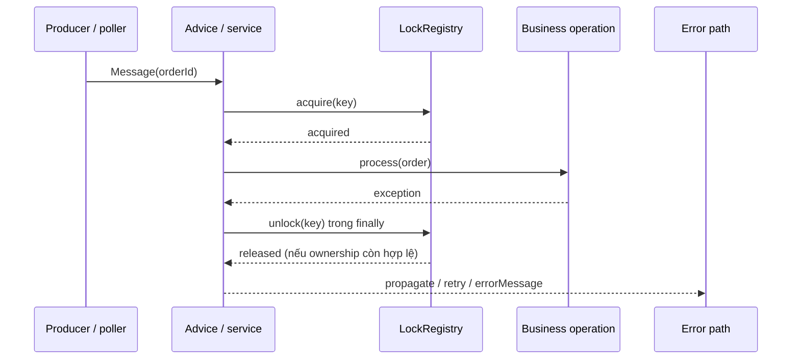
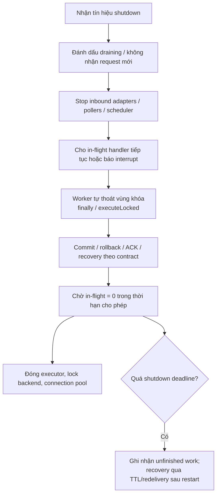
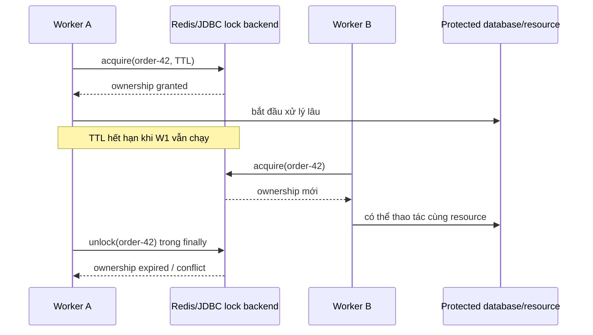
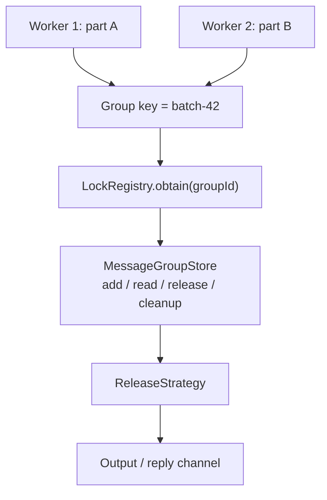

# Giải phóng lock khi exception hoặc shutdown trong Spring Integration

## 1. Mục tiêu và bối cảnh runtime

Trong **Spring Integration Runtime**, nhiều message có thể được xử lý song song qua `DirectChannel`, `ExecutorChannel`, consumer endpoint, poller và những `IntegrationFlow` hoạt động đồng thời. Một số message cùng thao tác lên một tài nguyên chung: message group của aggregator, trạng thái đơn hàng, bản ghi offset hay job cần bảo đảm chỉ một thread/instance xử lý tại một thời điểm.

`LockRegistry` là abstraction Spring Integration dùng để lấy một `java.util.concurrent.locks.Lock` theo **lock key**. Khi có exception, timeout, shutdown hoặc mất kết nối tới lock backend, vòng đời lock phải được xử lý đúng: **không bỏ quên lock đang giữ, không giải phóng lock chưa sở hữu và không giả định lock đã được giải phóng chỉ vì ứng dụng nhận tín hiệu shutdown**.

Đó là chủ đề **Giải phóng lock khi exception hoặc shutdown**, thuộc chương **Lock registry** của module `SPRING_INTEGRATION_RUNTIME`. Bài học liên hệ việc vận hành message flow, lifecycle `IntegrationFlow`, transaction, retry, message store, error handling, correlation, threading, hiệu năng và trạng thái runtime.

**Sau bài này, bạn sẽ có thể:**

1. Viết đúng mẫu `lock → try → finally → unlock` và `tryLock` có timeout.
2. Sử dụng `LockRegistry.executeLocked()` (có từ Spring Integration 6.2) để giảm nguy cơ quên unlock.
3. Phân biệt lỗi nghiệp vụ, lỗi lấy lock, lỗi unlock và lỗi lease/TTL hết hạn.
4. Giải thích vì sao shutdown hook, `@PreDestroy` và `SmartLifecycle.stop()` không thể thay việc mỗi worker tự unlock.
5. Thiết kế graceful shutdown trong flow có consumer, executor, aggregator và persistent `MessageGroupStore`.
6. Quan sát lock contention, xử lý distributed lock không còn sở hữu, và kiểm thử exception, interruption, forced termination.

**Phiên bản tham chiếu:** Spring Integration **6.5.x**, Java 17+, Spring Framework 6.x. Cần đối chiếu phiên bản triển khai khi dùng `RedisLockRegistry`/`JdbcLockRegistry` vì hành vi TTL, renewal và exception đã có thay đổi qua các bản phát hành.

## 2. LockRegistry là registry của khóa, không phải transaction manager

### 2.1. Hợp đồng cơ bản

```java
import java.util.concurrent.locks.Lock;
import org.springframework.integration.support.locks.LockRegistry;

LockRegistry registry = ...;
Object key = "orders:tenant-A:42";

Lock lock = registry.obtain(key); // lấy đối tượng Lock gắn với key
lock.lock();                      // mới là thao tác chiếm lock
try {
    // Chỉ một chủ sở hữu hợp lệ được vào critical section.
}
finally {
    lock.unlock();                // giải phóng bởi thread đang sở hữu
}
```

`obtain(key)` **không đồng nghĩa đã chiếm lock**. Nó lấy `Lock` tương ứng với key. Chỉ sau khi `lock.lock()`, `lock.lockInterruptibly()` hoặc `lock.tryLock(...)` thành công mới được xử lý vùng cần loại trừ tương hỗ.

`LockRegistry` không tự thực hiện:

- DB commit hoặc rollback.
- Broker acknowledgment/nack/requeue.
- Retry hay gửi `ErrorMessage` tới `errorChannel`.
- Message deduplication, correlation strategy hoặc group release.
- Điều phối đóng ứng dụng sao cho mọi tác vụ dở dang đều hoàn tất.
- Bảo đảm exactly-once qua nhiều tài nguyên.

Nó chỉ là **một cơ chế đồng bộ**. Các trách nhiệm kia thuộc endpoint/transaction manager, adapter, message store và hợp đồng nghiệp vụ.

### 2.2. Phân biệt acquire, release, expire và renewal

| Khái niệm | Ý nghĩa | Lưu ý |
|---|---|---|
| `obtain(key)` | Lấy đối tượng lock theo key | Chưa sở hữu lock |
| `lock()` | Chờ đến khi sở hữu | Có thể block lâu |
| `lockInterruptibly()` | Chờ lock nhưng có thể bị interrupt | Cần xử lý `InterruptedException` |
| `tryLock(wait, unit)` | Chờ tối đa một thời gian, trả boolean | Chỉ unlock khi trả `true` |
| `unlock()` | Chủ sở hữu kết thúc critical section | Phải nằm trong `finally` sau acquire thành công |
| Lease/TTL (distributed) | Thời hạn lock record ở backend | Có thể hết hạn **ngay khi thread vẫn chạy** |
| `renewLock(key)` | Gia hạn lease của lock đang sở hữu | Chỉ dùng với `RenewableLockRegistry` và đúng điều kiện sở hữu |
| `expireUnusedOlderThan(age)` | Dọn cache lock **không đang giữ** và lâu không dùng | **Không phải** phương án cưỡng bức unlock thread khác |

Hãy nhớ có **hai lớp trạng thái** khi dùng distributed lock: thread có thể nghĩ rằng mình đang ở trong critical section, nhưng key ở Redis/DB đã hết hạn và thread khác có thể đã lấy lock mới. Trong tình huống này, `unlock()` phát hiện mất ownership là **cảnh báo mất mutual exclusion**, không phải lỗi cleanup nhẹ.

### 2.3. DefaultLockRegistry dùng striped locks

`DefaultLockRegistry` là triển khai trong **một JVM**. Trong Spring Integration 6.5, constructor không tham số tạo **256 `ReentrantLock`**; khóa được chọn bằng cách mask `hashCode()` của key. Vì thế:

- Cùng key dùng cùng lock (trong registry instance đó).
- Hai key **khác nhau** vẫn có thể ánh xạ vào cùng stripe, khiến chúng chờ nhau mà **không bị gộp dữ liệu**.
- Không có coordination giữa hai JVM dù chúng dùng cùng tên key.
- Khi process kết thúc, các object lock trong RAM biến mất; đó **không phải một giao thức recovery** cho công việc nghiệp vụ.

```java
import org.springframework.integration.support.locks.DefaultLockRegistry;

LockRegistry localRegistry = new DefaultLockRegistry();        // 256 stripes
LockRegistry moreStripes = new DefaultLockRegistry(0x3ff);     // 1024 stripes
```

Không nhầm **hash collision trong striped locks** với **correlation key collision** của aggregator: lock contention có thể xảy ra với hai key khác nhau cùng stripe, còn correlation collision làm hai logical groups trả cùng key ngữ nghĩa và có thể trộn message.

## 3. Tại sao finally là bắt buộc?

### 3.1. Mẫu sai: unlock chỉ ở nhánh thành công

```java
Lock lock = registry.obtain(orderId);
lock.lock();

updateDatabase(orderId); // có thể throw RuntimeException

lock.unlock();            // bị bỏ qua khi updateDatabase() ném lỗi
```

Nếu method ném exception, `unlock()` không chạy. Với `ReentrantLock` cục bộ, các worker khác muốn cùng stripe sẽ đợi. Với distributed lock, key có thể tồn tại cho tới khi TTL hết hạn hoặc một cơ chế khác hợp lệ release; hệ thống có thể nghẽn kéo dài.

### 3.2. Mẫu đúng: mọi đường ra đều đi qua finally

```java
import java.util.concurrent.locks.Lock;

Lock lock = registry.obtain("order:" + orderId);
lock.lock();
try {
    updateDatabase(orderId);
    publishBusinessEvent(orderId);
}
finally {
    lock.unlock();
}
```

Với JDK `Lock`, `finally` vẫn chạy khi:

- Method `return` sớm.
- Business code ném exception được hoặc không được catch tại đây.
- Phương thức được interrupt và ném `InterruptedException` trong vùng protected.
- Một handler advice ném exception từ lời gọi downstream.

`finally` **không được bảo đảm chạy** khi JVM bị `SIGKILL`, process crash, `Runtime.halt()`, mất điện hay một số lỗi cấp hệ thống. Vì vậy distributed lock cần có TTL/lease và khả năng phục hồi sau process failure.

**Lưu ý:** `finally` gọi `unlock()` có thể **tự ném exception** (mất ownership, sai thread, backend unavailable). Khi cả business code lẫn unlock đều lỗi, exception trong `finally` có thể che lỗi gốc. Phải có logging/exception handling phù hợp mà không âm thầm bỏ qua lỗi unlock.

### 3.3. Chỉ unlock sau acquire thành công

Sai lầm hay gặp khi thêm timeout:

```java
Lock lock = registry.obtain(key);
try {
    if (!lock.tryLock(300, TimeUnit.MILLISECONDS)) {
        return false;
    }
    return process();
}
finally {
    lock.unlock(); // SAI nếu tryLock() trả false hoặc ném InterruptedException
}
```

Ở đây `finally` chạy ngay cả khi chưa acquire được lock, làm `unlock()` có thể ném `IllegalMonitorStateException` hoặc lỗi tương đương.

Phiên bản đúng:

```java
import java.util.concurrent.TimeUnit;
import java.util.concurrent.locks.Lock;

boolean acquired = false;
Lock lock = registry.obtain(key);

try {
    acquired = lock.tryLock(300, TimeUnit.MILLISECONDS);
    if (!acquired) {
        return false; // hết timeout, chưa vào critical section
    }

    process();
    return true;
}
catch (InterruptedException e) {
    Thread.currentThread().interrupt();
    return false;
}
finally {
    if (acquired) {
        lock.unlock();
    }
}
```

**Vì sao trả lại cờ interrupt?** `tryLock(timeout)` có thể ném `InterruptedException` khi thread đang chờ và clear interrupt status. `Thread.currentThread().interrupt()` khôi phục tín hiệu để vòng đời executor/shutdown ở tầng cao nhận biết yêu cầu dừng. Tùy hợp đồng xử lý message, có thể ném tiếp exception thay vì `return false`; đừng đánh đồng “đã bị interrupt” với “xử lý message thành công”.

Không gọi `unlock()` trên thread khác để “cứu” thread đang giữ lock. Với `ReentrantLock` và nhiều distributed lock implementation, thread ownership là điều kiện bắt buộc.

## 4. executeLocked(): API giúp cleanup an toàn hơn

Từ **Spring Integration 6.2**, `LockRegistry` cung cấp các overload `executeLocked()`. API lấy lock, chạy một `CheckedRunnable` hoặc `CheckedCallable`, rồi giải phóng lock kể cả khi callback có lỗi.

### 4.1. Không cần lặp lại finally

```java
import org.springframework.integration.support.locks.LockRegistry;

void updateOrder(LockRegistry registry, String orderId) throws Exception {
    registry.executeLocked("order:" + orderId, () -> {
        updateDatabase(orderId);
        publishBusinessEvent(orderId);
    });
}
```

Đoạn trên tương đương logic acquire và `unlock()` trong `finally` nhưng giảm rủi ro người lập trình quên cleanup. Nếu `updateDatabase` ném exception, callback kết thúc bất thường và API vẫn đi qua phần giải phóng lock.

Nếu callback cần trả kết quả:

```java
String result = registry.executeLocked("order:" + orderId, () -> {
    validateOrder(orderId);
    return "validated:" + orderId;
});
```

**Hợp đồng:** `executeLocked()` giúp đảm bảo cấu trúc release khi callback kết thúc, chứ **không thể** ngăn distributed TTL hết hạn, mất backend, thread treo vô hạn hoặc process bị kill.

### 4.2. Timeout acquire ở executeLocked

```java
import java.time.Duration;
import java.util.concurrent.TimeoutException;

try {
    registry.executeLocked(
            "order:" + orderId,
            Duration.ofMillis(500),
            () -> {
                updateDatabase(orderId);
            });
}
catch (TimeoutException timeout) {
    // Không acquire được trong 500 ms; chưa được phép xử lý nghiệp vụ.
    routeForRetryOrRecovery(orderId, timeout);
}
catch (InterruptedException interrupted) {
    Thread.currentThread().interrupt();
    throw interrupted;
}
```

Overload có `Duration` dùng semantics của `Lock.tryLock(long, TimeUnit)` và ném `TimeoutException` nếu hết thời gian. Đây là **timeout chờ lấy lock**, không phải timeout tổng của `updateDatabase()` hoặc một transaction.

`LockRegistry.executeLocked(key, runnable)` **không truyền Duration** dùng cơ chế acquire có thể interrupt (`lockInterruptibly()`). Khi cần kiểm soát thời gian chờ ở runtime, ưu tiên overload có Duration và có đường xử lý rõ nếu không lấy được khóa.

### 4.3. Không cần tự tạo shutdown unlock hook

Việc gọi `executeLocked` hoặc dùng `try/finally` **ngay quanh critical section** tốt hơn lưu `Lock` vào field toàn cục rồi hy vọng `@PreDestroy` sẽ unlock. Lock thường gắn với thread đang chạy, còn callback shutdown có thể chạy trên thread lifecycle khác.

Nếu có tác vụ dài, hãy thiết kế để tác vụ **tự kết thúc/đáp ứng interrupt**, giúp control flow quay về `finally`. Shutdown hook chỉ nên điều phối **ngừng nhận công việc, đợi hoàn tất và ghi nhận tình trạng**.

## 5. Lock trong service activator / handler advice

Từ **Spring Integration 6.5**, `LockRequestHandlerAdvice` giúp bao một handler bằng `LockRegistry.executeLocked()`. Nó tính lock key từ request message, có thể dùng callback, SpEL hoặc khóa tĩnh.

### 5.1. Cấu hình annotation-based

```java
import java.util.concurrent.atomic.AtomicInteger;

import org.springframework.context.annotation.Bean;
import org.springframework.context.annotation.Configuration;
import org.springframework.integration.annotation.ServiceActivator;
import org.springframework.integration.channel.DirectChannel;
import org.springframework.integration.config.EnableIntegration;
import org.springframework.integration.handler.advice.LockRequestHandlerAdvice;
import org.springframework.integration.support.locks.DefaultLockRegistry;
import org.springframework.integration.support.locks.LockRegistry;
import org.springframework.messaging.Message;
import org.springframework.messaging.MessageChannel;
import org.springframework.messaging.support.MessageBuilder;

@Configuration
@EnableIntegration
class LockAdviceConfig {

    @Bean("orders.input")
    MessageChannel input() {
        return new DirectChannel();
    }

    @Bean
    LockRegistry orderLockRegistry() {
        return new DefaultLockRegistry();
    }

    @Bean("orderLockAdvice")
    LockRequestHandlerAdvice orderLockAdvice(LockRegistry registry) {
        return new LockRequestHandlerAdvice(registry, message -> {
            Object tenant = message.getHeaders().get("tenantId");
            Object order = message.getHeaders().get("orderId");
            if (tenant == null || order == null) {
                throw new IllegalArgumentException("Missing lock identity");
            }
            return "order:" + tenant + ":" + order;
        });
    }

    @Bean
    OrderHandler orderHandler() {
        return new OrderHandler();
    }
}

class OrderHandler {

    private final AtomicInteger calls = new AtomicInteger();

    @ServiceActivator(
            inputChannel = "orders.input",
            adviceChain = "orderLockAdvice")
    public void handle(String orderId) {
        int number = calls.incrementAndGet();
        System.out.println("Handling " + orderId + ", call " + number);

        if (orderId.startsWith("FAIL")) {
            throw new IllegalStateException("Simulated service failure");
        }

        // Lời gọi chỉ được thực hiện khi advice đã lấy lock.
    }
}
```

`LockRequestHandlerAdvice` đã chịu trách nhiệm đặt lời gọi handler vào critical section. Handler **không cần tự gọi `unlock()`** một lần nữa. Ném exception từ handler không phải lý do bỏ qua release; advice phải trở về từ `executeLocked()` trong đường xử lý ngoại lệ.

**Điểm cần chú ý:** callback key không nên trả `null` vô tình. Theo tài liệu 6.5, nếu key là `null`, advice có thể xử lý **không khóa** hoặc gửi message tới `discardChannel` khi được cấu hình. Với nghiệp vụ bắt buộc khóa, nên **fail fast khi header thiếu** như ví dụ.

### 5.2. Khóa khác nhau có thể chạy song song

`LockRegistry` khóa theo **lock key**, vì thế hai order khác nhau thường có thể xử lý đồng thời. Tuy nhiên `DefaultLockRegistry` có **striped locks** nên hai key khác nhau có thể cùng stripe và phải chờ nhau dù không có xung đột nghiệp vụ. Điều này là một giới hạn hiệu năng, không phải dấu hiệu hai order bị trộn payload.

Với `DirectChannel`, handler/advice chạy trên thread đang gửi message (trừ khi flow chuyển sang async ở nơi khác). Với `ExecutorChannel`, lock được acquire trên worker thread. Nếu cùng key bị gửi ồ ạt, worker pool có thể bị chiếm bởi những thread **chờ lock** ngay cả khi CPU thấp.

### 5.3. Cân nhắc timeout và error path của advice

`LockRequestHandlerAdvice` hỗ trợ cấu hình `waitLockDuration`. Ví dụ theo reference 6.5:

```java
LockRequestHandlerAdvice advice =
        new LockRequestHandlerAdvice(registry,
                message -> message.getHeaders().get("orderId"));

advice.setWaitLockDurationExpressionString("'PT1s'");
```

Nếu không acquire trong thời gian đã chọn, lỗi timeout đi theo semantics của endpoint/advice chain; không coi message tự được retry hoặc lưu sang queue. Với `DirectChannel` đồng bộ, exception thường lan về producer; với poller/executor, có thể đi qua error handling tùy cấu hình.

**Không dùng lock key sai phạm vi:** `orderId` đơn lẻ có thể trùng giữa tenant, trong khi việc chặn song song theo một khóa quá thô có thể làm throughput giảm. Thiết kế khóa ổn định có namespace (tenant + business ID + stage nếu cần).

## 6. Exception, retry, transaction và thứ tự unlock

### 6.1. Một handler thất bại khi đang giữ lock



**Tách ba kết quả:**

1. **Business failed:** handler ném exception.
2. **Lock released:** vùng loại trừ tương hỗ đã được giải phóng, các request khác có thể tiếp tục.
3. **Message acknowledged/retried:** do adapter, transaction và retry advice quyết định.

Hai kết quả sau không được suy ra từ kết quả trước. Một lời gọi đã unlock có thể vẫn cần rollback, và một lời gọi bị error channel xử lý không đồng nghĩa backend đã release đúng lock.

### 6.2. Retry advice: khóa mỗi attempt hay cả chuỗi?

Giả sử một handler có cả `RequestHandlerRetryAdvice` và `LockRequestHandlerAdvice`:

```text
Hình A: Retry ngoài Lock
retry {
    lock {
        attempt-1
    }
    backoff
    lock {
        attempt-2
    }
}
→ mỗi attempt tự acquire/unlock, KHÔNG giữ lock khi backoff.

Hình B: Lock ngoài Retry
lock {
    attempt-1
    backoff
    attempt-2
}
→ giữ lock suốt backoff và nhiều attempts.
```

Lựa chọn có tác động:

| Lựa chọn | Ưu điểm | Rủi ro |
|---|---|---|
| Retry ngoài Lock | Ít giữ lock vô ích khi backoff; tăng concurrency | State có thể bị message khác sửa giữa hai attempts |
| Lock ngoài Retry | Toàn bộ nhóm attempts là một critical section | Dễ giữ lock lâu, tăng contention và có thể vượt TTL distributed |
| Poller-level retry ngoài handler-level lock | Bảo vệ đúng đoạn handler trong từng lần gọi | Retry toàn flow có thể lặp side effect upstream |

**Không áp dụng thứ tự mảng advice một cách máy móc:** Spring Integration có các loại `AbstractRequestHandlerAdvice` và `HandleMessageAdvice` với điểm bao khác nhau. Muốn đảm bảo ngữ nghĩa, instrument thời điểm acquire/release và đếm attempts trên phiên bản đang chạy.

### 6.3. Transaction: unlock phải phù hợp ranh giới commit

Một ví dụ dễ bị bỏ sót:

```text
BEGIN TRANSACTION
    lock
        UPDATE database
    unlock
COMMIT
```

Ở đây transaction commit **sau khi đã unlock**. Thread khác có thể acquire khóa và đọc state chưa commit hoặc gặp lock của database. Trong nghiệp vụ yêu cầu tuần tự hóa từ đầu transaction **đến lúc commit/rollback**, cách này có thể không đáp ứng mục tiêu.

Nếu thiết kế cho phép, chọn ranh giới:

```text
lock
    BEGIN TRANSACTION
       UPDATE database
    COMMIT / ROLLBACK
unlock
```

Ví dụ dùng `TransactionTemplate` trong phần đã acquire lock (mang tính minh họa về ordering):

```java
Lock lock = registry.obtain("order:" + orderId);
lock.lock();
try {
    transactionTemplate.executeWithoutResult(status -> {
        updateOrder(orderId);
        writeAuditRecord(orderId);
    }); // transaction hoàn tất trước khi ra khỏi vùng khóa
}
finally {
    lock.unlock();
}
```

Trong ứng dụng thực tế, độ bao transaction, việc persist message group, publish reply, broker ACK, và thread switch đều có semantics riêng. Không coi `LockRegistry` và `@Transactional` là một giao dịch phân tán. Nếu task chuyển sang executor/poller, transaction gắn thread của caller thường không tự đi theo.

**Ngoài ra:** đừng giữ lock trong khi chờ HTTP external API lâu hoặc backoff nếu không thật sự cần loại trừ trên toàn bước; đó là nguyên nhân gây timeout và làm mất lease trong distributed mode.

## 7. Shutdown: khác nhau giữa graceful stop và process crash

### 7.1. Shutdown không phải một lần unlock từ thread quản trị

Ở ứng dụng Spring, shutdown có thể được kích hoạt bởi:

- `ApplicationContext.close()`, ứng dụng hoàn tất bình thường.
- `SIGTERM` từ Kubernetes/container orchestrator trước khi pod bị thu hồi.
- Một thao tác stop của `SmartLifecycle` hoặc unregister `IntegrationFlow` động.
- Thread executor bị interrupt khi shutdown.
- Crash, OOM, mất nguồn hoặc `SIGKILL`.

**Chỉ các tình huống shutdown có phối hợp mới cho ứng dụng cơ hội chạy cleanup.** `SIGKILL`/process crash không thực thi Java `finally`, `@PreDestroy` hay shutdown hook một cách đáng tin cậy. Không có cơ chế Java nào bảo đảm release vật lý của distributed lock nếu process chết mà không liên lạc được với backend.

Với `ReentrantLock`, unlock phải do **chính thread giữ lock** thực hiện. Shutdown callback thường chạy trong thread lifecycle khác, nên mã dạng sau là sai:

```java
// KHÔNG LÀM: cleanup thread cố gỡ lock của worker.
@PreDestroy
void onShutdown() {
    sharedCurrentLock.unlock();
}
```

Hậu quả có thể là `IllegalMonitorStateException`, mất khả năng phối hợp với worker, hoặc phá hợp đồng distributed lock khi tùy tiện xóa key từ backend. Không giữ `Lock` vào một field toàn cục để cho shutdown thread cưỡng ép unlock.

### 7.2. Trình tự graceful shutdown đúng

Một quy trình thực tế:



Thứ tự ở mức thiết kế:

1. **Ngừng phát sinh message mới** từ inbound adapter, scheduler hoặc API ingress; với Kubernetes, cấu hình readiness/draining để load balancer không tiếp tục chuyển request vào pod.
2. **Ngừng poller/consumer** một cách phối hợp, không tắt tài nguyên DB/Redis trước khi những worker đã lấy lock kết thúc.
3. **Chờ in-flight tasks** trong một deadline hữu hạn phù hợp `terminationGracePeriodSeconds`/thời gian shutdown.
4. Để **mỗi worker tự chạy `finally`** và release lock trên đúng thread trước khi đóng kết nối lock backend.
5. Hoàn tất transaction hoặc đưa vào rollback/ACK/nack/requeue theo hợp đồng adapter và trạng thái nghiệp vụ.
6. Đóng executor, JDBC pool, Redis connection/scheduler và ApplicationContext theo phụ thuộc lifecycle.
7. Nếu deadline hết, **không giả định tất cả lock đã được release**; dựa trên TTL/lease, redelivery, idempotency và sự kiện recovery khi chạy lại.

Cần tùy biến thứ tự cho topology cụ thể. Một số adapter khi `stop()` sẽ ngừng nhận message mới nhưng vẫn để callback hiện tại chạy; những adapter khác có interrupt/cancellation semantics riêng. Test đúng adapter thay vì suy luận từ tên `stop`.

### 7.3. Executor shutdown và task đang giữ lock

Trong flow có `ExecutorChannel` hoặc polling consumer chạy trên `ThreadPoolTaskExecutor`, cấu hình executor có thể điều khiển việc chờ task hoàn thành:

```java
import org.springframework.context.annotation.Bean;
import org.springframework.scheduling.concurrent.ThreadPoolTaskExecutor;

@Bean
ThreadPoolTaskExecutor integrationExecutor() {
    ThreadPoolTaskExecutor executor = new ThreadPoolTaskExecutor();
    executor.setCorePoolSize(4);
    executor.setMaxPoolSize(8);
    executor.setQueueCapacity(100);

    // Cho tác vụ đã được nhận cơ hội hoàn thành khi executor shutdown.
    executor.setWaitForTasksToCompleteOnShutdown(true);
    executor.setAwaitTerminationSeconds(20);
    return executor;
}
```

Đây chỉ là cấu hình executor, **không tự dừng inbound producer**, không bảo đảm các lời gọi HTTP đang block sẽ hoàn tất trong 20 giây và không thay chính sách quản trị transaction/ACK. Nếu worker dùng `lock()` vô thời hạn, executor có thể treo khi shutdown; dùng `lockInterruptibly()`, `tryLock(timeout)` hoặc `executeLocked(key, Duration, ...)` tại nơi có thể cần cancellation/timeout.

**Đừng đặt `Thread.sleep()` dài trong critical section.** Nếu task bị interrupt, cleanup ở `finally` vẫn cần có cơ hội chạy, và nếu bạn bắt `InterruptedException` thì cần xử lý có chủ đích, thường khôi phục cờ interrupt.

### 7.4. @PreDestroy và ContextClosedEvent nên làm gì?

Các hook lifecycle thích hợp để **điều phối** shutdown:

- Đặt cờ draining.
- Ngừng lịch tạo task mới.
- Kích hoạt cancellation cooperative ở worker nếu được phép.
- Chờ bộ đếm in-flight hoàn thành.
- Ghi metrics/telemetry về tác vụ chưa hoàn tất.
- Đóng resources sau khi nghiệp vụ đã cleanup.

Chúng **không** thích hợp để unlock một khóa thuộc thread khác. Với `SmartLifecycle.stop(Runnable callback)`, đừng gọi callback báo “đã stop” trước khi các điều kiện dừng mà component cam kết thực sự hoàn tất. Cũng tránh block vô hạn trong callback làm toàn ApplicationContext không đóng được.

## 8. Distributed locks: TTL, mất ownership và unlock thất bại

### 8.1. Vì sao distributed lock có TTL?

`RedisLockRegistry` và `JdbcLockRegistry` cần tránh để một lock tồn tại vĩnh viễn khi node giữ lock chết. Vì vậy backend lưu một ownership record có **time-to-live** hoặc cơ chế expiry tương đương.

`RedisLockRegistry` trong dòng Spring Integration 6.5 mặc định có expiration **60 giây** nếu không cấu hình khác. `JdbcLockRegistry` sử dụng `LockRepository`, như `DefaultLockRepository`, và thuộc tính `timeToLive` để cho phép các node khác thu hồi ownership đã quá hạn.



Khi TTL hết hạn, **W1 đã mất quyền bảo vệ dữ liệu**, dù code W1 vẫn chạy. Nếu W2 vừa có quyền sở hữu mới, hai worker có thể cùng chạm resource; `finally` của W1 đến muộn không thể quay ngược thời gian để bảo đảm tính đúng đắn.

Từ Spring Integration **6.4**, tài liệu reference cho biết `RedisLockRegistry.RedisLock.unlock()` và `JdbcLockRegistry.JdbcLock.unlock()` có thể ném `ConcurrentModificationException` khi ownership đã hết hạn; một số Javadoc/phiên bản cũ mô tả `IllegalStateException`. Hãy kiểm tra **cause và backend/version thực tế**, không bắt một loại exception rồi giả định đã cleanup an toàn.

### 8.2. Phản ứng đúng khi unlock báo mất ownership

1. Ghi nhận lỗi **severity cao**: key (được mask nếu nhạy cảm), owner/process ID, thời điểm acquire, hold duration, backend, correlation/business ID.
2. Đánh dấu công việc có trạng thái **không chắc chắn**, vì mutation có thể xảy ra sau lúc lock đã mất.
3. Không tự xóa key Redis hoặc DB lock row bằng lệnh không kiểm tra owner. Bạn có thể xóa lock của **worker mới** đang hợp lệ.
4. Không retry vô hạn `unlock()` khi đã mất ownership. Không giả định unlock thành công chỉ vì DELETE trả về 0.
5. Kiểm tra side effect và transaction; nếu dữ liệu có nguy cơ bị đồng thời sửa, có thể cần **fencing token, optimistic concurrency/version check hoặc idempotency** ở hệ thống đích.
6. Cập nhật TTL/renewal và thời gian tối đa của critical section dựa trên SLO thật; kiểm thử chaos/GC pause/network partition.

Đây **khác** với sự cố thường gặp “lỡ quên `finally`”. Với lỗi hết hạn lease, **cleanup được gọi nhưng khóa đã không còn bảo vệ vùng critical section**.

### 8.3. Redis: renewal khi giữ lock lâu

Từ Spring Integration **6.4**, `RedisLockRegistry.setRenewalTaskScheduler()` hỗ trợ gia hạn lock định kỳ; khi cấu hình scheduler, registry tổ chức renewal cho lock đã được acquire đến khi unlock hoặc key bị xóa. Ví dụ phần cấu hình (module `spring-integration-redis`):

```java
import org.springframework.context.annotation.Bean;
import org.springframework.data.redis.connection.RedisConnectionFactory;
import org.springframework.integration.redis.util.RedisLockRegistry;
import org.springframework.scheduling.concurrent.ThreadPoolTaskScheduler;

@Bean
ThreadPoolTaskScheduler lockRenewalScheduler() {
    ThreadPoolTaskScheduler scheduler = new ThreadPoolTaskScheduler();
    scheduler.setPoolSize(2);
    scheduler.setThreadNamePrefix("lock-renew-");
    return scheduler;
}

@Bean
RedisLockRegistry redisLockRegistry(
        RedisConnectionFactory connectionFactory,
        ThreadPoolTaskScheduler lockRenewalScheduler) {

    RedisLockRegistry registry =
            new RedisLockRegistry(connectionFactory, "order-group", 120_000L);

    registry.setRenewalTaskScheduler(lockRenewalScheduler);
    return registry;
}
```

`120_000L` là lease/expiration ví dụ **120 giây**, không phải wait timeout của `tryLock()`. Renewal giảm khả năng hết TTL khi xử lý lâu, **nhưng không loại bỏ rủi ro** network outage, scheduler pause, GC stop-the-world hoặc Redis failover. Cần chọn TTL lớn hơn các khoảng pause dự kiến, cảnh báo khi renewal thất bại, và tránh critical section kéo dài tùy ý.

Nếu dự án dùng Spring Integration trước 6.4, không mặc định có API scheduler renewal; xem API/Javadoc đúng phiên bản.

### 8.4. JDBC: renewal phải được gọi theo hợp đồng thread

`JdbcLockRegistry` triển khai `RenewableLockRegistry` với:

```java
import org.springframework.integration.support.locks.RenewableLockRegistry;

RenewableLockRegistry renewable = jdbcLockRegistry;
renewable.renewLock("order:" + orderId);
```

`renewLock(key)` yêu cầu lock đang được **thread hiện tại** sở hữu. Vì vậy không thể tùy ý mở một scheduler thread mới rồi gọi renewal cho lock đang do worker khác giữ, trừ khi implementation/cơ chế hỗ trợ phù hợp. Nếu có một vòng công việc chia thành nhiều pha, renewal có thể được gọi từ **chính worker** sau mỗi pha, trong lúc vẫn ở critical section.

`DefaultLockRepository.timeToLive` cần đủ để chịu được thời gian xử lý và biến động DB/network nhưng cũng đủ ngắn để phục hồi sau node failure. Cần cấu hình schema, transaction manager và backend isolation phù hợp; `LockRegistry` không tự thay thế DB row version/unique constraint.

### 8.5. Local cache cleanup không phải cưỡng bức unlock

`ExpirableLockRegistry.expireUnusedOlderThan(age)` dùng để dọn **những lock cache entries đã lâu không sử dụng và hiện không bị khóa**. Nó không phải nút “release mọi lock” lúc shutdown.

Tương tự `setCacheCapacity(...)` của registry xử lý kích thước cache các lock objects, không phải số key sở hữu hợp lệ trong backend. Gọi eviction hoặc xóa cache không thể thay một giao thức unlock an toàn theo ownership.

## 9. Aggregator, MessageGroupStore và LockRegistry

### 9.1. Vì sao aggregator cần khóa?

Một `AggregatingMessageHandler` có thể nhận nhiều message cùng `correlationId` từ nhiều thread. Khi cập nhật `MessageGroup`, release hoặc expire, không nên để hai worker cùng sửa trạng thái nhóm mà không có cơ chế đồng bộ.



Trong Spring Integration 6.5, `AbstractMessageGroupStore` cũng hỗ trợ khóa thao tác metadata của group qua `LockRegistry`; mặc định là `DefaultLockRegistry`. Aggregator/resequencer có thể dùng registry của riêng endpoint để đồng bộ xử lý nhóm. Khi dùng **shared persistent store** qua nhiều JVM, hãy cấu hình phối hợp lock nhất quán với store, transaction và các endpoint đang truy cập cùng nhóm.

**Lưu ý ranh giới:** một JVM-local `DefaultLockRegistry` chỉ bảo vệ các thread dùng **cùng registry trong process**. Nếu hai pods dùng chung database store mà mỗi pod có local lock riêng, các lock không phối hợp giữa pods. Cần `JdbcLockRegistry`, `RedisLockRegistry` hoặc lựa chọn distributed khác được cấu hình đúng.

### 9.2. Tránh group lock bị giữ dài trong recovery

Giả sử aggregator giữ group lock khi gọi `ReleaseStrategy` hoặc thực hiện bước processing kéo dài, và handler ném exception. Nếu `finally` xử lý đúng, lock được release và flow có thể retry theo cấu hình. Nhưng các message vẫn có thể nằm trong group store nếu release chưa commit/rollback hoặc chưa hoàn tất.

Không coi **unlock = xóa message group**. Đây là ba trạng thái khác nhau:

| Trạng thái | Cần kiểm tra |
|---|---|
| Group lock được release | Thread khác có thể thử thao tác group |
| Message group đã complete hoặc expired | `MessageGroupStore` metadata/cleanup |
| Reply đã được phát và caller nhận | `outputChannel`, `replyChannel`, gateway timeout |

Khi shutdown xảy ra giữa lúc nhóm đang mutate:

- Với memory store, state trong heap biến mất khi process kết thúc.
- Với persistent store, dữ liệu có thể được giữ/rollback theo transaction.
- TTL distributed lock có thể cho instance khác tiếp quản sau failure, nhưng nghiệp vụ vẫn cần kiểm tra group state, duplication và late arrivals.

### 9.3. Lock key collision và deadlock

Nếu hai nhóm nghiệp vụ khác nhau cùng dùng group key (ví dụ chỉ `orderId` không có `tenantId`), lock có thể **serialize** truy cập của chúng nhưng dữ liệu vẫn bị **gom sai**; lock không sửa được correlation key collision.

Nếu một luồng phải lấy nhiều locks (`A` sau đó `B`), trong khi luồng khác lấy `B` rồi `A`, có nguy cơ deadlock:

```text
Thread 1: acquire(A) -> wait(B)
Thread 2: acquire(B) -> wait(A)
```

Biện pháp:

- Dùng quy tắc **thứ tự khóa toàn cục** (ví dụ sort theo key ổn định) cho mọi code path.
- Giảm nested locking, scope critical section nhỏ.
- Dùng timed `tryLock` và rollback/recovery khi timeout nếu hợp đồng cho phép.
- Quan sát lock hold time và thread dumps, không tự xóa distributed lock khi nghi deadlock.
- Với `DefaultLockRegistry`, nhiều key khác nhau có thể cùng stripe; nested locks cần kiểm tra nguy cơ contention và reentrancy.

## 10. Tình huống xử lý lỗi tổng hợp

| Sự kiện | Đã acquire? | Có phải unlock? | Hướng xử lý tiếp |
|---|---:|---:|---|
| Handler thành công | Có | Có, trong `finally` | Gửi reply/commit theo flow |
| Handler ném `RuntimeException` | Có | Có | Propagate, retry, error channel, rollback |
| Callback `executeLocked()` ném checked exception | Có | API tự unlock khi rời callback | Handler/caller xử lý exception |
| `tryLock()` timeout và trả `false` | Không | **Không** | Retry có backoff hoặc recovery |
| `tryLock()` bị interrupt trước acquire | Không | **Không** | Khôi phục interrupt/thoát |
| Thread bị interrupt **sau khi đã acquire** | Có | Có khi rời critical section | Dừng cooperative và xử lý message state |
| Worker ném `Error` hoặc method return sớm | Có | Java `finally` thường chạy | Tùy mức độ lỗi/transaction |
| Redis/JDBC lease hết hạn trong khi xử lý | Từng acquire nhưng **đã mất ownership** | Gọi cleanup có thể ném lỗi | Incident: state không chắc chắn, check data |
| JVM bị kill trước `finally` | Có khi còn chạy | Không thể thực hiện Java cleanup | TTL/lease, restart/reconcile/replay |
| Shutdown callback chạy ở thread khác | Không sở hữu lock worker | **Không unlock thay** | Stop/drain, đợi worker tự release |
| Consumer stop, group còn tồn trong persistent store | Không nhất thiết | Không liên quan trực tiếp | Điều phối release/expiry và redelivery |

## 11. Kiểm thử release lock khi exception: phải dùng thread khác

Một sai lầm trong test là kiểm tra `tryLock()` lại **trên chính thread vừa giữ khóa**. `ReentrantLock` có tính **reentrant**: thread đang giữ lock có thể acquire lại nó, cho nên phép thử cùng thread vẫn trả thành công ngay cả khi code đã quên unlock ở lần trước.

**Phép thử đúng** nên dùng một thread khác sau khi callback ném lỗi:

```java
import java.util.concurrent.*;
import java.util.concurrent.locks.Lock;

import org.springframework.integration.support.locks.DefaultLockRegistry;
import org.springframework.integration.support.locks.LockRegistry;

public class ExceptionUnlockDemo {

    private static void simulateFailure() {
        throw new IllegalStateException("Simulated processing failure");
    }

    public static void main(String[] args) throws Exception {
        LockRegistry registry = new DefaultLockRegistry();
        String key = "orders:A:42";

        try {
            registry.executeLocked(key, () -> {
                System.out.println("Critical section started");
                simulateFailure();
            });
            throw new AssertionError("Expected handler exception");
        }
        catch (IllegalStateException expected) {
            System.out.println("Handler failed; verify lock is released");
        }

        ExecutorService executor = Executors.newSingleThreadExecutor();
        try {
            Future<Boolean> secondThreadCanAcquire = executor.submit(() -> {
                Lock next = registry.obtain(key);
                boolean acquired = next.tryLock(1, TimeUnit.SECONDS);
                try {
                    return acquired;
                }
                finally {
                    if (acquired) {
                        next.unlock();
                    }
                }
            });

            boolean ok = secondThreadCanAcquire.get(2, TimeUnit.SECONDS);
            if (!ok) {
                throw new AssertionError("Lock was not released after exception");
            }
            System.out.println("PASS: Another thread acquired the lock");
        }
        finally {
            executor.shutdownNow();
        }
    }
}
```

Thử nghiệm này không cần Redis/DB, tập trung vào **hợp đồng giải phóng khi Java callback ném exception**. Nó không chứng minh rằng distributed lease vẫn còn khi xử lý lâu hoặc một backend network error được xử lý chính xác.

### 11.1. Test timeout và interrupted acquisition

Kiểm thử thêm:

- Worker A lấy lock và giữ đến khi test cho phép thả.
- Worker B thử `tryLock(100, MILLISECONDS)` với cùng key; kỳ vọng `false`.
- Đảm bảo B **không** gọi `unlock()` nếu đã timeout.
- Dùng `lockInterruptibly()` hoặc timed tryLock ở B; gửi `interrupt()` trong lúc chờ.
- Kiểm tra B thoát đúng, giữ lại interrupt status nếu contract yêu cầu; lock vẫn thuộc A.
- Khi A release, worker C có thể acquire.

Mẫu quản lý interrupt:

```java
Lock lock = registry.obtain(key);
boolean acquired = false;

try {
    acquired = lock.tryLock(500, TimeUnit.MILLISECONDS);
    if (!acquired) {
        throw new TimeoutException("Could not acquire " + key);
    }
    processMessage();
}
catch (InterruptedException interrupted) {
    Thread.currentThread().interrupt();
    throw interrupted;
}
finally {
    if (acquired) {
        lock.unlock();
    }
}
```

Nếu caller xử lý timeout bằng retry, đảm bảo retry **có giới hạn/backoff** và không phát lại một message đã có side effect khi trạng thái transaction chưa rõ.

### 11.2. Test shutdown graceful so với forced termination

**Graceful test:**

1. Tạo handler có critical section dùng `executeLocked`.
2. Cho handler dùng `CountDownLatch` để giữ công việc “in-flight”.
3. Gửi `ContextClosedEvent`/đóng ApplicationContext theo cơ chế vận hành và yêu cầu draining.
4. Giải phóng latch để handler hoàn tất.
5. Xác nhận handler thoát, release lock và executor shutdown mà không tạo message mới.
6. Cho instance hoặc thread khác acquire cùng key; xác minh không có duplicate side effect.

**Crash test (chỉ trong staging):**

1. Instance A lấy distributed lock và bắt đầu một side effect có business key có thể kiểm tra.
2. Giết instance A **không graceful**, ví dụ container bị terminate cưỡng bức.
3. Quan sát lock còn tồn tại ở backend trong một khoảng theo TTL; Java `finally` **không chạy**.
4. Sau khi lease hết hạn, instance B thử acquire. Xác nhận hệ thống có idempotency/recovery và không làm side effect trùng.
5. Nếu bật renewal, kiểm tra khi scheduler bị dừng/network mất kết nối trong khi critical section còn chạy.

Không thử `SIGKILL` hoặc TTL cực ngắn trực tiếp trên production khi dữ liệu chưa có phương án an toàn.

### 11.3. Test lease expiry giữa critical section

Một test lỗi thường chỉ xác minh rằng sau khi handler kết thúc thì lock không còn. Điều đó **không đủ** với distributed locking. Cần mô phỏng tình huống:

```text
A acquire(key, lease=2s)
A xử lý 5s, không renew
Lease của A hết hạn ở giây thứ 2
B acquire cùng key ở giây thứ 3
A vẫn xử lý ở giây 4
A gọi unlock ở giây 5 -> có thể báo mất ownership
```

Kỳ vọng trong test an toàn:

- Quan sát được sự kiện **ownership expired**.
- Không lặng lẽ ghi thành công giao dịch A nếu resource có thể đã bị B sửa.
- Có business idempotency/optimistic version hoặc cơ chế fencing nếu yêu cầu bảo đảm mạnh.
- Không xóa khóa B từ mã cleanup của A.
- Bản ghi incident/correlation đủ để xác minh dữ liệu và thực hiện reconciliation.

## 12. Giám sát lock contention và trạng thái shutdown

### 12.1. Những metric cần đo

| Chỉ số | Câu hỏi |
|---|---|
| `lock.acquire.duration` p50/p95/p99 | Thread mất bao lâu mới lấy được khóa? |
| `lock.hold.duration` p50/p95/p99/max | Critical section chạy bao lâu? Có gần/vượt TTL không? |
| `lock.acquire.timeout.count` | Có bao nhiêu message bị từ chối vì không lấy được khóa? |
| `lock.unlock.failure.count` | Cleanup có thất bại không? Root cause là gì? |
| `lock.lease.expired.count` | Có mất ownership khi đang xử lý không? |
| `lock.renewal.failure.count` | Scheduler/network/backend có ngăn gia hạn lease không? |
| `inflight.message.count` | Shutdown còn những handler nào đang chạy? |
| `executor.queue.depth`, active threads | Có worker bị giữ vì chờ lock không? |
| `poller.lag`, `group.age` | Message group bị nghẽn do lock hay thiếu parts? |
| `gateway.reply.timeout.count` | Caller đã bỏ cuộc trong lúc handler chờ lock? |
| `transaction.duration` | Có giữ lock quá lâu vì transaction/DB latency? |
| `retry/redelivery.count` | Lỗi acquire có gây retry storm không? |

Không mặc định mọi registry expose metric trực tiếp. Các chỉ số trên là **instrumentation đề xuất**: bạn có thể đo quanh `obtain`, `lock/tryLock`, `unlock`, interceptor hoặc dùng Micrometer/JFR/thread dumps tùy môi trường.

**Tránh metrics cardinality cao:** không dùng từng `orderId` hoặc nguyên văn lock key làm label của time series. Có thể log key đã mask/hashed và trace ID để điều tra, còn metrics chỉ nhóm theo endpoint, registry type, exception class, pod/instance và trạng thái.

### 12.2. Log acquire và unlock đúng cách

Một mẫu log có cấu trúc:

```text
event=lock_acquired
registry=redis
component=order-aggregator
keyHash=8fd1e2
instance=orders-pod-2
thread=worker-7
traceId=trace-42
waitMs=18

event=lock_release
registry=redis
component=order-aggregator
keyHash=8fd1e2
instance=orders-pod-2
thread=worker-7
holdMs=65
result=success
```

Với sự cố:

```text
event=lock_release_failed
registry=redis
component=order-aggregator
keyHash=8fd1e2
instance=orders-pod-2
thread=worker-7
holdMs=129000
error=ConcurrentModificationException
action=mark_inconsistent_and_reconcile
```

Các tên event/field này là **quy ước logging đề xuất**, không phải message được Spring Integration tự động ghi theo format trên. Nên dùng correlation ID, trace ID và business ID riêng biệt; mask khóa chứa thông tin khách hàng.

### 12.3. Khi có vẻ “treo lock”

Một thread dump cho `ReentrantLock` thường cho thấy worker đang đợi qua `AbstractQueuedSynchronizer`/park. Nhưng chỉ thấy nhiều thread `WAITING` không đủ để kết luận deadlock:

- Có thể một handler đang xử lý chậm trong critical section.
- Có thể nhiều key rơi vào **cùng stripe** của `DefaultLockRegistry`.
- Có thể Redis/JDBC acquire đang polling backend với độ trễ mạng.
- Có thể một lock do thread đang giữ đã bị leak vì thiếu `finally`.
- Có thể hai luồng giữ nhiều locks theo thứ tự ngược nhau.
- Có thể shutdown đã stop consumer nhưng còn worker đang chờ lock.

Dùng timestamp acquire/release, timeout counters, thread ownership, stack traces và metrics backend cùng lúc. Không giải quyết mọi trường hợp bằng cách tăng thread pool: thêm worker đang chờ lock chỉ làm tăng queue, memory và nguy cơ timeout.

## 13. Bảng chẩn đoán sự cố

| Triệu chứng | Nguyên nhân ưu tiên kiểm tra | Hành động |
|---|---|---|
| Chỉ lỗi khi handler ném exception | `unlock` không nằm trong `finally` | Bọc critical section đúng, ưu tiên `executeLocked` |
| `IllegalMonitorStateException` lúc cleanup | Unlock khi không acquire hoặc khác owner thread | Dùng boolean acquired; đừng unlock từ shutdown hook |
| Sau `tryLock` timeout vẫn có exception ở finally | Gọi unlock dù `tryLock` trả false | Chỉ unlock nếu acquired=true |
| Thread bị interrupt nhưng flow vẫn chạy | Code catch `InterruptedException` và bỏ qua | Khôi phục interrupt hoặc ném tiếp, dừng cooperative |
| Lock vẫn giữ khi `@PreDestroy` chạy | Worker còn in-flight, shutdown callback chạy thread khác | Draining và chờ worker tự kết thúc |
| Process bị kill mà vẫn thấy distributed lock | TTL chưa hết | Chờ recovery theo lease; không xóa mù |
| Redis/JDBC unlock báo `ConcurrentModificationException` | Lease hết hạn, owner khác đã tiếp quản | Incident: kiểm tra state, tăng TTL/renewal khi phù hợp |
| Nhiều worker chờ lock dù keys khác nhau | `DefaultLockRegistry` striped hash collision | Đo contention; tăng stripes nếu phù hợp và đo lại |
| Hai pods cùng sửa group dù có lock | Dùng `DefaultLockRegistry` cục bộ với store shared | Dùng distributed registry/lock scope đúng |
| Group vẫn chờ sau khi unlock thành công | Group release/expiry chưa thỏa; lock không xóa message | Kiểm tra `ReleaseStrategy`, `MessageGroupStore` |
| Retry lặp vô hạn khi lock busy | Retry policy không có backoff/deadline | Retry có giới hạn hoặc điều tiết nguồn |
| Worker bị chặn lúc shutdown | `lock()` không interruptible, external call treo | Timed acquire, cancel cooperative, deadline |
| Một instance tiếp quản lock nhưng side effect bị lặp | Lease hết hạn/ACK và retry không idempotent | Fencing/version, idempotency, transaction boundary |
| Unlock thành công nhưng DB state bất thường | Unlock trước commit hoặc transaction độc lập | Xác minh lock–commit ordering và isolation |
| Lock cache memory tăng | Quá nhiều keys/cached lock objects | Kiểm tra `setCacheCapacity`, cache cleanup, key cardinality |
| Có lỗi trên error channel nhưng lock chưa chắc released | Error handling độc lập với cleanup | Kiểm tra đường `finally`, TTL, ownership và in-flight |

**Quy trình điều tra theo thứ tự:**

1. Xác định **registry type**: Default, Redis, JDBC hay backend khác; version, TTL, renewal, cache.
2. Tìm **lock key** và scope (tenant/order/groupId/flow); có shared backend và key namespace đúng không?
3. Xác định call path acquire/tryLock và có **unlock đúng một lần trên mỗi mức acquire** hay không.
4. Đối chiếu exception nghiệp vụ với exception acquire/unlock; kiểm tra liệu cleanup có che mất lỗi gốc.
5. Đọc thread dump, acquire/hold latency, executor/poller backlog và shutdown timeline.
6. Nếu distributed, kiểm tra TTL hết hạn, ownership thay đổi, backend timeout/failover và renewal.
7. Đối chiếu DB commit/rollback, message store, ACK/redelivery, retry và trạng thái reply.
8. Sau khi xác định nguyên nhân, sửa cả **độ an toàn dữ liệu** (idempotency/version) và **độ ổn định** (timeout, TTL, graceful shutdown).

## 14. Bài tập thực hành

### Bài 1 — Chứng minh finally chạy khi exception

Chạy `ExceptionUnlockDemo` ở mục 11. Sửa cố ý thành mẫu thiếu `finally` rồi dùng thread thứ hai kiểm tra việc lấy khóa. Giải thích vì sao test cùng thread có thể cho kết quả sai vì `ReentrantLock` reentrant.

### Bài 2 — Timeout và interrupted acquisition

Giữ lock bằng thread A, cho thread B gọi `tryLock(200, MILLISECONDS)`. Kiểm tra B timeout và **không unlock**. Lặp lại với `lockInterruptibly()` và gửi interrupt đến B. Quan sát trạng thái thread và exception.

### Bài 3 — Handler advice trên hai message cùng key

Gắn `LockRequestHandlerAdvice` với callback lấy `orderId` và thêm `tenantId`. Gửi song song hai messages cùng key, log thời điểm vào/ra handler. Xác nhận critical sections không chồng nhau. Gửi messages khác key và quan sát có thể chạy đồng thời nếu không rơi vào cùng stripe.

### Bài 4 — Retry, backoff và lock hold duration

Kết hợp `RequestHandlerRetryAdvice` và `LockRequestHandlerAdvice`. Tạo handler thất bại hai lần rồi thành công. Đảo thứ tự advice, đo số lần acquire và thời gian hold lock. Chọn cách phù hợp với tính nhất quán của nghiệp vụ.

### Bài 5 — Graceful shutdown

Cho handler giữ lock 2 giây, gửi tín hiệu đóng ApplicationContext trước khi handler kết thúc. Thiết kế draining, chờ in-flight, bảo đảm worker tự unlock; thử cấu hình `ThreadPoolTaskExecutor` và kiểm tra không accept message mới sau thời điểm stop.

### Bài 6 — Distributed lease hết hạn

Trong staging, chọn TTL ngắn và task dài hơn TTL, tắt renewal để quan sát expiry. Cho hai instance cùng thử chiếm key. Xác nhận tình huống mất ownership được phát hiện và **không** dùng cleanup để xóa lock mới của instance khác.

### Bài 7 — Aggregator và shared store

Tạo aggregator lưu group vào `JdbcMessageStore` hoặc store shared tương ứng, chạy hai instances. Thử với local `DefaultLockRegistry` rồi cấu hình distributed `JdbcLockRegistry`/`RedisLockRegistry` đúng scope. Quan sát thông lượng, group consistency và transaction boundary. Không thử trên dữ liệu production.

### Bài 8 — Incident sau khi unlock báo ownership expired

Giả định worker A gửi giao dịch thành công, mất Redis lease, worker B đã tiếp quản và A phát hiện `ConcurrentModificationException` tại `unlock()`. Thiết kế quy trình đối soát để biết giao dịch đã được ghi nhận chưa, tránh xử lý lại trùng, và đưa trace vào alert.

## 15. Checklist thiết kế và vận hành

- **Acquire đúng:** phân biệt `obtain()` và `lock()/tryLock()`; timeout phải có đường xử lý rõ.
- **Unlock đúng:** chỉ sau acquire thành công, trên đúng owner thread, trong `finally` hoặc `executeLocked()`.
- **Không che lỗi:** phân biệt exception nghiệp vụ và exception khi release; mất ownership là cảnh báo nghiêm trọng.
- **Shutdown đúng:** ngừng nhận message, chờ worker thoát critical section và đóng lock backend sau cùng.
- **Không mong phép màu khi crash:** Java cleanup không chạy sau `SIGKILL`; dùng TTL, durable state, redelivery và idempotency.
- **Tính TTL/renewal:** critical section không được vô tình lâu hơn lease; renewal có giới hạn khi network/GC pause.
- **Key ổn định, scope đúng:** tenant/groupId/stage rõ ràng; đừng dùng lock để vá correlation key collision.
- **Store và registry phù hợp:** local lock cho một JVM; distributed lock khi cùng persistent state được chia sẻ qua pods.
- **Transaction order đúng:** hiểu thời điểm commit/rollback so với unlock.
- **Retry có giới hạn:** tránh giữ lock qua backoff không cần thiết hoặc retry storm lúc lock busy.
- **Theo dõi thực tế:** acquire/hold p99, contention, unlock failures, lease-expired, queue backlog, late reply.
- **Test có thread khác:** chứng minh release bằng cross-thread acquire, thêm shutdown và chaos tests cho distributed mode.

**Tóm lại:** `LockRegistry` giúp đồng bộ hóa thao tác theo key, nhưng tính an toàn phụ thuộc vào **vòng đời acquisition–ownership–release**. `finally` và `executeLocked()` giải quyết lỗi cleanup thông thường; còn shutdown, distributed TTL, transaction và message redelivery cần một thiết kế runtime riêng để tránh mất quyền sở hữu hoặc xử lý trùng.

## 16. Tài liệu tham khảo chính thức

- [Spring Integration 6.5 — LockRegistry Javadoc](https://docs.spring.io/spring-integration/docs/6.5.0/api/org/springframework/integration/support/locks/LockRegistry.html): `obtain()`, `executeLocked()`, checked callbacks, `TimeoutException`.
- [Spring Integration 6.5 — DefaultLockRegistry Javadoc](https://docs.spring.io/spring-integration/docs/6.5.0/api/org/springframework/integration/support/locks/DefaultLockRegistry.html): striped `ReentrantLock`, default 256 stripes, mask.
- [Spring Integration 6.5 — Lock Advice](https://docs.spring.io/spring-integration/reference/6.5/handler-advice/lock.html): `LockRequestHandlerAdvice`, lock key callback, `waitLockDuration` và `discardChannel`.
- [Spring Integration 6.5 — Redis Support: Redis Lock Registry](https://docs.spring.io/spring-integration/reference/6.5/redis.html): TTL mặc định, expiry, renewal, loss-of-ownership và cache cleanup.
- [Spring Integration 6.5 — JDBC Lock Registry](https://docs.spring.io/spring-integration/reference/6.5/jdbc/lock-registry.html): `DefaultLockRepository`, TTL, `renewLock()` và ownership errors.
- [Spring Integration 6.5 — RenewableLockRegistry Javadoc](https://docs.spring.io/spring-integration/docs/6.5.0/api/org/springframework/integration/support/locks/RenewableLockRegistry.html): yêu cầu thread ownership và `setRenewalTaskScheduler()`.
- [Spring Integration — Message Store](https://docs.spring.io/spring-integration/reference/6.5/message-store.html): `MessageGroupStore` và locking group metadata.
- [Java 17 — java.util.concurrent.locks.Lock](https://docs.oracle.com/en/java/javase/17/docs/api/java.base/java/util/concurrent/locks/Lock.html): `lock()`, `lockInterruptibly()`, `tryLock()`, `unlock()`.
