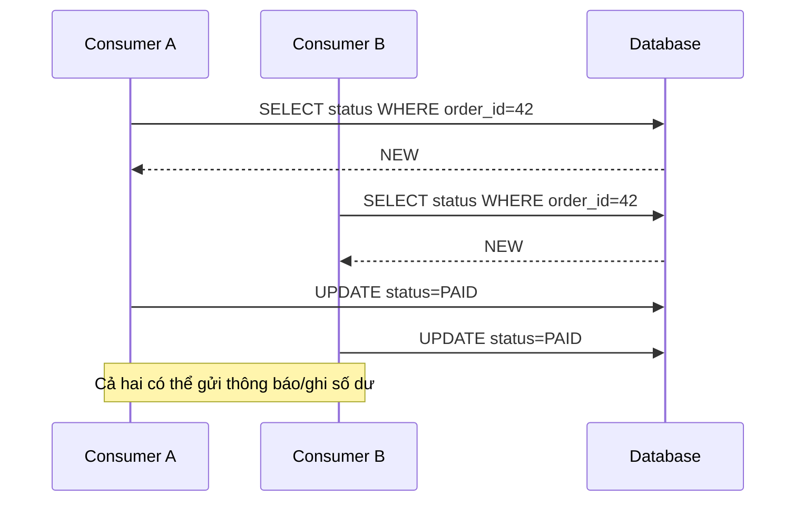
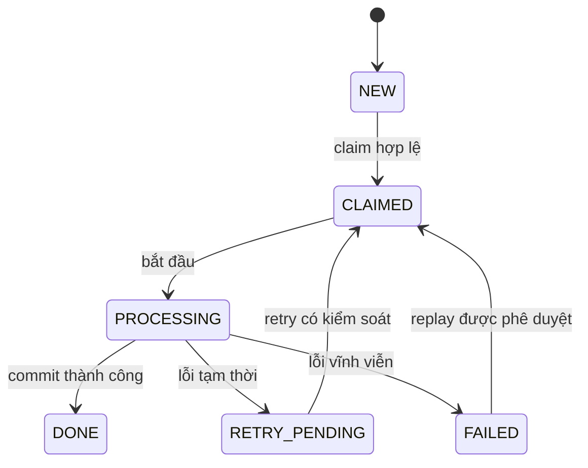
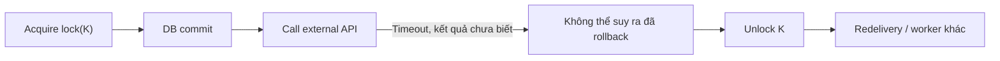
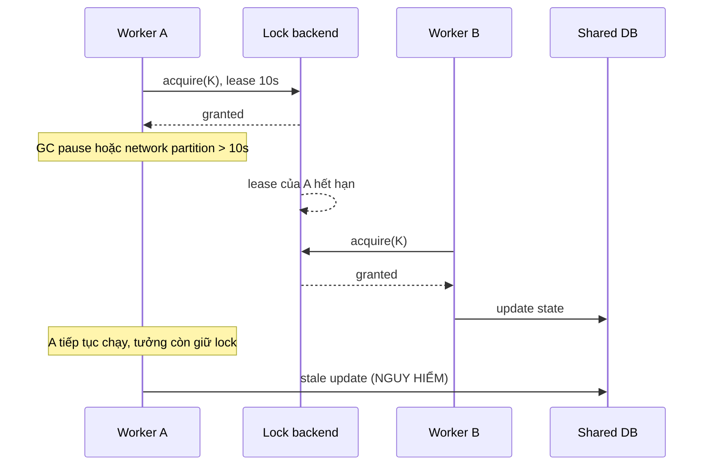
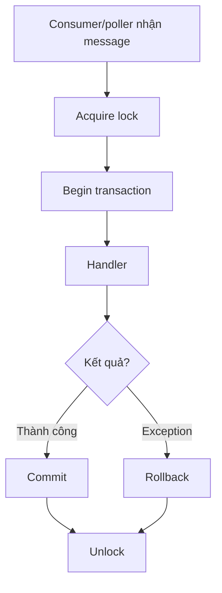
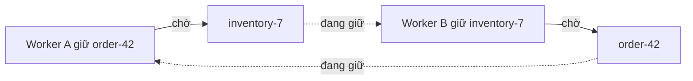
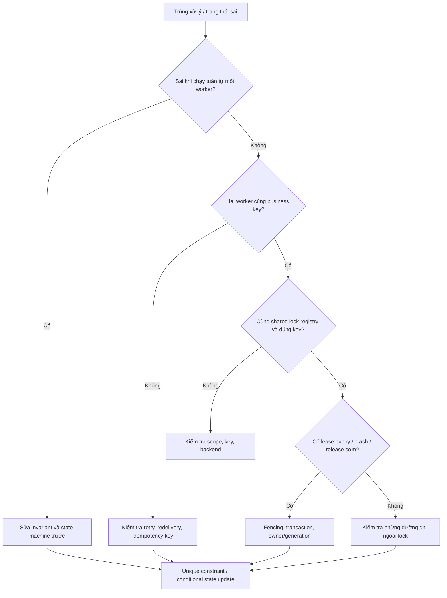

# Không dùng lock để che giấu thiết kế state sai

Trong **Spring Integration runtime**, nhiều consumer, poller, executor hoặc nhiều instance ứng dụng có thể cùng xử lý message liên quan tới một đơn hàng, một khóa correlation hoặc một bản ghi công việc. `LockRegistry` giúp điều phối **quyền truy cập đồng thời** vào một tài nguyên theo khóa. Nhưng nó **không sửa được mô hình trạng thái nghiệp vụ sai**: khóa xong mà đánh dấu `DONE` quá sớm, không lưu trạng thái qua crash, dùng ID không ổn định, hay gọi API ngoài không idempotent thì dữ liệu vẫn có thể bị mất hoặc xử lý trùng.

Bài thuộc chương **Lock registry** của module `SPRING_INTEGRATION_RUNTIME`. Trọng tâm là phân biệt *mutual exclusion* với *state correctness*, nhận diện các anti-pattern lấy lock để che vấn đề về state, và thiết kế một message flow có **invariant**, **state transition nguyên tử**, **transaction**, **retry/redelivery**, **recovery**, **message store**, **correlation** và khả năng chẩn đoán khi vận hành.

## 1. Lock trả lời câu hỏi gì — và không trả lời câu hỏi gì?

Một lock theo khóa `K` thường chỉ nói: **“Tại một thời điểm, trong phạm vi lock registry đang bảo đảm, một holder được quyền vào critical section cho `K`.”** Nó không trả lời “công việc đã hoàn thành chưa?”.

| Câu hỏi | Lock có giải quyết trực tiếp? | Cần thêm gì? |
| --- | --- | --- |
| Hai thread cùng JVM có cùng sửa dữ liệu ở critical section không? | Có thể, nếu dùng chung lock và đúng scope | Kiểm soát mọi đường truy cập state |
| Hai instance cùng nhận một message nghiệp vụ có trùng tác dụng phụ không? | Chưa đủ | Lock phân tán **và/hoặc** idempotency bền vững |
| Sau crash, hệ thống biết việc đang làm đã commit hay chưa? | Không | DB state, transaction, recovery record |
| Nghiệp vụ không chuyển từ `DONE` về `PROCESSING` sai luật? | Không | State machine và điều kiện cập nhật nguyên tử |
| Transaction database có rollback cùng thao tác gọi HTTP không? | Không | Idempotency key/outbox/đối soát |
| Message được redeliver có bị xử lý trùng không? | Không tự bảo đảm | Inbox/unique constraint, idempotent receiver |
| Lock hết hạn nhưng worker cũ vẫn chạy thì sao? | Không tự ngăn side effect | Fencing/version check tại tài nguyên được bảo vệ |
| Hai message mang sai correlation key bị trộn nhóm? | Không | Thiết kế correlation/group identity đúng |

**Nguyên tắc:** dùng lock để giảm cạnh tranh hoặc bảo vệ một critical section thật sự; **không dùng lock thay cho ràng buộc dữ liệu**. Ràng buộc cuối cùng nên được kiểm tra tại nơi lưu authoritative state: transaction database, unique constraint, conditional update hoặc dịch vụ đích hỗ trợ idempotency.

## 2. Tình huống điển hình: nhận hai lần cùng một đơn hàng

Giả sử một nguồn có thể redeliver `OrderPaid(orderId=42, eventId=E-42)`. Hai consumer chạy song song:



Một bản sửa hời hợt là bọc `SELECT → UPDATE` bằng lock trên `"order:42"`. Nếu cả hai consumer thật sự dùng chung registry và lock hoạt động tốt, chúng có thể chạy tuần tự. Nhưng sau đó vẫn còn các câu hỏi:

- Worker A có thể đã ghi DB xong rồi crash trước khi gửi acknowledgement.
- Worker B nhận lại event sau khi A đã `unlock()`.
- Code quên kiểm tra `DONE` sau khi lấy lock, nên B vẫn thực hiện tác dụng phụ lần hai.
- Một đường xử lý khác cập nhật DB mà không sử dụng cùng lock.
- Trong cluster, mỗi node dùng `DefaultLockRegistry` riêng nên không có mutual exclusion giữa hai JVM.
- Khóa đang giữ hết lease; worker cũ vẫn tiếp tục gọi API dù worker mới đã lấy khóa.

**Cách sửa đúng** bắt đầu bằng câu hỏi: *“Bất biến nghiệp vụ nào phải luôn đúng, kể cả khi lock bị mất hoặc message lặp?”* Với ví dụ này: **một `eventId` chỉ được áp dụng vào business state tối đa một lần**, và đơn hàng không được chuyển trạng thái trái luật.

## 3. State correctness: định nghĩa invariant trước khi chọn lock

Một state machine đơn giản cho công việc xử lý:



Đây là **mô hình do ứng dụng thiết kế**, không phải các trạng thái do `LockRegistry` tự sinh.

| Invariant cần giữ | Cách thực thi đáng tin cậy |
| --- | --- |
| Chỉ một worker có quyền sở hữu phiên xử lý hiện hành | Claim nguyên tử theo job ID + owner/generation |
| `DONE` là kết quả đã commit, không phải “đã nhận message” | Đánh dấu `DONE` trong transaction cùng thay đổi business state |
| Một event không cộng tiền/trừ tồn kho hai lần | Unique business event key hoặc conditional update |
| Worker cũ không thể hoàn tất job sau khi đã mất quyền | Version/generation/fencing check tại khi ghi state |
| Job lỗi phải có đường xử lý lại | `RETRY_PENDING`/DLQ/quarantine và policy rõ |
| Group correlation không gom nhầm hai phiên công việc | Key có namespace, vòng đời và version phù hợp |

Một lock có thể là thành phần phụ trợ để giảm xung đột, nhưng **nguồn sự thật** về trạng thái phải có **dữ liệu bền vững và luật chuyển trạng thái được thực thi nguyên tử**.

## 4. Anti-pattern 1: “Có lock thì khỏi cần kiểm tra lại state”

```java
// MÃ SAI VỀ NGHIỆP VỤ — đừng dùng trong production.
Lock lock = registry.obtain("order:" + orderId);
lock.lock();
try {
    paymentGateway.capture(orderId);   // Có thể gọi lại sau redelivery
    orderRepository.markPaid(orderId); // Không có điều kiện chuyển trạng thái
}
finally {
    lock.unlock();
}
```

Lock chỉ đảm bảo hai caller được xếp hàng, **không nhớ rằng request trước đã hoàn tất**. Sau lần A `unlock`, lần B lấy lock được và gọi lại payment gateway.

Ngay cả khi thêm `if (!orderRepository.isPaid(...))`, vẫn có vấn đề:

1. Nếu `isPaid` đọc state chưa commit ở transaction khác, kết quả không đáng tin.
2. Nếu một đường code không khóa, có thể cập nhật state ngoài ý muốn.
3. Nếu gọi payment API trước khi ghi `PAID`, crash ở giữa tạo **kết quả bên ngoài không rõ**.
4. Nếu ghi `PAID` trước khi gọi API, crash có thể tạo **state giả thành công**.

**Hướng sửa:** dùng business idempotency key `paymentRequestId` với API đích; ghi trạng thái bằng transaction/conditional update và đối soát trường hợp outcome không rõ. Lock không thay thế được giao thức đó.

## 5. Anti-pattern 2: “Lock bao cả luồng, vậy mọi bước đều atomic”

```text
lock(K)
  -> receive message
  -> update DB
  -> HTTP call
  -> publish event
unlock(K)
```

Một critical section lớn có thể ngăn worker khác dùng cùng key nhưng **không biến ba tài nguyên thành một transaction nguyên tử**. DB commit thành công, HTTP timeout và publish event thất bại vẫn có thể xảy ra, dù suốt thời gian đó chỉ một worker giữ lock.



Giải pháp thường gồm **transaction ngắn** cho DB, **outbox** để phát event sau commit, **inbox/idempotency key** cho consumer và **trạng thái đối soát** cho thao tác bên ngoài. Nếu cần phân tán transaction thực sự, phải phân tích chi phí và tính khả thi của phối hợp giao dịch; lock không phải thay thế cho XA/JTA.

## 6. LockRegistry trong Spring Integration

Spring Integration cung cấp giao diện `org.springframework.integration.support.locks.LockRegistry`:

```java
// Trích yếu hợp đồng sử dụng.
Lock lock = lockRegistry.obtain(lockKey); // java.util.concurrent.locks.Lock
lock.lock();
try {
    // Critical section
}
finally {
    lock.unlock();
}
```

Một số implementation thường gặp:

| Registry | Phạm vi chính | Cần lưu ý |
| --- | --- | --- |
| `DefaultLockRegistry` | Đồng bộ các thread **cùng JVM** chia sẻ registry | Không bảo vệ các instance/JVM khác |
| `JdbcLockRegistry` | Khóa phối hợp qua database với `LockRepository` | Schema/repository, kết nối, lease/timeout và semantics của phiên bản |
| `RedisLockRegistry` | Khóa phân tán dựa trên Redis | TTL, mất kết nối, gia hạn lease, unlock và tính sẵn sàng |
| Các implementation khác | Phụ thuộc backend/dịch vụ khóa | Luôn xác minh consistency, lease và failure semantics |

Không nên đổi từ `DefaultLockRegistry` sang registry phân tán rồi kết luận hệ thống đã đạt “exactly once”. Các implementation có đặc tính khác nhau về **khóa hết hạn**, **tái nhập (reentrant)**, **gia hạn**, **thao tác unlock** và **khôi phục khi kết nối lỗi**.

Tùy endpoint, Spring Integration có thể đã dùng lock để bảo vệ **message group/store** hoặc phối hợp các thành phần tương quan. Đặt thêm lock ngoài mà không biết nội bộ sử dụng khóa gì có thể tăng contention hoặc gây deadlock nếu thứ tự lấy khóa không nhất quán.

## 7. Ví dụ Java: lock cục bộ + transaction/idempotency bền vững

Ví dụ sau minh họa cách chia trách nhiệm:

1. `DefaultLockRegistry` giảm cạnh tranh giữa thread cùng JVM theo `orderId`.
2. Dịch vụ transaction dùng **unique `event_id`** để bảo đảm một event không áp dụng lại vào cùng business DB.
3. Phương thức được gọi qua **Spring bean riêng** để annotation `@Transactional` thực sự nằm dưới Spring transaction proxy; transaction hoàn tất trước khi bên ngoài release lock.
4. Khi không lấy được lock, **ném exception** để source/advice xử lý theo policy, không âm thầm nhận công việc rồi bỏ qua.

Giả sử bảng `orders(order_id, total_amount)` và `processed_event(event_id)` đã có schema thích hợp, `JdbcTemplate` và `PlatformTransactionManager` được cấu hình cho cùng database.

```java
import java.util.concurrent.TimeUnit;
import java.util.concurrent.locks.Lock;

import org.springframework.context.annotation.Bean;
import org.springframework.context.annotation.Configuration;
import org.springframework.integration.annotation.EnableIntegration;
import org.springframework.integration.annotation.ServiceActivator;
import org.springframework.integration.channel.DirectChannel;
import org.springframework.integration.support.locks.DefaultLockRegistry;
import org.springframework.integration.support.locks.LockRegistry;
import org.springframework.jdbc.core.JdbcTemplate;
import org.springframework.messaging.MessageChannel;
import org.springframework.stereotype.Service;
import org.springframework.transaction.annotation.Transactional;

record AddAmount(String eventId, String orderId, int amount) {}

@Configuration
@EnableIntegration
class OrderLockConfiguration {
    @Bean
    LockRegistry orderLockRegistry() {
        return new DefaultLockRegistry(); // Chỉ một JVM; dùng để minh họa.
    }

    @Bean
    MessageChannel orderCommands() {
        return new DirectChannel();
    }
}

@Service
class OrderCommandConsumer {
    private final LockRegistry locks;
    private final OrderTransactionalService service;

    OrderCommandConsumer(LockRegistry locks, OrderTransactionalService service) {
        this.locks = locks;
        this.service = service;
    }

    @ServiceActivator(inputChannel = "orderCommands")
    public void accept(AddAmount command) {
        Lock lock = locks.obtain("order:" + command.orderId());
        boolean acquired = false;
        try {
            acquired = lock.tryLock(2, TimeUnit.SECONDS);
            if (!acquired) {
                throw new IllegalStateException(
                        "Lock busy for order " + command.orderId());
            }
            service.applyOnce(command); // Commit/rollback diễn ra trong lời gọi này.
        }
        catch (InterruptedException ex) {
            Thread.currentThread().interrupt();
            throw new IllegalStateException("Interrupted while waiting for lock", ex);
        }
        finally {
            if (acquired) {
                lock.unlock();
            }
        }
    }
}

@Service
class OrderTransactionalService {
    private final JdbcTemplate jdbc;

    OrderTransactionalService(JdbcTemplate jdbc) {
        this.jdbc = jdbc;
    }

    @Transactional
    public void applyOnce(AddAmount cmd) {
        int inserted = jdbc.update(
                "INSERT INTO processed_event(event_id) " +
                "VALUES (?) ON CONFLICT (event_id) DO NOTHING",
                cmd.eventId());

        if (inserted == 0) {
            return; // Event đã được commit trước đó: duplicate.
        }

        int updated = jdbc.update(
                "UPDATE orders SET total_amount = total_amount + ? " +
                "WHERE order_id = ?",
                cmd.amount(), cmd.orderId());

        if (updated != 1) {
            // Rollback cả marker processed_event.
            throw new IllegalStateException("Order not found or not unique");
        }
    }
}
```

SQL `ON CONFLICT` là cú pháp **PostgreSQL**; với database khác cần cách tương đương. `processed_event.event_id` phải có unique constraint/primary key, và `orders.order_id` phải định danh đúng một bản ghi. Khi dùng connection pool/transaction manager sai nguồn, marker và cập nhật nghiệp vụ có thể không cùng transaction.

**Điểm cốt lõi:** nếu ứng dụng chạy nhiều instance và `DefaultLockRegistry` không phối hợp giữa node, **unique constraint và transaction vẫn bảo vệ bất biến “một event chỉ áp dụng một lần trong DB”**. Lock có thể giảm xung đột đồng thời, nhưng không phải rào chắn đúng sai cuối cùng.

### 7.1. Vì sao transaction nằm ở service bên trong?

Nếu đặt `@Transactional` trực tiếp trên `accept()`, transaction interceptor thường nằm **ngoài body của method**. Body `finally { unlock(); }` có thể chạy **trước khi transaction commit tại proxy**, nên worker khác có thể lấy lock khi giao dịch chưa kết thúc.

Trong ví dụ trên, `accept()` giữ lock rồi gọi một bean khác qua transaction proxy. `applyOnce()` commit/rollback trước khi trở về `accept()`; lúc ấy mới release lock. Đây là một lựa chọn thiết kế rõ boundary, nhưng vẫn phải test transaction propagation, timeout và exception trong ứng dụng thật.

Không gọi `@Transactional` method qua `this.applyOnce()` rồi nghĩ Spring tự intercept **self-invocation**. Với proxy-based transaction thông thường, gọi nội bộ trong cùng object có thể bỏ qua interceptor.

## 8. Khi nào dùng lock và khi nào không cần?

| Nhu cầu | Cách ưu tiên | Vai trò phù hợp của lock |
| --- | --- | --- |
| Một event chỉ cập nhật business DB một lần | Unique constraint/inbox trong DB transaction | Giảm cạnh tranh, không bắt buộc để bảo vệ invariant |
| Hai worker không cùng cập nhật một cache nội bộ phức tạp | Guard bằng lock cục bộ hoặc cơ chế concurrent collection | Bảo vệ critical section thật sự |
| Chỉ một node chạy scheduled job tại một thời điểm | Leader election/cluster coordination có lease | Một cơ chế coordination, vẫn cần idempotent job |
| Một order được xử lý tuần tự trong cluster | Partition theo order ID; conditional update | Lock theo order ID nếu buộc serialize |
| Trạng thái job có lease và crash recovery | Atomic claim + owner/generation + timeout | Có thể hỗ trợ giảm tranh chấp khi claim |
| Gửi HTTP/payment một lần dù retry | Idempotency key phía đích, outbox/đối soát | Không tạo atomicity cho external API |
| Nhóm aggregator không bị trộn hoặc release sai | Correlation strategy, release strategy, group store | Lock không sửa sai group key/sequence |
| Đảm bảo thứ tự output sau `ExecutorChannel` | Serial/partitioned processing theo key | Lock có thể serialize một đoạn, không khôi phục ordering toàn flow |

Nếu vấn đề được diễn đạt là “**state đổi sai dù mỗi lần chỉ có một thread**”, thường nguyên nhân là **thiết kế state hoặc boundary**. Đặt thêm lock sẽ không giải quyết lỗi vốn xuất hiện ngay trong thực thi tuần tự.

## 9. Anti-pattern 3: trạng thái chỉ ở RAM nhưng lock phân tán

```text
Node A                         Node B
  Redis lock(order-42)           Redis lock(order-42)
  localMap[order-42] = DONE      localMap[order-42] = NEW
```

Ngay cả khi chỉ một node giữ Redis lock tại một thời điểm, hai node vẫn có **hai bản sao state riêng**. Worker B lấy lock sau khi A release nhưng vẫn đọc `NEW` từ RAM và xử lý lại.

**Quy tắc:** lock có thể được dùng để phối hợp **truy cập vào một tài nguyên chung**; nếu dữ liệu nguồn không chung hoặc không nhất quán, thứ tự lấy lock không làm các bản sao local tự đồng bộ.

Với Spring Integration, `QueueChannel` trong RAM của mỗi instance và `SimpleMetadataStore`/message group store trong RAM cũng không tự trở thành cluster-safe nhờ thêm distributed lock. Nếu cần state bền vững và chia sẻ, chọn **store/queue/broker phù hợp**, thiết kế vùng khóa và chính sách transaction đồng bộ với state.

## 10. Anti-pattern 4: lấy lock theo khóa không khớp invariant

Ví dụ hai event cùng `orderId=42` nhưng `messageId` khác nhau:

```text
Message M1: messageId=f3... orderId=42
Message M2: messageId=9a... orderId=42

lock(messageId)  -> hai lock khác nhau -> không bảo vệ cùng order.
lock(orderId)    -> cùng vùng khóa -> có thể serialize truy cập order.
```

Khóa lock cần phản ánh **tài nguyên bị cạnh tranh**, không mặc định lấy từ message ID. Nhưng dùng khóa quá rộng cũng gây nghẽn:

- `lock("ALL_ORDERS")`: một đơn hàng chậm chặn toàn bộ đơn hàng khác.
- `lock("tenant:" + tenantId)`: hợp lý khi invariant ở cấp tenant; quá rộng nếu chỉ bảo vệ từng order.
- `lock("order:" + orderId)`: song song hóa theo order, nhưng không bảo vệ invariant chung như “số lượng đơn hàng toàn kho”.

Đối với aggregator/resequencer, correlation key chỉ phù hợp làm lock key khi **critical section thật sự thuộc group đó**. Nếu hai correlation IDs khác nhau vẫn cùng ghi một dòng tổng tồn kho, group lock không đủ bảo vệ invariant toàn kho.

### 10.1. Đặt namespace cho lock key

```text
orders:v1:tenant-7:42
inventory:v1:warehouse-2:sku-11
aggregation:v1:batch-2026-11-22-01
```

Namespace giúp tách các vùng state độc lập dùng chung registry, tránh trùng key vì hai domain tình cờ cùng có ID `42`. Không đưa token/password hoặc payload nhạy cảm vào key/log; chọn ID nghiệp vụ ổn định và an toàn.

## 11. Anti-pattern 5: lock lease hết hạn vẫn coi mình là owner

Với distributed lock có thời hạn, một tình huống phổ biến:



**Mất lock không tự dừng Java thread hoặc hoàn tác HTTP request đang chạy.** Một số backend hỗ trợ gia hạn lock, nhưng gia hạn có thể thất bại khi mạng lỗi/GC pause. Chỉ dựa vào lease để bảo vệ state là không đủ khi stale worker có thể tiếp tục tác động.

### 11.1. Fencing token / generation

Một biện pháp là cấp mỗi lần claim một **generation tăng đơn điệu** và yêu cầu tài nguyên được bảo vệ **từ chối operation mang generation cũ**. Ví dụ A giữ token `17`, sau đó B lấy token `18`; DB không cho A commit state khi token hiện hành là `18`.

```text
claim K -> generation=17 (A)
lease expires
claim K -> generation=18 (B)

B UPDATE ... WHERE generation=18 -> allowed
A UPDATE ... WHERE generation=17 -> rejected
```

**Đừng giả định `LockRegistry.obtain()` tự trả fencing token.** `LockRegistry` trả `Lock`; cơ chế generation/fencing là một thiết kế bổ sung ở store hoặc backend. Fencing cũng chỉ có tác dụng nếu **nơi nhận side effect thực sự kiểm tra token**. Một email provider hoặc payment gateway không hỗ trợ token này vẫn cần idempotency/đối soát riêng.

## 12. Mô hình atomic claim khi cần xử lý job bền vững

Nếu business state được quản lý trong DB, có thể dùng **conditional update** để claim job, thay vì cho rằng một distributed lock là nguồn sự thật. Ví dụ SQL mang tính minh họa (PostgreSQL):

```sql
-- Giả định:
-- work_item(id PK, state, owner, generation, lease_until)
-- State: NEW, RETRY_PENDING, PROCESSING, DONE, FAILED

UPDATE work_item
SET state = 'PROCESSING',
    owner = :workerId,
    generation = generation + 1,
    lease_until = CURRENT_TIMESTAMP + INTERVAL '30 seconds'
WHERE id = :jobId
  AND (
      state IN ('NEW', 'RETRY_PENDING')
      OR (state = 'PROCESSING' AND lease_until < CURRENT_TIMESTAMP)
  )
RETURNING generation;
```

- Có hàng trả về: worker nhận được **generation mới**.
- Không có hàng trả về: job không đủ điều kiện claim; **không** tự xử lý rồi coi như đã lấy được quyền.
- Khi hoàn tất, worker chỉ được đổi trạng thái với **owner + generation đang giữ**:

```sql
UPDATE work_item
SET state = 'DONE',
    lease_until = NULL
WHERE id = :jobId
  AND state = 'PROCESSING'
  AND owner = :workerId
  AND generation = :generation;
```

Kiểm tra **số hàng bị update phải bằng 1**. Nếu bằng 0, worker có thể đã mất quyền vì một worker khác claim lại. Đây là ví dụ state transition; muốn bảo vệ hoàn toàn khỏi stale worker, thao tác thay đổi **business state** cũng phải được kiểm soát theo generation hoặc gộp vào transaction/điều kiện update thích hợp — không chỉ kiểm tra token lúc ghi `DONE`.

### 12.1. Điểm chưa giải quyết chỉ bằng conditional claim

Một worker có thể hoàn thành cập nhật business DB rồi crash trước khi đánh dấu `DONE`; nếu hai bước không cùng transaction, job có thể được chạy lại. Vì vậy:

1. Lưu **inbox/event ID** với unique constraint để công việc có thể phát lại an toàn.
2. Gộp cập nhật nghiệp vụ và đánh dấu thành công vào **một transaction** khi cùng DB và phù hợp.
3. Với side effect ngoài DB, dùng **outbox/idempotency key** và trạng thái đối soát.
4. Định nghĩa xử lý lease timeout, retry tối đa và recovery record/DLQ.
5. Chấp nhận rằng lock/lease không tự thay thế hợp đồng delivery và acknowledgement của broker.

## 13. Lock, transaction và retry advice: thứ tự quyết định kết quả

Hai thứ không nên xem là tương đương:

```text
Lock( Transaction( handler ) )
Transaction( Lock( handler ) )
```

Với `Lock(Transaction(handler))`, lock được giữ trong lúc transaction bên trong commit/rollback, nếu transaction proxy thật sự tham gia như thiết kế. Với `Transaction(Lock(handler))`, lock có thể được release trước khi transaction bên ngoài commit. Thứ tự advice có thể dẫn đến sự khác biệt tương tự:



**Nhưng không phải cứ lấy lock trước transaction là đã đạt correctness:** những đường vào state khác có thể bỏ qua lock; lock có thể hết lease; transaction có thể chỉ bao phủ DB, không bao phủ message receive/ack hoặc HTTP. Hãy xác định phạm vi của từng advice và transaction manager thực sự.

### 13.1. Retry bên trong hay ngoài lock?

| Thứ tự khái niệm | Đặc điểm | Cần chú ý |
| --- | --- | --- |
| `Lock(Retry(handler))` | Giữ cùng lock qua các attempt và backoff | Cản consumer khác lâu; không thay thế idempotency |
| `Retry(Lock(handler))` | Mỗi attempt xin lock lại | Có thể giảm thời gian giữ, nhưng state thay đổi giữa attempts |
| `Lock(Transaction(handler))` | Lock sống qua commit nếu transaction nằm bên trong | Thời gian giữ khóa tùy duration transaction |
| `Transaction(Lock(handler))` | Lock có thể nhả trước commit bên ngoài | Race ở cửa sổ giữa unlock và commit |

Không dùng bảng này như một công thức cứng cho mọi `RequestHandlerRetryAdvice` hoặc `TransactionInterceptor`. Khi ở poller, transaction có thể bao quanh `receive()`; khi ở handler, nó chỉ bao quanh handler. Thứ tự và thread phải được xác nhận bằng trace và test tích hợp.

### 13.2. Không giữ lock trong backoff dài nếu không cần

Một retry 5 lần với backoff vài giây có thể khiến thread giữ lock rất lâu. Khi lock key quá rộng, throughput tụt mạnh và backlog trong `QueueChannel`/broker tăng. Có thể cần thiết kế queue partition theo key, retry delayed hoặc trạng thái `RETRY_PENDING` thay vì giữ cả lock lẫn thread để chờ.

## 14. Poller, executor và ranh giới bất đồng bộ

`LockRegistry` bảo vệ vùng được bọc bởi thread đang giữ khóa. Nếu lock được lấy trong poller nhưng handler thực tế chạy ở worker thread sau `ExecutorChannel`, lock có thể đã nhả khi handler bắt đầu:

```text
Poller thread:
  lock(K)
  receive() -> ExecutorChannel.send() -> accepted
  unlock(K)

Executor thread:
  handler(K) -> update state
```

Do đó, **đặt lock ở đúng đoạn đang sửa state**, không chỉ tại nơi message được chuyển giao. Với `DirectChannel` và handler đồng bộ, lời gọi có thể còn trong cùng thread; với `ExecutorChannel`/poller executor, phải kiểm tra đường chuyển thread cụ thể.

Một lock giữ trên thread A **không nên được unlock từ thread B** trừ khi implementation/hợp đồng cho phép rõ ràng. Đối với các `Lock` reentrant truyền thống, ownership thường gắn với thread; unlock sai thread có thể ném exception và phá logic cleanup.

Ngoài ra, không đồng nhất:

- “message đã `send()` vào executor” với “handler đã commit”;
- “poller giữ lock lúc lấy message” với “mọi downstream endpoint được bảo vệ”;
- “một lock theo correlation ID” với “thứ tự side effect sau fan-out luôn được bảo đảm”.

## 15. Lock không thay thế message store và correlation design

### 15.1. Queue và transaction

Nếu message ở `QueueChannel` trong RAM bị `receive()` lấy ra, handler thất bại rồi DB rollback, **lock không tự đưa message trở lại queue**. Muốn redelivery phải dùng source có semantics phù hợp (broker, transactional `JdbcChannelMessageStore` với poller transaction đúng phạm vi) hoặc durable recovery flow.

### 15.2. Aggregator, resequencer và message group

Nếu aggregator gộp nhầm hai order vì `correlationId` không đủ đặc hiệu, lock đúng group chỉ khiến việc **gộp sai diễn ra tuần tự**. Nếu release strategy chỉ đếm số message, duplicate do redelivery vẫn có thể làm release sớm. Cần:

- Correlation key đúng phạm vi và có namespace/version.
- `MessageGroupStore` phù hợp nếu cần bền vững.
- Release/expiry/late-arrival policy rõ ràng.
- Dedup theo business member key.

Một lock không thể biến chuỗi thiếu `sequenceNumber` thành có thứ tự, không biết khi nào phải release nhóm, và không quyết định được một trigger barrier đến muộn có hợp lệ không.

### 15.3. Accept-once và metadata store

`AcceptOnceFileListFilter` hoặc `MetadataStoreSelector` có thể ghi marker **ACCEPTED/CLAIMED** trước khi handler hoàn thành. Nếu chỉ đặt lock quanh đoạn ghi marker, vẫn có crash window sau marker nhưng trước commit nghiệp vụ. Không gọi marker `DONE` nếu nó chỉ xác nhận đã thấy message.

Một shared `ConcurrentMetadataStore` với `putIfAbsent` giúp claim nguyên tử trong phạm vi backend, nhưng bản thân nó không cung cấp transaction xuyên mọi tài nguyên hoặc replay sau crash. Hãy tách **claim** khỏi **completed**, dùng lease/recovery hoặc inbox bền vững khi cần.

## 16. Deadlock, lock ordering và phạm vi khóa

Một thiết kế sai có thể sinh deadlock dù mọi lock đều hoạt động đúng:

```text
Worker A: lock(order-42) -> chờ lock(inventory-7)
Worker B: lock(inventory-7) -> chờ lock(order-42)
```



Khi phải lấy nhiều lock, xác định **thứ tự toàn cục** như `inventory → order` hoặc sắp lock key theo thứ tự nhất quán. Dùng `tryLock(timeout)` và xử lý việc không lấy được khóa theo policy; **không nuốt timeout rồi trả success** khi công việc chưa được thực hiện.

Các lựa chọn khác:

- Giảm số lock bằng một transaction/conditional update trên authoritative store.
- Tách công việc thành từng bước bền vững, thay vì giữ nhiều khóa qua HTTP call.
- Tránh lấy lại lock từ callback bất đồng bộ trên thread khác.
- Đặt giới hạn hợp lý cho critical section và xác định đường interrupt/cancel.
- Không khóa toàn bộ tenant/cluster nếu invariant chỉ liên quan tới một order.

## 17. Xử lý khi không lấy được lock

`tryLock` thất bại là **một trạng thái điều phối**, không phải bằng chứng công việc đã được xử lý. Có ba đường hợp lệ tùy yêu cầu:

| Hành vi | Khi phù hợp | Điều bắt buộc |
| --- | --- | --- |
| Ném exception để source retry/redeliver | Message ở broker/store có redelivery đáng tin cậy | Không ack như success khi chưa xử lý; giới hạn retry |
| Ghi `RETRY_PENDING` và hẹn lại | Ứng dụng có durable job scheduler | Lưu payload/business key và lịch xử lý |
| Bỏ qua vì đã `DONE` | Đã đọc **authoritative committed state** chứng minh duplicate | Chỉ bỏ khi thật sự xử lý xong |

**Không nên:** `if (!lock.tryLock(...)) return;` rồi coi handler hoàn tất. Đối với nhiều adapter, return bình thường có thể khiến message được acknowledge và mất khỏi queue. Muốn bỏ qua, phải có căn cứ như inbox unique key cho biết nghiệp vụ đã được commit.

Khi thread chờ lock bị `InterruptedException`, cần khôi phục interrupt flag (`Thread.currentThread().interrupt()`) và chuyển lỗi ra policy xử lý thích hợp. Tránh swallow interrupt gây khó dừng poller, lifecycle endpoint hoặc executor.

## 18. Chẩn đoán runtime: lock contention hay state sai?

Khi service chậm hoặc xử lý trùng, trước tiên cần phân biệt ba loại sự cố:

1. **Concurrency conflict:** hai worker thật sự tranh cùng tài nguyên.
2. **Incorrect state transition:** chỉ một worker vẫn có thể cập nhật sai trạng thái.
3. **Delivery/recovery gap:** crash hoặc rollback làm message xuất hiện lại hay biến mất.



### 18.1. Các signal cần ghi log và metric

| Signal | Giải thích |
| --- | --- |
| `lockKey`, `lockRegistryType` | Đang khóa phạm vi nào, backend nào |
| `lockWaitDuration`, `lockHoldDuration` | Chờ lock hay xử lý bên trong kéo dài |
| `lockAcquired` / `lockTimeout` | Có lock contention hay không |
| `threadName`, instance ID | Có thread/instance chuyển giữa các bước |
| `businessKey`, `eventId`, `correlationId` | Liên kết retry/redelivery và dedup |
| Job `state`, `owner`, `generation` | Có stale worker hoặc chuyển trạng thái sai |
| `transactionBegin/Commit/Rollback` | Lock nhả trước hay sau commit |
| Broker delivery count, handler attempt count | Retry trong invocation hay redelivery nguồn |
| Inbox conflict count / duplicate skipped count | Idempotency có thực sự hoạt động |
| Queue depth, poller lag, executor saturation | Lock contention tạo backlog ở đâu |

Ghi log theo **business key ổn định**, không chỉ theo `MessageHeaders.ID`; message có thể được dựng lại với ID mới ở mỗi lần redelivery. Tránh log payload, secret hay token Redis/JDBC. Metric có nhãn khóa động theo từng order có thể tạo cardinality rất lớn; chỉ đưa ID chi tiết vào trace/log khi cần, metric aggregate theo endpoint và loại lỗi.

### 18.2. Một dấu hiệu đặc biệt: lock wait thấp nhưng vẫn duplicate

Khi thời gian chờ lock gần bằng 0 mà nghiệp vụ bị làm hai lần, đừng vội tăng timeout. Có thể lock keys khác nhau cho cùng business object, mỗi node có registry cục bộ, lock đã hết hạn, hoặc các duplicate chạy **tuần tự sau khi unlock**. Lúc đó **invariant/idempotency mới là trọng tâm**, không phải hiệu năng lock.

## 19. Ma trận kiểm thử trước khi đưa vào production

| Tình huống | Kỳ vọng đúng | Phép kiểm |
| --- | --- | --- |
| Hai consumer cùng `eventId` trong một JVM | Cập nhật business DB đúng một lần | Đếm row inbox, giá trị DB cuối |
| Hai consumer ở hai instance | Không nhân đôi side effect | Shared backend và unique constraint |
| Retry cùng một message ba attempt | Không tạo ba business updates | Handler count ≠ committed effect count |
| Broker redelivery sau DB commit, trước ack | Duplicate được bỏ an toàn | Unique event ID, không gọi external API lần hai |
| Worker crash sau claim, trước xử lý | Có cơ chế retry/reclaim | Lease/pending state, không kẹt vĩnh viễn |
| Lease hết hạn, worker cũ sống lại | Stale write bị từ chối | Owner/generation check tại DB |
| Transaction rollback do handler lỗi | Marker DONE không còn nếu chưa commit | Kiểm tra rollback state cùng transaction |
| `ExecutorChannel` tách thread | Lock và transaction bảo vệ đúng nơi sửa state | Trace lock enter/exit, thread và commit |
| Hai lock được lấy theo thứ tự ngược | Không deadlock vô hạn | Quy tắc thứ tự + timeout |
| Redis/JDBC lock backend mất kết nối | Không silently accept message chưa hoàn tất | Error propagation, recovery policy |
| Correlation key sai hoặc bị reuse | Không trộn nhóm nghiệp vụ | Group identity + expiry/dedup |
| Message store còn công việc sau restart | Có thể tiếp tục/replay đúng | Durable store và idempotent consumer |

Một test chỉ chứng minh “mỗi lúc có một holder” **chưa chứng minh** xử lý đúng. Cần assert **kết quả business sau crash và redelivery**, kể cả lỗi xảy ra giữa commit, publish event và acknowledgement.

## 20. Bài thực hành

### Bài 1 — Lock chỉ làm tuần tự, không chống duplicate

Viết hai worker cùng nhận `eventId=E-42` và dùng `DefaultLockRegistry` với cùng khóa `"order:42"`. Để handler luôn tăng tổng tiền mà không kiểm tra event đã xử lý. Cho worker A chạy xong rồi B lấy lock: giá trị tăng hai lần. Sau đó thêm inbox unique constraint và kiểm tra chỉ một lần cập nhật được commit.

### Bài 2 — Sai phạm vi lock key

Gửi hai message cùng `orderId` nhưng khác `messageId`. So sánh `lock(messageId)` với `lock(orderId)` về khả năng tranh chấp. Tiếp tục tạo hai đơn hàng khác nhau và so sánh throughput của `lock("ALL_ORDERS")` với `lock("order:" + orderId)`.

### Bài 3 — Transaction và thời điểm unlock

Tạo flow có handler `@Transactional`, log lúc acquire/unlock, lúc transaction commit và thread. So sánh (a) lock nằm bên trong method transactional, (b) lock được giữ ngoài lời gọi đến bean transaction riêng. Quan sát cửa sổ mà lock có thể được release trước commit.

### Bài 4 — Mô phỏng crash window

Trong môi trường test, đánh dấu job `CLAIMED` rồi dừng tiến trình trước khi ghi `DONE`. Thử replay và xác định trạng thái nào bị kẹt. Bổ sung lease/conditional claim và inbox business key; kiểm tra job được xử lý lại nhưng side effect không bị nhân đôi.

### Bài 5 — Lease hết hạn và stale worker

Cho worker A claim generation `17` rồi cố tình dừng lâu hơn lease; cho B claim generation `18` và hoàn thành. Để A tiếp tục update `WHERE generation=17`, xác minh update trả 0 hàng. Giải thích vì sao API HTTP không hỗ trợ fencing vẫn cần idempotency riêng.

### Bài 6 — Poller, executor và lock scope

Tạo `QueueChannel` có polling consumer. Đặt lock trước `ExecutorChannel` rồi log thread/lockHoldDuration; so sánh với khóa nằm ở handler worker. Cho handler cố ý ném exception và xác minh message source/redelivery policy, thay vì mặc định “unlock = rollback”.

### Bài 7 — Stress test và observability

Chạy nhiều worker trên một tập business keys có độ nóng khác nhau. Đo `lockWaitDuration`, `lockHoldDuration`, queue depth, retry attempts và business commits. Phát hiện lock key quá rộng, lock chờ kéo dài do backoff, và kiểm tra metric không nổ cardinality vì gắn order ID lên mọi time series.

## 21. Những sai lầm cần ghi nhớ

| Sai lầm | Hậu quả | Cách xử lý |
| --- | --- | --- |
| Chỉ có lock, không có invariant business | Duplicate có thể chạy tuần tự và vẫn gây trùng | Unique constraint, conditional transition, idempotency |
| Dùng distributed lock bảo vệ state chỉ ở RAM mỗi node | Mỗi node có bản state riêng | Authoritative shared store |
| Dùng `messageId` khi invariant theo `orderId` | Hai duplicate không tranh cùng khóa | Chọn lock key theo tài nguyên |
| Lock quá rộng quanh mọi đơn hàng | Bottleneck và backlog | Thu hẹp key/partition theo nghiệp vụ |
| Lock quanh HTTP dài, tưởng transaction nguyên tử | Crash hoặc timeout vẫn tạo trạng thái nửa chừng | Outbox, idempotency, đối soát |
| Nhả lock trước commit | Worker khác thấy state chưa hoàn tất | Boundary lock ngoài transaction hoặc DB atomicity |
| Coi lock lease hết hạn là worker cũ dừng | Stale worker ghi đè state | Fencing/generation check |
| `tryLock` timeout rồi `return` thành công | Message có thể được ack dù chưa xử lý | Throw hoặc durable retry pending |
| `lock()` mà thiếu `finally unlock` | Lock rò, worker khác chờ vô hạn | `try/finally` và timeout/interrupt |
| Đổi `DefaultLockRegistry` thành Redis là đủ exactly-once | Crash/redelivery vẫn tạo duplicate | Inbox/idempotent business effect |
| Thêm lock để chữa aggregator sai correlation key | Nhóm sai được xử lý tuần tự | Sửa correlation/release strategy |
| Xem số lần nhận message = số lần commit | Retry/redelivery làm số đếm khác nhau | Đếm attempt/delivery/business outcome riêng |

## 22. Tự kiểm tra kiến thức

1. **Lock có chứng minh một message đã được xử lý thành công không?** Không; nó chỉ phối hợp truy cập critical section trong phạm vi backend.
2. **Hai duplicate chạy tuần tự có thể cùng gây side effect không?** Có, nếu không có idempotency hoặc kiểm tra committed state.
3. **`DefaultLockRegistry` có bảo vệ hai JVM độc lập không?** Không.
4. **Tại sao đặt `@Transactional` trên method chứa `unlock()` có thể bất lợi?** Transaction proxy có thể commit sau khi body method đã release lock.
5. **Lock bị hết lease có làm worker cũ tự dừng không?** Không; cần fencing/generation nếu stale write nguy hiểm.
6. **Dùng `lock(messageId)` có đủ cho hai message cùng order nhưng ID khác nhau không?** Không; key phải khớp tài nguyên tranh chấp.
7. **`putIfAbsent` vào metadata store có đồng nghĩa `DONE` không?** Không; có thể mới chỉ claim.
8. **Khi không lấy được lock, có thể trả bình thường và coi job xong không?** Chỉ khi authoritative state đã xác nhận công việc hoàn thành; nếu chưa, phải chuyển retry/recovery thích hợp.
9. **Lock quanh `QueueChannel.receive()` có tự tạo redelivery sau rollback không?** Không; source/store cần hỗ trợ transaction/redelivery.
10. **Cách mạnh để bảo vệ một event cập nhật một lần trong DB?** Unique event ID/inbox và business update trong cùng transaction.

## 23. Tổng kết

**Lock là cơ chế điều phối đồng thời, không phải cơ chế chứng minh trạng thái đúng.** Một thiết kế vững phải trả lời được: *invariant nào cần giữ; ai sở hữu state; transition nào hợp lệ; phần nào commit nguyên tử; điều gì xảy ra sau crash; redelivery có an toàn không; worker cũ có thể tiếp tục sau khi mất lease không?*

Trong Spring Integration, hãy nhìn đầy đủ đường đi **source → channel → poller/consumer → executor → advice/transaction → handler → message/metadata store → error/recovery**. Chỉ dùng `LockRegistry` ở đúng critical section, đúng key và đúng backend; dùng transaction, conditional update, inbox/outbox, idempotency và correlation để bảo đảm kết quả nghiệp vụ. Nếu một lỗi vẫn xảy ra khi chỉ có một worker, **đừng thêm lock: hãy sửa mô hình state trước**.
