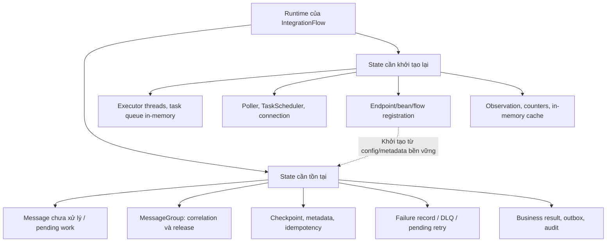
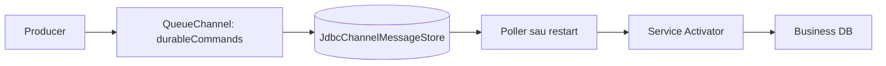
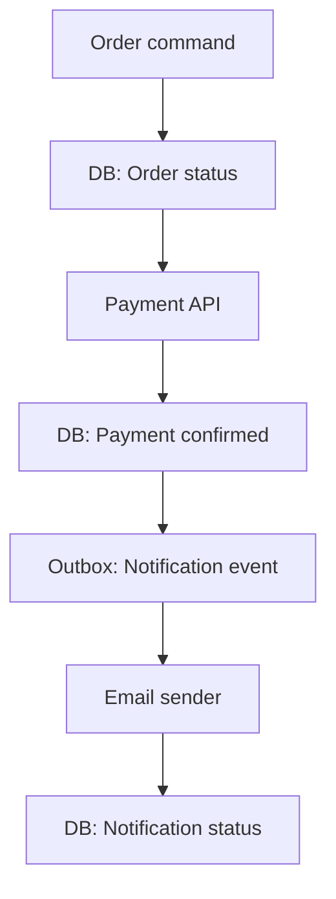
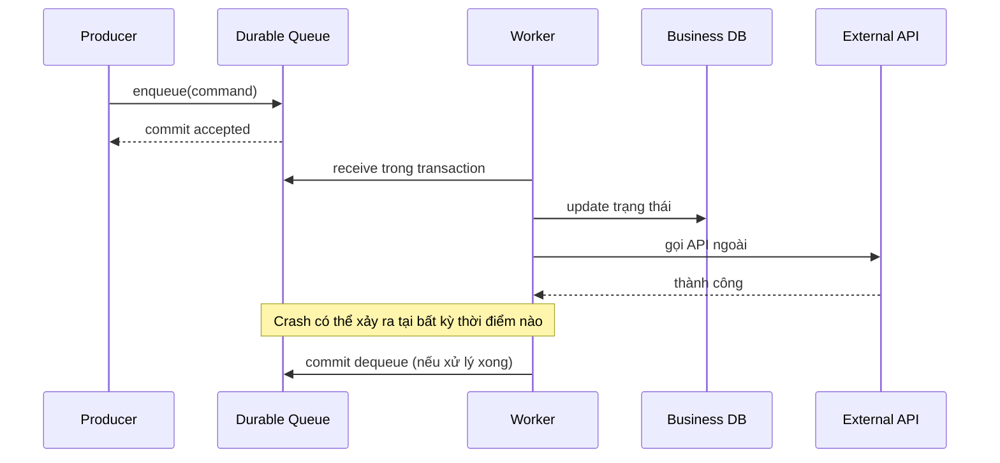
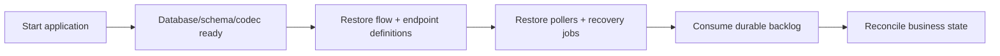

# State runtime nào cần tồn tại qua restart trong Spring Integration?

## 1. Đặt đúng câu hỏi: “Chạy lại ứng dụng” có nghĩa là khôi phục điều gì?

Spring Integration điều phối message flow qua `MessageChannel`, endpoint, consumer, poller, executor và các thành phần có trạng thái như aggregator, resequencer hoặc idempotent receiver. Một flow chạy ổn trong vài tháng vẫn có thể xử lý sai khi tiến trình Java bị kill, container được thay mới hoặc ứng dụng nâng cấp phiên bản.

Xét đơn hàng `ORDER-42`:

1. HTTP gateway nhận đơn và chuyển message vào một channel.
2. Executor xử lý nhiều bước bất đồng bộ.
3. Splitter tạo ba message để tính phí từ ba dịch vụ.
4. Aggregator đã nhận hai kết quả và đang đợi phần thứ ba.
5. Service bị restart trước khi hoàn thành.

Sau restart, ứng dụng có thể tạo lại toàn bộ Spring bean mà **không có hai message trong group cũ**. Hoặc nó còn đủ message nhưng không có đúng correlation key, poller chưa chạy, hay một lệnh đã trừ tiền lại được giao lần nữa.

Đối với chương **Persistence và restart** của module **SPRING_INTEGRATION_RUNTIME**, cần phân biệt hai câu hỏi:

- **State nào mang ý nghĩa nghiệp vụ hoặc tiến độ xử lý cần tồn tại?** State đó phải có nguồn dữ liệu bền vững hoặc khả năng tái dựng đáng tin cậy.
- **State nào chỉ là tài nguyên thực thi tạm thời?** Thread, connection, scheduler task hoặc call stack phải được khởi tạo lại; snapshot chúng thường không khả thi và cũng không cần thiết.

> **Nguyên tắc thiết kế:** Không cần persist mọi biến trong JVM. Cần bảo vệ *thông tin mà nếu mất, hệ thống không thể tiếp tục đúng hoặc không thể phát hiện đã thực hiện một side effect*. Mỗi loại thông tin cần một cơ chế khôi phục và một ranh giới commit riêng.

## 2. Bản đồ các loại state ở runtime



Bảng quyết định tổng quan:

| Loại state | Mất sau restart gây ra gì? | Nên lưu hoặc khôi phục thế nào? |
| --- | --- | --- |
| **Message chưa xử lý** | Bỏ sót việc đã nhận nhưng chưa làm | Broker bền vững, persistent `QueueChannel` hoặc nguồn có redelivery |
| **Message group** | Aggregator/resequencer mất phần đang chờ | Persistent `MessageGroupStore`, correlation/sequence ổn định |
| **Checkpoint của inbound reader** | Đọc lại hoặc bỏ qua file/feed/record không đúng | Persistent `MetadataStore` hoặc offset/checkpoint bền vững của nguồn |
| **Idempotency marker** | Replay trừ tiền, tạo hóa đơn hoặc gửi email lặp | Bảng business key duy nhất, `JdbcMetadataStore`/store bền vững |
| **Retry/delay đã lên lịch lâu dài** | Lần thử dự kiến không còn được kích hoạt | Durable retry queue, broker, bảng scheduled work và worker khôi phục |
| **Dead-letter/failure record** | Không còn dữ liệu để điều tra hay replay | Broker DLQ, persistent message queue hoặc bảng lỗi nghiệp vụ |
| **Trạng thái tiến trình nghiệp vụ** | Không biết bước nào đã hoàn tất | Database trạng thái công việc, event log, saga/process state |
| **Đăng ký dynamic IntegrationFlow** | Flow biến mất dù message ở DB còn nguyên | Lưu **định nghĩa hoặc ý định đăng ký** riêng, dựng lại lúc startup |
| **Executor thread, callback đang chạy** | Thread dừng, call stack mất | Khởi tạo lại; dùng nguồn durable để phát lại công việc cần tiếp tục |
| **Poller/scheduler instance** | Không còn tác vụ đang chạy | Tạo lại endpoint và lịch từ config; persist deadline khi lịch là nghiệp vụ |
| **Temporary reply channel / session** | Caller không còn chờ, reply thất lạc | Thiết kế response async theo business ID, persistent result và client polling/event |
| **Metrics, cache, log buffer** | Số liệu nhất thời mất, cache lạnh | Export metrics/log bên ngoài; xây dựng lại cache từ nguồn sự thật |

Bảng trên là định hướng thiết kế; một số source như Kafka/JMS có **cơ chế persistence riêng**, không nhất thiết phải sao chép message sang một JDBC queue nữa.

## 3. Ba mức bảo đảm phải tách riêng

**Durability** là dữ liệu đã được ghi và commit sẽ còn sau sự cố theo cam kết của storage. **Delivery semantics** là message được bàn giao cho consumer ra sao: có thể mất, lặp hoặc được giao lại. **Business correctness** là nghiệp vụ không tạo kết quả sai khi message lặp hoặc các bước thất bại nửa chừng.

```text
Persistent data
    != guarantee of immediate delivery
    != guarantee of exactly-once business side effect
```

Ví dụ một lệnh tạo hóa đơn nằm trong `JdbcChannelMessageStore` và được poll lại sau crash. Tính bền vững đã đạt: lệnh còn đó. Nhưng nếu hệ thống đã gọi API thanh toán thành công trước khi transaction xử lý queue rollback, message sẽ được giao lại và có nguy cơ thu tiền hai lần. Điều này đòi hỏi **business idempotency key** hoặc giao thức giao dịch/đối soát với hệ thống ngoài.

Hãy viết rõ cho mỗi loại state:

1. **Source of truth:** database, broker, metadata store hay hệ thống bên thứ ba?
2. **Commit point:** tại thời điểm nào app được phép nói “đã nhận” hoặc “đã hoàn tất”?
3. **Recovery owner:** ai sẽ phát hiện backlog sau restart và kích hoạt xử lý?
4. **Duplicate policy:** nếu cùng việc được giao hai lần, kết quả sẽ ra sao?
5. **Expiry/retention:** giữ state đến khi nào và dọn dẹp theo điều kiện nào?

## 4. Pending messages: giữ công việc đã nhận nhưng chưa xử lý

### 4.1. DirectChannel và ExecutorChannel không phải durable queue

`DirectChannel` truyền message trực tiếp đến subscriber trên call stack của thread gửi. `ExecutorChannel` giao công việc cho `TaskExecutor`, có thể khiến handler chạy ở thread khác. Cả hai hữu ích cho điều phối nhưng **không tự biến lời gọi thành công việc durable**.

Với executor có queue trong bộ nhớ:

```text
Producer.send() ---> ExecutorChannel ---> TaskExecutor queue ---> Worker
                         đã nhận            in-memory          chưa chạy
                                            ^
                                            JVM bị kill → công việc trong hàng chờ có thể mất
```

Ngay cả khi `send()` trả về thành công, điều đó không bảo đảm worker đã thực thi hay task đã được ghi bền vững. Nếu công việc không được phép mất, **đưa nó qua một durable boundary** trước khi xác nhận đầu vào.

### 4.2. Persistent QueueChannel

Spring Integration có thể dùng `JdbcChannelMessageStore` làm store phía sau `QueueChannel`. Message đã enqueue và commit vào database có thể được poll lại sau khi tạo mới application context.



Một cấu hình XML minh họa (phần của Spring context có namespace `int`; cần datasource và DDL đúng phiên bản):

```xml
<bean id="commandChannelStore"
      class="org.springframework.integration.jdbc.store.JdbcChannelMessageStore">
    <constructor-arg ref="dataSource"/>
    <property name="region" value="ORDERS_V1"/>
    <!-- Chọn channelMessageStoreQueryProvider phù hợp database. -->
</bean>

<int:channel id="durableCommands">
    <int:queue message-store="commandChannelStore"/>
</int:channel>

<int:service-activator
        input-channel="durableCommands"
        ref="commandConsumer"
        method="handle">
    <int:poller fixed-delay="1000" max-messages-per-poll="5">
        <int:transactional transaction-manager="transactionManager"/>
    </int:poller>
</int:service-activator>
```

Để chạy cần `spring-integration-jdbc`, bean `dataSource`, `transactionManager`, `commandConsumer` và các bảng/index theo SQL schema của Spring Integration JDBC. Query provider (ví dụ PostgreSQL, Oracle, SQL Server) phải hợp dialect. Ví dụ này tập trung vào quan hệ channel–store–poller–transaction, không phải bộ cấu hình deployment độc lập.

**Những điều phải giữ ổn định khi restart:**

- **Channel ID** `durableCommands` và store `region=ORDERS_V1`, nếu backend dùng chúng phân vùng dữ liệu.
- Kết nối DB và schema/message serializer tương thích.
- Consumer và poller được đăng ký lại; `autoStartup`/lifecycle cho phép chúng hoạt động.
- Ranh giới transaction dequeue và business operation được thiết kế rõ.

Nếu đổi tên channel hoặc region trong bản deploy mới, message cũ có thể **vẫn còn trong DB nhưng không còn được channel mới nhìn thấy**. Đó là lỗi migration/identity, không phải “database mất dữ liệu”.

### 4.3. Message không cần copy sang JDBC nếu source đã durable

Với broker như JMS/RabbitMQ hoặc Kafka, trạng thái pending và tiến độ tiêu thụ có thể do broker và container/adapter quản lý. Thêm một `QueueChannel` JDBC có thể tạo hai điểm commit, phát sinh cửa sổ ghi trùng hoặc mất nếu không có outbox/transaction/reconciliation.

Ví dụ nên bắt đầu từ câu hỏi: **Broker đã ghi message và chỉ ack/commit khi xử lý an toàn chưa?** Nếu có, có thể dùng nguồn đó để redeliver sau restart. Nếu producer là HTTP chỉ trả `202 Accepted` rồi giao việc vào một in-memory executor, cần thiết kế durable handoff trước khi trả thành công.

## 5. MessageGroup: state chưa hoàn tất của aggregator và resequencer

Một aggregator thường nhận nhiều fragment có chung `correlationId`, thêm vào `MessageGroup` và chờ `ReleaseStrategy`. Resequencer cũng giữ fragment để phát theo thứ tự `sequenceNumber`.

```text
batch-42: sequenceSize=3
  #1 đến → group có {1}
  #3 đến → group có {1,3}
  JVM restart
  #2 đến → cần khôi phục {1,3}, rồi mới release đúng
```

Nếu group store chỉ trong memory, bản mới không biết hai fragment trước restart. Dùng `JdbcMessageStore` hoặc persistent `MessageGroupStore` phù hợp giúp giữ group/metadata.

Ví dụ Java DSL (trong cấu hình Spring có JDBC datasource):

```java
import javax.sql.DataSource;
import org.springframework.context.annotation.Bean;
import org.springframework.integration.dsl.IntegrationFlow;
import org.springframework.integration.jdbc.store.JdbcMessageStore;
import org.springframework.integration.store.MessageGroupStore;

@Bean
MessageGroupStore persistentGroups(DataSource dataSource) {
    return new JdbcMessageStore(dataSource);
}

@Bean
IntegrationFlow aggregateResults(MessageGroupStore persistentGroups) {
    return IntegrationFlow.from("processedFragments")
            .aggregate(spec -> spec
                    .messageStore(persistentGroups)
                    .expireGroupsUponCompletion(false))
            .channel("completedBatches")
            .get();
}
```

Điều kiện chạy: upstream tạo correlation/sequence headers nhất quán; downstream `completedBatches` có consumer; JDBC schema tương thích và store được dùng lại sau restart.

**Quan trọng:** Persist nhóm **không** persist timer trong RAM hay Java code của `ReleaseStrategy`. App phải khởi tạo lại handler với cùng correlation key, message-group namespace và rule release phù hợp. Một nhóm còn nằm trong store có thể vẫn chờ **message mới** hoặc lịch expiry/reaper được cấu hình lại; nó không tự tạo output chỉ vì JVM vừa restart.

### Group hoàn tất, late arrivals và duplicate

Nếu xóa mọi metadata ngay sau release, một message cũ đến trễ với cùng key có thể tạo **nhóm mới**. Giữ completed-group marker trong một khoảng phù hợp, dùng group ID có vòng đời rõ (`orderId + revision + processingRunId`) và business idempotency nếu output có side effect.

Nếu nhiều application instance cùng dùng persistent `MessageGroupStore`, còn cần đồng bộ cập nhật bằng `LockRegistry` chia sẻ/phân tán thích hợp. `DefaultLockRegistry` bên trong mỗi JVM chỉ khóa trong tiến trình đó; hai node không tự nhìn thấy khóa của nhau.

## 6. Inbound checkpoint và duplicate marker: dữ liệu nhỏ nhưng quan trọng

Nhiều inbound adapter dùng metadata để ghi nhận “đã thấy/đã xử lý” một file, resource hoặc checkpoint. `MetadataStore` là abstraction dạng key/value; `ConcurrentMetadataStore` còn hỗ trợ `putIfAbsent` và `replace` để tránh check-then-act race.

### Trường hợp file inbound

Giả sử poller đã quét file `sales-2026-11.csv`. Nếu dùng **in-memory accept-once filter**, restart có thể khiến file bị nhận lại. Với `FileSystemPersistentAcceptOnceFileListFilter` và `ConcurrentMetadataStore` bền vững phù hợp, hệ thống có thể lưu dấu đã chấp nhận file qua restart.

Tuy nhiên, **“đã chấp nhận file” khác “đã xử lý mọi dòng của file thành công”**. Nếu đánh dấu accept trước khi toàn bộ nghiệp vụ commit, một crash sau đánh dấu có thể khiến file không được nhận lại dù công việc dang dở. Trong một số trường hợp filter có logic rollback/removal hoặc luồng xử lý điều phối bù trừ, nhưng không được mặc định tất cả adapter đều có chính sách tương tự.

### Trường hợp nguồn có offset

Checkpoint của nguồn phải biểu diễn **phần liên tục đã hoàn tất**. Nếu xử lý song song offset 105 trước 104, lưu `maxSeen=105` rồi restart có thể bỏ qua 104. Cần xác định điểm commit nguồn (chẳng hạn consumer group offset của Kafka) và không ghi nhầm “cao nhất từng đọc” thành “đã xử lý tới đây”.

### Atomic claim và restart

```java
import org.springframework.integration.metadata.ConcurrentMetadataStore;

public boolean claim(ConcurrentMetadataStore store, String businessId) {
    String key = "order:" + businessId;
    return store.putIfAbsent(key, "IN_PROGRESS") == null;
}
```

Chỉ một worker có thể thắng thao tác atomic trên **một backend được chia sẻ đúng**. Nhưng sau restart, key `IN_PROGRESS` có thể vẫn còn dù công việc chưa xong. Cần state machine hoặc lease để biết khi nào được phép tiếp quản, và không dùng `remove(key)` vô điều kiện nếu owner khác có thể đang nắm key.

| Metadata | Nếu mất | Nếu giữ quá lâu |
| --- | --- | --- |
| File accept-once marker | File xử lý lặp | File sửa hợp lệ không được nhận lại |
| Polling checkpoint | Bỏ sót hoặc đọc lặp dữ liệu | Không tiến được nếu checkpoint sai |
| Idempotency marker | Side effect lặp | Work treo `IN_PROGRESS` không được retry |
| Lease/owner/version | Hai worker cùng xử lý | Worker cũ có thể giữ quyền vô hạn |
| Completed status | Không phân biệt đã xong | Dữ liệu tăng mãi nếu không có retention |

Vì vậy, state phải tồn tại qua restart **kèm quy tắc hết hạn và khôi phục**, không chỉ kèm thuộc tính “persistent”.

## 7. Retry, delayed work và dead-letter

### 7.1. Retry đang diễn ra trong RAM

`RequestHandlerRetryAdvice` hoặc cơ chế retry tương tự có thể thử lại handler theo policy và backoff. Nếu thread đang ngủ giữa hai attempt và JVM bị kill, **call stack, bộ đếm attempt trong tác vụ và timer chờ** thông thường biến mất.

Nếu nguồn message durable và transaction/ack thích hợp, message có thể được phát lại từ đầu; bộ đếm retry cục bộ có thể **bắt đầu lại**. Nếu cần giới hạn tổng số lần thử **xuyên restart**, lưu attempt count trong record nghiệp vụ, header được quản lý bền vững hoặc hạ tầng broker retry phù hợp.

### 7.2. Công việc cần chạy vào một thời điểm tương lai

Một `TaskScheduler` hay `ScheduledExecutorService` trong memory không phải hệ thống lưu lịch bền vững. Nếu nghiệp vụ yêu cầu “thử lại đơn ORDER-42 sau 15 phút kể cả có deploy”, hãy lưu một work item có `nextAttemptAt`, `attemptCount`, `status` và định danh duy nhất vào DB hoặc hệ thống delayed queue/broker được thiết kế phù hợp.

```text
retry_jobs
  job_id=RETRY-42
  business_key=ORDER-42
  attempt_count=4
  next_attempt_at=2026-11-22T10:00:00Z
  status=WAITING
```

Đây là **schema logic do ứng dụng định nghĩa**, không phải table mặc định của Spring Integration. Sau restart, worker khởi động lại và query các job đến hạn; khi nhiều instance chạy, cần atomic claim/lease và idempotency.

### 7.3. Dead-letter và error flow

`ErrorMessage` chứa `Throwable` và có thể chứa ngữ cảnh message gốc. `errorChannel` mặc định phục vụ phân phối lỗi runtime; nó không tự biến thành kho DLQ bền vững. Nếu retry exhausted phải được điều tra sau restart, cần lưu **failure record** đã chuẩn hóa hoặc gửi đến broker DLQ có durability thích hợp.

Nên lưu tối thiểu `failureId`, business key, flow/endpoint, loại lỗi đã làm sạch, thời điểm, số attempt, correlation ID, dữ liệu/references cần replay và phiên bản schema. Một `Throwable` thuần hoặc stack trace có thể không serialize an toàn, có thể chứa dữ liệu nhạy cảm, và không phải bản sao chắc chắn của command gốc.

## 8. Trạng thái nghiệp vụ và side effect: nguồn sự thật quan trọng nhất

Một hệ thống đơn hàng có thể làm ba bước: lưu đơn, trừ tiền, phát email. Chỉ lưu message trong queue không cho biết bước nào đã hoàn thành khi tiến trình chết giữa hai bước.



Thiết kế robust dùng trạng thái nghiệp vụ được commit qua các bước, khóa idempotency ổn định, và khi cần gửi event ra broker thì dùng **transactional outbox** hoặc cơ chế tương đương phù hợp:

- Ghi trạng thái nghiệp vụ và outbox row trong **cùng local database transaction** nếu có thể.
- Một publisher riêng đọc outbox sau commit, gửi event và đánh dấu đã phát theo chính sách at-least-once/idempotent.
- Downstream consumer chống duplicate theo event ID/business key; không mặc định một lần gửi ra mạng là exactly-once.
- Với payment bên thứ ba, dùng idempotency key mà phía đối tác hỗ trợ hoặc quy trình đối soát khi kết quả chưa chắc chắn.

Đây là lý do **state cần persist** có thể nằm ngoài các interface `MessageStore`: database nghiệp vụ, transaction log, outbox và idempotency record là một phần của lời giải restart.

## 9. Cái gì KHÔNG cần persist trực tiếp?

### 9.1. Thread, executor và call stack

`ThreadPoolTaskExecutor`, số thread đang active, hàng đợi thread pool trong memory, stack frame và lock Java sẽ được tạo lại khi process start. Không thể “resume từ đúng dòng Java đang chạy” chỉ nhờ persistent MessageStore.

Cần đưa công việc quan trọng ra durable boundary trước khi giao cho executor và thiết kế retry/restart từ **một bước nghiệp vụ có thể thực thi lại**, không dựa vào snapshot thread.

### 9.2. Network connection, listener và temporary reply channel

HTTP request, TCP socket, session, temporary reply channel hoặc một anonymous channel là tài nguyên thời gian sống ngắn. Một message được serialize chứa header `replyChannel` tham chiếu object chỉ tồn tại trong tiến trình cũ có thể **không còn reply path hợp lệ** sau restart.

Với công việc dài, trả về `202 Accepted` kèm `operationId` rồi cho client query trạng thái qua API hoặc nhận event/webhook. Kết quả nghiệp vụ được lưu bền vững theo `operationId`; không phụ thuộc vào việc client giữ cùng TCP connection qua deploy.

### 9.3. Endpoint, poller và lịch runtime

Bean `IntegrationFlow`, handler, poller, scheduler và adapter được **khởi tạo lại từ cấu hình Spring**. Với flow tạo động bằng `IntegrationFlowContext`, registration trong RAM không tự persist chỉ vì các message đi qua flow được lưu. Nếu cần flow tự xuất hiện lại sau restart, phải lưu **định nghĩa/intent registration** trong metadata/config DB hoặc repository rồi dựng lại ở startup.

`SmartLifecycle` và `autoStartup` điều khiển start/stop ở ứng dụng mới. Nếu một endpoint bị operator pause trước restart và trạng thái pause đó là yêu cầu nghiệp vụ, hãy lưu **desired state** riêng rồi áp lại khi startup; đừng suy ra framework tự snapshot “đang dừng” vào `MessageStore`.

### 9.4. Cache, metrics và observation

Cache có thể xây lại từ source of truth; counters/gauges in-memory có thể reset khi process thay. Để phân tích xuyên restart, export logs/traces/metrics tới hệ thống ngoài. `traceId` và `correlationId` cần được truyền qua message/persistent record khi chúng là thông tin cần thiết để nối sự kiện, nhưng bản thân một span đang chạy không thể “sống tiếp” sau crash.

## 10. Crash windows: phải kiểm thử theo thời điểm commit



Bảng tình huống cần thiết kế:

| Thời điểm tiến trình chết | Điều có thể xảy ra | Cách phòng vệ |
| --- | --- | --- |
| Trước commit enqueue | Message chưa tồn tại trong durable store | Producer có retry/ack policy và request ID ổn định |
| Sau commit enqueue, trước poll | Message còn trong queue | Startup lại poller, giữ channel/region và schema |
| Sau poll, trước commit transaction | Dequeue có thể rollback | Transaction đúng phạm vi; consumer idempotent |
| Sau external API thành công, trước commit nội bộ | Message có thể được giao lại và API bị gọi lại | Idempotency key ở đích và đối soát |
| Sau commit dequeue, trước khi ghi business result | Work có thể mất khỏi queue | Đảm bảo đúng transaction boundary/outbox, không ack sớm |
| Sau persist group đủ, trước output | Có thể release lại hoặc chưa có output | Completion marker và idempotent output |
| Trong thời gian chờ retry | Attempt timer mất | Durable retry item hoặc source redelivery |
| Trong lúc đang đăng ký dynamic flow | Flow config có thể chưa commit | Persist intent và khởi tạo lại khi startup |
| Trong lúc viết error record | Error log có thể có, DLQ chưa lưu | Chỉ coi recovery thành công khi sink durable đã commit |

Mỗi dòng phải được đánh giá theo **transaction manager và nguồn thực tế**: một JDBC queue có transactional poller không bảo đảm atomic commit giữa DB và dịch vụ HTTP. Nếu recovery callback “nuốt” exception rồi trả bình thường, poller có thể commit transaction nguồn dù công việc không thành công về nghiệp vụ.

## 11. Transaction, acknowledgment và nguồn redelivery

Tính bền vững của message nằm ở **sự phối hợp giữa writer, source và consumer**:

| Nguồn / channel | Điểm chốt độ bền | Cần thử sau crash |
| --- | --- | --- |
| JDBC-backed `QueueChannel` | Enqueue commit trong DB, dequeue theo transaction | Message còn nếu chưa tiêu thụ commit; lỗi rollback |
| JMS broker durable queue | Broker persistence và session acknowledgment/transaction | Redelivery, DLQ, số lần giao, duplicate |
| RabbitMQ | Queue/message durability, publisher confirms và consumer ack | Nack/requeue/DLX, mất kết nối đúng thời điểm |
| Kafka | Record bền trong topic theo cấu hình và consumer offset commit | Replay từ offset nào, record trùng khi xử lý xong trước commit |
| HTTP → in-memory flow | Chưa có durable boundary | Trả `202` khi nào, có lưu command trước trả hay không |
| File poller | File nguồn + accept-once marker/checkpoint | File bị nhận lại hay bị bỏ qua sau restart |

Một số hệ thống dùng **at-least-once delivery**: chấp nhận có duplicate để giảm nguy cơ mất dữ liệu. Điều đó thường thực tế hơn việc cố bảo đảm end-to-end exactly-once giữa nhiều tài nguyên độc lập.

**Không lưu một “processed=true” marker trước business commit rồi ack nguồn** nếu chưa thiết kế recovery: restart sẽ thấy marker và bỏ qua công việc chưa hoàn tất. Ngược lại, ghi marker sau side effect mà không có idempotency cũng để lại cửa sổ side effect lặp.

## 12. Khi nhiều instance cùng khôi phục

Một persistent store chia sẻ giữa hai JVM đặt ra thêm bài toán đồng thời:

- Hai poller có thể cạnh tranh cùng một queue; phải dùng query provider/transaction đúng backend và kiểm thử delivery semantics.
- Hai aggregator cùng group có thể tranh việc thêm message và release; dùng `LockRegistry` phân tán phù hợp, không chỉ `DefaultLockRegistry` trong từng JVM.
- Hai worker cùng nhìn thấy một job retry đến hạn; dùng atomic claim/lease hoặc unique constraint.
- Hai node có thể cùng replay một dead-letter record; cần trạng thái `REPLAYING` có owner/version và CAS.
- Một node chạy phiên bản app cũ, node khác phiên bản mới có thể không đọc cùng payload serialized; cần schema evolution/rolling deployment.
- Một node cũ bị mất lease nhưng vẫn chạy external side effect; cân nhắc fencing token hoặc idempotency tại hệ thống đích.

```text
Durable storage + shared correlation keys
           không tự đồng nghĩa
distributed coordination + exactly-once output
```

Cần phân biệt **khóa trong critical section** với **business idempotency qua nhiều lần delivery**. Lock bảo vệ update đồng thời; idempotency bảo vệ cả trường hợp xử lý lại sau khi lock cũ đã được thả hoặc process đã restart.

## 13. Serialization và tương thích khi nâng phiên bản

Message nằm trong persistent store phải được đọc bởi **bản ứng dụng sau restart**, đôi khi là một bản deploy mới.

Các lỗi thường gặp:

1. Payload Java đổi tên class/package hoặc cấu trúc serialization.
2. Header chứa object không thể serialize, temporary channel hoặc callback.
3. Producer bản mới và consumer bản cũ dùng schema không tương thích trong rolling deployment.
4. Correlation key/release strategy đổi, làm group cũ không đạt điều kiện release.
5. Bean name/channel region đổi, khiến record cũ không còn được tìm thấy.
6. Mã hóa, serializer hoặc class allowlist thay đổi làm deserialize thất bại.

Một message durable nên dùng command schema có phiên bản rõ:

```java
public record ProcessOrderCommand(
        String commandId,
        String orderId,
        String customerId,
        int schemaVersion
) implements java.io.Serializable {}
```

`Serializable` chỉ minh họa một cách biểu diễn object Java. Nó **không cam kết tương thích định dạng qua mọi phiên bản**. Khi cần lưu nhiều ngày hoặc rolling deploy, cân nhắc JSON/Avro/Protobuf với codec và schema evolution được quản lý, rồi kiểm thử dữ liệu từ bản A bằng bản B.

Với key correlation, dùng ID nghiệp vụ/run ổn định; với replay, sinh message ID mới nếu framework yêu cầu nhưng giữ `commandId`/`idempotencyKey` gốc để phát hiện duplicate. Không dùng ngẫu nhiên một `MessageHeaders.ID` mới làm unique business key.

## 14. Startup và shutdown: thứ tự khôi phục cũng quan trọng

Một ứng dụng mới có thể khởi động nhưng vẫn **chưa sẵn sàng tiêu thụ** vì database migration, secret hoặc service phụ thuộc chưa có. Cần điều phối startup:

1. Đảm bảo datasource/broker và schema/codec sẵn sàng.
2. Tạo lại các channel, endpoint, poller, scheduler, dynamic flow cần thiết.
3. Xác thực config identity: region, channel IDs, metadata keys, correlation strategy.
4. Khởi động inbound adapters/pollers sau khi dependencies và transaction/recovery sink ổn định.
5. Đối chiếu backlog ở store với số message đang xử lý; theo dõi oldest message age.
6. Kích hoạt reaper/retry scheduler cần thiết và xử lý item tồn đọng quá hạn có chủ đích.



Với graceful shutdown, có thể dừng intake, chờ một số task hoàn thành, commit/rollback transaction rồi đóng connection. Nhưng không được coi shutdown graceful là bảo đảm: container có thể bị kill khi OOM, mất điện hoặc hết termination grace period.

Chạy thử **kill -9 / force-stop** (trong môi trường kiểm thử) có ý nghĩa hơn chỉ gọi `context.close()`. Nếu app tự trả lời “đã lưu” nhưng bản ghi mới chỉ nằm trong buffer chưa commit, crash test sẽ bộc lộ cửa sổ mất dữ liệu.

## 15. Một bảng kiểm kê state trước khi thiết kế persistence

Lập “state inventory” cho mỗi flow thay vì thêm database store theo cảm tính:

| Câu hỏi | Ví dụ trả lời |
| --- | --- |
| Message đến từ đâu? | HTTP, JMS, Kafka, file poller |
| Đâu là durable handoff đầu tiên? | HTTP ghi DB inbox rồi trả 202 |
| Có message/group đang chờ không? | JDBC QueueChannel, aggregator group |
| Có checkpoint hay accept-once marker không? | File metadata/JDBC metadata |
| Có retry trì hoãn hoặc dead letter không? | Durable retry_jobs, broker DLQ |
| Có side effect ngoài local transaction không? | Payment HTTP, email, SaaS API |
| Ai bảo đảm duplicate không gây sai? | Business unique key, target idempotency |
| Sau restart ai khởi động lại luồng? | Spring beans + dynamic registration loader |
| Nếu có backlog nhưng không có consumer? | Startup health check, poller status/alert |
| Nếu schema đổi giữa hai bản? | Versioned codec, migration plan |
| Khi nào xóa metadata cũ? | Retention lớn hơn cửa sổ redelivery/replay |
| Khi lỗi ghi persistence? | Rollback/nack/retry, alert, không ack mù |

Một câu hỏi kiểm chứng thực tế: **Nếu kill ứng dụng ngay sau mỗi dòng có side effect hoặc commit, trạng thái ngày mai có đủ để biết cần làm tiếp bước nào và không làm lặp bước đã hoàn tất không?**

## 16. Quan sát runtime sau restart

Các metric quan trọng nên được xuất ra hệ thống ngoài JVM:

| Nhóm chỉ số | Điểm quan sát |
| --- | --- |
| Backlog | `QueueChannel` pending count, broker consumer lag, DLQ size |
| Tuổi message | Oldest pending age, thời gian từ enqueue đến xử lý |
| Group | Open groups, oldest group age, partial/expired/released count |
| Checkpoint | Last committed offset/file checkpoint, thời gian không tiến |
| Recovery | Retry pending, attempt count, dead-letter rate, replay success/failure |
| Threading | Executor active threads, queue depth, rejected tasks, poller active |
| Persistence | DB connection pool, write/read latency, lock waits, storage usage |
| Correctness | Duplicate suppressed, idempotency conflict, external reconciliation |
| Lifecycle | Endpoint running/paused, dynamic flow registration, scheduler status |
| Errors | Deserialize failure, transaction rollback, error publishing failure |

**Không dùng correlationId/orderId làm nhãn metric có cardinality cao**. Đưa chúng vào log/tracing/audit theo chính sách bảo mật để lần theo một request. Dùng tag metric ổn định như `flowId`, `endpoint`, `storeType`, `outcome` và loại lỗi đã chuẩn hóa.

Nếu thấy **DB có message nhưng queue metric bằng 0**, kiểm tra channel ID/region, quyền DB, codec và consumer version. Nếu thấy **message được poll nhưng không có output**, kiểm tra transaction, error flow và retry/recovery đang nuốt lỗi trước khi commit.

## 17. Bộ lab kiểm tra restart từ đầu đến cuối

### Lab A: queue còn dữ liệu sau restart

1. Tạo `QueueChannel` dùng `JdbcChannelMessageStore` trên database thử nghiệm.
2. Gửi `commandId=CMD-001` và xác nhận enqueue đã commit.
3. Tạm dừng poller/endpoint, restart process trong khi DB vẫn chạy.
4. Bật poller, chờ handler xác nhận đã nhận `CMD-001`.
5. Kiểm tra business key được xử lý đúng theo delivery/idempotency policy.

**Kỳ vọng:** bản ghi đã commit còn sau restart. Nếu bị bỏ qua, kiểm tra channel/region và consumer startup.

### Lab B: crash giữa dequeue và business commit

1. Dùng transactional poller cho JDBC queue.
2. Khi nhận `CMD-002`, cố ý ném exception trước business commit.
3. Force-stop hoặc rollback transaction và restart.
4. Xác minh message được giao lại nếu cơ chế store/transaction bảo vệ dequeue.
5. Bật idempotent handler, lặp lại khi side effect bên ngoài đã thành công rồi DB rollback.

**Kỳ vọng:** rollback ngăn việc dequeue thành công khi transaction thất bại, nhưng side effect bên ngoài vẫn có thể xảy ra; idempotency ngăn duplicate.

### Lab C: aggregator group chờ phần cuối

1. Gửi hai message với `correlationId=BATCH-42`, `sequenceSize=3`, sequence 1 và 3.
2. Đảm bảo group đã được commit vào persistent `MessageGroupStore`.
3. Restart process, dùng lại cùng group store, correlation strategy và component ID/region tương thích.
4. Gửi sequence 2, chờ output đủ ba phần.
5. Gửi thêm một message cũ, kiểm tra late-message handling và completion metadata.

**Kỳ vọng:** group có thể hoàn tất sau restart; không tự động khôi phục scheduled timeout cũ trong JVM.

### Lab D: idempotency marker và retry xuyên restart

1. Gửi một command có business key duy nhất.
2. Cho handler claim `IN_PROGRESS` rồi force-stop trước khi commit.
3. Khởi động lại, quan sát marker còn hay mất theo loại store/transaction.
4. Thiết kế replay/lease để claim treo được giải quyết có kiểm soát.
5. Gửi cùng command lần nữa, kiểm tra không có duplicate side effect.

**Kỳ vọng:** không mất công việc vì marker cũ; không xử lý lặp vì marker biến mất. Cả hai cần được chứng minh bằng transaction/business state.

### Lab E: thay phiên bản và chạy hai instance

1. Lưu message/group bằng codec của version A; đọc ở version B.
2. Giữ đồng thời hai instance dùng một persistent store, kiểm tra locking/duplicate.
3. Đổi channel name hoặc region trong staging và quan sát backlog “biến mất khỏi view” nhưng vẫn ở DB.
4. Khôi phục bằng migration có kiểm soát, không xóa bản ghi thủ công khi chưa biết owner.
5. Kiểm tra dynamic flows, poller/reaper được đăng ký sau mỗi lần startup.

**Tiêu chí PASS:** có bản ghi bền vững trước restart, đúng consumer sau restart, không mất business command, không double-commit side effect, error/recovery được quan sát và có đường replay hợp lệ.

## 18. Những ngộ nhận phổ biến

| Ngộ nhận | Thực tế |
| --- | --- |
| “MessageStore được cấu hình thì mọi message của flow đã durable.” | Chỉ những điểm thực sự dùng store và đã commit mới được bảo vệ. |
| “ExecutorChannel đã nhận thì chắc chắn xử lý xong.” | Executor queue/task có thể nằm trong memory; producer không nhất thiết chờ worker. |
| “DB-backed QueueChannel đảm bảo exactly-once.” | Redelivery có thể xảy ra; business idempotency vẫn cần. |
| “Aggregator persistent sẽ tự khôi phục mọi timeout.” | Group state có thể còn, nhưng scheduler/reaper và strategy cần được dựng lại. |
| “Không thấy output nghĩa là message mất.” | Có thể poller dừng, release strategy chưa thỏa hoặc error flow đã hấp thụ exception. |
| “Giữ metadata mãi sẽ an toàn hơn.” | Marker `IN_PROGRESS` treo hoặc stale key có thể khóa công việc vĩnh viễn. |
| “Một ErrorMessage là bản sao message để replay.” | Throwable có thể thiếu payload gốc; cần failure record/command schema riêng. |
| “Có transaction là rollback được API ngoài.” | Local DB transaction không rollback HTTP/payment/email tự động. |
| “Message còn trong JDBC nên dynamic IntegrationFlow cũng còn.” | Flow registration là lifecycle/configuration, phải tạo lại riêng. |
| “Sau restart có thể tiếp tục đúng dòng Java đã chạy.” | Thread/call stack mất; cần workflow có checkpoint nghiệp vụ. |

## 19. Kết luận

**State runtime cần tồn tại qua restart** là state đại diện cho **công việc chưa hoàn tất, quyết định đã commit, hoặc thông tin tối thiểu để phục hồi mà không gây sai nghiệp vụ**: pending message, message group, checkpoint, idempotency marker, delayed/retry job, dead-letter record và business/outbox status. Tùy nguồn, state có thể nằm trong persistent `MessageStore`, `MetadataStore`, broker hoặc database nghiệp vụ.

Các tài nguyên thực thi như thread pool, connection, poller, `TaskScheduler`, temporary reply channel và instance `IntegrationFlow` phải được **dựng lại từ cấu hình/metadata**; không thể kỳ vọng persistent store lưu nguyên trạng một JVM. Điều kiện để phục hồi đúng là nhất quán giữa **durable handoff, transaction/acknowledgment, correlation, idempotency, serializer, lifecycle và recovery policy**.

## Tài liệu tham khảo

- [Spring Integration Reference — Message Store](https://docs.spring.io/spring-integration/reference/message-store.html)
- [Spring Integration Reference — JDBC Message Store](https://docs.spring.io/spring-integration/reference/jdbc/message-store.html)
- [Spring Integration Reference — Message Channels](https://docs.spring.io/spring-integration/reference/channel/configuration.html)
- [Spring Integration Reference — Aggregator](https://docs.spring.io/spring-integration/reference/aggregator.html)
- [Spring Integration Reference — Metadata Store](https://docs.spring.io/spring-integration/reference/meta-data-store.html)
- [Spring Integration Reference — Transactions](https://docs.spring.io/spring-integration/reference/transactions.html)
- [Spring Integration Reference — Error Handling](https://docs.spring.io/spring-integration/reference/error-handling.html)
- [Spring Integration Reference — Dynamic Integration Flows](https://docs.spring.io/spring-integration/reference/dsl/java-runtime-flows.html)

