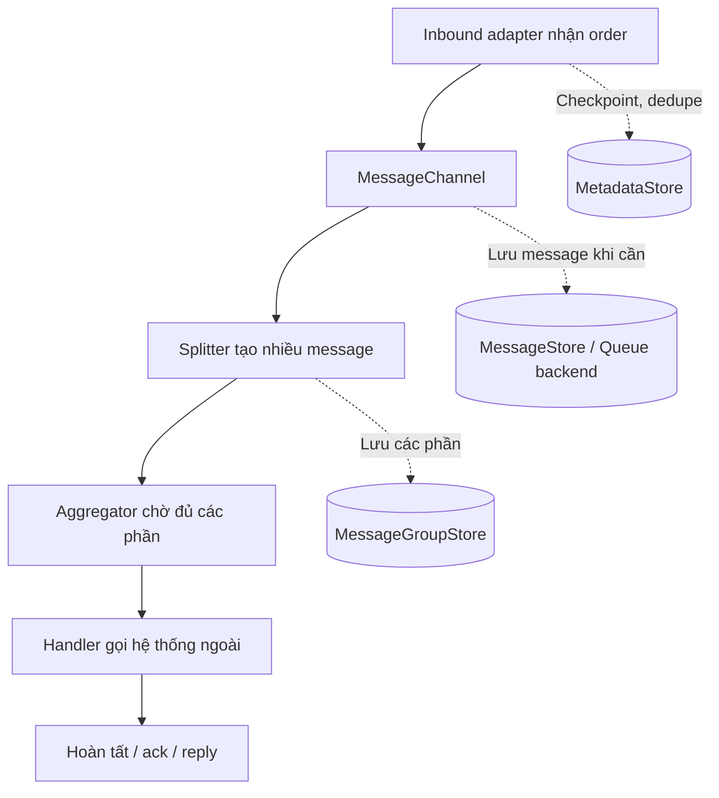
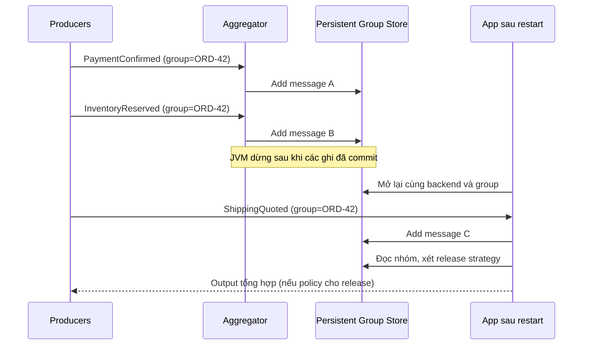
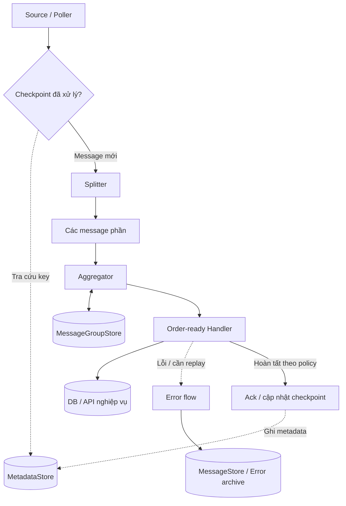

# Message store, group store và metadata store trong Persistence và restart

## Mục tiêu học tập

Trong Spring Integration, message không nhất thiết được lưu xuống đĩa. Một message đi qua `DirectChannel` có thể được xử lý ngay trong thread của sender; message trong `QueueChannel`, trạng thái của aggregator hoặc checkpoint của một inbound adapter lại có thể tồn tại một thời gian dài. Nếu ứng dụng dừng đột ngột rồi khởi động lại, **những trạng thái nào còn, những trạng thái nào mất và làm sao tiếp tục mà không bỏ sót hay xử lý trùng?**

Bài học **Message store, group store và metadata store** thuộc chương **Persistence và restart**, trong module **SPRING_INTEGRATION_RUNTIME**. Nội dung gắn ba loại lưu trữ với vòng đời thực thi của Spring Integration qua channel, endpoint, consumer, poller và executor, rồi xét transaction, retry, error handling, correlation, threading, hiệu năng và trạng thái runtime khi khởi động lại.

Sau bài học, bạn có thể:

- Phân biệt `MessageStore`, `MessageGroupStore` và `MetadataStore` theo dữ liệu được lưu, loại key và contract API.
- Xác định những gì sẽ mất khi dùng in-memory store và điều kiện để một persistent store thật sự phục hồi được dữ liệu đã commit.
- Thiết kế một flow dùng JDBC message/group store và JDBC metadata store; hiểu schema, namespace, serializer và transaction cần thiết.
- Giải thích cách aggregator, persistent queue, accept-once filter và checkpoint sử dụng store ở những thời điểm khác nhau.
- Xây dựng kịch bản restart/crash tại từng bước xử lý, phân biệt message đã lưu, message đã giao và side effect đã commit.
- Kiểm thử việc phục hồi message, nhóm message, metadata và chính sách idempotency, đồng thời chẩn đoán các lỗi thường gặp sau redeploy.

## 1. Restart là một ranh giới của runtime, không phải một phép tua lại hoàn hảo

Khi một JVM bị kill, host mất điện hoặc pod được thay thế, trạng thái Java nằm trong RAM mất đi. Cơ chế **persistence** chỉ giữ những dữ liệu đã được ghi vào backend còn tồn tại qua restart và đã được commit theo hợp đồng của backend đó.

Hãy xét luồng:



Có thể xảy ra các cửa sổ lỗi khác nhau:

- Adapter **đã đọc** message nhưng chưa xác nhận nguồn.
- Một message đang nằm trong **channel in-memory** hoặc **executor queue**.
- Splitter đã tạo ba nhánh nhưng aggregator mới nhận hai.
- Metadata store đã ghi dấu `seen`, còn nghiệp vụ chưa được thực hiện.
- Handler đã gọi thành công API bên ngoài, nhưng database chưa ghi trạng thái `DONE`.
- Aggregator đã release một output nhưng output chưa được giao cho consumer tiếp theo.

Một persistent store **không giải quyết tất cả các cửa sổ** kể trên. Nó chỉ bảo vệ dữ liệu thuộc phạm vi mà thành phần thực sự ghi vào store đó. Vì vậy cần thiết kế cả **điểm ghi bền vững**, **điểm ack**, **transaction**, **ngữ nghĩa retry/redelivery** và **cách tái kích hoạt consumer khi khởi động lại**.

### 1.1. Bốn trạng thái cần theo dõi riêng

```text
RECEIVED  -> PERSISTED  -> DELIVERED  -> BUSINESS_COMMITTED
  nguồn       store          handler        kết quả nghiệp vụ
```

Bốn trạng thái này không đồng nghĩa:

- **Received:** adapter hoặc channel đã nhận message, nhưng chưa chắc message được ghi bền vững.
- **Persisted:** một bản ghi hoặc group đã được lưu và commit; chưa chắc consumer đã nhận.
- **Delivered:** handler nhận/đọc được message; chưa chắc giao dịch nghiệp vụ thành công.
- **Business committed:** trạng thái nghiệp vụ được ghi nhận chắc chắn, ví dụ unique order/transfer đã được commit.

Sau restart, một message có thể được đọc lại từ store hoặc nguồn dù tác vụ ngoài hệ thống đã thành công. Đó là lý do cần **idempotency và business key**, ngay cả khi đã có database lưu message.

## 2. Ba loại store giải quyết ba bài toán khác nhau

Spring Integration dùng một số abstraction lưu trữ với mục tiêu khác nhau. Nhìn vào loại **key**, loại **value** và thành phần tiêu thụ sẽ biết nên chọn store nào.

| Abstraction | Key logic | Value/trạng thái được quản lý | API tiêu biểu | Tình huống phổ biến |
| --- | --- | --- | --- | --- |
| `MessageStore` | `UUID` trong `MessageHeaders.ID` | Một `Message<?>` | `addMessage`, `getMessage(UUID)`, `removeMessage(UUID)` | Claim check, tra cứu message đã cất, recovery custom |
| `MessageGroupStore` | `groupId` (`Object`) | Một `MessageGroup` gồm nhiều message và metadata nhóm | `addMessageToGroup`, `getMessageGroup` | Aggregator, resequencer, một số mô hình queue |
| `MetadataStore` | `String` | `String` value trạng thái nhỏ | `get`, `put`, `remove` | Poller checkpoint, accept-once filter, dedupe marker, token nhỏ |
| `ConcurrentMetadataStore` | `String` | Metadata string có cập nhật điều kiện | `putIfAbsent`, `replace` | Chống tranh chấp key khi nhiều worker |
| Kho nghiệp vụ/ledger riêng | Order ID, request ID, account ID | Trạng thái nghiệp vụ với ràng buộc unique/transaction | Repository SQL, command handler | Exactly-once *effect* hoặc idempotency bền vững |

Một implementation có thể hỗ trợ **cả** `MessageStore` và `MessageGroupStore` (ví dụ `SimpleMessageStore`, `JdbcMessageStore`). Điều đó **không biến** giao diện `MessageStore` thành API truy vấn business key; hai giao diện có contract khác nhau.

### 2.1. Key của một message khác key của một group

Ví dụ request `ORD-42` sinh hai phần kết quả:

```text
Message A:
  headers.id       = UUID-A
  correlationId    = "tenant-a:ORD-42"
  payload          = PaymentConfirmed(...)

Message B:
  headers.id       = UUID-B
  correlationId    = "tenant-a:ORD-42"
  payload          = InventoryReserved(...)

MessageStore:
  UUID-A -> Message A
  UUID-B -> Message B

MessageGroupStore:
  "tenant-a:ORD-42" -> {Message A, Message B}

MetadataStore:
  "si:orders:checkpoint" -> "offset-120"
```

`MessageHeaders.ID` là định danh một message instance, thường có kiểu `UUID`. `correlationId` có thể là string hoặc một object khác và thường giúp xác định những message cần đi chung nhóm. `MetadataStore` không dùng UUID/group key theo cách mặc định: nó lưu string key và string value do adapter/ứng dụng quy định.

Nếu một transformer tạo message mới, message ID có thể đổi trong khi business key/correlation vẫn được giữ. Do đó tra cứu một UUID trong `MessageStore` bằng correlation ID **không đúng API**; muốn tìm nhóm cần biết group ID thực tế.

### 2.2. Store không phải channel hoặc scheduler

Một `MessageStore` chỉ cung cấp chỗ lưu và lấy lại message. Gọi `addMessage(message)` **không tự phát message** đến consumer; sau restart cũng không có một scheduler ngầm tự quét mọi message đã lưu rồi gọi handler. Cần một thành phần kết nối như queue/channel, aggregator, inbound adapter, poller hoặc một recovery worker được thiết kế riêng.

`MetadataStore.put("cursor", "120")` cũng không tự đọc tiếp nguồn ở offset 120. Chỉ khi adapter hoặc logic khởi động lại **thực sự đọc cùng key** từ cùng backend, checkpoint đó mới có tác dụng.

## 3. Thử cả ba store bằng một ví dụ trong bộ nhớ

Trước khi dùng JDBC hay Redis, có thể kiểm chứng khác biệt giữa ba abstraction ngay trong một chương trình.

```java
import java.util.UUID;

import org.springframework.integration.store.MessageGroup;
import org.springframework.integration.store.MessageGroupStore;
import org.springframework.integration.store.MessageStore;
import org.springframework.integration.store.SimpleMessageStore;
import org.springframework.integration.metadata.MetadataStore;
import org.springframework.integration.metadata.SimpleMetadataStore;
import org.springframework.messaging.Message;
import org.springframework.messaging.support.MessageBuilder;

public class StoresBasicsDemo {

    public static void main(String[] args) {
        // Cùng một object hỗ trợ lưu message và message group.
        SimpleMessageStore combined = new SimpleMessageStore();
        MessageStore messages = combined;
        MessageGroupStore groups = combined;

        // Metadata string -> string thuộc một store khác.
        MetadataStore metadata = new SimpleMetadataStore();

        Message<String> payment = MessageBuilder
                .withPayload("PAYMENT_CONFIRMED")
                .setHeader("correlationId", "tenant-a:ORD-42")
                .setHeader("businessKey", "ORD-42")
                .build();

        Message<String> inventory = MessageBuilder
                .withPayload("INVENTORY_RESERVED")
                .setHeader("correlationId", "tenant-a:ORD-42")
                .setHeader("businessKey", "ORD-42")
                .build();

        UUID paymentId = payment.getHeaders().getId();

        // Lưu/đọc một message cụ thể theo UUID.
        messages.addMessage(payment);
        Message<?> loaded = messages.getMessage(paymentId);
        System.out.println(loaded.getPayload()); // PAYMENT_CONFIRMED

        // Lưu nhiều message theo một group key.
        String groupKey = "tenant-a:ORD-42";
        groups.addMessageToGroup(groupKey, payment);
        groups.addMessageToGroup(groupKey, inventory);

        MessageGroup group = groups.getMessageGroup(groupKey);
        System.out.println(group.size()); // 2

        // Metadata nhỏ có key/value String riêng.
        metadata.put("si:orders:checkpoint", "offset-120");
        System.out.println(metadata.get("si:orders:checkpoint"));

        // Mỗi API có vòng đời xóa/cleanup riêng.
        // Chưa xóa vì bài demo muốn xem lại cả ba loại dữ liệu.
    }
}
```

Ví dụ dùng `SimpleMessageStore` và `SimpleMetadataStore` là **in-memory**. Nó mô tả key và API, **không minh họa persistence sau restart**. Khi JVM dừng, dữ liệu nằm trong các instance này sẽ mất. Không nên test durability bằng cách tạo lại `new SimpleMessageStore()` rồi mong đọc được message đã lưu trước đó.

Một `MessageGroupStore` chứa message liên quan đến một group; không tự biết lúc nào group đã đủ điều kiện release. Điều đó do **correlation strategy**, **release strategy** và endpoint như aggregator quyết định.

## 4. In-memory so với persistent: cái gì thật sự còn sau restart?

| Thành phần | Khi chỉ nằm trong RAM | Khi dùng persistent backend phù hợp | Điều kiện để phục hồi |
| --- | --- | --- | --- |
| `SimpleMessageStore` | Mất khi process dừng | Thay bằng persistent store phù hợp | Bản ghi đã commit, cùng backend/namespace, serializer tương thích |
| `SimpleMessageStore` làm group store | Group pending mất | Persistent `MessageGroupStore` giữ group state | Aggregator mới đọc lại cùng group, release policy tương thích |
| `SimpleMetadataStore` | Cursor/dedupe key mất | Persistent `MetadataStore` giữ key/value | Adapter/flow dùng cùng key, prefix và backend |
| `DirectChannel` | Không tạo hàng đợi bền vững | Không biến nó thành durable chỉ bằng việc khai báo store khác | Upstream phải đảm bảo nguồn/ack hoặc lưu ở điểm khác |
| `ExecutorChannel` với queue trong RAM | Task queued/in-flight có thể mất | Cần thiết kế queue/source bền vững và redelivery | Worker/ack/transaction khớp với source |
| Queue hoặc adapter có backend durable | Tùy implementation | Có thể giữ dữ liệu sau restart | Consumer được start lại và có chính sách claim/ack |
| Service call tới API ngoài | Không thuộc database của Spring Integration | Không tự rollback theo local store | Idempotency hoặc workflow bù trừ |

“Persistent” không có nghĩa **mọi message trong ứng dụng** đều bền vững. Chỉ những message mà một component đã ghi qua store/queue tương ứng và commit thành công mới thuộc phạm vi bảo vệ của nó.

### 4.1. Persistent storage không đồng nghĩa HA hoặc exactly-once

- **Durability:** bản ghi đã commit có thể sống qua restart.
- **High availability:** backend và luồng xử lý tiếp tục phục vụ khi một node lỗi; cần replication/failover thực tế.
- **At-least-once:** message có thể được giao lại sau lỗi; handler phải chịu được duplicate.
- **At-most-once:** giảm nguy cơ duplicate bằng cách không giao lại, nhưng có thể mất message.
- **Exactly-once business effect:** cần hợp đồng và bảo vệ tại resource đích (unique business key, idempotent API, transactional constraints...), không thể suy ra từ việc bật một `MessageStore`.

Một message tồn tại trong JDBC không đảm bảo nó chỉ được xử lý đúng một lần sau crash. Một message đã mất khỏi store cũng không chứng minh side effect đã hoàn tất.

## 5. JDBC MessageStore và MetadataStore: cấu hình nền tảng

Spring Integration có các implementation kết nối JDBC. Một cấu hình minh họa:

```java
import javax.sql.DataSource;

import org.springframework.context.annotation.Bean;
import org.springframework.context.annotation.Configuration;
import org.springframework.integration.jdbc.store.JdbcMessageStore;
import org.springframework.integration.jdbc.metadata.JdbcMetadataStore;

@Configuration
class PersistentStoreConfiguration {

    @Bean
    JdbcMessageStore jdbcMessageStore(DataSource dataSource) {
        // Có thể được dùng qua MessageStore hoặc MessageGroupStore.
        return new JdbcMessageStore(dataSource);
    }

    @Bean
    JdbcMetadataStore jdbcMetadataStore(DataSource dataSource) {
        // Lưu String key -> String value cho checkpoint, filter...
        return new JdbcMetadataStore(dataSource);
    }
}
```

Ví dụ này cần `spring-integration-jdbc`, `DataSource` đã cấu hình, transaction manager phù hợp và **các bảng/schema do Spring Integration yêu cầu cho đúng phiên bản, đúng hệ quản trị CSDL**. Chỉ tạo bean không tự chứng minh các bảng đã sẵn sàng hoặc có dữ liệu bền vững. Hãy khởi tạo schema qua migration có kiểm soát và kiểm tra quyền truy cập DB.

`JdbcMessageStore` và `JdbcMetadataStore` phục vụ **hai mô hình dữ liệu khác nhau**. Chúng có thể dùng chung datasource, nhưng không có nghĩa cùng một thao tác message/group và metadata luôn nằm trong cùng transaction nếu không có ranh giới transaction thật sự được cấu hình.

### 5.1. Tránh trộn namespace, region và mục đích

Trong hệ thống lớn, nhiều flow có thể chia sẻ một backend. Cần đặt namespace/prefix hoặc vùng lưu phù hợp với khả năng implementation:

```text
Order flow:
  message/group key:  tenant-a:ORD-42
  metadata key:       si:orders:v1:poller:lastCursor

Invoice flow:
  message/group key:  tenant-a:INV-100
  metadata key:       si:invoice:v1:remote-file:...
```

Các chuỗi này là ví dụ **logical key**, không phải tên row/key vật lý mặc định của JDBC store. Với persistent store, phải phân biệt region/table prefix/cấu hình implementation với business key do ứng dụng đưa vào API. Hai message store trỏ tới cùng bảng mà không có cấu hình tách phạm vi phù hợp có thể tác động lẫn nhau.

Không xóa “toàn bộ metadata của phiên bản cũ” khi deploy nếu còn message pending, luồng đang hoạt động hoặc dữ liệu nguồn có thể redeliver sau này.

### 5.2. Serializer là điều kiện sống còn

Message có thể chứa DTO ứng dụng, collection, custom header, thông tin `replyChannel` hoặc `errorChannel`. Một message serialize được hôm nay chưa chắc đọc được sau deploy khi tên class/package hoặc schema thay đổi. Với persistent store cần xác định:

- Định dạng lưu payload/headers và khả năng serialize từng kiểu.
- Phiên bản DTO/schema và chính sách backward compatibility.
- Xử lý header chứa object runtime như channel bean, executor hoặc proxy.
- Giới hạn kích thước payload, bảo mật, mã hóa, retention và backup.
- Cách migration một bản ghi pending sau khi ứng dụng nâng cấp.

Không nên giả định mọi object Java đặt vào `Message` đều có thể round-trip qua JDBC/Redis hoặc đi qua broker. Hãy kiểm thử **ghi → dừng ứng dụng → chạy phiên bản mới → đọc → xử lý**, không chỉ unit test đọc lại ngay trong cùng JVM.

## 6. MessageStore: lưu một message và lấy lại theo UUID

`MessageStore` quản lý một message instance bằng `MessageHeaders.ID`:

```java
import java.util.UUID;

import org.springframework.integration.store.MessageStore;
import org.springframework.messaging.Message;
import org.springframework.messaging.support.MessageBuilder;

void archive(MessageStore store) {
    Message<String> input = MessageBuilder
            .withPayload("ORDER_ACCEPTED")
            .setHeader("businessKey", "ORD-42")
            .setHeader("correlationId", "corr-42")
            .build();

    UUID id = input.getHeaders().getId();

    store.addMessage(input);
    Message<?> restored = store.getMessage(id);

    if (restored == null) {
        throw new IllegalStateException("Cannot locate " + id);
    }

    // Không đồng nhất đọc bản ghi với hoàn tất nghiệp vụ.
    System.out.println(restored.getPayload());
}
```

Khi store là JDBC và transaction đã commit, message có thể được đọc lại sau restart **nếu** code biết UUID cũ và backend còn giữ bản ghi. Nhưng một câu hỏi nảy sinh: **sau crash, lấy UUID ở đâu?** Nếu UUID chỉ nằm trong RAM rồi process mất, dù bản ghi vẫn ở database cũng khó biết phải lấy bản nào.

Đối với workflow thực tế, cần một chỉ mục/record nghiệp vụ bền vững liên kết business key và message ID, hoặc để một component được thiết kế sẵn sở hữu việc duyệt/nhận message theo queue/group. Đừng xem `MessageStore` như một API `getMessage("ORD-42")` — phương thức cơ bản tra bằng UUID.

### 6.1. Claim check và recovery

Trong *claim-check pattern*, payload hoặc message lớn được cất vào store, còn một **claim token** nhỏ được chuyển qua các bước sau:

```text
Message<LargePayload>
    -> Claim-check in: store.addMessage(...)
    -> Message<ClaimToken>
    -> Broker / Channel / Routing
    -> Claim-check out: tra store bằng token
    -> Khôi phục payload và xử lý
```

Nếu application restart sau khi gửi claim token nhưng trước khi consumer checkout, token phải trỏ tới **persistent store mà consumer mới truy cập được**. Nếu token chỉ trỏ tới `SimpleMessageStore` của JVM cũ, dữ liệu không còn.

Một bẫy khác: checkout rồi **xóa ngay** message khỏi store trước khi handler downstream thành công. Nếu process crash ngay sau checkout, khả năng lấy lại payload có thể mất. Chính sách remove/retention phải phù hợp ack, transaction và retry của toàn bộ flow.

### 6.2. Lưu một message không tự lên lịch phát lại

Nếu code chỉ gọi `store.addMessage(input)`, sau restart bản ghi vẫn có thể nằm trong JDBC nhưng **không có endpoint nào tự đọc nó**. Phải định nghĩa recovery worker, queue/correlation component hoặc một thao tác lấy theo UUID để tiếp tục. Quyết định replay cần kiểm tra trạng thái nghiệp vụ hiện tại nhằm tránh side effect lặp.

## 7. MessageGroupStore: aggregator và những group chưa hoàn tất

`MessageGroupStore` lưu các phần có chung group ID:

```text
groupId = tenant-a:ORD-42
  ├── PaymentConfirmed    [messageId=UUID-A]
  ├── InventoryReserved   [messageId=UUID-B]
  └── ShippingQuoted      [messageId=UUID-C]
```

Một aggregator cần hai chính sách riêng:

1. **Correlation strategy** trả về group ID; ví dụ đọc `headers['correlationId']`.
2. **Release strategy** quyết định khi nào đủ điều kiện tạo output; ví dụ đủ ba loại kết quả hợp lệ.

Persistent group store hỗ trợ giữ những phần **đã được lưu và commit** qua restart, nhưng không tự quyết định “đủ ba message” hoặc “nếu một phần không bao giờ tới thì giải phóng thế nào”.

### 7.1. Mô hình group tồn tại trước và sau restart



Dữ liệu nhóm A/B vẫn có thể còn khi dùng `JdbcMessageStore` đúng cách. Tuy nhiên, sau restart các câu hỏi vận hành vẫn cần trả lời:

- Consumer/aggregator mới đã start và nhận được phần C chưa?
- Correlation strategy mới còn tạo **cùng group key và cùng kiểu dữ liệu**?
- Release strategy có thay đổi sau deploy?
- Các phần A/B có deserialize thành kiểu payload hiện tại?
- Group có bị expire/cleanup do chính sách timeout hoặc maintenance?
- Output của lần release trước crash đã được gửi hay chưa, và có thể phát lặp không?

### 7.2. Ví dụ aggregator gắn message group store

Ví dụ Java DSL minh họa cách truyền một `MessageGroupStore` bền vững vào aggregator:

```java
import org.springframework.context.annotation.Bean;
import org.springframework.integration.dsl.IntegrationFlow;
import org.springframework.integration.store.MessageGroupStore;

@Bean
IntegrationFlow orderPartsFlow(MessageGroupStore groupStore) {
    return IntegrationFlow.from("orders.parts")
            .aggregate(spec -> spec
                    .messageStore(groupStore)
                    .correlationStrategy(message ->
                            message.getHeaders().get("correlationId"))
                    // Chỉ phù hợp demo nếu có chính xác ba phần khác nhau.
                    .releaseStrategy(group -> group.size() >= 3))
            .handle(message -> System.out.println(
                    "Aggregated: " + message.getPayload()))
            .get();
}
```

Để chạy, phải có bean `MessageGroupStore` và channel `orders.parts` được cấu hình trong ứng dụng. Trong một cấu hình Spring Integration đầy đủ, cần xem thêm group timeout, expiration, lock registry và phạm vi transaction. Nếu có nhiều candidate bean cho `MessageGroupStore`, dùng qualifier để inject đúng store.

**Cảnh báo nghiệp vụ:** `group.size() >= 3` là ví dụ đơn giản. Ba message có thể gồm `PAYMENT_CONFIRMED` bị gửi trùng hai lần và `INVENTORY_RESERVED` một lần, trong khi `SHIPPING_QUOTED` còn thiếu. Production nên kiểm tra các loại phần cần thiết, dedup và late arrival; không chỉ đếm số lượng.

### 7.3. Release thành công không có nghĩa downstream đã commit

Giả sử aggregator đã release output rồi message đi đến một handler gọi API ngoài. Nếu handler thất bại hoặc process crash sau release, group có thể đã chuyển trạng thái/dọn theo policy. Persistent group store **không tự cung cấp** atomic commit giữa release output và HTTP API. Đặt transaction ở đúng ranh giới, dùng idempotent downstream và thiết kế redelivery/recovery cho output nếu cần.

Một persistent group store phục vụ **aggregation state**. Nó không đồng nghĩa với một queue replay được tất cả output, không bảo đảm exactly-once và không thay thế error flow.

## 8. MetadataStore: checkpoint, accept-once và trạng thái nhỏ

Khác hai store trên, `MetadataStore` có hợp đồng `String key -> String value`. Nó thường đi cùng các inbound adapter/filter hoặc logic nghiệp vụ để nhớ một trạng thái nhỏ.

```text
"si:poller:invoice:lastCursor"           -> "cursor-120"
"si:file:processed:2026-11-22.csv"        -> "timestamp-or-signature"
"si:dedupe:tenant-a:order-event-E42"      -> "DONE"
```

Ví dụ minh họa trực tiếp:

```java
import org.springframework.integration.metadata.MetadataStore;

void saveCheckpoint(MetadataStore metadata) {
    metadata.put("si:orders:v1:lastCursor", "offset-120");

    String cursor = metadata.get("si:orders:v1:lastCursor");
    System.out.println("Resume from " + cursor);
}
```

Đây là **một key do ứng dụng tự quản lý**. Nếu adapter dùng một key khác hoặc không được cấu hình dùng chính bean này, việc ghi `si:orders:v1:lastCursor` không làm adapter tự phục hồi từ giá trị vừa ghi.

### 8.1. Checkpoint có thể gây replay hoặc skip nếu đặt sai thời điểm

Xét một source đọc các record theo offset:

```text
offset 120 -> nhận message -> ghi checkpoint=121 -> gọi API -> ack
```

Nếu checkpoint được ghi/commit **trước** khi API xử lý thành công, rồi process crash, sau restart adapter có thể bắt đầu từ 121 và **bỏ qua** record 120. Ngược lại, nếu ghi checkpoint sau API thành công, crash giữa hai bước có thể khiến record 120 được đọc lại và API bị gọi trùng.

Không có thứ tự ghi đơn lẻ nào tự bảo đảm vừa không mất vừa không trùng qua hai hệ thống độc lập. Cần phối hợp offset/ack transaction, durable work queue và idempotency ở resource đích.

### 8.2. ConcurrentMetadataStore và khóa có điều kiện

Khi nhiều consumer/instance cùng dùng một key, `ConcurrentMetadataStore` hỗ trợ các thao tác có điều kiện như `putIfAbsent` và `replace`.

```java
import org.springframework.integration.metadata.ConcurrentMetadataStore;

boolean markIfNew(
        ConcurrentMetadataStore metadata,
        String tenantId,
        String eventId) {

    String key = "si:dedupe:" + tenantId + ":" + eventId;

    String previous = metadata.putIfAbsent(key, "SEEN");
    return previous == null;
}
```

`putIfAbsent` giúp tránh hai worker cùng đăng ký key trong một backend hỗ trợ thao tác phù hợp. Nhưng nếu ghi `SEEN` thành công rồi worker crash **trước khi side effect được commit**, một worker khác có thể từ chối xử lý lại; đây là nguy cơ **mất tác vụ**. Hợp đồng dedupe chỉ đúng khi gắn với trạng thái xử lý và thời điểm ack/commit.

`ConcurrentMetadataStore` **không tự thêm TTL, fencing token hoặc lease phục hồi**. Một key stale có thể chặn mãi, trong khi xóa key quá sớm có thể làm việc trùng. Nếu cần trạng thái `PENDING/PROCESSING/DONE`, xem xét repository nghiệp vụ hoặc backend có compare-and-swap/transaction và expiry an toàn.

### 8.3. Chọn retention và cleanup sau restart

- Checkpoint thường cần sống **qua restart và redeploy**; không đặt TTL tùy tiện.
- Metadata của persistent file filter cần giữ theo vòng đời file nguồn và chính sách reprocessing.
- Dedupe marker cần sống ít nhất đủ lâu cho cửa sổ redelivery/replay mà hệ thống muốn chặn.
- Lease tạm cần TTL, gia hạn và cơ chế xác nhận owner; TTL một mình không phải distributed lock.
- Metadata lỗi hoặc audit phải tuân thủ retention và phân quyền riêng.

Việc xóa metadata có thể khiến input trước đây từng được chặn **được nhận lại**. Cleanup phải do thành phần sở hữu key quyết định; không xóa một prefix dùng chung chỉ vì một loại key trong đó có TTL ngắn.

## 9. Ba store phối hợp ra sao trong một flow cần phục hồi?

Giả sử một đơn hàng gồm ba nhánh và bắt đầu từ một inbound poller:



Mỗi store có chủ sở hữu và thời điểm cập nhật khác nhau:

1. `MetadataStore` giữ **checkpoint hoặc marker** giúp poller biết đã đọc/hoàn tất đến đâu.
2. `MessageGroupStore` giữ **những phần đang chờ**, giúp aggregator có thể ghép chúng khi phần còn thiếu đến.
3. `MessageStore` có thể giữ **một message cần truy xuất lại** theo UUID, như bản ghi claim-check hoặc archive cho recovery.
4. Database/API nghiệp vụ giữ **kết quả thật**; các store kỹ thuật không tự thay thế ledger hoặc unique constraints.
5. Broker/source và transaction manager quyết định **ack/rollback/redelivery**; không có một store tự điều phối toàn bộ chúng.

Nên định nghĩa một bảng hợp đồng runtime cho từng flow, thay vì bật ba store rồi hy vọng toàn bộ xử lý trở nên durable.

### 9.1. Bảng hợp đồng mẫu

| Câu hỏi | Lựa chọn minh họa | Ai chịu trách nhiệm? |
| --- | --- | --- |
| Khi nào source được ack? | Sau khi công việc đã được ghi bền vững hoặc side effect commit theo policy | Adapter + transaction/source |
| Lưu message raw ở đâu? | Broker/queue durable hoặc `MessageStore` với claim token | Producer/adapter |
| Phần đang chờ của order ở đâu? | `JdbcMessageStore` qua `MessageGroupStore` | Aggregator |
| Offset/file state ở đâu? | `JdbcMetadataStore` hoặc backend tương ứng | Poller/filter |
| Khi nào xóa group? | Theo release/expiration/cleanup có kiểm thử | Aggregator/group store policy |
| Khi nào xóa archive? | Sau trạng thái nghiệp vụ hoàn tất và retention cho phép | Recovery worker |
| Khi nào một order được xem là DONE? | Khi DB nghiệp vụ/đích xác nhận commit | Domain handler |
| Làm sao tránh duplicate? | Unique business key/idempotent API/dedupe state đúng hợp đồng | Domain + source |
| Khi lỗi mà không thể retry? | Durable error record/DLQ kèm correlation và trạng thái | Error flow/operations |

## 10. Transaction và các “crash window” quan trọng

Persistence có ích nhất khi biết **lúc nào commit**. Hãy phân tích từng mốc xảy ra trước và sau một side effect.

```text
T0: Source giao message
T1: Store ghi message/group/metadata
T2: Commit store transaction
T3: Handler gọi API ngoài
T4: API trả thành công
T5: Ghi trạng thái DONE
T6: Ack source / cập nhật offset
```

| Thời điểm crash | Điều có thể còn sau restart | Rủi ro |
| --- | --- | --- |
| Trước T1 | Chưa có bản ghi trong store | Phụ thuộc nguồn có redeliver hay không |
| Sau T1 nhưng trước T2 | Ghi chưa commit có thể rollback | Không thể coi log `addMessage` là durability |
| Sau T2 nhưng trước T3 | Có state chờ xử lý | Cần consumer/recovery khởi động lại đúng |
| Sau T3 nhưng trước T4 | API có thể đã xử lý dù client chưa nhận response | Retry có thể tạo side effect trùng |
| Sau T4 nhưng trước T5 | Side effect đã xong, trạng thái DONE chưa ghi | Replay cần idempotency/lookup |
| Sau T5 nhưng trước T6 | Nghiệp vụ DONE nhưng nguồn chưa ack | Source có thể giao lại message, phải nhận diện DONE |
| Sau T6 | Nguồn có thể không giao lại | Cần chắc rằng các bước cần bền vững đã hoàn tất |

### 10.1. Một transaction JDBC không bao trùm mọi resource

Khi `JdbcMessageStore` và `JdbcMetadataStore` dùng cùng datasource/transaction manager, có thể thiết kế thao tác liên quan tham gia cùng một JDBC transaction **nếu** chúng chạy trong cùng thread và boundary phù hợp. Nhưng:

- Một API HTTP bên ngoài **không** tự thuộc transaction JDBC đó.
- Broker ack có thể cần transaction riêng hoặc cơ chế phối hợp.
- Bước qua `ExecutorChannel` thường chuyển sang thread khác; transaction gắn với thread caller không tự đi theo.
- Recovery callback bắt exception rồi trả về bình thường có thể thay đổi commit/ack outcome.
- `MessageStore` vẫn không phải một transaction manager.

Nếu handler ghi DB rồi gửi event, **transactional outbox** là một hướng thiết kế giúp ghi trạng thái nghiệp vụ và sự kiện cần phát trong cùng DB transaction, sau đó dùng worker chuyển tiếp. Nó không tự có trong `MessageStore`: cần schema và worker/outbox contract phù hợp.

### 10.2. Đừng xóa state quá sớm

Kịch bản nguy hiểm:

```text
Worker đọc message từ persistent store
  -> removeMessage(id)
  -> gọi API
  -> process crash
```

Bản ghi đã bị xóa trước khi xác nhận side effect, nên có thể mất cơ hội phục hồi. Ngược lại, xóa sau khi gọi API thành công có thể dẫn đến duplicate nếu crash xảy ra giữa hai bước.

Thường cần **trạng thái nghiệp vụ** (ví dụ `PENDING`, `PROCESSING`, `DONE`), unique key, idempotency và một chính sách ack/cleanup chặt chẽ, không chỉ thay vị trí `removeMessage`.

## 11. Poller, executor và startup: ai tiếp tục đọc dữ liệu?

### 11.1. DirectChannel và ExecutorChannel

`DirectChannel` chuyển message trực tiếp tới subscriber trên thread của sender. Nó không tự tạo một vùng lưu bền vững. Nếu flow đồng bộ bị kill giữa handler, cần nguồn có khả năng giao lại hoặc durable boundary đã đặt trước đó.

`ExecutorChannel` chuyển xử lý sang thread trong executor. Nếu executor chỉ giữ tác vụ trong queue RAM, message đang chờ hoặc đang xử lý có thể mất khi process chết. Đặt một persistent store không được thành phần executor/channel sử dụng **không thay đổi** điều này.

### 11.2. Poller và persistent source

Một poller có thể đọc từ channel/adapter dựa vào database, broker, filesystem hoặc remote source. Trạng thái restart phụ thuộc loại nguồn:

- **Database poller:** cần câu query/transaction và trạng thái claim đúng để không bỏ sót/trùng record.
- **File/remote file adapter:** persistent accept-once filter thường lưu metadata để tránh nhận lại file đã thấy. Xóa hoặc đổi prefix có thể làm file cũ được xử lý lại.
- **Queue-backed channel:** cần backend và cách ack/remove của queue; bảo đảm consumer sau restart mở lại đúng queue/group.
- **Aggregator:** lưu group pending không có nghĩa một poller tự quét và release mọi group sau restart nếu không có lời gọi mới, timeout task hoặc component tương ứng được cấu hình.

### 11.3. Trình tự startup an toàn

Một thứ tự vận hành hợp lý để **kiểm tra**, không phải một danh sách tự động do framework bảo đảm:

1. Xác nhận backend lưu trữ, schema migration và quyền truy cập đã sẵn sàng.
2. Khởi tạo message/group/metadata store với namespace, serializer và transaction phù hợp.
3. Khởi động endpoint/consumer sẽ nhận message hoặc xử lý group.
4. Kiểm tra poller/adapter đọc đúng checkpoint và các timeout/reaper của group (nếu cần) thực sự được cấu hình.
5. Sau đó mở lượng input theo chính sách rollout phù hợp.
6. Theo dõi backlog, group pending, lỗi deserialize, duplicate và tốc độ xử lý lại.

Khi dừng có kiểm soát, nên hạn chế nhận message mới, chờ in-flight phù hợp hoặc bảo đảm nguồn có thể redeliver. Không coi `stop()` là một lệnh “lưu hết mọi object trong RAM vào store”. Cần kiểm tra shutdown behavior của từng adapter và endpoint.

## 12. Error flow, retry và message đã được lưu

Khi handler lỗi, message có thể được retry trong một invocation, nguồn có thể redeliver, hoặc người vận hành có thể replay từ archive. Ba vòng lặp này khác nhau:

```text
RetryAdvice:       handler attempt #1 -> #2 -> #3
Broker redelivery: delivery #1 -> rollback -> delivery #2
Manual replay:     error archive -> sửa dữ liệu -> gửi lại
```

Việc có một `MessageStore` không tự biến exception thành `ErrorMessage`. Trong flow đồng bộ, exception có thể đi ngược về caller; qua executor/poller, error handler có thể publish `ErrorMessage` theo cấu hình. Để lưu lỗi cần **một consumer/recovery thực sự ghi archive**.

### 12.1. Ví dụ lấy message gốc từ ErrorMessage

```java
import org.springframework.messaging.Message;
import org.springframework.messaging.MessagingException;
import org.springframework.messaging.support.ErrorMessage;
import org.springframework.integration.store.MessageStore;

void saveFailedMessage(MessageStore archive, ErrorMessage error) {
    Throwable cause = error.getPayload();

    Message<?> failed = error.getOriginalMessage();
    if (failed == null && cause instanceof MessagingException messaging) {
        failed = messaging.getFailedMessage();
    }

    if (failed == null) {
        // Production cần bản ghi lỗi riêng khi không có message gốc.
        throw new IllegalStateException("No failed message", cause);
    }

    archive.addMessage(failed);
}
```

`ErrorMessage.getPayload()` là một `Throwable`, **không phải payload đơn hàng**. `getOriginalMessage()` và `MessagingException.getFailedMessage()` có thể là `null` hoặc trỏ tới message ở các giai đoạn khác nhau. Khi lưu để replay, nên lưu thêm error record với `businessKey`, `correlationId`, message ID, endpoint, nguyên nhân, thời điểm, attempt/delivery count, trạng thái và retention.

Không coi `archive.addMessage(failed)` thành công là “broker đã ack” hoặc “đã hoàn tất nghiệp vụ”. Hai kết quả đó cần được xác minh riêng.

### 12.2. Retry kết hợp persistent state có thể nhân số lần xử lý

Giả sử handler có `maxAttempts=3` và broker redeliver tối đa 4 lần. Một message có thể gây đến `3 × 4 = 12` lượt gọi downstream nếu tất cả attempts đều thất bại trước khi recovery. Nếu sau crash người vận hành lại replay, số lần gọi còn tăng.

Hãy dùng **business idempotency key** ổn định xuyên qua retry/restart, không phụ thuộc mỗi `MessageHeaders.ID` mới được tạo. Khi replay từ group store, cần kiểm tra group đã release, expired hay còn pending, nếu không có thể trộn message mới với kết quả cũ.

## 13. Correlation, group identity và trạng thái sau deploy

Đối với aggregator, group ID có thể lấy từ `headers['correlationId']` hoặc expression như `headers['tenantId'] + ':' + payload.orderId`. Sau restart, nếu code mới thay expression hoặc kiểu key, các phần message đang lưu có thể không còn được ghép với các phần đến sau.

Ví dụ:

```text
Version 1: groupId = "ORD-42"
Version 2: groupId = "tenant-a:ORD-42"

Persistent store còn group "ORD-42"
Message mới vào group "tenant-a:ORD-42"
=> Hai nhóm khác nhau; cả hai có thể chờ vô hạn.
```

Những điều cần cố định hoặc migrate khi triển khai bản mới:

- Cấu trúc correlation/group key, namespace theo tenant và kiểu Java được dùng để làm key.
- `sequenceNumber`, `sequenceSize` và release strategy.
- Chính sách late arrival, expiry, cleanup và group đã hoàn tất.
- Payload class/schema để deserialize message cũ.
- Tên/prefix metadata của accept-once filter, checkpoint và key dedupe.
- Quy trình migrate/replay khi thay đổi đáng kể contract.

Không nên coi `MessageHeaders.ID` là correlation ID bền vững của cả workflow. Một business operation có thể tạo nhiều message instance khác nhau sau transform hoặc redelivery; cần khóa nghiệp vụ rõ ràng.

## 14. Bảo mật, retention và hiệu năng của persistent stores

Lưu trữ bền vững đem lại khả năng phục hồi, nhưng cũng tăng chi phí và trách nhiệm:

| Khía cạnh | Điểm cần thiết kế |
| --- | --- |
| **Dung lượng** | Số pending messages, số group chưa release, số metadata keys, kích thước payload |
| **I/O** | Latency của add/get/remove, batch size, index, lock contention, connection pool |
| **Serializer** | Kích thước/định dạng, schema version, khả năng đọc dữ liệu cũ |
| **Concurrency** | Nhiều consumer cùng truy cập store, claim/lock/lease, transaction isolation |
| **Retention** | Khi nào xóa message archive, group hoàn tất và metadata cũ |
| **Bảo mật** | Dữ liệu nhạy cảm trong payload/header, encryption, access controls, audit |
| **Backup/restore** | Nhất quán giữa DB nghiệp vụ, store và broker; thao tác khôi phục thử định kỳ |
| **Multi-instance** | Cùng backend/namespace, clock, uniqueness và ownership rõ ràng |

Một persistent group chứa hàng nghìn message lớn có thể làm aggregator dùng nhiều memory/CPU khi đọc group. Lưu mọi raw payload lớn cũng tăng thời gian restore và áp lực I/O. Nếu cần, cân nhắc claim-check, reference payload, giới hạn group size, partition và cleanup, nhưng phải giữ recovery semantics.

Với metadata, “dọn key cũ cho sạch” có thể làm poller **quên checkpoint** và xử lý lại nguồn. Với group, xóa nhóm chưa release có thể làm **mất trạng thái đang chờ**. Với archive, xóa message chưa xử lý xong có thể làm **mất cơ hội replay**. Vì vậy cleanup luôn phải dựa trên **trạng thái nghiệp vụ + retention policy**, không chỉ thời gian lưu.

## 15. Chẩn đoán lỗi khi ứng dụng khởi động lại

| Triệu chứng | Nguyên nhân khả dĩ | Kiểm tra |
| --- | --- | --- |
| Sau restart không tìm thấy message | In-memory store, sai backend/namespace, message chưa commit, đã cleanup | Bean implementation, datasource, UUID, transaction |
| Group pending trước restart giờ rỗng | Dùng `SimpleMessageStore`, namespace thay đổi, cleanup nhóm | Group ID, store type, row count |
| Group còn trong DB nhưng aggregator không release | Chưa nhận phần thiếu, strategy đổi, timeout task không chạy | Correlation key, release strategy, endpoint lifecycle |
| Poller đọc lại tất cả dữ liệu cũ | Metadata in-memory, checkpoint key/prefix mới, file filter state bị xóa | `MetadataStore` bean, key, source state |
| Poller bỏ qua một record chưa xử lý | Checkpoint đã commit trước side effect/ack | Thời điểm ghi offset, transaction, business ledger |
| Message đã lưu nhưng không ai xử lý | Không có reader/worker/queue tiêu thụ store | Endpoint, poller, trạng thái `IntegrationFlow` |
| Duplicate sau crash | Source redelivery/replay, thiếu idempotency, xóa dedupe key sớm | Business key, ack, retry layers, store cleanup |
| `ClassNotFoundException` hoặc deserialize lỗi | DTO/schema thay đổi | Serializer, stored data version, deploy compatibility |
| Trạng thái khác giữa các pod | In-memory store riêng hoặc cấu hình backend khác | Datasource/Redis, namespace, instance logs |
| Message lỗi không nằm trong archive | Không có error consumer, lỗi đồng bộ chưa được publish, archive write fail | Error flow, transaction, error channel |
| JDBC store gây nghẽn poller | Slow query, lock, connection pool nhỏ, payload lớn | Metrics latency, DB plan, pool saturation |
| Dữ liệu store có nhưng API chưa thành công | Store commit xảy ra trước nghiệp vụ | State machine và retry/recovery worker |

### 15.1. Trình tự điều tra một message mất sau restart

1. Tìm `businessKey`, `correlationId` và message ID ở thời điểm nguồn nhận.
2. Xác định store bean/component nào **thực sự ghi** message, group hoặc metadata.
3. Tìm backend/namespace/schema, record tương ứng và trạng thái transaction đã commit chưa.
4. Kiểm tra consumer/poller/aggregator đã start và có đăng ký đọc đúng store sau restart không.
5. Đối chiếu correlation/group key và payload serializer giữa bản trước/sau deploy.
6. Kiểm tra source ack/redelivery, retry advice, error flow và bản ghi replay.
7. Xác minh **trạng thái nghiệp vụ cuối** trước khi cho replay hoặc cleanup để tránh tạo duplicate.

## 16. Thiết kế bộ kiểm thử restart và crash window

Kiểm thử chỉ gọi `addMessage()` rồi `getMessage()` trong một JVM là chưa đủ. Một bộ kiểm thử persistence/restart nên có cả dừng thật hoặc tái tạo application context/store instance với **backend được giữ nguyên**.

| Kịch bản | Điều cần chứng minh |
| --- | --- |
| In-memory store rồi tạo JVM/context mới | Message/group/metadata trong RAM không còn |
| JDBC store: ghi và commit, restart rồi đọc lại | Bản ghi còn với đúng key và payload/header |
| Ghi trong transaction rồi rollback | Không coi dữ liệu chưa commit là bền vững |
| Aggregator giữ hai phần, restart, nhận phần thứ ba | Đúng group được release khi strategy/payload tương thích |
| Metadata poller đã lưu checkpoint, restart | Đọc đúng checkpoint khi adapter được cấu hình dùng cùng store |
| Thay payload DTO/serializer giữa hai phiên bản | Phát hiện và xử lý compatibility/migration |
| Source redeliver sau crash trước ack | Handler idempotent, không ghi trùng nghiệp vụ |
| Crash sau external API thành công nhưng trước DONE | Replay phát hiện kết quả đã tồn tại hoặc dùng idempotent API |
| Hai instance cùng resume một queue/group | Không cùng claim một tác vụ ngoài ý muốn; có concurrency control |
| Cleanup chạy cùng lúc recovery/replay | Không xóa nhầm bản ghi đang cần xử lý |

### 16.1. Kiểm thử một group sống qua restart

Thiết lập flow aggregator với `JdbcMessageStore`, correlation key `tenant-a:ORD-42`, release strategy cần ba phần:

1. Gửi `PAYMENT_CONFIRMED` và `INVENTORY_RESERVED`.
2. Xác nhận hai phần đã commit trong persistent store và aggregator **chưa release**.
3. Dừng application context hoặc container.
4. Khởi động lại với cùng datasource, schema, key policy và serializer.
5. Gửi `SHIPPING_QUOTED` có cùng group ID.
6. Xác minh output chỉ chứa ba loại phần mong đợi, không bị trộn với order khác.
7. Cho một phần bị redeliver và kiểm tra dedupe/late-arrival policy.

**Kết quả cần phân biệt:** “đọc được hai phần cũ” chứng minh persistence; “release đúng một kết quả nghiệp vụ sau restart” cần thêm policy về correlation, release, idempotency và commit.

### 16.2. Kiểm thử checkpoint và duplicate

Tạo nguồn giả có record `event-42`. Cho flow ghi metadata checkpoint ở những thời điểm khác nhau, rồi dừng ứng dụng sau khi API giả đã thành công nhưng trước ack. Khi restart, xác nhận có thể xảy ra redelivery. Thêm unique business key hoặc idempotency key ở API/DB để kết quả nghiệp vụ chỉ ghi nhận một lần.

**Kết quả mong đợi:** không đưa ra giả định “persistent metadata = exactly-once”. Kết quả chính xác đến từ thiết kế phối hợp giữa checkpoint, source delivery và nghiệp vụ.

## 17. Bài thực hành có hướng dẫn

### Bài A — Phân biệt key của ba store

Dùng ví dụ mục 3, tạo hai `Message<String>` có UUID khác nhau và cùng `correlationId`. Lưu từng message bằng `MessageStore`, gom vào group bằng `MessageGroupStore`, và lưu cursor bằng `MetadataStore`.

**Kết quả mong đợi:** `getMessage(UUID)` trả một message; `getMessageGroup(groupId)` trả nhóm; `get(metadataKey)` trả string. Không lấy được group bằng UUID hoặc business key thông qua API message store cơ bản.

### Bài B — Chuyển từ in-memory sang JDBC

Cấu hình backend JDBC riêng cho môi trường test, schema đúng phiên bản và hai bean `JdbcMessageStore`/`JdbcMetadataStore`. Ghi một message, một group và một checkpoint rồi restart.

**Kết quả mong đợi:** dữ liệu đã commit tồn tại sau restart; serialization/namespace đúng. Lặp lại với in-memory store để thấy khác biệt. Kiểm tra case rollback một giao dịch ghi.

### Bài C — Khôi phục aggregator sau khi nhận thiếu một phần

Gửi hai phần cho `ORD-42`, dừng ứng dụng, khởi động lại và gửi phần thứ ba. Thử thay đổi correlation key sang `tenant-a:ORD-42` trong một phiên chạy riêng để quan sát group bị tách.

**Kết quả mong đợi:** tính bền vững của group không thay thế sự ổn định của correlation strategy và release policy.

### Bài D — Checkpoint bị ghi sớm

Xây flow giả `receive -> write metadata cursor -> call downstream`, cho downstream fail rồi restart. So sánh với phương án ghi checkpoint sau khi downstream commit và kết hợp idempotency key.

**Kết quả mong đợi:** phương án ghi sớm có thể skip record; ghi muộn có thể redeliver; idempotency và source ack/transaction giải quyết rủi ro cần thiết.

### Bài E — Hai worker và claim

Cho hai worker cùng đọc một message ID từ store hoặc cùng lấy trạng thái xử lý một business key. Đo số lần gọi API giả; bổ sung trạng thái `PENDING -> CLAIMED -> DONE` với thao tác update có điều kiện ở backend nghiệp vụ.

**Kết quả mong đợi:** `getMessage(UUID)` là tra cứu, không phải claim độc quyền. Nếu resource đích vẫn cần bảo vệ, dùng idempotency/fencing/unique constraint thích hợp.

### Bài F — Thử nghiệm lỗi serialization và error archive

Lưu DTO ứng dụng vào persistent store, rồi thay phiên bản DTO để mô phỏng schema mismatch. Thiết kế cách đọc legacy data hoặc migration. Đồng thời cho một handler ném exception, xác nhận error flow thực sự lưu message lỗi cùng correlation ID và có thể replay theo policy.

**Kết quả mong đợi:** nhìn thấy ranh giới giữa “có row trong DB”, “đọc được message” và “phát lại an toàn”.

## 18. Câu hỏi tự kiểm tra

1. `MessageStore`, `MessageGroupStore` và `MetadataStore` khác nhau thế nào về key, value và người dùng API?
2. Vì sao một `MessageStore` đã ghi message thành công chưa chắc bảo đảm message được xử lý tiếp sau restart?
3. `MessageHeaders.ID` và correlation/group ID khác nhau như thế nào?
4. Một aggregator dùng persistent group store có tự release tất cả nhóm chưa hoàn tất ngay khi khởi động lại không? Vì sao?
5. Dùng `SimpleMessageStore` hoặc `SimpleMetadataStore` trong production có rủi ro gì nếu ứng dụng restart?
6. Khi adapter cần resume từ offset đã lưu, chỉ tạo bean `JdbcMetadataStore` đã đủ chưa?
7. Một transaction JDBC bao gồm những thao tác nào khi handler gọi thêm API HTTP ngoài?
8. Vì sao crash sau API thành công nhưng trước khi ghi `DONE` có thể tạo duplicate khi replay?
9. Nếu hai replica dùng cùng persistent store, `getMessage(UUID)` có tự bảo đảm chỉ một replica được xử lý không?
10. Thay đổi correlation expression hoặc kiểu group key sau redeploy có thể làm aggregator bị kẹt như thế nào?
11. Xóa checkpoint của persistent file filter có thể làm gì với file nguồn còn tồn tại?
12. Tại sao một persistent error archive không tự động là một DLQ có retry scheduler?
13. Metadata key được dùng để dedupe có thể làm **mất tác vụ** nếu ghi quá sớm ra sao?
14. Những metric và log nào giúp phân biệt record chưa được commit, record bị xóa và consumer chưa đọc?
15. Những bước kiểm thử nào đủ để chứng minh một message group có thể phục hồi qua restart mà không bị xử lý trùng?
16. Khi nào nên dùng repository nghiệp vụ/outbox thay vì cố kéo dài phạm vi trách nhiệm của `MessageStore`?

**Ghi nhớ:** `MessageStore` giữ **một message theo UUID**, `MessageGroupStore` giữ **nhiều message theo group ID**, còn `MetadataStore` giữ **key/value trạng thái nhỏ** như checkpoint hoặc dấu vết xử lý. Persistence chỉ bảo vệ dữ liệu được **ghi và commit vào backend còn sống sau restart**. Muốn flow tiếp tục an toàn phải thiết kế thêm **consumer khôi phục, transaction, correlation, serializer, ack/redelivery, retry, cleanup và idempotency nghiệp vụ**.

