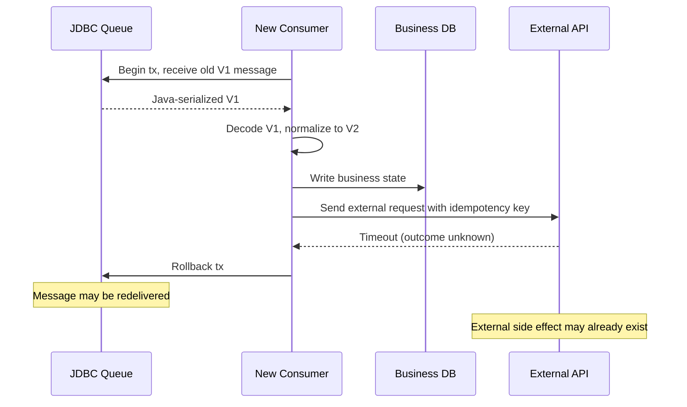
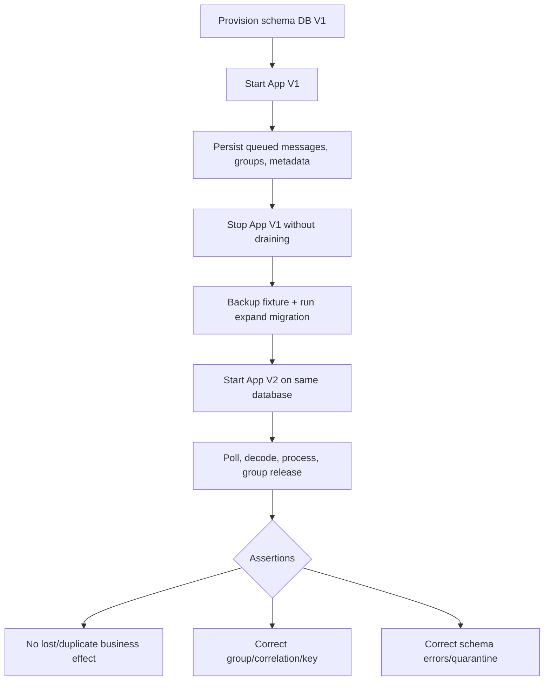

# Version schema của dữ liệu lưu trữ trong Spring Integration runtime

## 1. Vì sao schema version là một vấn đề của runtime?

Trong một message flow không lưu trạng thái, triển khai phiên bản mới thường chỉ cần chạy lại ứng dụng với code mới. Nhưng khi Spring Integration dùng **persistent message store**, dữ liệu do phiên bản cũ ghi có thể còn tồn tại sau nhiều lần restart: message trong `QueueChannel`, message group chưa hoàn tất của aggregator, metadata của file poller, hoặc khóa của idempotent receiver. Phiên bản mới phải **đọc được dữ liệu cũ và tiếp tục xử lý đúng ý nghĩa nghiệp vụ**.

Ví dụ: bản V1 nhận message với payload `OrderCreated(orderId, amount)` rồi lưu vào JDBC queue. Ứng dụng được nâng lên V2, đổi tên package/class của `OrderCreated` và thêm trường `currency`. Dù bảng `INT_CHANNEL_MESSAGE` vẫn tồn tại, Java deserializer của V2 có thể không khôi phục được message V1. Ngược lại, bảng có thể đã thêm cột mới nhưng node V1 vẫn dùng SQL/query provider không tương thích, dẫn tới lỗi lúc `poll()`.

**Version schema của dữ liệu lưu trữ** là cách kiểm soát thay đổi hợp đồng đọc/ghi **dữ liệu tồn tại ngoài vòng đời một lần chạy ứng dụng**. Đây là bài trong chương **Persistence và restart** thuộc module **SPRING_INTEGRATION_RUNTIME**. Chủ đề liên quan trực tiếp đến channel, endpoint, consumer, poller, executor, vòng đời IntegrationFlow, transaction, retry, message store, correlation, trạng thái runtime và khả năng khôi phục sau lỗi.

> **Giới hạn phiên bản:** Các cơ chế được nêu tham chiếu **Spring Integration 6.5.x**. Ví dụ code dùng Java 17, PostgreSQL và JDBC khi có chỉ định. Không suy ra có thể dùng nguyên các serializer/row mapper mới của Spring Integration 7.x trong ứng dụng 6.5.

Mục tiêu sau bài học:

1. Phân biệt **schema vật lý của database**, **format của message đã serialize** và **schema ngữ nghĩa của runtime state**.
2. Xây dựng quy trình migration có thể chạy khi còn message tồn đọng, nhiều node và cần rolling deployment.
3. Kiểm tra nâng cấp/rollback bằng dữ liệu thực sự được **bản cũ ghi và bản mới đọc**.
4. Chẩn đoán vì sao restart làm queue “trống”, aggregator kẹt, metadata bị nhận lại hoặc message không deserialize được.
5. Thiết kế giới hạn transaction, retry, replay và idempotency khi di chuyển dữ liệu lâu sống.

## 2. Ba lớp version thường bị trộn lẫn

| Lớp | Dữ liệu chứa gì? | Ví dụ thay đổi | Hỏng như thế nào sau upgrade? |
| --- | --- | --- | --- |
| **Physical/storage schema** | Table, column, index, constraint, SQL sequence, trigger, prefix. | Thêm cột trong bảng channel store; đổi index phục vụ poll. | SQL đọc/ghi thất bại, tăng lock wait, mất thứ tự FIFO hoặc khởi động lỗi. |
| **Serialization/payload schema** | Bytes hoặc document của payload và message headers. | `OrderCreated` đổi package, `serialVersionUID`, class fields; JSON đổi tên trường. | `ClassNotFoundException`, `InvalidClassException`, lỗi mapper, mất header hoặc dữ liệu sai ngầm. |
| **Semantic/runtime state schema** | Ý nghĩa của `region`, `groupId`, correlation key, sequence, metadata key/value, trạng thái đã xử lý. | Đổi quy tắc tạo key dedup, đổi release strategy aggregator, đổi tên channel. | Message còn trong DB nhưng không được tìm thấy; group release sai; event bị xử lý lại hoặc bỏ sót. |

Ngoài ra còn **phiên bản framework/driver/database**: nâng Spring Integration 6.x, Java, PostgreSQL driver hoặc Redis có thể làm thay đổi query, codec, lock và serialization contract. Một thay đổi chỉ “nâng dependency” vẫn có thể tác động ba lớp trên.

### 2.1. DDL version khác payload version

Không nên dùng một số `version = 7` duy nhất để ngầm đại diện cho mọi định dạng. Ví dụ:

```text
Application release       : 2026.11.0
Spring Integration line   : 6.5.x
Database migration        : V042
Persisted event schema    : order-created/v2
Idempotency key namespace : orders-in:v1
Aggregator correlation    : order-fulfillment:v1
```

Mỗi phiên bản trả lời một câu hỏi khác. `V042` chỉ nói migration vật lý nào đã chạy; nó không tự chỉ ra payload trong từng dòng là V1 hay V2. Khi cùng bảng có dữ liệu hỗn hợp, **mỗi message hoặc batch phải được nhận dạng format** bằng version trong envelope, schema ID, namespace có kiểm soát hoặc một quy tắc mapping có thể kiểm chứng.

### 2.2. Chứng cứ của tính tương thích

“Ứng dụng start được” chưa đủ chứng minh schema tương thích. Để kết luận upgrade an toàn, cần ít nhất:

- SQL của bản mới đọc được các hàng cũ, ghi đúng theo schema DB hiện tại.
- Payload/header cũ vẫn deserialize được với code và classpath mới.
- Group state, dedup keys và channel names tiếp tục mang **cùng ý nghĩa**.
- Transaction `receive + xử lý` có thể rollback khi gặp dữ liệu lỗi; không xóa message trước khi phát hiện lỗi.
- Có cách truy vết message bị từ chối và khôi phục/replay có kiểm soát.

## 3. Những bảng và tài nguyên Spring Integration thường lưu

Với PostgreSQL và table prefix mặc định `INT_`, bộ script JDBC của Spring Integration 6.5 có các đối tượng như sau. **Tên, kiểu cột và index phải đối chiếu với script `schema-postgresql.sql` của đúng phiên bản JAR và DDL thực tế đã triển khai**:

| Đối tượng | Vai trò chính | Rủi ro khi đổi schema |
| --- | --- | --- |
| `INT_CHANNEL_MESSAGE` | Lưu message của persistent channel (`JdbcChannelMessageStore`). | Column `MESSAGE_CONTENT`, `MESSAGE_SEQUENCE`, `REGION` và chỉ mục liên quan poll/priority phải khớp SQL query provider. |
| `INT_MESSAGE` | Message content của `JdbcMessageStore` (claim-check/group). | Bytes cũ có thể không đọc được bằng codec mới. |
| `INT_MESSAGE_GROUP` | Metadata về message group. | Thay đổi logic completed/release có thể làm group cũ xử lý khác đi. |
| `INT_GROUP_TO_MESSAGE` | Liên kết message với group. | Sai foreign mapping hoặc group key làm mất khả năng tổng hợp. |
| `INT_METADATA_STORE` | Khóa/giá trị cho metadata, feed/file marker, idempotency. | Đổi `REGION` hoặc quy tắc key có thể khiến khóa cũ không còn được nhận diện. |
| `INT_LOCK` | Thông tin JDBC lock registry nếu ứng dụng dùng. | Thay đổi lock semantics trong rolling upgrade có thể làm các node không phối hợp an toàn. |
| `INT_MESSAGE_SEQ` | Sequence phục vụ thứ tự message ở một số DB/script. | Tạo lại/reset sequence sai cách có thể tạo collision hoặc phá FIFO. |

Không phải mọi ứng dụng đều tạo hoặc sử dụng toàn bộ bảng. Mỗi store có thể được cấu hình `tablePrefix`, `region` và group key khác nhau, hoặc sử dụng database/schema riêng. Redis/MongoDB/Hazelcast có bố cục dữ liệu và hợp đồng persistence riêng; không được coi các bảng JDBC là quy chuẩn áp dụng cho mọi backend.

**Theo tài liệu Spring Integration 6.5:**

- `JdbcMessageStore` phù hợp với aggregator/claim-check, còn `JdbcChannelMessageStore` được tối ưu cho message channel.
- Module `spring-integration-jdbc` chứa script mẫu `org/springframework/integration/jdbc/schema-*.sql` cho nhiều loại database. Script là **mẫu cấu trúc cần có**, không phải hệ thống migration tự động.
- Từ **Spring Integration 6.2**, `JdbcMessageStore`, `JdbcChannelMessageStore`, `JdbcMetadataStore` và `DefaultLockRepository` kiểm tra sự tồn tại của bảng trong `SmartLifecycle.start()` bằng truy vấn đếm. **Kiểm tra tồn tại không tương đương xác minh đầy đủ tất cả cột, index, DDL version hoặc khả năng giải mã dữ liệu cũ.**
- `JdbcChannelMessageStore` có SQL riêng theo database thông qua `ChannelMessageStoreQueryProvider`. Thay framework version mà không đối chiếu query provider và DDL có thể làm poll thất bại hoặc đổi hiệu năng.
- Từ **6.2**, PostgreSQL provider dùng cách poll dựa trên `DELETE ... RETURNING` trong một statement; thay đổi query semantics cần test transaction, locking và concurrency.

## 4. Quản lý migration vật lý bằng công cụ DB

Không nên để nhiều instance ứng dụng tự ý chạy `DROP/CREATE` bảng của Spring Integration mỗi lần start. Với hệ thống có message đang chờ, lệnh drop sẽ xóa trạng thái hàng đợi, group và metadata. Hãy quản lý DDL như một phần của quy trình deployment bằng Flyway, Liquibase hoặc migration workflow tương đương; chỉ một pipeline/actor được phép thay đổi schema ở mỗi lần triển khai.

Một migration tốt cần có:

1. **Baseline:** version DDL hiện tại và script mẫu khớp chính xác với Spring Integration JAR/DB vendor.
2. **Up migration:** chỉ thay đổi cần thiết, xác định thứ tự, có precondition/lock chống chạy đồng thời.
3. **Dữ liệu cũ:** ước lượng số dòng, kích thước `MESSAGE_CONTENT`, backlog và thời gian migrate.
4. **Quy tắc compatibility:** xác định code cũ và code mới đọc/ghi được ở DDL mới hay không.
5. **Rollback/roll-forward:** cách phục hồi code, dữ liệu và migration history mà không làm mất message mới.
6. **Hậu kiểm:** verify table/column/index, group/store, payload round-trip, restart và latency poll.

### 4.1. Ví dụ mở rộng bảng ứng dụng bằng expand–backfill–contract

Ví dụ này minh họa **bảng do ứng dụng sở hữu** `APP_STORED_EVENT`, **không phải** lệnh áp trực tiếp vào `INT_CHANNEL_MESSAGE`. Giả sử ứng dụng lưu bản sao JSON có `EVENT_ID`, `PAYLOAD_JSON` và nay muốn có cột `PAYLOAD_SCHEMA_VERSION`.

**Giai đoạn expand** — thêm cột nullable để bản code cũ không cần biết:

```sql
-- V042__add_payload_schema_version.sql (PostgreSQL)
ALTER TABLE APP_STORED_EVENT
    ADD COLUMN PAYLOAD_SCHEMA_VERSION SMALLINT;
```

**Giai đoạn backfill** — nhận diện tất cả dòng V1 và cập nhật có điều kiện:

```sql
-- Chỉ được áp dụng nếu TẤT CẢ dòng cũ thực sự là format V1.
UPDATE APP_STORED_EVENT
SET PAYLOAD_SCHEMA_VERSION = 1
WHERE PAYLOAD_SCHEMA_VERSION IS NULL;
```

**Giai đoạn writer switch** — sau khi code mới biết đọc cả V1/V2 và mọi writer có thể ghi V2, thiết lập default cho dữ liệu mới nếu phù hợp hợp đồng:

```sql
ALTER TABLE APP_STORED_EVENT
    ALTER COLUMN PAYLOAD_SCHEMA_VERSION SET DEFAULT 2;

-- Chỉ áp dụng khi đã chứng minh không còn NULL và mọi writer tương thích.
ALTER TABLE APP_STORED_EVENT
    ALTER COLUMN PAYLOAD_SCHEMA_VERSION SET NOT NULL;
```

Đây chỉ là ví dụ cú pháp/chiến lược, không phải migration hoàn chỉnh cho mọi database. Với bảng lớn, dùng backfill **theo batch có checkpoint**, transaction ngắn và đo lock/wal/replication lag; không giả định một lệnh `UPDATE` toàn bảng là an toàn trong giờ cao điểm. **Nếu writer V1 còn chạy sau khi DB đặt `DEFAULT 2`**, một lệnh insert V1 không khai báo cột version có thể nhận default 2: **payload V1 bị gắn nhãn V2 sai**. Vì vậy, **không chuyển default sang 2 khi còn writer V1 không ghi version**, trừ khi đã có một cơ chế tương thích cụ thể. Thời điểm cắt writer là quyết định triển khai, không chỉ là bước SQL.

**Riêng bảng của Spring Integration:** không tự thêm, xóa hoặc đổi tên cột mà không đối chiếu SQL của `JdbcMessageStore`/`JdbcChannelMessageStore`; thứ tự cột, row mapper, query provider và index đều có thể có giả định cụ thể. Muốn thay serializer từ Java bytes sang JSON, cần thiết kế migration nội dung và codec song song; **không** chỉ đổi kiểu cột `MESSAGE_CONTENT` từ `BYTEA` sang `JSONB` rồi mong binary Java trở thành JSON hợp lệ.

## 5. Versioning của payload và message headers

### 5.1. Java serialization mặc định là một ràng buộc triển khai

Với `JdbcMessageStore`, tài liệu Spring Integration 6.5 nêu dữ liệu mặc định phải hỗ trợ `Serializable`; header không serializable có thể bị loại trước khi lưu. Vì vậy, một message đã được lưu trước triển khai là **hợp đồng nhị phân với classpath tại thời điểm đọc lại**, không chỉ là “đối tượng Java cũ”.

Các thay đổi dễ phá đọc lại:

- Đổi package/tên class của payload, xóa class cũ, đổi loại field hoặc hierarchy.
- Thay `serialVersionUID` hoặc dựa vào UID sinh tự động khi nội dung class thay đổi.
- Thêm `record`/sealed type trong khi binary cũ được ghi với class hoặc hierarchy khác.
- Thay kiểu header từ `String` sang enum/object custom, hoặc thay serializer strategy.
- Đưa đối tượng Spring bean, resource hoặc channel trực tiếp vào headers rồi mong restart khôi phục đúng tham chiếu.

**`serialVersionUID` không phải “schema migration”.** Giữ cùng UID có thể giúp một số thay đổi tương thích theo Java serialization, nhưng không chuyển đổi được ý nghĩa nghiệp vụ; đổi package/name vẫn có nguy cơ `ClassNotFoundException`, còn thay không tương thích có thể gây `InvalidClassException`. Nếu phải giữ Java serialization, cần đọc thật những blob do release cũ ghi trong test của release mới; không chỉ serialize rồi deserialize cùng version của class.

**Header reply/error channel:** gateway có thể dùng temporary reply channel sống trong process hiện tại. Persist message rồi restart không tự hồi sinh channel đó. Spring Integration cung cấp `HeaderChannelRegistry` và header enricher để thay một số tham chiếu channel bằng dạng có thể tra cứu; tuy nhiên còn phải đánh giá vòng đời registry và thời hạn yêu cầu. Một business request đã timeout trước khi restart không tự có caller đang chờ sau restart.

### 5.2. Thiết kế application envelope có schemaVersion

Với event do ứng dụng sở hữu, một envelope ổn định giúp tách model domain hiện tại khỏi định dạng lưu lâu dài:

```json
{
  "schemaVersion": 2,
  "eventId": "evt-204",
  "type": "OrderCreated",
  "data": {
    "orderId": "ORD-42",
    "amount": "125000",
    "currency": "VND"
  }
}
```

Quy ước:

1. `schemaVersion` mô tả **format của payload đã lưu**, không phải schema version của bảng.
2. `eventId` ổn định dùng cho dedup/reconciliation; `type` hoặc schema ID phân biệt loại event.
3. Đơn vị tiền/định dạng ngày/precision phải được quy định rõ; dùng chuỗi thập phân có thể tránh lỗi precision của số thực.
4. Trình đọc nhận biết **các phiên bản cũ đã được công bố** và chuẩn hóa sang model nội bộ V2; trình ghi chỉ phát V2 khi tất cả bên đọc có thể hiểu.
5. Version nằm trong dữ liệu được bảo quản; nếu để *chỉ* trong header có thể bị loại khi serialize hoặc bị thay đổi trên đường đi.

Đừng nhầm ví dụ envelope với cơ chế tự có của JDBC store 6.5. Với `JdbcMessageStore` có thể tùy chỉnh `Serializer`/`Deserializer`; với `JdbcChannelMessageStore` việc thay format lưu có thể cần tùy biến cách insert/đọc message. **Spring Integration 7.0 mới giới thiệu API JSON serialization tích hợp sẵn cho JDBC channel message store**, nên không copy nguyên API 7.x vào 6.5. Ở 6.5, bạn phải chủ động chọn adapter/transformer/custom codec phù hợp hoặc dùng một bảng ứng dụng sở hữu.

### 5.3. Ví dụ Java 17: reader đọc V1/V2, writer chỉ ghi V2

Ví dụ sau minh họa *application-owned event codec*, sử dụng Jackson `com.fasterxml.jackson.databind`. Nó không phải drop-in `MessageConverter` tự động cho `JdbcChannelMessageStore`. Ta giả định **V1 theo hợp đồng chỉ có đơn vị VND**; nếu dữ liệu lịch sử đa đơn vị tiền mà không lưu currency, không được bịa `"VND"`.

```java
import java.io.IOException;
import java.math.BigDecimal;

import com.fasterxml.jackson.databind.JsonNode;
import com.fasterxml.jackson.databind.ObjectMapper;
import com.fasterxml.jackson.databind.node.ObjectNode;

record NormalizedOrderEvent(
        String eventId, String orderId,
        BigDecimal amount, String currency) { }

final class OrderEventCodec {
    private final ObjectMapper json = new ObjectMapper();

    NormalizedOrderEvent decode(byte[] storedBytes) throws IOException {
        JsonNode envelope = json.readTree(storedBytes);
        if (envelope == null || !envelope.isObject()) {
            throw new IllegalArgumentException("Invalid event envelope");
        }
        int version = envelope.path("schemaVersion").asInt(-1);
        String eventId = requiredText(envelope, "eventId");
        JsonNode data = envelope.path("data");
        if (!data.isObject()) {
            throw new IllegalArgumentException("Missing data object");
        }

        String orderId = requiredText(data, "orderId");
        BigDecimal amount = new BigDecimal(requiredText(data, "amount"));
        if (amount.signum() <= 0) {
            throw new IllegalArgumentException("Amount must be positive");
        }
        return switch (version) {
            case 1 -> new NormalizedOrderEvent(
                    eventId, orderId, amount, "VND"); // Quy tắc cũ đã biết
            case 2 -> new NormalizedOrderEvent(
                    eventId, orderId, amount, requiredText(data, "currency"));
            default -> throw new IllegalArgumentException(
                    "Unsupported stored schemaVersion: " + version);
        };
    }

    byte[] encodeV2(NormalizedOrderEvent event) throws IOException {
        ObjectNode root = json.createObjectNode();
        root.put("schemaVersion", 2);
        root.put("eventId", event.eventId());
        root.put("type", "OrderCreated");
        ObjectNode data = root.putObject("data");
        data.put("orderId", event.orderId());
        data.put("amount", event.amount().toPlainString());
        data.put("currency", event.currency());
        return json.writeValueAsBytes(root);
    }

    private static String requiredText(JsonNode parent, String field) {
        JsonNode node = parent.get(field);
        if (node == null || !node.isTextual() || node.asText().isBlank()) {
            throw new IllegalArgumentException(
                    "Missing/invalid field: " + field);
        }
        return node.asText();
    }
}
```

Một test dạng *golden fixture* kiểm chứng rằng V1 do release cũ ghi và V2 hiện tại cùng dẫn tới kết quả nghiệp vụ mong muốn:

```java
import java.nio.charset.StandardCharsets;
import java.math.BigDecimal;
import org.junit.jupiter.api.Test;
import static org.junit.jupiter.api.Assertions.*;

class OrderEventCodecTest {
    private final OrderEventCodec codec = new OrderEventCodec();

    @Test
    void oldAndNewStoredFormatsDecodeToSameMeaning() throws Exception {
        String v1 = """
                {"schemaVersion":1,"eventId":"evt-204",
                 "data":{"orderId":"ORD-42","amount":"125000"}}
                """;
        String v2 = """
                {"schemaVersion":2,"eventId":"evt-204",
                 "data":{"orderId":"ORD-42","amount":"125000",
                         "currency":"VND"}}
                """;

        var fromOld = codec.decode(v1.getBytes(StandardCharsets.UTF_8));
        var fromNew = codec.decode(v2.getBytes(StandardCharsets.UTF_8));
        assertEquals(fromNew, fromOld);
        assertEquals(new BigDecimal("125000"), fromOld.amount());
        assertEquals(fromOld, codec.decode(codec.encodeV2(fromOld)));
    }

    @Test
    void unknownSchemaIsRejectedInsteadOfSilentlyGuessing() {
        String future = """
                {"schemaVersion":99,"eventId":"evt-x",
                 "data":{"orderId":"ORD-X","amount":"1"}}
                """;
        assertThrows(IllegalArgumentException.class,
                () -> codec.decode(future.getBytes(StandardCharsets.UTF_8)));
    }
}
```

Các ví dụ production nên thêm validation loại event, currency thuộc danh sách hợp lệ, schema registry hoặc schema ID, ngưỡng độ lớn payload và error/quarantine khi không đọc được. **Không** tự động suy phiên bản từ “thiếu trường currency” trừ khi đó là một hợp đồng đã xác minh và ghi chép; đoán version có thể làm sai dữ liệu cũ.

### 5.4. Một số incompatibility không thể sửa chỉ bằng reader

| Thay đổi | Có thể hỗ trợ đọc ngược? | Cần chú ý |
| --- | --- | --- |
| Thêm trường optional có default nghiệp vụ chắc chắn | Thường có. | Version cũ đọc mới có thể không biết trường mới; tránh writer switch quá sớm. |
| Đổi tên trường `amount` → `totalAmount` | Có, nếu reader/upcaster biết map rõ. | Không mất đơn vị/precision. |
| Đổi kiểu số thập phân → chuỗi | Có nếu định nghĩa parser và precision. | Lỗi locale và rounding; kiểm tra dữ liệu biên. |
| Xóa một trường bắt buộc của nghiệp vụ cũ | Không luôn luôn. | Nếu không có dữ liệu để khôi phục, phải quyết định bỏ/cách ly/migration bên ngoài. |
| Đổi package của class Java đã serialize | Thường rủi ro cao. | Cần giữ class cũ, chuyển dữ liệu bằng reader cũ hoặc đổi serializer có migration. |
| Bản V1 gặp schema V2 chưa hỗ trợ | Không bảo đảm. | Không cho V2 writer hoạt động cùng V1 reader nếu chưa chứng minh tương thích. |

## 6. Version của metadata store, group state và định danh runtime

Khác payload, **semantic version của state** có thể làm sai message ngay cả khi JDBC query và deserializer vẫn hoạt động.

### 6.1. Metadata keys: chống bỏ lỡ hoặc xử lý trùng

Giả sử idempotent receiver V1 tạo key `payment:{eventId}` trong `JdbcMetadataStore` vùng `RX_V1`. V2 đổi key thành `payment:{tenantId}:{eventId}` và vùng `RX_V2`. Các key V1 vẫn nằm trong DB, nhưng V2 có thể không tìm ra chúng; cùng event được nhận lại như message mới.

| Trước nâng cấp | Sau nâng cấp | Hậu quả nếu bỏ qua migration |
| --- | --- | --- |
| `region = RX_V1` | `region = RX_V2` | Store không tra cứu các marker ở vùng cũ. |
| `payment:{eventId}` | `payment:{tenant}:{eventId}` | Event cũ có thể được xử lý lại. |
| Value là timestamp của file | Value đổi thành số offset | So sánh phiên bản sai, có thể bỏ qua cập nhật hợp lệ. |
| File poller giữ checkpoint ở path cũ | File/path đổi | File cũ có thể được quét/đọc lại. |

**Cách chuyển:** xác định trước mapping key cũ → mới, điều kiện nhận diện namespace, collision và retention. Có thể cho code mới **dual-read** marker cũ và mới trong giai đoạn chuyển, đồng thời ghi vào format mới có transaction; chỉ bỏ dual-read khi thời hạn redelivery/replay an toàn đã qua. Nếu không thể map vì key V1 không có tenant, đừng đoán: dùng business inbox hoặc reconciliation từ nguồn chuẩn.

### 6.2. Message group: correlation/release strategy là schema ngữ nghĩa

Aggregator và resequencer dùng `MessageGroupStore` giữ nhóm theo key tương quan, message chưa release và metadata hoàn tất. Đổi release strategy, correlation key hoặc cách xử lý late arrivals có thể làm:

- Nhóm cũ không bao giờ đạt điều kiện release của code mới.
- Hai nhóm hợp lệ bị gộp hoặc một nhóm cũ bị tách.
- Một result được phát hai lần vì completed marker hoặc expiry policy đổi.
- Một phần message cũ bị bỏ khi reaper dọn group theo timeout mới.

Thay đổi group strategy cần phương án cụ thể: **drain nhóm cũ trước deploy**, duy trì hai flow theo namespace V1/V2, hoặc migrate group state với idempotent business output. Tránh việc hai phiên bản aggregator dùng cùng `region/groupId` nhưng có release semantics khác nhau. Khi nhiều instance cùng chia sẻ store, dùng `LockRegistry` phân tán phù hợp; khóa local chỉ bảo vệ cùng một JVM.

### 6.3. Channel names, reply/error routes và IntegrationFlow động

Định danh channel/group phải ổn định qua restart nếu muốn `QueueChannel` mới đọc được hàng đợi cũ. Đổi `tablePrefix`, `region`, `groupId` hoặc ID endpoint động của `IntegrationFlowContext` có thể làm message nằm lại trong backend nhưng không có consumer tìm đến. Đồng thời:

- `replyChannel` và `errorChannel` tạm thời của gateway có thể không tồn tại ở lần chạy mới; thiết kế request/reply bền vững cần channel resolution/registry và timeout semantics riêng.
- Với flow được tạo/xóa động, phải quản lý cả vòng đời flow **và** vòng đời dữ liệu của logical queue/group; xóa registration không tự xóa hoặc migrate persisted rows.
- Correlation key dùng chung nhiều loại event không bảo đảm idempotency; ghi rõ namespace/version của key khi thay đổi release logic.

## 7. Kế hoạch rollout: expand → read-both → migrate → write-new → contract

Một migration nhiều phiên bản an toàn cần trả lời **ai đang đọc, ai đang ghi, ai còn dữ liệu cũ**. Đặt tên:

- **A1:** ứng dụng cũ, đọc và ghi payload V1.
- **A2:** ứng dụng mới, đọc V1+V2 và có khả năng ghi V2.
- **DB1:** bảng cũ; **DB2-expanded:** thêm cột/index tương thích.

Ma trận tương thích mẫu:

| Code đang chạy | DDL đang dùng | Dữ liệu trong store | Được cho phép? |
| --- | --- | --- | --- |
| A1 | DB1 | Chỉ V1 | Có — baseline trước nâng cấp. |
| A1 | DB2-expanded | Chỉ V1 | Có **nếu** migration expand giữ được mọi SQL của A1. |
| A1 + A2 rolling | DB2-expanded | Chỉ V1 được ghi, cả hai reader đọc được | Có điều kiện — A2 chưa được ghi format V2. |
| Chỉ A2 | DB2-expanded | Hỗn hợp V1/V2 | Có — A2 phải đọc được cả hai. |
| A1 + A2 rolling | DB2-expanded | Có V2 | **Không an toàn** nếu A1 không thể deserialize V2. |
| Chỉ A2 | DB2-contracted | Chỉ dữ liệu còn được A2 hỗ trợ | Có sau backfill và kiểm tra rollback window. |
| Rollback A2 về A1 | DB2 + data V2 | V2 vẫn còn | **Không an toàn** trừ khi A1 có compatibility reader hoặc dữ liệu đã được chuyển ngược an toàn. |

**Trình tự rollout tiêu biểu:**

1. **Inventory và backup:** chụp version schema, backlog, group chưa release, metadata regions, table prefixes, số lượng blob theo loại/tuổi, class phiên bản cũ. Backup phải có phương án restore được kiểm chứng.
2. **Expand DB:** thêm cột/index tương thích trước, vẫn giữ code A1 chạy được; chưa đổi serializer của dữ liệu đang ghi.
3. **Đưa A2 dual-reader:** triển khai dần code mới có thể đọc dữ liệu V1/V2 nhưng **chỉ ghi V1** trong thời gian A1 còn tồn tại. Sử dụng feature flag cho writer switch.
4. **Chạy migration/backfill:** với dữ liệu chuyển được an toàn, upcast sang format mới theo batch, có checkpoint và kiểm tra từng đơn vị. Không xóa bản cũ trước khi có bằng chứng thành công.
5. **Chuyển writer sang V2:** khi toàn bộ consumer/rollback fleet đáp ứng reader V2, bật ghi V2. Quan sát lỗi deserialization/retry/queue depth.
6. **Contract:** sau khi đảm bảo hết dữ liệu V1 trong tất cả backlog, group store, delayed messages, backup/replay horizon, mới dọn reader V1/cột cũ nếu cần. Contract có thể được thực hiện ở một release rất xa.

### 7.1. Rolling deployment hay drain trước khi chuyển?

Hai chiến lược có chi phí khác nhau:

| Chiến lược | Cách làm | Phù hợp khi | Rủi ro |
| --- | --- | --- | --- |
| **Drain → migrate → resume** | Tạm dừng ingress, để consumer xử lý hết backlog, dừng poller, backup, nâng schema/code, sau đó mở lại. | Có cửa sổ bảo trì; queue có thể về 0; schema/codec không tương thích mạnh. | Downtime, nhóm aggregator có thể còn chưa đủ dù queue trống, source ngoài có thể tiếp tục gửi. |
| **Expand + rolling + dual-reader** | DB tương thích cả A1/A2, reader mới hiểu V1+V2, bật writer V2 sau khi A1 rời fleet. | Yêu cầu uptime cao, có thể phát triển backward-compatible reader. | Cấu hình phức tạp, đòi kiểm tra thực tế cả hai phiên bản đọc cùng persisted state. |
| **Blue/green store riêng** | Hai vùng/store tách biệt; chuyển traffic, drain/migrate state theo kế hoạch. | Muốn đổi codec rất lớn hoặc SQL/table structure không tương thích. | Dễ bỏ sót in-flight messages, correlation group, metadata marker hoặc tạo hai consumer cùng xử lý event. |

**“Queue size = 0” chưa có nghĩa đã drain xong:** một aggregator có thể đang giữ message group chưa hoàn tất, delayer giữ message chờ, metadata còn marker, outbound request đang chờ callback, executor còn tasks trong bộ nhớ. Phải kiểm tra tất cả component có trạng thái trong IntegrationFlow, bao gồm các flow được đăng ký động.

### 7.2. Ai kiểm soát dừng và mở lại?

Quy trình thực tế cần phân biệt **ngừng nhận nguồn** với **ngừng xử lý backlog**:

- Dừng ingress/producer ở tầng được kiểm soát để không có message mới chạy vào vùng đang migrate; nếu producer bên ngoài không thể dừng, cần tách nguồn sang một queue bền vững hoặc buffer khác.
- Để consumer drain nếu dùng chiến lược drain; sau đó dừng poller/endpoint có transaction một cách có kiểm soát trước khi sửa store.
- Với rolling upgrade, giữ các endpoints được phép chạy trên **schema hiện tại** và không để phiên bản cũ đọc format mới trước khi tương thích.
- Nếu đổi region/table prefix, có kế hoạch **chuyển message theo transaction** hoặc dùng double-reader có idempotency. Đổi một cấu hình rồi bỏ mặc vùng dữ liệu cũ sẽ không di chuyển dữ liệu.

## 8. Migration của binary message phải có code đọc dữ liệu cũ

Spring Integration 6.5 lưu Java-serialized message theo định dạng nội bộ phù hợp store. Với blob `MESSAGE_CONTENT`, một câu SQL có thể copy bytes, nhưng **không tự hiểu class Java**, không thể thêm trường currency hay đổi package class. Đối với schema payload, migration đúng cần **reader của format cũ** và **writer của format mới**, hoặc một adapter trung gian biết hai format.

Ví dụ khung migration dành cho bảng **do ứng dụng sở hữu**:

```text
for each batch of rows in APP_STORED_EVENT:
    read row ID + schemaVersion + payload with consistent snapshot
    if schemaVersion == 1:
        decode payload using V1 decoder
        upcast to normalized model
        encode V2
        update row only if ID/version still matches original
        commit small transaction + record checkpoint
    else if schemaVersion == 2:
        leave row unchanged
    else:
        quarantine row and stop/alert for unsupported version

verify counts, checksums, representative decoding, business invariants
```

Điều kiện `WHERE id = ? AND payload_schema_version = 1` cùng kiểm tra row count giúp tránh ghi đè dữ liệu đã được process khác nâng cấp. Với persistent message queue đang được poll, không thể tùy tiện update payload khi consumer khác đang nhận; cần khóa/snapshot, dừng pollers hoặc migration chiến lược phù hợp isolation.

**Với bảng Spring Integration sở hữu:** một message ID có thể được dùng bởi `INT_GROUP_TO_MESSAGE`, `INT_MESSAGE` hoặc correlation state. Không tạo message ID mới và xóa row cũ rồi bỏ mặc liên kết group. Nếu di chuyển store giữa bảng/regions, phải chuyển cả thông tin nhóm, order, completed markers và metadata còn liên quan, hoặc chọn drain hết các state đó trước.

### 8.1. Vì sao không nên đổi kiểu `MESSAGE_CONTENT` trực tiếp?

Nếu dữ liệu cũ là Java serialization `byte[]` trong PostgreSQL `BYTEA`, một lệnh:

```sql
-- Ví dụ không an toàn khi dữ liệu cũ là Java-serialized bytes:
-- ALTER TABLE INT_CHANNEL_MESSAGE
--   ALTER COLUMN MESSAGE_CONTENT TYPE JSONB
--   USING MESSAGE_CONTENT::text::jsonb;
```

không thực hiện quá trình Java deserialization, không upcast class cũ và không chuyển header/channel thành đối tượng runtime mới. Với dữ liệu còn tồn, cần migration hai bước/dual-store hoặc custom converter đã được test. Nếu sử dụng API JSON serializer từ Spring Integration 7.x, lại có yêu cầu phiên bản framework và storage schema riêng; đó không phải API mặc định của 6.5.

### 8.2. Những trường hợp không có migration tự động an toàn

- Payload cũ thiếu trường bắt buộc mà không có nguồn sự thật để suy ra.
- Dữ liệu nhị phân được ghi bởi class đã biến mất, không còn bản build/classloader đủ khả năng đọc.
- Legacy codec dùng dữ liệu nhạy cảm nhưng không còn khóa giải mã.
- Message group V1 có correlation/sequence không thể map một-một sang V2.
- Một số request/reply headers chỉ tham chiếu temporary channel đã chết.

Các trường hợp này cần **quarantine, reconciliation, archival hoặc manual remediation**. Không silently skip để làm đẹp metric “migration success”.

## 9. Transaction, retry và crash window khi chuyển đổi dữ liệu

Nếu message đã persist trong JDBC queue, một poller transactional có thể đưa `receive()` và business JDBC write vào cùng transaction. Điều này có ích sau restart vì rollback có thể khôi phục message để xử lý lại. Tuy nhiên, nó **không đảm bảo migration và tất cả side effects nguyên tử**.



| Crash/lỗi xảy ra tại | Hậu quả điển hình | Cách bảo vệ |
| --- | --- | --- |
| Trước commit của producer | Message có thể chưa được lưu bền. | Xác nhận commit/ack đúng giao thức và nguồn phát. |
| Sau khi lưu, trước khi consumer nhận | Message còn trong store nếu transaction đã commit. | Khôi phục poller và đúng region/group sau restart. |
| Sau `receive()` nhưng trước commit poller | Nếu receive transactional, DB rollback có thể trả message về store. | Retry giới hạn, idempotency và kiểm chứng rollback. |
| Decode V1 thất bại | Có thể bị retry vô hạn nếu xem là lỗi tạm thời. | Phân loại lỗi schema/permanent, quarantine có nguồn/correlation. |
| Sau business DB commit nhưng trước external call | Side effect ngoài chưa thực hiện. | Outbox, workflow trạng thái và replay. |
| External call thành công nhưng timeout, DB rollback | Redelivery có thể gọi external API lần nữa. | Stable idempotency key, trạng thái đối soát ở phía nhận. |
| Sau khi ghi format mới, trước khi ghi migration checkpoint | Batch có thể chạy lại. | Migration idempotent + CAS theo version và checkpoint trong cùng transaction nếu có thể. |
| Sau cutover writer V2 nhưng phải rollback app V1 | V1 có thể không đọc dữ liệu mới. | Giữ dual-reader tương thích hoặc roll-forward; không rollback mù quáng. |

Retry có thể được cấu hình qua `RequestHandlerRetryAdvice` hoặc ở poller/source. **Không** dùng retry vô hạn cho `ClassNotFoundException`, `InvalidClassException` hoặc unsupported `schemaVersion`; dữ liệu không tự sửa khi gọi lại. Nếu một phiên bản chạy cùng lúc với phiên bản mới, việc poll lặp có thể gây contention hoặc poison message. Nên có nhánh lỗi dữ liệu bền vững và cơ chế phát lại sau khi sửa.

**Thứ tự advice và transaction:** nếu transaction bọc `receive()` và xử lý đồng bộ, rollback có thể bảo vệ cùng JDBC store. `ExecutorChannel` hoặc bước async khác tạo thread boundary; transaction không tự chuyển sang executor. Đừng giả định handler/codec ở thread khác vẫn tham gia transaction của poller.

### 9.1. Chính sách rollback release khác rollback DDL

- **Rollback code:** chạy lại binary/application release cũ. An toàn chỉ khi code cũ đọc được dữ liệu hiện tại và tương thích schema vật lý.
- **Rollback DDL:** khôi phục cấu trúc database. Thao tác drop column/table có thể xóa dữ liệu do release mới tạo.
- **Restore backup:** đưa database về snapshot cũ. Có nguy cơ mất những message/business writes được commit sau snapshot; cần replay delta nếu dùng.
- **Roll-forward:** giữ schema hiện tại và triển khai bản sửa đọc được dữ liệu hỗn hợp. Thường là lựa chọn thực tế sau khi writer mới đã phát format không đọc ngược.

Phải thử runbook phục hồi trên dữ liệu copy trước deployment. Không tự động chạy script `drop-*.sql` từ thư viện nhằm “rollback nhanh” — script đó xóa bảng/state.

## 10. Kiểm thử tương thích trước và sau restart

Test quan trọng nhất cho dữ liệu lưu lâu dài là **cross-version test**: phiên bản cũ phải ghi ra dữ liệu thực, phiên bản mới phải đọc dữ liệu đó sau restart. Một test `serialize → deserialize` trong cùng phiên bản **không chứng minh** tương thích với release cũ.

### 10.1. Bộ fixture cần lưu

Chuẩn bị dữ liệu tạo từ **chính release cũ**, ví dụ:

| Fixture | Nội dung được lưu | Điều cần chứng minh sau upgrade |
| --- | --- | --- |
| V1 queue message | Payload và header từ class V1, `correlationId` hợp lệ. | V2 đọc được, chuyển đúng model, xử lý đúng một kết quả nghiệp vụ. |
| V1 message group | Hai trong ba message của một aggregator, group chưa release. | V2 nhận phần còn lại và release theo hợp đồng hoặc chuyển nhóm theo kế hoạch. |
| V1 metadata key | Marker idempotency hoặc file checkpoint. | V2 không tự xử lý lại event đã hoàn tất hoặc bỏ sót event mới. |
| V1 priority queue | Nhiều message cùng priority/time gần nhau. | Thứ tự theo quy tắc store phù hợp, không trùng/lạc message. |
| Header có reply/error routing | Message được persisted qua queue và gateway. | Cơ chế channel resolution sau restart đáp ứng đúng hợp đồng hoặc báo timeout có kiểm soát. |
| Dữ liệu corrupted/unknown schema | Blob lỗi, schemaVersion tương lai. | Có lỗi phân loại và quarantine; không retry vô hạn hoặc silently drop. |

Đối với Java serialization, fixture cần giữ **raw bytes từ ứng dụng V1** và classpath tương ứng để chẩn đoán. Không ghi đè fixture cũ bằng output của V2 mỗi lần test chạy. Với JSON, giữ các envelope đại diện gồm schema V1, V2, missing field, extra field, null, Unicode, độ lớn số và định dạng thời gian.

### 10.2. Test hai tiến trình cùng database

Sử dụng một instance PostgreSQL test bền trong suốt kịch bản (có thể qua Testcontainers hoặc database integration test), **không thay đổi dữ liệu giữa hai tiến trình** ngoài thao tác có chủ đích:



Với nguồn/poller, cần đảm bảo lúc ghi fixture không có consumer khác lấy mất message; khi kiểm tra V2, cần xác định chính xác poller nào đang chạy. Nếu V1 và V2 cùng chạy trong rolling test, cho chúng chia sẻ backend nhưng phải thiết kế tương thích và **không bật writer V2 khi V1 vẫn đọc và chưa biết V2**.

### 10.3. Ma trận kiểm thử tối thiểu

| Trường hợp | Tác động giả lập | Assertion bắt buộc |
| --- | --- | --- |
| T1 — Old → New | V1 persist message, tắt V1, V2 đọc. | Payload/headers cần thiết đúng, side effect một lần. |
| T2 — Mixed versions | Hai reader V1/V2 cùng polling khi chỉ có writer V1. | Không có lỗi version/SQL; không mất message. |
| T3 — Writer switch | Tất cả reader V2, bật writer V2. | V2 đọc cả dữ liệu cũ và mới; không còn lỗi decode V1. |
| T4 — Rollback giả định | Khi đã có V2 data, thử chạy lại A1 trên DB clone. | Phải chứng minh được tương thích; nếu fail, cấm rollback code về A1. |
| T5 — Crash before commit | Poller nhận message, xử lý rồi crash/rollback. | Message có thể được nhận lại theo contract transaction; side effect JDBC không bị ghi hai lần. |
| T6 — Unknown schema | Chèn payload version chưa hỗ trợ. | Không ack sai; quarantine có thông tin phục hồi. |
| T7 — Aggregator state | Persist partial group V1, hoàn thành bằng V2 event. | Group release/discard đúng theo semantics đã thống nhất. |
| T8 — Metadata marker | V1 đã xử lý event, V2 chạy cùng nguồn. | Không xử lý trùng do đổi namespace/key strategy. |
| T9 — Large backfill | Hàng triệu row đại diện, migration theo batch. | Không vượt lock window/pool, checkpoint resume và kiểm chứng row count. |
| T10 — Two nodes | V2 chạy đa instance, cùng persistent state. | Lock/isolation/idempotency đúng, không double-release. |

**Test idempotency:** khi message được redeliver do rollback, việc handler gọi hai lần có thể là hành vi đúng về transport. Assertion cần nhắm tới **một business effect cuối cùng** theo business key, không áp `handlerInvocationCount == 1` cho mọi tình huống.

### 10.4. Ví dụ kiểm kê SQL trên PostgreSQL trước/sau migration

Các truy vấn đọc sau chỉ giúp **đối chiếu số lượng và phân vùng**, không chứng minh nội dung payload đã deserialize đúng:

```sql
-- Đếm message theo logical queue (region + group key).
SELECT REGION, GROUP_KEY, COUNT(*) AS pending_count
FROM INT_CHANNEL_MESSAGE
GROUP BY REGION, GROUP_KEY
ORDER BY REGION, GROUP_KEY;

-- Đếm các nhóm còn lưu theo region.
SELECT REGION, COUNT(*) AS group_count
FROM INT_MESSAGE_GROUP
GROUP BY REGION
ORDER BY REGION;

-- Đếm metadata markers theo vùng.
SELECT REGION, COUNT(*) AS metadata_count
FROM INT_METADATA_STORE
GROUP BY REGION
ORDER BY REGION;
```

Nếu bảng có prefix khác `INT_`, phải thay truy vấn tương ứng. Chạy bằng tài khoản **read-only** khi kiểm kê production. Không kết luận “không mất message” chỉ từ số hàng: một message có thể đã được xử lý/commit trong lúc đo; cần so theo khoảng thời gian và kết hợp message ID/business ID, transaction log, backlog age và event outcome.

## 11. Chẩn đoán sau deploy và kiểm soát tính toàn vẹn

### 11.1. Dấu hiệu cần giám sát

| Tín hiệu runtime | Diễn giải khả dĩ |
| --- | --- |
| Startup fail vì bảng/column thiếu | DDL chưa migrate, prefix sai, script khác DB vendor. |
| `ClassNotFoundException` hoặc `InvalidClassException` | Payload/header Java serialization không còn tương thích. |
| `MessageConversionException` hoặc lỗi JSON schema | Writer đã chuyển format nhưng reader chưa hiểu, hoặc dữ liệu hỏng. |
| Backlog tăng đột ngột sau rollout | Poller chết, SQL provider không tương thích, poison message hoặc lock contention. |
| Queue trống ở dashboard nhưng bảng còn rows | `region`, `groupId`, prefix hoặc logical channel khác. |
| Duplicate business events tăng | Metadata key/region đổi hoặc recovery/retry gây replay. |
| Aggregator groups không hoàn tất | Correlation/release strategy đổi, group incomplete hoặc lock registry bất thường. |
| Gateway timeout khi message sống qua restart | `replyChannel` tạm thời biến mất, caller không còn chờ, route không còn hợp lệ. |
| Poll latency tăng, DB lock wait tăng | Index/DDL/SQL plan thay đổi, migrate/backfill đang tranh lock. |
| Không đọc được messages mới sau rollback | Release cũ không hiểu format mới đã ghi. |

Khi phát hiện lỗi deserialize ở consumer, hãy giữ lại **đúng bytes và metadata cần thiết** ở nơi kiểm soát truy cập trước khi can thiệp; thông tin nhạy cảm trong payload không nên đưa thẳng vào log hay message lỗi công khai. Gắn correlation/business key, tên store/region, application build, schema version và exception cause vào trace. Đặc biệt, đừng để retry policy coi lỗi schema cố định là lỗi tạm thời.

### 11.2. Quy trình điều tra một “message biến mất”

1. Xác minh producer có gửi và **commit** message chưa; kiểm tra transaction/ack/response.
2. Xác định đúng backend, DB schema, table prefix, region, logical group/channel ID của **cả V1 và V2**.
3. Tra cứu row tồn tại, cùng message ID, thời điểm tạo và business key; đối chiếu group mapping/metadata marker.
4. Xem poller/executor nào thực sự chạy; transaction `receive()` có rollback khi lỗi không?
5. Xem lỗi serialization/deserialization và classpath. Nếu lỗi đọc V1, tách dữ liệu vào quarantine thay vì drop.
6. Kiểm tra flow registration và endpoint lifecycle; một flow động bị stop/remove có thể để lại backlog trong store.
7. Đối chiếu side effect cuối cùng với inbox/outbox hoặc hệ thống nhận để phát hiện đã xử lý nhưng không ack.
8. Nếu do migration, ngừng writer/cutover liên quan, chạy recovery theo runbook và xác thực lại trên bản copy trước.

### 11.3. Checklist vận hành trước khi bật writer mới

- Migration history đã áp dụng đúng DB/schema và table prefix của production.
- Mọi node/consumer đang chạy đều có reader hỗ trợ V2; không còn node V1 có thể poll V2.
- Đã kiểm chứng đọc **fixture do release cũ tạo**, gồm partial group, metadata và headers.
- Backlog, oldest message age, count group chưa hoàn tất và region map có baseline đối chiếu.
- Transaction/retry/recovery được test với lỗi deserialize và crash ở ranh giới commit.
- Đã thử rollback code trên snapshot có **V2 data** hoặc quyết định rõ chỉ roll-forward.
- Có quan sát tỷ lệ lỗi decode, queue depth, DLQ/quarantine, DB lock, latency poll và duplicate business effects.
- Có cách xử lý message unknown schema có kiểm soát; không retry vô hạn, không tự động xóa blob cũ.
- Có backup/restore drill và cách tiếp tục backfill khi tiến trình migration dừng giữa chừng.

## 12. Bài tập thực hành

**Bài tập 1 — Ba version khác nhau:** cho app release `R15` đang chạy Spring Integration `6.5.x` với DB migration `V035` và payload `order/v1`. Liệt kê những thành phần cần kiểm tra khi đưa app lên `R16`, DB `V036` và `order/v2`. Vì sao không thể nói “database đã lên V036 nên message tự là V2”?

**Bài tập 2 — Backward reader:** mở rộng `OrderEventCodec` để nhận thêm V0 với trường `totalMinorUnits`. Xác định rõ tiền tệ và quy tắc đổi đơn vị. Viết test cho amount rất lớn, số âm, thiếu trường và schema unknown.

**Bài tập 3 — Golden fixture:** tạo một build V1 thực sự lưu message vào PostgreSQL JDBC store, sau đó stop nó. Khởi chạy V2 trên cùng database mà không drop bảng. Chứng minh V2 đọc đúng payload, correlation header và không sinh side effect trùng.

**Bài tập 4 — Rolling deploy:** mô phỏng hai instance A1/A2; A1 chỉ đọc V1, A2 đọc cả V1/V2. Viết bảng các thời điểm được/không được bật writer V2; thử rollback A2 về A1 trên snapshot chứa V2 rows để chứng minh giới hạn.

**Bài tập 5 — Region và metadata:** đổi `region` hoặc key prefix của `JdbcMetadataStore`; phát lại cùng event rồi ghi nhận việc dedup có thay đổi không. Thiết kế dual-read/migration key tránh xử lý trùng.

**Bài tập 6 — Aggregator sống qua restart:** lưu hai trong ba message của cùng một group, stop V1, khởi chạy V2 rồi gửi message thứ ba. Kiểm tra release strategy, completed markers và late-arrival handling.

**Bài tập 7 — Crash trong migration:** cập nhật theo batch có checkpoint, giả lập tiến trình chết giữa hai batch. Chạy lại và chứng minh update idempotent, không xóa các row chưa được xác nhận và không tạo message ID mới làm gãy group mapping.

**Bài tập 8 — Poison message:** đưa một payload có `schemaVersion=99` vào store. Xác minh consumer không retry vô hạn, event được quarantine đủ thông tin và business outcome không được đánh dấu thành công giả.

**Bài tập 9 — SQL hiệu năng:** sau khi thêm index phục vụ poll, so sánh execution plan/lock wait và throughput trên backlog test; đừng chỉ đo thời gian `ApplicationContext.start()`.

### Câu hỏi tự kiểm tra

1. Vì sao DDL tương thích chưa bảo đảm message blob cũ đọc được?
2. `serialVersionUID` giải quyết được và không giải quyết được kiểu thay đổi nào?
3. Vì sao không được bật writer V2 khi vẫn có consumer V1 không hiểu V2?
4. Tại sao đổi `region` hoặc `groupId` có thể khiến queue trông như mất message?
5. Làm sao biết một aggregator còn trạng thái chưa hoàn tất dù `QueueChannel` đã trống?
6. Vì sao chỉ khởi động thành công không chứng minh migration đã đúng?
7. Khi `receive()` transactional rollback, điều gì có thể được khôi phục và điều gì không tự rollback?
8. Sự khác biệt giữa rollback code, rollback DDL, restore backup và roll-forward?
9. Khi chuyển Java blob sang JSON, vì sao một câu SQL cast kiểu cột không đủ?
10. Khi thay đổi idempotency key, điều gì có thể xảy ra với event đã xử lý từ V1?

## 13. Tài liệu chính thức và hướng đối chiếu

- Spring Integration 6.5 — [Message Store](https://docs.spring.io/spring-integration/reference/6.5/message-store.html): persistence, serialization, `JdbcMessageStore` và ảnh hưởng tới headers.
- Spring Integration 6.5 — [JDBC Message Store](https://docs.spring.io/spring-integration/reference/6.5/jdbc/message-store.html): schema scripts, channel store, table prefix, region và query provider.
- Spring Integration 6.5 — [JDBC Metadata Store](https://docs.spring.io/spring-integration/reference/6.5/jdbc/metadata-store.html): marker, region, transaction và atomicity.
- Spring Integration 6.5 — [Transaction Support](https://docs.spring.io/spring-integration/reference/6.5/transactions.html): transaction của poller và các ranh giới flow.
- Spring Integration 6.5 — [Aggregator](https://docs.spring.io/spring-integration/reference/6.5/aggregator.html): message group, correlation, release strategy và expiration.
- Spring Integration — [Changes between 6.4 and 6.5](https://docs.spring.io/spring-integration/reference/changes-6.4-6.5.html): đối chiếu thay đổi framework khi nâng cấp.
- Spring Integration 6.5 API — [`JdbcMessageStore`](https://docs.spring.io/spring-integration/docs/6.5.0/api/org/springframework/integration/jdbc/store/JdbcMessageStore.html) và [`JdbcChannelMessageStore`](https://docs.spring.io/spring-integration/docs/6.5.0/api/org/springframework/integration/jdbc/store/JdbcChannelMessageStore.html).
- Spring Integration JDBC — script `org/springframework/integration/jdbc/schema-postgresql.sql` **được đóng gói trong JAR của đúng version triển khai**; dùng nó làm điểm so sánh với DDL đang tồn tại thay vì copy schema từ nhánh mã nguồn khác.

**Ghi chú về Spring Integration 7.x:** nếu đang xem tài liệu mới về `JsonChannelMessageStorePreparedStatementSetter` và `JsonMessageRowMapper`, các API JSON này được giới thiệu từ 7.0. Với ứng dụng 6.5, hãy xem chúng là hướng tham khảo cho **một kế hoạch nâng version riêng**, không phải lựa chọn cấu hình sẵn có.
