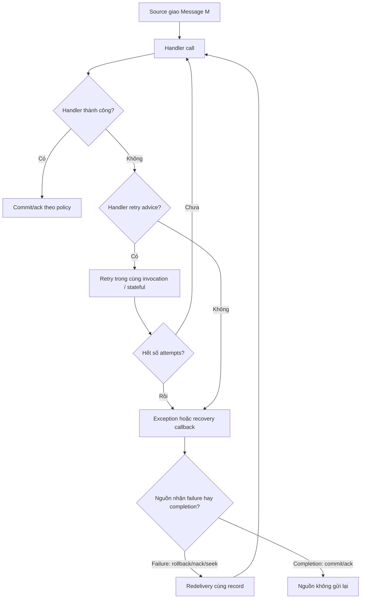

# Poison message sau khi khởi động lại trong Spring Integration

## 1. Vì sao một message cũ có thể làm hệ thống lỗi liên tục sau restart?

Trong Spring Integration, **poison message** là message mà một consumer không thể xử lý thành công với cấu hình và mã chương trình hiện tại. Khi nguồn message có lưu trữ bền vững và cơ chế redelivery, cùng một message có thể được xử lý lại nhiều lần. Nếu lỗi có tính cố định, mỗi lần thử đều thất bại. Khi ứng dụng khởi động lại, message chưa được acknowledge/commit vẫn còn và tiếp tục gây lỗi.

Bài **Poison message sau khi khởi động lại** thuộc chương **Persistence và restart** của module `SPRING_INTEGRATION_RUNTIME`. Phạm vi bài học là đường đi của message qua channel, endpoint, consumer, poller, executor, transaction, retry, message store và error flow; cách quyết định commit/rollback, cách ly message lỗi và khôi phục hệ thống an toàn.

Một tình huống thực tế:

1. Ứng dụng nhận message `POISON-17` và ghi nó vào một `QueueChannel` được hỗ trợ bởi `JdbcChannelMessageStore`.
2. Poller lấy message trong một transaction; handler thử xử lý nhưng luôn ném `IllegalArgumentException` vì dữ liệu không hợp lệ.
3. Transaction rollback, bao gồm cả việc lấy message khỏi JDBC store. Message vẫn tồn tại.
4. Ứng dụng tắt và khởi động lại. Queue dùng lại cùng database, `region` và group ID nên `POISON-17` được lấy lại.
5. Consumer tiếp tục ném lỗi mỗi lần poll. Tùy kiểu source/ordering, message này có thể chiếm tài nguyên và khiến công việc hợp lệ ở phía sau bị trễ.

**Poison không phải một kiểu exception của Spring Integration.** Đó là phân loại vận hành dựa trên đặc điểm *cùng một bản ghi tiếp tục thất bại*. Lỗi có thể đến từ dữ liệu, schema, serializer, một bug trong code, phụ thuộc hạ tầng hoặc cấu hình. Một lần lỗi vì mạng chưa đủ để kết luận message là poison.

### Mục tiêu sau bài học

- Giải thích vì sao message còn tồn tại sau restart, và khi nào nó thực sự bị mất.
- Phân biệt **retry trong một invocation**, **redelivery từ source** và **replay sau restart**.
- Xác định đúng ranh giới transaction giữa poller, message store, handler, executor và error channel.
- Chọn cách xử lý giữa retry có giới hạn, rollback, quarantine/dead-letter và sửa rồi replay.
- Tạo một luồng JDBC queue có thể tái hiện poison message và chuyển message lỗi xác định vào bảng quarantine.
- Kiểm thử restart, tính bền vững, idempotency, ordering, serialization và concurrent consumers.

## 2. Hành trình message bền vững qua hai lần chạy ứng dụng

```mermaid
sequenceDiagram
    participant P as Producer
    participant S as Persistent message store
    participant R1 as Runtime lần 1
    participant H as Handler
    participant R2 as Runtime sau restart
    P->>S: Persist message M (commit)
    R1->>S: BEGIN TX; poll/remove M
    S-->>R1: M
    R1->>H: handle(M)
    H--xR1: Permanent exception
    R1->>S: ROLLBACK TX
    Note over S: M vẫn lưu trong store
    Note over R1: Process tắt/restart
    R2->>S: BEGIN TX; poll M
    S-->>R2: M
    R2->>H: handle(M)
    H--xR2: Lỗi tái diễn
    R2->>S: ROLLBACK TX
```

Sơ đồ mô tả **trường hợp** source có khả năng khôi phục message khi rollback, handler lỗi thoát khỏi transaction và không có recovery đánh dấu hoàn tất. Không phải mọi adapter, broker hay channel đều có cùng semantics.

Một cách phân tích chính xác là tách ba trạng thái:

| Khía cạnh | Câu hỏi | Bằng chứng |
|---|---|---|
| **Message delivery** | Message đã được nhận và acknowledge/commit chưa? | JDBC queue row, JMS ack, Kafka offset/commit, broker delivery count. |
| **Business effect** | DB/remote operation đã hoàn tất hay rollback? | Business row, outbox record, log giao dịch, idempotency key. |
| **Consumer outcome** | Method return, throw, bị retry, hay error handler nuốt lỗi? | Exception stack, attempt log, `ErrorMessage`, advice chain. |

Ví dụ business DB có row `DONE` nhưng source vẫn redeliver vì acknowledgment thất bại: message đó **không còn là một lệnh chưa được xử lý**, mà là **duplicate delivery** của thao tác đã hoàn tất. Xử lý bằng idempotency/tra cứu kết quả, không mù quáng thực thi lại.

## 3. Nhận biết poison message và phân loại lỗi

| Loại lỗi | Ví dụ | Có nên retry nguyên trạng? | Chiến lược |
|---|---|---|---|
| **Dữ liệu không hợp lệ có tính xác định** | Thiếu trường bắt buộc, amount âm, enum không hỗ trợ | Thường không | Quarantine có lý do, kiểm tra nguồn, sửa dữ liệu có kiểm soát. |
| **Schema/serialization không tương thích** | Sau deploy đổi class, `serialVersionUID`, kiểu header; deserialize message cũ thất bại | Retry ngay không có ích | Khôi phục bộ đọc tương thích, migrate store hoặc cô lập raw record ở tầng source. |
| **Lỗi lập trình lặp lại với input cụ thể** | `NullPointerException` chỉ với một cấu trúc payload | Không nếu cùng binary | Sửa code, thêm regression test, replay sau khi deploy bản sửa. |
| **Phụ thuộc tạm thời** | DB unavailable, HTTP 503, broker mất kết nối | Có, giới hạn/backoff | Retry bounded, circuit breaker, backpressure. |
| **Vi phạm constraint do xử lý trùng** | Unique key đã tồn tại vì lần trước commit thành công | Không theo cùng thao tác ghi | Xem business state; trả/ghi nhận idempotent completion. |
| **Đồng thời/khóa** | Deadlock, optimistic locking, optimistic conflict | Có thể | Retry có giới hạn với transaction mới, jitter/backoff. |
| **Lỗi cấu hình toàn hệ thống** | Sai credentials, schema table thiếu | Retry từng message thường không giải quyết | Dừng/pause consumer, sửa cấu hình, kiểm tra rồi chạy lại. |

**Không đánh nhãn "poison" chỉ dựa vào số lần thử.** Một outage 10 phút có thể khiến rất nhiều message vượt hạn retry dù tất cả đều hợp lệ. Nên kết hợp phân loại exception, payload/schema, trạng thái dependency, thời điểm bắt đầu và chính sách vận hành.

## 4. Điểm quyết định: nguồn message có thực sự rollback được không?

Một message bị lỗi có quay lại sau restart hay không phụ thuộc nguồn lưu trữ và phạm vi transaction/acknowledgment.

| Nguồn | Điểm bảo toàn | Rủi ro nếu cấu hình sai |
|---|---|---|
| `QueueChannel` mặc định in-memory | Thông thường chỉ sống trong JVM | Crash sau enqueue làm mất message; poll không phải thao tác rollback DB. |
| `QueueChannel` + `JdbcChannelMessageStore` | Có thể persist message và rollback thao tác remove khi poller dùng transaction | Handler throw nhưng exception bị nuốt → transaction commit, message bị remove. |
| JMS consumer có transacted session/container | Broker có thể redeliver sau rollback theo chính sách broker | Ack trước khi business commit, sai listener container hoặc message bị DLQ sau giới hạn broker. |
| AMQP/RabbitMQ listener | Ack/nack/reject và requeue policy của container/broker | Infinite requeue, dead-letter routing không đúng, conversion error được acknowledge ngoài ý muốn. |
| Kafka inbound adapter | Offset commit, seek/error handler, DLQ/record recovery theo container và adapter | Commit offset dù xử lý chưa xong; hoặc một poison record kẹt partition. |
| Persistent `MessageGroupStore` của aggregator | Giữ nhóm và metadata correlation giữa lần chạy | Group chưa đủ điều kiện release, expiry/dedup sai; không tương đương hàng đợi inbound. |
| `MetadataStore` | Chỉ giữ marker/checkpoint/accept-once | Marker vẫn ở trạng thái "đã thấy" dù business chưa hoàn thành; suppress replay. |

Spring Integration khuyến nghị `JdbcChannelMessageStore` khi cần queue qua JDBC, thay vì lấy `JdbcMessageStore` chuyên dùng cho aggregator làm queue mặc định. Tuy vậy tài liệu cũng cảnh báo không nên chọn relational database làm queue lưu lượng cao khi broker chuyên dụng phù hợp hơn.

### 4.1. Vì sao transaction poller phải bao cả `receive()`?

```text
Đúng: transactional poller
  BEGIN
    QueueChannel.receive()       -> xóa message trong JDBC store (chưa commit)
    Handler.process(message)     -> xử lý business DB
  COMMIT hoặc ROLLBACK

Chưa đủ: chỉ @Transactional trên handler
  QueueChannel.receive()         -> message có thể đã bị xóa/commit
  BEGIN
    Handler.process(message)
  ROLLBACK                       -> business rollback, nhưng nguồn có thể đã mất
```

Nếu message store và business DB cùng datasource và transaction manager, rollback có thể khôi phục cả việc xóa queue row và dữ liệu nghiệp vụ. Nếu hai datasource khác nhau hoặc chuyển thread trước handler, một local transaction không tự bảo đảm rollback cả hai.

**Ranh giới thread:** `DirectChannel` thường chạy cùng thread; `ExecutorChannel` chuyển sang worker; `QueueChannel` + poller chuyển thời điểm xử lý. Transaction trong một thread không tự đi theo message sang thread khác. Lỗi của worker sau handoff có thể đến quá muộn để rollback transaction của sender.

## 5. Vì sao poison message chỉ lộ ra sau deploy hoặc restart?

Đặc trưng của poison sau restart là **message được tạo dưới trạng thái runtime cũ nhưng được đọc bằng runtime mới**.

Có nhiều nguyên nhân:

1. **Class tương thích bị phá:** một Java object được serialize bằng binary cũ, sau restart reader mới không đọc được; lỗi có thể xảy ra **trong `MessageStore.receive()`**, trước `MessageHandler`.
2. **Message payload schema đổi:** field bị rename, type/enum đổi; converter đọc được nhưng business validation mới từ chối.
3. **Header thay đổi:** mất `contentType`, version, tenant, `correlationId`; một handler từng hoạt động nay không chọn được route.
4. **Code mới chặt hơn:** thêm yêu cầu unique, bắt buộc header, kiểm tra signature/hard-coded rule.
5. **Dependencies đổi:** credentials, network, DB schema chưa migrate; nhiều message hợp lệ thất bại đồng loạt.
6. **Retry counter reset:** `RequestHandlerRetryAdvice` stateless chỉ nhớ attempts trong một lần invocation; sau restart có thể bắt đầu chu kỳ retry mới. Stateful retry giữ trạng thái trong memory của advice cũng không mặc nhiên survive process restart.
7. **Đường poller thay đổi:** tên channel, `region`, group ID hoặc database đổi; có thể đọc nhầm queue cũ, hoặc ngược lại không đọc được backlog đã lưu.

### 5.1. Serialization failure là trường hợp đặc biệt

Nếu `JdbcChannelMessageStore` dùng serializer Java mặc định trong Spring Integration 6.5, một thay đổi class có thể làm bản ghi cũ không deserialize được. Khi đó:

- Business handler **không hề được invoke**.
- Retry advice gắn vào handler không bắt được lỗi.
- Retry/resume poller thường tiếp tục thất bại cùng row.
- Log có thể chứa `MessageStoreException`, `SerializationException`, `InvalidClassException` hoặc `ClassNotFoundException`, tùy lớp wrapper/cause.
- Không thể đơn giản gửi `Message<?>` tới error flow nếu việc tạo đối tượng `Message<?>` đã thất bại ngay tại nguồn.

Cách xử lý là kiểm tra raw persisted data, serializer/allowlist, class version và migration strategy; có thể chạy compatibility reader để trích xuất và ghi lại message theo format mới trong quy trình riêng có backup. **Không xóa row trực tiếp chỉ vì chưa deserialize được.** Trước tiên cần giữ bản sao, xác định phạm vi ảnh hưởng và cách replay.

## 6. Retry trong handler khác redelivery từ nguồn



Ba khái niệm cần phân biệt:

- **Stateless retry:** nhiều lần gọi handler trong **một lần** nhận message, do `RequestHandlerRetryAdvice`/retry policy điều khiển. Số lần cụ thể phụ thuộc config/version.
- **Stateful retry:** advice dùng một khóa nhận diện submission; exception quay về source để source redeliver rồi advice tiếp tục trạng thái retry của message tương ứng. Trạng thái này không tự bền vững qua restart nếu chưa có giải pháp lưu riêng.
- **Source redelivery:** JDBC poller rollback, JMS broker redeliver, Kafka consumer seek/reprocess. Số lần redelivery có thể độc lập với số lần gọi handler.

**Tổng attempts thực tế không nhất thiết bằng `maxAttempts` của retry advice.** Ví dụ, mỗi lần redelivery lại được retry 3 lần; nếu broker cho 5 deliveries thì tổng có thể lên tới 15 lần handler invocation. Restart có thể làm vòng đếm bắt đầu lại nếu không có state bền vững.

### Retry policy đề xuất

- Với transient error: giới hạn attempts, dùng exponential backoff/jitter, giới hạn tổng thời gian để tránh đốt thread.
- Với validation/schema error: không retry mù quáng; quarantine hoặc dừng có giải thích.
- Với lỗi DB deadlock: mỗi attempt nên dùng transaction mới để rollback attempt trước; kiểm tra advice order.
- Với outage diện rộng: dừng/pause upstream consumer hoặc dùng circuit breaker; không đẩy mọi message vào DLQ chỉ vì hạ tầng đang down.
- Với terminal failure: bảo đảm điểm xác nhận source và ghi recovery record có quan hệ transaction/ack rõ ràng.

## 7. ErrorChannel, ack và nguy cơ nuốt lỗi

Trong Spring Integration, exception có thể truyền theo stack đồng bộ hoặc được publish thành `ErrorMessage` tại một asynchronous boundary. Việc xuất hiện `ErrorMessage` **không chứng minh** nguồn đã rollback.

Đặc biệt với inbound JMS: nếu adapter có `error-channel`, lỗi conversion có thể được chuyển đến error flow. Theo tài liệu Spring Integration, nếu error flow xử lý rồi **trả bình thường**, transaction của container có thể được commit và message sẽ bị remove. Muốn rollback, error flow phải ném exception trở lại đúng boundary.

Với các nguồn khác, nguyên tắc tương tự nhưng API/semantics cụ thể thay đổi theo adapter:

| Error flow làm gì? | Hệ quả khả dĩ | Khi dùng |
|---|---|---|
| Chỉ log rồi return | Upstream có thể coi xử lý thành công và ack/commit | Chỉ khi đã chấp nhận bỏ message hoặc nó đã được lưu bền vững nơi khác |
| Gửi vào `QueueChannel` in-memory rồi return | Source commit nhưng quarantine có thể mất sau crash | Tránh dùng cho lỗi cần bảo toàn |
| Ghi DLQ/quarantine bền vững, cùng transaction rồi return | Source removal và quarantine record cùng commit hoặc rollback | Phù hợp nếu cùng resource/transaction; kiểm thử crash window |
| Ném exception sau khi ghi log | Nguồn có thể rollback/redeliver theo policy | Lỗi tạm thời hoặc muốn giữ message chưa xử lý |
| Bắt exception và trả DTO fallback | Caller/flow có thể nhận successful invocation | Chỉ khi business contract cho phép kết quả fallback và source disposition đã rõ |

**Không dùng global `errorChannel` làm nơi cất message bền vững theo mặc định.** Nó là kênh xử lý lỗi; nếu consumer chỉ log hoặc bị ngắt, dữ liệu có thể không đủ để replay. Một DLQ đúng nghĩa phải lưu đủ nguồn gốc, mã lỗi, payload hoặc tham chiếu có thể phục hồi, schema version, correlation và chính sách retention.

## 8. Ví dụ thực hành: tái hiện poison với JDBC QueueChannel

Bài thực hành dùng Spring Boot 3.x, Spring Integration 6.5, Java 17, H2 hoặc PostgreSQL. Mục tiêu là **quan sát message vẫn còn sau rollback và restart**, không cần broker bên ngoài. Khi triển khai production, có thể thay JDBC queue bằng JMS/AMQP nếu phù hợp lưu lượng.

### 8.1. Dependencies và database

Dùng dependency management tương thích với Spring Boot đang sử dụng:

```groovy
dependencies {
    implementation 'org.springframework.boot:spring-boot-starter-integration'
    implementation 'org.springframework.boot:spring-boot-starter-jdbc'
    implementation 'org.springframework.integration:spring-integration-jdbc'

    runtimeOnly 'org.postgresql:postgresql'
    testImplementation 'org.springframework.boot:spring-boot-starter-test'
    testRuntimeOnly 'com.h2database:h2'
}
```

Khởi tạo bảng message store bằng script **đi kèm `spring-integration-jdbc` cho đúng DB vendor**, ví dụ `org/springframework/integration/jdbc/schema-h2.sql` cho H2. Không tự dựng bảng message store với cấu trúc thiếu cột; Spring Integration 6.2+ có kiểm tra tồn tại bảng khi component khởi động.

Tạo thêm bảng nghiệp vụ cho thí nghiệm:

```sql
CREATE TABLE completed_job (
    job_id VARCHAR(128) PRIMARY KEY,
    completed_at TIMESTAMP DEFAULT CURRENT_TIMESTAMP
);

CREATE TABLE job_quarantine (
    job_id VARCHAR(128) PRIMARY KEY,
    reason_code VARCHAR(64) NOT NULL,
    recorded_at TIMESTAMP DEFAULT CURRENT_TIMESTAMP
);
```

Bảng quarantine mẫu chỉ chứa job ID và mã lỗi để bài học ngắn gọn. Production cần thêm source address, raw message hoặc safe payload reference, schema version, root cause, attempts, checksum, timestamps và operator resolution; tránh lưu secrets/PII không kiểm soát.

### 8.2. Cấu hình store và queue

```java
import java.time.Duration;
import javax.sql.DataSource;

import org.springframework.context.annotation.Bean;
import org.springframework.context.annotation.Configuration;
import org.springframework.integration.channel.QueueChannel;
import org.springframework.integration.dsl.IntegrationFlow;
import org.springframework.integration.dsl.Pollers;
import org.springframework.integration.jdbc.store.JdbcChannelMessageStore;
import org.springframework.integration.jdbc.store.channel.H2ChannelMessageStoreQueryProvider;
import org.springframework.integration.store.MessageGroupQueue;
import org.springframework.messaging.PollableChannel;
import org.springframework.transaction.PlatformTransactionManager;

@Configuration
public class DurableJobFlowConfig {

    @Bean
    JdbcChannelMessageStore jobStore(DataSource dataSource) {
        var store = new JdbcChannelMessageStore(dataSource);
        store.setChannelMessageStoreQueryProvider(
                new H2ChannelMessageStoreQueryProvider());
        store.setRegion("job-runtime-v1");
        return store;
    }

    @Bean("jobs.queue")
    PollableChannel jobsQueue(JdbcChannelMessageStore jobStore) {
        // Group ID là identity của queue: dùng lại khi restart.
        return new QueueChannel(new MessageGroupQueue(
                jobStore, "jobs.queue"));
    }

    @Bean
    IntegrationFlow durableJobs(JobWorker jobWorker,
                                PlatformTransactionManager transactionManager) {
        return IntegrationFlow.from("jobs.queue")
                .handle(jobWorker, "process", endpoint -> endpoint
                        .poller(Pollers.fixedDelay(Duration.ofMillis(200))
                                .maxMessagesPerPoll(1)
                                .transactional(transactionManager)))
                .get();
    }
}
```

**Với PostgreSQL**, thay `H2ChannelMessageStoreQueryProvider` bằng `PostgresChannelMessageStoreQueryProvider` và dùng schema tương ứng. Mọi instance cùng logical queue phải kết nối tới đúng store, `region` và group ID; nếu thay chúng trong lúc rolling restart có thể tạo queue trông như rỗng hoặc để message cũ bị bỏ lại.

Một `MessageGroupQueue` giữ message trong store; `QueueChannel` bọc queue để producer/consumer tương tác qua chuẩn `MessageChannel`. Poller tạo transaction **trước** khi `receive()`, do đó exception thoát khỏi handler khiến thao tác remove message rollback. Để kết hợp với business DB, cần store và `JdbcTemplate` sử dụng cùng `DataSource`, `PlatformTransactionManager` và không cắt ngang thread trong phạm vi transaction.

**Lưu ý:** Đây là ví dụ một consumer với concurrency thấp để dễ quan sát; trên nhiều thread/nút cần kiểm tra MVCC, khóa, isolation và các tùy chọn cache của JDBC message store theo tài liệu chính thức.

### 8.3. Handler cố tình tạo poison

```java
import org.springframework.jdbc.core.JdbcTemplate;
import org.springframework.stereotype.Component;

@Component
public class JobWorker {
    private final JdbcTemplate jdbc;

    public JobWorker(JdbcTemplate jdbc) {
        this.jdbc = jdbc;
    }

    public void process(String jobId) {
        jdbc.update(
                "INSERT INTO completed_job(job_id) VALUES (?)", jobId);

        if (jobId.startsWith("POISON-")) {
            // Exception thoát khỏi transactional poller.
            throw new IllegalArgumentException(
                    "Invalid job format: " + jobId);
        }
    }
}
```

**Diễn giải:** Với `POISON-17`, insert DB được thực hiện rồi exception thoát ra. Khi transaction poller bao cả queue removal và business insert, **cả hai thay đổi rollback**. Mỗi lần poll sẽ thấy lại message; bảng `completed_job` không có row `POISON-17`.

**Gửi message thử** (ví dụ trong một `CommandLineRunner`/integration test, với bean channel đã được inject):

```java
import org.springframework.messaging.MessageChannel;
import org.springframework.messaging.support.MessageBuilder;

void enqueue(MessageChannel jobsQueue) {
    jobsQueue.send(MessageBuilder.withPayload("OK-11")
            .setHeader("requestId", "REQ-11")
            .build());

    jobsQueue.send(MessageBuilder.withPayload("POISON-17")
            .setHeader("requestId", "REQ-17")
            .build());
}
```

Do producer enqueue và poller chạy song song, không dựa vào thứ tự log để kết luận các DB write đã commit. Đo row của `completed_job` và số bản ghi message store theo group ID sau transaction. Với thí nghiệm restart thực, dùng PostgreSQL hoặc database H2 **file-based**; H2 in-memory mất data khi process JVM kết thúc, không chứng minh durability qua restart process.

### 8.4. Đọc triệu chứng

```text
09:00:00.000 poll jobs.queue -> POISON-17
09:00:00.008 JobWorker.process -> IllegalArgumentException
09:00:00.010 transaction rollback -> queue row remains
09:00:00.210 poll jobs.queue -> POISON-17
09:00:00.220 transaction rollback -> queue row remains
... restart process ...
09:03:00.000 poll jobs.queue -> POISON-17
09:03:00.010 transaction rollback -> queue row remains
```

Đây là **timeline giả lập** để giải thích cơ chế, không phải log mặc định do Spring Integration sinh ra. Sau khi restart, nếu code hoặc source configuration đã thay đổi thì thời điểm/loại exception có thể khác.

## 9. Quarantine message lỗi xác định mà không làm mất message

Cần quyết định rõ terminal failure được xử lý ở đâu. Với JDBC queue và business database chung, cách đơn giản là **ghi quarantine record trong cùng transaction đang remove message**, sau đó return bình thường để transaction commit cả hai thao tác.

### 9.1. Thay handler bằng bản có terminal classification

Ở thí nghiệm trước, thay toàn bộ class `JobWorker` bằng:

```java
import org.springframework.jdbc.core.JdbcTemplate;
import org.springframework.stereotype.Component;

@Component
public class JobWorker {
    private final JdbcTemplate jdbc;

    public JobWorker(JdbcTemplate jdbc) {
        this.jdbc = jdbc;
    }

    public void process(String jobId) {
        if (jobId.startsWith("POISON-")) {
            // Terminal validation failure:
            // ghi quarantine trước khi cho phép queue removal commit.
            jdbc.update(
                    "INSERT INTO job_quarantine(job_id, reason_code) "
                            + "VALUES (?, ?)",
                    jobId, "INVALID_JOB_ID");
            return;
        }

        // Kết quả nghiệp vụ thành công.
        jdbc.update(
                "INSERT INTO completed_job(job_id) VALUES (?)",
                jobId);
    }
}
```

**Hành vi khi chạy lại:**

- Poller lấy `POISON-17` và chuẩn bị remove trong transaction.
- Handler nhận diện validation failure, ghi `job_quarantine` rồi return bình thường.
- Transaction commit: queue row biến mất **và** quarantine row tồn tại.
- Sau restart, message không quay lại queue chính; operator có thể tìm record quarantine để điều tra/replay.

Nếu crash trước commit, cả queue removal lẫn quarantine insert rollback, nên message vẫn còn để thử lại. Nếu ghi quarantine thất bại và exception thoát ra, transaction rollback; message không bị mất. Đây là điều kiện then chốt: **source removal và việc ghi recovery state phải nằm trong cùng transaction/nguồn dữ liệu**.

**Không dùng `return null` để biểu thị “quarantine thành công” trong flow cần reply.** Ví dụ này là consumer một chiều, không có gateway chờ return value. Trong request–reply, phải định nghĩa response lỗi rõ hoặc ném exception theo contract.

### 9.2. Thêm idempotency khi retry hoặc duplicate delivery

Bảng `completed_job(job_id PRIMARY KEY)` giúp phát hiện duplicate nhưng mặc định SQL duplicate-key exception **chưa tạo thành semantics idempotent đầy đủ**. Cần xác định:

- Nếu job ID đã `DONE` với payload/fingerprint giống hệt, trả/ghi nhận kết quả cũ.
- Nếu job ID trùng nhưng payload khác, phát conflict.
- Nếu job đang `IN_PROGRESS`, caller nên biết trạng thái và khả năng retry.
- Nếu side effect ngoài DB đã chạy, phải có idempotency key ở hệ thống ngoài hoặc outbox/inbox.

Sau khi quarantine, không replay message bằng cách xóa bản ghi lỗi rồi gửi lại nguyên payload chưa sửa; cần xác minh bản sửa, gắn version và giữ audit trail.

### 9.3. Khi không thể dùng chung transaction

Nếu source là JMS/Kafka và quarantine nằm ở RDBMS, không tự giả định việc ghi DB và broker ack/offset commit có ACID transaction chung. Phương án thường dùng:

1. Lưu **durable inbox/quarantine** có unique key và trạng thái bằng business DB transaction.
2. Chỉ ack/commit source sau khi bằng chứng lưu bền vững được xác nhận.
3. Nếu crash sau DB commit nhưng trước ack, source redeliver; unique key bảo vệ record và logic biết rằng message đã được lưu.
4. Nếu DLQ là broker khác, dùng cơ chế publisher-confirm/transaction phù hợp, outbox hoặc retryable DLQ sender.
5. Dự liệu at-least-once; thiết kế idempotent thay vì tuyên bố exactly-once end-to-end.

## 10. Poison ở JMS, AMQP và Kafka: không áp dụng một công thức cho mọi nguồn

| Nền tảng | Redelivery sau restart | Quyết định terminal failure | Cần kiểm chứng |
|---|---|---|---|
| **JMS** | Có thể redeliver khi transacted session rollback hoặc ack chưa hoàn tất | Broker redelivery policy, DLQ, error flow throw/return | `JMSXDeliveryCount` nếu broker cung cấp, transaction mode, conversion exception. |
| **RabbitMQ/AMQP** | Unacked delivery có thể quay lại queue khi connection mất; `nack/requeue` theo policy | `basicReject/basicNack`, DLX/DLQ, retry/delay | Ack mode, x-death hoặc broker retry metadata, poison requeue loop. |
| **Kafka** | Record có thể được đọc lại nếu offset chưa commit hoặc error handler seek/retry | Container error handler, recoverer, DLT và offset policy | Partition ordering, `max.poll.interval.ms`, DLT publish result, commit offset sau recovery. |
| **JDBC QueueChannel** | Message còn trong store nếu transactional receive rollback | Ghi quarantine cùng local transaction hoặc dừng consumer | Store region/group ID, isolation, schema và deserialization. |

Spring Integration JMS inbound adapter có hỗ trợ error channel cho conversion failures. Nếu error flow bắt rồi return, transaction có thể commit; muốn broker redelivery phải cấu hình exception propagation đúng. Spring Integration Kafka adapter có retry template/recovery callback; retry blocking quá lâu có thể gây rebalance vì vượt `max.poll.interval.ms`. Đối với Kafka, chọn container error handler và DLT behavior theo Spring Kafka đang dùng, không tự suy ra từ `RequestHandlerRetryAdvice`.

**Head-of-line blocking:** Với FIFO queue hoặc một Kafka partition, poison message gần đầu có thể làm message hợp lệ phía sau bị trễ nhiều chu kỳ retry. Một số broker cho phép retry queue/topic riêng hoặc DLQ để tách lỗi, nhưng việc bỏ qua record cũng thay đổi ordering contract. Cần quyết định nghiệp vụ có cho phép xử lý message sau trước khi giải quyết message lỗi hay không.

## 11. Đếm attempts qua restart: lưu ở đâu?

Counter nằm trong một `AtomicInteger` của handler hoặc retry state trong RAM **không bền vững**. Khi process restart, counter có thể về 0 dù message đã thất bại hàng chục lần.

Các lựa chọn:

| Nơi giữ attempt | Bền qua restart? | Vấn đề cần giải quyết |
|---|---|---|
| Biến RAM / stateless retry state | Không | Restart reset; tổng attempts có thể không giới hạn. |
| Header được gắn trước redelivery | Tùy nguồn và việc persist lại header | Header mới sinh trong handler có thể rollback/mất. |
| JMS delivery count / broker header | Có thể, theo broker/policy | Có trường hợp reset sau DLQ/requeue hoặc chính sách broker riêng. |
| Kafka record metadata / DLT header | Tùy cấu hình retry topic/container | Không phải mọi reprocess cùng offset đều có số đếm bền. |
| Bảng `job_attempt` bền vững độc lập | Có, nếu đã commit | Không được ghi trong transaction đang rollback; cần dedup/concurrency/version. |
| Dedicated delayed retry queue | Có nếu broker store bền | Bảo vệ key, TTL, max attempts và routing tránh vòng lặp. |

Nếu dùng bảng attempts riêng, một schema phác thảo:

```sql
CREATE TABLE job_attempt (
    source_name VARCHAR(64) NOT NULL,
    business_id VARCHAR(128) NOT NULL,
    attempt_count INTEGER NOT NULL,
    last_error_code VARCHAR(64),
    updated_at TIMESTAMP NOT NULL,
    PRIMARY KEY (source_name, business_id)
);
```

Để counter không rollback cùng lần xử lý thất bại, có thể ghi nó trong transaction độc lập (ví dụ một service bean dùng `REQUIRES_NEW` qua Spring proxy) hoặc lấy delivery count từ source. Tuy nhiên **counter và xử lý vẫn có crash window**, nên phải có reconciliation/idempotency, không coi một lần ghi counter là evidence rằng message đã/ chưa được xử lý. Với nhiều worker, cập nhật counter cần atomic increment hoặc compare-and-set.

**Không retry vô hạn vì "message vẫn còn trong queue nên an toàn".** Vòng lặp poison có thể tiêu tốn CPU, DB connection, broker quota, storage log và khiến thông báo hợp lệ bị đói tài nguyên.

## 12. Thiết kế quarantine/DLQ cho phép replay an toàn

Một bản ghi quarantine đủ tốt thường chứa:

| Field | Công dụng |
|---|---|
| `sourceType`, `sourceName`, partition/channel | Xác định nguồn chính xác. |
| `messageId` kỹ thuật và `businessId` ổn định | Ghép log và tránh replay trùng. |
| `payloadRef` / raw bytes với kiểm soát truy cập | Phục hồi đúng input; hạn chế lộ PII/secrets. |
| `contentType`, `schemaVersion`, serializer version | Biết cách đọc lại sau deploy. |
| `errorCode`, root cause, failed component | Phân loại và quyết định sửa. |
| `firstSeenAt`, `lastSeenAt`, attempts | Điều tra tần suất và thời điểm. |
| `status`, `resolvedBy`, `resolutionNote` | Điều khiển lifecycle quarantine. |
| `replayId`, `replayedAt`, target version | Audit việc đưa lại vào luồng. |

Trình tự xử lý replay:

1. Giữ nguyên bản gốc và checksum/hash để có thể đối chiếu.
2. Phân loại nguyên nhân: schema, business rule, code bug hay dependency.
3. Sửa code/schema hoặc sửa payload **có kiểm soát**, lưu phiên bản đã chỉnh.
4. Kiểm tra dry-run/conversion trong môi trường cách ly, không tạo side effect thật.
5. Gửi lại với business idempotency key thích hợp và event version mới nếu contract yêu cầu.
6. Chỉ đánh dấu quarantine `REPLAYED/RESOLVED` khi có bằng chứng xử lý/ack đã thành công.
7. Có cơ chế dừng khi cùng message lại thất bại, không tạo chuỗi replay vô hạn.

**Không replay một `MessageChannel` header tạm từ gateway cũ** sau restart. Temporary reply channel thuộc invocation/JVM trước và không còn caller tương ứng. Với công việc dài, trả job ID và tra cứu trạng thái, hoặc tạo request mới với reply address/correlation hợp lệ cho lần chạy mới.

## 13. Kiểm thử crash/restart một cách xác định

### 13.1. Bộ test nên chứng minh gì?

| Kịch bản | Setup | Assertion quan trọng |
|---|---|---|
| Message hợp lệ | Enqueue `OK-11`, poller transactional | Business row có, queue row đã remove sau commit. |
| Poison validation | Enqueue `POISON-17`, handler throw | Business row không có; source còn message sau rollback. |
| Restart trước khi hoàn tất | Commit enqueue, stop process, restart cùng store/group | Runtime mới đọc cùng business ID. |
| Restart sau successful quarantine | Poison được ghi quarantine atomically và source commit | Không còn queue row; đúng một quarantine record. |
| Quarantine DB lỗi | Gây lỗi INSERT quarantine trong transaction | Source vẫn còn, không có lost message. |
| Crash giữa source remove và business commit | Kill process khi transaction chưa commit | Source hoặc inbox có thể redeliver; business effect không mất hoặc trùng. |
| Crash sau business commit trước ack | Chặn ack/reply sau commit | Source có thể redeliver nhưng idempotency tránh tạo effect thứ hai. |
| Schema không tương thích | Message serialize bằng phiên bản cũ, reader mới | Root cause trước handler; recovery không phụ thuộc advice của handler. |
| Hai consumer cùng store | Poll đồng thời trên DB hỗ trợ MVCC | Không xử lý cùng message đồng thời ngoài policy; cần stress test. |
| DLQ replay | Sửa version/điều kiện, replay một lần | Dữ liệu cuối đúng, quarantine cập nhật, không duplicate effect. |

**Cách làm test đáng tin cậy:**

- Dùng **Testcontainers PostgreSQL hoặc broker thật** để quan sát transaction/ack; H2 in-memory không đủ để kiểm tra restart process.
- Chạy hai `ApplicationContext`/process nối cùng database ở hai lượt, không drop schema giữa hai lượt. Giữ nguyên `region` và group ID.
- Chủ động kiểm soát endpoint bằng `@SpringIntegrationTest(noAutoStartup=...)`, `MockIntegrationContext` hoặc lifecycle start/stop của consumer; xác nhận endpoint ID chính xác trong cấu hình.
- Với poller, dùng `OnlyOnceTrigger` hoặc test trigger cho số lần poll hữu hạn để tránh poison liên tục trong lúc assert.
- Đồng bộ bằng latch/condition có deadline; **không dùng `Thread.sleep(...)` làm bằng chứng** transaction/ack đã hoàn tất.
- Không đặt `@Transactional` lên toàn test nếu mục đích là xác minh DB commit/rollback thật; test-managed transaction mặc định có thể rollback và che lỗi.
- Đọc trạng thái DB/store ở **transaction độc lập sau completion**. Với JMS/Kafka kiểm tra queue/topic/offset/DLT từ client riêng.
- Với crash test, dùng process thật bị kill trong một cửa sổ được điều khiển, sau đó khởi động lại; `context.close()` bình thường chưa mô phỏng được mất điện giữa transaction.

### 13.2. Kịch bản kiểm thử hai lượt

```text
Lượt 1: startup với persistent queue
  1. Stop/disable polling consumer, rồi enqueue POISON-17.
  2. Đợi xác nhận enqueue đã commit trong store.
  3. Start consumer một lần -> xác nhận exception & rollback.
  4. Stop context/process khi source row vẫn còn.

Lượt 2: restart với cùng DB/schema/region/group ID
  5. Xác nhận source row vẫn tồn tại trước poll.
  6. Start consumer -> thấy lại cùng POISON-17.
  7. Chuyển handler sang bản có quarantine trong transaction.
  8. Đợi hoàn tất -> assert queue empty, quarantine has POISON-17.
  9. Restart lần nữa -> assert poison không còn lặp.
```

Nếu cần test "sau deploy đổi schema", lưu message bằng binary/schema V1 rồi khởi động reader V2 trong một process khác. Một JUnit test chạy một context không chứng minh serialization compatibility của rolling upgrade.

### 13.3. Những assertions dùng được trong test

```java
// Pseudocode assertion: các helper đọc bằng transaction độc lập.
assertEquals(0, countCompletedJob("POISON-17"));
assertEquals(1, countStoredQueueMessage("POISON-17"));

// Sau khi áp dụng handler quarantine và commit:
assertEquals(0, countStoredQueueMessage("POISON-17"));
assertEquals(1, countQuarantineRow("POISON-17"));

// Sau restart khác, không tạo lại quarantine ngoài ý muốn:
assertEquals(1, countQuarantineRow("POISON-17"));
```

Các helper trên là *khung assertions*, không phải hàm sẵn có trong Spring Integration. `JdbcChannelMessageStore` lưu serialized message theo schema của nó; muốn query theo business ID có thể phải deserialize an toàn hoặc gắn bảng inbox/test hook. Không giả định có cột `job_id` trong bảng `INT_CHANNEL_MESSAGE` mặc định.

## 14. Chẩn đoán một incident: "Cứ restart là lỗi cũ quay lại"

Đi theo chuỗi điều tra sau, ưu tiên giữ bằng chứng:

1. **Xác định nguồn:** JDBC queue, JMS/AMQP, Kafka, aggregator hay polling source. Kiểm tra service/endpoint ID, consumer/poller đang `started` và các cấu hình ack/transaction.
2. **Chọn một message cụ thể:** business key, technical message ID, correlation ID, partition/offset hoặc queue group; tránh đọc cả payload nhạy cảm trong log.
3. **Tìm exception gốc:** handler validation, serializer/converter trước handler, dependency outage, group release hay channel routing.
4. **Theo dõi transaction:** `receive()` và business write nằm trong cùng transaction không? Có advice bắt lỗi trước transaction boundary không?
5. **Đếm invocation và redelivery riêng:** retry advice attempts, broker deliveries, poller cycles và restart count.
6. **Kiểm tra dữ liệu nghiệp vụ:** message chưa xử lý, xử lý dở, hay business đã commit nhưng ack/reply thất bại?
7. **Dừng vòng lặp an toàn:** pause đúng consumer/partition hoặc điều tiết poller; giữ nguyên raw record và backup. Không xóa queue hay đổi offset hàng loạt.
8. **Quyết định nhánh:** transient → bounded retry; deterministic poison → durable quarantine; serializer/schema break → compatibility migration; config outage → sửa hạ tầng trước.
9. **Kiểm thử recovery trong môi trường cách ly:** đảm bảo không mất message và không trùng business effect, có khả năng replay.
10. **Resume có quan sát:** theo dõi backlog, DLQ, retry rate, throughput, latency và DB connection; chỉ mở rộng concurrency sau khi rõ nguyên nhân.

### Ma trận triệu chứng

| Quan sát | Nguyên nhân cần kiểm tra đầu tiên | Hành động |
|---|---|---|
| Cùng message ID log lại mỗi 200 ms | Transaction rollback và poller lặp; retry không giới hạn ở source | Bounded retry, quarantine hoặc pause consumer. |
| Handler chưa từng log nhưng queue không tiến | Deserialization/conversion fail trước handler | Kiểm tra serializer/class version, raw store, root cause. |
| Không thấy message sau restart | Store là in-memory, schema/region/channel/group ID đổi, message đã ack/commit | Đối chiếu storage identity và transaction evidence. |
| Có ErrorMessage nhưng message biến mất | Error flow nuốt exception và source commit/ack | Xác minh error-flow outcome; viết quarantine trước commit. |
| Nhiều bản ghi business dù message đã rollback | Side effect ngoài transaction, retry sau commit/reply failure | Idempotency, transactional outbox/inbox. |
| Một poison ngăn các record kế tiếp | FIFO/partition ordering, same-key retry | Tách DLQ/retry, xác định ordering contract. |
| Lỗi chỉ xảy ra sau deploy V2 | Schema/version/serializer hoặc thay đổi validation | Chạy reader tương thích, migration/replay. |
| Các replica xử lý trùng | Shared store locking/transaction/isolation sai, broker delivery at-least-once | Unique business key, distributed locking/consumer semantics. |
| Recovery row có nhưng source vẫn redeliver | Quarantine và source commit không cùng transaction, recoverer throw | Kiểm tra transaction, ack và dedup recovery. |
| DLQ tăng nhanh khi DB outage | Đang coi transient infrastructure failure là poison | Pause/limit retry, điều tra dependency trước khi DLQ hàng loạt. |

## 15. Vòng đời IntegrationFlow và trạng thái runtime

Một restart không chỉ khôi phục message; nó còn khởi động lại các endpoint theo lifecycle:

- `IntegrationFlow` có thể được tạo sẵn hay đăng ký động qua `IntegrationFlowContext`. Flow registration tồn tại không đồng nghĩa consumer đã `start()`.
- `PollingConsumer` chỉ nhận message khi endpoint được start và poller trigger còn chạy; nếu không thấy lỗi có thể vì **chưa poll**, không phải message đã được sửa.
- `maxMessagesPerPoll` và số thread executor thay đổi mức độ ảnh hưởng của poison tới throughput; tăng concurrency có thể khiến log bùng nổ hoặc cạnh tranh cùng row.
- Với JDBC queue, startup check về table/schema có thể làm application fail trước khi poller chạy; đây là **lỗi infrastructure/schema**, chưa chứng minh có poison message.
- `SmartLifecycle` start/stop và shutdown drain period ảnh hưởng khoảng thời gian task đang chạy; test clean shutdown và hard crash riêng.
- Khi sửa flow động, phải giữ hoặc migrate destination/region/group identity. Một queue mới cùng tên trên một store khác không nhận các message cũ.

Giữa release V1 và V2, dùng rolling-deploy contract: old messages còn trong store phải đọc được bằng V2; nếu không, có bước migration/dual-read. Với message chứa class Java tự định nghĩa, quản lý format/version là một phần của khả năng phục hồi.

## 16. Quan sát: đo poison theo message và theo source

Các chỉ số cần ghi nhận (tên dưới đây là **đề xuất**, không phải metrics Spring Integration tự sinh mặc định):

| Metric/log field | Mục đích |
|---|---|
| `message.businessId`, `messageId`, `source` | Biết một record có bị xử lý lại. |
| `handler.attempts` | Phân biệt retry trong handler với redelivery. |
| `source.redeliveries`, `restartEpoch` | Phát hiện một poison sống qua nhiều lần restart. |
| `queue.depth`, oldest-message-age, partition-lag | Nhận biết head-of-line blocking. |
| `transaction.rollback.count`, commit.count | Quan sát source disposition thực tế. |
| `quarantine.count`, reason, age, replay.outcome | Biết số message đã bị cô lập và xử lý. |
| `conversion.failure.count` | Phát hiện schema/serialization break sau deploy. |
| `consumer.started`, poller-lag, executor-queue-size | Biết nguồn có đang dispatch message. |
| `business.idempotency.conflict.count` | Đo duplicate sau retry/timeout. |
| `dependency.failure.rate` | Phân biệt poison đơn lẻ với outage diện rộng. |

Tại mỗi error event, log **business ID + exception code + thread + source position + transaction disposition**, không chỉ stack trace lặp. Với error payload, hạn chế log toàn bộ bytes/headers có thể chứa thông tin nhạy cảm.

Có thể cấu hình Spring Integration management/Micrometer Observation cho handler/channel tùy phiên bản và hạ tầng; metrics "poison message per restart" thường cần instrumentation của ứng dụng/broker.

## 17. Checklist thiết kế tránh poison loop sau restart

1. Dùng nguồn lưu bền vững khi message cần survive crash; kiểm tra thực tế bằng restart **process**.
2. Với JDBC queue, đặt transaction ở **poller bao quanh receive + handler** nếu muốn rollback remove.
3. Xác định đường exception thực: handler advice, error channel, recoverer, listener container có thể bắt/ném ở các tầng khác nhau.
4. Phân loại permanent và transient errors; retry bounded và chọn backoff thích hợp.
5. Lưu terminal failure vào quarantine/DLQ **trước khi commit/ack** nguồn, có chiến lược chống mất và trùng.
6. Đưa attempt state quan trọng sang storage bền vững nếu cần giới hạn xuyên restart.
7. Dùng business idempotency key và unique constraint hoặc inbox/outbox cho xử lý at-least-once.
8. Version payload/serializer; có migration path cho message cũ khi deploy.
9. Quản lý queue identity: schema, `region`, group ID, channel name, credentials và consumer group ổn định.
10. Kiểm thử hard crash, error-flow swallow, deserialization failure, concurrent delivery và DLQ replay.
11. Quan sát queue depth/oldest age, rollback rate, poison key và recovery outcome; pause tự động khi rủi ro cao.
12. Có runbook giữ bằng chứng, quyết định replay và audit việc thao tác thủ công.

## 18. Câu hỏi tự kiểm tra

**1.** Vì sao `POISON-17` vẫn còn trong `JdbcChannelMessageStore` sau restart?  
**Đáp án:** Nếu poller mở transaction trước `receive()` và handler throw làm transaction rollback, thao tác remove message trong store cũng rollback. Khi restart dùng lại cùng store/region/group ID, message còn để poll.

**2.** Chỉ thêm `@Transactional` vào handler đã đủ bảo đảm message quay lại queue sau lỗi chưa?  
**Đáp án:** Chưa. Receive có thể xảy ra trước transaction của method; cần transaction bao quanh poller receive và downstream synchronous handling.

**3.** Handler retry advice thử 3 lần, sao sau restart vẫn có hàng trăm lần xử lý?  
**Đáp án:** Retry trong mỗi invocation khác source redelivery. Rollback có thể khiến source giao lại message, và state retry trong RAM không tự survive restart.

**4.** Error flow chỉ log exception rồi return. Có bảo đảm source rollback không?  
**Đáp án:** Không. Nhiều adapter/container coi return bình thường là successful handling và có thể commit/ack; cần xem boundary cụ thể.

**5.** Message deserialize lỗi trước handler. Gắn `RequestHandlerRetryAdvice` vào handler có giúp quarantine nó không?  
**Đáp án:** Không, vì handler chưa được invoke. Phải xử lý ở source/converter/error infrastructure hoặc theo công cụ quản trị store tương ứng.

**6.** Ghi quarantine record rồi ném exception trong cùng transaction JDBC poller có chuyển được message sang quarantine không?  
**Đáp án:** Thông thường cả quarantine insert lẫn source remove rollback, nên message vẫn ở queue. Muốn terminal quarantine, ghi bền vững rồi hoàn tất transaction theo policy, hoặc dùng cơ chế chuyển source–DLQ có atomicity khác.

**7.** Business đã commit nhưng reply bị mất. Retry message có cần chạy business lại không?  
**Đáp án:** Không nên thực hiện lại side effect khi business idempotency key đã hoàn tất; cần tra cứu trạng thái/kết quả cũ hoặc trả status phù hợp.

**8.** Một poison ở Kafka partition có thể làm chậm record tốt phía sau thế nào?  
**Đáp án:** Nếu error handler tiếp tục retry/seek cùng offset trước khi tiến, partition bị giữ ở record lỗi. DLT/skip có kiểm soát thay đổi ordering và cần chính sách rõ.

**9.** H2 in-memory có chứng minh được độ bền qua restart JVM không?  
**Đáp án:** Không. Dùng H2 file-based, PostgreSQL Testcontainers hoặc broker bền vững cho test restart process.

**10.** Vì sao không thể chỉ dựa vào MessageHeaders.ID để chống duplicate nghiệp vụ?  
**Đáp án:** Retry/replay có thể tạo message kỹ thuật mới với ID khác dù cùng job; business key ổn định mới phản ánh cùng hiệu ứng nghiệp vụ.

## 19. Tài liệu tham khảo chính thức

1. [Spring Integration 6.5 — Configuring Message Channels](https://docs.spring.io/spring-integration/reference/6.5/channel/configuration.html): persistent QueueChannel, transaction poller, message removal và in-memory queue.
2. [Spring Integration 6.5 — JDBC Message Store](https://docs.spring.io/spring-integration/reference/6.5/jdbc/message-store.html): `JdbcChannelMessageStore`, query provider, schema/version và concurrent polling.
3. [Spring Integration 6.5 — Transaction Support](https://docs.spring.io/spring-integration/reference/6.5/transactions.html): transaction ở poller trước `receive()`, commit/rollback và synchronization.
4. [Spring Integration 6.5 — Provided Advice Classes](https://docs.spring.io/spring-integration/reference/6.5/handler-advice/classes.html): `RequestHandlerRetryAdvice`, stateful/stateless retry và `ErrorMessageSendingRecoverer`.
5. [Spring Integration 6.5 — Error Handling](https://docs.spring.io/spring-integration/reference/6.5/error-handling.html): error flow, sync/async và global `errorChannel`.
6. [Spring Integration 6.5 — JMS Support](https://docs.spring.io/spring-integration/reference/6.5/jms.html): transacted container, conversion error, error channel và redelivery.
7. [Spring Integration 6.5 — Apache Kafka Support](https://docs.spring.io/spring-integration/reference/6.5/kafka.html): `KafkaMessageDrivenChannelAdapter`, retry/recovery và offset/error handling.
8. [Spring Integration 6.5 — Testing Support](https://docs.spring.io/spring-integration/reference/6.5/testing.html): `@SpringIntegrationTest`, `MockIntegrationContext` và `OnlyOnceTrigger`.
9. [Spring Integration 6.5 API — MessageGroupQueue](https://docs.spring.io/spring-integration/docs/6.5.0/api/org/springframework/integration/store/MessageGroupQueue.html): queue backed by message group store và group ID ổn định qua restart.
10. [Spring Integration 6.5 API — JdbcChannelMessageStore](https://docs.spring.io/spring-integration/docs/6.5.0/api/org/springframework/integration/jdbc/store/JdbcChannelMessageStore.html): store dành riêng cho channel và database properties.
