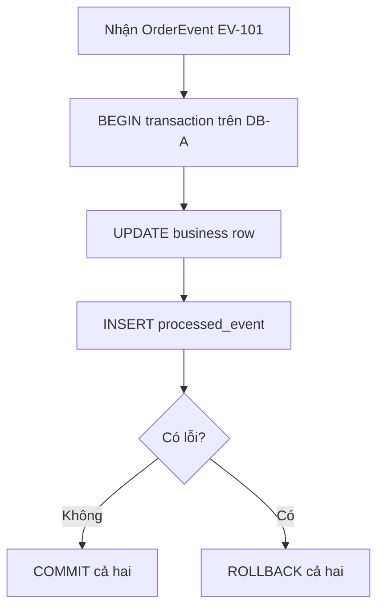
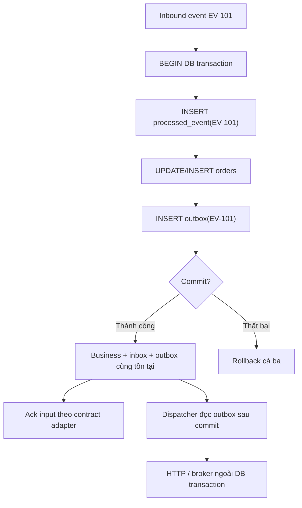
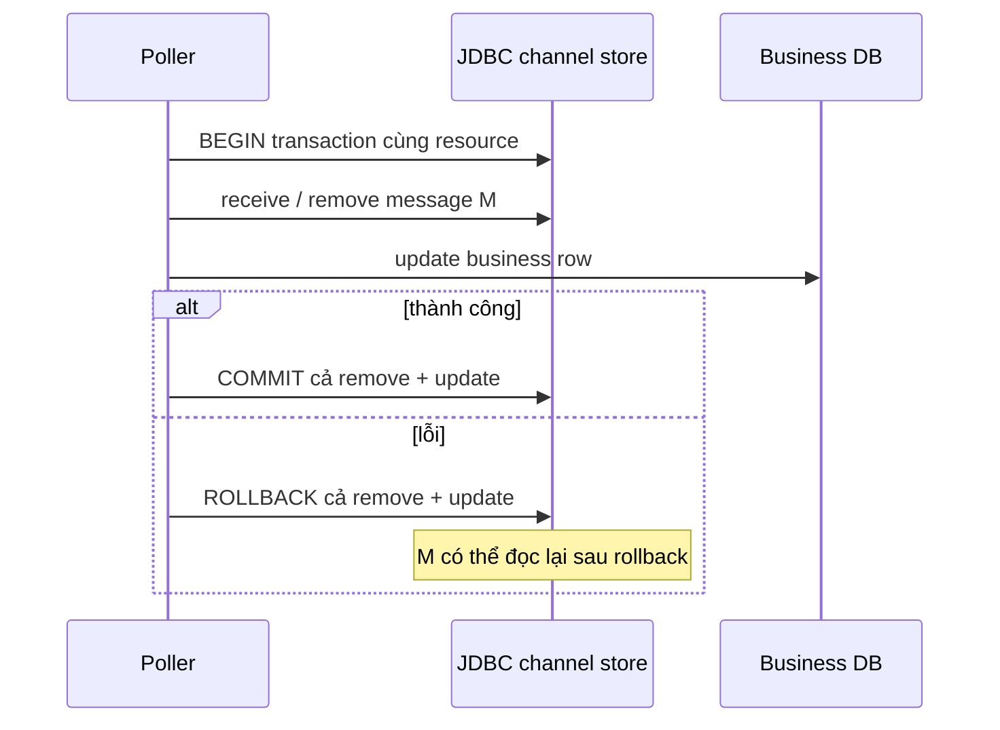
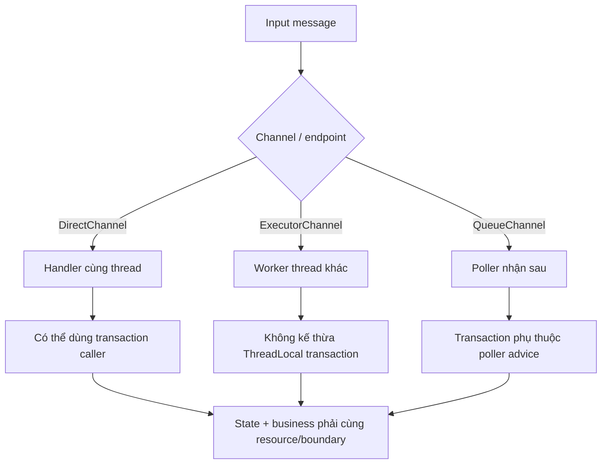
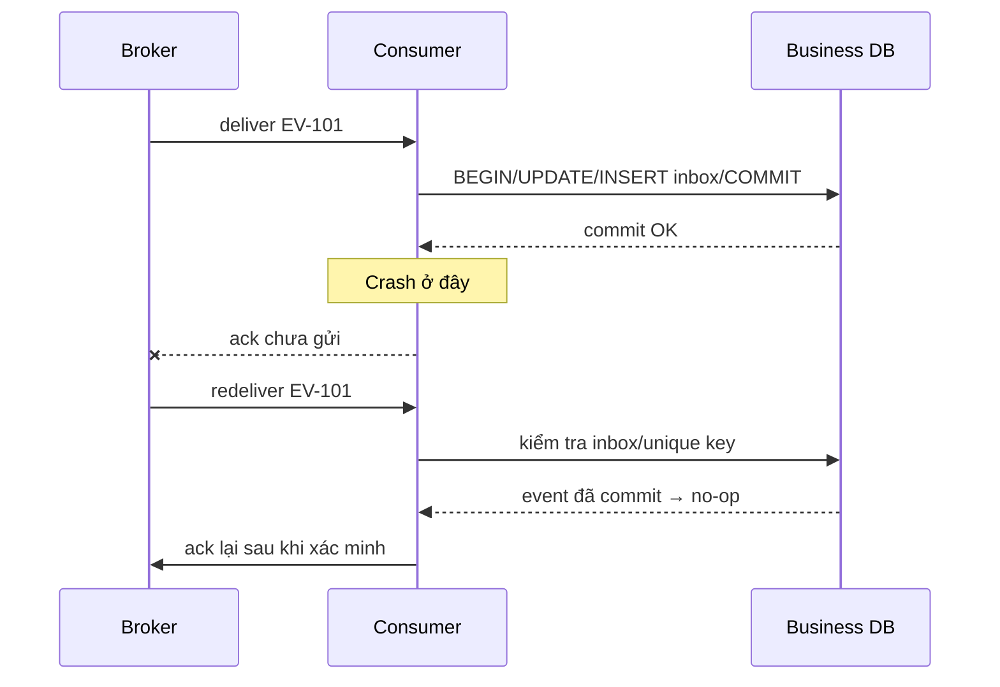

# Atomicity giữa lưu trạng thái và business resource trong Spring Integration

## Mục tiêu bài học

Một message flow của **SPRING_INTEGRATION_RUNTIME** có thể vừa cập nhật trạng thái mà Spring Integration dùng để tiếp tục xử lý (message trong store, nhóm aggregator, checkpoint, metadata), vừa cập nhật dữ liệu nghiệp vụ như đơn hàng, thanh toán hoặc tồn kho. Khi ứng dụng restart, điều nguy hiểm không chỉ là **mất một message**, mà còn là **trạng thái runtime và dữ liệu nghiệp vụ đã tiến tới hai thời điểm khác nhau**.

Bài thuộc chương **Persistence và restart**, tập trung vào câu hỏi:

> Làm thế nào để việc lưu trạng thái xử lý và việc sửa đổi business resource **cùng thành công hoặc cùng thất bại**, và điều gì xảy ra nếu hai thao tác không thể nằm trong một transaction?

Sau bài này, bạn có thể:

- Phân biệt **atomicity** trong một local transaction với tính bền vững (`durability`), idempotency, redelivery và exactly-once effect.
- Xác định chính xác các resource tham gia transaction của Spring; hiểu vì sao “cùng JDBC database” chưa đủ nếu hai thao tác không chạy **trong cùng transaction boundary**.
- Thiết kế lưu **checkpoint/inbox/outbox** và business row trong một transaction ngắn.
- Phân tích `JdbcMessageStore`, `JdbcChannelMessageStore`, group state, `JdbcMetadataStore` và điểm commit của consumer/poller.
- Nhận diện ranh giới tại `DirectChannel`, `ExecutorChannel`, `QueueChannel`, endpoint, scheduler, retry advice và error flow.
- Dùng idempotency, transactional outbox, reconciliation và compensation khi broker/HTTP/database khác không thể commit nguyên tử.
- Thiết kế kiểm thử crash ở từng bước, rollback, redelivery, concurrent workers và restart.

Ngữ cảnh kỹ thuật: Spring Framework 6.x, Spring Integration 6.x, Java 17+, JDBC. Những đoạn code dùng bảng ứng dụng là ví dụ minh họa; tên schema, transaction manager và endpoint cụ thể phải được cấu hình theo môi trường triển khai.

## 1. Atomicity thực sự đảm bảo điều gì?

Giả sử hệ thống cần xử lý `OrderEvent(eventId=EV-101)` theo hai bước:

1. Cập nhật bảng đơn hàng: `orders.status = CONFIRMED`.
2. Ghi dấu trạng thái xử lý: `processed_event(eventId=EV-101)`.

Nếu bước 1 commit nhưng bước 2 chưa commit thì sau restart, event có thể bị nhận lại và xử lý lần hai. Nếu bước 2 commit trước khi bước 1 thành công, hệ thống có thể cho rằng event đã xử lý, dù đơn hàng thực tế không đổi.



Với **một local database transaction đúng nghĩa**, hai thay đổi này có thể commit/rollback nguyên tử, miễn là:

- Cả hai dùng **cùng resource** được transaction manager kiểm soát, hoặc một cơ chế transaction phân tán thực sự đã enlist tất cả participant.
- Cả hai diễn ra trong **cùng transaction boundary** (đúng thread/transaction context/propagation).
- Không có thao tác nào cố tình tạo một transaction tách biệt bằng `REQUIRES_NEW` hoặc transaction manager khác.
- Các lỗi cần rollback thực sự được truyền tới transaction manager và không bị một advice/recovery callback nuốt mất.
- Storage và transaction logs được cấu hình có độ bền phù hợp với yêu cầu hệ thống.

**Atomicity ≠ exactly-once delivery.** Nguồn có thể gửi message nhiều lần. Atomicity cho phép ghi marker và business change cùng một lần; **idempotency** quyết định phải làm gì khi nhận lại một event đã commit.

### Bốn từ thường bị dùng lẫn

| Khái niệm | Câu hỏi nó trả lời | Điều không tự bảo đảm |
|---|---|---|
| **Atomicity** | Các thay đổi nằm trong một transaction có cùng commit hay rollback không? | Nguồn message không gửi lại |
| **Durability** | State đã commit có tồn tại sau restart/crash không? | Remote service cũng đã thực hiện |
| **Idempotency** | Cùng business operation được thử lại có tạo hiệu ứng trùng không? | Không bao giờ có duplicate message |
| **Consistency across resources** | Hai hệ thống độc lập cuối cùng có đồng thuận trạng thái không? | Được đảm bảo bởi một `@Transactional` local |
| **Exactly-once effect** | Người dùng nhìn thấy hiệu ứng nghiệp vụ đúng một lần không? | Exactly-once network delivery |

Một hệ thống thường đạt **at-least-once delivery + idempotent processing** thay vì hy vọng không bao giờ có redelivery.

## 2. “Trạng thái” nào cần lưu trong Spring Integration?

Không phải mọi thứ gọi là state đều nằm cùng một store.

| Loại trạng thái | Ví dụ | Nơi lưu thường gặp | Liên quan tới restart |
|---|---|---|---|
| **Business state** | `orders`, `inventory`, `payments` | Database nghiệp vụ | Cần nhất quán với tiến độ xử lý |
| **Message queue state** | Message đang chờ consumer lấy | `QueueChannel` với store in-memory hoặc `JdbcChannelMessageStore` | Chỉ bền khi store thật sự persistent |
| **Message group state** | Aggregator có 2/3 parts của `batch-7` | `MessageGroupStore` như `JdbcMessageStore` | Cần recovery/expiry khi group còn dang dở |
| **Checkpoint / metadata** | File đã đọc tới đâu, ID nguồn cuối | `MetadataStore`, có thể dùng `JdbcMetadataStore` | Checkpoint sớm có thể làm mất dữ liệu |
| **Inbox / processed marker** | `eventId` đã áp dụng vào business DB | Bảng ứng dụng với unique constraint | Bảo vệ khi input redeliver |
| **Outbox** | Ý định gửi command/event sau DB commit | Bảng ứng dụng trong cùng DB | Giữ tác vụ qua restart |
| **Broker offset / ack** | Kafka offset, JMS ack, AMQP acknowledgment | Broker/container/source | Không tự nằm trong DB transaction |
| **Retry state** | Số lần thử, backoff deadline | Memory, repository hoặc transport | Có thể mất khi restart nếu không persisted |

### Các store dễ nhầm

- `JdbcMessageStore`: sử dụng JDBC để lưu messages và message groups; phù hợp với trạng thái của aggregator/resequencer khi cấu hình đúng.
- `JdbcChannelMessageStore`: triển khai JDBC dùng cho các pollable channels phù hợp, nhằm lưu message chờ; cách lấy/xóa message phải được kiểm tra transaction.
- `JdbcMetadataStore`: lưu key/value metadata bền vững. Nó **không phải** transactional inbox nghiệp vụ trừ khi bạn thiết kế atomicity và conflict handling cùng DB rõ ràng.
- `SimpleMessageStore`/queue in-memory: có thể mất trạng thái khi JVM restart, dù business DB đã commit.
- `LockRegistry`: giúp đồng bộ truy cập nhóm/trạng thái trong phạm vi registry; lock không tự thêm transaction hoặc persistence.

**Cùng DataSource** là điều kiện hữu ích cho local atomicity, nhưng phải kiểm tra đúng connection binding, giao dịch thật sự bao cả hai thao tác, isolation và cách implementation store thực hiện SQL. Không chỉ nhìn tên database/bean.

## 3. Failure windows khi lưu state và business riêng lẻ

### Anti-pattern 1: ghi business rồi đánh dấu processed ngoài transaction

```text
T0  Nhận EV-101
T1  UPDATE orders, commit
T2  Process crash trước INSERT processed_event
T3  Restart, source redeliver EV-101
T4  Ứng dụng nghĩ EV-101 chưa xử lý → UPDATE lần nữa
```

Nếu business operation là tăng tồn kho, trừ tiền hoặc cộng điểm, lần hai có thể tạo kết quả sai.

### Anti-pattern 2: checkpoint trước business update

```text
T0  Nhận EV-101
T1  Lưu checkpoint "EV-101 đã đọc", commit
T2  Process crash trước khi cập nhật orders
T3  Restart bỏ qua EV-101 theo checkpoint
T4  Business change bị mất
```

Điều này nguy hiểm với file adapter, poller dùng metadata store, offsets hoặc một custom source. Nguồn không thể phát lại event nếu checkpoint đã nhảy qua, trừ khi có cơ chế reset/replay.

### Anti-pattern 3: dùng hai transaction độc lập

```mermaid
sequenceDiagram
    participant M as Message flow
    participant S as State Store DB-A
    participant B as Business DB-B
    M->>S: TX-A BEGIN, ghi checkpoint
    S-->>M: TX-A COMMIT
    M->>B: TX-B BEGIN, cập nhật order
    B--xM: DB error → TX-B ROLLBACK
    Note over S,B: Checkpoint vẫn đã commit; không atomic!
```

Ngay cả khi DB-A và DB-B ở cùng máy chủ, transaction riêng biệt vẫn không trở thành một transaction duy nhất. Phải xác định resource và manager được enlist đúng cách.

### Bảng sự cố điển hình

| Thời điểm crash | Business state | Integration state | Hậu quả nếu không có biện pháp |
|---|---|---|---|
| Trước cả hai thay đổi | Chưa ghi | Chưa ghi | Có thể xử lý lại an toàn |
| Sau business commit, trước state commit | Đã ghi | Chưa ghi | Duplicate effect khi replay |
| Sau state commit, trước business commit | Chưa ghi | Đã ghi | Mất xử lý vì tưởng đã hoàn tất |
| Cả hai trong một DB transaction, trước commit | Rollback cả hai | Rollback cả hai | Replay, cần idempotency |
| Cả hai cùng commit | Đã ghi | Đã ghi | Business complete; nguồn vẫn có thể redeliver |
| Sau local commit, trước broker ack | Đã ghi | Đã ghi | Broker redeliver; marker/inbox phải chặn duplicate |

## 4. Thiết kế tối thiểu: business row + inbox + outbox trong một DB transaction

Một mô hình đáng tin cậy là lưu ba loại dữ liệu trong **cùng local database transaction**:

1. Business state (sự thay đổi mà người dùng quan tâm).
2. Inbox/processed marker (event này đã được áp dụng vào business DB).
3. Outbox record (một công việc/event tiếp theo cần phát ra bên ngoài).



### Schema ví dụ

```sql
-- SQL minh họa, điều chỉnh dialect/index/type theo RDBMS.
CREATE TABLE orders (
    order_id         VARCHAR(64) PRIMARY KEY,
    status           VARCHAR(24) NOT NULL,
    updated_at       TIMESTAMP NOT NULL
);

CREATE TABLE processed_event (
    event_id         VARCHAR(64) PRIMARY KEY,
    order_id         VARCHAR(64) NOT NULL,
    processed_at     TIMESTAMP NOT NULL
);

CREATE TABLE integration_outbox (
    event_id         VARCHAR(64) PRIMARY KEY,
    order_id         VARCHAR(64) NOT NULL,
    event_type       VARCHAR(64) NOT NULL,
    payload_json     TEXT NOT NULL,
    status           VARCHAR(24) NOT NULL,
    created_at       TIMESTAMP NOT NULL
);
```

`event_id` ở `processed_event` được bảo vệ bởi primary key, để hai workers không thể cả hai commit marker cho cùng một business event. Với nhiều event cho cùng order, `order_id` có thể xuất hiện nhiều lần ở marker, còn bảng orders cần concurrency control riêng (version/locking) tùy yêu cầu nghiệp vụ.

### Ví dụ Spring service: local atomicity

```java
import java.time.Instant;

import org.springframework.jdbc.core.JdbcTemplate;
import org.springframework.stereotype.Service;
import org.springframework.transaction.annotation.Transactional;

public record OrderEvent(
        String eventId,
        String orderId,
        String status,
        String payloadJson) {
}

@Service
public class AtomicOrderWriter {

    private final JdbcTemplate jdbc;

    public AtomicOrderWriter(JdbcTemplate jdbc) {
        this.jdbc = jdbc;
    }

    @Transactional(transactionManager = "ordersTransactionManager")
    public void record(OrderEvent event) {

        // 1. Chống xử lý lại cùng một business event.
        jdbc.update(
                "INSERT INTO processed_event "
              + "(event_id, order_id, processed_at) VALUES (?, ?, ?)",
                event.eventId(),
                event.orderId(),
                java.sql.Timestamp.from(Instant.now()));

        // 2. Chỉ cập nhật đơn đã tồn tại, theo ví dụ nghiệp vụ.
        int updated = jdbc.update(
                "UPDATE orders SET status = ?, updated_at = ? "
              + "WHERE order_id = ?",
                event.status(),
                java.sql.Timestamp.from(Instant.now()),
                event.orderId());

        if (updated != 1) {
            throw new IllegalStateException(
                    "Order không tồn tại: " + event.orderId());
        }

        // 3. Ghi ý định publish trong cùng transaction.
        jdbc.update(
                "INSERT INTO integration_outbox "
              + "(event_id, order_id, event_type, payload_json, "
              + "status, created_at) VALUES (?, ?, ?, ?, ?, ?)",
                event.eventId(),
                event.orderId(),
                "ORDER_STATUS_CHANGED",
                event.payloadJson(),
                "READY",
                java.sql.Timestamp.from(Instant.now()));
    }
}
```

Đoạn code là **mẫu hai class minh họa**; mỗi `public` top-level class/record cần tệp Java riêng để biên dịch. Ứng dụng phải có `JdbcTemplate`, transaction manager bean `ordersTransactionManager`, DataSource, schema đã tạo và một `orders` row hiện hữu. Với Spring Boot, cấu hình transaction manager phải khớp bean name được chỉ định.

**Tại sao cả ba cập nhật atomic?** `JdbcTemplate` dùng kết nối tham gia vào Spring-managed transaction khi nó sử dụng đúng DataSource. Một `RuntimeException` từ cập nhật đơn hoặc outbox khiến transaction rollback theo chính sách mặc định. Marker, business update và outbox không commit riêng lẻ.

**Nhận duplicate event:** insert marker đã có sẽ gây unique constraint exception. Đừng cố bắt `DuplicateKeyException` rồi tiếp tục SQL trong **cùng transaction** trên các hệ DB có cơ chế transaction aborted (như PostgreSQL). Có thể kiểm tra existence trước như một tối ưu, nhưng unique constraint vẫn là hàng rào cuối cùng. Sau rollback, tầng caller có thể phân loại duplicate rồi trả outcome phù hợp hoặc mở **transaction mới** để xác minh event đã commit.

### Gắn vào Spring Integration

```java
import org.springframework.integration.annotation.ServiceActivator;
import org.springframework.stereotype.Component;

@Component
public class OrdersEndpoint {

    private final AtomicOrderWriter writer;

    public OrdersEndpoint(AtomicOrderWriter writer) {
        this.writer = writer;
    }

    @ServiceActivator(inputChannel = "ordersToRecord")
    public void handle(OrderEvent event) {
        writer.record(event); // Đi qua Spring bean/proxy.
    }
}
```

Định nghĩa channel input và bật Integration:

```java
@Configuration
@EnableIntegration
public class OrdersChannelConfig {

    @Bean
    public MessageChannel ordersToRecord() {
        return new DirectChannel();
    }
}
```

Đoạn trên cần import các annotation, `MessageChannel` và `DirectChannel` tương ứng; các Spring components phải được component-scan hoặc đăng ký trong context. `OrdersEndpoint` **không** mở outer transaction; `AtomicOrderWriter.record` là transaction boundary ngắn và tường minh.

Một producer gửi qua `DirectChannel` sẽ gọi endpoint đồng bộ ở cấu hình thường gặp, nhưng **producer phải còn giữ được message nguồn hoặc có cơ chế redelivery nếu DB rollback**. Local atomicity của DB không tự sinh message nguồn thay thế.

### Nếu state là bảng checkpoint do ứng dụng định nghĩa

Có thể thay một insert outbox bằng việc ghi `integration_checkpoint` trong cùng transaction:

```java
jdbc.update(
    "UPDATE integration_checkpoint SET last_event_id = ? "
  + "WHERE source_name = ?",
    event.eventId(),
    "partner-orders");
```

Cần kiểm tra số hàng được cập nhật và thiết kế checkpoint tăng đơn điệu, có ràng buộc nguồn/thứ tự. **Không dùng một `last_event_id` dạng chuỗi để suy ra thứ tự** nếu nguồn không bảo đảm ID tăng dần. Nếu xử lý nhiều partitions/keys, checkpoint phải phân vùng tương ứng.

## 5. Đồng bộ state thực sự của Spring Integration với business DB

Bảng `processed_event` trong ví dụ trên là **state ứng dụng tự quản lý**, không phải bằng chứng rằng `QueueChannel` hay aggregator đã đánh dấu message được xử lý. Để atomicity giữa **framework-managed state** và business row, transaction phải bao chính **thao tác của message store**.

### 5.1. Ghi MessageStore và business DB trong cùng transaction

Ví dụ ngắn với một `MessageStore` backed by JDBC và cùng `DataSource`:

```java
import org.springframework.integration.store.MessageStore;
import org.springframework.messaging.Message;
import org.springframework.jdbc.core.JdbcTemplate;
import org.springframework.transaction.annotation.Transactional;

public class AtomicStateAndBusiness {

    private final MessageStore messageStore;
    private final JdbcTemplate jdbc;

    public AtomicStateAndBusiness(
            MessageStore messageStore, JdbcTemplate jdbc) {
        this.messageStore = messageStore;
        this.jdbc = jdbc;
    }

    @Transactional(transactionManager = "ordersTransactionManager")
    public void save(Message<?> message, String orderId) {
        // Chỉ lưu bản sao/message vào MessageStore;
        // đây CHƯA phải thao tác receive/ack của một QueueChannel.
        messageStore.addMessage(message);

        jdbc.update(
                "UPDATE orders SET status = ? WHERE order_id = ?",
                "ACCEPTED", orderId);
    }
}
```

Để đoạn này thực sự atomic, cần đồng thời:

- `messageStore` là implementation JDBC phù hợp (ví dụ `JdbcMessageStore`), không phải `SimpleMessageStore`.
- `JdbcTemplate` của store và của business sử dụng **cùng resource** do `ordersTransactionManager` quản lý.
- Method được gọi qua Spring transaction proxy và không có transaction propagation tách riêng.
- Message serializer, bảng store và transaction behavior của implementation hoạt động đúng.
- Test chứng minh lỗi sau `addMessage` khiến cả message insert lẫn business update rollback.

**Giới hạn ví dụ:** `MessageStore.addMessage(message)` là thao tác lưu một message; nó **không** đồng nghĩa “đã gửi vào QueueChannel” hoặc “đã ack message đầu vào”. Atomicity khi **remove/poll/release** cần kiểm tra các API thực sự mà endpoint dùng.

### 5.2. QueueChannel backed by JDBC

Đối với pollable channel cần khôi phục message sau restart, dùng store phù hợp như `JdbcChannelMessageStore`. Nhưng phải xét **thao tác lấy/xóa message**:



Đây là **mục tiêu cấu hình**, không phải hành vi tự động chỉ vì dùng JDBC. Để nó đúng, poller/transaction advice phải bao trùm việc nhận message từ store và cập nhật DB trên cùng resource. Nếu transaction commit ngay sau `receive` rồi handler mới ghi DB, sự cố giữa hai bước có thể làm message mất.

Một ví dụ khung cấu hình transaction cho poller:

```java
@Bean
public PollerMetadata transactionalPoller(
        PlatformTransactionManager ordersTransactionManager) {

    PollerMetadata poller = new PollerMetadata();
    poller.setTrigger(new PeriodicTrigger(100L));

    TransactionInterceptor txAdvice = new TransactionInterceptor();
    txAdvice.setTransactionManager(ordersTransactionManager);
    txAdvice.setTransactionAttribute(
            new DefaultTransactionAttribute());

    poller.setAdviceChain(List.of(txAdvice));
    return poller;
}
```

Đây là **phác thảo** cần import `PollerMetadata`, `PeriodicTrigger`, `TransactionInterceptor`, `DefaultTransactionAttribute`, `List` và kết nối poller metadata với endpoint thích hợp. Không dùng làm snippet tự biên dịch độc lập. Trong ứng dụng thật, có thể dùng `@Poller`, Java DSL hoặc XML transaction support; kiểm tra advice bọc cả `receive` và downstream xử lý đồng bộ.

Không nên hiểu transaction advice ở **handler** là tương đương transaction advice ở **poller**. Nếu message đã bị remove/ack trước khi handler bắt đầu transaction, DB rollback trong handler không hoàn nguyên được thao tác remove trước đó.

### 5.3. MessageGroupStore, aggregator và release

Aggregator giữ messages trong group theo `correlationId`, sau đó `ReleaseStrategy` có thể cho release. Trạng thái bao gồm:

- Group chứa các parts đã nhận.
- Metadata số lượng, timestamps, trạng thái complete.
- Thao tác release hoặc xóa group.
- Trạng thái “tombstone” để từ chối messages đến muộn.

Nếu group store là `JdbcMessageStore`, việc **add part** có thể commit trước thời điểm group đủ điều kiện. Khi group release, output có thể đi qua channel khác, thread khác hoặc một transaction mới. Đừng mặc định các thao tác **update group + update business DB** atomic với nhau.

```text
Aggregator:
  store.add(part A)        -- TX-1
  store.add(part B)        -- TX-2
  release group            -- TX-3 / context của endpoint
     → ExecutorChannel
         → businessHandler -- TX-4

TX-3 và TX-4 không tự atomic dù cùng DB.
```

Nếu cần atomicity giữa kết quả group và business write, có thể:

1. Thiết kế phần business update chạy **đồng bộ trong cùng transaction** bao những thao tác store thực sự cần commit cùng nhau; phải kiểm tra scope của aggregator/endpoint và lock/release.
2. Hoặc, đơn giản và đáng tin cậy hơn với workflow phức tạp: aggregator tạo một **event kết quả bền vững** vào outbox/queue có tính transactional, rồi consumer downstream ghi business DB idempotently.
3. Dùng unique business group/version key để ngăn duplicate release hoặc replay sau crash.
4. Đặt orphan cleanup/`MessageGroupStoreReaper` phù hợp để state dở dang sau restart không tồn mãi.

**Cẩn thận:** ép transaction giữ group lock xuyên I/O remote dài có thể gây deadlock và làm nghẽn message store. Tính nguyên tử phải được đạt bằng ranh giới ngắn, không phải kéo transaction dài qua toàn bộ flow.

### 5.4. MetadataStore và checkpoint

Các adapter như file/remote file có thể lưu metadata “đã thấy file nào” hoặc trạng thái đồng bộ. `JdbcMetadataStore` cho khả năng lưu bền, nhưng nếu adapter cập nhật metadata ngoài transaction của business DB, sự cố vẫn có thể làm mất hoặc xử lý trùng dữ liệu.

Cần phân biệt:

- **Filter metadata** có thể chỉ dùng để tránh đọc trùng, không phải một cam kết business đã xử lý.
- **Business checkpoint/inbox** cần được cập nhật khi business transaction đạt kết quả mong muốn.
- Adapter có thể không cho phép gộp mọi metadata write vào một transaction với business resource. Khi đó, hãy chọn replay-at-least-once và dedup ở business layer thay vì suy ra atomicity giả.

## 6. Transaction boundary theo channel, consumer, poller và executor



| Thành phần | Tác động tới atomicity |
|---|---|
| `DirectChannel` | Dispatch đồng bộ cùng thread trong cấu hình thường gặp; một transaction bên ngoài có thể bao các bước downstream. |
| `ExecutorChannel` | Worker chạy thread khác; transaction/`ThreadLocal` của producer không tự lan theo. |
| `QueueChannel` | `send`/`receive` thường ở các thời điểm khác nhau; cần xét commit riêng của enqueue và dequeue. |
| `Poller` | Có thể mở transaction quanh nguồn message và xử lý đồng bộ; scope phụ thuộc advice, scheduler và endpoint. |
| `@Transactional` service | Có hiệu lực khi lời gọi đi qua proxy/weaving phù hợp; self-invocation có thể bỏ qua annotation. |
| `RequestHandlerRetryAdvice` | Có thể chạy lại handler, nhưng không tự hoàn nguyên thao tác nguồn đã commit. |
| `ErrorMessage`/`errorChannel` | Giúp xử lý lỗi, không đồng nghĩa business DB và message source rollback nguyên tử. |
| Dynamic `IntegrationFlow` | Start/stop thay đổi endpoint đang nhận message; không tự dọn/checkpoint mọi state bền vững. |

### Transaction bị cắt ở ranh giới async

```text
Producer thread:
  BEGIN DB transaction
  update progress
  send(ExecutorChannel) -> enqueue task
  COMMIT

Worker thread:
  receive task
  update business DB (transaction khác hoặc không có TX)
```

Hai thao tác không atomic. Nếu producer commit progress trước khi worker ghi business, crash worker có thể làm mất xử lý. Nếu worker thực hiện lại, có thể tạo duplicate. Cần ghi ý định xử lý bền vững và idempotent consumer.

### Self-invocation và propagation

```java
@Service
class OrderService {

    public void handle(OrderEvent event) {
        this.save(event); // Proxy-mode mặc định: không đi qua proxy.
    }

    @Transactional
    public void save(OrderEvent event) {
        // Đừng mặc định transaction mới đã được mở.
    }
}
```

Tương tự, khi outer method đã có `@Transactional` và inner method là `REQUIRED`, inner sẽ tham gia outer; transaction có thể kéo dài qua HTTP/broker hơn dự kiến. `REQUIRES_NEW` mở transaction độc lập, **không làm hai resource trở thành atomic**; thậm chí có thể để outer vẫn giữ connection/lock.

## 7. Broker acknowledgment không tự atomic với DB

### Tình huống consumer



**DB commit trước broker ack** có thể tạo duplicate delivery, nên xử lý phải idempotent. Trình tự ngược lại (**ack trước DB commit**) có thể mất xử lý khi DB rollback hoặc process crash.

Không có thứ tự hai thao tác độc lập nào tự mang lại atomicity tuyệt đối. Các phương án:

| Phương án | Ý tưởng | Giới hạn |
|---|---|---|
| DB transaction + inbox, ack sau commit | Chấp nhận redelivery, dedup theo event ID | Có thể nhận lại duplicate, phải idempotent |
| Transactional outbox | DB business change + ý định publish trong một commit | Dispatcher có thể gửi nhiều lần |
| XA/JTA | Phối hợp các transactional participants thực sự hỗ trợ XA | Vận hành phức tạp; không áp dụng cho HTTP thông thường |
| Kafka transaction/offset coordination | Bảo đảm một số bước consume-process-publish trong Kafka theo cấu hình | Không tự phối hợp arbitrary JDBC/HTTP thành cùng commit |
| Saga/compensation | Workflow nhiều resource có bước bù trừ | Eventual consistency, compensation có thể thất bại |

**Không nên gọi một Spring Integration flow là “exactly once” chỉ vì dùng persistent queue hoặc Kafka transactions.** Hãy xác định chính xác “once” ở tầng message delivery, DB row, remote API hay business effect.

## 8. Outbox giải quyết ranh giới DB → external resource

Khi việc ghi business DB phải sinh thêm một message ra broker hoặc gọi hệ thống ngoài, **transactional outbox** ghi ý định gửi vào cùng DB transaction; dispatcher thực hiện side effect sau commit.

```text
TX-A:
   update orders
   insert processed_event
   insert outbox READY
COMMIT

Dispatcher:
   claim outbox (TX ngắn)
   publish broker / call HTTP ngoài DB transaction
   mark SENT (TX ngắn)
```

Những nguyên tắc bắt buộc:

- `event_id` ổn định, không tạo mới mỗi lần dispatcher retry.
- Outbox claim phải **atomic** giữa các workers, ví dụ DB row locking/CAS/lease token phù hợp.
- Nếu remote thành công nhưng `markSent` thất bại, outbox có thể phát lại; bên nhận cần idempotency hoặc cách kiểm tra đã thực hiện.
- `markSent` và retry schedule dùng transaction DB ngắn, không giữ DB transaction trong thời gian HTTP timeout/backoff.
- Quản lý trạng thái `READY`, `IN_PROGRESS`, `RETRY_WAIT`, `SENT`, `FAILED` và retention.
- Dispatcher phải có recovery khi restart, lease timeout, alert khi backlog cũ hoặc DLQ quá hạn.

**After-commit callback không đủ cho durability.** Nếu chỉ gọi publish từ `@TransactionalEventListener(phase = AFTER_COMMIT)` mà tiến trình chết ngay sau commit và trước callback, event chưa gửi có thể mất. Outbox bền vững giữ công việc đó để restart có thể làm tiếp.

## 9. Atomicity với state của Aggregator/Resequencer

Group completion trong correlation runtime đặc biệt nhạy cảm với crash:

```text
group batch-42: đã nhận 3/3 parts
ReleaseStrategy -> true
   ↓
Framework đánh dấu/xóa group khỏi store
   ↓
Business handler cập nhật report
```

Nếu việc release state và business handler nằm ở **hai transactions**, crash ở giữa có thể gây mất business output. Đảo lại thứ tự: business đã commit nhưng group chưa đánh dấu complete có thể gây duplicate output sau restart.

### Hai lựa chọn

**Lựa chọn A — cùng transaction thực tế.** Nếu group store và business DB sử dụng chung DataSource, một transaction bao **đúng thao tác release và business update** có thể bảo đảm atomicity. Nhưng cần xem kỹ framework đang release trước/sau output, loại channel, callbacks, interceptor và lock. Không chỉ gắn `@Transactional` trên business handler rồi mặc định store cũng rollback.

**Lựa chọn B — handoff bền vững/idempotent.** Khi release group, ghi một kết quả có business group/version ID vào một durable handoff/store, sau đó downstream service xử lý idempotent. Nếu cần atomicity giữa group state và handoff, đặt chúng trong một transaction cùng resource; còn nếu không thể, thiết kế replay/reconciliation để không mất group.

### Late arrival và orphan

Persistent `MessageGroupStore` giữ group qua restart, nhưng `groupTimeout` được schedule trong JVM cũ không tự được lưu. Cần `expireTimeout/expireDuration` hoặc `MessageGroupStoreReaper` theo cấu hình để xử lý orphan. Khi group bị xóa metadata sau completion/timeout, message tới muộn có thể tạo group mới; do đó business idempotency phải độc lập với thời hạn tombstone trong store.

Lock registry chỉ điều phối **các threads/instances cùng sử dụng cơ chế khóa đó**. `DefaultLockRegistry` là local JVM; nó không bảo vệ state JDBC group trước hai pods độc lập cùng sửa. Với nhiều replicas, cần distributed ownership/locking hoặc DB concurrency controls.

## 10. Error handling, retry và khả năng rollback

### Khi lỗi được truyền tiếp

Nếu handler ném `RuntimeException`, transaction của Spring thường rollback. Tầng caller/poller/broker quyết định có gửi lại message. Với `DirectChannel`, exception thường về caller; với executor/poller, error publisher có thể phát `ErrorMessage` sang error flow.

### Khi lỗi bị xử lý thành “thành công”

`RequestHandlerRetryAdvice` có thể dùng `RecoveryCallback`/`ErrorMessageSendingRecoverer` sau khi hết attempts. Nếu callback không ném tiếp exception, outer transaction/source có thể coi xử lý đã hoàn thành.

```text
TX poller BEGIN
    read message
    handler fails 3 attempts
    recovery logs error, returns null
TX poller COMMIT  <-- message có thể bị remove/ack
```

Điều này có thể **đúng** nếu recovery đã ghi message vào persistent quarantine/DLQ trong một transaction tương thích; nhưng sẽ **sai** nếu recovery chỉ log mà business operation chưa hoàn tất, và nguồn không còn đường phát lại.

Không đánh đồng `ErrorMessage` được publish với transaction đã rollback. Error flow của scheduler/worker có thể chạy ở thread khác; việc publish lỗi tới một in-memory channel không bảo đảm durability.

### Thứ tự advice

```text
RetryAdvice → TransactionAdvice → handler
  mỗi attempt có thể mở transaction DB mới

TransactionAdvice → RetryAdvice → handler
  có thể giữ một transaction qua các attempts/backoff
```

Thứ tự thay đổi rollback-only behavior và thời gian giữ connection. Tuy nhiên nó không tự gộp hai stores khác resource. Khi dùng poller transaction advice và handler transaction advice, cần lập sơ đồ cụ thể phạm vi của từng advice.

## 11. Concurrency và transaction correctness

Dù cùng database, hai consumers có thể đồng thời xử lý cùng `eventId`:

```text
Worker A: SELECT processed_event: chưa có
Worker B: SELECT processed_event: chưa có
Worker A: INSERT processed_event(EV-101) → COMMIT
Worker B: INSERT processed_event(EV-101) → unique violation
```

Vì vậy **kiểm tra trước bằng SELECT không đủ**. Dùng primary key/unique constraint trong database, UPSERT/CAS hoặc xử lý duplicate ở transaction boundary thích hợp.

Với state theo `orderId`, nhiều event khác nhau có thể tranh cập nhật cùng row; chọn optimistic locking/version hoặc pessimistic lock theo invariant nghiệp vụ.

| Cơ chế | Phạm vi | Lợi ích | Giới hạn |
|---|---|---|---|
| Unique constraint trên event ID | Database | Không commit hai marker cho cùng key | Cần phân loại duplicate và thiết kế retention |
| Optimistic locking / version | Business row | Phát hiện concurrent updates | Cần retry/merge phù hợp |
| `DefaultLockRegistry` | Một instance registry/JVM | Giảm race cục bộ | Không bảo vệ multi-JVM |
| `JdbcLockRegistry`/distributed lock | Nhiều instances khi đúng cấu hình | Serialize phối hợp qua shared resource | Không thay thế business transaction/idempotency |
| Atomic claim + lease token | Outbox/inbox worker ownership | Giảm double dispatch | Lease expiry vẫn có thể dẫn tới request trùng |
| Isolation/row locks | Database transaction | Kiểm soát concurrency trong DB | Không rollback remote HTTP |

### Transaction không nên quá rộng

Đừng giữ transaction DB từ lúc poller đọc message qua một remote HTTP 5 giây rồi mới commit. Điều đó giữ connection/lock và vẫn **không thể rollback remote**.

Thay vào đó:

1. Transaction ngắn ghi business state và durable intent (outbox).
2. Commit.
3. Worker gọi remote ngoài transaction DB, với timeout/retry/idempotency.
4. Transaction ngắn cập nhật kết quả.

Atomicity tốt không yêu cầu **một transaction khổng lồ**. Nó yêu cầu xác định đúng tập thay đổi cần commit chung, và có giao thức đáng tin cậy giữa những tập không thể gộp.

## 12. Chẩn đoán khi restart gây mất hoặc xử lý trùng

Khi thấy “DB đã cập nhật nhưng message vẫn còn” hoặc “message đã biến mất nhưng DB chưa cập nhật”, đừng vội tăng retry count. Điều tra theo trình tự:

1. **Liệt kê resources:** business DB, JDBC channel/group/metadata store, broker, filesystem, remote API.
2. **Vẽ từng transaction boundary:** ai mở transaction? transaction manager nào? begin/commit/rollback ở đâu?
3. **Đánh dấu thread boundary:** `DirectChannel`, `ExecutorChannel`, poller, scheduler và async handoff.
4. **Xác định thao tác state thực tế:** enqueue, dequeue, add to group, release, checkpoint hoặc ack; đừng nói chung “đã lưu state”.
5. **Đối chiếu logs/trace:** eventId, messageId, correlationId, transaction outcome và timestamp.
6. **Kiểm tra recovery:** khi handler ném lỗi, advice có nuốt exception không? Error flow/DLQ đã commit bền vững chưa?
7. **Kiểm tra redelivery:** broker có phát lại không? inbox marker còn không? Có unique constraints không?
8. **Kiểm tra restart:** persistent store có schema/serializer tương thích? Có group orphan hoặc lease quá hạn?
9. **Đối chiếu side effects:** remote API đã nhận request chưa? Idempotency key có ổn định qua retries không?
10. **Tái hiện failure window** bằng kill process/tiêm lỗi ở các mốc trước và sau commit.

### Bảng sự cố

| Triệu chứng | Nguyên nhân có thể | Cách xử lý |
|---|---|---|
| Business row đã đổi nhưng checkpoint chưa đổi | Hai transaction khác nhau; crash trước checkpoint | Gộp trong một DB transaction hoặc dùng inbox |
| Checkpoint đã đổi nhưng business row chưa | Checkpoint commit trước business | Đảo thiết kế, transaction chung hoặc replay-safe processing |
| JDBC queue đã mất message sau DB rollback | Dequeue commit trước transaction business | Đặt poller transaction bao receive+business trên cùng resource |
| Message tồn tại hai lần sau redelivery | Broker ack sau DB commit; marker thiếu hoặc sai key | Inbox/unique event ID, idempotent handler |
| Aggregator mất group nhưng output không được lưu | Release state và downstream write không cùng transaction | Durable handoff/transaction đúng scope, idempotent output |
| Outbox gửi hai lần | Remote thành công rồi update SENT thất bại | Idempotency key phía remote, reconciliation |
| Metadata filter không đọc lại file dù business lỗi | Metadata/checkpoint đã lưu trước business commit | Phân tách metadata filter với business inbox, reset/replay có kiểm soát |
| `@Transactional` không có hiệu lực | Self-invocation, sai manager, bean không được Spring quản lý | Kiểm tra proxy và injection |
| Một pod ghi đè pod khác | Registry chỉ local, thiếu DB concurrency control | Unique/version/atomic claim hoặc distributed coordination |
| Sau deploy không đọc được old messages | Serializer/schema/message converter thay đổi | Migration/compatibility, test rolling upgrade và backup |

## 13. Kiểm thử atomicity: cần thử **crash windows**, không chỉ happy path

### 13.1. Test rollback giữa hai lệnh ghi

Tạo row `orders` ban đầu, gửi `OrderEvent` mới, cố ý ném `RuntimeException` sau khi cập nhật business nhưng trước khi ghi marker/outbox. Sau transaction:

- Business row không thay đổi.
- Không có `processed_event` và outbox mới.
- Nguồn vẫn có phương án retry/redelivery.
- Không có side effect remote đã được thực hiện sớm.

Không dùng unit test chỉ mock `JdbcTemplate` để khẳng định database rollback; cần test tích hợp với transaction manager và database thực.

### 13.2. Test trạng thái đã commit, ack chưa gửi

Cho business+inbox+outbox commit thành công, mô phỏng consumer chết trước ack inbound. Broker phát lại event:

- Unique event ID ngăn business side effect lần thứ hai.
- Consumer phân loại duplicate là “đã xử lý”, không retry vô hạn constraint violation.
- Nếu outbox chưa được dispatch, dispatcher vẫn có thể làm tiếp.
- Ack/durable DLQ policy được kiểm tra trên adapter/container thật.

### 13.3. Test receive từ JDBC queue và business update

Với `JdbcChannelMessageStore` và transaction-compatible poller:

1. Enqueue message M và xác nhận nó persisted.
2. Lấy M và bắt đầu business update trong **cùng transaction** theo cấu hình thực tế.
3. Tiêm lỗi làm rollback trước commit.
4. Xác nhận M có thể được nhận lại và business row không đổi.
5. Xử lý M thành công lần kế tiếp, xác nhận row được cập nhật và M không còn chờ.
6. Restart ứng dụng giữa bước 3 và 4; xác nhận durability của store.

Nếu M bị xóa sau rollback, trước tiên kiểm tra transaction scope của poller/ChannelMessageStore, không vội đổ lỗi cho `@Transactional` trong handler.

### 13.4. Test aggregator qua restart

1. Gửi 2/3 parts vào persistent `MessageGroupStore`; xác nhận group tồn tại.
2. Restart trước phần thứ ba.
3. Gửi phần ba; xác nhận release chỉ một lần.
4. Thử restart ngay sau khi group release nhưng trước khi business output commit: xác minh durable handoff/inbox chống mất hoặc lặp kết quả.
5. Kiểm tra orphan cleanup và late arrivals theo `expireTimeout`/`MessageGroupStoreReaper`.

### 13.5. Test remote thành công nhưng response mất

Mô phỏng shipping API đã tạo shipment nhưng client nhận timeout; dispatcher sẽ thử lại:

- Mọi retry dùng **cùng eventId** làm idempotency key.
- Remote tạo đúng một shipment theo business invariant.
- Outbox chuyển sang `SENT` khi xác minh kết quả.
- Nếu không xác minh được, event vào trạng thái reconciliation/quarantine, không retry vô hạn.

### Pseudocode kiểm thử

```java
// Spring integration test, với database transaction thật.
// assertThat(orders.find(orderId).status()).isEqualTo("NEW");

// Gửi message; tiêm RuntimeException trước commit.
// assertThrows(RuntimeException.class, () -> sendAndFail(event));

// Cả thay đổi business và state đã rollback.
// assertThat(orders.find(orderId).status()).isEqualTo("NEW");
// assertThat(inbox.exists(eventId)).isFalse();
// assertThat(outbox.exists(eventId)).isFalse();

// Với test redelivery, gửi lại event thành công.
// assertThat(orders.find(orderId).status()).isEqualTo("CONFIRMED");
// assertThat(inbox.count(eventId)).isEqualTo(1);
// assertThat(outbox.count(eventId)).isEqualTo(1);
```

Khi kiểm thử transaction boundary, tránh vô tình đặt `@Transactional` trên **toàn test method**, vì transaction test-level có thể giữ các thay đổi chưa commit và che hành vi thật của poller/other thread. Dùng DB thật/Testcontainers cho concurrency và khởi động lại process/context khi cần.

## 14. Checklist thiết kế production

- [ ] Đã xác định business state, framework message/group state, checkpoint, inbox/outbox và broker ack nằm ở đâu.
- [ ] Có một transaction manager đúng resource cho các JDBC writes phải atomic.
- [ ] Transaction thực tế bao **cả thao tác state store** và business write, không chỉ bao một handler phía sau.
- [ ] `JdbcMessageStore`/`JdbcChannelMessageStore`/`JdbcMetadataStore` được chọn đúng mục đích và đã thử với DB thật.
- [ ] Không dựa vào `SimpleMessageStore` hay queue in-memory để đảm bảo restart durability.
- [ ] Không giả định transaction đi qua `ExecutorChannel` hoặc thread khác.
- [ ] Poller advice và handler advice được phân biệt về phạm vi receive/ack và cập nhật business.
- [ ] Error handling/recovery không vô tình nuốt exception cần rollback.
- [ ] Business event ID ổn định, được bảo vệ bằng unique constraint hoặc inbox idempotency.
- [ ] Outbox được ghi cùng business DB transaction khi cần gửi tới broker/remote sau commit.
- [ ] Dispatcher có atomic claim/lease, retries có giới hạn và remote idempotency.
- [ ] Database locks/version và multi-instance ownership được thiết kế rõ, không dựa riêng vào local lock registry.
- [ ] Aggregator/group store có restart recovery, late arrival policy và orphan cleanup.
- [ ] Broker acknowledgment/offset commit được kiểm thử độc lập với DB commit.
- [ ] Schema, serializer, message converter và rolling upgrade tương thích với dữ liệu đã lưu.
- [ ] Giám sát oldest queued message, outbox lag, retries, duplicate rate, DB rollback và orphan groups.
- [ ] Có kiểm thử crash trước/sau mỗi commit, trước/sau ack, sau remote success và trong lúc restart.

## Tài liệu tham khảo

- [Spring Integration Reference — Message Store](https://docs.spring.io/spring-integration/reference/message-store.html): `MessageStore`, persistent stores, channel/group persistence.
- [Spring Integration Reference — Transactions](https://docs.spring.io/spring-integration/reference/transactions.html): transaction support, poller và transaction synchronization.
- [Spring Integration Reference — Poller](https://docs.spring.io/spring-integration/reference/endpoint.html): lifecycle, scheduler và polling endpoints.
- [Spring Integration Reference — Aggregator](https://docs.spring.io/spring-integration/reference/aggregator.html): group state, release và expiry sau restart.
- [Spring Integration Reference — Error Handling](https://docs.spring.io/spring-integration/reference/error-handling.html): đồng bộ/bất đồng bộ, error flow.
- [Spring Integration Reference — JDBC Message Store](https://docs.spring.io/spring-integration/reference/jdbc/message-store.html): JDBC-backed message/group state và cấu hình.
- [Spring Framework Reference — Declarative Transaction Management](https://docs.spring.io/spring-framework/reference/data-access/transaction/declarative.html): proxy, rollback semantics và transaction boundaries.
- [Spring Framework Reference — Transaction Propagation](https://docs.spring.io/spring-framework/reference/data-access/transaction/declarative/tx-propagation.html): `REQUIRED`, `REQUIRES_NEW` và tài nguyên transaction.

**Ghi nhớ:** Atomicity giữa trạng thái Spring Integration và business resource chỉ có khi các thao tác cần thiết **thực sự tham gia cùng một transaction/resource hoặc cơ chế phối hợp được bảo đảm**. Một persistent message store, một `@Transactional` trên handler hoặc một broker acknowledgment riêng lẻ không tự đủ. Khi không thể gộp các tài nguyên, hãy thiết kế **at-least-once + inbox/idempotency + outbox + recovery/reconciliation**, kiểm chứng bằng crash tests và giữ transaction ngắn.

