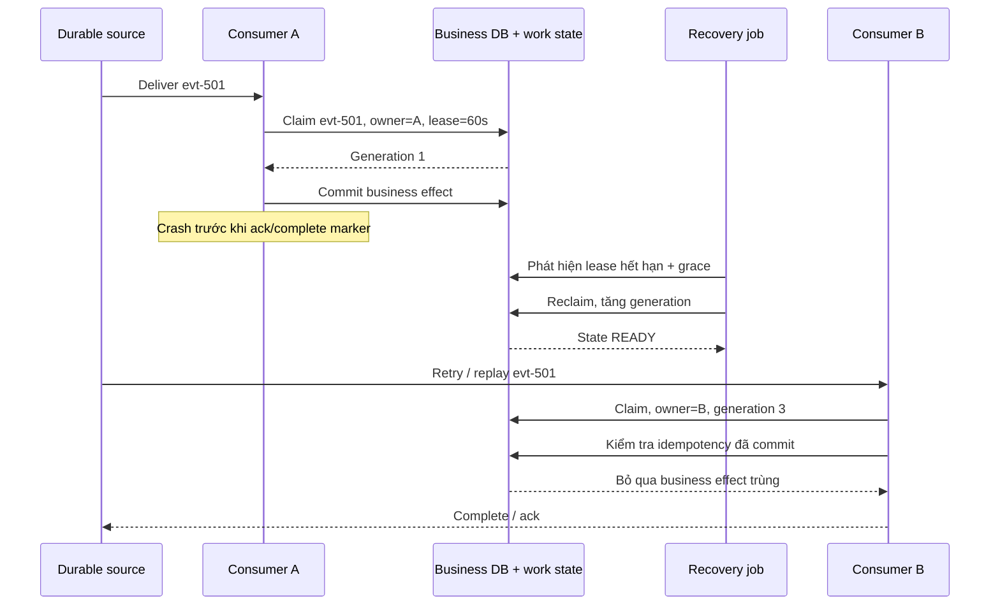
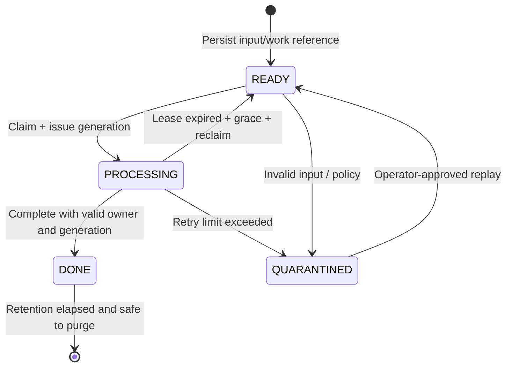
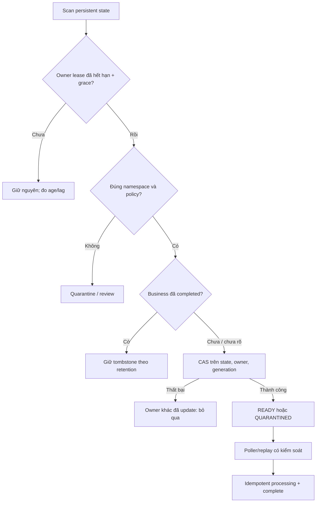

# Cleanup state không còn owner trong Spring Integration

## 1. Vì sao restart tạo ra state “không còn owner”?

Trong module `SPRING_INTEGRATION_RUNTIME`, Spring Integration chạy và điều phối message flow qua **channel, endpoint, consumer, poller và executor**. Ở một flow có persistence, dữ liệu còn tồn tại trong database, message store hoặc metadata store ngay cả khi tiến trình xử lý dữ liệu ấy đã dừng. Điều này cần thiết để khôi phục, nhưng cũng tạo ra trạng thái **orphaned state**: còn record hoặc message group, song thành phần từng chịu trách nhiệm xử lý không còn hoạt động hoặc không thể tiếp tục công việc cũ.

Ví dụ: pod A lấy message `payment:evt-501`, ghi `owner=A`, `status=PROCESSING` và bắt đầu gọi dịch vụ nghiệp vụ. Pod A bị kill trước khi xác nhận hoàn tất. Sau khi restart, database vẫn có `status=PROCESSING` nhưng không có worker thực sự đang hoàn tất công việc đó. Nếu hệ thống chỉ xử lý record `READY`, sự kiện có thể bị kẹt vô thời hạn. Nếu một tác vụ cleanup **xóa luôn** record, sự kiện có thể bị mất và tác dụng nghiệp vụ có thể bị lặp khi nguồn gửi lại.

**Cleanup an toàn thường là một quy trình đánh giá và thu hồi quyền sở hữu để khôi phục xử lý**, không đơn giản là `DELETE` bản ghi quá hạn. Muốn quyết định chính xác, phải biết: state đại diện cho thứ gì, owner được xác nhận thế nào, liệu tác dụng nghiệp vụ đã commit chưa, có thể replay không và record có được dùng để chặn duplicate không.

### Kết quả học tập

Sau bài này, bạn có thể:

1. Phân biệt message backlog, message group, lock record, checkpoint/metadata và business-processing state khi ứng dụng restart.
2. Nhận diện **state thực sự mất owner** mà không nhầm với worker chậm, đang pause hoặc mất kết nối tạm thời.
3. Thiết kế cơ chế **lease, heartbeat, grace period, generation/fencing và compare-and-set** cho việc reclaim an toàn.
4. Phối hợp cleanup với transaction, poller, retry, message store, idempotency và error/recovery flow.
5. Dùng tính năng phù hợp của `MessageGroupStoreReaper`, orphan-group purge và `JdbcLockRegistry` thay vì tự xóa bảng framework.
6. Viết một bài thử restart/crash có thể kiểm chứng: state không bị mất, old owner không hoàn tất trái phép và message có thể được xử lý tiếp.

## 2. “Owner” không phải một khái niệm chung cho mọi store

“Owner” là thành phần có **trách nhiệm xử lý hoặc quyền thay đổi một state tại thời điểm nhất định**. Tên gọi này thay đổi theo loại tài nguyên; không phải bảng nào của Spring Integration cũng có cột `owner_id`.

| Loại state | “Owner” theo ngữ nghĩa | Khi restart hoặc crash | Cleanup/recovery cần cân nhắc |
|---|---|---|---|
| Work item do ứng dụng claim trong JDBC | Worker/node nhận quyền xử lý cùng lease | Record còn `PROCESSING`, worker có thể đã mất | Reclaim có điều kiện rồi cho retry; không xóa payload |
| `JdbcLockRegistry` | Owner của lock record tại repository | Lock có thể còn đến khi TTL hết hạn | Để cơ chế expire/reacquire của repository xử lý; không tự `DELETE INT_LOCK` bừa bãi |
| `MessageGroupStore` của aggregator/resequencer | Correlation endpoint chịu trách nhiệm hoàn tất group | Group tồn tại nhưng trigger timeout/release có thể mất khi restart | Group timeout, orphan purge hoặc reaper; quyết định partial release hay discard |
| Durable `QueueChannel`/broker | Consumer/inflight delivery theo hợp đồng queue hoặc broker | Message chưa ack có thể xuất hiện lại, hoặc bị kẹt nếu claim không được thu hồi | Recover bằng transaction/ack/visibility timeout; idempotency khi redelivery |
| `MetadataStore` | Thành phần giữ checkpoint, marker dedup hoặc state poller | Key bền có thể không còn phù hợp với lifecycle mới | Reconcile ý nghĩa key; chỉ xóa theo TTL/policy đã xác minh |
| Dynamic `IntegrationFlow`/runtime endpoint | Registration/lifecycle do ứng dụng quản lý | Flow trong RAM không tự tái tạo từ persistent state | Tái dựng desired state/registration khi khởi động trước khi xóa metadata |
| Temporary gateway reply channel | Một lần gọi đang chờ reply | Caller và địa chỉ tạm có thể không còn sau restart | Không kỳ vọng reply muộn tìm được caller cũ; cần response store hoặc giao thức mới |

**Không có “global reaper” dùng chung cho mọi loại state.** Việc xóa một group, dọn metadata, hết hạn JDBC lock hay chuyển work item từ `PROCESSING` về `READY` đều theo hợp đồng của **component sở hữu state đó**.

### Những trường hợp chỉ nhìn timestamp là dễ sai

- Worker A đang xử lý một HTTP call lâu hơn bình thường nhưng **chưa chết**.
- JVM A gặp stop-the-world GC pause; heartbeat không được cập nhật, nhưng A sẽ chạy tiếp.
- Pod B đọc replica database chậm cập nhật, tưởng owner A không tồn tại.
- App đang rolling deploy, các pod có version khác nhau nhưng cùng dùng store.
- Một aggregator chờ mảnh message cuối theo `correlationId`; nhóm đã “già” nhưng **vẫn hợp lệ** theo SLA.
- Metadata `idempotent:evt-501` là tombstone cố ý giữ để chặn replay cũ.

Do đó **“không thấy heartbeat” hoặc “quá lâu chưa cập nhật” chỉ là tín hiệu nghi ngờ**. Muốn reclaim có tính đúng đắn, cần kết hợp lease, so sánh phiên bản, transaction và quy tắc nghiệp vụ.

## 3. Crash giữa các mốc: vì sao một record còn lại là chưa đủ?

Xem timeline của một công việc xử lý message:



Trong thực tế, **không phải** mọi nguồn đều phát lại ngay sau khi state được reclaim; hệ thống phải bảo đảm còn một đường để producer/poller đọc lại `READY`, hoặc còn message trong durable source. Reaper chỉ đổi trạng thái mà không có worker tìm lại state thì chưa hoàn tất recovery.

Các mốc cần phân biệt:

| Mốc | Ý nghĩa | Rủi ro nếu crash kế tiếp |
|---|---|---|
| Message được lưu bền | Nguồn đã commit dữ liệu theo contract | Cần consumer mới có thể đọc lại |
| Worker claim state | Owner có quyền xử lý tạm thời | Lease bị bỏ dở; cần reclaim |
| Business effect commit | Dữ liệu/tác dụng nghiệp vụ đã đổi | Có thể replay gây duplicate |
| Marker completed/ack commit | Hệ thống ghi nhận đã hoàn tất | Nếu lệch với business commit thì có thể mất hoặc lặp tác dụng |
| Dọn completed state | Xóa record không còn cần | Nếu xóa quá sớm thì replay cũ không còn dấu để nhận diện |

**Một transaction JDBC chỉ atomic cho những resource thực sự tham gia transaction đó.** Commit DB nghiệp vụ không đồng nghĩa broker đã ack. Gửi email/HTTP không thể rollback chỉ nhờ transaction JDBC. Cần thiết kế idempotency/outbox/đối soát nếu có side effect ngoài DB.

## 4. Phân loại hành động khi state nghi ngờ mất owner

Trước khi chạy cleanup, phân loại state thành bốn hướng:

| Nhóm | Ví dụ | Hành động thích hợp |
|---|---|---|
| **Recoverable work** | `PROCESSING` nhưng lease hết hạn; payload còn trong durable store | Thu hồi owner bằng CAS/fencing, chuyển về `READY`, cho worker claim lại |
| **Completed state cần retention** | Idempotency ledger, aggregator tombstone, checkpoint đã xác nhận | Giữ đến hết cửa sổ retry/replay/late message; chưa xóa theo tuổi tùy tiện |
| **Expired nhưng có nghiệp vụ cần quyết định** | Aggregator còn thiếu một phần, pending approval, payment đang không chắc trạng thái | Partial result, discard, quarantine hoặc đối soát theo contract; ghi audit |
| **State có thể xóa an toàn** | Bản ghi `DONE` cũ hơn retention, lease cache unused, temporary log đã xác minh không còn tham chiếu | Xóa theo batch, kiểm tra điều kiện version và giám sát |

Đừng gộp `retry` với `cleanup`. Một record chuyển về `READY` nên được xử lý bằng cùng đường nhận message và error/retry policy như các công việc mới; không để reaper gọi trực tiếp HTTP business side effect mà không có idempotency.

### Nguyên tắc tối thiểu

1. Chỉ dọn các record thuộc **namespace/component** mình sở hữu.
2. Dựa trên **state + lease + version**, không chỉ mốc thời gian.
3. Cập nhật owner/state **nguyên tử trong store dùng chung**.
4. **Tăng generation** khi reclaim để old owner không thể ghi “completed” hợp lệ bằng token cũ.
5. Giữ payload/reference để tái xử lý; nếu không thể quyết định an toàn thì **quarantine**, không xóa.
6. Dọn bản ghi completed sau khi hết **toàn bộ cửa sổ replay, retry, DLQ, restore**, và xác minh còn ledger độc lập nếu cần.

## 5. Thiết kế giao thức lease + fencing cho state có owner

Với một work item có thể được nhiều pod xử lý, lưu ít nhất:

- `work_id`: ID nghiệp vụ ổn định qua retry/redelivery.
- `state`: ví dụ `READY`, `PROCESSING`, `DONE`, `QUARANTINED`.
- `owner_id`: định danh instance/lần khởi động độc nhất, tránh dùng lại tên pod trần qua restart.
- `lease_until`: hạn sở hữu theo **đồng hồ của backend dùng chung**.
- `generation`: số tăng mỗi lần claim hoặc thu hồi; giúp từ chối thao tác của owner cũ.
- `attempts`, `updated_at` và `payload_ref`: để backoff, recovery, quan sát và lấy lại nội dung.

### 5.1. Các trạng thái



**Điều kiện “lease expired” là một phần của recovery policy.** Nếu worker đang pause và tiếp tục chạy sau khi lease hết hạn, generation là hàng rào bảo vệ cho **thao tác ghi có kiểm tra token**. Nó không tự chặn external API chưa kiểm tra fencing.

### 5.2. Ví dụ schema PostgreSQL

```sql
CREATE TABLE runtime_work (
    work_id VARCHAR(160) PRIMARY KEY,
    payload_ref VARCHAR(512) NOT NULL,
    state VARCHAR(24) NOT NULL
        CHECK (state IN ('READY', 'PROCESSING', 'DONE', 'QUARANTINED')),
    owner_id VARCHAR(160),
    lease_until TIMESTAMPTZ,
    generation BIGINT NOT NULL DEFAULT 0,
    attempts INTEGER NOT NULL DEFAULT 0,
    updated_at TIMESTAMPTZ NOT NULL DEFAULT CURRENT_TIMESTAMP,
    CHECK (
        (state = 'PROCESSING' AND owner_id IS NOT NULL
            AND lease_until IS NOT NULL)
        OR
        (state <> 'PROCESSING' AND owner_id IS NULL
            AND lease_until IS NULL)
    )
);

CREATE INDEX runtime_work_expired_idx
    ON runtime_work(lease_until)
    WHERE state = 'PROCESSING';

CREATE INDEX runtime_work_ready_idx
    ON runtime_work(updated_at)
    WHERE state = 'READY';

-- Sự kiện được lưu bền trước khi gửi tới consumer.
INSERT INTO runtime_work(work_id, payload_ref, state)
VALUES ('evt-501', 'blob://invoices/evt-501.json', 'READY');
```

Schema này là **bảng nghiệp vụ minh họa tự thiết kế**, không phải DDL nội bộ của Spring Integration. Tên `payload_ref` thể hiện tham chiếu đến dữ liệu có thể truy xuất lại; khi object store được dùng, retention của blob phải dài hơn thời gian retry/replay của record.

### 5.3. Claim nguyên tử, không dùng “SELECT rồi UPDATE”

Sau khi một worker nhìn thấy `READY`, nó claim bằng **một câu UPDATE có điều kiện** và nhận generation được cấp. PostgreSQL hỗ trợ `RETURNING`:

```sql
UPDATE runtime_work
   SET state = 'PROCESSING',
       owner_id = :owner_id,
       lease_until = clock_timestamp() + INTERVAL '60 seconds',
       generation = generation + 1,
       attempts = attempts + 1,
       updated_at = clock_timestamp()
 WHERE work_id = :work_id
   AND state = 'READY'
RETURNING work_id, generation, lease_until;
```

Nếu hai pod cùng claim, update trên cùng row được database đồng bộ; **chỉ pod thắng** nhận kết quả theo điều kiện `state='READY'`. Pod còn lại nhận 0 row và không nên chạy nghiệp vụ.

- `owner_id` nên có định danh phiên khởi động, ví dụ `consumer-a:boot-uuid`.
- `generation`/`lease_until` trả về phải được mang theo đến từng điểm cập nhật hoàn tất hoặc heartbeat.
- Nếu không claim được, consumer cần quyết định retry sau hay kết thúc lần nhận trùng theo contract; không giả vờ đã thực thi business logic.
- `attempts` giúp áp dụng retry budget. Nếu có nhiều nguồn phát trùng, cần xét cả tổng attempts và nguyên nhân lỗi.

### 5.4. Gia hạn trên cùng owner/generation

```sql
UPDATE runtime_work
   SET lease_until = clock_timestamp() + INTERVAL '60 seconds',
       updated_at = clock_timestamp()
 WHERE work_id = :work_id
   AND state = 'PROCESSING'
   AND owner_id = :owner_id
   AND generation = :generation
   AND lease_until > clock_timestamp();
```

Nếu update trả **0 row**, worker không còn giữ lease hợp lệ theo backend; **không tiếp tục commit side effect** mà chưa xử lý mất ownership. Đồng hồ `clock_timestamp()` được lấy từ database để tránh mỗi pod tự quyết định hạn lease bằng clock lệch nhau.

Heartbeat nên chạy đủ sớm so với TTL và dựa trên **observed latency/GC pause**. Với công việc đang chạy trên một thread lâu, heartbeat từ thread khác có thể thực hiện nếu **giao thức sở hữu là DB row/generation của ứng dụng**. Đây là thiết kế tự xây và **khác với quy tắc** `JdbcLockRegistry.renewLock()` vốn yêu cầu thread hiện tại đang giữ lock.

### 5.5. Hoàn tất chỉ khi còn quyền sở hữu

```sql
UPDATE runtime_work
   SET state = 'DONE',
       owner_id = NULL,
       lease_until = NULL,
       updated_at = clock_timestamp()
 WHERE work_id = :work_id
   AND state = 'PROCESSING'
   AND owner_id = :owner_id
   AND generation = :generation
   AND lease_until > clock_timestamp();
```

Nếu update trả 0 row: **không được ack thành công** chỉ vì method business đã return; cần điều tra worker cũ đã mất lease hay message đã được worker mới xử lý. Với business update JDBC trên cùng datasource, nên đặt business effect và thao tác complete này trong **cùng transaction**; nếu complete không thành công, ném exception để rollback business effect.

Nếu đã gọi **payment/email/HTTP** trước khi complete, rollback database vẫn không hoàn tác được external side effect. Cần idempotency key của provider, outbox/inbox hoặc đối soát; generation chỉ bảo vệ những write có thực hiện **kiểm tra generation**.

### 5.6. Reclaim khi lease hết hạn và đã qua grace period

```sql
UPDATE runtime_work
   SET state = CASE
           WHEN attempts >= 5 THEN 'QUARANTINED'
           ELSE 'READY'
       END,
       owner_id = NULL,
       lease_until = NULL,
       generation = generation + 1,
       updated_at = clock_timestamp()
 WHERE state = 'PROCESSING'
   AND lease_until < clock_timestamp() - INTERVAL '30 seconds'
RETURNING work_id, state, generation;
```

Điều này **đổi trạng thái**, không xóa event. Việc tăng generation trong reclaim khiến worker cũ không thể dùng token trước đó để update `DONE` qua điều kiện mục 5.5. Reaper chạy ở nhiều pod vẫn có thể an toàn ở mức row update: pod thứ hai không thể reclaim lại chính row đã chuyển khỏi `PROCESSING` khi điều kiện được kiểm tra lại trong transaction.

**Grace period** 30 giây và TTL 60 giây chỉ là **giá trị minh họa**. Cần chọn từ SLA, thời gian xử lý thực, GC pause, độ trễ backend và khả năng retry. Nếu reaper chạy mỗi 1 phút, một item có thể nằm quá hạn thêm gần một chu kỳ trước khi được reclaim.

### 5.7. Đừng xóa DONE chỉ vì nó đã “cũ”

Có thể dọn record completed theo batch khi chắc chắn không cần khôi phục và có idempotency ledger đủ lâu. Ví dụ:

```sql
-- Chỉ minh họa, phải kiểm chứng retention thật trước khi chạy.
DELETE FROM runtime_work
 WHERE state = 'DONE'
   AND updated_at < clock_timestamp() - INTERVAL '30 days';
```

Nếu `runtime_work` là **ledger duy nhất** để nhận diện event đã xử lý, xóa record có thể khiến event cũ được import lại và xử lý lần thứ hai. Retention phải bao gồm cả retry, dead-letter replay, source retention, backup restore và chính sách audit.

## 6. Kết nối reaper với Spring Integration runtime

Đoạn SQL ở mục 5 là giao thức lưu state riêng của ứng dụng. Có thể tổ chức một **recovery job định kỳ**, sau đó để polling consumer lấy các work item `READY` và đưa vào flow.

### 6.1. Tác vụ reaper định kỳ dùng JdbcTemplate

Ví dụ Java 17+, Spring JDBC, Spring Scheduling; bảng PostgreSQL `runtime_work` đã được tạo ở mục 5. Đây là một **tác vụ cleanup state**, không trực tiếp xử lý payload.

```java
package example.integration;

public record RecoveredWork(String workId, String newState, long generation) {}
```

```java
package example.integration;

import java.util.List;

import org.springframework.jdbc.core.JdbcTemplate;
import org.springframework.scheduling.annotation.Scheduled;
import org.springframework.stereotype.Component;

@Component
public class OrphanLeaseReaper {

    private final JdbcTemplate jdbc;

    public OrphanLeaseReaper(JdbcTemplate jdbc) {
        this.jdbc = jdbc;
    }

    @Scheduled(fixedDelay = 60_000L)
    public void reclaimExpired() {
        String sql = """
            UPDATE runtime_work
               SET state = CASE
                       WHEN attempts >= 5 THEN 'QUARANTINED'
                       ELSE 'READY'
                   END,
                   owner_id = NULL,
                   lease_until = NULL,
                   generation = generation + 1,
                   updated_at = clock_timestamp()
             WHERE state = 'PROCESSING'
               AND lease_until < clock_timestamp() - INTERVAL '30 seconds'
            RETURNING work_id, state, generation
            """;

        List<RecoveredWork> recovered = jdbc.query(sql, (rs, row) ->
                new RecoveredWork(
                        rs.getString("work_id"),
                        rs.getString("state"),
                        rs.getLong("generation")));

        for (RecoveredWork item : recovered) {
            // Demo: thay bằng structured log + metric.
            System.out.println("reclaimed " + item.workId()
                    + " -> " + item.newState()
                    + " generation=" + item.generation());
        }
    }
}
```

Thêm `@EnableScheduling` ở class cấu hình của ứng dụng nếu chưa bật:

```java
import org.springframework.context.annotation.Configuration;
import org.springframework.scheduling.annotation.EnableScheduling;

@Configuration
@EnableScheduling
public class RecoverySchedulingConfig {
}
```

**Vì sao nhiều pod có thể chạy reaper đồng thời?** Tác vụ minh họa dùng một câu `UPDATE ... WHERE state='PROCESSING' AND lease_until ...` trên database dùng chung; điều kiện và row lock của PostgreSQL giúp hai job không cùng thay đổi một row đã reclaim xong. Nếu job còn phải **ghi audit, outbox hoặc gửi lệnh recovery**, cần đảm bảo các thay đổi liên quan cùng transaction hoặc có outbox bền vững; đừng gửi message ra external channel ngay sau update rồi coi đó là một commit nguyên tử.

**Đường xử lý phía sau:** một poller/adapter cần đọc `runtime_work.state='READY'` (theo thứ tự/lô có giới hạn), phát `work_id` vào channel và để handler thực hiện **claim có điều kiện** theo mục 5.3 trước khi làm nghiệp vụ. Hai instance có thể nhìn thấy cùng một READY ID; câu UPDATE claim là nơi bảo vệ cạnh tranh. Nếu downstream là `ExecutorChannel`, transaction của poller **không tự lan** sang worker; transaction của business/complete phải mở trong thread xử lý.

Một mẫu cấu hình channel và handler nhận ID:

```java
import org.springframework.context.annotation.Bean;
import org.springframework.integration.annotation.ServiceActivator;
import org.springframework.integration.channel.DirectChannel;
import org.springframework.messaging.MessageChannel;

@Bean
public MessageChannel recoverableWorkIn() {
    return new DirectChannel();
}

@ServiceActivator(inputChannel = "recoverableWorkIn")
public void processReadyWork(String workId) {
    // 1. Claim workId bằng UPDATE ... WHERE state='READY'.
    // 2. Chỉ khi claim thành công mới xử lý business.
    // 3. Renew lease nếu cần; complete có điều kiện trong transaction.
    // 4. Nếu lỗi, để retry/error flow giữ state cho recovery.
}
```

Fragment này minh họa **điểm nối vào Spring Integration**; các phương thức được đặt trong bean `@Configuration` / `@MessageEndpoint` tương ứng, và ứng dụng phải có một poller/source thực sự phát `work_id`. Nó chưa phải flow chạy hoàn chỉnh nếu không có nguồn phát ID và triển khai bốn bước trong comment. Điều đó được cố ý tách khỏi thuật toán reclaim để không giả định gửi channel trong memory là persistent queue.

### 6.2. Kiểm soát tần suất và failure

- Giới hạn batch mỗi lần quét, ví dụ theo `LIMIT` qua CTE và `FOR UPDATE SKIP LOCKED` trong PostgreSQL, để tránh long transaction và pressure khi backlog rất lớn.
- Dùng index trên `state/lease_until` và đo execution plan thực tế; tránh quét toàn bảng trên mỗi vòng poll.
- Nếu database unavailable, job phải log/metric và retry ở chu kỳ tiếp theo; **không** fallback sang xóa local state.
- Không chạy CPU-heavy cleanup trên thread scheduler dùng chung với critical poller nếu có thể làm trễ processing; tách scheduler/executor và giới hạn thời gian query.
- Record từ `QUARANTINED` không tự quay lại `READY`: cần operator review, sửa nguyên nhân và replay có kiểm soát.
- Cần metric `orphan_age`, `reclaimed_total`, `quarantined_total`, `late_owner_completion_rejected_total`, `recovery_backlog` để phân biệt “reaper chạy” với “hệ thống đã hồi phục”.

## 7. Với MessageGroupStore: expire group khác reclaim work item

Một `Aggregator` hoặc `Resequencer` dựa trên `MessageGroupStore` có thể còn group sau restart. Group “orphaned” trong tài liệu Spring Integration thường là **group tồn trong persistent store mà không còn luồng message mới để kích hoạt giải phóng**, chứ không nhất thiết có cột owner hoặc lease.

Ví dụ ba mảnh của một giao dịch:

```text
A1(groupId=ORDER-7, seq=1, size=3)
A2(groupId=ORDER-7, seq=2, size=3)
... restart ...
A3 chưa bao giờ đến
```

Nếu chỉ chờ message thứ ba, group tồn mãi. Spring Integration cung cấp các cơ chế chuyên biệt:

| Cơ chế | Cách dùng | Cần quyết định nghiệp vụ |
|---|---|---|
| `groupTimeout` / `groupTimeoutExpression` | Force-complete/expire group khi điều kiện timeout phù hợp | Trả partial result hay discard? |
| `MessageGroupStoreReaper` | Task định kỳ expire các group già hơn ngưỡng trên `MessageGroupStore` | Lịch chạy, TTL, callback, quy tắc release và phạm vi store |
| `expireTimeout` và `expireDuration` trên aggregator/resequencer | Tự purge orphaned group lúc startup và theo chu kỳ (khi cấu hình phù hợp) | Store dành riêng cho correlation endpoint; partial/expire policy |
| Giữ completed empty group | Tombstone để bỏ late-arriving messages khi `expireGroupsUponCompletion=false` | Bao lâu mới xóa tombstone để không vô tình tạo group mới? |

Ví dụ Spring Integration XML (fragment): một reaper được lịch hóa ngoài endpoint:

```xml
<bean id="groupReaper"
      class="org.springframework.integration.store.MessageGroupStoreReaper">
    <constructor-arg ref="ordersGroupStore"/>
    <property name="timeout" value="600000"/>
</bean>

<task:scheduled-tasks scheduler="groupCleanupScheduler">
    <task:scheduled ref="groupReaper"
                    method="run"
                    fixed-delay="60000"/>
</task:scheduled-tasks>
```

Cần khai báo Spring `task` namespace, bean `ordersGroupStore` đúng giao diện `MessageGroupStore` và scheduler phù hợp. `timeout=600000` là mốc **10 phút theo thời gian của group** trong ví dụ; task chạy mỗi phút nên việc expire có thể muộn hơn ngưỡng đến gần một chu kỳ. **Chỉ dùng đối với nhóm được endpoint sở hữu đúng**, vì expiry sẽ gọi callback có thể giải phóng một **partial group** hoặc discard, tùy cấu hình.

Khi chọn cơ chế `purgeOrphanedGroups`/`expireTimeout` tích hợp aggregator, tài liệu yêu cầu **message group store cung cấp riêng cho correlation endpoint** để một aggregator không purge group của aggregator khác. Cấu hình `expireGroupsUponTimeout` hoặc `sendPartialResultOnExpiry` có thể thay đổi trạng thái nghiệp vụ sau timeout. Đừng tự chạy SQL `DELETE` trên bảng message group để thay thế việc expire qua API: bạn có thể bỏ qua callbacks, tombstone và idempotency semantics.

**Điểm quan trọng với late messages:** Khi một group bị **xóa hoàn toàn**, message đến muộn có thể tạo một group mới cùng correlation ID. Nếu giữ empty completed group để **từ chối late message**, việc dọn tombstone quá sớm có thể gây release trùng. Retention phải tương ứng với độ trễ nguồn và replay window.

## 8. Với JdbcLockRegistry: reclaim lock phải theo TTL của repository

`JdbcLockRegistry` dùng `DefaultLockRepository` và bảng `INT_LOCK` để phối hợp distributed lock cho nhiều instance. Nếu một owner chết khi còn giữ khóa, repository cung cấp cơ chế TTL để các instance khác có thể giành lại lock khi đủ điều kiện.

- **Không dùng cleanup job tùy ý `DELETE FROM INT_LOCK WHERE ...`** khi không hiểu owner, region, TTL và schema. Một lock chưa expired vẫn có thể được thread hiện hành giữ.
- `DefaultLockRepository` và `JdbcLockRegistry` tự phối hợp reclaim qua các lần acquire; không cần tự dọn row theo lịch như bảng `runtime_work` do ứng dụng thiết kế.
- `JdbcLockRegistry.renewLock()` chỉ được gọi khi **thread hiện tại** đang giữ lock; một scheduler thread bất kỳ không thể tự gia hạn lock của handler.
- TTL hết hạn **không ngắt code của owner cũ**. Owner A có thể tiếp tục sau GC pause khi owner B đã giành lại lock.
- Từ các phiên bản mới, `unlock()` có thể báo lỗi mất quyền sở hữu (ví dụ `ConcurrentModificationException` với Jdbc lock), cần đối soát dữ liệu bảo vệ thay vì bỏ qua.

**Phiên bản schema:** Spring Integration 7.0 có hỗ trợ TTL riêng cho từng `JdbcLock` và cột `EXPIRED_AFTER` trong DDL. Dự án dùng 6.x cần đọc đúng schema, API và migration của phiên bản đang chạy. Các trường `created_date`/`expired_after` không phải là điểm để cleanup ứng dụng tùy tiện.

Nếu business state cần chứng minh không bị owner cũ ghi đè sau lease expiry, phải dùng **fencing token/version trên business resource**, optimistic concurrency hoặc transaction/unique constraint phù hợp. Một distributed lock có lease không tự bảo đảm exactly-once ở external system.

## 9. Với MetadataStore: key cũ không đồng nghĩa key vô dụng

`MetadataStore` thường lưu offset, “file đã thấy”, marker idempotency hoặc checkpoint của inbound adapter. Một key có thể còn khi component từng tạo nó bị thay thế, nhưng **xóa key** có thể làm dữ liệu cũ bị đọc lại hoặc làm một sự kiện được xử lý lần nữa.

Phân loại theo ngữ nghĩa:

| Key/metadata | Khi nào nghi ngờ orphan? | Khi nào được xóa? |
|---|---|---|
| `idempotent:orders:evt-501` | Component phiên bản cũ không còn hoạt động | Chỉ khi hết replay window và có policy xác nhận không cần chặn duplicate |
| `file-filter:invoices:path+timestamp` | File đã xử lý nhưng nguồn có thể tồn tại lâu | Phụ thuộc khả năng nguồn replay và trách nhiệm xóa/move file |
| `poller:source:last-offset` | Adapter cũ đã thay bằng adapter khác | Phải quyết định migration/start position; xóa có thể reset cursor |
| `owner:instance:boot-uuid` do ứng dụng tự tạo | Heartbeat đã dừng quá lease/grace | Revoke theo CAS/version; chỉ xóa khi chắc chắn không còn được consumer tham chiếu |
| Temporary routing mapping | Call đã timeout/instance restart | Xóa theo vòng đời registry và thiết kế reply/error flow; không giữ vô hạn |

`SimpleMetadataStore` chỉ giữ trong ApplicationContext; restart **tự mất** state, không có việc cleanup durable. `JdbcMetadataStore`/Redis/Properties store có thể giữ key qua restart; với những store đó cần TTL, retention và đối chiếu **key namespace + phiên bản consumer + nguồn sự thật**.

Một `ConcurrentMetadataStore.replace(key, expected, newValue)` giúp cập nhật có điều kiện theo giá trị cũ, nhưng chỉ bảo vệ **một key/value**. Nếu owner ledger và business DB nằm ở hai tài nguyên khác nhau, việc thay metadata thành công không tạo atomic commit cho cả hai.

**Tombstone không phải rác mặc định.** Completed group marker hoặc idempotency record đôi khi tồn tại *chính để* chặn request cũ bị xử lý lại; mọi cleanup policy phải tính cửa sổ replay của broker, DLQ, backup/restore và external API.

## 10. Với durable queue, message store và động vòng đời IntegrationFlow

### 10.1. Durable queue và consumer ownership

Một consumer bị crash khi đã nhận message có thể để lại **inflight state**. Tùy adapter:

- Broker có thể redeliver message chưa ack theo cơ chế riêng.
- JDBC-backed queue có thể đưa message trở lại qua rollback nếu **receive và business processing trong đúng transaction/resource**.
- In-memory `QueueChannel` không được transaction manager JDBC bảo đảm rollback thao tác dequeue; restart có thể mất message.
- `ExecutorChannel` chuyển công việc sang thread mới; transaction/lease ở thread gửi không tự kéo sang worker.

**Không reclaim queue bằng cách tự insert lại mọi row trông “cũ”.** Điều đó có thể tạo duplicate hoặc phá ordering/ack của adapter. Cần tuân theo visibility timeout, ack/nack, message store transaction và retry policy của nguồn. Nếu nguồn không thể replay, hãy xây inbox/outbox hoặc durable work table trước khi coi cleanup là an toàn.

### 10.2. Dynamic IntegrationFlow không thể “hồi sinh” từ metadata cũ

Các flow đăng ký động bằng `IntegrationFlowContext` có vòng đời runtime. Restart JVM tạo ApplicationContext mới; registration cũ trong memory không tự xuất hiện chỉ vì metadata mô tả một flow từng tồn tại.

Nếu ứng dụng cần tiếp tục những flow động, nên giữ **desired configuration** ở kho bền, rồi trong startup:

1. Đọc danh sách flow cần chạy và version/config tương ứng.
2. Đăng ký lại flow qua API runtime được hỗ trợ.
3. Bật adapter/poller/consumer sau khi dependencies và store sẵn sàng.
4. Đối chiếu runtime registrations với desired state.
5. Chỉ dọn **metadata của flow bị decommission thực sự**, không xóa config vì flow chưa kịp khởi tạo.

Với deployment rolling nhiều instance, cần xác định flow chạy ở mọi instance hay một leader, kiểm soát trùng source polling và correlation giữa instance. Leader election hoặc distributed lock không thay thế việc quản lý desired state.

## 11. Cách xác định state có thể reclaim mà không gặp race

Một recovery job an toàn cần quan sát đồng thời các yếu tố:



### Những tình huống race thường gặp

**Race với heartbeat:** reaper đọc “quá hạn” rồi worker gia hạn trước khi reaper update. Nếu reaper dùng **UPDATE có điều kiện trực tiếp** thay vì read-then-delete, một trong hai operation thắng trên database; điều kiện phải được đánh giá trên bản row hiện hành.

**Race với worker cũ quay lại:** reaper đưa state về `READY` và tăng generation, worker B claim. Worker A tiếp tục rồi cố complete bằng token cũ; `UPDATE ... WHERE generation=:old` trả 0. Nhưng nếu A đã gửi email hoặc gọi HTTP bên ngoài, fencing **ở DB row** chưa đủ.

**ABA problem:** owner tên `worker-1` xuất hiện lại sau restart; nếu chỉ so `owner_id`, bản sở hữu mới và cũ có thể bị nhầm. Dùng `boot UUID + generation`, không chỉ hostname hoặc tên pod.

**Clock skew:** nếu mỗi pod tính lease deadline theo giờ máy mình, clock lệch nhau gây reclaim sớm/muộn. Dùng giờ của **shared backend** cho claim, renew và expire trong mẫu JDBC.

**Split-brain hoặc network partition:** pod không truy cập được store chưa chắc đã dừng business. Khi không xác nhận quyền sở hữu, nên **fail closed** đối với side effect cần exclusive ownership và dùng fencing/idempotency ở đích.

**Multi-resource update:** thay state về `READY` trong JDBC rồi publish một message vào broker là hai thay đổi. Nếu crash ở giữa, có thể mất thông báo hoặc gửi lặp; dùng **polling nguồn sự thật** hoặc transactional outbox.

## 12. Observability và runbook cleanup sau restart

Một reaper chạy thành công không đồng nghĩa hệ thống đã xử lý hết state tồn dư. Cần đo **số item đã reclaim**, **số item sau đó được hoàn tất**, và **tác dụng nghiệp vụ cuối cùng**.

| Chỉ số/log | Trả lời câu hỏi |
|---|---|
| `orphan_candidates` theo loại state | Có bao nhiêu record quá lease/grace? |
| `oldest_orphan_age` | Record lâu nhất đã kẹt bao lâu? |
| `reclaimed_total`, `reclaimed_failed_total` | Cleanup thực sự đổi trạng thái thành công hay lỗi? |
| `late_owner_completion_rejected_total` | Có worker cũ cố commit bằng generation không còn hợp lệ? |
| `ready_backlog`, `quarantined_total` | Recovered item có vào processing lại hay bị dồn ở hàng chờ? |
| `group_expired_total`, `partial_release_total` | Aggregator đã expire hay gửi partial group? |
| `lock_acquire_latency`, `lease_expired_total` | Lock registry có contention/TTL quá ngắn? |
| `duplicate_detected_total`, `business_commit_total` | Replay có nhân tác dụng nghiệp vụ không? |
| `recovery_drain_duration` | Sau restart mất bao lâu để hết backlog theo SLA? |

### Trình tự xử lý sự cố

1. **Xác định nguồn sự thật:** JDBC queue, `MessageGroupStore`, metadata table, lock repository hay durable broker. Không áp dụng SQL cleanup của bảng khác.
2. **Dựng timeline:** `received → claimed → heartbeat → business commit → ack/complete → process exit → lease expiry → reclaim`. Nối theo business event ID, owner ID và generation.
3. **Đánh giá blast radius:** bao nhiêu work item trong `PROCESSING`, bao nhiêu group chưa hoàn tất, queue oldest age, có bao nhiêu instance còn chạy?
4. **Kiểm tra liveness và lease:** owner có đang thay đổi state không, có GC pause/DB outage, có rolling deploy hay clock skew không?
5. **Chạy dry-run:** liệt kê candidates bằng câu `SELECT` tương ứng; so tuổi, status, namespace và nghiệp vụ chưa hoàn tất. Tạm cách ly dữ liệu nghi ngờ thay vì xóa hàng loạt.
6. **Reclaim có điều kiện:** cho scheduled reaper hoặc API của component cập nhật; ghi lại số row thay đổi và outcome; giới hạn batch.
7. **Xác minh reprocessing:** nguồn/consumer/poller đã hoạt động chưa, trạng thái trở thành `DONE` hay `QUARANTINED`, có lỗi serialization/correlation không?
8. **Đối soát business state:** kiểm tra invoice/payment/email/đơn hàng và marker idempotency, đặc biệt khi crash xảy ra sau commit trước ack.
9. **Sửa nguyên nhân gốc:** TTL/heartbeat, transaction, executor handoff, group timeout, schema/serializer, retry backoff hoặc capacity.
10. **Đo lại RTO/RPO:** xác nhận recovery hoàn tất trong SLA và không làm mất hoặc nhân đôi tác dụng nghiệp vụ ngoài contract.

Không ghi payload, secrets hoặc raw PII khi log candidates; dùng `work_id`/correlation token phù hợp chính sách dữ liệu.

## 13. Các triệu chứng thường gặp

| Triệu chứng | Khả năng nguyên nhân | Bước chẩn đoán đầu tiên |
|---|---|---|
| `PROCESSING` tồn tại mãi sau pod crash | Không có TTL/reaper hoặc reaper không chạy | Kiểm tra `lease_until`, scheduler, index, error log |
| Reaper chạy nhưng không có worker xử lý lại | Không có source/poller đọc `READY`, queue không còn payload | Kiểm tra durable source, `payload_ref` và dispatch path |
| Item được xử lý hai lần sau reclaim | Business commit trước ack; thiếu idempotency | So ledger theo `work_id` và transaction outcome |
| Old worker commit sau khi lease hết hạn | Không kiểm tra generation/owner tại commit hoặc external API thiếu idempotency | Audit version/fencing và nguồn side effect |
| Reaper nhiều pod “giành nhau” | Read-then-update không atomic | Chuyển sang CAS/UPDATE có điều kiện trên DB dùng chung |
| Aggregator group không biến mất sau restart | Chưa có group timeout/reaper/orphan purge, hoặc chưa đến lịch chạy | Xem component config, group store và release strategy |
| Late message tạo group mới gây duplicate | Group tombstone bị xóa quá sớm | Kiểm tra `expireGroupsUponCompletion` và retention |
| `JdbcLockRegistry` tiếp tục bị khóa | TTL chưa hết, DB/chủ sở hữu lỗi, region sai | Quan sát lock owner, TTL/renew và repository logs |
| Metadata “đã xử lý” làm message bị bỏ qua vĩnh viễn | Marker ghi trước side effect rồi transaction rollback | So marker với business effect và retry path |
| Gateway reply đến sau restart nhưng caller không nhận | Temporary reply address không còn | Thiết kế response store/correlation bền vững nếu bắt buộc |
| Cleanup xóa quá nhiều sau deploy | TTL/grace quá ngắn hoặc clock/namespace sai | Dừng job, đối chiếu audit và restore theo backup nếu cần |

## 14. Bài thực hành: crash/restart có kiểm chứng

Sử dụng bảng PostgreSQL `runtime_work` ở mục 5 và reaper ở mục 6 trên môi trường thử nghiệm. Mỗi bài cần ghi **row trước/sau**, **generation**, **owner**, **business effect**, **trạng thái nhận/ack** và **thời điểm restart**.

1. **Baseline:** insert `evt-501` ở `READY`; worker A claim (generation 1), complete trước TTL; reaper không đổi `DONE`.
2. **Crash sau claim:** worker A claim rồi dừng mà không complete; đợi `lease_until + grace`; reaper chuyển `PROCESSING → READY` và tăng generation; worker B claim lại.
3. **Old owner resumes:** giữ token owner/generation cũ của A, sau khi reaper reclaim và B claim thì thử `COMPLETE` từ A; xác minh 0 row và không ghi được trạng thái cuối.
4. **Heartbeat race:** cho worker A renew gần thời điểm reaper quét; xác minh conditional SQL không reclaim một lease đang còn hiệu lực ở thời điểm update.
5. **Crash sau business commit trước ack:** mô phỏng event được phát lại sau khi effect đã commit; dùng idempotency ledger để xác minh business effect chỉ xảy ra một lần.
6. **Retry budget:** cho một item fail lặp lại đến `attempts >= 5`; sau expiry, kiểm tra reaper đưa nó vào `QUARANTINED` và operator phải quyết định replay.
7. **Hai instance cùng chạy reaper:** chạy hai app trỏ cùng database; xác minh mỗi row được reclaim theo đúng generation, không trở thành `READY` nhiều lần vô ích.
8. **Mất database tạm thời:** ngắt kết nối đến DB ở môi trường test; xem worker fail closed và reaper retry ở chu kỳ sau; kiểm tra không có cleanup local tùy tiện.
9. **MessageGroupStore:** tạo một group thiếu message cuối, restart app và áp dụng group expiration policy; đo partial/discard và hành vi late message.
10. **Retention:** tạo `DONE` và idempotency marker, giả lập nguồn replay sau thời gian cleanup; chứng minh tại sao phải giữ marker đủ lâu.
11. **Dynamic flow:** ghi desired registration vào store bền, restart context, dựng lại flow trước khi cho source nhận message; xác minh không có stale metadata bị xóa sớm.

Bảng kiểm chứng:

| Thuộc tính | Giá trị cần ghi |
|---|---|
| `work_id`, `owner_id`, `generation` | Có xác định được quyền sở hữu hiện hành? |
| `lease_until`, `updated_at`, grace | State có thực sự đủ điều kiện reclaim? |
| `state` trước và sau cleanup | `READY`, `PROCESSING`, `DONE`, `QUARANTINED`? |
| Poller/source status | Có đọc lại việc đã reclaim? |
| Transaction/ack | Commit, rollback, nack hay redelivery? |
| Idempotency key và business result | Có side effect trùng/mất tác dụng? |
| Error flow, DLQ, recovery | Lỗi cuối được xử lý hay còn kẹt? |
| Restart metrics | RPO/RTO, backlog drain, orphan age? |

## 15. Checklist thiết kế trước khi bật cleanup trên production

- **Phân biệt tài nguyên:** work lease, JDBC lock, message group, message queue và metadata có contract cleanup khác nhau.
- **Không dùng timestamp một mình:** xác định owner, state, TTL, grace, generation và nguồn sự thật.
- **Thu hồi có điều kiện:** `UPDATE ... WHERE state/owner/generation/lease`; tránh read-then-delete, tăng generation khi reclaim.
- **Không xóa payload của việc chưa hoàn tất:** chuyển sang `READY` hoặc `QUARANTINED`, đảm bảo poller/replay path còn hoạt động.
- **Bảo vệ business effect:** transaction trên resource đúng, idempotency ledger và fencing/optimistic concurrency; external API cần idempotency hoặc reconciliation.
- **Đúng API framework:** dùng `MessageGroupStoreReaper`/group timeout cho aggregator và TTL/reacquire của `JdbcLockRegistry`; tránh SQL xóa bảng nội bộ không qua lifecycle.
- **Giữ tombstone và metadata đủ lâu:** dựa trên retry, DLQ, source replay, backup restore và late message.
- **Giới hạn batch và áp lực backend:** index, scheduler, timeout, backoff, quota; quan sát throughput và orphan age.
- **Bắt buộc thử crash thật:** trước/sau commit, trước ack, pause dài hơn lease, rolling restart, nhiều instance và backend outage.
- **Có đường xử lý thủ công:** audit, quarantine, replay có kiểm soát và đối soát dữ liệu khi trạng thái không rõ.

### Tài liệu tham khảo chính thức

- [Spring Integration Reference — Aggregator](https://docs.spring.io/spring-integration/reference/aggregator.html): `MessageGroupStoreReaper`, group timeout, orphaned group purge, completed group/tombstone và late arrivals.
- [Spring Integration Javadoc — MessageGroupStoreReaper](https://docs.spring.io/spring-integration/docs/latest-ga/api/org/springframework/integration/store/MessageGroupStoreReaper.html): lifecycle và `run()` cho expiry theo lịch.
- [Spring Integration Reference — JDBC Lock Registry](https://docs.spring.io/spring-integration/reference/jdbc/lock-registry.html): lock TTL, owner, renew, expiry và hành vi mất ownership.
- [Spring Integration Reference — Metadata Store](https://docs.spring.io/spring-integration/reference/meta-data-store.html): lưu metadata, persistent stores và marker retention.
- [Spring Integration Reference — Message Store](https://docs.spring.io/spring-integration/reference/message-store.html): khả năng lưu message/group và phục hồi state.
- [Spring Integration Reference — Transaction Support](https://docs.spring.io/spring-integration/reference/transactions.html): transaction cho polling endpoint, ranh giới thread và rollback.
- [Spring Integration Reference — Dynamic Integration Flows](https://docs.spring.io/spring-integration/reference/dsl/java-runtime-flows.html): quản lý `IntegrationFlowContext` lúc runtime.
