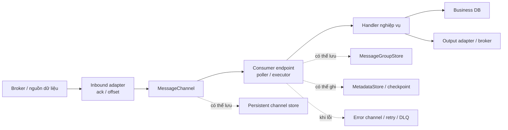
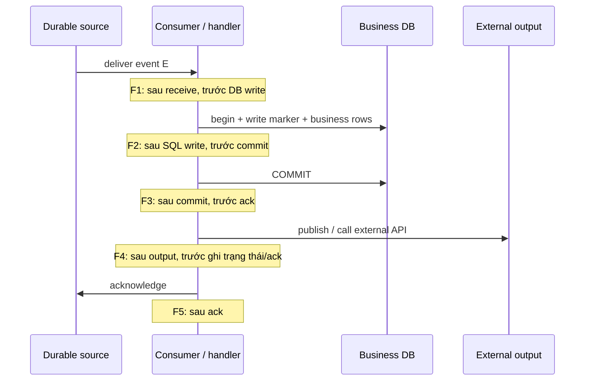
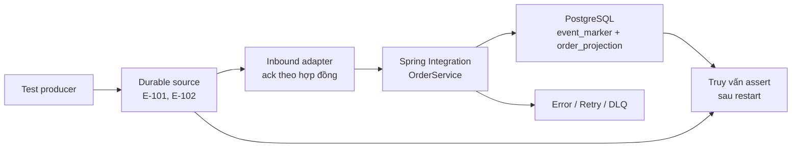
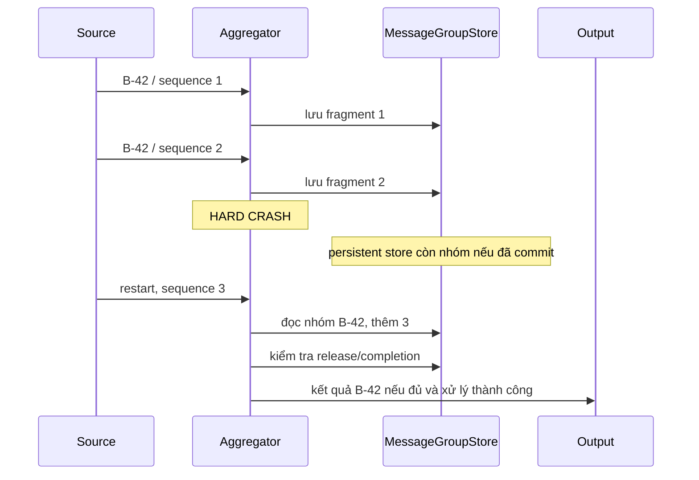
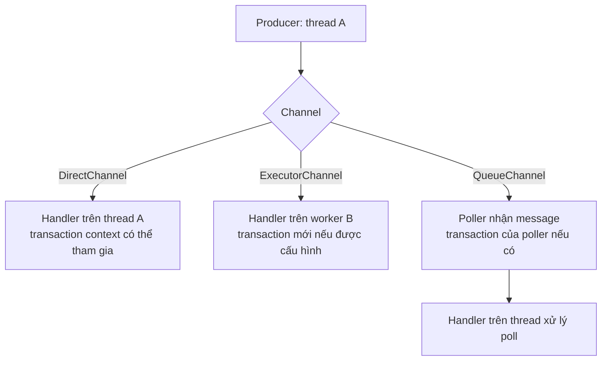

# Kiểm thử crash, restart và recovery

## 1. Mục tiêu: chứng minh điều gì sau khi JVM chết đột ngột?

Một hệ thống Spring Integration thường có inbound adapter, channel, consumer endpoint, poller, executor và handler nghiệp vụ. Một message có thể đang nằm trong `QueueChannel`, được lưu trong `MessageGroupStore` của aggregator, hoặc đã ghi dữ liệu vào database khi tiến trình đột ngột bị dừng. Sau khi khởi động lại, câu hỏi không đơn giản là “ứng dụng đã chạy lại chưa?” mà là:

1. **Dữ liệu nào còn tồn tại?** Message, trạng thái nhóm, checkpoint, metadata và transaction đã được lưu bền vững ở đâu?
2. **Công việc nào được xử lý lại?** Nguồn message có redelivery hay không, và ai quyết định acknowledgement?
3. **Side effect có lặp không?** Database đã commit, HTTP API đã nhận lệnh, hoặc sự kiện đã được phát ra trước khi JVM chết chưa?
4. **Flow có tự hoạt động trở lại không?** Consumer, poller, scheduler, error handler và dynamic `IntegrationFlow` có được đăng ký/start lại đúng cách không?
5. **Có thể chứng minh bằng số liệu không?** Log, correlation ID, message store, trạng thái transaction và dữ liệu cuối cùng có khớp với kỳ vọng?

Bài thuộc chương **Persistence và restart** của module **SPRING_INTEGRATION_RUNTIME**. Trọng tâm là thiết kế và thực hiện kiểm thử có kiểm soát để đánh giá phục hồi message flow qua channel, endpoint, poller, executor; transaction, retry, message store, error channel và correlation.

> **Nguyên tắc nền tảng:** “khởi động lại thành công”, “message còn trong store”, “message được giao ít nhất một lần” và “side effect xảy ra đúng một lần” là **bốn khẳng định khác nhau**. Mỗi khẳng định cần một phép thử và bằng chứng riêng.

## 2. Hiểu chính xác crash, stop và restart

| Tình huống | Ý nghĩa | Dùng để kiểm chứng |
| --- | --- | --- |
| **Graceful stop** | Ứng dụng nhận tín hiệu dừng, có cơ hội hoàn tất shutdown hook, ngừng poller và đóng tài nguyên | Lifecycle, drain, shutdown timeout, không mất message trong quá trình dừng có kiểm soát. |
| **Crash / hard kill** | Tiến trình JVM bị chấm dứt đột ngột, không có đảm bảo `finally`, shutdown hook hoặc transaction đang mở sẽ chạy xong | Khả năng khôi phục từ durable state khi không kịp cleanup. |
| **Restart cùng durable backend** | JVM mới dùng lại database/broker/store trước đó | Kiểm chứng dữ liệu đã commit và checkpoint có thể được đọc lại. |
| **Restart với storage mới/rỗng** | JVM mới nhưng database/broker/volume bị thay | **Không** phải bài kiểm thử recovery của state bền vững; dùng để kiểm tra hành vi bootstrap. |
| **Crash giữa hai hệ thống** | DB commit nhưng broker chưa ack, hoặc API ngoài thành công nhưng marker chưa ghi | Duplicate, idempotency, reconciliation, outbox. |
| **Mất kết nối / partition** | JVM chưa chết nhưng không kết nối được tới nguồn hoặc store | Retry, timeout, lease, split-brain; khác hard kill. |

Một lệnh dừng bình thường như `docker compose restart` hoặc `systemctl stop` không đủ để giả lập JVM bị kill tức thời. Ngược lại, `SIGKILL` chỉ mô phỏng **mất tiến trình**, không nhất thiết mô phỏng **mất điện, hỏng ổ đĩa hay database failover**. Cần ghi rõ loại failure được kiểm thử.

**Quy tắc an toàn:** chỉ dùng môi trường thử nghiệm có dữ liệu tổng hợp, database và broker có thể reset. Không dùng lệnh kill trên hệ thống production nếu chưa có quy trình vận hành được phê duyệt.

## 3. Bản đồ trạng thái trong một IntegrationFlow



Sau crash, từng vị trí có cơ chế bền vững khác nhau:

| Trạng thái | Ví dụ | Điều gì xảy ra nếu chỉ ở RAM? |
| --- | --- | --- |
| Message đang chờ | `QueueChannel`, hàng đợi của executor | Biến mất cùng tiến trình nếu không được nguồn bên ngoài phát lại. |
| Message nhóm chưa đủ | Aggregator, resequencer, `MessageGroupStore` | Các fragment chờ có thể mất; batch sau restart không còn đủ nhóm. |
| Metadata/checkpoint | `MetadataStore`, dấu mốc accept-once, trạng thái `PROCESSING/DONE` | Có thể đọc lại file/event từ đầu, hoặc không nhớ đã xử lý. |
| Correlation/sequence | `correlationId`, `sequenceNumber`, `sequenceSize` | Còn nếu nằm trong durable message headers; không mặc định ở các log hay biến cục bộ. |
| Database nghiệp vụ | JDBC/JPA transaction đã commit | Có thể giữ được nếu database cũng sống và lưu bền vững; transaction chưa commit thường rollback khi connection mất. |
| Ack/offset của broker | Kafka offset, RabbitMQ acknowledgement, JMS session | Quyết định redelivery theo transport và mode đã cấu hình. |
| Lock/lease | `LockRegistry`, ownership và fencing metadata | Lock nội bộ JVM biến mất; shared backend có chính sách expire/renewal riêng. |

**`MessageStore` không thay thế `MetadataStore`.** Message store giữ payload/headers hoặc các nhóm; metadata store giữ dấu mốc/chốt điều kiện. Lưu message bền vững mà quên dedupe vẫn có thể tạo side effect trùng sau redelivery.

## 4. Các mức bảo đảm thường bị nhầm

Hãy phân biệt **delivery semantics** và **business effect semantics**:

| Tính chất | Cần điều kiện gì? | Điều nó *không* tự hứa |
| --- | --- | --- |
| **At-most-once delivery** | Có thể xác nhận trước khi xử lý hoặc không redeliver | Có thể mất message khi crash. |
| **At-least-once delivery** | Nguồn lưu bền vững và phát lại khi chưa được xác nhận | Có thể giao trùng và xử lý trùng. |
| **Durable message storage** | Store và transaction ghi state đã commit, storage còn tồn tại | Không bảo đảm consumer đã xử lý thành công. |
| **Idempotent business effect** | Khóa nghiệp vụ ổn định, unique constraint hoặc idempotency tại đích | Không có nghĩa message chỉ được giao một lần. |
| **Atomic local database transaction** | Các thay đổi cùng nguồn tài nguyên và transaction manager phù hợp | Không rollback HTTP request hoặc ack broker ngoài transaction đó. |
| **End-to-end exactly-once** | Cần hợp đồng rất cụ thể giữa nguồn, state, output, transaction/offset/idempotency | Không thể suy ra chỉ từ `@Transactional` hay `JdbcMessageStore`. |

Một mục tiêu thực tế trong nhiều kiến trúc là **at-least-once delivery + side effect idempotent**. Broker có thể gửi lại event, nhưng database nghiệp vụ chỉ chấp nhận tác dụng của `eventId` một lần. Điều cần kiểm chứng là **số lần hiệu lực nghiệp vụ**, không phải chỉ số lần handler được gọi.

## 5. Thiết kế ma trận crash window trước khi chạy test

Cần đặt các *failpoint* vào đúng thời điểm. Nếu chỉ kill một tiến trình vào thời điểm ngẫu nhiên, rất khó suy ra crash xảy ra trước hay sau commit/ack.



Đây là một **timeline minh họa**, không phải thứ tự bắt buộc cho mọi adapter. Có hệ thống phát output trước DB commit; hệ thống khác dùng outbox để phát **sau** commit. Thứ tự chính xác phải được đo trên flow của bạn.

| Failpoint | Trạng thái có thể còn sau crash | Điều cần kiểm tra |
| --- | --- | --- |
| **F0 – Trước khi nguồn lưu message** | Chưa có durable event | Producer có retry/confirm đúng không; đây là phía producer. |
| **F1 – Sau receive, trước thao tác nghiệp vụ** | Nguồn có thể vẫn giữ event chưa ack | Event có được giao lại; inbound adapter có lỡ ack quá sớm không? |
| **F2 – Đã chạy SQL nhưng chưa commit** | Thay đổi DB thường phải rollback khi transaction bị hủy | Có row nghiệp vụ hoặc marker nào lọt ra ngoài transaction không? |
| **F3 – Đã commit DB, chưa ack nguồn** | DB đã đổi, message có thể redeliver | Unique key/idempotency có ngăn hiệu lực nghiệp vụ lần hai không? |
| **F4 – Output ngoài đã nhận nhưng checkpoint/ack chưa hoàn tất** | Tài nguyên ngoài có thể có side effect nhưng store chưa ghi nhận | Đích có idempotency key hoặc cơ chế reconciliation không? |
| **F5 – Đã ack nguồn** | Event có thể không redeliver | Ack có thực hiện **sau** khi trạng thái cần thiết được lưu không? |
| **Aggregator – Đã có 2/3 fragment** | Nhóm đang chờ release | Fragment sống qua restart và group ID còn đúng không? |
| **Aggregator – Đã release, chưa publish output** | Group có thể đã đánh dấu completed | Có mất kết quả hoặc phát lại trùng sau restart không? |
| **Checkpoint – Đã ghi metadata trước khi xử lý** | Marker tồn tại dù side effect chưa xong | Có skip event vĩnh viễn do ghi checkpoint quá sớm không? |

**Chỉ tiêu PASS** phải được viết **trước** khi test: “E có thể redeliver, `event_marker` có đúng một row, `order_projection` đúng một hiệu lực, và không tồn tại message kẹt không có recovery”. Không dùng tiêu chí mơ hồ như “không thấy lỗi”.

## 6. Phòng thí nghiệm: kiến trúc đủ nhỏ nhưng đo được recovery

Chọn một hệ thống thử nghiệm gồm:

1. Một **nguồn durable** (ví dụ broker có lưu message bền vững, hoặc `QueueChannel` được gắn persistent message store tương thích).
2. Một Spring Integration consumer flow với handler JDBC.
3. Một **database riêng được giữ nguyên giữa các lần restart**.
4. Một error/recovery path để xử lý event lỗi lâu dài.
5. Một test driver gửi event có `eventId` ổn định và ghi nhận kết quả.



Trong ví dụ Java ở phần tiếp theo, `DirectChannel` chỉ dùng làm **đầu vào giả lập để kiểm tra handler và local transaction**. Nó **không tự tạo durable source** và không cung cấp ack/redelivery. Để chạy crash test end-to-end, phải nối trước channel đó một inbound adapter hoặc một polling channel có nguồn bền vững; cần cấu hình ack và transaction theo transport được chọn.

### Schema demo (PostgreSQL)

```sql
CREATE TABLE event_marker (
    event_id VARCHAR(120) PRIMARY KEY,
    applied_at TIMESTAMP NOT NULL DEFAULT CURRENT_TIMESTAMP
);

CREATE TABLE order_projection (
    order_id VARCHAR(120) PRIMARY KEY,
    quantity INTEGER NOT NULL
);
```

Ở đây, `eventId` là khóa idempotency của **một sự kiện đã xử lý**, còn `orderId` là định danh đối tượng nghiệp vụ. Nhiều event hợp lệ có thể cập nhật cùng `orderId`; vì vậy không nên dùng `orderId` làm khóa duy nhất để bỏ mọi lần cập nhật.

### Handler JDBC với marker và business write trong cùng transaction

```java
import org.springframework.jdbc.core.JdbcTemplate;
import org.springframework.stereotype.Service;
import org.springframework.transaction.annotation.Transactional;

@Service
public class DurableOrderService {

    public record OrderEvent(
            String eventId, String orderId, int quantityDelta) {}

    private final JdbcTemplate jdbc;

    public DurableOrderService(JdbcTemplate jdbc) {
        this.jdbc = jdbc;
    }

    @Transactional
    public void process(OrderEvent event) {
        if (event.eventId() == null || event.eventId().isBlank()
                || event.orderId() == null || event.orderId().isBlank()) {
            throw new IllegalArgumentException("Missing eventId / orderId");
        }

        // Cú pháp ON CONFLICT dành riêng cho PostgreSQL.
        int inserted = jdbc.update(
            "INSERT INTO event_marker(event_id) VALUES (?) " +
            "ON CONFLICT (event_id) DO NOTHING",
            event.eventId());

        if (inserted == 0) {
            // Message có thể được giao lại, nhưng business effect đã commit.
            return;
        }

        jdbc.update(
            "INSERT INTO order_projection(order_id, quantity) " +
            "VALUES (?, ?) " +
            "ON CONFLICT (order_id) " +
            "DO UPDATE SET quantity = " +
            "order_projection.quantity + EXCLUDED.quantity",
            event.orderId(), event.quantityDelta());

        if (Boolean.getBoolean("demo.failAfterWrite")) {
            // Failure injection có thể bật/tắt giữa các lần restart.
            throw new IllegalStateException("Injected failure");
        }
    }
}
```

**Điều kiện bắt buộc:** handler `process` được gọi qua bean Spring có transaction proxy, có `PlatformTransactionManager` phù hợp, và `JdbcTemplate` cùng dùng database/transaction manager đó. Không tự gọi `this.process(...)` từ một method khác trong cùng bean rồi mặc định `@Transactional` sẽ chạy qua proxy.

Nếu exception được ném trước commit, **cả marker và projection** phải rollback cùng nhau. Nếu DB commit xong nhưng nguồn message chưa ack, lần redelivery sẽ gặp `event_marker` đã tồn tại và không cộng `quantity` lần nữa. Đây là lý do marker và cập nhật nghiệp vụ **phải nằm trong cùng local transaction**.

### Một IntegrationFlow nhỏ để gọi handler

```java
import org.springframework.context.annotation.Bean;
import org.springframework.context.annotation.Configuration;
import org.springframework.integration.channel.DirectChannel;
import org.springframework.integration.config.EnableIntegration;
import org.springframework.integration.dsl.IntegrationFlow;
import org.springframework.messaging.MessageChannel;

@Configuration
@EnableIntegration
public class RecoveryFlowConfig {

    @Bean("orders.work")
    MessageChannel ordersWork() {
        return new DirectChannel();
    }

    @Bean
    IntegrationFlow ordersFlow(DurableOrderService service) {
        return IntegrationFlow.from("orders.work")
            .handle(service, "process")
            .get();
    }
}
```

Producer thử nhanh trong cùng ứng dụng:

```java
import org.springframework.messaging.MessageChannel;
import org.springframework.messaging.support.MessageBuilder;

MessageChannel work = context.getBean(
    "orders.work", MessageChannel.class);

work.send(MessageBuilder.withPayload(
        new DurableOrderService.OrderEvent("E-101", "O-77", 2))
    .setHeader("traceId", "test-run-001")
    .build());
```

`context` là `ApplicationContext` đã khởi động. Gửi `E-101` hai lần thông qua channel đồng bộ là bài test **idempotency trên handler**; nó chưa phải bằng chứng recovery sau crash. Để kiểm tra redelivery sau `SIGKILL`, phải có durable adapter/store và test harness điều khiển được thời điểm ack.

## 7. Phân biệt các loại store khi restart

| Thành phần | State lưu gì? | Cấu hình trong bộ nhớ | Hướng kiểm tra persistence |
| --- | --- | --- | --- |
| `QueueChannel` | Message đang chờ xử lý | Queue in-memory có thể mất hoàn toàn khi JVM chết | Dùng channel message store bền vững phù hợp, ví dụ triển khai JDBC dành cho channel, hoặc durable broker phía trước. |
| `MessageStore` | Message theo ID | In-memory store mất khi restart | Dùng implementation có lưu trữ bền vững và serializer phù hợp. |
| `MessageGroupStore` | Fragment và trạng thái của aggregator/resequencer | Group đang chờ có thể mất | Dùng persistent group store; kiểm tra group ID, completion marker, timeout/reaper. |
| `MetadataStore` / `ConcurrentMetadataStore` | Checkpoint, accept-once, dấu mốc đã xử lý | Memory map mất cùng JVM | Dùng shared JDBC/Redis/backend thích hợp và kiểm tra atomicity/durability. |
| `LockRegistry` | Quyền sở hữu lock theo key | Lock cục bộ biến mất khi process chết | Shared registry có lease/reclaim phù hợp; kiểm tra stale owner và fencing. |
| Retry context / scheduled task | Số lần thử, lịch chờ | Có thể chỉ sống trong memory | Xác định implementation và nhu cầu lưu state giữa restart; không mặc định được phục hồi. |

**Lưu ý quan trọng:** một số kiểu message store phục vụ **channel** và kiểu khác phục vụ **message group**. Chẳng hạn, `JdbcChannelMessageStore` và `JdbcMessageStore` có mục đích/API cấu hình khác nhau; không chọn chỉ vì đều có chữ “JDBC”. Cần kiểm tra đúng interface mà channel/aggregator của phiên bản đang dùng yêu cầu, schema và transaction manager phù hợp.

Với **`QueueChannel` persistent**, kiểm tra cả hai phép thử:

- **Trước receive:** message đã được commit vào store, JVM chết, restart → có thể nhận lại.
- **Sau receive, trước hoàn tất handler:** message đã bị lấy ra khỏi queue, JVM chết → có được trả lại hay không còn phụ thuộc transaction có bao việc receive và store có rollback dequeue đúng hợp đồng.

Một hàng đợi bền vững **không tự động bảo đảm** nhận lại message đã dequeue nhưng chưa xử lý. Bài kiểm thử phải tác động vào đúng ranh giới này.

## 8. Poller transaction, receive và khả năng phát lại

Giả sử một polling consumer lấy message từ persistent `QueueChannel` và gọi handler JDBC. Có hai cấu hình thường gặp:

**Mô hình A — Transaction chỉ quanh handler**

```text
poller: receive message khỏi queue
handler: begin transaction
handler: update database
handler: commit/rollback
```

Nếu JVM chết **sau receive nhưng trước khi ghi DB**, message có thể không còn trong queue tùy implementation và chính sách receive; transaction của handler **không tự đảo ngược** thao tác dequeue đã diễn ra trước đó.

**Mô hình B — Transaction ở poller**

```text
poller: begin transaction
  receive message từ store tương thích
  invoke handler cùng thread/transaction tương thích
poller: commit hoặc rollback
```

Khi nguồn lưu message và business DB có thể cùng tham gia một transaction phù hợp, mô hình B có thể phối hợp rollback receive và các thay đổi database. Tuy nhiên, điều này **không đúng chỉ vì đã khai báo `.transactional(txManager)`**: phải kiểm tra loại store, transaction manager, propagation, thread và thời điểm acknowledgement.

Ví dụ DSL minh họa việc khai báo transaction tại polling endpoint:

```java
import java.time.Duration;

import org.springframework.context.annotation.Bean;
import org.springframework.integration.dsl.IntegrationFlow;
import org.springframework.integration.dsl.Pollers;
import org.springframework.messaging.PollableChannel;
import org.springframework.transaction.PlatformTransactionManager;

@Bean
IntegrationFlow replayableOrderFlow(
        PollableChannel pendingOrders,
        DurableOrderService service,
        PlatformTransactionManager txManager) {

    return IntegrationFlow.from(pendingOrders,
        source -> source.poller(
            Pollers.fixedDelay(Duration.ofMillis(500))
                .maxMessagesPerPoll(1)
                .transactional(txManager)))
        .handle(service, "process")
        .get();
}
```

Đoạn trên **chưa khai báo `pendingOrders`**: nó phải là bean pollable channel có persistent store được cấu hình riêng để làm bài thử. Không tạo thêm flow song song cùng tiêu thụ một message mà không có chủ đích. Với một số nguồn hoặc kiểu channel, việc rollback receive có thể không được hỗ trợ; phải kiểm thử trên backend thực tế.

Ngoài ra, `fixedDelay(500 ms)` là **lịch poll**, không phải transaction timeout. Nếu handler bị treo, thời điểm poll tiếp theo phụ thuộc worker/scheduler và cấu hình concurrency.

## 9. Crash thật: cách tạo và kiểm chứng failpoint

### Phân biệt exception test và hard-kill test

Gọi `throw new RuntimeException(...)` trong handler hữu ích để kiểm tra rollback, retry và error channel **khi JVM còn sống**. Nhưng nó không kiểm tra những sự cố như connection bị cắt đột ngột, thread không chạy `finally`, hoặc dữ liệu trong RAM biến mất.

Để kiểm tra crash/restart, phải dừng **chính tiến trình ứng dụng** theo cách không cho chạy graceful shutdown. Ví dụ với Docker, trong môi trường test:

```bash
# Ví dụ: tên container giả định là runtime-app.
docker kill --signal=SIGKILL runtime-app

# Khởi động lại cùng deployment/storage đã cấu hình.
docker compose up -d runtime-app
```

Lệnh chỉ có ý nghĩa khi `runtime-app` là container được quản lý bởi Compose project đang dùng. Nếu Compose có restart policy tự động, container có thể đã được khởi động lại; cần quan sát **container ID, restart count và startup log**, không giả định restart do chính lệnh thứ hai.

**Điều kiện rất quan trọng:** không kill database và broker cùng với app trừ khi bài test chủ đích đánh giá thêm sự cố của storage. Nếu xóa Docker volume hoặc dùng database ephemeral sau mỗi lần khởi động, không còn dữ liệu để xác minh persistence.

### Đặt điểm dừng quan sát được

Trong môi trường thử nghiệm, có thể bổ sung failpoint vào các ranh giới cụ thể: sau receive, sau SQL write trước commit, sau commit trước ack, sau publish output trước checkpoint. Một *latch/barrier* điều khiển bởi test harness giúp giữ tiến trình ở đúng điểm trước khi gửi SIGKILL.

Mỗi failpoint nên có log:

```text
run=test-017 event=E-101 phase=RECEIVED
run=test-017 event=E-101 phase=DB_WRITTEN_NOT_COMMITTED
run=test-017 event=E-101 phase=DB_COMMITTED
run=test-017 event=E-101 phase=ACK_PENDING
```

Không phải tất cả các phase đều nằm trong cùng một method. Ví dụ khi handler được `@Transactional` bọc bởi proxy, **method trả về chưa chắc là điểm thích hợp để tự khẳng định transaction đã commit** nếu nó đang tham gia transaction ngoài. Dùng transaction synchronization hoặc đo sự kiện commit tại ranh giới quản lý transaction phù hợp; không ghi “COMMITTED” ngay sau câu SQL `UPDATE`.

Dùng `SIGKILL` ở phase được xác nhận, khởi động lại với **cùng dữ liệu lưu bền vững**, sau đó truy vấn DB/broker/store và so sánh với kỳ vọng đã định nghĩa.

## 10. Assertions cần kiểm tra sau mỗi lần restart

Với demo PostgreSQL, sau khi gửi hai event khác nhau rồi cố tình redeliver event đầu:

```sql
SELECT event_id, applied_at
FROM event_marker
ORDER BY event_id;

SELECT order_id, quantity
FROM order_projection
ORDER BY order_id;
```

Giả sử gửi `E-101 = +2` và `E-102 = +3` vào đơn `O-77`; rồi gửi lại `E-101`. Nếu cả hai event hợp lệ đã commit, trạng thái mong đợi là:

| Chỉ số | Giá trị mong đợi | Ý nghĩa |
| --- | --- | --- |
| `event_marker` có `E-101` | 1 dòng | Chỉ ghi nhận hiệu lực một lần. |
| `event_marker` có `E-102` | 1 dòng | Sự kiện thứ hai được xử lý. |
| `order_projection.quantity` của `O-77` | 5 | Không cộng lại `E-101` khi redelivery. |
| Nguồn message | Không còn event mắc kẹt vô hạn khi recovery thành công | Phải xác minh ack/offset/queue state theo transport. |
| Error/retry/DLQ | Không có message bị bỏ qua mà không có chính sách | Có dấu vết cho poison message và retry exhausted. |

Nếu bật `-Ddemo.failAfterWrite=true` và chỉ gửi `E-101`, mong đợi khi lỗi lan ra khỏi transaction là **không có marker `E-101` và không có projection mới**. Tắt failpoint khi restart, cho message được redeliver qua nguồn bền vững, rồi xác nhận hiệu lực xuất hiện đúng một lần.

**Điểm dễ sai:** `order_projection.quantity = 5` chỉ hợp lý nếu database thử nghiệm bắt đầu trống và không có worker khác hoặc event khác ghi cùng đơn. Hãy reset hoặc version hóa dữ liệu kiểm thử trước mỗi run.

### Kiểm chứng trạng thái nguồn

Tùy nguồn:

- **Broker:** kiểm tra số event đã gửi, số lần delivery, acknowledgement/offset đã commit, redelivery/retry và DLQ. Các con số/field cụ thể phụ thuộc Kafka, RabbitMQ, JMS hoặc adapter khác.
- **Persistent QueueChannel:** kiểm tra số message tồn đọng và khả năng receive lại sau crash, nhất là cửa sổ đã dequeue.
- **Aggregator:** kiểm tra số group đang chờ, số fragment trong mỗi group, completion marker và output đã phát.
- **MetadataStore:** kiểm tra checkpoint/key trước và sau restart, TTL/retention và liệu marker có bị ghi trước side effect hay không.

Chỉ nhìn log `"Started Application"` không chứng minh bất cứ assertion nào trong số này.

## 11. Crash của aggregator, correlation và message đến muộn

Aggregator và resequencer cần nhớ nhiều message thuộc cùng `correlationId` để release khi đủ điều kiện. Giả sử batch `B-42` có ba fragment và trước crash đã nhận phần 1, 2.



Bài test nên kiểm tra **cả hai cửa sổ**:

1. **Crash trước khi nhóm đủ:** persistent `MessageGroupStore` phải còn group và các fragment đã commit; fragment mới sau restart có thể hoàn tất nhóm.
2. **Crash sau khi nhóm đủ nhưng trước hoặc sau khi publish output:** có thể mất output hoặc phát lại trùng, tùy giao dịch giữa lưu group, đánh dấu completed và output adapter. Không coi việc group “đã hoàn tất” là bằng chứng consumer phía sau đã nhận kết quả.

Một số tình huống khó:

- `correlationId` bị đổi do transformer/adapter tự tạo message không giữ header: fragment sau restart không ghép lại đúng group.
- `sequenceSize`/`ReleaseStrategy` sai hoặc missing fragment: nhóm nằm chờ mãi; cần expiration/reaper và chính sách partial/discard rõ ràng.
- Message trùng do redelivery: `group.size()` có thể tăng nhưng không phản ánh số **fragment nghiệp vụ khác nhau**.
- Group đã bị xóa metadata sau completion: message đến muộn cùng key có thể tạo nhóm mới tùy cấu hình. Cần dedupe/retention và test late-arrival.

Với nhiều application instance, phải kiểm tra **lock registry/store concurrency** của aggregator để tránh hai worker cùng release một group. Persistent store đơn độc không đảm bảo mọi thao tác cập nhật/release là nguyên tử giữa nhiều JVM.

## 12. Retry, poison message, error channel và DLQ

Recovery không có nghĩa **thử lại vô hạn mọi lỗi**. Giả sử một message lỗi định dạng sẽ làm handler thất bại ngay cả sau 20 lần restart. Nếu consumer luôn rollback rồi broker phát lại tức thì, hệ thống có thể tạo **poison-message loop**.

| Nhóm lỗi | Hướng xử lý thường phù hợp |
| --- | --- |
| Lỗi tạm thời như database timeout, broker mất kết nối | Retry có giới hạn, backoff, recovery; phân loại mã lỗi thực tế. |
| Dữ liệu sai schema/validation không thể sửa tự động | Reject và đưa sang kênh xử lý lỗi/DLQ có kiểm soát, giữ nguyên nhân và ID. |
| Error channel không có subscriber | Sửa endpoint/lifecycle/routing; đừng retry vô hạn một đích lỗi vẫn trống. |
| Transaction rollback thành công nhưng broker vẫn redeliver | Dự kiến trong at-least-once; kết hợp idempotency và giới hạn retry. |
| External API đã nhận request nhưng client timeout | Đối chiếu bằng idempotency key/status API trước khi gọi lại. |
| Store schema/migration không tương thích sau deploy | Khắc phục migration/serialization trước khi mở consumer; tránh xoá state để “sửa nhanh”. |

Khi `ErrorMessage` được phát ra, thường cần đọc `Throwable` và `MessagingException.failedMessage` nếu có, thay vì cho rằng mọi thông tin nghiệp vụ nằm ngay trên error message. Trong đường đồng bộ qua `DirectChannel`, exception có thể quay về producer; trong đường bất đồng bộ qua poller/executor, error handler có thể phát message lên error channel. Hai đường cần phép thử riêng.

**DLQ không phải nơi bỏ qua lỗi:** cần quy trình xem xét, replay có kiểm soát, retention và xác minh rằng replay không tạo side effect trùng. Replay một message đã commit nghiệp vụ nhưng chưa ack vẫn phải an toàn.

## 13. Thread, transaction, shutdown và lifecycle sau restart

### Thread boundary

`DirectChannel` thường xử lý ngay trên thread gửi. `ExecutorChannel` và poller có thể chuyển message sang worker thread; transaction context gắn thread **không tự đi theo** worker. Vì thế một crash test chạy với `DirectChannel` có thể PASS nhưng cùng flow sau khi thêm executor lại sai rollback/ack boundary.



Nếu cần khôi phục queue sau crash, phải biết **receive và business write** có được thực hiện trong một transaction phù hợp trên cùng thread không, hoặc cần dựa vào broker ack/redelivery.

### Lifecycle của endpoint và flow

Sau restart, lưu dữ liệu bền vững **chưa đủ** nếu không có consumer:

- Consumer endpoint có `autoStartup=false` hoặc chưa được start: queue tiếp tục tăng nhưng không xử lý.
- Poller/scheduler bị cấu hình sai: persistent queue còn message nhưng không ai `receive`.
- Dynamic `IntegrationFlow` chỉ được đăng ký trong RAM trước crash: nếu restart không tái dựng flow từ một nguồn cấu hình bền vững, endpoint sẽ không xuất hiện.
- Error handler chưa start hoặc error channel sai: thông báo lỗi không có consumer.
- Adapter khởi động trước khi migration/database/broker sẵn sàng: có thể lỗi liên tục trong cửa sổ startup.

Phải phân biệt **liveness** (JVM đang chạy) với **readiness** (đủ phụ thuộc và flow sẵn sàng nhận công việc). Startup log là một mốc, không phải xác nhận đã drain backlog.

### Graceful shutdown cũng cần test

Ngoài `SIGKILL`, chạy thử dừng có kiểm soát khi đang có 100 message trong nguồn. Quan sát liệu poller ngừng nhận mới, executor chờ task đang chạy theo timeout cấu hình, và trạng thái chưa xong có được giữ để retry/restart không. Không dựa vào `finally` hay shutdown hook làm cơ chế duy nhất để lưu trạng thái quan trọng, vì hard crash sẽ bỏ qua chúng.

## 14. Kịch bản test nên tự động hóa theo từng lớp

Một bộ kiểm thử tốt có **ba lớp**:

**Lớp A — Unit/integration test trong một JVM:** xác minh rollback của handler, chính sách retry, contract của `MessageStore` và release của aggregator. Có thể chủ động ném exception. Test này nhanh nhưng **không chứng minh** restart recovery.

**Lớp B — Process-level crash test:** chạy app như tiến trình/container thật với storage tách biệt, tạo failpoint, gửi `SIGKILL`, restart app và assert lại DB/broker/store. Đây là lớp bắt buộc nếu yêu cầu chịu crash.

**Lớp C — Distributed/operational test:** hai hoặc nhiều instance cùng nhận message, restart rolling, mất kết nối broker/database, instance chết khi giữ distributed lock; xác minh lease/fencing, idempotency, duplicate và backlog. Đừng gộp lỗi network partition với hard crash nếu chưa kiểm soát được kịch bản.

### Ma trận kiểm thử gợi ý

| ID | Thao tác thử | Kỳ vọng sau phục hồi |
| --- | --- | --- |
| C01 | Hard kill sau durable enqueue, trước receive | Message còn/được delivery lại khi consumer restart. |
| C02 | Hard kill sau dequeue, trước handler | Receive được rollback/redeliver **nếu hợp đồng nguồn hỗ trợ**; nếu không, test phải đánh dấu rủi ro mất message. |
| C03 | Ném exception sau SQL write, trước commit | Marker và dữ liệu nghiệp vụ đều rollback; retry có thể chạy lại. |
| C04 | Hard kill sau DB commit, trước ack | Redelivery không tạo thêm business effect nhờ idempotency. |
| C05 | Hard kill sau external API success, trước checkpoint | Reconciliation hoặc idempotency phía API ngăn side effect lặp. |
| C06 | Crash khi aggregator giữ 2/3 fragment | Group và 2 fragment vẫn tồn tại khi persistent store đã commit. |
| C07 | Crash lúc group release/output | Không mất output không được phát hiện, duplicate được xử lý đúng. |
| C08 | Restart với error handler/poller chưa start | Readiness/monitoring phát hiện backlog; khởi động lại endpoint xử lý được. |
| C09 | Retry poison event qua nhiều lần restart | Có giới hạn thử, chuyển DLQ và giữ dấu vết, không loop vô hạn. |
| C10 | Hai instance nhận cùng `eventId` | Business effect vẫn đúng một lần, dù có nhiều delivery. |
| C11 | Store/broker tạm unavailable trong startup | Endpoint xử lý lỗi đúng, không ghi nhận ack/commit giả. |
| C12 | Graceful stop khi executor đang xử lý | Công việc hoàn tất hoặc được giao lại theo hợp đồng, không có task “mất dấu”. |

Với mỗi case, ghi **điểm kill, dữ liệu trước/sau, thread, transaction, ack, group/key và kết luận PASS/FAIL**. Nếu ứng dụng không cung cấp khả năng đặt kill đúng cửa sổ F3/F4, ghi rõ case chưa kiểm chứng thay vì đánh dấu PASS dựa trên may mắn.

## 15. Quan sát, metric và chẩn đoán khi recovery không đúng

| Triệu chứng | Nghi ngờ cần kiểm tra | Bằng chứng nên thu thập |
| --- | --- | --- |
| Message biến mất sau restart | In-memory queue, ack trước xử lý, dequeue ngoài transaction | Store rows/queue depth, ack log, thời điểm receive và commit. |
| Message được xử lý hai lần | Redelivery sau commit, thiếu idempotency hoặc khóa không ổn định | `eventId`, marker table, số lần delivery, business row count. |
| Nhiều message nhóm không thể release | Group store in-memory hoặc thiếu fragment/header correlation | Group ID, sequence, store snapshot, release log. |
| Output từ aggregator bị lặp | Crash ở ranh giới group completion/output; no dedupe | Output event ID, group completion marker, downstream idempotency. |
| Backlog không giảm dù app healthy | Poller/endpoint chưa start, adapter sai channel hoặc DB không sẵn sàng | Lifecycle status, subscriber count (nếu áp dụng), poll count, error logs. |
| Message kẹt ở `PROCESSING` | Metadata claim được ghi sớm, crash trước DONE | Tuổi claim, business DB state, recovery/fencing mechanism. |
| Retry storm sau restart | Poison event, immediate redelivery, error handler không hoạt động | Retry count, root cause, DLQ depth, error channel. |
| DataSource pool cạn sau restart | SQL lock wait, transaction dài, executor quá nhiều worker | Connection pool, DB locks, thread dumps, transaction duration. |
| Lỗi chỉ khi chạy nhiều replica | Shared store/lock registry không đồng bộ hoặc namespace khác | Instance ID, metadata key, backend identity, concurrent claims. |
| Restore dữ liệu cũ thất bại | Payload/header serialization hoặc schema migration không tương thích | Deserialization stack, version, migration history. |
| Đã bật JDBC nhưng message vẫn mất | Store không dùng ở đúng channel, transaction chưa commit, volume/database bị reset | Wiring thực tế, store type, schema, transaction trace và storage identity. |

### Những metric có ích

- **Nguồn:** số message đã nhận, số delivered, redelivered, acknowledged, backlog, DLQ count.
- **Flow:** số message ở mỗi endpoint, thời gian xử lý p50/p95/p99, error count, retry attempts.
- **Executor/poller:** active threads, queue depth, poll lag, số poller đang hoạt động.
- **State:** message/group store rows, số group chờ, tuổi group lớn nhất, metadata `PROCESSING/DONE`.
- **Database:** commits, rollbacks, unique-conflict rate, lock wait, connection usage.
- **Tính đúng:** số business event duy nhất đã commit, số duplicate bị chặn, số side effect chưa đối chiếu.

Dùng cùng một `eventId` hoặc `correlationId` xuyên các log/metric, nhưng **không** suy ra transaction được truyền qua message headers. Tránh log toàn bộ payload chứa dữ liệu cá nhân hoặc bí mật. Nếu log bị mất cùng process, cần thu thập log tập trung hoặc đối chiếu durable state ngoài JVM.

## 16. Checklist trước khi tuyên bố “recovery đã đạt”

- **Nguồn:** message được lưu bền vững; ack/offset commit có thời điểm rõ ràng.
- **Store:** queue, group, metadata hoặc checkpoint có backend đúng và vẫn tồn tại sau restart.
- **Transaction:** kiểm tra rollback bằng dữ liệu thật, không chỉ nhìn annotation `@Transactional`.
- **Crash windows:** đã thử trước/giữa/sau commit và ack, không chỉ graceful restart.
- **Idempotency:** event ID ổn định, unique constraint hoặc cơ chế tại đích cuối cùng ngăn hiệu lực nghiệp vụ lặp.
- **Output:** có phương án cho khoảng trống sau DB commit trước publish (ví dụ outbox), và cho duplicate khi publish lại.
- **Aggregator:** kiểm thử partial group, completion marker, late arrival, duplicate, timeout và expiry.
- **Lifecycle:** endpoint/poller/error handler/dynamic flow được tái dựng/start đúng sau restart.
- **Concurrency:** có kiểm thử nhiều thread/instance, lock lease/fencing khi cần.
- **Quan sát:** có dashboard và assertion so sánh business state, message backlog, DLQ, redelivery và số lần side effect.
- **Vận hành:** quy trình replay/DLQ có giới hạn, backup/restore và schema migration đã được kiểm thử độc lập.

Nếu thiếu một mục, kết quả test nên ghi rõ **giới hạn phạm vi đảm bảo**, ví dụ “đã chứng minh rollback JDBC khi ném exception, chưa chứng minh khôi phục message sau SIGKILL”.

## 17. Bài thực hành và câu hỏi tự kiểm tra

**Bài 1 — Rollback không phải crash:** chạy `DurableOrderService`, bật `-Ddemo.failAfterWrite=true`, gửi event `E-101` và kiểm tra DB không có marker lẫn projection sau exception. Tắt flag và gửi lại cùng event, xác minh commit đúng một lần. Nêu rõ vì sao bài test này chưa đủ để kết luận phục hồi qua restart.

**Bài 2 — Crash trước receive:** nối flow vào durable inbound broker hoặc persistent polling channel được cấu hình đúng; gửi một event, xác nhận đã lưu ở nguồn nhưng consumer chưa nhận, hard kill app, restart với cùng storage. Kiểm tra event được nhận và xử lý sau restart.

**Bài 3 — Crash sau commit trước ack:** tạo một failpoint ở ranh giới được xác minh là **DB đã commit nhưng source chưa ack**. Kill app, restart, cho event redeliver và truy vấn `event_marker`/`order_projection`. Chứng minh handler có thể được gọi nhiều lần nhưng business effect chỉ có một lần.

**Bài 4 — QueueChannel in-memory và persistent:** gửi vài message rồi kill app trước khi consume. So sánh queue mặc định với channel lưu bền vững, luôn kiểm tra nơi đã ghi commit thành công. Tiếp tục thử crash sau dequeue, nêu sự phụ thuộc vào poller transaction/store.

**Bài 5 — Aggregator đang chờ:** cấu hình `MessageGroupStore` persistent, gửi hai fragment của batch ba phần tử; kill app; restart và gửi fragment thứ ba. Xác minh đúng correlation key, sequence và một output batch. Thử lặp fragment rồi thêm chính sách dedupe.

**Bài 6 — Poison message và DLQ:** gửi một event validation sai, cấu hình retry có giới hạn và recovery channel. Khởi động lại nhiều lần; kiểm tra không xuất hiện retry storm hoặc trạng thái bị kẹt, đồng thời DLQ lưu đủ ID và nguyên nhân để replay an toàn.

**Bài 7 — Hai replica cùng event:** hai instance chung database và nguồn message có khả năng phân phối/redelivery. Gửi nhiều bản sao cùng `eventId`, kiểm tra unique marker chặn double effect; so sánh với việc dùng `SimpleMetadataStore` cục bộ để thấy vì sao kiểm soát trong một JVM chưa đủ.

**Bài 8 — Rolling restart và readiness:** khi còn backlog, dừng rồi khởi động từng instance. Kiểm tra poller, error handler và dynamic flow được tái dựng; readiness chỉ báo sẵn sàng khi các phụ thuộc và endpoint quan trọng hoạt động. Theo dõi backlog trở về mức bình thường.

### Câu hỏi tự kiểm tra

1. Vì sao graceful restart không tương đương crash bằng SIGKILL?
2. `QueueChannel` persistent có đảm bảo message đã dequeue nhưng chưa xử lý sẽ quay lại không? Điều kiện nào cần kiểm tra?
3. Vì sao `@Transactional` không thể rollback một HTTP call đã thành công?
4. Điều gì xảy ra nếu database commit xong nhưng broker chưa ack trước khi app chết?
5. Vì sao bảng marker và cập nhật business cần cùng transaction?
6. Một handler đã được gọi hai lần có nhất thiết tạo hai business effect không?
7. Persistent `MessageGroupStore` giúp gì khi aggregator crash ở 2/3 fragment?
8. Vì sao group đã release chưa chứng minh output được downstream nhận?
9. Vì sao một message lỗi schema có thể tạo retry loop qua nhiều lần restart?
10. Khi `ExecutorChannel` thay `DirectChannel`, giả định nào về thread và transaction thay đổi?
11. Nếu app đã restart và health check xanh nhưng backlog vẫn tăng, cần kiểm tra những thành phần nào?
12. Một báo cáo recovery test tốt cần ghi những bằng chứng gì để phân biệt PASS với “chưa kiểm thử”?

**Nguyên tắc vận hành:** thực hiện recovery test bằng **failpoint rõ ràng và hard crash có kiểm soát**; tái khởi động ứng dụng với **cùng storage bền vững**; kiểm chứng **delivery, transaction, idempotency, group state, endpoint lifecycle và output** bằng dữ liệu thực. Chỉ khi hệ thống xử lý được cả cửa sổ **trước commit, sau commit nhưng trước ack, và sau side effect ngoài transaction**, mới có cơ sở đánh giá độ tin cậy của message flow qua crash/restart.
