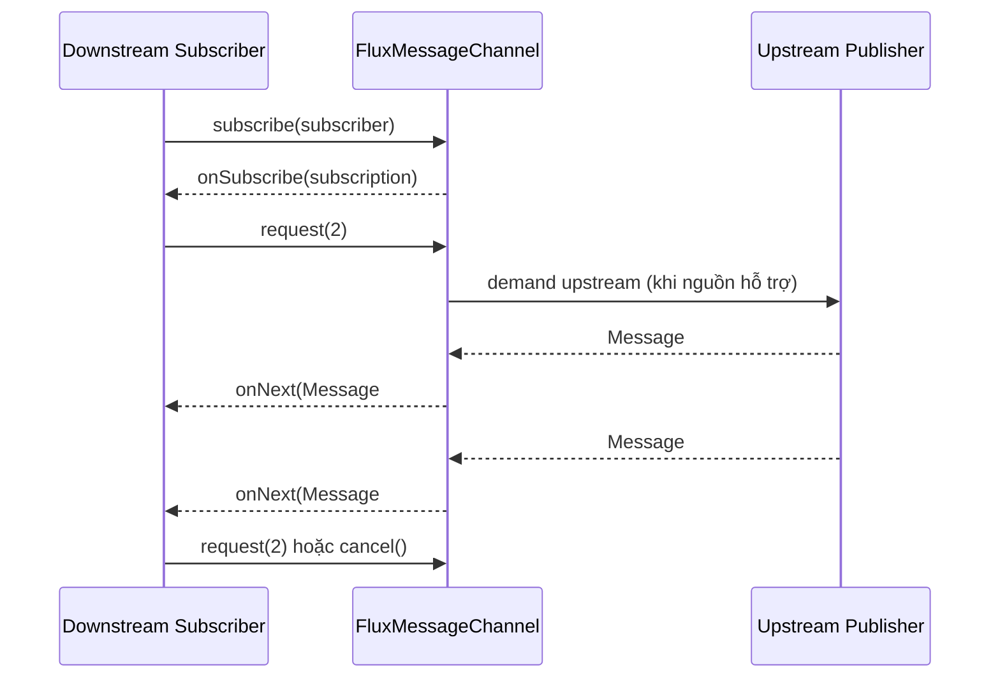
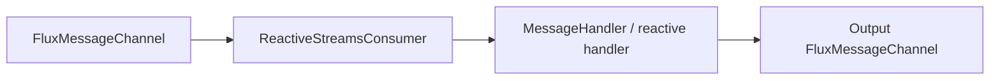
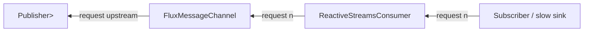
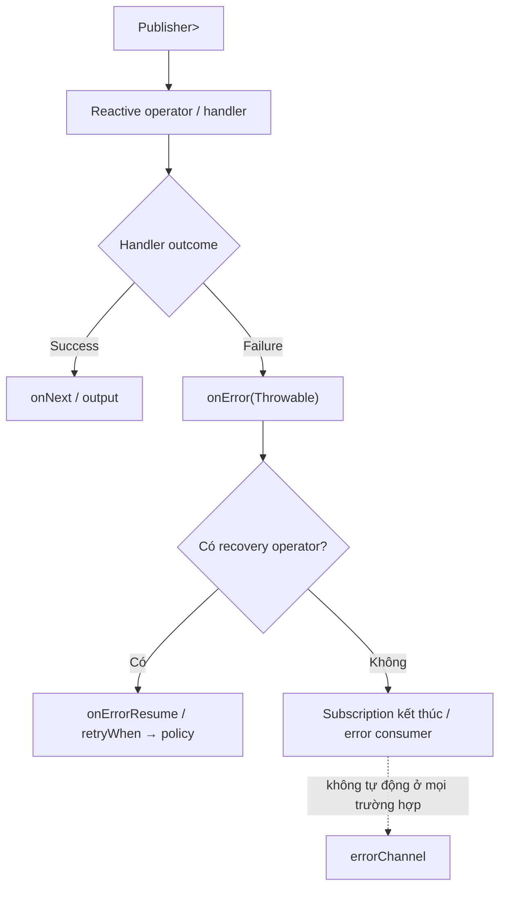

# FluxMessageChannel và Publisher message trong Spring Integration

## 1. Bài toán: một message flow có thể vận hành theo Reactive Streams như thế nào?

Trong Spring Integration truyền thống, producer thường gọi `MessageChannel.send(message)` và endpoint nhận message để xử lý. Với `DirectChannel`, việc giao cho consumer thường diễn ra ngay trên call stack của người gửi. Với `ExecutorChannel`, tác vụ được đưa sang executor, nhưng producer không nhất thiết được điều tiết theo lượng công việc mà downstream có thể xử lý.

Khi nguồn dữ liệu là `Flux` của Project Reactor, WebFlux, RSocket hoặc một API trả `Publisher`, ta có thêm một cơ chế: **consumer gửi tín hiệu demand xuống upstream**, xác định số phần tử sẵn sàng nhận theo hợp đồng Reactive Streams. Spring Integration cung cấp `FluxMessageChannel` và `ReactiveStreamsConsumer` để gắn mô hình này vào kiến trúc message–channel–endpoint.

Trong chương **Reactive runtime** của module **SPRING_INTEGRATION_RUNTIME**, bài học này tập trung vào câu hỏi: **`FluxMessageChannel` chuyển một `Message<?>` sang một Publisher như thế nào; ai tạo subscription; demand, threading, lỗi, lifecycle và persistence vận hành ra sao?** Các mối liên hệ tới consumer, poller, executor, retry, transaction, message store và correlation sẽ được giải thích theo thực tế runtime.

> **Điểm cần nhớ:** Reactive không có nghĩa tự động chạy ở thread khác, không có nghĩa mọi adapter đều non-blocking, và không có nghĩa message được lưu bền vững. `FluxMessageChannel` là **cầu nối tương tác theo Reactive Streams**, không phải broker hoặc `QueueChannel` persistent.

## 2. Ba tầng kiến thức trước khi bắt đầu

### 2.1. Reactive Streams có bốn vai trò

Reactive Streams định nghĩa bốn giao diện chính:

- `Publisher<T>`: nguồn có thể xuất bản các phần tử thuộc kiểu `T`.
- `Subscriber<T>`: phía nhận, xử lý `onSubscribe`, `onNext`, `onError` và `onComplete`.
- `Subscription`: mối quan hệ giữa một Publisher và một Subscriber; phía nhận gọi `request(n)` để yêu cầu thêm phần tử hoặc `cancel()` để hủy.
- `Processor<T,R>`: vừa là Subscriber vừa là Publisher; trong Reactor, những tổ hợp operator có thể đóng vai trò tương tự.

`Mono<T>` đại diện cho tối đa một phần tử; `Flux<T>` đại diện cho 0..N phần tử. Spring Integration dùng **Project Reactor** để triển khai hỗ trợ Reactive Streams. Các operator như `map`, `flatMap`, `publishOn`, `retryWhen` chỉ tạo pipeline; **subscription** là bước kích hoạt xử lý cho Publisher nguồn phù hợp.



Trong thực tế có thể có buffering, prefetch và các operator trung gian, nên đừng hiểu sơ đồ là từng lệnh `request(2)` sẽ luôn tương ứng chính xác hai sự kiện ngay lập tức đi tới upstream. Đây là **mô hình logic của nhu cầu tiêu thụ**.

### 2.2. Message<T> khác Publisher<T>

Ba kiểu dữ liệu rất dễ bị nhầm:

| Kiểu | Nó đại diện cho điều gì? |
| --- | --- |
| `Message<Order>` | **Một message** có payload `Order` và headers |
| `Publisher<Message<Order>>` | **Một dòng message** mà subscriber có thể yêu cầu theo demand |
| `Message<Flux<Order>>` | **Một message** chứa một publisher trong payload; bản thân channel chưa chắc subscribe/flatten publisher này |

Với `FluxMessageChannel`, hợp đồng quan trọng là **`Publisher<Message<?>>`**: downstream nhận các **Spring Message**, không phải trực tiếp các `Order` hoặc `String` trần. Nếu muốn dữ liệu dạng `Flux<Order>`, có thể chuyển bằng `Flux.from(channel).map(m -> (Order) m.getPayload())` khi kiểu payload đã được kiểm soát.

Một `Message<Flux<T>>` chỉ có ý nghĩa reactive đúng nếu handler hoặc downstream biết cách subscribe, flatten hoặc chuyển payload đó sang cấu trúc pipeline tương ứng. Không suy ra việc message mang payload `Flux` tự làm mọi endpoint trở thành reactive.

### 2.3. Hot và cold Publisher

- **Cold Publisher** như `Flux.range(...)` hoặc `Flux.defer(...)` thường tạo nguồn dữ liệu mới cho từng subscription.
- **Hot Publisher** như một sink nhận sự kiện đang được push thường phụ thuộc thời điểm subscriber tham gia; không nhất thiết phát lại dữ liệu cũ.
- `FluxMessageChannel` có nguồn `Flux` nội bộ dạng **hot sink**, nhận message từ `send()`. Đồng thời nó có thể đăng ký upstream `Publisher` để tiêu thụ theo nhu cầu downstream.

Hậu quả: đừng gửi message vào một `FluxMessageChannel` chưa có downstream rồi tin rằng các message ấy được lưu lại vĩnh viễn. Với yêu cầu lưu/replay, chọn broker hoặc persistent store thích hợp.

## 3. FluxMessageChannel thật sự là gì?

`org.springframework.integration.channel.FluxMessageChannel` được Spring Integration giới thiệu từ phiên bản 5.0. Nó kết hợp hai khả năng:

1. Là một `MessageChannel`: code imperative có thể gọi `send(Message<?>)`.
2. Là một `org.reactivestreams.Publisher<Message<?>>`: code reactive có thể gọi `subscribe(Subscriber)`, thường thông qua `Flux.from(channel)`.

Nó cũng thực hiện hợp đồng `ReactiveStreamsSubscribableChannel`, có phương thức `subscribeTo(Publisher<? extends Message<?>>)` để nối một Publisher nguồn vào channel.

```mermaid
flowchart LR
    P["Imperative producer"] -->|send(Message)| F["FluxMessageChannel"]
    R["Publisher<Message<?>>"] -->|subscribeTo(...)| F
    F -->|subscribe + request(n)| S["Reactive Subscriber"]
    S --> H["ReactiveStreamsConsumer / MessageHandler"]
```

Mẫu này cho phép đưa cả **message push truyền thống** và **publisher nguồn** vào một bề mặt Reactive Streams.

### Những giao diện KHÔNG nên dùng nhầm

`FluxMessageChannel` không phải `PollableChannel` và cũng không phải `SubscribableChannel` truyền thống. Do đó:

- Không gọi `channel.receive()` như với `QueueChannel`; `FluxMessageChannel` không cung cấp polling receive.
- Không đăng ký handler theo kiểu `SubscribableChannel.subscribe(MessageHandler)` trực tiếp trên chính đối tượng này.
- Thay vào đó, kết nối thông qua `Subscriber`/`Flux` hoặc để Spring Integration tạo `ReactiveStreamsConsumer` cho endpoint downstream.
- Không cấu hình poller chỉ để “đọc” từ `FluxMessageChannel`; poller thuộc về các `PollableChannel` hoặc source polling adapter tương ứng.

### Bảng so sánh nhanh

| Channel | Cách nhận/tiêu thụ | Threading điển hình | Backpressure | Persistence mặc định |
| --- | --- | --- | --- | --- |
| `DirectChannel` | `MessageHandler` qua `SubscribableChannel` | Đồng bộ trong thread gọi `send` | Không phải Reactive Streams demand | Không |
| `ExecutorChannel` | Dispatch handler qua `TaskExecutor` | Worker thread | Queue/capacity/rejection của executor, không phải Reactive Streams end-to-end | Không |
| `QueueChannel` | `receive()` thông qua poller | Thread poller | Capacity/poll rate, không phải `request(n)` của Reactive Streams | Không; có thể thêm store |
| `PublishSubscribeChannel` | Broadcast đến subscriber | Theo sender hoặc executor | Không tự biến thành `Publisher<Message<?>>` | Không |
| **`FluxMessageChannel`** | Reactive `Subscriber`, kết hợp nguồn `Publisher` | Theo scheduler/nguồn/operator | **Có thể truyền demand**, nếu toàn chuỗi tương thích | **Không** |

Dù một channel là reactive, bất kỳ bước phía trước hoặc phía sau có I/O blocking, infinite buffering hay listener chỉ biết push đều có thể làm mất lợi ích điều tiết nhu cầu ở phần đó của pipeline.

## 4. Bên trong FluxMessageChannel: hai đường vào, một dòng ra

### Đường A: code imperative gọi send()

```text
producer.send(message)
         |
         v
  FluxMessageChannel.doSend(...)
         |
         v
 Reactor hot sink
         |
         v
 Subscriber đã đăng ký + operator downstream
```

`send()` trả về một giá trị `boolean` theo hợp đồng `MessageChannel`; giá trị đó không có nghĩa tất cả các bước downstream đã hoàn tất, cũng không xác nhận side effect nghiệp vụ commit. Do subscriber có thể xử lý bất đồng bộ hoặc ở một scheduler khác, lỗi có thể xuất hiện **sau** lời gọi `send()`.

Nếu push liên tục từ code imperative không biết backpressure, sink và các queue/operator phía sau có thể gặp tình huống chưa có demand hoặc backlog quá lớn; việc Reactive Streams tồn tại ở phía downstream không khiến producer imperative tự nhiên gọi `request(n)`. Cần kiểm soát tốc độ, giới hạn memory, xử lý rejection/overflow và xác minh hành vi phiên bản triển khai.

### Đường B: nối upstream Publisher

```text
Flux<Message<?>> upstream
         |
   subscribeTo(upstream)
         |
   FluxMessageChannel
         |
   downstream subscriber (request(n))
         |
     xử lý theo demand
```

Khi upstream cũng là `Publisher` và downstream subscribe, `FluxMessageChannel` có thể phát triển subscription đến upstream đúng lúc consumer đã sẵn sàng. Đây là mô hình phù hợp để giữ semantics reactive xuyên các bước.

**Không nhầm `subscribeTo(publisher)` với `publisher.subscribe(...)`:** phương thức thứ nhất gắn nguồn vào channel; phương thức thứ hai gắn consumer vào nguồn. Cần có **cả đường sản xuất và đường tiêu thụ** để message được xử lý.

## 5. Ví dụ cơ bản: một FluxMessageChannel dùng trực tiếp

Ví dụ này cho thấy đối tượng channel có thể đồng thời nhận `send()` và được dùng như `Publisher<Message<?>>`. Nó không đòi hỏi Spring ApplicationContext vì chỉ minh họa API channel.

```java
import org.springframework.integration.channel.FluxMessageChannel;
import org.springframework.messaging.Message;
import org.springframework.messaging.support.MessageBuilder;
import reactor.core.Disposable;
import reactor.core.publisher.Flux;

public class FluxChannelBasics {

    public static void main(String[] args) {
        FluxMessageChannel channel = new FluxMessageChannel();

        // Đăng ký downstream TRƯỚC khi đưa message vào hot channel.
        Disposable subscription = Flux.from(channel)
                .map(Message::getPayload)
                .doOnNext(value -> System.out.println("Received: " + value))
                .doOnError(error -> System.err.println(
                        "Stream failed: " + error.getMessage()))
                .subscribe();

        try {
            boolean accepted = channel.send(
                    MessageBuilder.withPayload("order-101").build());

            System.out.println("Accepted by channel: " + accepted);
        } finally {
            subscription.dispose();
            channel.destroy();
        }
    }
}
```

Kỳ vọng khi chạy trong điều kiện bình thường: subscriber nhận payload `order-101` và lệnh `send()` báo channel chấp nhận message. **Đây không phải ví dụ durable queue**. `subscription.dispose()` hủy subscription, còn `destroy()` giải phóng tài nguyên channel ở cuối vòng đời demo.

Trong thực tế, không nên tạo/dispose subscriber ngẫu nhiên theo từng request. Hãy để Spring quản lý `IntegrationFlow` và endpoint subscriptions, hoặc quản lý vòng đời subscriber/`Disposable` tại một nơi có lifecycle rõ ràng.

### Ví dụ thứ hai: nguồn Publisher<Message<?>>

```java
import org.springframework.integration.channel.FluxMessageChannel;
import org.springframework.messaging.Message;
import org.springframework.messaging.support.MessageBuilder;
import reactor.core.publisher.Flux;

FluxMessageChannel channel = new FluxMessageChannel();

Flux<Message<?>> source = Flux.range(1, 5)
        .<Message<?>>map(number ->
                MessageBuilder.withPayload("order-" + number)
                        .setHeader("correlationId", "batch-A")
                        .build());

// Kết nối upstream trước; subscription nguồn được điều phối
// theo khả năng của channel và khi downstream sẵn sàng.
channel.subscribeTo(source);

// Downstream đăng ký nhận Message<?>.
Flux.from(channel)
        .take(5)
        .subscribe(msg -> System.out.println(msg.getPayload()),
                error -> System.err.println(error.getMessage()));
```

Đoạn code này trình bày trực tiếp hợp đồng `subscribeTo`. Trong ứng dụng, hãy quản lý lifecycle và subscription theo Spring; đừng dùng `subscribe()` thủ công ở nhiều nơi nếu các subscriber có thể cạnh tranh/nhân bản hành vi nghiệp vụ mà bạn chưa dự tính.

## 6. ReactiveStreamsConsumer kết nối với handler như thế nào?

Với channel truyền thống, `SubscribingConsumer` có thể đăng ký một `MessageHandler` trực tiếp với `SubscribableChannel`. Với `FluxMessageChannel`, consumer cần tham gia theo Reactive Streams. Spring Integration cung cấp `ReactiveStreamsConsumer` làm cầu nối: phía upstream là `Flux<Message<?>>`, phía downstream là các message handler phù hợp.



Trong nhiều tình huống, lập trình viên chỉ cấu hình `IntegrationFlow`; framework tự xây consumer phù hợp dựa trên input channel và handler.

### Việc một endpoint là “reactive” không đảm bảo handler không blocking

Ví dụ một `@ServiceActivator` dùng JDBC blocking, gọi `Thread.sleep` hoặc HTTP client đồng bộ: đặt nó sau `FluxMessageChannel` không tự thay thế lời gọi blocking bằng Reactor bất đồng bộ. Nếu nó chạy trên event-loop/scheduler không phù hợp, latency và throughput sẽ suy giảm.

Hướng xử lý:

- Dùng reactive client thực sự (R2DBC, WebClient, adapter reactive tương ứng) khi có.
- Nếu buộc dùng API blocking, đưa công việc tới scheduler phù hợp (`Schedulers.boundedElastic()`) hoặc cách ly qua executor phù hợp, có giới hạn concurrency.
- Không dùng `Schedulers.parallel()` để chạy I/O blocking lâu dài.
- Kiểm tra transaction/acknowledgment khi chuyển thread, vì `ThreadLocal` transaction của JDBC không tự truyền qua Reactor scheduler.

Từ Spring Integration 5.5, endpoint DSL có tùy chọn `reactive()` để yêu cầu tạo `ReactiveStreamsConsumer` kể cả khi input channel không phải `FluxMessageChannel`; có thể cung cấp hàm tùy chỉnh `Flux` qua `publishOn`, `doOnNext`, v.v. Đây là một **cách tạo ranh giới xử lý reactive**, không phải một cờ đảm bảo toàn hệ thống trở thành non-blocking.

## 7. Java DSL: một IntegrationFlow với hai FluxMessageChannel

Ví dụ sau đặt reactive channel ở cả đầu vào và đầu ra để các endpoint giữa chúng có thể tham gia mô hình reactive. Khai báo các bean trong một Spring application có Project Reactor trên classpath.

```java
import java.util.Locale;

import org.springframework.beans.factory.annotation.Qualifier;
import org.springframework.context.annotation.Bean;
import org.springframework.context.annotation.Configuration;
import org.springframework.integration.channel.FluxMessageChannel;
import org.springframework.integration.config.EnableIntegration;
import org.springframework.integration.dsl.IntegrationFlow;

@Configuration
@EnableIntegration
public class ReactiveOrdersFlow {

    @Bean("reactiveOrdersIn")
    public FluxMessageChannel reactiveOrdersIn() {
        return new FluxMessageChannel();
    }

    @Bean("reactiveOrdersOut")
    public FluxMessageChannel reactiveOrdersOut() {
        return new FluxMessageChannel();
    }

    @Bean
    public IntegrationFlow normalizeOrders(
            @Qualifier("reactiveOrdersIn") FluxMessageChannel input,
            @Qualifier("reactiveOrdersOut") FluxMessageChannel output) {

        return IntegrationFlow.from(input)
                .transform(String.class,
                        text -> text.trim().toUpperCase(Locale.ROOT))
                .channel(output)
                .get();
    }
}
```

`@EnableIntegration` khởi tạo hạ tầng integration; channel đầu vào/đầu ra được đăng ký như bean. `IntegrationFlow.from(input)` nối consumer vào input; `.transform(...)` chuyển payload `String` thành String đã chuẩn hóa, đồng thời Spring Integration bảo quản các header liên quan qua biến đổi phù hợp.

Để quan sát kết quả, sau khi ứng dụng đã khởi tạo:

```java
import org.springframework.integration.channel.FluxMessageChannel;
import org.springframework.messaging.support.MessageBuilder;
import reactor.core.Disposable;
import reactor.core.publisher.Flux;

FluxMessageChannel input =
        context.getBean("reactiveOrdersIn", FluxMessageChannel.class);
FluxMessageChannel output =
        context.getBean("reactiveOrdersOut", FluxMessageChannel.class);

Disposable observer = Flux.from(output)
        .subscribe(message ->
                System.out.println("Output: " + message.getPayload()),
                error -> System.err.println("Pipeline error: " + error));

// Đăng ký consumer rồi mới gửi.
input.send(MessageBuilder.withPayload("  order-101  ").build());

// Khi dừng phần observer/lab:
observer.dispose();
```

Kỳ vọng payload đầu ra là `ORDER-101` trong điều kiện flow và subscribers hoạt động đúng. Lưu ý: biến `context` đại diện cho một `ApplicationContext` đã khởi chạy, không phải biến toàn cục có sẵn; đoạn code là **cách dùng bean** sau khi cấu hình đã được nạp.

### Khi nào ví dụ chỉ “một phần reactive”?

Transformer trong ví dụ là hàm Java đồng bộ và rất ngắn, phù hợp. Nhưng nếu thay bằng gọi JDBC hoặc HTTP blocking thì pipeline có thể vẫn chứa đoạn blocking. Một chuỗi `FluxMessageChannel` **không** làm một hàm blocking trở thành non-blocking.

Với sản phẩm thực tế, cần thử throughput, thread names, queue depth, timeout, duplicate và semantics của adapter đang dùng chứ không chỉ nhìn vào class channel.

## 8. Bắt đầu IntegrationFlow từ một Publisher

Java DSL hỗ trợ `IntegrationFlow.from(Publisher<Message<T>>)`. Hướng này phù hợp khi ứng dụng đã có `Flux<Message<?>>` từ reactive client hoặc một source producer.

```java
import org.springframework.context.annotation.Bean;
import org.springframework.integration.dsl.IntegrationFlow;
import org.springframework.messaging.Message;
import org.springframework.messaging.support.MessageBuilder;
import reactor.core.publisher.Flux;
import reactor.core.publisher.Mono;

@Bean
public IntegrationFlow fromReactiveSource() {

    Flux<Message<?>> source = Flux.range(1, 5)
            .<Message<?>>map(number ->
                    MessageBuilder
                            .withPayload("job-" + number)
                            .build());

    return IntegrationFlow.from(source)
            // handleReactive() là terminal operator từ Spring Integration 6.1.
            .handleReactive(message ->
                    Mono.fromRunnable(() ->
                            System.out.println(
                                    "Handled: " + message.getPayload())));
}
```

Đây là ví dụ **demo**: `Mono.fromRunnable(...)` chỉ gói lệnh in log vào một Publisher lười thực thi, không tự biến println thành I/O non-blocking. Với client reactive thật, handler sẽ trả `Mono<Void>` từ WebClient hoặc cơ chế thao tác bất đồng bộ tương đương.

**Thứ tự kích hoạt phụ thuộc lifecycle của flow/subscription**, không phải ở thời điểm tạo `Flux.range`. Một nguồn Publisher cold có thể phát lại phần tử khi subscribe lại; khi thiết kế retry/resubscribe, phải xem khả năng lặp của nguồn và idempotency downstream.

## 9. Xuất IntegrationFlow thành Publisher bằng toReactivePublisher()

Hướng ngược lại cũng được hỗ trợ: biến một `IntegrationFlow` đã xây dựng thành `Publisher<Message<?>>` để code bên ngoài dùng Reactor operators hoặc đăng ký downstream subscriber.

```text
IntegrationFlow:
   source → transform → route → toReactivePublisher()
                                       |
                             Publisher<Message<?>>
                                       |
                            Flux.from(...).subscribe(...)
```

`IntegrationFlowBuilder.toReactivePublisher()` dùng `FluxMessageChannel` nội bộ. Biến thể `toReactivePublisher(boolean autoStartOnSubscribe)` xuất hiện từ Spring Integration 5.5.6 để điều khiển thời điểm bắt đầu các thành phần của flow khi có subscription:

- Với `autoStartOnSubscribe=true`, flow có thể được cấu hình không tự start trong startup thông thường, rồi `start()` tại `doOnSubscribe` của Publisher được xuất ra.
- Khi reactive stream bị cancel hoặc terminate, cơ chế này có thể stop các thành phần liên quan theo quy tắc lifecycle của flow.
- Không giả định mọi Publisher đều tự start một flow: phải chọn biến thể phù hợp và kiểm tra phiên bản Spring Integration thực tế.

Đây là khía cạnh **rất quan trọng** khi tạo dynamic `IntegrationFlow`. Nếu publisher không có subscriber, nguồn có thể chưa được kích hoạt; nếu subscriber bị hủy, flow có thể dừng. Đừng dùng điều này như bảo đảm durable hoặc tự động resume message đang chạy sau restart.

`toReactivePublisher()` phù hợp khi cần giao stream ra ngoài cho client hoặc lớp xử lý reactive; một ứng dụng bình thường dùng endpoint do Spring quản lý không nhất thiết phải gọi API này.

## 10. FluxMessageChannel, ReactiveMessageHandler và kết quả Mono/Flux

Từ Spring Integration 5.3, `ReactiveMessageHandler` được hỗ trợ cho handler tương tác với client reactive và trả một reactive signal. Trong một flow imperative, framework có thể dùng `ReactiveMessageHandlerAdapter` và subscribe ngay để thực hiện việc xử lý. Trong một `ReactiveStreamsConsumer`, phản hồi của handler được nối vào pipeline theo operator như `flatMap` để tôn trọng demand khi có khả năng.

Từ Spring Integration 6.1, DSL có terminal operator `handleReactive(ReactiveMessageHandler)`, phù hợp với xử lý một chiều trả `Mono<Void>`.

Ví dụ client phản hồi không đồng bộ:

```java
import org.springframework.context.annotation.Bean;
import org.springframework.integration.dsl.IntegrationFlow;
import reactor.core.publisher.Mono;

@Bean
IntegrationFlow outboundReactiveFlow() {
    return IntegrationFlow.from("outboundRequests")
            .handleReactive(message ->
                    Mono.fromRunnable(() ->
                            System.out.println(message.getPayload())));
}
```

Ở đây `handleReactive` được framework subscribe. Với nghiệp vụ thật, body thường là một lệnh `Mono<Void>` hoặc `Mono<Something>.then()` từ reactive client, không phải một `Runnable` in log.

### Handler trả Publisher trong payload phản hồi

Đây là một tình huống khác với `ReactiveMessageHandler`: một **reply-producing handler** có thể trả `Mono<T>` hoặc `Flux<T>` như payload kết quả.

Theo tài liệu Spring Integration:

- Khi output channel là `ReactiveStreamsSubscribableChannel` (chẳng hạn `FluxMessageChannel`), framework có thể nối/flatten Publisher phù hợp để downstream nhận các sự kiện theo demand.
- Với output channel imperative và cấu hình async phù hợp, cách xử lý kết quả reactive khác: đối với publisher nhiều giá trị, payload có thể vẫn được gói trong một `Mono` chứa chính publisher; downstream có thể cần chủ động subscribe/flatten.
- Đừng lầm tưởng một `Message<Flux<Order>>` tự sinh N `Message<Order>` ở mọi channel. Hành vi phụ thuộc handler, loại publisher, output channel và các tùy chọn async.

Nếu cần 1 phần tử đầu ra cho mỗi item của publisher, hãy xác minh pipeline thực tế bằng integration test thay vì chỉ dựa vào chữ `Flux` trong kiểu trả về của method.

## 11. Backpressure hoạt động ở đâu và không hoạt động ở đâu?

Backpressure là cơ chế để subscriber báo số phần tử nó sẵn sàng nhận (`request(n)`). Nó giúp kiểm soát lưu lượng ở một chuỗi nguồn–operator–consumer hỗ trợ Reactive Streams, nhưng không phải phép màu.

### Luồng có backpressure xuyên các chặng



Khi `FluxMessageChannel.subscribeTo(publisher)` nối một publisher đúng chuẩn, nguồn có thể được yêu cầu phát theo demand. Tùy operator (ví dụ `flatMap` có prefetch) và implementation, upstream có thể nhận lượng demand lớn hơn từng request nhỏ downstream; vẫn cần chính sách concurrency/buffering rõ.

### Các điểm cắt backpressure

- **`send()` imperative:** producer chủ động push; nó không nhận `Subscription.request(n)` từ consumer. Nếu producer gửi quá nhanh, phải kiểm soát riêng.
- **Adapter non-reactive:** một listener hoặc client blocking không tự hỗ trợ demand; có thể cần queue có capacity hoặc adapter khác.
- **Buffer không giới hạn:** `onBackpressureBuffer` không có giới hạn có thể chuyển bottleneck thành OOM.
- **I/O blocking:** subscriber thiếu khả năng giải phóng event-loop; demand không thay thế timeout, bulkhead và scheduler phù hợp.
- **Broker/DB:** ack/commit, message retention và redelivery thuộc semantics của transport; Reactor demand không tự commit transactional offset.

### Ví dụ giới hạn số yêu cầu đồng thời

```java
import reactor.core.publisher.Flux;
import reactor.core.publisher.Mono;

Flux<String> orderIds = Flux.just("o-1", "o-2", "o-3");

// remoteCall(String) là phương thức do ứng dụng cung cấp,
// trả Mono<String> từ một API bất đồng bộ.
Flux<String> results = orderIds.flatMap(
        orderId -> remoteCall(orderId),
        4); // Giới hạn tối đa 4 inner publishers đang hoạt động.
```

`flatMap` có thể hoàn tất **không giữ thứ tự đầu vào**. Nếu cần đúng thứ tự, dùng `concatMap` hoặc giải pháp xử lý thứ tự rõ ràng; đổi lại concurrency có thể giảm. Đây là vấn đề quan trọng khi downstream dùng `correlationId` và `sequenceNumber`.

## 12. publishOn, subscribeOn và ranh giới thread

Reactive **không đồng nghĩa** luôn chạy trên thread riêng. Khi không thay scheduler, nhiều operator có thể thực thi trên thread phát nguồn hoặc thread đang phát tín hiệu.

- `publishOn(scheduler)` chuyển việc thực thi những operator downstream sau nó sang scheduler chỉ định; nó có queue/prefetch của riêng operator.
- `subscribeOn(scheduler)` tác động tới nơi thực hiện subscription và phần upstream theo mô hình Reactor.
- `Schedulers.parallel()` dành cho công việc CPU ngắn; không đặt I/O blocking lâu vào đó.
- `Schedulers.boundedElastic()` phù hợp hơn để cách ly API blocking còn tồn tại trong hệ thống, kèm giới hạn/sizing.

Ví dụ bọc lời gọi blocking:

```java
import reactor.core.publisher.Mono;
import reactor.core.scheduler.Schedulers;

Mono<Invoice> invoiceMono =
        Mono.fromCallable(() ->
                legacyJdbcInvoiceService.loadInvoice("INV-101"))
            .subscribeOn(Schedulers.boundedElastic());
```

`Invoice` và `legacyJdbcInvoiceService` là thành phần ứng dụng, không phải API có sẵn của Spring Integration. Ví dụ cho thấy cách không để lời gọi JDBC blocking chạy trực tiếp trên event-loop.

### Tại sao phải quan tâm transaction?

Transaction JDBC truyền thống thường gắn với `ThreadLocal`. Nếu một flow khởi tạo transaction trên thread A rồi dùng `publishOn` hoặc chuyển qua `ExecutorChannel` sang thread B, không được mặc định transaction và các resource của thread A sẽ được mang sang B.

Với R2DBC và reactive transaction manager, context giao dịch thường nằm trong **Reactor Context** và phải được thiết lập/nối đúng vào pipeline. Việc thay `MessageChannel` thành `FluxMessageChannel` **không** tự chuyển toàn bộ transaction của ứng dụng sang reactive transaction.

Chỉ khẳng định enqueue/dequeue/DB update có cùng transaction khi đã xác nhận transaction manager, adapter, điểm subscription và vùng operator thực sự tham gia cùng ranh giới commit.

## 13. Poller và reactive message source

Một `SourcePollingChannelAdapter` truyền thống dùng `TaskScheduler` để gọi `MessageSource.receive()` theo lịch. Khi output channel là `ReactiveStreamsSubscribableChannel`, Spring Integration có thể điều phối việc polling bằng một publisher và dựa vào demand downstream thay vì đơn thuần dispatch các tác vụ lặp vô hạn theo lịch.

Theo tài liệu, cách kết hợp này sử dụng một chuỗi Reactor xác định thời điểm poll tiếp theo, sau đó lấy tối đa `maxMessagesPerPoll` và đẩy các message vào reactive output. Từ Spring Integration 5.5, nếu `maxMessagesPerPoll=0` thì source không được gọi trong chu kỳ tương ứng; có thể dùng cơ chế điều khiển runtime để tạm ngừng kéo message.

`ReactiveMessageSourceProducer` (từ Spring Integration 5.3) là một hướng khác: chuyển `MessageSource` thành producer reactive bằng cách lặp subscription của `Mono` và chờ khi nguồn tạm thời trả `null`. Với source blocking, framework có thể dùng `Schedulers.boundedElastic()`. Source adapter còn có thể xử lý acknowledgment callback theo ngữ cảnh xử lý thành công/lỗi của message.

**Điểm cần cảnh giác:** “Poller dùng Reactor” không có nghĩa `MessageSource.receive()` tự trở thành non-blocking. Nếu nguồn đọc file/DB blocking, cần quan tâm scheduler và connection pool; nếu nguồn nhận message từ broker, ack/requeue phụ thuộc adapter/broker. `request(n)` không đồng nghĩa đã commit thành công tại nguồn.

## 14. Splitter, aggregator, correlation khi publisher tham gia

Một splitter có thể trả `Publisher` thay vì danh sách trong memory. Nếu output channel là `FluxMessageChannel`, việc phát các phần có thể tham gia reactive pipeline và phục vụ downstream theo demand.

Giả sử một message chứa một batch với 3 đơn hàng:

```text
Incoming batch: batch-42
    |
    | split
    v
 Flux<Message<OrderPart>>
    |
 FluxMessageChannel → consumers
    |
    v
 Aggregator / resequencer theo correlationId + sequence
```

Những yếu tố cần thiết:

- **Correlation key:** giữ `correlationId`/business key đủ ổn định qua các phần và retry.
- **Sequence headers:** nếu aggregator/resequencer cần đủ N phần, nguồn hoặc splitter phải cung cấp `sequenceNumber` và `sequenceSize` đúng.
- **Ordering:** `flatMap` đồng thời có thể làm các phần hoàn tất khác thứ tự; nếu downstream yêu cầu tuần tự, dùng `concatMap`/resequencer hoặc strategy rõ ràng.
- **Cancellation:** subscriber hủy giữa chừng có thể khiến batch thiếu một số phần; cần timeout/expiry/discard policy.
- **Store:** `FluxMessageChannel` không lưu bền các phần đang chờ; aggregator dùng `MessageGroupStore` và có thể dùng persistent implementation.

Spring Integration cũng cung cấp `FluxAggregatorMessageHandler` cho một số chiến lược gộp reactive, dựa trên các operator như `groupBy`, `window`/`buffer`. Nó không có cùng mọi đặc tính lifecycle/persistence như một aggregator dựa trên `MessageGroupStore`, vì vậy chọn theo yêu cầu **stream processing** hay **message group durable/correlation state**.

## 15. Lỗi reactive: onError khác ErrorMessage ở đâu?

Có hai mô hình báo lỗi cần phân biệt:

1. **Reactor `onError(Throwable)`**: tín hiệu terminal của một subscription. Một lỗi không được recovery có thể kết thúc cả dòng, không chỉ “báo lỗi của một message rồi tiếp tục”.
2. **Spring Integration `ErrorMessage`/`errorChannel`**: một message mang `Throwable` được publish qua cơ chế xử lý lỗi của framework tại những boundary/adapter phù hợp.



**Không đồng nhất `doOnError` với xử lý lỗi:** `doOnError` chỉ tạo side effect như log/metric, **không hấp thụ** lỗi. `onErrorResume` có thể chuyển sang giá trị thay thế hoặc nhánh dead-letter; `retryWhen` có thể resubscribe theo policy.

### Mẫu xử lý lỗi per-message

Nếu muốn một message lỗi không kết thúc toàn bộ stream, hãy cân nhắc đặt recovery ở bên trong xử lý từng message:

```java
import java.time.Duration;
import reactor.core.publisher.Flux;
import reactor.core.publisher.Mono;
import reactor.util.retry.Retry;

// processOne(Message<?>) trả Mono<Void> do ứng dụng triển khai.
Flux<?> processed = Flux.from(inputChannel)
        .flatMap(message ->
                processOne(message)
                        .retryWhen(
                                Retry.backoff(2, Duration.ofMillis(200)))
                        .onErrorResume(error -> {
                            // publishFailure(...) phải có chính sách bảo đảm
                            // gửi/lưu lỗi và trả Mono<Void> phù hợp.
                            return publishFailure(message, error);
                        }),
                8);
```

`inputChannel` là một `FluxMessageChannel`/`Publisher<Message<?>>`; `processOne` và `publishFailure` là các hàm ứng dụng. Đây là **mẫu operator**, không phải bean đầy đủ. Phải có terminal subscriber hoặc `ReactiveStreamsConsumer` thực thi publisher kết quả, nếu không quá trình vẫn chỉ là định nghĩa.

Đặt `retryWhen` vào bên trong `flatMap` giúp giới hạn retry ở xử lý **một** message. Nếu đặt `retryWhen` trên toàn nguồn `Flux`, nó có thể **resubscribe toàn bộ upstream**, làm xử lý lại nhiều message từ cold publisher hoặc thay đổi hành vi với hot publisher. Với side effect như tạo payment, phải có idempotency dù đặt operator ở đâu.

**Failure sink** cần trả tín hiệu hoàn tất chỉ sau khi đã đáp ứng mức xác nhận cần thiết. Nếu `publishFailure` chỉ gọi `errorChannel.send()` trong memory rồi trả `Mono.empty()`, không thể khẳng định lỗi đã được lưu bền vững.

### ErrorMessage trên ranh giới async

Khi exception thoát khỏi một handler chạy trong `ExecutorChannel`/poller do Spring Integration quản lý, framework có thể publish `ErrorMessage` tới header `errorChannel` hoặc bean global. Nhưng exception trong một `Flux` riêng đi theo Reactor signals và subscription của nó; đừng mặc định tất cả `onError` đều biến thành global `ErrorMessage`.

Thiết kế error flow phải trả lời: **error cuối cùng xuất hiện ở subscriber `onError`, một recovery publisher, một Spring Integration error channel, hay được giao lại bởi broker?** Đặt rõ nơi ghi terminal failure và tránh báo hai lần khi retry/redelivery.

## 16. Cancellation, lifecycle và restart

`FluxMessageChannel` có khả năng quản lý subscription nguồn qua `subscribeTo` và lifecycle tùy phiên bản. `Subscription.cancel()` cho biết downstream không muốn nhận tiếp; một source producer tích hợp reactive có thể stop hoặc hủy nguồn khi subscription kết thúc.

Các hệ quả:

- **Cancel không phải ack thành công.** Nếu một reactive consumer hủy vì timeout hoặc client disconnect, message đang chờ có thể chưa hoàn tất.
- **Hot channel không phải replay store.** Restart ứng dụng sẽ tạo channel và subscription mới, không khôi phục các sự kiện đang nằm trong hot sink trước khi process chết.
- **Dynamic IntegrationFlow phải tạo lại.** `toReactivePublisher(true)` điều khiển lifecycle theo subscription, không persist đăng ký flow hoặc pending work.
- **Error/termination có thể dừng producer.** Cần cơ chế tự khởi động lại theo chính sách hoặc bàn giao công việc qua durable source nếu luồng phải liên tục chạy.
- **Retry có thể resubscribe.** Với cold source, các message trước có thể xuất hiện lại; với hot source, việc resubscribe có thể không phát lại phần đã mất.

Nếu nghiệp vụ cần tồn tại qua restart, dùng **broker durable, persistent `QueueChannel`, `MessageStore`, checkpoint, idempotency record hoặc outbox** ở boundary phù hợp. Reactive subscription chỉ quyết định cách **đọc/xử lý**; nó không tạo bảo đảm durability.

## 17. Backpressure và durability là hai câu hỏi khác nhau

| Vấn đề | Câu hỏi cần trả lời | Công cụ liên quan |
| --- | --- | --- |
| Backpressure | Consumer có thể yêu cầu/nhận bao nhiêu phần tử cùng lúc? | `Publisher`/`Subscription.request(n)`, `flatMap(concurrency)`, bounded buffers |
| Threading | Ai chạy handler, có block event-loop không? | `publishOn`, `subscribeOn`, `Schedulers.boundedElastic`, executor |
| Persistence | Sau restart message có còn không? | Broker, `JdbcChannelMessageStore`, durable inbox/outbox |
| Transaction | Khi một bước fail, thao tác nào rollback được? | Transaction manager phù hợp, broker ack, reactive transaction context |
| Error recovery | Lỗi xử lý một message hay kết thúc toàn subscription? | `onErrorResume`, `retryWhen`, error channel, DLQ |
| Correlation | Các phần của một batch có cùng khóa và sequence không? | Message headers, aggregator/resequencer, `MessageGroupStore` |
| Observability | Có biết backlog, saturation và end-to-end latency không? | Micrometer, tracing, Reactor instrumentation, logs |

Đặt `FluxMessageChannel` ở giữa hai `MessageHandler` không tự giải quyết tất cả các vấn đề trên. Ngược lại, hệ thống vẫn có thể là **reactive một phần**: một Publisher nguồn → reactive transform → một bước blocking được cách ly → output broker. Quan trọng là ghi nhận chính xác nơi nào giữ demand và nơi nào đã cắt semantics reactive.

## 18. Chẩn đoán runtime: vì sao có publisher nhưng không có message?

Bảng triệu chứng thường gặp:

| Triệu chứng | Nguyên nhân có thể | Cách kiểm chứng |
| --- | --- | --- |
| Tạo `Flux` xong nhưng không thấy handler chạy | Chưa có subscription đến Publisher | Kiểm tra `ReactiveStreamsConsumer`/terminal subscriber |
| Gửi trước khi subscriber xuất hiện, message không được nhận | Hot source không phải durable backlog | Đăng ký subscriber trước trong lab; dùng persistent queue cho production |
| Sau khi thêm `publishOn`, thread thay đổi | Operator thay execution context downstream | Log thread names trước/sau operator |
| Producer nhanh, memory tăng | `send()` push liên tục, buffer/prefetch/concurrency thiếu giới hạn | Đo queue depth, backpressure, overflow và sink behavior |
| `onError` làm cả stream ngừng | Error terminal chưa được recover | Đặt `onErrorResume` hoặc retry đúng phạm vi per-message |
| Retry tạo duplicate | Resubscribe cold Publisher hoặc broker redelivery | Stable business idempotency key, attempt tracking |
| Downstream JDBC vẫn blocking | Reactive channel không biến JDBC đồng bộ thành reactive | Dùng boundedElastic/bulkhead hoặc R2DBC nếu phù hợp |
| Không thấy error trong bean `errorChannel` | Error đang đi qua Reactor `onError` thay vì framework publisher | Quan sát đúng subscription và error strategy |
| Message mất sau restart | Hot channel/executor buffer không durable | Xác định durable handoff, broker/MessageStore |
| `Flux` trả về thành payload, consumer chỉ nhận một message | Không có flatten hoặc output channel không reactive | Kiểm tra publisher reply handling và subscriber |
| Batch thiếu phần | Cancellation, error, duplicate hoặc sequence headers sai | Correlation ID, group store, timeout/expiry |
| Process dừng nhưng publisher còn active | Subscription/lifecycle cleanup không nhất quán | Quản lý `Disposable`, endpoint start/stop, dynamic flow |

### Đo những gì?

Các metric/trace hữu ích gồm:

- Số message nhận ở ingress, số message thực sự được handler bắt đầu và hoàn tất.
- Reactive subscription count, cancellation count, terminal onError count, retry exhausted count.
- Thời gian từ enqueue đến bắt đầu xử lý; p95/p99 thời gian xử lý của handler/remote API.
- Số inner publishers đang chạy (`flatMap` concurrency), tỷ lệ timeout, scheduler queue/saturation.
- Backlog của broker hoặc queue bền vững, oldest message age và số message đang xử lý.
- Correlation/group age, số batch partial/expired và duplicate business side effects.
- Tình trạng error flow, DLQ, replay và transaction rollback/nack.

Các metric tên tùy chọn do ứng dụng định nghĩa; không giả định mọi phiên bản Spring Integration xuất sẵn cùng một tên. Đừng đưa `orderId` hoặc `correlationId` vào nhãn có cardinality lớn; dùng log và tracing có kiểm soát.

## 19. Bài thực hành kiểm chứng FluxMessageChannel

### Lab A: `send()` và subscription

1. Tạo `FluxMessageChannel` như ví dụ phần 5.
2. Đăng ký subscriber trước, rồi gửi hai message bằng `send()`.
3. Quan sát nội dung payload, thứ tự nhận và thread.
4. Hủy subscription rồi thử gửi message khác; kiểm tra hành vi sink và không suy ra có queue durable.
5. Tạo channel mới sau “restart mô phỏng”; xác minh message cũ không được tự phát lại.

**Kỳ vọng:** Subscription là yếu tố quyết định người nhận có thể quan sát message; `send()` không tương đương durable acknowledgment.

### Lab B: Publisher nguồn có demand giới hạn

1. Tạo `Flux.range(1,10)` chuyển thành `Message<?>`.
2. Nối qua `subscribeTo(source)` hoặc một `IntegrationFlow.from(source)`.
3. Dùng `reactor-test`/`StepVerifier` để điều khiển request tăng từng phần hoặc viết subscriber thủ công gọi `request(1)`.
4. Quan sát `doOnRequest` phía upstream, số lượng `onNext` và cancellation.
5. Chèn operator có prefetch để thấy demand upstream không luôn là một-một với từng lần request downstream.

**Kỳ vọng:** Publisher chuẩn tôn trọng demand theo hợp đồng, nhưng buffering/operator trung gian có thể làm pattern request khác dự tính đơn giản.

### Lab C: reactive vs blocking

1. Dùng một handler reactive trả `Mono<Void>` sau delay mô phỏng.
2. Đo latency và thread khi không có `publishOn`.
3. Thay handler bằng lời gọi blocking rồi chuyển nó qua `Schedulers.boundedElastic()`, giới hạn concurrency.
4. So sánh throughput và thread names, kiểm tra không block event-loop.
5. Thử lỗi timeout và khôi phục theo per-message policy.

**Kỳ vọng:** Scheduler là ranh giới thread; `FluxMessageChannel` không tự xử lý I/O blocking.

### Lab D: lỗi của một message so với lỗi của cả dòng

1. Tạo nguồn 5 message, message thứ 3 thất bại.
2. Đặt `onErrorResume` ở **ngoài** pipeline, quan sát các message còn lại có được xử lý không.
3. Chuyển recovery vào trong `flatMap` từng message, bảo đảm có một failure event cho message thứ 3.
4. Thử `retryWhen` trên toàn upstream và per-message, ghi nhận số side effects và duplicate.
5. Thêm dead-letter sink bền vững, cố ý làm sink thất bại và kiểm tra tín hiệu lỗi propagate đúng policy.

**Kỳ vọng:** Vị trí error operator quyết định một lỗi có chấm dứt subscription hay chỉ khiến một message được cách ly.

### Lab E: cancellation, lifecycle và restart

1. Dùng Publisher nguồn có counter onSubscribe/onCancel.
2. Tạo reactive flow và biến thể `toReactivePublisher(true)` khi phiên bản API hỗ trợ.
3. Đăng ký, hủy subscriber, theo dõi endpoint running state và cancellation của upstream.
4. Restart application với nguồn durable (broker/JDBC queue) để phân biệt dữ liệu được khôi phục với publisher/channel chỉ được tạo mới.
5. Xác minh correlationId/idempotency key không đổi khi message được redeliver.

**Kỳ vọng:** Lifecycle theo subscription và dữ liệu bền vững là hai cơ chế độc lập cần phối hợp.

### Ví dụ Reactor StepVerifier để quan sát hot channel

```java
import org.springframework.integration.channel.FluxMessageChannel;
import org.springframework.messaging.support.MessageBuilder;
import reactor.core.publisher.Flux;
import reactor.test.StepVerifier;

FluxMessageChannel channel = new FluxMessageChannel();

StepVerifier.create(Flux.from(channel).take(2))
        .then(() -> {
            channel.send(
                    MessageBuilder.withPayload("A").build());
            channel.send(
                    MessageBuilder.withPayload("B").build());
        })
        .expectNextMatches(msg -> "A".equals(msg.getPayload()))
        .expectNextMatches(msg -> "B".equals(msg.getPayload()))
        .verifyComplete();
```

`reactor-test` là dependency kiểm thử bổ sung. Điểm mấu chốt: `then(...)` gửi message **sau khi subscription của StepVerifier đã được thiết lập**; thử gửi trước khi `StepVerifier.create(...).verifyComplete()` sẽ kiểm tra một hành vi khác của hot channel, không phải độ bền hàng đợi.

## 20. Checklist trước khi triển khai production

- **Source:** Publisher có thực sự hỗ trợ Reactive Streams demand? Nó cold hay hot và chuyện gì xảy ra khi subscribe lại?
- **Channel:** Dùng `FluxMessageChannel` ở những chặng nào? Có điểm imperative `send()` push mà không có flow control?
- **Subscriber:** Ai subscribe, ai quản lý `Disposable`, cancellation và lifecycle khi không có demand?
- **Handler:** Có I/O blocking không? Nếu có, đã cách ly với scheduler/bulkhead và giới hạn concurrency chưa?
- **Payload:** Luồng là `Publisher<Message<?>>` hay `Message<Publisher<?>>`? Đã kiểm tra flatten/async reply semantics?
- **Thread/transaction:** Có ranh giới `publishOn`/`subscribeOn`/executor? Transaction/ack của nguồn được quản lý ở đâu?
- **Error:** Error terminal sẽ kết thúc subscription hay được xử lý per-message? `ErrorMessage` và error channel nào thật sự được dùng?
- **Retry:** Resubscribe có phát lại message/công việc đã hoàn tất không? Business key có idempotent?
- **Correlation:** Sequence headers và ordering có ổn khi `flatMap` concurrency, cancellation, timeout?
- **Durability:** Message đang chờ, retry/delay, failure record và group state có tồn tại sau restart theo cam kết?
- **Observability:** Có đo subscription, cancellation, retry exhausted, backlog, latency và lỗi publish/recovery?
- **Integration tests:** Đã thử no subscriber, slow subscriber, terminal failure, cancellation, restart, concurrency và adapter thực tế?

## 21. Tổng kết

`FluxMessageChannel` là **điểm nối giữa Spring Integration messaging và Reactive Streams**: nó nhận `Message<?>` bằng `send()`, xuất bản dưới dạng `Publisher<Message<?>>` cho downstream và có thể đăng ký một Publisher nguồn qua `subscribeTo(...)`. `ReactiveStreamsConsumer` giúp endpoint Spring Integration tham gia subscription/demand mà không bắt lập trình viên tự viết `Subscriber` cho từng handler.

Tính reactive của hệ thống phụ thuộc **toàn bộ đường đi**: Publisher nguồn, channel, handler, scheduler, adapter và error policy. Reactive demand không thay thế persistence, transaction hoặc idempotency. Khi thiết kế runtime thực tế, luôn phân biệt **message được gửi**, **message được subscriber yêu cầu**, **handler đã hoàn tất**, **lỗi đã được recovery**, và **nghiệp vụ đã commit**.

## Tài liệu tham khảo

- [Spring Integration Reference — Reactive Streams Support](https://docs.spring.io/spring-integration/reference/reactive-streams.html)
- [Spring Integration Reference — Message Channel Implementations](https://docs.spring.io/spring-integration/reference/channel/implementations.html)
- [Spring Integration Reference — Reactive Endpoint DSL](https://docs.spring.io/spring-integration/reference/dsl/java-reactive.html)
- [Spring Integration Reference — Annotation Support / @Reactive](https://docs.spring.io/spring-integration/reference/configuration/annotations.html)
- [Spring Integration API — FluxMessageChannel](https://docs.spring.io/spring-integration/docs/6.5.x/api/org/springframework/integration/channel/FluxMessageChannel.html)
- [Project Reactor Reference — Backpressure and Schedulers](https://projectreactor.io/docs/core/release/reference/)

