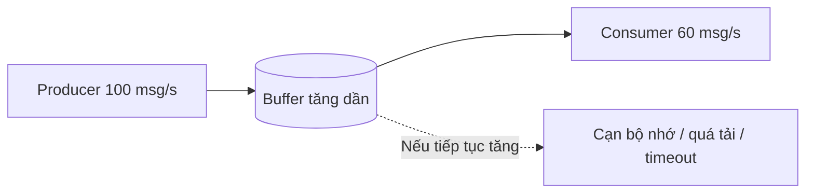
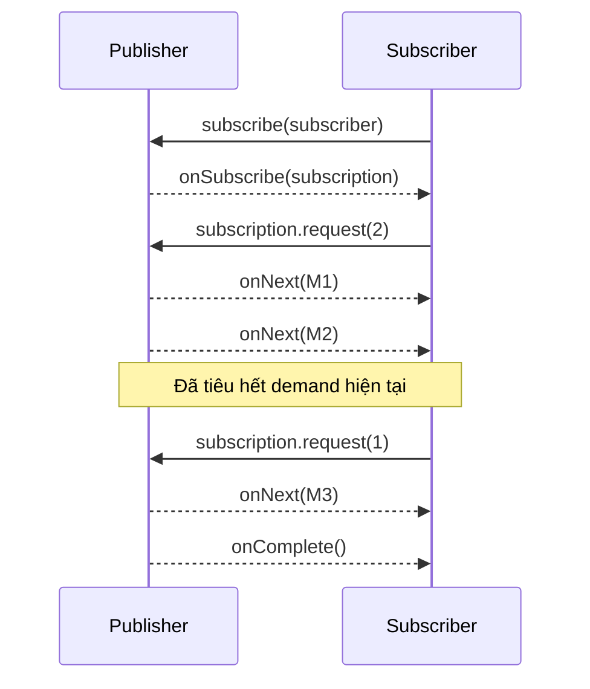
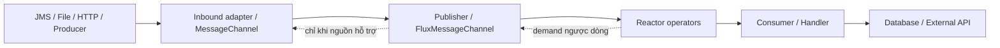
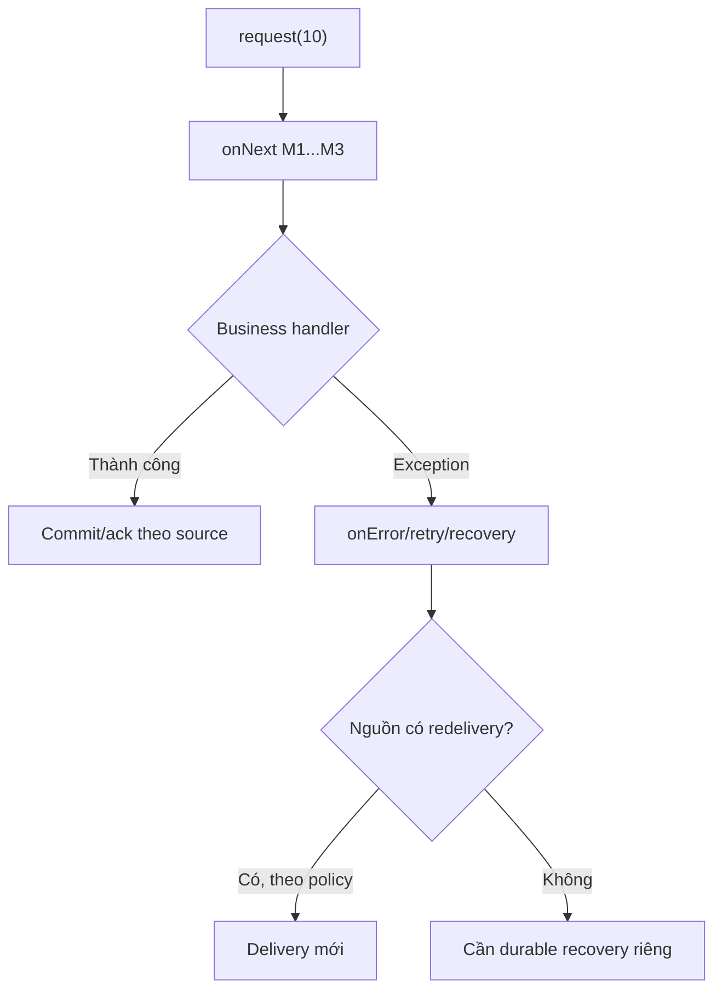
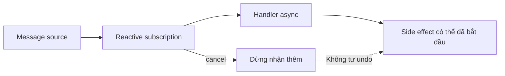
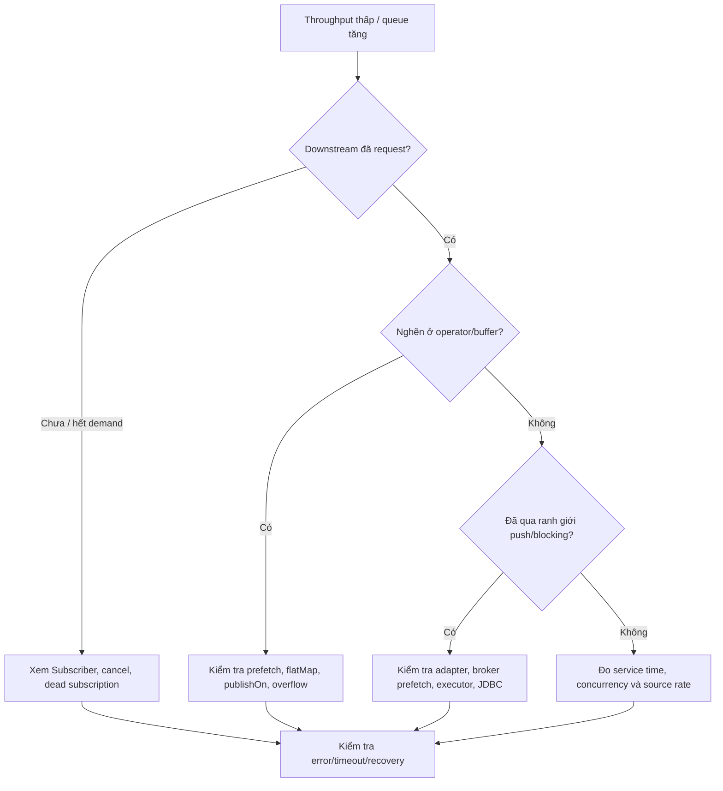

# Reactive Streams backpressure

Trong **Spring Integration runtime**, message đi qua channel, endpoint, consumer, poller và executor với tốc độ có thể rất khác nhau. Một producer có thể phát hàng nghìn message mỗi giây, trong khi handler phải ghi database, gọi HTTP hoặc chờ hệ thống ngoài. Nếu mọi thành phần chỉ tiếp tục đẩy dữ liệu mà không xét sức xử lý của downstream, hàng đợi tăng, bộ nhớ cạn, độ trễ tăng và cuối cùng message có thể lỗi hoặc bị mất.

**Reactive Streams backpressure** là cơ chế cho phép bên nhận thông báo lượng dữ liệu nó **sẵn sàng nhận** qua tín hiệu `request(n)`. Đây là hợp đồng giữa `Publisher` và `Subscriber`, không phải lời hứa rằng mọi channel, adapter hoặc broker tự động chạy theo nhu cầu reactive.

Bài thuộc chương **Reactive runtime** của module `SPRING_INTEGRATION_RUNTIME`. Nội dung liên hệ Reactive Streams với Reactor `Flux`/`Mono`, `FluxMessageChannel`, message flow Spring Integration, giới hạn bộ nhớ, executor/threading, transaction, retry, message store, correlation và cách chẩn đoán tình trạng backlog tại runtime.

## 1. Vì sao backpressure cần thiết?

Giả sử producer phát **100 message/giây**, trong khi handler xử lý được **60 message/giây**. Nếu không có điều tiết, backlog tăng trung bình khoảng **40 message/giây** khi tải ổn định. Một vùng đệm còn chỗ cho 400 message có thể đầy chỉ sau khoảng 10 giây, chưa kể biến động tải và dữ liệu đã tồn sẵn.



Có ba cách đối phó khác nhau, thường cần kết hợp:

| Cơ chế | Ý nghĩa | Giới hạn |
| --- | --- | --- |
| **Backpressure bằng demand** | Downstream yêu cầu có giới hạn số phần tử có thể nhận | Chỉ hoạt động xuyên những `Publisher`/operator tôn trọng demand |
| **Buffer** | Giữ tạm phần tử khi tốc độ khác nhau | Bộ nhớ/disk hữu hạn; không tự làm consumer nhanh hơn |
| **Admission control / load shedding** | Giảm tốc, từ chối, trì hoãn hoặc bỏ bớt khi quá tải | Phải định nghĩa rõ xử lý những phần tử không được nhận |

**Backpressure không tương đương buffering.** Buffer chỉ dời chỗ xuất hiện quá tải. Nếu nguồn tiếp tục đẩy không kiểm soát trong thời gian dài, một buffer “rất lớn” vẫn có thể đầy.

## 2. Hợp đồng Reactive Streams: Publisher, Subscriber, Subscription

Reactive Streams chuẩn hóa bốn giao diện trọng tâm:

- `Publisher<T>` phát các phần tử và nhận `subscribe(subscriber)`.
- `Subscriber<T>` nhận tín hiệu `onSubscribe`, `onNext`, `onError`, `onComplete`.
- `Subscription` đại diện cho quan hệ giữa một Publisher và Subscriber; hỗ trợ `request(long n)` và `cancel()`.
- `Processor<T,R>` vừa là Subscriber vừa là Publisher; trong Reactor thường dùng `Flux`/`Mono` và operator thay vì tự viết Processor.



### 2.1. Năm quy tắc cần nhớ

1. `request(n)` với `n > 0` cộng thêm **quyền phát tối đa n phần tử** vào nhu cầu đang chờ. Nó **không** bảo đảm Publisher nhất định phải phát ngay đủ n.
2. Publisher **không được phát `onNext` nhiều hơn tổng demand hợp lệ chưa được đáp ứng** trên một subscription.
3. Khi chưa có demand, một Publisher tuân thủ đặc tả phải **chờ**, hoặc một nguồn phát nhanh có thể dùng buffer/chính sách overflow ở phần giao tiếp thích hợp; không được âm thầm vượt demand downstream.
4. `onError` và `onComplete` là **terminal signals**: sau một tín hiệu kết thúc, subscription đó không tiếp tục phát `onNext`.
5. `cancel()` báo không cần thêm dữ liệu trên subscription; nó **không tự rollback** database transaction, gửi lại message hoặc dừng được mọi tác vụ I/O bên ngoài đã bắt đầu.

`request(0)` hoặc giá trị âm là yêu cầu không hợp lệ theo Reactive Streams và phải dẫn tới xử lý lỗi theo đặc tả. Đừng dùng `request(0)` như một cách “tạm dừng”; để không phát thêm, chỉ cần **không xin thêm demand**.

### 2.2. Demand là tín hiệu trên từng subscription

Nếu một `Flux` có hai Subscriber độc lập, mỗi Subscriber có demand riêng. Không cộng hai giá trị đó rồi coi đây là ngân sách chung của một business job. Với **hot source** có nhiều subscriber, chính sách multicast, buffering và overflow có thể phức tạp hơn một cold sequence.

Một `request(10)` cũng **không** có nghĩa là “mỗi giây chỉ xử lý mười message”. Nó chỉ là số phần tử được phép chuyển tiếp, không chứa thông tin về thời gian. Muốn giới hạn requests/giây hoặc số giao dịch đang chạy, cần thêm rate limiting, bounded concurrency hay quota phù hợp.

## 3. Backpressure trong Reactor: xem demand bằng BaseSubscriber

Project Reactor triển khai Reactive Streams thông qua `Flux` (0..N phần tử) và `Mono` (0..1 phần tử). `BaseSubscriber` giúp kiểm soát demand trong một ví dụ rất nhỏ.

```java
import org.reactivestreams.Subscription;
import reactor.core.publisher.BaseSubscriber;
import reactor.core.publisher.Flux;

public class DemandDemo {
    public static void main(String[] args) {
        Flux<Integer> events = Flux.range(1, 5)
                .doOnRequest(n -> System.out.println("request = " + n));

        events.subscribe(new BaseSubscriber<Integer>() {
            @Override
            protected void hookOnSubscribe(Subscription subscription) {
                request(1); // Xin phần tử đầu tiên.
            }

            @Override
            protected void hookOnNext(Integer value) {
                System.out.println("received = " + value);
                // Sau khi xử lý xong phần tử này, mới xin thêm.
                request(1);
            }

            @Override
            protected void hookOnComplete() {
                System.out.println("completed");
            }
        });
    }
}
```

Ví dụ sử dụng `Flux.range` đồng bộ và đơn giản để nhìn rõ `request(1)`. Với producer thật, callback `hookOnNext` **không nên chứa I/O blocking lâu** trên event-loop thread; thay vào đó dùng operator hoặc scheduler thích hợp.

Nếu Subscriber chỉ gọi `request(2)` lúc đầu và không bao giờ xin thêm, nó nhận tối đa hai phần tử; sequence có thể chưa phát tín hiệu hoàn tất vì vẫn còn dữ liệu chờ nhu cầu. Đây là **điểm kiểm soát chủ động của downstream**.

## 4. Ba tầng phải phân biệt: nguồn, pipeline và handler

Một Spring Integration flow có thể kết hợp adapter truyền thống với pipeline reactive:



**Quan trọng:** `request(n)` chỉ được truyền ngược qua các thành phần hỗ trợ hợp đồng Reactive Streams. Một adapter đẩy dữ liệu theo lịch `poller`, một broker push vào listener hay một lệnh `MessageChannel.send()` **không nhất thiết** giảm tốc chỉ vì subscriber cuối xin ít hơn.

| Thành phần | Kiểu luồng thường gặp | Có tự tôn trọng `request(n)` không? |
| --- | --- | --- |
| `Flux` từ nguồn Reactive Streams đúng chuẩn | Publisher có demand | Có, trong phạm vi hợp đồng |
| `Mono` | Tối đa một phần tử/terminal signal | Có khi là Publisher |
| `FluxMessageChannel` | Cầu nối message channel và reactive Publisher | Hỗ trợ giao tiếp reactive ở phía subscription; cần xem ingress/buffer |
| `DirectChannel` | Gọi subscriber handler đồng bộ theo `send()` | Không phải Reactive Streams Publisher theo bản chất |
| `ExecutorChannel` | Dispatch sang thread của executor | Có hàng chờ/executor, không tự biến thành `request(n)` |
| `QueueChannel` | Channel pollable với `receive()` | Có giới hạn queue/polling riêng, không phải demand Reactive Streams |
| JMS/AMQP/Kafka adapter | Theo broker, listener, ack/prefetch và cấu hình | Phụ thuộc connector/adapter, không được mặc định giả định |

Từ bảng trên, **“dùng Reactor ở handler” không tự làm tất cả đầu vào thành reactive backpressure-aware**. Phải vẽ ranh giới từng adapter để biết tín hiệu demand dừng ở đâu.

## 5. FluxMessageChannel: chiếc cầu, không phải lời hứa không đầy bộ nhớ

`FluxMessageChannel` thuộc Spring Integration, vừa là một `MessageChannel` để hệ thống gửi message vào, vừa cung cấp mặt `Publisher<Message<?>>` cho downstream subscribe. Nhờ đó có thể đưa message từ một flow truyền thống vào pipeline dùng Reactor.

### 5.1. Fragment cấu hình Spring Integration

Ví dụ Java 17+ minh họa cách khai báo channel nguồn và kênh reactive:

```java
import org.springframework.beans.factory.annotation.Qualifier;
import org.springframework.context.annotation.Bean;
import org.springframework.context.annotation.Configuration;
import org.springframework.integration.annotation.EnableIntegration;
import org.springframework.integration.channel.DirectChannel;
import org.springframework.integration.channel.FluxMessageChannel;
import org.springframework.integration.dsl.IntegrationFlow;
import org.springframework.messaging.MessageChannel;

@Configuration
@EnableIntegration
public class ReactiveChannelConfig {
    @Bean
    MessageChannel ingressChannel() {
        return new DirectChannel();
    }

    @Bean
    FluxMessageChannel reactiveMessages() {
        return new FluxMessageChannel();
    }

    @Bean
    IntegrationFlow bridgeToReactive(
            @Qualifier("ingressChannel") MessageChannel ingress,
            @Qualifier("reactiveMessages") FluxMessageChannel reactiveMessages) {

        return IntegrationFlow.from(ingress)
                .channel(reactiveMessages)
                .get();
    }
}
```

Sau khi Spring context khởi động, downstream có thể subscribe vào `reactiveMessages` theo Reactive Streams:

```java
import org.reactivestreams.Subscription;
import org.springframework.integration.channel.FluxMessageChannel;
import org.springframework.messaging.Message;
import reactor.core.publisher.BaseSubscriber;
import reactor.core.publisher.Flux;

// Đoạn gọi minh họa: reactiveMessages là bean được inject.
void attachConsumer(FluxMessageChannel reactiveMessages) {
    Flux.from(reactiveMessages)
            .doOnRequest(n -> System.out.println("downstream requested " + n))
            .subscribe(new BaseSubscriber<Message<?>>() {
                @Override
                protected void hookOnSubscribe(Subscription subscription) {
                    request(1);
                }

                @Override
                protected void hookOnNext(Message<?> message) {
                    System.out.println("consume " + message.getPayload());
                    request(1);
                }
            });
}
```

Đây là **minh họa ranh giới reactive**, không phải một hệ thống durable queue. Trong ứng dụng thực, nên quản lý vòng đời subscription cùng application context và xác nhận consumer đã subscribe trước khi producer bắt đầu gửi. `FluxMessageChannel` có cơ chế xử lý push/buffer tùy implementation/phiên bản; **không được kết luận `send()` bị chặn chờ demand của subscriber** hoặc mọi message đều được lưu an toàn qua restart.

### 5.2. Những câu hỏi cần kiểm chứng trước khi dùng production

- Nếu subscriber chậm hoặc chưa tồn tại, message được **buffer**, **bị từ chối**, **báo lỗi** hay **bị bỏ** theo implementation?
- Buffer có giới hạn bao nhiêu và đầy sẽ phát tín hiệu gì?
- `MessageChannel.send()` trả về như thế nào khi không thể nhận thêm dữ liệu?
- Khi có nhiều subscriber, cơ chế phân phối là multicast hay có yêu cầu cấu hình riêng?
- Khi cancel subscription hoặc restart JVM, có phải replay message từ broker/store không?

Các kết luận phải được kiểm thử với **phiên bản Spring Integration và Reactor được triển khai**, không suy ra chỉ từ tên lớp.

## 6. `limitRate`, `prefetch` và concurrency là những cơ chế khác nhau

Reactor có các operator điều tiết demand, ví dụ `limitRate`:

```java
import reactor.core.publisher.Flux;

Flux.range(1, 100)
    .doOnRequest(n -> System.out.println("upstream request: " + n))
    .limitRate(8)
    .subscribe(System.out::println);
```

`limitRate(8)` chia nhu cầu gửi lên upstream thành các đợt nhỏ hơn, theo cơ chế refill nội bộ của operator. Đây **không phải** hard limit tổng cộng tám message và **không** bảo đảm tám message/giây. Nó cũng không thay thế giới hạn queue ở phía ngoài pipeline.

### 6.1. `flatMap` và số công việc đang chạy

Một cách kiểm soát số lời gọi bất đồng bộ đồng thời là dùng overload `flatMap(mapper, concurrency)`:

```java
import reactor.core.publisher.Flux;
import reactor.core.publisher.Mono;

Flux<String> orderIds = Flux.just("O-1", "O-2", "O-3", "O-4");

Flux<String> results = orderIds.flatMap(
    orderId -> nonBlockingClient.fetch(orderId),  // trả Mono<String>
    2                                          // tối đa hai inner publishers active
);
```

Ở đây `nonBlockingClient.fetch()` là API giả định của ứng dụng, không phải một class Spring Integration có sẵn. `concurrency=2` giới hạn số inner publishers active mà `flatMap` đăng ký đồng thời trong trường hợp này; nó **không** nhất thiết giới hạn mọi buffer, scheduler task, TCP connection hay toàn bộ instance trong cluster ở mức hai.

| Operator | Hành vi chính | Lưu ý |
| --- | --- | --- |
| `map` | Biến đổi đồng bộ từng phần tử | Không chạy blocking I/O lâu trên event-loop |
| `flatMap` | Merge nhiều Publisher bất đồng bộ | Có thể hoàn tất/emit **không theo thứ tự input** |
| `concatMap` | Xử lý inner publishers nối tiếp để giữ thứ tự | Có thể giảm throughput |
| `flatMapSequential` | Cho phép chạy inner publishers đồng thời nhưng phát theo thứ tự nguồn | Có thể phải buffer kết quả đến sớm |
| `limitRate` | Điều chỉnh mức demand yêu cầu lên upstream | Không phải rate limiter theo thời gian |
| `onBackpressureBuffer` | Buffer thêm khi downstream chậm | Cần giới hạn kích thước và overflow policy |

`prefetch` là số phần tử một số operator chủ động yêu cầu/đệm từ upstream. Vì vậy khi downstream gọi `request(1)`, log của upstream đôi khi lại hiển thị một request lớn hơn 1 do operator đã prefetch. **Đó không nhất thiết là vi phạm Reactive Streams**; demand được điều phối theo từng đoạn của pipeline.

## 7. Buffer có giới hạn, overflow và chính sách mất dữ liệu

Một pipeline sử dụng `onBackpressureBuffer` có thể giữ dữ liệu tạm khi nguồn đẩy nhanh. Với sự kiện nghiệp vụ quan trọng, phải quyết định rõ điều gì xảy ra khi buffer đầy.

```java
import reactor.core.publisher.Flux;

Flux<MessageEvent> safeToObserve = upstream
        .onBackpressureBuffer(256)
        .doOnError(ex -> log.error("Reactive pipeline error", ex));
```

`upstream` và `log` là các biến giả định đã được khai báo; fragment này minh họa operator. Khi buffer giới hạn bị vượt, Reactor có thể phát **overflow error** thay vì lưu vô hạn. `doOnError` chỉ quan sát lỗi, **không** tự retry, DLQ hoặc phục hồi message.

Các chính sách cần phân biệt:

| Chiến lược | Kết quả | Phù hợp với |
| --- | --- | --- |
| Buffer có giới hạn và fail khi đầy | Báo quá tải rõ để upstream/source có cơ hội xử lý | Sự kiện cần bảo toàn, có retry/redelivery đáng tin |
| Buffer không giới hạn | Giữ thêm cho đến khi có tài nguyên | Rủi ro OOM, không khuyến nghị tải không giới hạn |
| Drop latest/oldest hoặc `onBackpressureDrop` | Mất một số phần tử | Telemetry có thể bỏ mẫu, **không** phù hợp lệnh thanh toán |
| `onBackpressureLatest` | Giữ giá trị mới nhất, bỏ các giá trị trung gian | Snapshot/trạng thái cập nhật liên tục, không phải event ledger |
| Rate limit/admission control trước pipeline | Từ chối hoặc trì hoãn tại đầu vào | Cần trả lỗi/ack phù hợp với source |
| Durable broker/message store | Lưu backlog ngoài heap | Vẫn phải điều tiết consumer và có chính sách retention |

Không được âm thầm đổi từ overflow error sang drop khi hệ thống mang dữ liệu tài chính, đơn hàng hoặc message cần tính đầy đủ. Đường quá tải phải là một phần của hợp đồng nghiệp vụ.

### 7.1. Phép tính capacity đơn giản

Giả sử mức chênh giữa tốc độ nhận và xử lý bình quân là 40 message/giây. Một buffer còn khả năng chứa 400 message chỉ chịu được khoảng 10 giây ở mức tải đó. Hệ thống cần đo:

- Arrival rate và service rate **theo cửa sổ thời gian**, không chỉ trung bình ngày.
- Message **đang thực thi** và message **đang chờ** riêng biệt.
- Kích thước từng message, vì “400 message” có thể là vài KB hoặc hàng GB.
- Điều kiện burst, retry storm và thời gian downstream ngừng hoạt động.

Một buffer có dung lượng lớn không xử lý được bài toán nguồn luôn nhanh hơn consumer. Cần **giảm tốc đầu vào, tăng năng lực xử lý hợp lệ, hoặc chuyển backlog sang một nguồn bền vững**.

## 8. Phân biệt reactive demand với hàng đợi và poller

`QueueChannel` có thể giới hạn dung lượng và `poller` chỉ lấy tối đa một số message trong mỗi lượt. Đây là cơ chế điều tiết **qua queue/schedule**, không phải tín hiệu `Subscription.request(n)` của Reactive Streams.

```text
Reactive:
Subscriber request(5)  -> Publisher được phát tối đa 5 onNext theo demand

Polling:
Poller tick             -> gọi receive(), tối đa maxMessagesPerPoll mỗi lượt

Queue capacity:
Producer send()         -> có thể bị chặn / không gửi được theo kiểu channel
                          và cấu hình timeout/capacity
```

Một poller nhận ít message hơn có thể làm **backlog chuyển về queue/source**, nhưng không tự điều tiết một producer remote ngoài JVM. Nếu `maxMessagesPerPoll=10` và `fixedDelay=1s`, throughput tối đa quan sát được còn phụ thuộc thời gian xử lý, số thread poller, loại source và kết quả mỗi lần poll; không nên suy ra đơn giản “luôn đúng 10 message/giây”.

### 8.1. Các ranh giới có thể dừng tín hiệu backpressure

| Ranh giới | Điều cần hỏi |
| --- | --- |
| `Flux` → `Flux` | Operator có tôn trọng demand hay chủ động buffer/prefetch? |
| `FluxMessageChannel` ← `MessageChannel.send` | `send` có bị giới hạn bởi demand hay chỉ đẩy vào buffer? |
| `QueueChannel` → poller | Queue có capacity, receive rate, transaction thế nào? |
| JMS/AMQP listener → channel | Container/broker có prefetch, concurrency, ack, requeue? |
| HTTP inbound gateway → reactive handler | HTTP client có phải chờ response? Có trả 429/503 khi quá tải? |
| File inbound adapter → channel | Scanner/poller có ngừng quét không? File đã được accept-once trước khi xử lý chưa? |

Khi chuyển từ reactive pipeline về handler blocking hoặc channel push, không được coi áp lực ngược vẫn xuyên suốt một cách tự động. Cần một cơ chế capacity và failure policy **tại chỗ chuyển đổi**.

## 9. Blocking I/O, scheduler và Reactor Context

Reactive Streams backpressure không có nghĩa là không có thread. Điều khác biệt là **đừng giữ một event-loop thread để chờ I/O blocking**, đặc biệt nếu một handler gọi JDBC, HTTP blocking hoặc filesystem API chậm.

### 9.1. Tách blocking call sang boundedElastic

```java
import reactor.core.publisher.Flux;
import reactor.core.publisher.Mono;
import reactor.core.scheduler.Schedulers;

// blockingRepository là dependency của ứng dụng.
Flux<Receipt> receipts = incomingMessages.flatMap(
        message -> Mono.fromCallable(() -> blockingRepository.save(message))
                .subscribeOn(Schedulers.boundedElastic()),
        8
);
```

Trong ví dụ này, `incomingMessages` là `Flux<Message<?>>` và `save` là thao tác blocking trả về `Receipt` do ứng dụng định nghĩa. `boundedElastic()` là scheduler thích hợp cho tác vụ blocking ngắn/có giới hạn, **không** biến JDBC thành non-blocking I/O và không cho phép vô hạn tác vụ chạy đồng thời. Tham số `8` là một giới hạn concurrency ở đoạn `flatMap`; vẫn phải đo thread pool, queue và connection pool.

### 9.2. `publishOn` và `subscribeOn`

| Operator | Tác động chính | Bẫy thường gặp |
| --- | --- | --- |
| `subscribeOn(scheduler)` | Ảnh hưởng nơi subscription/source được thực hiện theo cơ chế operator | Không đồng nghĩa mọi callback ở mọi phía đều chuyển thread |
| `publishOn(scheduler)` | Chuyển các tín hiệu downstream sau điểm đặt sang scheduler | Có thể tạo hàng đợi/prefetch và thay ranh giới thread |
| `flatMap(...subscribeOn(...))` | Điều phối từng lời gọi async/blocking con | Cần giới hạn concurrency và xử lý lỗi riêng |

`ThreadLocal`, MDC và các transaction context kiểu blocking không tự truyền ổn định qua mọi bước chuyển thread. Nếu cần tracing, dùng cơ chế context propagation phù hợp với Reactor và observability stack. **Không** đồng nhất `Reactor Context` với transaction gắn `ThreadLocal` của `PlatformTransactionManager`.

## 10. Transaction: demand không quyết định commit/rollback

Một Subscriber đã `request(10)` nhưng mới xử lý được 3 message rồi có exception. `request(10)` chỉ nói về **khả năng phát onNext**, không nói rằng 10 message đã được commit hoặc acknowledge.



Phân biệt các trường hợp:

1. **JDBC blocking:** transaction thường quản lý bằng `PlatformTransactionManager`/`@Transactional` trên thread phù hợp; chuyển việc sang scheduler khác có thể cắt ranh giới transaction mong muốn.
2. **R2DBC/reactive transaction:** có thể dùng `ReactiveTransactionManager` hoặc `TransactionalOperator`; transaction context được truyền theo reactive subscription/context phù hợp.
3. **JMS/AMQP/Kafka:** broker ack/nack và transaction của listener **không tự khớp** với `onNext`/`onComplete` trong một Reactor pipeline tùy ý. Phải đọc và kiểm thử mode ack, commit, retry/redelivery của adapter.
4. **Message store:** chỉ một nguồn được thiết kế với transactional dequeue mới có thể khôi phục message khi rollback đúng boundary; `FluxMessageChannel` đơn thuần không tự là durable store.

Nếu reactive processing chuyển sang async và listener/poller đã hoàn tất việc giao cho một channel, **transaction source có thể commit trước khi handler thực sự xong**. Backpressure trong đoạn phía sau không làm transaction đã commit trở về trạng thái đang mở.

## 11. Retry, resubscription và idempotency

Reactor có `retry` và `retryWhen`, nhưng cần hiểu rằng retry trong reactive chain thường có thể **resubscribe vào upstream Publisher** chứ không tự yêu cầu broker redeliver một message đã ack.

```java
import java.time.Duration;
import reactor.core.publisher.Mono;
import reactor.util.retry.Retry;

Mono<String> result = Mono.defer(() -> remoteService.call("ORDER-42"))
        .retryWhen(
                Retry.backoff(3, Duration.ofMillis(200))
                     .filter(this::isTransientFailure)
        );
```

`remoteService` và `isTransientFailure` là API của ứng dụng trong đoạn minh họa. Trong Reactor, tham số `3` ở `Retry.backoff(3, ...)` là **số retry bổ sung** cho invocation ban đầu, không phải tổng attempt: nếu mọi lần đều thất bại, có thể gọi đến **4 attempt**. Cần đặt giới hạn tổng thời gian retry, backoff và loại exception được retry.

### 11.1. Cẩn thận với cold và hot source

- **Cold Publisher:** resubscribe có thể chạy lại công việc tạo dữ liệu, ví dụ một query hoặc HTTP call; nếu có side effect, có nguy cơ thực hiện lần nữa.
- **Hot Publisher:** resubscribe có thể nhận các sự kiện **mới** thay vì replay chính xác phần tử cũ; không nên coi `retryWhen` là broker redelivery.
- **Message source đã ack:** retry tại downstream không đảm bảo message gốc còn ở nguồn để nhận lại nếu pipeline chết.
- **Recovery:** `onErrorResume` có thể biến lỗi thành fallback/terminal completion bình thường; đường ack/transaction upstream có thể coi như thành công tùy bridge.

```text
Broker delivery #1
  -> reactive handler attempt #1: lỗi
  -> reactive handler attempt #2: lỗi
  -> reactive handler attempt #3: thành công
  -> ack (nếu integration thiết kế đúng)

Hoặc:
  -> onErrorResume(fallback)
  -> subscriber hoàn thành bình thường
  -> source có thể coi message đã được xử lý
```

**Một kết quả fallback không phải bằng chứng tác vụ nghiệp vụ thành công.** Nếu cần durable recovery, lưu business key và lỗi vào store/DLQ trước khi xác nhận message, theo transaction/ack semantics của nguồn.

### 11.2. Idempotency vẫn bắt buộc

Backpressure kiểm soát **lượng công việc đang được chuyển tiếp**, không kiểm soát liệu hai message có cùng `eventId`. Một retry/redelivery có thể gây side effect lặp, dù demand hoàn toàn tuân thủ đặc tả.

Nên dùng:

- `businessKey`/`eventId` ổn định xuyên attempt và delivery.
- Inbox/unique constraint gắn với business database transaction khi có thể.
- Idempotency key cho HTTP/payment API nếu downstream hỗ trợ.
- Outbox để đưa sự kiện ra ngoài sau khi business transaction commit.
- Correlation/trace ID để liên hệ những lần thử và trạng thái cuối.

## 12. Error signal: lỗi reactive không phải lúc nào cũng vào errorChannel

Reactor có `onError` trên subscription. Spring Integration có đường xử lý lỗi qua exception, `ErrorMessage` và `errorChannel` tùy endpoint/adapter. **Đây không phải một cơ chế tự động đồng nhất trong mọi kiến trúc hybrid**.

| Lỗi xảy ra tại | Dấu hiệu có thể thấy | Cần kiểm tra |
| --- | --- | --- |
| `MessageChannel.send()` trước khi vào reactive bridge | Exception/return false từ send | Producer có retry/ack sai không? |
| `FluxMessageChannel` hoặc sink/buffer đầy | Overflow/emit failure theo implementation | Tín hiệu lỗi được propagate đến đâu? |
| `map/flatMap` trong Reactor | `onError` / retry / fallback | Subscriber có onError handler? |
| Handler Spring Integration đồng bộ | Exception trực tiếp hoặc ErrorMessage tùy endpoint | Đã đi tới transaction boundary? |
| Reactive handler gọi DB/HTTP | Error trong `Mono`/`Flux` | Có ai subscribe để quan sát và xử lý terminal signal? |

`doOnError` **không** xử lý/nuốt lỗi; nó chỉ là side-effect khi lỗi đi qua. `onErrorResume` chọn fallback; `onErrorMap` biến đổi exception; `onErrorContinue` có semantics khó kiểm soát và không nên dùng như “bỏ qua mọi lỗi” cho message quan trọng.

Nếu tự gọi `subscribe()` rồi bỏ mặc `Disposable`/subscription, exception có thể chỉ được báo ở subscriber mà **không quay về lời gọi `send()` hoặc source listener**. Cần thiết kế rõ ai sở hữu subscription, ai chịu trách nhiệm acknowledgement và nơi ghi nhận lỗi cuối.

## 13. Correlation và ordering khi xử lý bất đồng bộ

Khi `flatMap` xử lý đồng thời, message theo cùng `correlationId` có thể hoàn thành không đúng thứ tự `sequenceNumber`. Reactive Streams chỉ bảo đảm **thứ tự tín hiệu `onNext` trên một subscription** theo Publisher đang phát, không bảo đảm các inner async task kết thúc theo thứ tự nguồn.

```text
Input order:     ORDER-42 #1, #2, #3
flatMap start:   #1, #2, #3
Completion:      #3, #1, #2
```

Các lựa chọn:

| Mục tiêu | Cách cân nhắc |
| --- | --- |
| Throughput cao, không quan tâm thứ tự | `flatMap` có concurrency giới hạn |
| Xử lý từng bước theo đúng thứ tự | `concatMap`/serial processing ở phạm vi phù hợp |
| Chạy song song nhưng emit theo thứ tự đầu vào | `flatMapSequential`, lưu ý buffer |
| Bảo toàn thứ tự theo từng `orderId` nhưng vẫn song song giữa order | Partition/group theo key với giới hạn số nhóm và thiết kế draining |
| Gom nhiều phần thành một kết quả | Aggregator/MessageGroupStore, release strategy và duplicate policy |

`groupBy` của Reactor cũng tạo nhóm động theo key. Nếu số key rất lớn hoặc GroupedFlux không được consume/drain đầy đủ, có thể tăng memory và gây kẹt pipeline. **groupBy không thay thế** aggregator bền vững, message group store, expiry policy hay business correlation strategy của Spring Integration.

## 14. Cancellation, timeout và lifecycle endpoint

Một Subscription có thể bị cancel vì HTTP client ngắt kết nối, service shutdown, timeout hoặc chính business logic. Điều xảy ra với message đã nhận phụ thuộc source và boundary:



- `cancel()` không có nghĩa HTTP request đã gửi sẽ được hoàn tác.
- `timeout(Duration)` phát lỗi timeout trong reactive pipeline; không nhất thiết hủy được mọi công việc trên server remote.
- Khi stop `IntegrationFlow` hoặc application context, subscription lifecycle và các task đang chạy cần được xử lý có chủ đích.
- Nếu message đã bị lấy khỏi `QueueChannel` RAM hoặc ack ở broker trước khi cancel, không nên kỳ vọng có replay tự động.
- Với nguồn transactional, phải gắn commit/rollback và acknowledgement vào **kết quả xử lý thật**, không chỉ vào việc message đã được enqueue cho executor.

Đối với xử lý cần phục hồi sau crash, hãy lưu trạng thái công việc vào nguồn bền vững (broker, DB work queue, outbox/inbox) thay vì dựa vào một subscription sống trong RAM.

## 15. Quan sát backpressure trong production

Backpressure đúng vẫn có thể tạo latency cao nếu consumer không đủ năng lực; backpressure sai có thể dẫn tới backlog hoặc lỗi ngay cả khi CPU chưa đạt 100%.

| Signal / metric | Câu hỏi được trả lời |
| --- | --- |
| `requested/demand` quan sát tại Publisher | Downstream đã xin thêm dữ liệu chưa? |
| `onNext` rate | Đang phát bao nhiêu phần tử/giây? |
| `inFlight` của async handler | Có bao nhiêu công việc đang thực thi? |
| Buffer/queue depth | Có backlog trong heap, channel, broker hoặc store? |
| Buffer overflow/drop/reject count | Có mất dữ liệu hoặc từ chối vì quá tải? |
| `onError`/cancel/timeout count | Vì sao subscription kết thúc sớm? |
| Handler latency p50/p95/p99 | Downstream chậm ở đâu? |
| Executor active threads/queue | Có nghẽn ở ranh giới blocking? |
| Broker lag/prefetch/redelivery | Backlog được dịch về nguồn hay bị replay? |
| Retry attempts và committed business outcomes | Có retry storm hoặc xử lý lặp? |

Đừng dùng số `request(n)` ghi ở **một operator** để suy ra chính xác số phần tử đang chờ ở **toàn hệ thống**. `publishOn`/`flatMap` có thể tạo prefetch và queue nội bộ; broker hoặc `FluxMessageChannel` cũng có buffering riêng.

### 15.1. Ghi log diagnostic không làm nghẽn pipeline

```java
Flux<MessageEvent> observed = upstream
        .doOnRequest(n -> metrics.recordDemand(n))
        .doOnNext(event -> metrics.recordReceived())
        .doOnError(error -> metrics.recordError(error))
        .doOnCancel(() -> metrics.recordCancel());
```

`metrics` và `upstream` là dependency minh họa. Các callback metric nên nhẹ, không dùng blocking I/O cho từng message. Không gắn `orderId`/`messageId` làm metric label có cardinality vô hạn; để ID chi tiết trong log/trace có giới hạn và tránh đưa payload nhạy cảm vào telemetry.

### 15.2. Chẩn đoán khi throughput bất thường



Nếu demand tăng nhưng `onNext` không xuất hiện, nguồn có thể không có dữ liệu, bị block, chờ I/O hoặc subscription bị cancel. Nếu `onNext` rất nhanh nhưng business commits ít, bottleneck nằm sau reactive pipeline hoặc kết quả xử lý bị lỗi — không thể chỉ tăng prefetch.

## 16. Kiểm thử backpressure với reactor-test

Thư viện `reactor-test` có `StepVerifier` để khẳng định Publisher **không phát vượt demand**. Ví dụ sử dụng nguồn cold `Flux.range`, bắt đầu với demand bằng 0:

```java
import reactor.core.publisher.Flux;
import reactor.test.StepVerifier;

public class BackpressureTestExample {
    public static void main(String[] args) {
        StepVerifier.create(Flux.range(1, 10), 0L)
                .thenRequest(2)
                .expectNext(1, 2)
                .thenRequest(3)
                .expectNext(3, 4, 5)
                .thenCancel()
                .verify();
    }
}
```

Test này kiểm tra contract của `Flux.range` tại một subscription, **không** chứng minh message từ file/JMS adapter đã được ack đúng hay buffer ở `FluxMessageChannel` có giới hạn an toàn.

### 16.1. Những điều cần assert trong test tích hợp Spring Integration

1. Subscribe consumer **trước khi** gửi message vào bridge; xác nhận kết quả với `request(1)` và `request(k)`.
2. Nếu consumer ngừng xin demand, đo buffer/queue tăng tới đâu; xác nhận overflow/failure policy.
3. Inject handler chậm, kiểm tra giới hạn concurrent in-flight; không chỉ dựa vào log thứ tự.
4. Tạo failure tại DB/HTTP, kiểm tra error propagation, retry count và source ack/redelivery.
5. Cancel giữa lúc xử lý, xác định message nào đã commit, đang chạy, còn trong store và sẽ replay.
6. Restart trong lúc backlog tồn tại; phân biệt vùng đệm RAM với durable broker/message store.
7. Chạy hai instance và message có cùng `eventId`, xác minh idempotency/ordering theo business key.

**Lưu ý:** một test với `Flux.range` chỉ cho thấy Reactor xử lý demand đúng trong môi trường thuần reactive. Kiểm thử toàn flow phải bao gồm nguồn thật, adapter, channel và transaction boundary.

## 17. Bẫy thường gặp trong Reactive Streams backpressure

| Ngộ nhận / anti-pattern | Hậu quả | Cách xử lý |
| --- | --- | --- |
| “Dùng `Flux` là mọi source tự chậm lại” | Broker/poller vẫn đẩy nhanh và đầy buffer | Xác định chỗ demand dừng, thêm admission control |
| “`FluxMessageChannel` là durable queue” | Mất backlog khi restart nếu chỉ nằm trong RAM | Broker/message store bền vững khi cần |
| “`request(100)` nghĩa là 100 message/giây” | Không có rate limit theo thời gian | Thêm rate limiting và concurrency bound |
| Buffer vô hạn cho message quan trọng | OOM và latency không kiểm soát | Bounded buffer + failure/recovery policy |
| Drop để chữa mọi overflow | Mất sự kiện nghiệp vụ | Chỉ drop khi hợp đồng cho phép |
| `flatMap` không giới hạn quanh HTTP/JDBC | Quá nhiều kết nối/tác vụ cùng lúc | Giới hạn concurrency, pool và timeout |
| Blocking JDBC chạy trên Reactor event loop | Thread starvation và latency tăng | Scheduler phù hợp hoặc dùng reactive driver |
| Nghĩ `publishOn` giữ nguyên transaction thread-bound | Mất transaction/MDC hoặc commit không đúng phạm vi | Thiết kế context/transaction tại đúng boundary |
| `retryWhen` được xem là broker redelivery | Resubscribe sai source hoặc side effect lặp | Tách reactive retry và source retry/redelivery |
| `onErrorResume` trả fallback rồi coi business success | Lỗi bị che, message có thể ack | Ghi final outcome và durable recovery |
| `subscribe()` tự phát trong handler rồi bỏ mặc | Lỗi/cancel không nối với caller, ack có thể quá sớm | Quản lý subscription và phản hồi completion thực |
| Dùng `flatMap` rồi kỳ vọng commit đúng thứ tự | Async completion đảo thứ tự | `concatMap`/partition theo key khi cần |
| Coi `cancel` là rollback | Side effect đã xảy ra vẫn còn | Transaction/idempotency/đối soát |
| Chỉ đo heap, bỏ qua broker lag và executor queue | Tưởng hết backlog nhưng backlog chuyển sang nơi khác | Theo dõi end-to-end |

## 18. Bài thực hành

### Bài 1 — Demand từng phần tử

Dùng `Flux.range(1, 20)` và `BaseSubscriber`. Đầu tiên `request(1)`, sau mỗi `onNext` mới xin thêm; ghi lại log. Thử chỉ xin `request(3)` rồi dừng và giải thích vì sao các phần tử còn lại chưa phát. Thử `cancel()` và quan sát terminal behavior.

### Bài 2 — Backpressure khác rate limit

Tạo `Flux.range` với `limitRate(8)` và `doOnRequest`, so sánh log với pipeline không có `limitRate`. Đo thời gian thực thi và giải thích vì sao `limitRate(8)` không tương đương tám sự kiện/giây.

### Bài 3 — Bounded concurrency

Mô phỏng một `Mono` bất đồng bộ có độ trễ khác nhau; dùng `flatMap(..., 2)` rồi đổi sang `concatMap`. Ghi số inner publishers active tối đa, thứ tự hoàn thành và total latency. Xác định lựa chọn phù hợp nếu mỗi business key phải bảo đảm ordering.

### Bài 4 — Bridge vào FluxMessageChannel

Tạo `DirectChannel → FluxMessageChannel`; subscribe bằng `BaseSubscriber`. Gửi nhiều message nhưng cố ý không request thêm trong một khoảng thời gian. Quan sát buffer/overflow/return của `send()` ở đúng phiên bản đang chạy và ghi rõ policy thực tế. Không kết luận từ test này rằng state đã bền vững sau restart.

### Bài 5 — Chặn blocking I/O

Đặt một blocking DB/mock HTTP call trong `doOnNext` trên event-loop rồi đo responsiveness. Đổi sang `Mono.fromCallable` với `Schedulers.boundedElastic()` và giới hạn concurrency. So sánh thread, service time và số in-flight; đảm bảo mọi phép đo thuộc môi trường test.

### Bài 6 — Retry, ack và redelivery

Tạo một handler reactive lỗi tạm thời hai lần rồi thành công. Đếm `retryWhen` attempts; sau đó gắn vào adapter nguồn có transactional redelivery để đếm delivery riêng. Dùng `eventId` trong business inbox để xác minh số lần gọi handler khác với số business commits.

### Bài 7 — Cancel và durable recovery

Giả lập client cancel trong lúc handler đang gọi downstream. Xác định I/O nào đã khởi động, kết quả có được commit không và nguồn còn giữ message không. Đề xuất đường recovery không phụ thuộc vào subscription trong RAM.

### Bài 8 — Stress test backlog

Tạo producer nhanh hơn consumer, giới hạn buffer và concurrency; đo queue depth, `onNext` rate, demand, overflow và độ trễ p95. Thử policy fail-fast có durable retry so với drop/latest và giải thích vì sao chỉ một số loại dữ liệu có thể được phép bỏ.

## 19. Tự kiểm tra kiến thức

1. **`request(n)` có ý nghĩa gì?** Subscriber cấp thêm demand cho tối đa `n` phần tử `onNext` trên một subscription.
2. **`request(10)` có nghĩa đúng 10 message/giây không?** Không; nó không chứa đơn vị thời gian.
3. **`cancel()` có rollback DB transaction không?** Không tự động.
4. **`FluxMessageChannel` có tự bảo đảm mọi nguồn ngoài dừng đẩy theo demand không?** Không; phải xem bridge/adapter và buffering.
5. **`limitRate(8)` có nghĩa chỉ phát tổng cộng tám phần tử không?** Không; nó điều tiết request lên upstream.
6. **Vì sao `flatMap` có thể làm output đảo thứ tự?** Inner publishers hoàn thành bất đồng bộ và được merge.
7. **Nếu message phải bảo toàn, có nên dùng `onBackpressureDrop` không?** Không nếu hợp đồng nghiệp vụ không cho phép mất dữ liệu.
8. **Tại sao cần tách JDBC blocking khỏi event-loop?** Vì blocking giữ thread và làm giảm responsiveness.
9. **`retryWhen` có luôn tương đương redelivery từ broker không?** Không; thường nó resubscribe vào Publisher upstream.
10. **`onErrorResume` có bảo đảm rollback nguồn không?** Không; fallback có thể làm pipeline hoàn thành bình thường.
11. **Đầu ra resequence/`concatMap` có bảo đảm transaction ở adapter nguồn không?** Không; transaction/ack là ranh giới riêng.
12. **Backpressure có thay thế idempotency không?** Không; message có thể trùng do retry hoặc redelivery.

## 20. Tài liệu tham khảo để đối chiếu theo phiên bản

- [Reactive Streams — Specification](https://www.reactive-streams.org/): hợp đồng Publisher, Subscriber, Subscription và demand.
- [Project Reactor Reference Guide](https://projectreactor.io/docs/core/release/reference/): Reactor `Flux`/`Mono`, threading, `flatMap`, backpressure và test.
- [Spring Integration Reference Documentation](https://docs.spring.io/spring-integration/reference/): reactive streams support, channel, endpoint, transaction và error handling.

Khi áp dụng ví dụ, hãy đối chiếu API, sink/buffer policy và integration boundary với **phiên bản Spring Integration và Reactor được dùng**; các chi tiết ở adapter/broker có thể khác theo implementation.

## 21. Tổng kết

**Reactive Streams backpressure là hợp đồng “downstream yêu cầu trước, upstream chỉ phát trong phạm vi demand”, không phải phép màu làm toàn bộ hệ thống tự cân bằng.** Reactor cung cấp công cụ điều tiết demand, giới hạn concurrency và xử lý overflow; `FluxMessageChannel` giúp nối Spring Integration messaging với Reactive Streams. Nhưng nguồn push, poller, executor, JDBC, broker ack và message store có ranh giới riêng, có thể không truyền tín hiệu backpressure xuyên suốt.

Khi chẩn đoán một flow quá tải, hãy lần theo **source rate → adapter → channel/buffer → demand → operator/prefetch → thread/executor → handler → transaction/ack → recovery**. Chỉ khi biết rõ demand dừng ở đâu, backlog đang nằm ở đâu và message được xác nhận lúc nào, mới chọn được giải pháp đúng: giới hạn concurrency, rate limit, bounded queue, durable store, retry có kiểm soát hay nâng năng lực downstream. **Dù backpressure hoạt động hoàn hảo, vẫn cần idempotency, transaction và correlation để giữ đúng trạng thái nghiệp vụ.**
