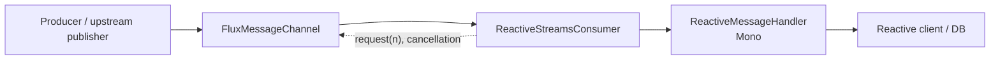
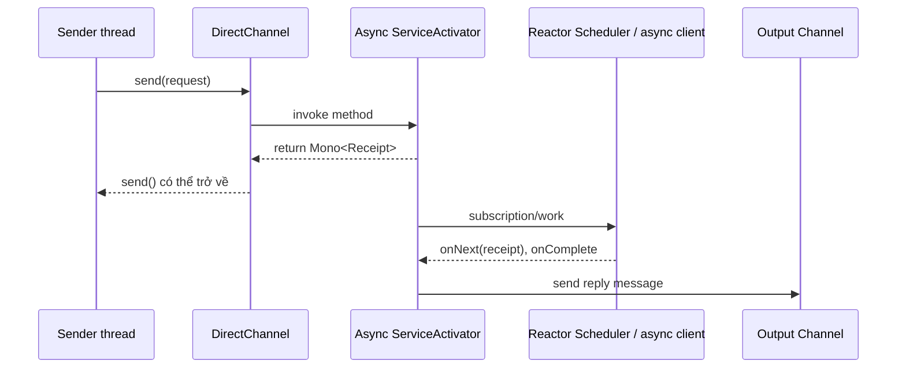
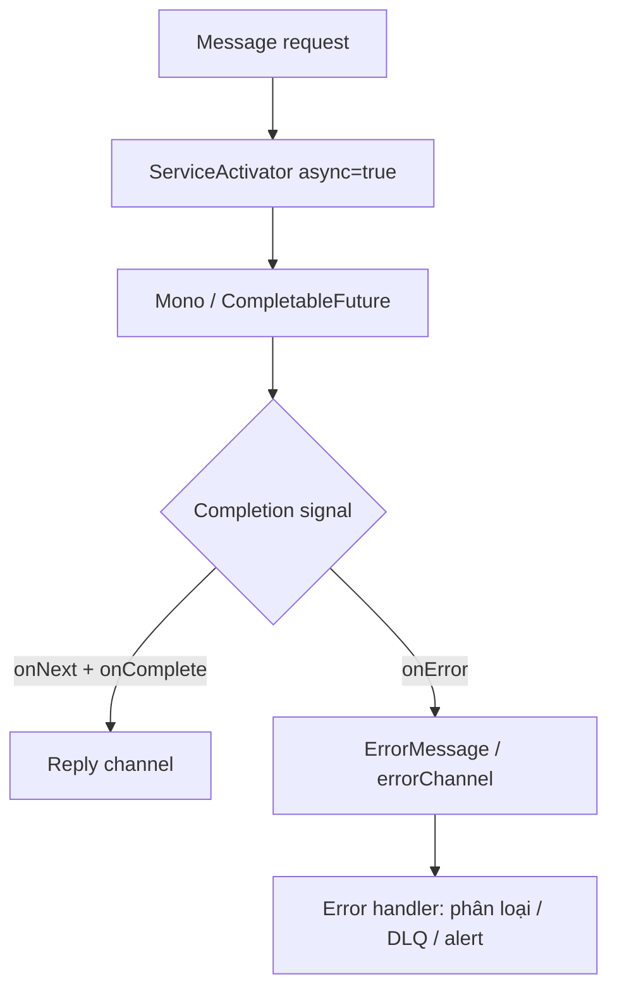
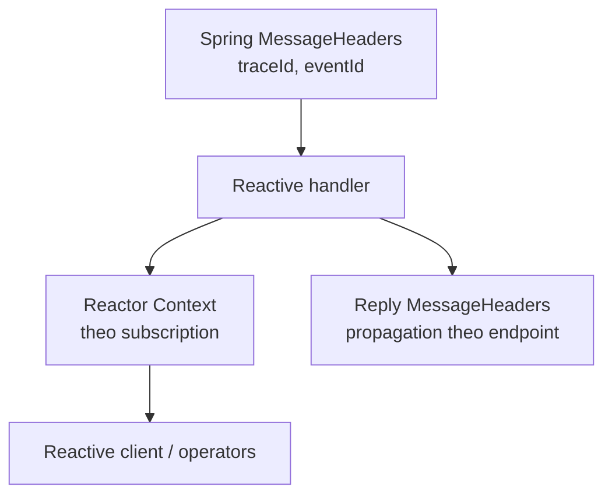

# Reactive handler và async return type trong Spring Integration Runtime

## 1. Vì sao một handler trả về `Mono` chưa chắc là một flow reactive?

Một message đi vào `DirectChannel`, service activator gọi dịch vụ ngoài để tính phí vận chuyển, rồi gửi kết quả tới endpoint kế tiếp. Nếu service gọi HTTP theo kiểu blocking, thread consumer sẽ chờ network I/O. Khi tăng số request, thread pool và connection pool có thể đầy. Nếu service trả về `Mono<Quote>` hoặc `CompletableFuture<Quote>`, công việc **có thể** tiếp tục mà không giữ thread caller; nhưng kết quả chỉ được xử lý đúng nếu Spring Integration biết **khi nào subscribe/đợi future**, **đưa reply đi đâu** và **lỗi không đồng bộ được chuyển tới đâu**.

Trong module **SPRING_INTEGRATION_RUNTIME**, bài này tập trung vào **Reactive handler và async return type** của chương **Reactive runtime**. Trọng tâm không phải cú pháp Reactor đơn lẻ mà là tác động tới message flow: channel, endpoint, consumer, poller, executor, reply/error channel, correlation, retry, transaction và hiệu năng.

Sau bài học, bạn có thể:

1. Phân biệt handler đồng bộ, handler có async reply và `ReactiveMessageHandler`.
2. Giải thích `Mono<T>`, `Flux<T>`, `Mono<Void>` và `CompletableFuture<T>` khi được trả về từ handler.
3. Sử dụng `@ServiceActivator(async = "true")`, `FluxMessageChannel` và `IntegrationFlow.handleReactive(...)` trong trường hợp phù hợp.
4. Nhận biết ai là subscriber, lúc nào công việc chạy và backpressure tồn tại ở đâu.
5. Giải thích thay đổi thread, transaction và error propagation qua ranh giới bất đồng bộ.
6. Thiết kế timeout, retry, correlation, cancellation và kiểm thử có thể quan sát được.

**Phiên bản tham chiếu:** ví dụ Java 17+, Spring Integration 6.1+ và Reactor 3.x. Một số đặc điểm như tự bật async khi output channel reactive bắt đầu từ Spring Integration 6.1. Hãy đối chiếu API với đúng phiên bản dependency của dự án, vì cấu hình và adapter khác nhau có thể có hành vi khác nhau.

## 2. Ba mô hình xử lý thường bị trộn lẫn

| Mô hình | Đầu vào / đầu ra | Thời điểm thực thi | Hệ quả |
| --- | --- | --- | --- |
| **Imperative synchronous** | `Message<?> → T` | Method chạy ngay trên thread consumer; reply được gửi khi method trả về | Exception thường truyền ngược cùng call stack nếu channel đồng bộ. |
| **Async reply-producing handler** | `Message<?> → CompletableFuture<T>` hoặc `Mono<T>` | Method trả sớm; framework xử lý completion/reply theo `async` và output channel | Caller có thể được giải phóng, reply/error xuất hiện sau đó trên thread khác. |
| **Reactive terminal handler** | `Message<?> → Mono<Void>` qua `ReactiveMessageHandler` | Publisher được subscribe theo cách adapter/consumer cấu hình | Mô hình one-way, không tự phát reply payload nghiệp vụ. |

Một **reactive flow** còn cần chuỗi publisher/subscriber thực sự tham gia Reactive Streams, không chỉ một method trả về đối tượng `Mono`. Một channel truyền thống vẫn có thể mang **`Mono` làm payload**, nghĩa là downstream nhận *đối tượng publisher* chứ chưa nhận `Quote`.

### 2.1. Những khái niệm Reactive Streams cần nắm

| Khái niệm | Ý nghĩa trong flow |
| --- | --- |
| `Publisher<T>` | Mô tả nguồn phát tín hiệu; có thể chưa làm I/O trước khi subscribe. |
| `Subscriber<T>` | Bên nhận `onNext`, `onError`, `onComplete` theo demand. |
| `Subscription.request(n)` | Yêu cầu số lượng item muốn nhận; nền tảng của backpressure. |
| `Mono<T>` | Tối đa một giá trị, hoặc hoàn tất rỗng, hoặc báo lỗi. |
| `Flux<T>` | Có thể phát 0..N giá trị; cần xác định chúng là N message hay một payload kiểu publisher. |
| `Mono<Void>` | Chỉ mang tín hiệu completion/error, không mang giá trị reply. |
| `CompletableFuture<T>` | Promise cho một kết quả/exception, **không có giao thức demand/backpressure** như Reactor. |

Với publisher **cold** như `Mono.defer(...)`, nhiều lần subscribe có thể kích hoạt nhiều lần side effect. Với publisher **hot** như một event stream đang chạy, subscriber đến muộn có thể không nhận lại item trước đó. Không nên nói mọi `Mono` đều “chạy đúng một lần” hoặc mọi `Flux` đều có replay.

## 3. Async return type khác payload kiểu reactive

Giả sử business service trả:

```java
Mono<Quote> computeQuote(Order order);
```

Có hai tình huống quan trọng:

**A — Framework coi `Mono` là async reply:** nó subscribe/flatten theo contract của endpoint, và khi publisher phát `Quote`, downstream nhận reply message mang `Quote`. Exception bên trong publisher trở thành **async error signal**.

**B — Framework coi `Mono` là payload thông thường:** downstream nhận một `Message<Mono<Quote>>`. Nếu không subscriber nào subscribe, thao tác trong cold `Mono` sẽ không chạy; nếu consumer tự `block()`, thread bị giữ chờ kết quả.

Khi dùng **output channel imperative** thông thường, service activator cần bật `async = true` để framework xử lý return type reactive theo chế độ async reply. Khi output channel là `ReactiveStreamsSubscribableChannel` (ví dụ `FluxMessageChannel`), Spring Integration có thể flatten publisher theo nhu cầu downstream. Từ 6.1, handler có output channel loại này tự chuyển sang async mode nếu kết quả là reactive/`CompletableFuture`.

Lưu ý quan trọng với **publisher nhiều giá trị**: trong kịch bản output channel imperative, framework có xử lý bảo toàn publisher dưới dạng một giá trị/bao trong `Mono.just(...)` thay vì tự gửi N reply cho mọi `onNext`. Không dựa vào việc một method trả `Flux<Order>` để suy ra 100 phần tử luôn biến thành 100 Spring messages. Muốn phát nhiều message, chọn splitter/reactive channel/adapter đúng contract.

### 3.1. Bảng lựa chọn nhanh

| Method result | Một reply nghiệp vụ? | Khuyến nghị |
| --- | --- | --- |
| `Receipt` | Có, ngay | Dùng service activator đồng bộ nếu xử lý ngắn. |
| `CompletableFuture<Receipt>` | Có, khi future hoàn tất | Bật async reply và xác định error channel/reply destination. |
| `Mono<Receipt>` | Có, khi publisher phát phần tử | Dùng async reply hoặc reactive output channel. |
| `Mono.empty()` | Không có dữ liệu | Thiết kế riêng no-reply semantics, nhất là khi gateway đòi response. |
| `Mono<Void>` | Không có dữ liệu reply | Hợp với `ReactiveMessageHandler`/`handleReactive` cho outbound one-way. |
| `Flux<Receipt>` | Có thể nhiều phần tử | Chọn reactive downstream để flatten đúng cách; tránh giả định imperative channel tự gửi N replies. |
| `Mono<Message<Receipt>>` | Có một message nếu được xử lý như async reply | Kiểm tra header propagation và reply routing; không ép publisher thành payload tùy tiện. |

## 4. Ví dụ: `@ServiceActivator` trả `Mono<Receipt>`

Trường hợp: mỗi đơn hàng được xác nhận bất đồng bộ, mất khoảng 200 ms để mô phỏng một dịch vụ bên ngoài. Handler không gọi `block()` và không tự `subscribe()`.

**`OrderProcessing.java`** — các kiểu dữ liệu và handler:

```java
package demo.reactive;

import java.time.Duration;
import org.springframework.integration.annotation.MessageEndpoint;
import org.springframework.integration.annotation.ServiceActivator;
import reactor.core.publisher.Mono;

record OrderRequest(String orderId, int quantity) {}
record Receipt(String orderId, String status) {}

@MessageEndpoint
public class OrderProcessing {

    @ServiceActivator(
            inputChannel = "ordersIn",
            outputChannel = "ordersOut",
            async = "true")
    public Mono<Receipt> process(OrderRequest order) {
        // Demo với Reactor. Thực tế thay Mono.delay bằng HTTP/R2DBC client reactive.
        return Mono.defer(() -> {
            if (order.quantity() <= 0) {
                return Mono.error(
                        new IllegalArgumentException("Quantity must be positive"));
            }

            return Mono.delay(Duration.ofMillis(200))
                    .map(tick -> new Receipt(order.orderId(), "ACCEPTED"));
        });
    }
}
```

**`OrderFlowConfiguration.java`** — hai channel và consumer nhận reply:

```java
package demo.reactive;

import java.util.concurrent.CountDownLatch;
import org.springframework.context.annotation.Bean;
import org.springframework.context.annotation.ComponentScan;
import org.springframework.context.annotation.Configuration;
import org.springframework.integration.annotation.ServiceActivator;
import org.springframework.integration.channel.DirectChannel;
import org.springframework.integration.config.EnableIntegration;
import org.springframework.messaging.MessageChannel;
import org.springframework.messaging.MessageHandler;

@Configuration
@EnableIntegration
@ComponentScan(basePackageClasses = OrderProcessing.class)
public class OrderFlowConfiguration {

    @Bean("ordersIn")
    public MessageChannel ordersIn() {
        return new DirectChannel();
    }

    @Bean("ordersOut")
    public MessageChannel ordersOut() {
        return new DirectChannel();
    }

    @Bean
    public CountDownLatch receiptLatch() {
        return new CountDownLatch(1);
    }

    @Bean
    @ServiceActivator(inputChannel = "ordersOut")
    public MessageHandler receiptConsumer(CountDownLatch receiptLatch) {
        return message -> {
            Receipt receipt = (Receipt) message.getPayload();
            System.out.println("Received: " + receipt.orderId());
            receiptLatch.countDown();
        };
    }
}
```

**`Demo.java`** — gửi message và quan sát completion:

```java
package demo.reactive;

import java.util.concurrent.CountDownLatch;
import java.util.concurrent.TimeUnit;
import org.springframework.context.annotation.AnnotationConfigApplicationContext;
import org.springframework.messaging.MessageChannel;
import org.springframework.messaging.support.MessageBuilder;

public class Demo {
    public static void main(String[] args) throws InterruptedException {
        try (var context = new AnnotationConfigApplicationContext(
                OrderFlowConfiguration.class)) {

            MessageChannel input = context.getBean("ordersIn", MessageChannel.class);
            CountDownLatch latch = context.getBean(CountDownLatch.class);

            input.send(MessageBuilder
                    .withPayload(new OrderRequest("SO-42", 2))
                    .setHeader("traceId", "trace-42")
                    .build());

            System.out.println("send() đã trả về; reply có thể chưa đến.");
            if (!latch.await(3, TimeUnit.SECONDS)) {
                throw new IllegalStateException("No receipt within test timeout");
            }
        }
    }
}
```

**Diễn giải chính xác:**

1. `DirectChannel` gọi method `process(...)` trên thread sender; việc **tạo** `Mono` diễn ra ngay.
2. `async = "true"` yêu cầu service activator xử lý kết quả reactive theo chế độ bất đồng bộ, không chuyển `Mono` như payload thông thường sang `ordersOut`.
3. `Mono.delay(...)` phát tín hiệu sau khoảng delay; framework gửi reply `Receipt` đến `ordersOut` khi kết quả sẵn sàng.
4. `receiptConsumer` có thể chạy trên thread hoàn tất publisher, không nhất thiết là thread của `input.send(...)`.
5. `CountDownLatch` chỉ để demo/test; production dùng gateway/reply flow, metrics và timeouts thích hợp.

Một handler không cần tạo thread bằng tay hoặc gọi `subscribe()` để nhận lợi ích từ async return. Việc gọi `subscribe()` bên trong rồi trả `void` thường khiến framework không còn biết khi nào side effect hoàn tất hoặc lỗi xảy ra.

### 4.1. Khi nào `async = "true"` là bắt buộc?

Với output channel thông thường như `DirectChannel`, nên bật rõ `async = "true"` khi muốn trả `Mono<T>` hoặc `CompletableFuture<T>` làm async reply. Với output channel là `FluxMessageChannel`/`ReactiveStreamsSubscribableChannel`, từ phiên bản 6.1 chế độ async được bật tự động cho những kết quả hỗ trợ, nhưng khai báo rõ vẫn giúp thể hiện ý định và dễ đọc code.

Không nên bật async chỉ vì mọi method đều dài: nếu method tự blocking trong lúc **tạo** publisher, caller vẫn bị chặn trước khi method trả về. Phần thực thi blocking cần được loại bỏ hoặc chuyển tới scheduler phù hợp một cách có chủ đích.

## 5. `CompletableFuture`: bất đồng bộ nhưng không phải Reactive Streams

`CompletableFuture<T>` đại diện cho một kết quả sẽ có trong tương lai, hoặc một exceptional completion. Khi service activator có `async = "true"`, Spring Integration có thể gửi reply sau khi future hoàn tất và giải phóng thread caller trước lúc đó.

Ví dụ khi tích hợp một SDK blocking chưa có API reactive:

```java
import java.util.concurrent.CompletableFuture;
import java.util.concurrent.Executor;
import org.springframework.integration.annotation.MessageEndpoint;
import org.springframework.integration.annotation.ServiceActivator;

@MessageEndpoint
public class FutureQuoteHandler {
    private final Executor blockingIoExecutor;
    private final LegacyQuoteClient client;

    public FutureQuoteHandler(Executor blockingIoExecutor, LegacyQuoteClient client) {
        this.blockingIoExecutor = blockingIoExecutor;
        this.client = client;
    }

    @ServiceActivator(
            inputChannel = "legacyQuoteRequests",
            outputChannel = "legacyQuoteReplies",
            async = "true")
    public CompletableFuture<String> quote(String orderId) {
        return CompletableFuture.supplyAsync(
                () -> client.fetchQuote(orderId), blockingIoExecutor);
    }

    public interface LegacyQuoteClient {
        String fetchQuote(String orderId); // API blocking của SDK.
    }
}
```

Ví dụ giả định đã cấu hình hai channel, client và **bounded executor** có bean thích hợp. `supplyAsync` chuyển công việc blocking sang executor; nó **không làm API blocking trở thành non-blocking**. Số worker, queue capacity, timeout và chính sách từ chối tác vụ phải được kiểm soát. Không lạm dụng common `ForkJoinPool` cho I/O chặn kéo dài.

| `CompletableFuture<T>` | `Mono<T>` |
| --- | --- |
| Thao tác có thể đã bắt đầu ngay khi tạo future. | Cold publisher có thể trì hoãn tới lúc subscribe; một số publisher khác vẫn eager/hot. |
| Một kết quả hoặc lỗi; không có demand cho N phần tử. | Tối đa một kết quả hoặc lỗi, tham gia Reactive Streams. |
| Dùng `thenApply`, `exceptionally`, `whenComplete`. | Dùng `map`, `flatMap`, `onErrorResume`, `doOnError`. |
| Cancellation và timeout theo `CompletableFuture`, không luôn dừng tác vụ underlying. | Reactive cancellation được truyền theo subscription nếu operator/driver hỗ trợ. |
| Không tự có Reactor Context. | Có Reactor `Context` theo luồng subscription. |

Tránh gọi `future.join()` hoặc `future.get()` trên thread poller/event loop: hành động đó biến một async result thành chờ blocking. Nếu muốn đợi đồng bộ ở biên ứng dụng, cần có timeout và hiểu giới hạn tài nguyên.

## 6. `ReactiveMessageHandler` và terminal `handleReactive(...)`

Trong Spring Integration, `ReactiveMessageHandler` dành cho handler có **tác vụ reactive một chiều**. Nó nhận Spring `Message<?>` và trả về `Mono<Void>` biểu diễn completion/error của việc xử lý, **không phải một reply payload**.

Từ Spring Integration 6.1, Java DSL có operator `handleReactive(ReactiveMessageHandler)`. Framework có trách nhiệm subscribe publisher trả về; ứng dụng không phải tự gọi `subscribe()` trong lambda:

```java
import java.time.Duration;
import org.springframework.context.annotation.Bean;
import org.springframework.context.annotation.Configuration;
import org.springframework.integration.dsl.IntegrationFlow;
import reactor.core.publisher.Mono;

@Configuration
public class ReactiveAuditFlow {

    @Bean
    public IntegrationFlow auditFlow() {
        return IntegrationFlow.from("auditRequests")
                .handleReactive(message ->
                        Mono.delay(Duration.ofMillis(50))
                            .doOnNext(ignored ->
                                    System.out.println(
                                        "Audited event " + message.getHeaders().get("eventId")))
                            .then());
    }
}
```

Ý nghĩa: `auditRequests` là input channel cần được cấu hình riêng phù hợp với flow; `Mono<Void>` chỉ báo khi audit operation hoàn tất. Demo dùng `Mono.delay` để nhìn rõ cơ chế; production nên thay bằng reactive client (ví dụ thao tác R2DBC, WebClient) trả `Mono<Void>` thật sự.

**Không nhầm lẫn:**

- `handleReactive(...)` là **terminal** cho one-way handler: hoàn tất không phát reply nghiệp vụ.
- `handle(service, "method")` / `@ServiceActivator` có thể **sinh reply** nếu method trả `Mono<T>`, `CompletableFuture<T>` và được cấu hình xử lý kết quả phù hợp.
- `MessageHandler` imperative bình thường có method `handleMessage(Message<?>)` dạng `void`, khác với contract reactive trả publisher completion.

### 6.1. Khi input channel là imperative

Nếu một `ReactiveMessageHandler` được sử dụng trong flow imperative, Spring Integration có adapter `ReactiveMessageHandlerAdapter` thực hiện việc subscribe publisher ngay sau lời gọi handler, vì flow hiện tại không tạo được một chuỗi demand xuyên suốt. Kết quả là có **async execution**, nhưng không tự có end-to-end backpressure.

### 6.2. Khi input channel/consumer reactive

Khi có `ReactiveStreamsConsumer`, ví dụ tiêu thụ từ `FluxMessageChannel`, publisher của `ReactiveMessageHandler` có thể được **composed** vào reactive stream qua operator Reactor như `flatMap`. Lúc này demand và concurrency của pipeline có thể ảnh hưởng việc gọi handler. Cần phân biệt số lượng tác vụ đang chạy với số message đã hoàn tất, không chỉ đếm số lần method được gọi.

## 7. `FluxMessageChannel` và `ReactiveStreamsConsumer`

`FluxMessageChannel` là một channel kết hợp hai vai trò: triển khai `MessageChannel` cho việc gửi Spring messages và cung cấp `Publisher<Message<?>>` theo Reactive Streams. Nó sử dụng một `Flux` nội bộ để chuyển tiếp message tới subscriber và tham gia `ReactiveStreamsSubscribableChannel` để nhận upstream publisher theo demand.



Điểm then chốt: `FluxMessageChannel` **không phải queue bền vững** và không thay thế `JdbcChannelMessageStore`, broker hay outbox. Nó cho phép nối các thành phần reactive; khả năng chịu tải, buffering, behavior của producer imperative và chính sách xử lý overflow cần được kiểm tra cụ thể.

### 7.1. Một flow dùng `FluxMessageChannel`

```java
import java.time.Duration;
import org.springframework.context.annotation.Bean;
import org.springframework.context.annotation.Configuration;
import org.springframework.integration.channel.FluxMessageChannel;
import org.springframework.integration.dsl.IntegrationFlow;
import reactor.core.publisher.Mono;

@Configuration
public class FluxChannelDemo {

    @Bean
    public FluxMessageChannel reactiveInput() {
        return new FluxMessageChannel();
    }

    @Bean
    public IntegrationFlow reactiveInputFlow(FluxMessageChannel reactiveInput) {
        return IntegrationFlow.from(reactiveInput)
                .handleReactive(message ->
                        Mono.delay(Duration.ofMillis(25))
                            .doOnNext(i -> System.out.println(
                                    "processed " + message.getPayload()))
                            .then());
    }
}
```

Mẫu này để minh họa đường reactive consumer. `reactiveInput` không có persistent buffer; để dùng production, cần thiết lập source, backpressure, lifecycle, error handling và kế hoạch xử lý restart theo SLA. Việc in log trong `doOnNext` là side effect minh họa, không phải cơ chế đảm bảo durability.

### 7.2. `reactive()` ở endpoint

Spring Integration 5.5+ có tùy chọn `reactive()` của `ConsumerEndpointSpec` (và annotation `@Reactive` trong các messaging annotations). Nó cho phép xây `ReactiveStreamsConsumer`, kể cả khi input không trực tiếp là `FluxMessageChannel`, và cho phép biến đổi source `Flux<Message<?>>` bằng các operator như `publishOn`, `doOnNext` hoặc `retry`.

Không cấu hình cả `poller()` và `reactive()` trên cùng endpoint annotation vì hai mô hình consumer này có những ràng buộc loại trừ nhau. Nếu dùng cả poller source và reactive stage, hãy xác định boundary giữa **nguồn polling** và **reactive consumer downstream**.

### 7.3. Backpressure có hiệu lực đến đâu?

**Có hiệu lực** khi producer, channel/bridge, consumer và adapter cùng tôn trọng `request(n)`. **Không thể giả định** backpressure xuyên suốt khi:

- Một adapter gọi API blocking và tự prefetch lượng lớn dữ liệu.
- `DirectChannel` dùng imperative push, không có cơ chế `Subscription`.
- Một callback `CompletableFuture` đã chạy 1.000 công việc trước khi reactive subscriber có cơ hội yêu cầu.
- Một consumer gọi `subscribe()` tùy ý, tách công việc khỏi subscription chính.
- Một broker dùng protocol-specific prefetch/ack và chưa được bridge đúng với demand.

Nếu chỉ thấy `Mono`/`Flux` trong code, chưa đủ để tuyên bố toàn bộ hệ thống backpressure-ready.

## 8. Reactive `@MessagingGateway`: thực thi khi có subscription

Một cách dễ bắt đầu với reactive request–reply là định nghĩa gateway trả `Mono<T>`:

```java
import org.springframework.integration.annotation.Gateway;
import org.springframework.integration.annotation.MessagingGateway;
import reactor.core.publisher.Mono;

@MessagingGateway
public interface OrderGateway {
    @Gateway(requestChannel = "gatewayOrderRequests")
    Mono<Receipt> submit(OrderRequest order);
}
```

Với gateway reactive, Spring Integration xây thao tác send-and-receive theo cơ chế trì hoãn như `Mono.defer(...)`: **lời gọi method trả `Mono`**, nhưng việc gửi vào flow và đợi reply được khởi tạo khi có subscriber. Cần một service activator phía sau xử lý reply:

```java
import org.springframework.integration.annotation.MessageEndpoint;
import org.springframework.integration.annotation.ServiceActivator;
import reactor.core.publisher.Mono;

@MessageEndpoint
public class GatewayOrderHandler {

    @ServiceActivator(inputChannel = "gatewayOrderRequests", async = "true")
    public Mono<Receipt> process(OrderRequest order) {
        return Mono.just(new Receipt(order.orderId(), "ACCEPTED"));
    }
}
```

Lưu ý:

1. Để gateway biết đường nhận reply, handler phải gửi kết quả tới reply destination thích hợp; ví dụ này **không** gắn output channel cố định mà dựa vào header `replyChannel` của gateway.
2. Khi code gọi `gateway.submit(order)` mà không subscribe, **không nên giả định request đã được xử lý**.
3. Nếu subscribe nhiều lần trên một cold `Mono` trả từ gateway, thao tác send-and-receive có thể được kích hoạt nhiều lần. Không tự động retry/subscribe lặp với nghiệp vụ có side effect mà thiếu idempotency key.
4. `block()` tại biên imperative có thể dùng rất hạn chế trong test hoặc bootstrap, nhưng không dùng trên reactive event-loop như cách vận hành chính.

### 8.1. Thực hành tránh subscribe hai lần

```java
Mono<Receipt> result = gateway.submit(new OrderRequest("SO-42", 2));

// Chưa có nghĩa đã gửi request nếu chưa subscribe.
// result.subscribe(...); result.subscribe(...); có thể tạo hai request.

// Trong code reactive, compose tiếp:
Mono<String> status = result.map(Receipt::status);
// Chỉ subscriber cuối cùng của cả pipeline mới bắt đầu thực thi.
```

Không nên dùng `cache()` một cách mù quáng chỉ để ngăn subscribe lặp: cache có tác động tới memory, lỗi cached và thời hạn hiệu lực. Lựa chọn đúng tùy request semantics và cơ chế idempotency của nghiệp vụ.

## 9. `Flux<T>`, splitter và nhiều reply trong một message flow

`Flux<T>` có thể phát nhiều giá trị, nhưng “nhiều giá trị” chưa chắc là “nhiều Spring messages”. Ý nghĩa phụ thuộc endpoint:

- Một service activator trả `Flux<T>` trên channel imperative có thể khiến downstream nhận **publisher như một payload** thay vì mỗi item riêng biệt.
- Một `AbstractMessageSplitter` hỗ trợ publisher có thể biến những phần tử được phát thành những message riêng khi cấu hình đúng.
- `FluxMessageChannel`/reactive consumer có thể tham gia flatten publisher theo Reactive Streams, với demand downstream.
- Một outbound adapter one-way dùng `ReactiveMessageHandler` thường quan tâm **completion/error** của `Mono<Void>`, không tạo nhiều reply.

Ví dụ splitter được dùng để tạo các phần tử từ một batch:

```java
import java.util.List;
import org.springframework.integration.annotation.MessageEndpoint;
import org.springframework.integration.annotation.Splitter;
import reactor.core.publisher.Flux;

record OrderBatch(String batchId, List<String> orderIds) {}

@MessageEndpoint
public class BatchSplitter {
    @Splitter(inputChannel = "batchesIn", outputChannel = "partsOut")
    public Flux<String> split(OrderBatch batch) {
        return Flux.fromIterable(batch.orderIds());
    }
}
```

Để aggregator phía sau biết các part thuộc cùng một batch và khi nào đủ sequence, cần kiểm tra **`correlationId`, `sequenceNumber` và `sequenceSize`** mà splitter/adapter tạo hoặc cấu hình. Một `Flux` vô hạn/không biết trước độ dài thường không có `sequenceSize` hữu hạn để aggregator đợi đủ; phải có **release strategy hoặc timeout** phù hợp. Nếu source filter một số part, aggregator có thể chờ mãi nếu điều kiện release không được cập nhật.

`Flux.flatMap(...)` còn có thể thay đổi thứ tự hoàn tất khi các tác vụ có latency khác nhau. Nếu nghiệp vụ cần thứ tự, cân nhắc `concatMap`, `flatMapSequential` hoặc resequencer, kèm đánh giá giới hạn concurrency và throughput.

## 10. Threading: ai gọi handler và ai gửi reply?

**Không có một “reactive thread” chung**. `Mono` và `Flux` là mô hình composition; operator, scheduler, channel và adapter quyết định thread thực thi.



Sơ đồ mô tả một trường hợp async reply thông dụng, **không cam kết** mọi operator đổi thread hay `send()` luôn trở về ngay trong mọi cấu hình. Nếu method blocking trước khi trả `Mono`, sender vẫn phải chờ đoạn đó.

### 10.1. `subscribeOn` và `publishOn`

| Operator | Ảnh hưởng điển hình | Khi dùng |
| --- | --- | --- |
| `subscribeOn(scheduler)` | Tác động scheduling cho subscription và các bước upstream liên quan | Khi cần chuyển blocking source vào pool phù hợp. |
| `publishOn(scheduler)` | Chuyển thực thi downstream operator sang scheduler đó | Cần ranh giới thread rõ giữa các đoạn xử lý. |
| Không gắn scheduler | Có thể chạy trên thread subscriber/producer hoặc thread của async client | Khi pipeline vốn đã non-blocking, tránh đổi thread vô ích. |
| `Mono.delay(...)` | Phát tín hiệu qua scheduler của Reactor | Demo/timer; không đại diện cho network I/O thực tế. |

**Ví dụ bọc API legacy blocking** khi không có client non-blocking:

```java
import reactor.core.publisher.Mono;
import reactor.core.scheduler.Schedulers;

public Mono<String> fetchLegacyQuote(String orderId) {
    return Mono.fromCallable(() -> blockingQuoteClient.fetchQuote(orderId))
            .subscribeOn(Schedulers.boundedElastic());
}
```

Đây là **bridge cho thao tác blocking**: nó chiếm một thread boundedElastic khi thực thi. Đừng đặt đoạn JDBC blocking hoặc `Thread.sleep` trực tiếp trên Reactor event loop/`Schedulers.parallel()` rồi cho rằng đã có reactive scaling. `boundedElastic` có giới hạn thread/queue; cần đo saturation và cân nhắc R2DBC/WebClient nếu yêu cầu thực sự non-blocking.

### 10.2. Channel và transaction gắn với thread

| Boundary | Thực thi | Hệ quả |
| --- | --- | --- |
| `DirectChannel` → method đồng bộ | Cùng call stack | Imperative transaction có thể bao trùm nếu manager/resource phù hợp. |
| `DirectChannel` → method trả `Mono` async | Method được gọi cùng thread, completion có thể ở thread khác | Transaction thread-bound của caller **không tự kéo dài** tới async reply. |
| `ExecutorChannel` | Chuyển sang executor | Transaction upstream và MDC thread-local không tự propagate. |
| `QueueChannel` + poller | Poller lấy message trên thread riêng | Poller cần transaction/error policy của nó; retry ở downstream khác receive từ nguồn. |
| `FluxMessageChannel` | Subscriber/demand dẫn dắt stream | Thread phụ thuộc publisher/operator/scheduler; vẫn phải kiểm tra nơi có blocking boundary. |

**Kết luận:** async return type không làm một transaction imperative tự tồn tại cho đến khi `Mono` hoàn tất. Nếu business code cần reactive transaction, hãy dùng resource driver và transaction manager reactive phù hợp.

## 11. Reactive transaction và tác dụng phụ

### 11.1. JDBC imperative và R2DBC reactive khác nhau

Transaction manager imperative phổ biến dùng `ThreadLocal` để liên kết transaction với execution thread. Reactive transaction dùng **Reactor Context** để quản lý state trong một subscription. Một service activator:

```java
@Transactional
public Mono<Receipt> process(OrderRequest order) {
    return reactiveRepository.save(order)
            .map(saved -> new Receipt(saved.orderId(), "ACCEPTED"));
}
```

**Chưa đủ để kết luận** transaction bao trùm toàn bộ pipeline. Kết quả phụ thuộc việc ứng dụng cấu hình `ReactiveTransactionManager`, loại repository và cách framework/proxy áp dụng `@Transactional`. Nếu chỉ có `DataSourceTransactionManager` cho JDBC, không thể mặc định transaction đó được propagate qua các scheduler của Reactor.

### 11.2. Minh họa dùng `TransactionalOperator`

Với resource reactive (ví dụ R2DBC) và `ReactiveTransactionManager`, có thể đặt transaction tường minh quanh publisher:

```java
import org.springframework.transaction.ReactiveTransactionManager;
import org.springframework.transaction.reactive.TransactionalOperator;
import reactor.core.publisher.Mono;

public final class ReactiveOrderService {
    private final ReactiveOrderRepository repository;
    private final TransactionalOperator tx;

    public ReactiveOrderService(
            ReactiveOrderRepository repository,
            ReactiveTransactionManager transactionManager) {
        this.repository = repository;
        this.tx = TransactionalOperator.create(transactionManager);
    }

    public Mono<Receipt> save(OrderRequest order) {
        return tx.transactional(
                repository.save(order)
                        .thenReturn(new Receipt(order.orderId(), "SAVED")));
    }

    public interface ReactiveOrderRepository {
        Mono<Void> save(OrderRequest order);
    }
}
```

Transaction thuộc **subscription thực thi publisher**. Khi publisher hoàn tất thành công, manager có thể commit; khi có lỗi, theo rollback semantics sẽ rollback; khi cancel cần kiểm tra policy của driver/manager và trạng thái side effect đã phát sinh.

**Không kéo transaction qua API bên ngoài** chỉ vì cùng có `flatMap`. Ví dụ R2DBC commit không tự rollback HTTP request, JMS acknowledgment hoặc message đã publish sang Kafka. Cần stable idempotency key, outbox và choreography/compensation khi vượt qua resource boundary.

### 11.3. Poller mở transaction rồi handler trả `Mono`

```text
Poller thread
  BEGIN JDBC TX
  receive()
  invoke handler -> Mono<Receipt>
  return from handler
  COMMIT JDBC TX

Async continuation thread
  subscription tới Mono
  save/order processing xảy ra về sau
```

Đây là **kịch bản rủi ro** khi `async = true` và người viết tưởng rằng JDBC transaction của poller bao quanh asynchronous continuation. Một số source/adapter có callback/transaction-specific handling riêng, nhưng không nên giả định chung. Nếu muốn atomic receive + processing, phải xét transaction boundary thực tế của source/broker và data store.

## 12. Async error: exception xảy ra sau khi caller đã đi tiếp

Với handler đồng bộ trên `DirectChannel`, exception thường đi ngược về `send(...)` hoặc gateway caller. Với `Mono.error(...)` / future hoàn tất exceptionally **sau khi method đã trả**, lỗi không còn thuộc cùng stack của caller. Spring Integration có thể phát `ErrorMessage` tới header `errorChannel` của message yêu cầu, nếu có, hoặc tới error channel mặc định theo cấu hình.



**Không nên mặc định** mọi lỗi trong toàn bộ pipeline đều được chuyển đến global `errorChannel`: behavior còn phụ thuộc endpoint, adapter, subscription, error handler và việc exception đã bị catch/transform trong operator hay chưa.

### 12.1. Demo xử lý error theo Reactor

```java
import java.time.Duration;
import reactor.core.publisher.Mono;

public Mono<Receipt> processWithFallback(OrderRequest order) {
    return remoteClient.reserve(order) // Mono<Receipt>
            .timeout(Duration.ofSeconds(2))
            .onErrorResume(RemoteUnavailableException.class,
                    ex -> Mono.just(
                            new Receipt(order.orderId(), "PENDING_MANUAL_REVIEW")));
}
```

Ở đây `remoteClient.reserve(...)` giả định API ứng dụng trả `Mono<Receipt>`. `onErrorResume` **chuyển một số lỗi thành kết quả thành công nghiệp vụ**, nên chúng không còn phát `onError` tới error flow. Đây là quyết định **business recovery**, không chỉ kỹ thuật log. Với lỗi không thể phục hồi, để error signal tiếp tục và thiết kế error channel/alert/DLQ đúng contract.

### 12.2. Đừng gọi `subscribe()` bên trong handler rồi trả `void`

```java
// RỦI RO: tự subscribe rồi trả void, framework không quan sát completion.
@ServiceActivator(inputChannel = "paymentsIn")
public void handle(Payment payment) {
    client.charge(payment).subscribe();
}
```

Trong ví dụ lỗi này, caller có thể nghĩ handler đã xử lý xong trong khi network call chưa hoàn tất. Exception sau subscription có thể không tới đúng `errorChannel`/retry của flow, còn transaction của caller cũng đã kết thúc. Thiết kế tốt hơn là trả publisher cho endpoint có async/reactive contract:

```java
@ServiceActivator(inputChannel = "paymentsIn", async = "true")
public Mono<Receipt> handle(Payment payment) {
    return client.charge(payment);
}
```

Hai đoạn là minh họa phương pháp; `Payment`, `client` và routing đầu ra phải được cấu hình theo ứng dụng. Với one-way outbound, dùng `ReactiveMessageHandler` trả `Mono<Void>` thay vì ép một payment result thành reply không cần thiết.

### 12.3. `ErrorMessage` và correlation

Trong error handler, `ErrorMessage.getPayload()` là `Throwable`; `getOriginalMessage()` có thể `null`. `MessagingException.getFailedMessage()` có thể chứa message tại nơi xảy ra lỗi, nhưng **không luôn tồn tại**. Với async completion và nhiều bước biến đổi, nên mang `eventId`/`traceId` ổn định trong message headers, tránh dùng riêng `MessageHeaders.ID` để nhận diện một nghiệp vụ xuyên mọi stage.

Log nên có: endpoint, event ID, correlation ID, exception type, số attempts, duration, thread/scheduler và error destination. Không log toàn bộ token, customer data hoặc payload tùy ý.

## 13. Timeout, retry, backoff và cancellation

Reactive publisher mang tín hiệu lỗi, nên retry có thể được mô tả bằng operator. Nhưng **retry publisher** khác **retry của Spring Integration handler** và cũng khác **redelivery từ nguồn JMS/Kafka**.

### 13.1. Reactor retry có thể tạo lại side effect

```java
import java.time.Duration;
import reactor.core.publisher.Mono;
import reactor.util.retry.Retry;

public Mono<Receipt> reserveWithRetry(OrderRequest order) {
    return Mono.defer(() -> remoteClient.reserve(order))
            .timeout(Duration.ofSeconds(2))
            .retryWhen(
                    Retry.backoff(2, Duration.ofMillis(100))
                            .maxBackoff(Duration.ofSeconds(1))
                            .filter(ex -> ex instanceof TransientRemoteException));
}
```

Trong đó `remoteClient.reserve(...)` là API reactive do ứng dụng cung cấp; `TransientRemoteException` là exception nghiệp vụ để phân loại lỗi tạm thời. `Retry.backoff(2, ...)` cho phép **tối đa 2 lần retry sau lần ban đầu** (tối đa 3 subscriptions/attempts ở nhánh được thử lại). Không retry lỗi validation, lỗi phân quyền hay schema mismatch khi input không thay đổi.

Lưu ý thứ tự operator: ở ví dụ, `timeout` **nằm trước** `retryWhen` nên mỗi attempt có timeout riêng. Nếu muốn giới hạn **tổng thời gian** của toàn bộ chuỗi gồm backoff và retries, cần đặt thêm timeout ở ngoài retry:

```java
return attemptWithRetry(order)
        .timeout(Duration.ofSeconds(5)); // Giới hạn tổng, gồm thời gian backoff.
```

**Rủi ro lớn:** Một request remote bị timeout nhưng server đã xử lý thành công. Resubscribe để retry có thể tạo thanh toán hai lần hoặc trừ kho hai lần. Với side effect, bắt buộc có **stable idempotency key**, kiểm tra trạng thái remote khi cần và thiết kế retry theo error classification.

### 13.2. Ba tầng retry có thể chồng nhau

```text
JMS/Kafka redelivery
  └─ Spring Integration RequestHandlerRetryAdvice
       └─ Mono.retryWhen(...)
            └─ HTTP call / DB operation
```

Nếu mỗi tầng thử tối đa 3 lần và không phối hợp, số lời gọi remote có thể tăng tới `3 × 3 × 3 = 27` trong một kịch bản thất bại liên tục. Con số chính xác phụ thuộc retry rules, acknowledgment, recovery, giới hạn thời gian và nơi exception được chuyển đổi.

Thiết kế policy gồm:

- Một nơi chịu trách nhiệm chính cho retry theo từng loại lỗi.
- Tổng ngân sách retry, deadline của gateway và backoff/jitter.
- DLQ hoặc parking lot cho poison message sau khi hết retry.
- Correlation ID và attempt count xuyên cả broker redelivery lẫn Reactor subscription.
- Idempotency và trạng thái commit/ack không phụ thuộc vào số lần retry.

### 13.3. Cancellation không tự rollback tất cả hệ thống

Một subscriber cancel `Mono`/`Flux` có thể làm upstream dừng việc phát tín hiệu nếu adapter/driver hỗ trợ. Nhưng cancellation **không chắc** hủy một network request đã gửi hoặc rollback một database transaction đã commit. Ví dụ:

```text
Gateway timeout → cancel subscription
               → HTTP payment request đã tới bên nhận
               → remote payment có thể vẫn thành công
```

Do đó không đồng nhất `cancel()` với “nghiệp vụ chưa thực thi”. Khi ứng dụng yêu cầu bồi hoàn, cần truy vấn lại trạng thái remote, dùng idempotency/compensation hoặc workflow khôi phục.

## 14. Reactor Context, message headers và correlation

Spring Integration dùng `MessageHeaders` như `correlationId`, `replyChannel`, `errorChannel` và custom `traceId` để truyền metadata. Reactor có `Context` riêng phục vụ dữ liệu gắn với **subscription**, khác với Java `ThreadLocal`/MDC.



Đừng mặc định `MessageHeaders` được đưa vào Reactor Context hoặc `MDC` một cách tự động ở mọi adapter. Khi cần, truyền dữ liệu rõ ràng:

```java
import org.springframework.messaging.Message;
import reactor.core.publisher.Mono;

public Mono<Receipt> processWithTrace(Message<OrderRequest> request) {
    String traceId = String.valueOf(
            request.getHeaders().getOrDefault("traceId", "unknown"));

    return Mono.deferContextual(contextView -> {
        String activeTrace = contextView.getOrDefault("traceId", "unknown");
        return traceAwareClient.reserve(request.getPayload(), activeTrace);
    }).contextWrite(context -> context.put("traceId", traceId));
}
```

Ví dụ giả định `traceAwareClient.reserve(...)` trả `Mono<Receipt>`. Đây là minh họa chuyển metadata từ message headers sang Reactor Context có kiểm soát; không tự bật tracing end-to-end cho mọi protocol.

**Bảo mật:** header do client bên ngoài cung cấp không phải dữ liệu xác thực đáng tin. Nếu dùng `tenantId`/`traceId` để định tuyến hoặc audit, validate và chuẩn hóa trước. Không nhét token, password hoặc toàn bộ headers vào Reactor Context để log tràn lan.

## 15. Lifecycle, subscription và khả năng khôi phục

Với flow imperative, một endpoint đang `running` có thể nhận message ngay khi sender gửi. Trong reactive flow, **tình trạng lifecycle** và **subscription** là hai khái niệm có liên quan nhưng không đồng nhất:

- Một bean `IntegrationFlow` đã được đăng ký không bảo đảm đã có subscriber ở cuối chuỗi.
- Với `@MessagingGateway` trả `Mono`, request–reply thường bắt đầu khi publisher được subscribe.
- Một `FluxMessageChannel` cần một reactive consumer/subscriber để dữ liệu có nơi đến; không nên giả định nó là durable queue sẵn sàng lưu mọi message trước lúc subscribe.
- Khi cancel/stop, source publisher hoặc adapter có thể dừng producing theo lifecycle implementation; việc restart cần khôi phục đúng subscription và trạng thái adapter.
- `IntegrationFlow` với source reactive có thể có lifecycle gắn subscription, khác các poller dựa trên `TaskScheduler`.

Trong Java DSL có operator `toReactivePublisher(...)` để xuất flow dưới dạng publisher. Một số biến thể hỗ trợ `autoStartOnSubscribe`; khi dùng cần hiểu flow có thể **được start lúc subscribe và stop khi cancel/terminate**, nên không tạo và bỏ publisher tùy tiện gây start/stop liên tục trong production.

### 15.1. Reactor flow không thay cho durable message store

Nếu nhà sản xuất gửi message vào một reactive channel mà ứng dụng crash khi chưa xử lý xong, một `Flux` tự nó không có cùng semantics với JMS queue, Kafka topic hoặc `JdbcChannelMessageStore`. Để hỗ trợ replay/khôi phục sau restart, cần:

1. Chọn source/broker có cơ chế delivery/ack/checkpoint đáp ứng yêu cầu.
2. Điều phối ack với completion/error của pipeline theo adapter cụ thể.
3. Dùng `MessageStore`, outbox hoặc durable queue khi cần.
4. Truyền stable event ID, correlation và idempotency key cho redelivery.
5. Đo backlog, in-flight tasks, timeouts và các message không có subscriber.

Với `ReactiveMessageSourceProducer` và những nguồn có acknowledgment callback, Spring Integration có khả năng điều phối ack/reject từ tín hiệu completion/error trong một số trường hợp, nhưng đây là **hành vi phụ thuộc nguồn và adapter**. Không suy luận mọi inbound adapter phản ứng giống nhau trước `onComplete` và `onError`.

## 16. Hiệu năng: ít thread hơn không luôn nghĩa là nhanh hơn

### 16.1. Cần đo những gì?

| Tín hiệu | Vì sao quan trọng |
| --- | --- |
| Lời gọi handler/giây | Cho biết số request được **nhận**, chưa phải số hoàn tất. |
| Completion rate và p95/p99 latency | Phản ánh kết quả đã hoàn tất qua reply/error channel. |
| Số publisher đang in-flight | Gợi ý concurrency, backlog và số thao tác ngoại vi chưa hoàn tất. |
| Demand/request(n) và buffer occupancy | Kiểm tra backpressure thực tế, overflow và burst behavior. |
| Executor/boundedElastic active/queue | Phát hiện bridge blocking đang bão hòa. |
| HTTP connection pool và R2DBC pool | Nút thắt bên dưới reactive pipeline. |
| Timeout/retry/cancel rate | Phát hiện downstream chậm hoặc retry storm. |
| ErrorMessage và dead-letter rate | Tách lỗi business, infrastructure và failover. |
| Poller receive duration / queue depth | Đánh giá liệu async return đã giải phóng poller thread nhưng tạo backlog downstream. |
| Late reply/gateway timeout rate | Phát hiện response đến sau deadline. |

**Không đo chỉ thời gian method trả về `Mono`**: phần I/O có thể chưa bắt đầu. Nên đo tới khi publisher báo `onComplete` hoặc `onError`, tính cả retry/backoff, và nối trace giữa endpoint bắt đầu và completion.

### 16.2. Tăng concurrency có thể làm vấn đề nặng hơn

`flatMap` có concurrency cao có thể mở quá nhiều tác vụ HTTP; `parallel()` không tự làm blocking code hết blocking; thêm workers cho `ExecutorChannel` có thể làm connection pool DB cạn. Nếu một aggregator phía sau khóa theo correlation ID, tăng thread upstream chỉ làm nhiều request chờ cùng group lock.

Giải pháp không đơn thuần là “thêm `publishOn(parallel())`”:

- Giới hạn concurrency dựa trên năng lực downstream.
- Dùng non-blocking client thật sự, hoặc bridge blocking có bounded executor.
- Chọn timeouts, bulkhead, backpressure policy và retry budget.
- Tách nhánh có I/O dài khỏi transaction/critical section nhạy cảm.
- Đặt metrics cho **completion** và **backlog**, không chỉ incoming rate.

## 17. Bảng lỗi thường gặp và cách chẩn đoán

| Triệu chứng | Khả năng cần kiểm tra | Cách xử lý |
| --- | --- | --- |
| Handler trả `Mono` nhưng HTTP call không chạy | Không ai subscribe, `Mono` bị đưa như payload, cold publisher chưa kích hoạt | Kiểm tra `async=true`, output channel và downstream subscriber. |
| Downstream nhận `Mono` thay vì `Receipt` | Imperative handler chưa xử lý async return đúng chế độ | Bật async mode hoặc chuyển sang reactive channel/consumer đúng contract. |
| `send()` trả về ngay nhưng nghiệp vụ chưa hoàn tất | Async reply hoặc handoff qua channel khác | Đo completion và ack riêng, không đánh dấu thành công chỉ dựa trên `send()`. |
| Gateway chờ mãi không có reply | `Mono.empty()`, missing subscriber, replyChannel bị mất, timeout thấp | Xác minh reply/error routing, no-reply contract và deadline. |
| Error trong `Mono` không tới error flow | Tự `subscribe()`, đã `onErrorResume`, nhánh async không có handler phù hợp | Để framework quản lý subscription hoặc cấu hình error destination. |
| Thấy `block()` làm treo event loop | Blocking trên scheduler dành cho non-blocking | Dùng reactive client hoặc bridge `boundedElastic` có giới hạn. |
| `@Transactional` không rollback side effect async | Transaction thread-bound đã kết thúc, dùng sai transaction manager | Chuyển sang reactive transaction phù hợp hoặc thiết kế boundary tường minh. |
| Thao tác external chạy hai lần | Có 2 subscriptions hoặc `retryWhen` resubscribe, broker redelivery | Stable idempotency key, kiểm tra attempts ở mọi tầng. |
| `Flux` bị mất thứ tự | `flatMap` có nhiều tác vụ đồng thời | Dùng `concatMap`/`flatMapSequential` hoặc resequencer tùy nhu cầu. |
| Nhiều message nhưng tốc độ hoàn tất thấp | Pool kết nối bão hòa, lock contention, retry storm | Đo in-flight, p95, backlog, lock wait và các pool. |
| Cancel rồi vẫn thấy side effect | Request đã tới remote trước khi subscription cancel | Dùng reconciliation/compensation; không đồng nhất cancel với undo. |
| MDC/transaction context mất ở callback | Đổi thread qua scheduler hoặc async boundary | Dùng Reactor Context/propagation đúng chuẩn và transaction reactive. |
| Flow dừng sau cancel và không nhận dữ liệu | Subscription gắn lifecycle của source/flow | Xem cơ chế start/stop, re-subscribe và health endpoint. |
| Reactive output làm memory tăng | Buffer không giới hạn, slow subscriber, hot producer | Đo demand/buffer, giới hạn concurrency và overflow policy. |

### Quy trình điều tra tuần tự

1. **Xác định contract của handler:** trả `T`, `CompletableFuture<T>`, `Mono<T>`, `Flux<T>` hay `Mono<Void>`.
2. **Xác định subscriber:** framework hay ứng dụng tự subscribe? Có bao nhiêu subscriptions trên cùng publisher?
3. **Xác định channel:** `DirectChannel`, `ExecutorChannel`, `QueueChannel` hay `FluxMessageChannel`; output channel có reactive contract không?
4. **Kiểm tra cấu hình:** `async`, `reactive()`, `handleReactive(...)`, `replyChannel` và `errorChannel`.
5. **Vẽ timeline thread:** lúc method trả, lúc subscribe, lúc gọi remote, lúc onNext/onError/onComplete, lúc send reply.
6. **Đối chiếu transaction và retry:** resource nào commit/ack khi nào, bao nhiêu attempts/subscribe và có business idempotency không?
7. **Đo bottleneck:** in-flight, pool utilization, demand/buffer, p99 latency, event-loop blocking, downstream errors.
8. **Khắc phục có kiểm soát:** viết test phản ánh failure mode rồi điều chỉnh async/subscribe/timeout trước khi tăng số threads.

## 18. Kiểm thử handler reactive và flow bất đồng bộ

### 18.1. Kiểm thử `Mono` bằng Reactor `StepVerifier`

Với ví dụ `OrderProcessing.process(...)` ở mục 4, `StepVerifier` có thể kiểm tra output mà không cần khởi tạo toàn bộ Spring context:

```java
import java.time.Duration;
import org.junit.jupiter.api.Test;
import reactor.test.StepVerifier;

class OrderProcessingTest {

    @Test
    void emitsReceipt() {
        OrderProcessing service = new OrderProcessing();

        StepVerifier.withVirtualTime(
                    () -> service.process(new OrderRequest("SO-42", 2)))
                .thenAwait(Duration.ofMillis(200))
                .expectNext(new Receipt("SO-42", "ACCEPTED"))
                .verifyComplete();
    }

    @Test
    void rejectsInvalidQuantity() {
        OrderProcessing service = new OrderProcessing();

        StepVerifier.create(
                    service.process(new OrderRequest("SO-42", -1)))
                .expectError(IllegalArgumentException.class)
                .verify();
    }
}
```

`withVirtualTime` đặc biệt hữu ích khi dùng `Mono.delay` hoặc `retryWhen` với backoff, vì không cần đợi theo wall-clock time. Publisher cần được tạo trong supplier theo đúng quy trình test virtual time, tránh khởi tạo timer trước khi scheduler ảo được thiết lập.

### 18.2. Integration test phải xác nhận cả reply và error

Một unit test của `Mono` chưa chứng minh:

- `@ServiceActivator(async="true")` đã được khởi tạo đúng.
- Publisher được subscribe bởi framework ở flow thực.
- Reply đi tới channel/gateway đúng.
- Error sau async completion được đưa tới `errorChannel` đúng.
- Header `traceId`/`correlationId` còn tồn tại.
- Poller đã ack đúng khi downstream thành công hoặc thất bại.

Hãy viết integration test gửi một message thật qua channel/gateway, dùng latch hoặc assertion có timeout hữu hạn để đợi **reply message hoặc ErrorMessage**. Không dùng `Thread.sleep(...)` làm bằng chứng xử lý xong. Nên có ít nhất các trường hợp: success; error trước khi trả publisher; `Mono.error` sau khi subscribe; timeout; cancel; retry thành công; hết retry; double subscription; và output channel không phải reactive.

### 18.3. Những case quan trọng khi kiểm thử tải

| Case | Cần quan sát |
| --- | --- |
| 1.000 concurrent requests với downstream chậm | Concurrency cap, in-flight, queue/pool saturation. |
| Một subscriber cancel giữa chừng | Upstream có dừng? Side effect có thể đã xảy ra không? |
| Publisher phát `onError` sau method return | ErrorMessage đi đúng đích, có correlation ID. |
| `Mono.empty()` qua request–reply gateway | No-reply semantics và gateway timeout. |
| Downstream blocking trước/sau `publishOn` | Thread nào bị chặn; có event-loop starvation không. |
| Đổi `DirectChannel` sang `FluxMessageChannel` | Subscription, demand và dạng payload downstream. |
| Restart khi đang có publisher in-flight | Durable source có redeliver không; consumer idempotent chưa. |
| Retry Reactor cộng retry từ broker | Tổng attempts, duplicate side effects, deadline. |

## 19. Checklist đưa reactive handler vào production

1. Xác định rõ **one-way (`Mono<Void>`)** hay **request–reply (`Mono<T>`/`CompletableFuture<T>`)**.
2. Biết **ai subscribe**: framework, gateway caller hoặc một subscriber ở cuối pipeline.
3. Không tự `subscribe()` rồi bỏ mất completion/error; tránh `block()` trên event loop.
4. Dùng **`async=true` hoặc output reactive** khi cần flatten async reply; kiểm tra behavior thực tế của channel.
5. Phân biệt **imperative threading** với **Reactive Streams backpressure**; đo demand và buffered messages.
6. Chọn client và scheduler đúng: non-blocking WebClient/R2DBC hoặc bounded bridge cho legacy blocking API.
7. Thiết kế **reply/error channel**, timeout, no-reply và late reply có chủ đích.
8. Bảo toàn **event ID/correlation ID** xuyên async continuation, mapping và retry.
9. Chọn **ReactiveTransactionManager** nếu muốn transaction bao quanh reactive resource; không trông chờ transaction thread-local đi qua subscription.
10. Dùng **idempotency** cho side effects trước khả năng retry/resubscribe/redelivery.
11. Có chính sách **cancellation/restart/recovery** của source và transport, không mặc định Flux là durable queue.
12. Kiểm thử success/error/cancel/double subscription và performance dưới downstream chậm.

### Câu hỏi tự đánh giá

1. Vì sao một handler trả `Mono<Receipt>` có thể khiến downstream nhận một `Mono` thay vì `Receipt`?
2. Khác biệt giữa `handleReactive(...)` và một service activator trả `Mono<T>`?
3. `FluxMessageChannel` có tự cung cấp durable storage và exactly-once không?
4. Một `@MessagingGateway` trả `Mono` khởi tạo send-and-receive vào thời điểm nào?
5. Vì sao một cold `Mono` được subscribe hai lần có thể gây side effect hai lần?
6. Khi nào nên dùng `subscribeOn(boundedElastic())`, và tại sao nó không biến JDBC blocking thành non-blocking?
7. Transaction imperative mở trong poller có tự bao quanh callback Reactor chạy sau đó không?
8. `onErrorResume` có thể làm error channel không nhận được lỗi vì lý do gì?
9. Với `Retry.backoff(2, ...)`, tổng số subscriptions tối đa tính cả lần đầu là bao nhiêu?
10. Vì sao cancel subscription không chứng minh remote payment đã bị hoàn tác?
11. `Flux.flatMap` có thể làm mất ordering; cần chọn operator/endpoint nào nếu ordering quan trọng?
12. Khi method trả rất nhanh nhưng p99 latency cao, bạn sẽ đo thời điểm nào?

## 20. Tài liệu tham khảo

- [Spring Integration Reference — Reactive Streams Support](https://docs.spring.io/spring-integration/reference/6.4/reactive-streams.html)
- [Spring Integration Reference — Service Activator / Asynchronous Service Activator](https://docs.spring.io/spring-integration/reference/6.4/service-activator.html)
- [Spring Integration Reference — Java DSL](https://docs.spring.io/spring-integration/reference/dsl.html)
- [Spring Integration Reference — Messaging Gateway](https://docs.spring.io/spring-integration/reference/gateway.html)
- [Spring Integration Reference — Error Handling](https://docs.spring.io/spring-integration/reference/error-handling.html)
- [Spring Framework Reference — Reactive Transactions](https://docs.spring.io/spring-framework/reference/data-access/transaction/programmatic.html)
- [Project Reactor Reference — Reactor Core Features](https://projectreactor.io/docs/core/release/reference/)
- [Project Reactor Reference — Testing](https://projectreactor.io/docs/core/release/reference/testing.html)
