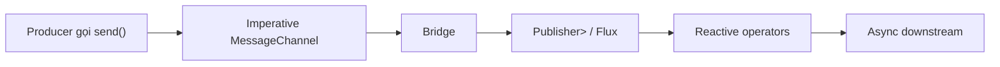
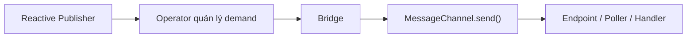
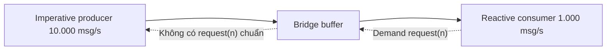
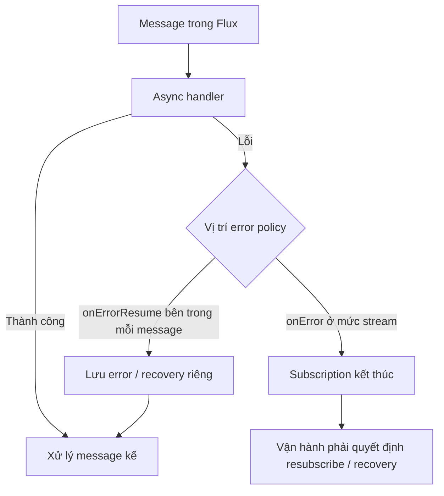
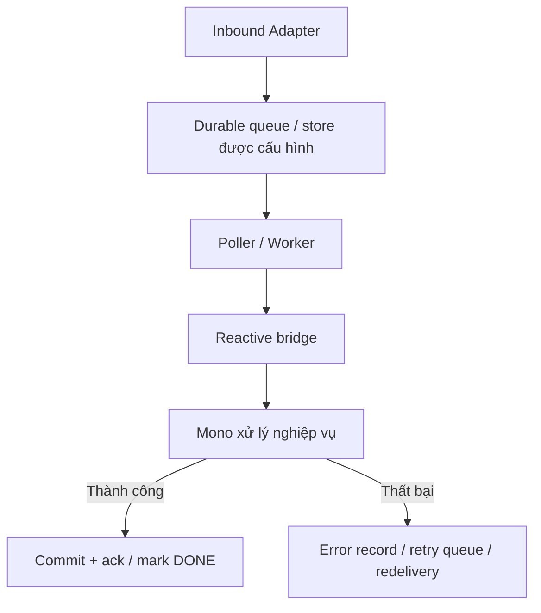

# Bridge giữa imperative channel và reactive flow trong Spring Integration

## Mục tiêu học tập

Trong Spring Integration, nhiều ứng dụng bắt đầu bằng một mô hình **imperative**: producer gọi `MessageChannel.send(message)`, channel giao message cho một endpoint và handler thực thi công việc. Một hệ thống khác có thể dùng **Reactive Streams** với `Publisher`, `Flux`, `Mono`, subscriber và tín hiệu yêu cầu dữ liệu (*demand*). Khi hai cách lập trình cần phối hợp, chúng ta phải xác định chính xác **ranh giới** giữa bên đẩy message theo lời gọi hàm và bên xử lý theo luồng reactive.

Bài **Bridge giữa imperative channel và reactive flow** thuộc chương **Reactive runtime**, trong module **SPRING_INTEGRATION_RUNTIME**. Mục tiêu không chỉ là nối hai API mà còn hiểu cách message thực sự chạy qua channel, endpoint, consumer, poller và executor, đồng thời thiết kế lifecycle, transaction, retry, message store, error flow, correlation, backpressure, threading và quan sát runtime.

Sau bài học, bạn có thể:

- Phân biệt contract của `MessageChannel` với `Publisher<Message<?>>`, đặc biệt ý nghĩa của `send()`, `subscribe()`, `request(n)` và `cancel()`.
- Dùng `FluxMessageChannel` làm điểm nối từ một flow imperative sang subscriber reactive; biết nơi đặt subscription và quản lý việc start/stop.
- Chuyển ngược một `Flux<Message<?>>` thành các lời gọi `MessageChannel.send()` mà không vô tình chặn event-loop.
- Giải thích vì sao bridge không tự làm một handler blocking trở thành non-blocking, không tự đảm bảo lưu bền vững và không biến `send()` thành xác nhận nghiệp vụ hoàn tất.
- Thiết kế backpressure, buffer, timeout, lỗi, retry, idempotency và concurrency ở từng phía của ranh giới.
- Kiểm thử message đến trước/sau subscription, lỗi từng message, cancellation, restart và những lúc downstream chậm hơn producer.

## 1. Hai mô hình thực thi gặp nhau ở đâu?

### 1.1. Imperative message channel

Giao diện cơ bản của Spring Messaging là `MessageChannel`:

```java
boolean accepted = messageChannel.send(message);
```

Lời gọi `send()` thực hiện thao tác gửi qua channel theo contract cụ thể. Trong một flow dùng `DirectChannel`, việc gửi có thể gọi **handler đồng bộ trên chính thread của producer**; nếu handler chặn I/O trong 3 giây, sender cũng có thể chờ trong 3 giây.

Tuy nhiên, **không phải mọi channel đều đồng bộ**. `ExecutorChannel` chuyển delivery sang worker; `QueueChannel` giữ message chờ consumer hoặc poller; `PublishSubscribeChannel` phát tới các subscriber tùy cấu hình. Vì vậy “imperative” ở đây chủ yếu nghĩa là **API gửi theo lời gọi hàm**, không khẳng định mọi endpoint ở phía sau đều chạy trên cùng thread.

Giá trị boolean của `send()` chủ yếu thể hiện kết quả **chấp nhận/giao message theo contract của channel**. Đặc biệt ở các ranh giới bất đồng bộ, nó **không phải** biên nhận rằng database đã commit hoặc API bên ngoài đã hoàn tất nghiệp vụ.

### 1.2. Reactive Streams và Reactor

Reactive Streams có bốn khái niệm chính:

- **`Publisher<T>`** công bố khả năng phát dữ liệu.
- **`Subscriber<T>`** nhận `onSubscribe`, `onNext`, `onError`, `onComplete`.
- **`Subscription`** cho phép yêu cầu thêm phần tử bằng `request(n)` và hủy bằng `cancel()`.
- **Demand/backpressure** giúp subscriber biểu đạt tốc độ tiêu thụ mong muốn đến một publisher có khả năng tuân theo demand.

Reactor triển khai mô hình này bằng `Flux<T>` (0 đến nhiều phần tử) và `Mono<T>` (0 hoặc 1 phần tử). Ví dụ xử lý message một cách không đồng bộ:

```java
Flux<Message<OrderCommand>> stream = ...;

Mono<Void> processing = stream
        .concatMap(msg -> orderService.handle(msg.getPayload()))
        .then();
```

Ở đây `orderService.handle(command)` được giả định trả `Mono<Void>`. Biến `processing` chỉ mô tả pipeline; với một publisher **cold**, thao tác thường chưa được thực hiện cho đến khi có subscription. Trái lại, một publisher **hot** có thể phát sự kiện độc lập với từng subscriber, nên cần kiểm tra chính sách phát và lưu đệm.

**Cảnh báo:** chữ “reactive” không có nghĩa mọi đoạn code tự động chạy ở thread khác. Nếu `orderService.handle()` gọi JDBC/HTTP blocking ngay trên event-loop, ứng dụng vẫn có thể nghẽn. Khi cần, dùng client bất đồng bộ hoặc chuyển công việc blocking sang scheduler phù hợp.

### 1.3. Ranh giới bridge





Bridge phải chuyển đổi **không chỉ dữ liệu** mà còn những khác biệt về tốc độ, subscription, lỗi, cancellation, lifecycle và transaction.

## 2. Bảng so sánh các channel ở runtime

| Thành phần | Cách nhận/phát message | Nơi handler chạy | Backpressure/buffer cần chú ý |
| --- | --- | --- | --- |
| `DirectChannel` | `send()` giao trực tiếp tới subscriber | Thường cùng thread sender | Không có Reactive Streams demand; sender có thể bị chặn |
| `ExecutorChannel` | `send()` chuyển delivery sang executor | Thread worker | Pool/queue/rejection phải được cấu hình; không tự tạo demand xuyên suốt |
| `QueueChannel` | `send()` đưa vào queue; consumer `receive()` hoặc poll | Thread của consumer/poller | Queue capacity và thời gian chờ gửi/nhận; có thể hết bộ nhớ |
| `FluxMessageChannel` | Channel kết nối với mô hình reactive `Publisher<Message<?>>` | Tùy subscriber và operator/scheduler | Cần subscription, demand, xử lý phát khi chưa có subscriber và chính sách buffering |
| `PublishSubscribeChannel` | Phát tới nhiều subscriber theo cấu hình | Đồng bộ hoặc qua executor | Fan-out có nghĩa khác queue cạnh tranh; không tự tuân demand |

`FluxMessageChannel` nằm trong Spring Integration, dùng để làm cầu nối giữa cách gửi `MessageChannel` và subscriber theo Reactive Streams. Nó đặc biệt hữu ích khi producer hiện hữu vẫn dùng `send()`, còn phía tiêu thụ muốn dùng `Flux`/Reactor.

**Lưu ý phiên bản:** chính sách queue/buffer, hành vi thiếu subscriber, emission failure và API chi tiết của channel reactive cần được kiểm chứng trên phiên bản Spring Integration và Reactor thực tế. Không kết luận rằng mọi message đều được giữ vô hạn hoặc sẽ sống qua restart chỉ vì channel có chữ `Flux`.

## 3. Imperative → reactive qua FluxMessageChannel

Giả sử một service nhận `OrderCommand` từ ứng dụng cũ qua một `DirectChannel`. Phần xử lý mới muốn đọc message như một luồng Reactor.

```text
Sender.send(Message<OrderCommand>)
      |
      v
ordersInput: DirectChannel
      |
      v
Bridge IntegrationFlow
      |
      v
ordersReactive: FluxMessageChannel
      |
      v
Reactor subscriber -> Mono xử lý đơn hàng
```

### 3.1. Khai báo channel và bridge bằng Java DSL

Ví dụ phù hợp về mặt ý tưởng cho Spring Integration 6.x:

```java
import org.springframework.beans.factory.annotation.Qualifier;
import org.springframework.context.annotation.Bean;
import org.springframework.context.annotation.Configuration;
import org.springframework.integration.channel.DirectChannel;
import org.springframework.integration.channel.FluxMessageChannel;
import org.springframework.integration.config.EnableIntegration;
import org.springframework.integration.dsl.IntegrationFlow;
import org.springframework.messaging.MessageChannel;

@Configuration
@EnableIntegration
class OrderBridgeConfiguration {

    @Bean("ordersInput")
    MessageChannel ordersInput() {
        return new DirectChannel();
    }

    @Bean("ordersReactive")
    FluxMessageChannel ordersReactive() {
        return new FluxMessageChannel();
    }

    @Bean
    IntegrationFlow imperativeToReactive(
            @Qualifier("ordersInput") MessageChannel ordersInput,
            @Qualifier("ordersReactive") FluxMessageChannel ordersReactive) {

        return IntegrationFlow.from(ordersInput)
                .channel(ordersReactive)
                .get();
    }
}
```

Điểm mấu chốt: upstream vẫn gửi bằng `ordersInput.send(message)`; flow chuyển message vào `FluxMessageChannel`. **Đến đây chưa có xử lý nghiệp vụ reactive** nếu không có subscriber tiêu thụ publisher tương ứng.

Không cần tự biến một `Message` thành DTO trước bridge; `FluxMessageChannel` có thể làm việc với `Message<?>`. Việc dùng `Flux.from(ordersReactive)` làm publisher của các message cho phép giữ payload và headers để downstream lấy correlation, business key, reply/error headers theo hợp đồng.

### 3.2. Tạo message ở phía imperative

```java
import org.springframework.messaging.Message;
import org.springframework.messaging.MessageChannel;
import org.springframework.messaging.support.MessageBuilder;

// Bean ordersInput được inject từ Spring context.
// OrderCommand là DTO nghiệp vụ do ứng dụng định nghĩa.
record OrderCommand(String orderId, int quantity) {}

Message<OrderCommand> request = MessageBuilder
        .withPayload(new OrderCommand("ORD-42", 2))
        .setHeader("correlationId", "tenant-a:ORD-42")
        .setHeader("businessKey", "ORD-42")
        .build();

boolean accepted = ordersInput.send(request);
```

Với `DirectChannel` ở đầu vào, `accepted` cho biết trạng thái gửi theo contract của channel. Nó không được dùng làm bằng chứng `OrderService` ở subscriber reactive đã hoàn thành. Một message đi qua bridge có thể **đã được chấp nhận vào pipeline nhưng còn đang chờ xử lý**.

### 3.3. Đọc publisher từ FluxMessageChannel

Một subscriber reactive có thể nhận message từ channel:

```java
import org.springframework.integration.channel.FluxMessageChannel;
import org.springframework.messaging.Message;
import reactor.core.publisher.Flux;

Flux<Message<?>> messages = Flux.from(ordersReactive);

Flux<String> orderIds = messages.map(message -> {
    OrderCommand command = (OrderCommand) message.getPayload();
    return command.orderId();
});
```

Đây là **pipeline khai báo**. Nếu chưa subscription, đừng kỳ vọng `map()` đã chạy với các message mới. Trong ứng dụng, subscription nên do một thành phần có lifecycle rõ ràng sở hữu, hoặc do framework quản lý khi bạn dùng endpoint reactive phù hợp.

**Quan trọng:** đăng ký nhiều subscriber vào một publisher/hot channel có thể tạo semantics fan-out thay vì *competing consumers*. Nếu nghiệp vụ cần một message được một worker duy nhất nhận, phải chọn một cấu trúc queue/group/consumer và chính sách ownership phù hợp; đừng giả định mỗi subscription tương đương với một phần tử được chia đều.

## 4. Quản lý subscription cùng lifecycle của Spring

Một lỗi dễ gặp là viết `Flux.from(channel).subscribe(...)` bên trong constructor, `@Bean` factory hoặc một handler rồi quên subscription. Khi component được tạo lại, có thể phát sinh **nhiều subscriber**. Khi context dừng, subscription chưa bị dispose có thể giữ tài nguyên hoặc tiếp tục thực hiện side effect ở những publisher khác.

Một lựa chọn minh họa là một bean `SmartLifecycle` sở hữu `Disposable`:

```java
import org.springframework.beans.factory.annotation.Qualifier;
import org.springframework.context.SmartLifecycle;
import org.springframework.integration.channel.FluxMessageChannel;
import org.springframework.messaging.Message;
import org.springframework.stereotype.Component;
import reactor.core.Disposable;
import reactor.core.publisher.Flux;
import reactor.core.publisher.Mono;

record OrderCommand(String orderId, int quantity) {}

interface AsyncOrderService {
    Mono<Void> process(OrderCommand command);
}

interface AsyncErrorArchive {
    Mono<Void> record(Message<?> message, Throwable failure);
}

@Component
final class ReactiveOrderConsumer implements SmartLifecycle {
    private final FluxMessageChannel input;
    private final AsyncOrderService service;
    private final AsyncErrorArchive errorArchive;

    private volatile boolean running;
    private Disposable subscription;

    ReactiveOrderConsumer(
            @Qualifier("ordersReactive") FluxMessageChannel input,
            AsyncOrderService service,
            AsyncErrorArchive errorArchive) {
        this.input = input;
        this.service = service;
        this.errorArchive = errorArchive;
    }

    @Override
    public synchronized void start() {
        if (running) {
            return;
        }

        subscription = Flux.from(input)
                // Một message tại một thời điểm trong subscription này;
                // tránh chạy đồng thời các lệnh ghi cùng đơn hàng.
                .concatMap(message ->
                        Mono.defer(() -> service.process(
                                (OrderCommand) message.getPayload()))
                            // Lỗi của một message được xử lý bên trong
                            // concatMap, không làm kết thúc toàn stream
                            // nếu archive thành công.
                            .onErrorResume(error ->
                                    errorArchive.record(message, error)))
                .subscribe(
                        ignored -> { },
                        fatal -> System.err.println(
                                "Reactive subscription terminated: " + fatal));

        running = true;
    }

    @Override
    public synchronized void stop() {
        running = false;
        if (subscription != null) {
            subscription.dispose();
            subscription = null;
        }
    }

    @Override
    public boolean isRunning() {
        return running;
    }
}
```

**Các giả định của ví dụ:**

- `AsyncOrderService.process` trả `Mono<Void>` và thực hiện I/O theo mô hình phù hợp; `AsyncErrorArchive.record` cũng trả `Mono<Void>` và lưu lỗi theo hợp đồng ứng dụng.
- Chỉ minh họa một subscriber do component sở hữu; thực tế cần kiểm tra auto-startup order, luồng shutdown, subscription terminal và khả năng khởi động lại khi pipeline lỗi nghiêm trọng.
- `concatMap` tuần tự hóa việc xử lý trong **một subscription**. Nó không tự tuần tự hóa nhiều pod hoặc nhiều subscriber độc lập.
- Nếu `errorArchive.record` thất bại, lỗi có thể trở thành **terminal error**, subscription dừng. Đây là tình trạng cần cảnh báo và chiến lược phục hồi; không nên âm thầm `onErrorResume(... -> Mono.empty())` cho mọi lỗi.
- `stop()` dispose subscription; điều đó **không** bảo đảm mọi thao tác I/O đã hoàn tất, đã rollback hoặc message chưa xử lý được lưu bền vững. Cần graceful shutdown và nguồn phát lại khi có yêu cầu durability.

Đoạn code đặt `OrderCommand` ở top-level để tự chứa ví dụ; khi ghép vào dự án, khai báo DTO một lần và tránh định nghĩa lại record của ví dụ ở các file khác. Nó chỉ minh họa cơ chế bridge, không tự cấu hình database, bean `AsyncOrderService` hay kho lỗi.

### 4.1. Vì sao không gọi subscribe() cho từng message?

Không nên đặt logic dạng:

```java
.handle(message -> {
    asyncService.process((OrderCommand) message.getPayload())
            .subscribe();
    // Handler trả về ngay, mặc dù công việc còn đang chạy.
})
```

Cách này tách rời việc hoàn tất công việc khỏi kết quả xử lý message ở endpoint. Caller hoặc adapter có thể xem handler đã hoàn thành, dẫn đến **ack/commit quá sớm**; exception xuất hiện ở subscriber khác và có thể không đi vào error flow mà bạn mong đợi. Với quy trình cần độ tin cậy, hãy dùng endpoint có hợp đồng reactive completion, hoặc thiết kế một durable handoff rõ ràng rồi mới hoàn tất lượt nhận.

## 5. Reactive → imperative bằng MessageChannel.send()

Ở chiều ngược lại, bạn có một `Flux<Message<OrderCommand>>` lấy từ nguồn reactive và cần đưa các message vào channel/handler Spring Integration hiện có.

```text
Publisher / Flux
   -> operator giới hạn số công việc
   -> offload nếu send() có thể blocking
   -> MessageChannel.send(message)
   -> DirectChannel / QueueChannel / ExecutorChannel
   -> handler hiện có
```

### 5.1. Chuyển một Flux thành chuỗi gửi tuần tự

Đoạn code sau biến mỗi phần tử thành một lời gọi `send()`. Nó giữ thứ tự xử lý tại chính bridge bằng `concatMap`, đồng thời chuyển phép gọi có thể blocking sang `boundedElastic`:

```java
import org.springframework.messaging.Message;
import org.springframework.messaging.MessageChannel;
import reactor.core.publisher.Flux;
import reactor.core.publisher.Mono;
import reactor.core.scheduler.Schedulers;

static Mono<Void> forwardToChannel(
        Flux<Message<OrderCommand>> source,
        MessageChannel target) {

    return source
            .concatMap(message ->
                    Mono.fromCallable(() -> {
                        boolean accepted = target.send(message);
                        if (!accepted) {
                            throw new IllegalStateException(
                                    "Channel rejected message "
                                            + message.getHeaders().getId());
                        }
                        return true;
                    }).subscribeOn(Schedulers.boundedElastic()))
            .then();
}
```

**Ý nghĩa:**

- `forwardToChannel()` trả về `Mono<Void>` mô tả **lượt forward**. Caller cần subscribe hoặc đưa nó vào một chain đang được framework subscribe để công việc thật sự diễn ra.
- `concatMap` tránh nhiều lời gọi `send()` đồng thời trong cùng subscription, phù hợp khi thứ tự quan trọng hoặc không muốn đẩy tải quá nhanh vào channel hiện hữu.
- `Schedulers.boundedElastic()` dùng để cô lập **lời gọi có thể blocking**, không khiến underlying JDBC/HTTP client tự trở thành non-blocking. Scheduler có tài nguyên hữu hạn và queue; không dùng nó để che một nguồn phát vô hạn không được kiểm soát.
- Nếu `target` là `DirectChannel`, `send()` có thể bao gồm cả thời gian handler chạy; nếu là queue/executor, `send()` có thể trả về trước khi nghiệp vụ hoàn tất.
- Một `send()` trả `false` được nâng thành lỗi ở **bridge**. Exception của handler đồng bộ cũng có thể xuất hiện từ `send()`; còn lỗi bất đồng bộ có thể đến từ error handler tại thread worker.

Để giữ `correlationId`, `businessKey` và các headers, dùng cùng `Message` khi forward; nếu cần tạo message mới thì phải quyết định chính sách sao chép headers rõ ràng. Một message mới có thể có UUID mới dù correlation nghiệp vụ giữ nguyên.

### 5.2. Khi muốn xử lý song song

Một biến thể có thể dùng `flatMap` với giới hạn concurrency:

```java
return source
        .flatMap(message ->
                Mono.fromCallable(() -> target.send(message))
                    .subscribeOn(Schedulers.boundedElastic()),
                8)
        .then();
```

Đây là ví dụ minh họa **tối đa 8 lời gọi send đồng thời trong operator này**; cần thêm kiểm tra boolean `false` và xử lý lỗi như mục 5.1 trước khi dùng production. `flatMap` có thể thay đổi **thứ tự hoàn tất**; nếu hai event của cùng business key phải tuần tự, cần partition theo key hoặc dùng `concatMap` trong từng nhóm.

Đừng tăng concurrency khi downstream chỉ có một DB connection hoặc khi handler không an toàn với xử lý song song. Concurrency phải phù hợp với thread pool, hàng đợi và giới hạn của hệ thống đích.

### 5.3. Rủi ro resubscribe một cold source

```java
Mono<Void> task = forwardToChannel(sourceFlux, targetChannel);

// Nếu sourceFlux là cold, mỗi lần subscribe có thể đọc/phát lại dữ liệu.
task.subscribe();
task.subscribe();
```

Trong ví dụ, `sourceFlux` có thể chạy lại hai lần và gửi hai bản message tới target. Không dùng `subscribe()` lặp như một cơ chế đảm bảo “chắc chắn gửi thành công”. Cần biết source hot/cold, cơ chế delivery, error handling và idempotency; quản lý subscription trong lifecycle thay vì đăng ký tự do.

## 6. Backpressure không tự xuyên qua một lời gọi send()

Backpressure của Reactive Streams là cơ chế **subscriber yêu cầu số phần tử có thể nhận**. Một nguồn reactive được viết đúng có thể giảm tốc độ phát khi demand nhỏ. Nhưng `MessageChannel.send()` chỉ trả boolean/exception; API này không truyền `request(n)` ngược về một producer imperative độc lập.



Nếu input đến nhanh hơn tiêu thụ trong thời gian dài, hệ thống phải xử lý **chênh lệch tốc độ**. Không thể chỉ thêm `Flux` là có backpressure end-to-end.

### 6.1. Buffer tích lũy theo thời gian

Giả sử producer đẩy 5.000 message/giây, consumer xử lý 3.000 message/giây. Mức tăng backlog trung bình là:

```text
5.000 - 3.000 = 2.000 message/giây

Sau 60 giây:
2.000 × 60 = 120.000 message tồn đọng (xấp xỉ)

Nếu trung bình 2 KB/message (gồm overhead):
120.000 × 2 KB ≈ 240 MB, chưa kể object/queue overhead
```

Đây là **ước lượng minh họa**, không phải metric của Spring Integration. Buffer trong RAM có thể tăng nhanh, gây GC và OOM, còn buffer trên DB/broker có thể làm tăng latency, I/O và dung lượng lưu trữ. Nếu consumer ngừng hoàn toàn, backlog còn tăng mạnh hơn.

### 6.2. Các biện pháp điều tiết

| Chiến lược | Có ích khi | Đánh đổi |
| --- | --- | --- |
| Hạ tốc producer tại nguồn | Producer điều chỉnh tốc độ được | Có thể tăng latency upstream |
| Queue/broker bền vững có giới hạn | Cần chịu đột biến và khôi phục sau restart | I/O, ack, retention, redelivery và vận hành |
| Giới hạn concurrency | Downstream có năng lực xử lý hữu hạn | Throughput tối đa bị giới hạn rõ ràng |
| Bounded buffer + overflow policy | Message có thể từ chối/hoãn hoặc xử lý quá tải theo policy | Phải chọn rõ drop/error/block/route khác |
| Batch/coalesce | Dữ liệu có thể gộp hợp lệ | Có thể thay đổi ngữ nghĩa từng message |
| Retry queue có delay | Downstream tạm hỏng | Cần idempotency, lịch và giới hạn retry |
| Shed load/fail fast | Request không quan trọng bằng hệ thống sống ổn định | Một số request bị từ chối có chủ đích |

Các operator Reactor như `onBackpressureBuffer`, `limitRate`, `onBackpressureDrop` không có tác dụng thần kỳ với producer imperative: cần xác định buffer nằm ở đâu, có bị giới hạn hay không, và thành phần nào **thật sự phản ứng** khi hết chỗ. Với message tài chính/đơn hàng, **drop** thường không chấp nhận được nếu chưa có một lưu trữ bền vững hoặc đường báo lỗi có hợp đồng.

### 6.3. Khi nào cần dừng gửi?

Một bridge tốt nên có chính sách khi downstream không đáp ứng:

- Nếu channel từ chối hoặc queue đã đầy, chuyển lỗi về caller hoặc durable retry store thay vì bỏ qua `false`.
- Nếu upstream là poller, có thể giảm tốc hoặc tạm dừng poller theo chính sách.
- Nếu inbound từ broker, dùng prefetch/concurrency/ack/nack phù hợp thay vì chỉ tạo buffer vô hạn trong JVM.
- Nếu input là hot source, xác định overflow policy; mất subscriber hoặc cancel không đồng nghĩa upstream tự dừng.
- Nếu mục tiêu là độ bền, phải bảo đảm message đã được lưu **trước khi** source xác nhận.

## 7. Threading: “reactive” khác với “chạy ở background”

Một `Flux` không tự đổi thread. Các operator có thể chạy trên thread phát tín hiệu hoặc scheduler mà chúng được chỉ định. Hai operator dễ nhầm:

- `subscribeOn(scheduler)`: ảnh hưởng nơi subscription và phần nguồn liên quan được thực thi.
- `publishOn(scheduler)`: chuyển việc thực thi các operator ở phía downstream của vị trí đó sang scheduler được chỉ định.

Ví dụ:

```java
Flux.from(ordersReactive)
        .doOnNext(message ->
                System.out.println("before=" +
                        Thread.currentThread().getName()))
        .publishOn(Schedulers.parallel())
        .doOnNext(message ->
                System.out.println("after=" +
                        Thread.currentThread().getName()));
```

Đoạn này chưa có subscription, và `parallel()` **không dành cho JDBC/HTTP blocking**. Không nên thêm `publishOn(Schedulers.parallel())` rồi gọi một REST client synchronous để “làm reactive”. Nếu buộc phải dùng API blocking, cô lập trên `boundedElastic()` hoặc dùng một executor có kích thước rõ và theo dõi queue. Với I/O thực sự non-blocking, thường không cần thêm thread chỉ để “tỏ ra async”.

### 7.1. Những thread boundary trong Spring Integration

| Vị trí | Thread thực thi điển hình | Ảnh hưởng đến transaction/context |
| --- | --- | --- |
| `DirectChannel` → handler | Thread gọi `send()` | Transaction gắn thread có thể tiếp tục nếu resource tham gia |
| `ExecutorChannel` → handler | Thread worker | ThreadLocal transaction/MDC thông thường không tự truyền |
| Poller → handler | Thread scheduler/poller | Transaction có thể mở theo poller advice/config |
| `FluxMessageChannel` → Reactor subscriber | Theo publisher, subscription và scheduler/operator | Không suy từ `Flux` ra một thread cố định |
| `publishOn` / `subscribeOn` | Scheduler do Reactor quản lý | ThreadLocal/MDC cần context propagation riêng |
| Async HTTP/database client | Event-loop/callback do client quản lý | Không tự nằm trong transaction imperative đang mở |

### 7.2. Correlation header khác Reactor Context

`MessageHeaders` là dữ liệu gắn với từng message. `Reactor Context` chứa ngữ cảnh được truyền theo một subscription/reactive chain theo contract Reactor. MDC/ThreadLocal là trạng thái gắn thread. Chúng **không tự đồng nhất** với nhau.

```text
Message:
  id            = UUID-1
  correlationId = tenant-a:ORD-42

Reactor Context:
  trace/tenant metadata nếu được truyền có chủ đích

ThreadLocal/MDC:
  có thể rỗng khi đổi scheduler hoặc executor
```

Cách an toàn là giữ business key/correlation ID trong message, chỉ bổ sung Context/MDC khi cần cho logging/tracing và bảo đảm clear/restore đúng scope. Không lấy MDC từ thread producer làm nguồn duy nhất để group message ở aggregator sau bridge.

## 8. Lỗi đi qua bridge như thế nào?

Imperative và reactive có mô hình lỗi khác nhau:

- Ở flow synchronous dùng `DirectChannel`, exception có thể truyền về caller của `send()`.
- Với `ExecutorChannel` hoặc poller, lỗi có thể được error handler tại biên bất đồng bộ chuyển thành `ErrorMessage`.
- Trong Reactor, `onError` là **tín hiệu terminal** của một Publisher/Subscription. Nếu không xử lý thích hợp, một lỗi từ message riêng lẻ có thể làm subscription xử lý các message sau **dừng hẳn**.



### 8.1. Lỗi cục bộ một message vs lỗi terminal của stream

Ví dụ nguy hiểm:

```java
Flux.from(ordersReactive)
        .flatMap(message ->
                orderService.process((OrderCommand) message.getPayload()))
        .doOnError(error -> System.err.println(error))
        .subscribe();
```

Nếu một `Mono` bên trong phát lỗi và `flatMap` không có policy cục bộ, lỗi có thể lan ra làm subscription dừng. `doOnError` chỉ quan sát, **không xử lý/nuốt lỗi**. Thêm `onErrorResume` **ở cuối toàn stream** cũng có thể thay stream đang chạy bằng một publisher khác hoặc kết thúc; nó không tự quay lại nhận những message cũ bị bỏ qua.

Khi cần cô lập lỗi theo message:

```java
Flux.from(ordersReactive)
        .concatMap(message ->
                Mono.defer(() -> orderService.process(
                        (OrderCommand) message.getPayload()))
                    .onErrorResume(error ->
                            errorArchive.record(message, error)))
        .subscribe(
                ignored -> { },
                fatal -> System.err.println(
                        "Fatal stream error: " + fatal));
```

Ví dụ chỉ đúng nếu `errorArchive.record()` thực sự lưu lỗi theo hợp đồng. Nếu archive cũng lỗi, subscription có thể dừng. Không nên trả `Mono.empty()` cho tất cả lỗi mà không có record bền vững khi dữ liệu quan trọng.

### 8.2. ErrorMessage và lỗi Reactor không phải một

Một `Throwable` trong `onError` **không tự trở thành `ErrorMessage`** trên `errorChannel` của Spring Integration. Muốn dùng Spring Integration error flow, cần chuyển tín hiệu lỗi sang message/channel hoặc dùng endpoint/adapter có cơ chế publish lỗi được cấu hình.

Ví dụ chuyển lỗi nghiệp vụ thành `ErrorMessage` tại một biên đã định:

```java
import org.springframework.messaging.Message;
import org.springframework.messaging.MessageChannel;
import org.springframework.messaging.support.ErrorMessage;

void publishFailure(
        MessageChannel errorChannel,
        Message<?> original,
        Throwable failure) {

    ErrorMessage error = new ErrorMessage(failure, original);

    boolean accepted = errorChannel.send(error);
    if (!accepted) {
        throw new IllegalStateException("Could not publish error message");
    }
}
```

Đoạn này sử dụng channel/error consumer được ứng dụng cấu hình. Nếu `errorChannel` đồng bộ và handler của nó blocking, `send(error)` cũng có thể blocking; cần đặt ở scheduler/endpoint thích hợp. `ErrorMessage.getPayload()` là `Throwable`, còn `originalMessage` giúp giữ ngữ cảnh để truy correlation và payload nguồn nếu có.

### 8.3. Retry theo message, không tự retry cả hot/cold source

Để chỉ thử lại một thao tác bị lỗi, đặt `retryWhen` bên trong phép biến đổi **mỗi message**:

```java
import java.time.Duration;
import reactor.util.retry.Retry;

Flux.from(ordersReactive)
        .concatMap(message ->
                Mono.defer(() -> orderService.process(
                        (OrderCommand) message.getPayload()))
                    .retryWhen(Retry.backoff(2, Duration.ofMillis(200))
                            .filter(TemporaryRemoteFailure.class::isInstance))
                    .onErrorResume(error ->
                            errorArchive.record(message, error)))
        .subscribe(
                ignored -> { },
                fatal -> System.err.println(fatal));
```

`Retry.backoff(2, ...)` trong Reactor biểu thị **tối đa 2 lượt retry sau attempt đầu tiên**, nên có thể có **3 attempts tổng cộng**. Điều này khác cách đặt tên `maxAttempts=3` của nhiều chính sách Spring Retry, nơi thường tính cả lần đầu.

`TemporaryRemoteFailure` là exception nghiệp vụ ví dụ do ứng dụng định nghĩa. Việc chỉ retry loại lỗi tạm thời giúp tránh retry lỗi schema, validation hoặc lỗi lập trình. Nếu API đã nhận lệnh nhưng timeout trước khi trả lời, retry có thể tạo side effect lặp; cần idempotency key.

**Cẩn thận:** `sourceFlux.retryWhen(...)` ở phía **ngoài** pipeline có thể resubscribe toàn bộ source. Với cold source, nó có thể phát lại cả những phần tử đã xử lý thành công; với hot source, các message trong thời gian không có subscriber có thể không được phục hồi. Hãy đặt retry tại **đơn vị thao tác phù hợp**, không coi resubscribe là một hình thức redelivery bền vững.

## 9. Transaction, ack và xử lý “đã nhận” hay “đã xong”

Một bridge mở ranh giới giữa message delivery và reactive completion. Điều quan trọng là **thời điểm nguồn được phép ack**.

```text
Broker delivery / Poller
       |
       v
Imperative send() -> Flux bridge nhận message
       |
       |   Có thể trả về trước khi Mono xử lý xong
       v
Reactive process -> side effect -> commit/DONE
```

Nếu adapter upstream ack ngay khi `send()` trả thành công, nhưng subscriber reactive chưa gọi API hoặc còn đang đợi backoff, thì crash có thể làm **mất công việc chưa hoàn tất**. Dùng `FluxMessageChannel` không tự tạo một transaction bao trùm cả hai phía.

### 9.1. Ba mô hình handoff

| Hợp đồng | Điểm upstream được phép hoàn tất | Khi nào phù hợp | Yêu cầu bổ sung |
| --- | --- | --- | --- |
| **Fire-and-forget, chấp nhận mất** | Sau `send()` được chấp nhận | Telemetry có thể bỏ qua, best-effort | Monitoring/drop policy rõ |
| **Durable handoff** | Sau khi message được lưu bền vững ở queue/store | Async business processing có recovery | Broker/DB durable, worker, ack/retry/idempotency |
| **End-to-end completion** | Sau khi kết quả reactive hoàn tất và được xác nhận | Request/reply đòi kết quả chắc chắn | Gateway/endpoint có hợp đồng async completion, deadline, timeout, propagation |

Không thể có được mô hình thứ ba chỉ bằng cách `subscribe()` bên trong một `MessageHandler` rồi trả về ngay. Nếu nghiệp vụ cần kết quả cuối mới ack, hãy dùng một thiết kế completion được liên kết tới source adapter/gateway, hoặc một durable work queue làm ranh giới trách nhiệm.

### 9.2. ThreadLocal transaction không tự qua scheduler

Spring transaction theo imperative thường gắn với thread. Khi một flow chuyển từ `DirectChannel` sang `ExecutorChannel` hoặc qua Reactor scheduler khác, transaction gắn thread ban đầu thường **không tự lan sang** thao tác phía sau. Reactive transaction có cách quản lý context riêng, phụ thuộc `ReactiveTransactionManager` và resource client hỗ trợ.

Ví dụ:

```text
Caller thread:
  begin JDBC transaction
  send(message)
  commit JDBC transaction
           |
           v
Reactive subscriber thread:
  call async downstream / reactive DB
  finish later
```

Không mặc nhiên coi cả hai hành động nằm trong **một transaction** chỉ vì chúng cùng thuộc một `IntegrationFlow`. Nếu cần atomically persist “công việc chờ xử lý” cùng nghiệp vụ, cân nhắc outbox/durable enqueue trong transaction phù hợp, sau đó để worker reactive xử lý và cập nhật trạng thái.

### 9.3. Idempotency và correlation qua bridge

Bridge nên giữ `businessKey` và `correlationId`. Khi có replay hoặc tạo `Message` mới, message ID có thể đổi; dedupe nên dựa vào business key ổn định chứ không chỉ UUID của message instance. Đối với hệ thống ngoài, dùng idempotency key hoặc ràng buộc unique ở resource đích.

```text
eventId = E-42
businessKey = tenant-a:ORD-42
correlationId = flow-42

attempt 1: Message ID = UUID-A
attempt 2 / redelivery: Message ID có thể = UUID-B

=> Kiểm tra duplicate theo eventId/businessKey,
   không mặc nhiên theo UUID-A.
```

## 10. Cancellation, stop và restart của reactive bridge

Một `Subscription.cancel()` hoặc Reactor `Disposable.dispose()` là **tín hiệu ngừng nhận/phát theo subscription**, không phải một lệnh commit hoặc rollback nghiệp vụ. Khi ứng dụng stop:

- Producer imperative vẫn có thể đang gọi `send()` nếu nguồn chưa được pause.
- Message đã được chuyển vào channel nhưng chưa hoàn tất downstream.
- Một I/O bất đồng bộ đang in-flight có thể tiếp tục hoặc bị hủy tùy client.
- Một queue/buffer trong bộ nhớ có thể mất dữ liệu khi JVM dừng.
- Subscriber có thể bị dispose trong khi nguồn chưa biết rằng công việc chưa hoàn thành.

### 10.1. Một quy trình graceful shutdown cần xác minh

1. Ngừng hoặc giảm tốc **nguồn nhận message mới** (poller, consumer container, producer).
2. Đợi các tác vụ in-flight hoàn tất trong một deadline phù hợp nếu có thể.
3. Đối với tác vụ chưa hoàn tất, xác minh đã có durable state hoặc source có thể redeliver.
4. Chỉ sau đó dispose subscription và đóng scheduler/resource.
5. Ghi metrics còn tồn đọng, trạng thái cuối của message, exception và correlation.
6. Khi restart, khởi tạo subscriber/consumer trước hoặc phối hợp với source để tránh giai đoạn phát khi chưa có subscriber.
7. Mở lại input có kiểm soát và theo dõi retry, duplicate, backlog.

Trình tự này là **chính sách vận hành tham khảo**, không phải bảo đảm tự động của `FluxMessageChannel`. Khi shutdown bị kill cưỡng bức, durable queue/store + idempotency mới là lớp bảo vệ quan trọng.

### 10.2. Hot source và thời điểm subscription

Nếu một hot publisher phát khi chưa có subscriber, dữ liệu có thể bị giữ tạm, bị từ chối hoặc không được chuyển tiếp tùy implementation và cấu hình. Do đó, bài test phải bao gồm:

```text
A. subscribe trước -> send message
B. send trước -> subscribe sau
C. subscriber dispose -> producer tiếp tục send
D. subscriber lỗi terminal -> producer tiếp tục send
E. restart process -> source redeliver hoặc buffer mất
```

Đừng suy luận từ test A rằng B–E cũng an toàn. Một publisher reactive không tự là một message broker lưu bền vững.

## 11. MessageStore, QueueChannel và nơi nên đặt durable boundary

Đối với một flow quan trọng, nếu message xuất phát từ nguồn imperative và subscriber reactive có thể chậm hoặc tạm vắng mặt, thường cần một vùng lưu bền vững **trước khi upstream ack**.



`MessageStore`, `MessageGroupStore` và `MetadataStore` hỗ trợ những mục đích khác nhau:

| Loại store | Có thể đóng góp gì cho bridge? | Điều không tự làm |
| --- | --- | --- |
| `MessageStore` | Cất một `Message<?>` theo UUID cho claim-check hoặc recovery | Không tự phát lại/đặt lịch consumer; không tự quản lý ack |
| `MessageGroupStore` | Gom message theo correlation/group ID nếu bridge tham gia aggregator | Không tự biết group đã đủ/đã release an toàn |
| `MetadataStore` | Giữ checkpoint/dedupe/claim metadata nhỏ | Không lưu nguyên payload message; không tự tạo durable queue |
| Broker/queue persistent | Có thể giữ công việc và redeliver theo contract | Không tự làm side effect exactly-once |
| Repository nghiệp vụ/outbox | Giữ trạng thái đơn hàng/sự kiện với ràng buộc transaction | Cần worker và idempotency để giao/đọc tiếp |

Nếu dùng một `FluxMessageChannel` nối trực tiếp vào subscriber, hãy kiểm chứng liệu công việc có được **lưu bền vững ở nơi nào khác** trước khi nguồn xác nhận hay không. Trong trường hợp không có durable state, restart có thể mất các message đã được gửi nhưng chưa xử lý xong.

## 12. Ordering và concurrency trong một reactive pipeline

`concatMap` và `flatMap` có hành vi khác nhau:

| Operator/pattern | Tính chất | Khi dùng |
| --- | --- | --- |
| `map` | Biến đổi đồng bộ từng giá trị; không chờ I/O async | Mapping nhẹ, không blocking |
| `concatMap` | Xử lý inner publisher lần lượt, giữ thứ tự theo source | Update tuần tự cùng business key |
| `flatMap` | Có thể chạy nhiều inner publisher đồng thời, output xen kẽ | Các message độc lập, I/O async |
| `flatMap(..., n)` | Giới hạn số inner subscriptions đồng thời tại vị trí đó | Khống chế tải downstream |
| `flatMapSequential` | Cho phép xử lý đồng thời nhưng phát output theo thứ tự nguồn | Cần output có thứ tự, chịu được buffer chờ |
| `groupBy(key)` + `concatMap` | Có thể tuần tự trong từng group nếu tổ chức đúng | Ordering theo `orderId`/partition |

Ví dụ: Order `ORD-42` nhận `CREATED` rồi `PAID`; nếu `flatMap` cho cả hai cùng gửi vào DB, `PAID` có thể hoàn thành trước `CREATED`. Khi ordering quan trọng, dùng partition có khóa ổn định hoặc tuần tự hóa theo business key, và kiểm soát số group đồng thời để tránh tạo vô hạn queue.

Lưu ý: `concatMap` bảo đảm thứ tự **trong một subscription** của operator, không đảm bảo các message phát từ hai pod/broker partition khác nhau luôn có ordering toàn cục. Khi dùng retry/durable queue, thứ tự còn phụ thuộc redelivery và cách xử lý message thất bại.

## 13. Quan sát bridge trong production

Nếu chỉ nhìn vào “`send()` trả true”, bạn sẽ khó biết subscriber có tồn tại, đang đợi backoff hay đã lỗi terminal. Nên đo ở **cả hai phía** của bridge:

| Tín hiệu | Tại đâu | Mục đích |
| --- | --- | --- |
| `imperative.send.attempt` | Producer/channel đầu vào | Tốc độ nguồn và số lần thử gửi |
| `imperative.send.reject` | Tại `send()` hoặc error handler | Gửi bị từ chối hoặc phát sinh exception |
| `bridge.emitted` | Sau điểm phát vào publisher | Số message thật sự bước qua bridge |
| `bridge.subscription.active` | Lifecycle subscriber | Phát hiện không có subscriber/stream dừng |
| `reactive.process.started` | Khi bắt đầu inner `Mono` | Số message bắt đầu xử lý |
| `reactive.process.succeeded` | Khi `Mono` hoàn tất thành công | Thành công nghiệp vụ theo phạm vi được instrument |
| `reactive.process.failed` | Trong per-message error policy | Lỗi thật của xử lý |
| `reactive.stream.terminated` | Terminal onError/onComplete | Subscription bị kết thúc ngoài ý muốn |
| `bridge.buffer.depth` | Queue/buffer nếu có API đo | Có backlog tăng không? |
| `executor.active/queue` | Thread pool hoặc scheduler | Kiểm tra nghẽn worker/blocking |
| `message.age` / `endToEnd.latency` | Correlation giữa ingress và commit | Đo delay do bridge/backpressure |
| `error.archive.persisted` | Error flow/recovery | Xác minh lỗi có thể được replay |

Đây là **tên metric gợi ý để tự instrument**, không phải danh sách metric chắc chắn có sẵn trong Spring Integration. Không đưa mỗi `messageId` hoặc `correlationId` làm label metric vì cardinality rất cao; giữ chúng trong structured log/tracing có retention và bảo mật phù hợp.

### 13.1. Log cần đủ ngữ cảnh xuyên thread

Ví dụ:

```text
time=... stage=imperative-send thread=http-42
  messageId=UUID-A correlationId=tenant-a:ORD-42 accepted=true

time=... stage=reactive-start thread=reactor-http-nio-3
  messageId=UUID-A correlationId=tenant-a:ORD-42

time=... stage=reactive-end thread=reactor-http-nio-3
  messageId=UUID-A correlationId=tenant-a:ORD-42 outcome=SUCCESS
```

Cần phân biệt **message ID** với **correlation ID**. Nếu message được transform/convert, message ID mới có thể xuất hiện; giữ business key/correlation để nối các log. Không log payload chứa token, thông tin cá nhân hoặc dữ liệu nhạy cảm khi chưa có chính sách bảo vệ.

## 14. Chẩn đoán sự cố thường gặp

| Triệu chứng | Nguyên nhân có thể | Kiểm tra đầu tiên |
| --- | --- | --- |
| `send()` thành công nhưng không thấy handler reactive chạy | Chưa subscribe, subscriber chết, source phát khi chưa có subscriber | Trạng thái subscription, đường channel, lifecycle |
| `subscribe()` hai lần và thấy xử lý hai lần | Cold source phát lại hoặc fan-out nhiều subscriber | Hot/cold semantics, nơi tạo subscription |
| CPU thấp nhưng queue tăng | Downstream chậm, đang backoff, worker bị blocking | Demand, buffer, pool/queue, latency |
| Reactor event-loop nghẽn | Blocking JDBC/HTTP chạy trực tiếp trên event-loop | Thread dump, scheduler, API blocking |
| Message lỗi làm flow ngừng nhận | `onError` terminal, error policy ở sai scope | Đặt xử lý lỗi bên trong per-message mapping |
| `doOnError` log nhưng không thấy error record | `doOnError` chỉ quan sát, không archive | Error handler/MessageChannel tương ứng |
| `send()` trả true nhưng nghiệp vụ mất sau restart | Ack trước reactive completion, không có durable handoff | Ranh giới lưu bền vững, source ack, retry |
| Consumer ở pod B không thấy message từ pod A | Bridge/channel dùng RAM local, không có shared durable source | Backend/instance/namespace |
| Retry làm đơn hàng tạo hai lần | Timeout sau side effect, cold resubscribe, thiếu idempotency | Business key, downstream ledger, retry scope |
| Correlation biến mất sau bridge | Tạo `Message` mới không giữ headers | Headers trước/sau, MessageBuilder/header mapper |
| MDC ở worker khác với sender | ThreadLocal không tự truyền qua scheduler | Reactor Context, context propagation, log scope |
| Một order bị xử lý sai thứ tự | `flatMap` concurrency, executor/broker ordering | Operator, partition key, redelivery |
| Dừng ứng dụng gây mất in-flight | Dispose trước khi drain, thiếu broker redelivery | Shutdown policy, durable state, timeouts |
| Buffer tăng đến OOM | Push nguồn nhanh, demand không điều tiết upstream | Bounded queue, overflow strategy, backpressure |
| Error channel rỗng khi Mono lỗi | Reactor error chưa được chuyển thành `ErrorMessage` | Reactive error policy, endpoint/error-channel publisher |

### 14.1. Quy trình điều tra một message mất sau bridge

1. Lấy `businessKey`, `correlationId` và `MessageHeaders.ID` ở điểm ingress.
2. Kiểm tra producer gọi `send()` tới channel nào, `send()` trả gì hoặc ném exception.
3. Xác minh bridge đã kết nối đúng `FluxMessageChannel` và có subscriber **đang hoạt động**.
4. Ghi thời điểm message được subscriber bắt đầu xử lý, operator/scheduler và thread name.
5. Kiểm tra error signals: lỗi per-message, lỗi terminal, archive và `ErrorMessage` nếu có.
6. Đối chiếu queue/buffer, inflight count, concurrency và downstream latency.
7. Xác định thời điểm nguồn ack, nơi công việc được lưu bền vững và trạng thái nghiệp vụ cuối.
8. Chỉ replay khi đã kiểm tra idempotency và duplicate risk.

## 15. Bộ kiểm thử bridge tối thiểu

Không chỉ test “message đến được Reactor”. Bộ kiểm thử cần khẳng định những trường hợp khó nhất ở hai phía của bridge:

| Tình huống | Input | Kỳ vọng |
| --- | --- | --- |
| Basic flow | Gửi một message sau khi subscriber start | Reactor xử lý đúng payload/headers |
| Chưa có subscription | Gửi trước khi subscriber start | Quan sát hành vi phiên bản channel; không mặc định an toàn |
| Nhiều subscriber | Đăng ký hai subscriber | Xác định fan-out/ownership, tránh side effect trùng |
| Subscriber chậm | Producer gửi nhanh trong thời gian dài | Buffer/queue không vượt ngân sách; overflow theo policy |
| Per-message failure | Message #2 lỗi, #3 hợp lệ | #2 được archive, #3 vẫn có thể xử lý nếu policy cho phép |
| Fatal error | Error archive cũng lỗi | Terminal subscription được phát hiện và khôi phục có kiểm soát |
| Blocking downstream | API synchronous chờ lâu | Event-loop không bị chiếm bởi blocking; pool được đo |
| Forward return false | Channel đích không nhận | Bridge phát lỗi, không bỏ qua message |
| Cancellation | Dispose khi còn tác vụ | Xác minh in-flight/durable state, không nhận nhầm ack |
| Restart | Kill app sau send trước side effect | Message được redeliver hoặc không, đúng theo design |
| Duplicate/retry | Timeout sau side effect | Idempotency ngăn lệnh nghiệp vụ trùng |
| Correlation | Tạo message mới, đổi scheduler | `businessKey` và `correlationId` được giữ |
| Ordering | Message 1 chậm hơn 2 | `concatMap`/partition giữ thứ tự cần thiết |

### 15.1. Test pipeline thuần Reactor bằng StepVerifier

Khi kiểm tra phần reactive thuần, Reactor Test cung cấp `StepVerifier`. Ví dụ dưới đây không cần Spring context để xác minh một chuỗi chuyển đổi:

```java
import reactor.core.publisher.Flux;
import reactor.test.StepVerifier;

record OrderCommand(String orderId, int quantity) {}

Flux<String> orderIds = Flux.just(
        new OrderCommand("ORD-42", 1),
        new OrderCommand("ORD-43", 2))
        .map(OrderCommand::orderId);

StepVerifier.create(orderIds)
        .expectNext("ORD-42")
        .expectNext("ORD-43")
        .verifyComplete();
```

Đoạn trên cần dependency `reactor-test` trong scope kiểm thử. Nó chứng minh thứ tự/value của pipeline Reactor này, **không chứng minh** `FluxMessageChannel` có buffer bền vững hoặc nguồn imperative xử lý ack đúng. Muốn kiểm tra bridge thật, cần integration test khởi động channel/endpoint/subscriber và kiểm tra message flow.

### 15.2. Test không dùng sleep để “đoán”

Đừng viết test với `Thread.sleep(500)` rồi cho rằng subscriber đã xử lý xong. Với pipeline có khả năng hoàn tất, test nên chờ tín hiệu completion, `Mono` trả về, `StepVerifier`, latch hoặc test probe có timeout hữu hạn. Với hot channel sống lâu, dùng một probe/counter để chờ **đủ sự kiện cần thiết** và bảo đảm dispose sau test.

Khi kiểm thử restart/durability, chạy nguồn/worker qua ranh giới process/context thật và kiểm tra dữ liệu backend đã commit. Một `StepVerifier` đơn lẻ không thay thế test ack/redelivery và business idempotency.

## 16. Bài thực hành

### Bài A — Nối DirectChannel sang FluxMessageChannel

Tạo hai bean channel theo mục 3, triển khai flow nối chúng và viết subscriber có lifecycle. Gửi ba `Message<OrderCommand>` với business key khác nhau qua `ordersInput`; log message ID, correlation, thread và outcome ở subscriber.

**Kết quả mong đợi:** phía producer vẫn dùng `send()`, phía nhận dùng `Flux.from(ordersReactive)`. Giải thích tại sao `send()` được chấp nhận không đồng nghĩa xử lý nghiệp vụ đã hoàn tất.

### Bài B — Reactive → DirectChannel và blocking

Viết một `Flux<Message<OrderCommand>>` gồm 20 message, forward theo `concatMap` vào một `DirectChannel` có handler giả sleep 200 ms. Đo thread name, elapsed time, số lần gọi; sau đó chuyển lời gọi send vào `boundedElastic`.

**Kết quả mong đợi:** scheduler khác giúp tách blocking khỏi event-loop phát tín hiệu, nhưng tổng thời gian xử lý tuần tự không tự giảm. Nếu dùng `flatMap(..., n)`, hãy chỉ ra rủi ro ordering và giới hạn concurrency.

### Bài C — Backpressure và overflow

Cho producer tạo 1.000 message/giây, consumer chỉ xử lý 100 message/giây trong một khoảng thời gian có giới hạn. Đo backlog/buffer và thời gian end-to-end. Thêm một queue có capacity và một overflow policy rõ ràng (reject hoặc durable retry), không dùng drop cho đơn hàng quan trọng.

**Kết quả mong đợi:** hiểu `request(n)` không tự làm producer imperative giảm tốc; hệ thống cần một chính sách điều tiết hoặc lưu đệm cụ thể.

### Bài D — Lỗi một message không giết cả stream

Cho `AsyncOrderService.process` ném lỗi với `ORD-42` nhưng thành công với `ORD-43`. So sánh đặt `onErrorResume` ở cuối stream với đặt trong `concatMap` cho mỗi message. Cho `AsyncErrorArchive.record` thất bại để kiểm tra terminal error.

**Kết quả mong đợi:** lỗi cục bộ được ghi nhận; message sau có thể tiếp tục khi archive thành công. Khi archive lỗi, subscription terminal được theo dõi thay vì bị bỏ qua.

### Bài E — Retry đúng đơn vị và idempotency

Giả lập API tạo đơn hàng thành công nhưng trả timeout cho client. Dùng `retryWhen` ở per-message `Mono` và ghi số lần gọi thực tế. So sánh với `retryWhen` ở mức toàn `Flux`; thêm idempotency key theo `orderId`.

**Kết quả mong đợi:** phân biệt lượt retry từ Reactor với attempt của Spring Retry/broker redelivery và thấy nguy cơ duplicate khi resubscribe một cold source.

### Bài F — Restart sau durable handoff

Thiết lập nguồn có broker/queue bền vững hoặc một recovery store với worker được cấu hình rõ. Cho ứng dụng dừng sau khi nguồn giao message nhưng trước khi reactive `Mono` hoàn tất. Khởi động lại, kiểm tra số lần xử lý, trạng thái ack/redelivery và kết quả nghiệp vụ.

**Kết quả mong đợi:** một bridge in-memory không tự bảo vệ message qua restart; durable handoff, source policy và idempotency mới quyết định an toàn dữ liệu.

### Bài G — Correlation qua các scheduler

Gửi các message có cùng `correlationId` nhưng UUID riêng, xử lý qua `publishOn` và `flatMap`. Quan sát `MessageHeaders`, MDC và `Reactor Context`; cấu hình context propagation có kiểm soát rồi so sánh log trước/sau.

**Kết quả mong đợi:** header vẫn là nguồn correlation của message; MDC/ThreadLocal có thể thiếu hoặc đổi nếu không truyền qua thread boundary; không gom các message dựa duy nhất vào thread name.

## 17. Câu hỏi tự kiểm tra

1. `MessageChannel.send()` và `Subscriber.request(n)` đại diện cho hai kiểu hợp đồng nào?
2. `FluxMessageChannel` biến handler blocking thành non-blocking một cách tự động không?
3. Một `send()` trả `true` chứng minh được điều gì, và không chứng minh được điều gì?
4. Vì sao phải có subscriber/lifecycle khi đưa message từ `DirectChannel` sang `FluxMessageChannel`?
5. Điều gì có thể xảy ra nếu gọi `subscribe()` hai lần trên một cold publisher?
6. Vì sao `doOnError` không thay thế `onErrorResume` hoặc một error archive thực sự?
7. Sự khác nhau giữa đặt `onErrorResume` bên trong `concatMap` và ở cuối toàn `Flux`?
8. Tại sao không nên `subscribe()` bất đồng bộ bên trong một `MessageHandler` rồi return ngay khi source cần ack sau kết quả nghiệp vụ?
9. `publishOn(Schedulers.parallel())` có phù hợp để chạy JDBC blocking không? Nếu không, giải pháp nào cần cân nhắc?
10. Vì sao backpressure phía Reactor không tự làm `MessageChannel.send()` của producer giảm tốc?
11. Khi queue/buffer đầy, chính sách nào hợp lệ cho luồng đơn hàng cần không mất dữ liệu?
12. `concatMap` và `flatMap` khác nhau thế nào về concurrency và thứ tự hoàn tất?
13. Vì sao một transaction JDBC imperative không tự bao trùm việc xử lý trên Reactor scheduler khác?
14. `Cancellation` hoặc `dispose()` có tự rollback broker hoặc xóa trạng thái nghiệp vụ chưa?
15. `MessageStore` và `MetadataStore` có tự động tạo một durable bridge từ `FluxMessageChannel` không?
16. Vì sao retry ở mức toàn source có thể làm dữ liệu đã thành công được gửi lại?
17. Correlation header khác `Reactor Context` và MDC ở điểm nào?
18. Những metric nào giúp phát hiện subscriber đã chết nhưng upstream vẫn tiếp tục gọi `send()`?
19. Làm sao kiểm chứng không có message mất sau restart nếu nguồn có redelivery?
20. Khi nào nên ưu tiên một durable queue với consumer reactive thay vì bridge trực tiếp in-memory?

**Ghi nhớ:** bridge giữa imperative channel và reactive flow là **một ranh giới ngữ nghĩa**, không chỉ là đổi kiểu API. `FluxMessageChannel` giúp kết nối `send()` với subscriber reactive, còn chiều ngược lại có thể dùng `Flux` gọi `MessageChannel.send()` một cách có kiểm soát. Để hệ thống chạy đúng trong thực tế, hãy xác minh **subscription và lifecycle, demand/buffer, blocking thread, per-message error policy, transaction/ack, durable handoff, correlation và idempotency**. Đừng suy từ “message đã vào Flux” rằng dữ liệu đã được lưu bền vững hoặc nghiệp vụ đã thành công.

