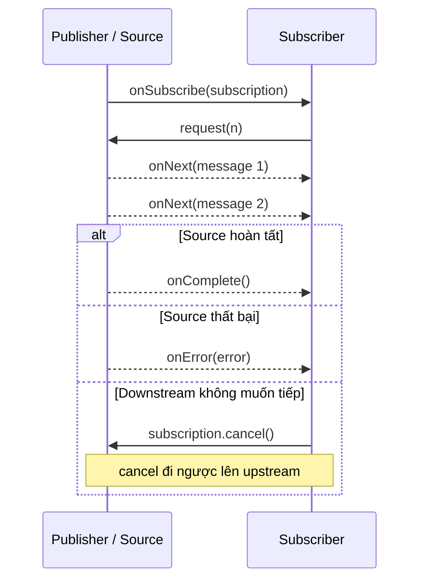
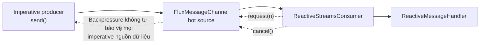
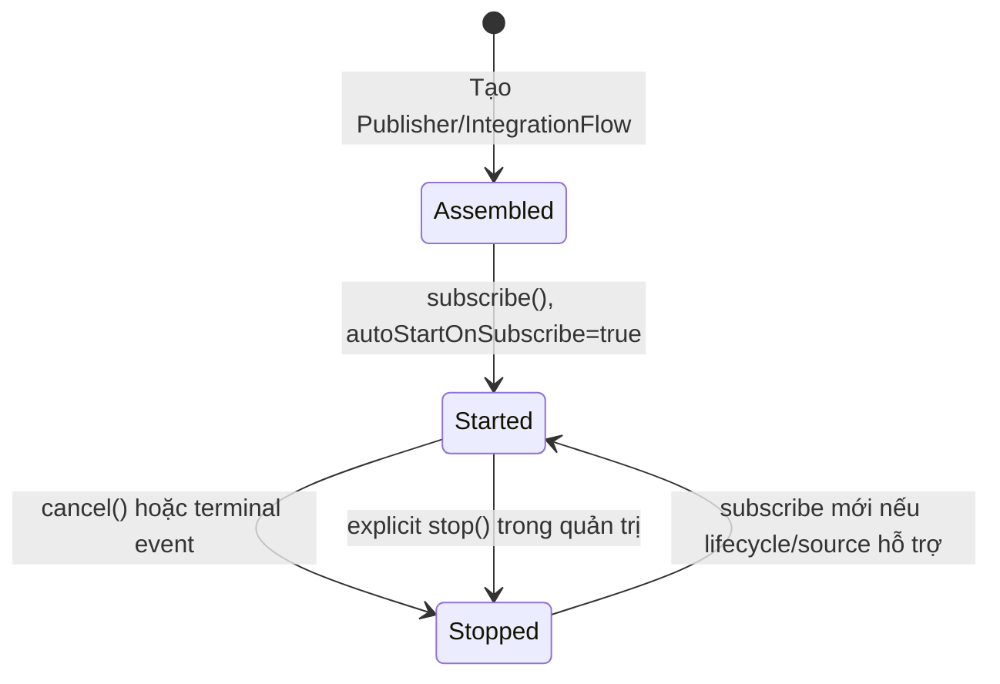
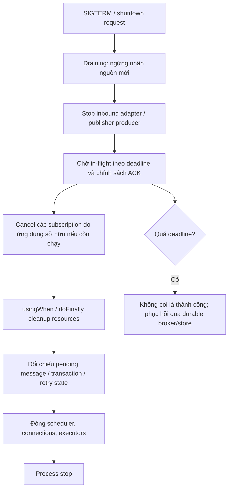

# Cancellation và cleanup subscription trong Spring Integration Reactive Runtime

## 1. Bài toán: subscription đã bị hủy nhưng công việc còn chạy?

Trong **Spring Integration Runtime**, message có thể được đẩy qua `DirectChannel`, xếp vào `QueueChannel` rồi được poller tiêu thụ, hoặc đi qua `FluxMessageChannel` để kết hợp với Project Reactor. Ở mô hình reactive, một consumer biểu đạt nhu cầu xử lý bằng **`Subscription`**; khi downstream không cần dữ liệu nữa, nó có thể gửi tín hiệu **`cancel()`** lên upstream.

Một yêu cầu HTTP bị client ngắt, gateway chờ quá lâu, ứng dụng stop một `IntegrationFlow`, hoặc subscriber chỉ lấy ba kết quả đầu có thể khiến subscription không còn được cần đến. Tuy nhiên, cancellation **không tự động đồng nghĩa** với việc:

- Mọi tác vụ async/blocking đã chạy thực sự dừng ngay.
- Transaction đã rollback, broker đã nack hay message đã được redeliver.
- File, socket, DB session, timer và callback do ứng dụng tự tạo đều được đóng đúng.
- Message ở `MessageStore` hoặc aggregator đã bị xóa.
- Lỗi cancellation được gửi thành `ErrorMessage` đến global `errorChannel`.

Bài **Cancellation và cleanup subscription** thuộc chương **Reactive runtime** của module `SPRING_INTEGRATION_RUNTIME`. Bài liên hệ trực tiếp tới việc điều phối channel, endpoint, consumer, poller, executor, vòng đời `IntegrationFlow`, transaction, retry, message store, lỗi, correlation, threading và hiệu năng.

**Mục tiêu học tập:**

1. Phân biệt `onComplete`, `onError` và `cancel` trong Reactive Streams.
2. Quản lý đúng đối tượng `Subscription` và `Disposable`, kể cả khi flow shutdown.
3. Dùng `doFinally`, `doOnCancel`, `doOnDiscard`, `Flux.using` và `usingWhen` để cleanup đúng phạm vi.
4. Hiểu cách `FluxMessageChannel`, `ReactiveStreamsConsumer` và `toReactivePublisher(true)` phối hợp với lifecycle.
5. Thiết kế cancellation-safe với tài nguyên async, message acknowledgment, transaction và retry.
6. Viết kiểm thử cancellation, phát hiện subscription leak và đánh giá tác động lên backpressure.

**Phiên bản tham chiếu:** Spring Integration **6.x** (đặc biệt reference 6.5), Reactor Core 3.x, Java 17+. Các đoạn code Reactor cần `reactor-core`; test cần `reactor-test`; flow Spring Integration cần `spring-integration-core` và các dependency Spring tương ứng. Không giả định các API/hành vi mới ở Spring Integration 7.x đã có trong 6.x.

## 2. Ba loại kết thúc của một Publisher

### 2.1. Reactive Streams protocol



Một Reactive Streams `Publisher` chỉ được phát `onNext` theo nhu cầu `request(n)` và kết thúc bằng tối đa một terminal signal `onComplete` hoặc `onError`. **`cancel()` là lời yêu cầu từ subscriber lên subscription**, không phải một terminal callback `onCancel()` gửi xuống consumer như `onComplete`.

| Tình huống | Ai khởi xướng? | Phía subscriber nhận | Hành động cleanup |
|---|---|---|---|
| Hoàn tất (`onComplete`) | Upstream | `onComplete` | `doFinally(ON_COMPLETE)`, cleanup resource |
| Thất bại (`onError`) | Upstream | `onError` | `doFinally(ON_ERROR)`, cleanup resource |
| Hủy (`cancel`) | Downstream | Thường **không** nhận terminal callback mới | `doOnCancel`, `doFinally(CANCEL)` và cleanup của resource |
| Timeout operator | Downstream operator | `onError(TimeoutException)` ở phía downstream nếu chưa recover | Upstream bị cancel, downstream đi vào error path |
| `take(n)` đủ n phần tử | Downstream operator | `onComplete` sau `take` | Upstream có thể thấy `CANCEL` |
| `Disposable.dispose()` của Reactor subscriber | Owner của subscription | Không đồng nghĩa `onComplete` | Thường chuyển thành `cancel` upstream |

**Hệ quả:** nếu chỉ ghi cleanup trong `doOnError` hoặc `doOnComplete`, bạn có thể bỏ sót nhánh cancel. Nếu chỉ ghi cleanup trong `doOnCancel`, bạn bỏ sót kết thúc bình thường và kết thúc bằng lỗi. Khi cần theo dõi cả ba, `doFinally` thường phù hợp hơn.

### 2.2. Cancellation là tín hiệu phối hợp, không phải ngắt cưỡng bức

`Subscription.cancel()` yêu cầu upstream ngừng sản xuất và giải phóng tài nguyên liên quan. Nhà cung cấp `Publisher` có thể đã phát tín hiệu hoặc đã khởi động tác vụ không thể hủy ngay; do race, các xử lý in-flight vẫn cần hoàn tất hoặc được xử lý an toàn.

Không thể dựa vào cancellation để đảm bảo side effect chưa xảy ra. Ví dụ:

```text
t0: gửi yêu cầu thanh toán tới remote API
t1: client HTTP hủy subscription (cancel)
t2: ngân hàng đã ghi nhận giao dịch
t3: response bị bỏ vì downstream không còn nhận
```

Tại `t3`, không có reply không đồng nghĩa giao dịch thất bại. Khi xử lý lại cần dùng **business idempotency key** và đối chiếu trạng thái thật, không replay mù.

## 3. Các lớp ownership: ai sở hữu subscription?

### 3.1. Subscription, Disposable, lifecycle và message

| Đối tượng | Thuộc ai | Trách nhiệm |
|---|---|---|
| `org.reactivestreams.Subscription` | Subscriber đang nhận publisher | `request(n)`, `cancel()` |
| `reactor.core.Disposable` trả về từ `Flux.subscribe(...)` | Code trực tiếp gọi `subscribe` | `dispose()` khi không muốn nhận nữa |
| `ReactiveStreamsConsumer` | Spring Integration endpoint | Điều phối consume reactive channel trong lifecycle |
| `MessageProducerSupport` reactive adapter | Spring Integration adapter | Quản lý subscription tới nguồn bên ngoài qua API adapter |
| `IntegrationFlow` / `SmartLifecycle` | ApplicationContext, IntegrationFlowContext | Start/stop endpoint và producer |
| `MessageStore` / consumer transaction | Runtime/store/adapter tương ứng | Persist/remove/commit/nack theo hợp đồng riêng |
| Custom `Sinks`, scheduler, file/connection | Thành phần tạo tài nguyên | Cleanup theo lifetime và chính sách của tài nguyên |

**Quy tắc ownership:** chỉ code **sở hữu** subscription mới nên tự lưu `Disposable` và `dispose()`. Nếu Spring Integration đã subscribe thay cho bạn, không tạo thêm một subscriber chỉ để “quản lý cleanup”: điều đó có thể tạo double processing, tranh tài nguyên hoặc sai semantics broadcast/consume.

### 3.2. Publisher được assembly chưa có nghĩa đã subscribe

```java
import reactor.core.publisher.Flux;

Flux<String> messages = Flux.just("A", "B", "C")
        .map(String::toLowerCase);

// Chưa có terminal subscription do dòng code trên tự tạo.
```

Reactive chain thường **lazy**. Tạo `Flux`/`Mono` chưa kích hoạt công việc; có subscriber hoặc một operator terminal mới bắt đầu. Trái lại, gọi `subscribe()` thủ công là một hành động **tạo subscription mới**, cần biết ai sẽ hủy nó.

```java
import reactor.core.Disposable;

Disposable subscription = messages.subscribe(
        value -> System.out.println("value=" + value),
        error -> System.err.println(error.getMessage()),
        () -> System.out.println("completed"));

subscription.dispose();
```

Với `Flux.just(...)`, publisher có thể hoàn tất đồng bộ trước khi dòng `dispose()` được chạy; lúc đó `dispose()` không biến lần hoàn tất thành một cancel thật. Để quan sát cancellation, dùng publisher **chưa tự hoàn tất**, như `Flux.interval` hoặc `Flux.never`.

### 3.3. Nhiều subscriber: không dispose subscription không thuộc quyền

Một `Publisher` có thể có nhiều subscriber. `Disposable` của subscriber A chỉ đại diện subscription A, không nên được dùng để giả định toàn bộ nguồn/broker đã dừng cho subscriber B. Với hot source, việc có thể subscribe nhiều lần và semantics phát message phụ thuộc implementation.

Đặc biệt, `FluxMessageChannel` có mô hình hot publisher; không dựa vào việc “subscriber vừa vào sẽ nhận lại toàn bộ lịch sử”. Nếu muốn replay, dùng persistent channel/broker/store với hợp đồng lưu giữ dữ liệu cụ thể.

## 4. Reactor cleanup hooks: dùng hook nào?

### 4.1. So sánh hook

| Hook/Operator | Khi chạy | Trường hợp sử dụng |
|---|---|---|
| `doOnSubscribe` | Có subscription mới | Log, khởi tạo timer, ghi nhận owner |
| `doOnRequest` | Downstream yêu cầu `n` phần tử | Đo demand, backpressure |
| `doOnCancel` | Downstream cancel subscription tại vị trí operator | Log cancel, kích hoạt thao tác hủy có chủ đích |
| `doOnComplete` | Upstream hoàn tất bình thường | Audit success, **không** phủ error/cancel |
| `doOnError` | Upstream phát lỗi | Error telemetry, **không** phủ cancel |
| `doOnTerminate` | Complete hoặc error | Cleanup khi có terminal signal, **không** phủ cancel |
| `doFinally` | Complete, error hoặc cancel | Cleanup/metrics tổng quát |
| `doOnDiscard` | Operator hỗ trợ discard phần tử không giao downstream | Release resource của element bị drop/prefetch |
| `Flux.using` | Cấp resource trên subscription, close đồng bộ theo lifecycle | File cursor, scope tài nguyên synchronous |
| `Flux.usingWhen` / `Mono.usingWhen` | Resource có **cleanup bất đồng bộ** theo complete/error/cancel | Async DB session, remote connection/release |

`doFinally` nhận `SignalType.ON_COMPLETE`, `SignalType.ON_ERROR` hoặc `SignalType.CANCEL`. Callback chạy **sau khi tín hiệu terminal/cancel tương ứng đã được truyền qua vị trí operator**; khi có nhiều `doFinally` liên tiếp, thứ tự thực thi có thể ngược thứ tự khai báo. Vì vậy một assertion về cleanup cần tính tới thời điểm callback chạy.

### 4.2. Ví dụ 1: quan sát cancel do take(n)

```java
import java.util.concurrent.atomic.AtomicReference;
import reactor.core.publisher.Flux;
import reactor.core.publisher.SignalType;

public class CancellationSignalsDemo {

    public static void main(String[] args) {
        AtomicReference<SignalType> upstreamSignal =
                new AtomicReference<>();
        AtomicReference<SignalType> downstreamSignal =
                new AtomicReference<>();

        Flux.range(1, 100)
                .doOnCancel(() ->
                        System.out.println("upstream cancel received"))
                .doFinally(upstreamSignal::set)
                .take(3)
                .doFinally(downstreamSignal::set)
                .blockLast();

        // Sau khi các hooks hoàn tất:
        // upstreamSignal == SignalType.CANCEL
        // downstreamSignal == SignalType.ON_COMPLETE
        System.out.println("upstream=" + upstreamSignal.get());
        System.out.println("downstream=" + downstreamSignal.get());
    }
}
```

Tại sao cùng một pipeline có thể thấy hai signal khác nhau? `take(3)` đã nhận đủ ba phần, nên nó **cancel upstream** để ngừng sản xuất thêm, đồng thời **complete downstream** cho consumer. Kết luận “flow bị cancel” phải kèm **vị trí quan sát** trong chuỗi operator.

Với `doFinally` chạy sau khi terminal được truyền xuống, một chương trình đòi hỏi chắc chắn callback hoàn tất trước khi kiểm tra nên dùng `CountDownLatch`/`StepVerifier` thay vì chỉ kiểm tra ngay sau `blockLast()` trong mọi trường hợp scheduler.

### 4.3. Ví dụ 2: metrics không mất nhánh cancel

```java
import java.util.concurrent.atomic.LongAdder;
import reactor.core.publisher.Flux;
import reactor.core.publisher.SignalType;

LongAdder completed = new LongAdder();
LongAdder failed = new LongAdder();
LongAdder cancelled = new LongAdder();

Flux<String> flow = upstreamFlux
        .doFinally(signal -> {
            if (signal == SignalType.ON_COMPLETE) {
                completed.increment();
            }
            else if (signal == SignalType.ON_ERROR) {
                failed.increment();
            }
            else if (signal == SignalType.CANCEL) {
                cancelled.increment();
            }
        });
```

`upstreamFlux` ở đoạn trên là một nguồn `Flux<String>` do ứng dụng cung cấp. Đây là mẫu instrumentation; không tự tạo subscription, do đó metrics tăng **khi subscriber thực sự chạy**.

Một luồng có nhiều subscription có thể increment nhiều lần, mỗi lần cho một subscription. Nếu muốn đếm **số business messages** thay vì số lần kết thúc subscription, cần thêm metrics riêng theo message ID/correlation ID.

### 4.4. doOnDiscard xử lý phần tử chưa phát downstream

Một số operator (filter, buffer/prefetch, cancellation khi còn phần tử đã lấy) có thể bỏ message khỏi luồng trước khi consumer nhận. Nếu payload giữ resource có cơ chế reference counting (như pooled buffer), resource bị bỏ phải được release đúng hợp đồng.

```java
Flux<AutoCloseable> stream = upstreamResources
        .filter(resource -> shouldKeep(resource))
        .doOnDiscard(AutoCloseable.class, resource -> {
            try {
                resource.close();
            }
            catch (Exception e) {
                recordCleanupFailure(e);
            }
        });
```

**Lưu ý:** `doOnDiscard` là hook chỉ được hỗ trợ bởi **những operator có “Discard Support”**; không phải interceptor chung cho mọi item đã xử lý. Cleanup phải **idempotent** và an toàn khi cùng một resource có thể bị tác động bởi nhiều đường discard. Không đóng resource mà consumer downstream đang sở hữu; quy định ownership rõ ràng trước.

`doOnDiscard` có mục tiêu khác `doFinally`: một cái cleanup **element bị bỏ**, một cái cleanup **subscription lifecycle**.

## 5. Cleanup tài nguyên theo từng subscription

### 5.1. Vì sao finally quanh đoạn tạo Flux không đủ?

Mẫu sau sai về mặt lifetime:

```java
Flux<String> readLines() throws Exception {
    ResourceHandle handle = openHandle();
    try {
        return handle.readAsFlux();
    }
    finally {
        handle.close(); // Đóng ngay lúc trả Flux, trước lúc subscribe!
    }
}
```

Vì quá trình đọc thường chỉ bắt đầu khi subscriber đến, `finally` của method tạo publisher chạy quá sớm. Cần **cấp phát và cleanup resource trong lifetime của subscription**, không phải trong lifetime của thao tác tạo object Flux.

### 5.2. Flux.using cho cleanup đồng bộ

```java
import java.util.Scanner;
import reactor.core.publisher.Flux;

Flux<String> words = Flux.using(
        () -> new Scanner("alpha beta gamma"),
        scanner -> Flux.generate(sink -> {
            if (scanner.hasNext()) {
                sink.next(scanner.next());
            }
            else {
                sink.complete();
            }
        }),
        Scanner::close
);
```

`Flux.using` cấp tài nguyên **mỗi lần subscribe**, cho subscriber xử lý data rồi gọi cleanup khi complete, error hoặc cancel. `Scanner.close()` là thao tác đồng bộ. Nếu tạo nhiều subscriptions, mỗi subscription cần instance resource riêng (ví dụ `new Scanner(...)` trong supplier).

Với file/socket thật, chọn API đọc dữ liệu phù hợp scheduler và backpressure; `Scanner` đọc chặn thread, không biến I/O thành non-blocking chỉ bằng cách bọc trong `Flux`.

### 5.3. usingWhen cho cleanup bất đồng bộ

Tài nguyên có thể cần hoàn trả thông qua một Publisher, ví dụ đóng async DB session, flush/rollback một transaction hoặc hủy stream remote. `usingWhen` phân biệt ba nhánh:

```java
import java.time.Duration;
import reactor.core.publisher.Flux;
import reactor.core.publisher.Mono;

record DemoSession(String id) {
    Flux<String> events() {
        return Flux.interval(Duration.ofMillis(100))
                .map(n -> id + ":event-" + n);
    }

    Mono<Void> close(String reason) {
        return Mono.fromRunnable(
                () -> System.out.println(id + ": close on " + reason));
    }
}

Flux<String> stream = Flux.usingWhen(
        Mono.fromSupplier(() -> new DemoSession("S-1")),
        DemoSession::events,
        session -> session.close("complete"),
        (session, error) -> session.close("error:" + error.getClass().getName()),
        session -> session.close("cancel")
);
```

Trong đoạn này `events()` là nguồn chạy lâu. Khi subscriber gọi cancel, `usingWhen` thực hiện **asyncCancel cleanup publisher**; khi complete/error, thực hiện nhánh cleanup tương ứng. Trong ví dụ `close` chỉ in log để minh họa; với resource thật cần thao tác close/rollback thực sự.

**Phân biệt hai mức bảo đảm:**

- `doFinally` phù hợp ghi metrics hoặc cleanup đồng bộ, nhưng không **chờ** một thao tác close async chỉ vì callback tự gọi `subscribe()`.
- `usingWhen` gắn async cleanup vào lifecycle. Với complete/error, terminal signal có thể được trì hoãn tới lúc cleanup kết thúc; với cancel, không có normal terminal signal để downstream chờ, nên owner cần monitoring và deadline khi cleanup kéo dài hoặc thất bại.

Không làm:

```java
.doFinally(signal ->
        remoteClient.closeAsync().subscribe()) // fire-and-forget cleanup
```

Cách này tạo một subscription mới cho cleanup mà không có owner/giám sát lỗi rõ ràng. Ưu tiên `usingWhen`/resource abstraction có thể quan sát.

## 6. Cancellation, backpressure và threading

### 6.1. Cancel và request(n) có hai nhiệm vụ khác nhau

- **`request(n)`:** downstream đang sẵn sàng nhận thêm bao nhiêu phần tử.
- **`cancel()`:** downstream không cần nhận thêm phần tử nữa.
- **Backpressure:** producer/on-demand operator tôn trọng demand để không phát nhanh hơn khả năng subscriber nhận.

Cancellation không phải công cụ thay thế backpressure. Ví dụ ứng dụng dùng `FluxMessageChannel` nhưng producer imperative liên tục gọi `send()` với tốc độ quá cao; không thể kết luận toàn bộ upstream đã tự điều tiết chỉ vì downstream là Reactor.



Nếu có các thành phần blocking hoặc side effect async được subscribe riêng, luồng có thể không còn hoàn toàn reactive dù có dùng `FluxMessageChannel`. Cần kiểm tra cụ thể mỗi ranh giới.

### 6.2. Reactor scheduler không tự hủy blocking work

`subscribeOn` và `publishOn` chỉ thay cách scheduling. `boundedElastic` thích hợp bao các thao tác blocking có giới hạn; nhưng:

- `Disposable.dispose()` không bảo đảm ngắt một JDBC call đang block hoặc một HTTP client không hỗ trợ cancellation.
- Một `Mono.fromCallable` dùng scheduler có thể đã bắt đầu chạy khi cancel đến; interruption có hỗ trợ đến đâu tùy scheduler, thư viện và tài nguyên.
- Nếu blocking call tiếp tục có side effect dù subscriber đã cancel, cần xác định reply/callback và idempotency.

Ví dụ tách phần blocking:

```java
import reactor.core.publisher.Mono;
import reactor.core.scheduler.Schedulers;

Mono<String> result = Mono.fromCallable(
            () -> blockingPartnerClient.lookup("ORD-42"))
        .subscribeOn(Schedulers.boundedElastic())
        .doFinally(signal -> recordSignal(signal));
```

`blockingPartnerClient` và `recordSignal` là hàm ứng dụng trong ví dụ. Đặt I/O blocking trên `boundedElastic` tránh khóa event-loop, nhưng **không chuyển thư viện blocking thành cancellable I/O**.

### 6.3. flatMap concurrency và buffer prefetched

Với pipeline `flatMap` cho phép nhiều inner publishers chạy đồng thời, một cancel của downstream sẽ yêu cầu hủy những inner subscriptions còn hoạt động, nhưng không hoàn tác side effect đã được khởi động.

```java
Flux<String> replies = sourceMessages
        .flatMap(message -> sendAsync(message)
                        .doFinally(signal -> observeItem(message, signal)),
                8); // Giới hạn tối đa 8 inner publishers đang active
```

`sourceMessages` và `sendAsync` là nguồn/hàm của ứng dụng. `flatMap` có thể prefetch theo cấu hình. Nếu người dùng hủy stream giữa chừng, cần biết các item đã được nhận vào buffer hoặc đã bắt đầu xử lý hay chưa.

Nếu yêu cầu xử lý tuần tự, `concatMap` có thể phù hợp hơn, nhưng không tự bảo đảm exactly-once, durability hay cleanup các tác vụ ngoài Reactor. Nếu có side effect không thể hủy, dùng idempotency và trạng thái công việc độc lập với subscription.

## 7. FluxMessageChannel và ReactiveStreamsConsumer

### 7.1. Vai trò của FluxMessageChannel

`FluxMessageChannel` là một `MessageChannel` đồng thời là `Publisher<Message<?>>`. Nó tạo hot `Flux` nội bộ để đưa message gửi tới channel sang các reactive subscribers, và triển khai `ReactiveStreamsSubscribableChannel` để nhận các upstream publishers theo nhu cầu.

**Khác biệt với channel thông thường:**

| Channel/endpoint | Mô hình tiêu thụ | Quan hệ với cancellation |
|---|---|---|
| `DirectChannel` | Handler được gọi đồng bộ trên thread gửi | Exception truyền theo call stack, không có reactive subscription mặc định |
| `ExecutorChannel` | Handler được gọi trên worker | Producer có thể đã send xong dù worker vẫn chạy |
| `QueueChannel` | Poller gọi `receive()` | Message có thể nằm trong queue; stop poller không đồng nghĩa mất message |
| `FluxMessageChannel` | `Subscriber` theo Reactive Streams contract | `Subscription.cancel()` là cơ chế ngừng demand/nguồn theo reactive flow |
| `ReactiveStreamsConsumer` | Endpoint subscribe reactive source và compose handler | Quản lý subscription theo lifecycle endpoint |

`FluxMessageChannel` **không phải** `PollableChannel`, cũng không phải `SubscribableChannel` imperative dùng `MessageHandler` đăng ký trực tiếp theo cơ chế thông thường. Spring Integration sử dụng `ReactiveStreamsConsumer` để kết nối kiểu handler với reactive channel.

### 7.2. Phạm vi backpressure của ReactiveMessageHandler

Khi handler là `ReactiveMessageHandler` và flow tiêu thụ qua `ReactiveStreamsConsumer`, Spring Integration có thể compose thao tác vào stream qua `flatMap()`, giúp demand và cancellation có cơ hội lan tới reactive client.

Nếu một `ReactiveMessageHandler` được sử dụng ở flow imperative, framework có thể bọc bằng `ReactiveMessageHandlerAdapter` và **subscribe ngay** vào kết quả asynchronous. Đường này không có cùng semantics backpressure của một chuỗi reactive được compose xuyên suốt.

**Không giả định một method trả `Mono` là đủ để cả Spring Integration flow trở thành end-to-end reactive**. Kiểm tra loại channel trước/sau handler và ai là subscriber cuối.

### 7.3. Event-driven adapter và subscribeToPublisher()

`MessageProducerSupport` cung cấp `subscribeToPublisher(Publisher<? extends Message<?>>)` cho adapter nguồn dữ liệu reactive. Tài liệu Spring Integration mô tả:

- Khi output channel phù hợp reactive, subscriber downstream có thể kích hoạt việc tiêu thụ upstream theo nhu cầu.
- **Hủy subscription tới nguồn Publisher** có thể khiến adapter chuyển sang trạng thái stopped.
- Gọi `stop()` trên adapter có thể hoàn thành việc sản xuất message từ source publisher.
- Adapter được start lại có thể tạo subscription mới tới một publisher nguồn mới.

Không được hiểu nhầm rằng mọi adapter JDBC/HTTP/Kafka tự có cùng semantics này. Đây là mô tả của cơ chế `MessageProducerSupport` reactive; implementation protocol cụ thể có trách nhiệm dừng nguồn và giải phóng resources của nó.

## 8. Lifecycle: toReactivePublisher(true) và stop khi cancel

### 8.1. autoStartOnSubscribe

Trong Java DSL, `IntegrationFlowBuilder.toReactivePublisher(boolean autoStartOnSubscribe)` (có từ Spring Integration 5.5.6) có thể biểu diễn flow như `Publisher<Message<T>>`.

Khi `autoStartOnSubscribe=true`:

1. Flow và các components được đánh dấu không auto-start khi ApplicationContext khởi tạo.
2. Khi có subscription, framework start `IntegrationFlow` từ operator `doOnSubscribe` nội bộ.
3. Khi publisher **cancel** hoặc **terminate**, framework stop flow bằng `doOnCancel` / `doOnTerminate`.



**Quan trọng:** đây là behavior được tài liệu mô tả cho **`toReactivePublisher(...)`**, không có nghĩa **mọi** reactive `IntegrationFlow` sẽ tự start/stop khi bạn hủy bất kỳ một subscription nào do ứng dụng tự tạo.

### 8.2. Ví dụ Java DSL trả Publisher

```java
import org.reactivestreams.Publisher;
import org.springframework.context.annotation.Bean;
import org.springframework.context.annotation.Configuration;
import org.springframework.integration.dsl.IntegrationFlow;
import org.springframework.messaging.Message;
import org.springframework.messaging.support.MessageBuilder;
import reactor.core.publisher.Flux;

@Configuration
class ReactivePublisherConfig {

    @Bean
    Publisher<Message<String>> orderPublisher() {
        Publisher<Message<String>> source = Flux.range(1, 100)
                .map(i -> MessageBuilder
                        .withPayload("ORD-" + i)
                        .build());

        return IntegrationFlow.from(source)
                .<String>toReactivePublisher(true);
    }
}
```

Subscriber có thể consume publisher khi sẵn sàng:

```java
import org.reactivestreams.Publisher;
import org.springframework.messaging.Message;
import reactor.core.Disposable;
import reactor.core.publisher.Flux;

Publisher<Message<String>> publisher = context.getBean(
        "orderPublisher", Publisher.class);

Disposable subscription = Flux.from(publisher)
        .take(5)
        .subscribe(
                message -> System.out.println(message.getPayload()),
                error -> System.err.println("Flow error: " + error),
                () -> System.out.println("Consumed five messages"));

// take(5) có thể đã cancel upstream và hoàn tất ở downstream;
// dispose() chỉ cần nếu subscription còn hoạt động.
subscription.dispose();
```

Đoạn thứ hai minh họa API subscriber với `context` là một `ApplicationContext` đã khởi tạo. Tùy publisher nguồn phát nhanh, `subscribe()` có thể hoàn tất trước khi gán `Disposable`. Nếu đưa vào ứng dụng thật, đảm bảo cơ chế lifecycle có một **owner** rõ ràng, không tạo nhiều subscriber không chủ đích trên cùng một flow/hot source.

**Cần xác minh tại runtime:** subscription bị hủy có nghĩa framework stop flow của publisher theo hợp đồng, nhưng task đã thoát khỏi reactive chain (ví dụ tự gọi `subscribe()` riêng) vẫn có thể chạy. Việc stop flow không thể thay nhiệm vụ cleanup các task/tài nguyên bên ngoài đó.

### 8.3. Kết thúc flow và message còn lưu ở store

Khi flow stop:

- Producer nguồn có thể ngừng tạo message.
- Subscription reactive có thể bị cancel/dispose.
- Message trong `QueueChannel`/`MessageStore` có thể vẫn tồn tại nếu không bị xóa theo logic của endpoint/store.
- Aggregator có thể có group chưa release; cancellation không tự expire tất cả groups.
- External broker có thể giữ record chưa ACK và redeliver theo protocol.
- Caller của gateway có thể timeout mà backend vẫn đang xử lý một side effect.

Muốn **graceful drain**, cần chính sách stop ở mức endpoint/adapter, đợi in-flight operations, giải quyết pending messages và hoàn tất ACK/recovery. Không thay thế bằng việc chỉ gọi `Disposable.dispose()` rồi coi mọi tài nguyên đã giải phóng.

## 9. Ví dụ quản lý Disposable trong SmartLifecycle

### 9.1. Khi ứng dụng tự subscribe thì ứng dụng phải tự dispose

Có những trường hợp bạn **cố ý** tạo subscriber thủ công, ví dụ thành phần quản trị tiêu thụ `Publisher` do một hệ thống nội bộ cung cấp. Khi đó nên giữ `Disposable` ở một owner có lifecycle cụ thể, không gọi `subscribe()` rải rác trong handler mỗi khi nhận message.

Dưới đây là mẫu consumer **thủ công**, dùng riêng một `FluxMessageChannel` và không đồng thời đăng ký thêm `@ServiceActivator`/`ReactiveStreamsConsumer` vào chính channel đó. Ví dụ minh họa ownership/lifecycle, chưa phải cơ chế guaranteed graceful drain cho một backend thực.

```java
import org.springframework.context.SmartLifecycle;
import org.springframework.messaging.Message;
import reactor.core.Disposable;
import reactor.core.publisher.Flux;
import reactor.core.publisher.Mono;
import reactor.core.scheduler.Schedulers;

public final class ManagedReactiveConsumer implements SmartLifecycle {

    private final Flux<Message<?>> source;
    private volatile boolean running;
    private Disposable subscription;

    public ManagedReactiveConsumer(Flux<Message<?>> source) {
        this.source = source;
    }

    @Override
    public synchronized void start() {
        if (running) {
            return;
        }

        running = true;
        subscription = source
                .concatMap(message ->
                        Mono.fromRunnable(() -> process(message))
                                .subscribeOn(Schedulers.boundedElastic())
                                .then())
                .doFinally(signal ->
                        System.out.println("subscription ended: " + signal))
                .subscribe(
                        ignored -> { },
                        error -> System.err.println("consumer error: " + error));
    }

    @Override
    public synchronized void stop() {
        running = false;
        Disposable current = subscription;
        subscription = null;
        if (current != null) {
            current.dispose();
        }
    }

    @Override
    public boolean isRunning() {
        return running;
    }

    private void process(Message<?> message) {
        System.out.println("Processing " + message.getPayload());
        // Trong hệ thống thật: lưu trạng thái và xử lý side effect idempotent.
    }
}
```

Bean wiring cho channel và owner:

```java
import org.springframework.beans.factory.annotation.Qualifier;
import org.springframework.context.annotation.Bean;
import org.springframework.context.annotation.Configuration;
import org.springframework.integration.channel.FluxMessageChannel;
import reactor.core.publisher.Flux;

@Configuration
class ManualReactiveConsumerConfig {

    @Bean("orders.reactive")
    FluxMessageChannel ordersReactive() {
        return new FluxMessageChannel();
    }

    @Bean
    ManagedReactiveConsumer managedConsumer(
            @Qualifier("orders.reactive") FluxMessageChannel channel) {

        return new ManagedReactiveConsumer(Flux.from(channel));
    }
}
```

**Phân tích lifecycle:**

1. `start()` tạo một subscription và giữ `Disposable`.
2. `stop()` gọi `dispose()` nếu subscription còn tồn tại.
3. `concatMap()` giới hạn luồng xử lý tuần tự theo từng subscriber.
4. `boundedElastic` tránh chạy đoạn `process()` blocking trên event loop, nhưng không hứa hủy được side effect đang chạy.
5. `doFinally` ghi nhận lý do kết thúc subscription.

**Giới hạn có chủ đích của ví dụ:** `stop()` chỉ yêu cầu cancel, **không đợi mọi cleanup bất đồng bộ hoàn thành**; `process()` có thể đang thực thi. Nếu source hoàn tất/lỗi tự nhiên mà không đi qua `stop()`, trạng thái `running` cần được cập nhật theo chính sách restart của production component. Trong ứng dụng production phải thêm in-flight tracking, deadline, error path và chính sách tự khởi động lại khi phù hợp.

Vì Spring Integration đã có `ReactiveStreamsConsumer` và lifecycle endpoint, **ưu tiên cơ chế do framework quản lý** nếu flow chỉ cần kết nối channel với handler bình thường. Đừng tái tạo consumer thủ công nếu không có lý do cụ thể.

### 9.2. Vì sao không subscribe trong từng onNext?

Phản mẫu:

```java
// SAI: mỗi message tạo thêm inner subscription, không có owner rõ.
source.subscribe(message ->
        remoteCall(message).subscribe());
```

Đây là nested subscribe:

- Subscription ngoài có thể cancel mà inner subscription vẫn tiếp tục.
- Error của `remoteCall` không tự lan vào error handling của outer pipeline.
- Backpressure/concurrency của outer pipeline không kiểm soát inner tasks.
- Khi shutdown khó biết bao nhiêu remote calls còn in-flight.

Nên compose:

```java
Disposable subscription = source
        .flatMap(message -> remoteCall(message), 8)
        .doFinally(this::recordTermination)
        .subscribe(
                result -> handleResult(result),
                error -> handleError(error));
```

`source`, `remoteCall` và các method khác là thành phần ứng dụng. `flatMap` giúp những inner publishers thuộc **cùng subscription graph**, để cancel/error propagation và concurrency limit được tổ chức nhất quán hơn.

Dù vậy, cancellation không hoàn tác remote call đã commit ở hệ thống ngoài.

## 10. Cancellation, acknowledgment và transaction

### 10.1. Đã consume message chưa đồng nghĩa đã ACK nguồn

Tình huống có nguồn Kafka, RabbitMQ, JMS hoặc một `MessageSource` khác:

```text
Broker -> Reactive adapter -> FluxMessageChannel -> handler
                                             |
                                             +-- cancel xảy ra giữa chừng
```

Cần hỏi riêng cho từng transport:

- Record được ACK lúc **được đọc khỏi nguồn**, lúc **handler hoàn tất**, hay do consumer gọi ACK thủ công?
- Khi subscription cancel, adapter có thực hiện reject/nack không?
- Có trạng thái transaction/pending ACK nào được lưu trong broker hay local memory?
- Có message đã được lấy nhưng vẫn đang xử lý trong inner publisher không?
- Nếu restart hoặc rebalance, record được giao lại và có idempotency không?

**Không có quy tắc chung rằng cancel luôn là nack hoặc rollback.** Đó là hợp đồng của adapter/protocol, không phải hợp đồng của `org.reactivestreams.Subscription`.

### 10.2. ReactiveMessageSourceProducer có logic ACK riêng

Spring Integration có `ReactiveMessageSourceProducer` từ 5.3. Nó dùng một `MessageSource` để tạo stream và tiêu thụ theo nhu cầu, với việc đọc message được đưa lên `Schedulers.boundedElastic()` nếu message source có khả năng blocking.

Tài liệu Spring Integration mô tả xử lý acknowledgment dựa trên `IntegrationMessageHeaderAccessor.ACKNOWLEDGMENT_CALLBACK` trong header: callback có thể được ACK sau đường xử lý thành công, hoặc reject trong đường lỗi phù hợp có `MessagingException`/failed message.

Nhưng **đừng suy rộng** từ đó rằng cancel bất kỳ chỗ nào trong reactive chain sẽ tự reject đúng message. Hãy kiểm tra cụ thể implementation, thời điểm ACK, ranh giới subscription và semantics của nguồn. Nên có integration test **cancel trước/sau xử lý** trên chính adapter đang dùng.

### 10.3. Transaction reactive và cancellation

Với Spring reactive transactions, một `TransactionalOperator` có thể quản lý transaction theo Reactor context và lifecycle publisher. Cancellation có thể kích hoạt cleanup/rollback tùy contract/phiên bản và vị trí operator, nhưng:

- Một HTTP request đã gửi ra bên ngoài DB transaction vẫn có thể hoàn thành.
- Transaction context reactive không tự đi qua một đoạn handler imperative chạy trên thread khác theo cách ThreadLocal thông thường.
- Message trong `MessageStore` ngoài transaction manager có thể vẫn tồn tại.
- Gateway timeout/cancel không đảm bảo rollback cho một tác vụ đã tách khỏi subscription graph.

Ví dụ ý tưởng:

```java
Mono<OrderResult> work = transactionalOperator.transactional(
        repository.updateOrder(orderId)
                .then(repository.fetchOrderResult(orderId))
);
```

`transactionalOperator` và `repository` là các bean ứng dụng đang sử dụng reactive transaction manager tương thích. Hãy kiểm tra thử trường hợp downstream cancel khi query đang chạy, rồi đối chiếu trạng thái DB thật; không suy ra kết quả chỉ từ `SignalType.CANCEL`.

### 10.4. Retry và cancellation

`retry()` hoặc `retryWhen()` hoạt động khi nguồn phát **`onError`**, không phải mỗi khi downstream cancel. Nếu application chủ động cancel sau timeout HTTP, việc tự động retry hay không phụ thuộc cách operator `timeout`, `onErrorResume`, `retryWhen` được sắp xếp.

Ví dụ:

```java
Mono<String> response = callPartner()
        .timeout(Duration.ofSeconds(2))
        .retryWhen(Retry.backoff(2, Duration.ofMillis(200)));
```

Với pipeline này, `timeout` có thể **cancel upstream attempt** rồi phát `TimeoutException` downstream; `retryWhen` có thể subscribe lại một attempt mới. Nếu remote request cũ vẫn hoàn thành và tạo side effect, bạn có nguy cơ duplicate work. Có thể cần policy chỉ retry lỗi an toàn, kiểm tra trạng thái bên ngoài, deadline tổng và idempotency key.

`callPartner()` là publisher được tạo cho từng subscription theo hợp đồng của client. Nếu là một hot publisher chia sẻ, resubscription có thể không mang nghĩa “thực hiện lại remote call”; luôn xác minh tính cold/hot.

## 11. Error channel khác cancellation signal

### 11.1. Vì sao cancel không tự tạo ErrorMessage?

Trong Reactive Streams, `onError` là một terminal signal mang `Throwable`; `cancel()` là yêu cầu của downstream chấm dứt subscription. Nó **không nhất thiết mang lỗi**. Vì thế không thể mặc định mỗi lần cancel Spring Integration sẽ tạo `ErrorMessage` và publish vào `errorChannel`.

| Sự kiện | Tín hiệu Reactor thường thấy | Hướng xử lý |
|---|---|---|
| Handler reactive thất bại | `onError` | Error path, retry/recovery theo cấu hình |
| Caller hủy subscription | `cancel` | `doOnCancel`, `doFinally(CANCEL)`, resource cleanup |
| `take(3)` lấy đủ phần | Cancel upstream, complete downstream | Kết thúc bình thường cho caller |
| `timeout` hết thời gian | Upstream cancel, downstream error | Bắt timeout, recovery/alert có chủ đích |
| Error đến sau khi đã cancel | Có thể bị coi là dropped signal | Truy tìm nguồn và cleanup/metrics |
| `onErrorResume` trả fallback | Downstream thấy complete/success fallback | Đừng nhầm fallback với xử lý thành công nghiệp vụ |

Nếu cần audit cancellation (ai hủy, khi nào, business request ID nào), **ghi event/metric riêng** tại nơi có đủ context. Không dùng `doOnError` làm nơi duy nhất theo dõi cancel, cũng không ép tạo business exception chỉ để có `ErrorMessage` nếu đó là một nhánh kết thúc được dự kiến.

### 11.2. Dropped errors, doOnDiscard và dữ liệu nhạy cảm

Sau cancel có thể xuất hiện:

- I/O callback đến muộn và báo lỗi.
- Pooled buffer bị prefetch nhưng chưa được downstream nhận.
- Một inner publisher hoàn thành sau khi subscription cha đã dừng.
- Một manual nested `subscribe()` vẫn chạy và tạo sự kiện nằm ngoài trace gốc.

Reactor có các hook cho **dropped onNext/onError** và `doOnDiscard` tại các operator hỗ trợ. Khi production debug, tránh cấu hình global hooks tùy tiện vì nó tác động toàn ứng dụng và khó quy định ownership. Ưu tiên instrumentation theo chuỗi và kiểm tra resource implementation.

Không log toàn bộ `Message<?>` khi lỗi xảy ra: headers có thể chứa auth token, temporary reply channel, trace metadata; payload có thể chứa dữ liệu nhạy cảm.

## 12. Shutdown và cleanup không làm mất message

### 12.1. Trình tự shutdown đề xuất



Cách triển khai thực tế phụ thuộc adapter và SLA. Một số ứng dụng phải cancel sớm để dừng stream dài vô hạn; một số phải đợi xử lý hết tác vụ đã nhận. Điểm chung là:

1. Ngừng tạo **công việc mới** trước khi xử lý cleanup của công việc đang có.
2. Biết **subscription owner** và tập tài nguyên cần đóng.
3. Đặt **deadline hữu hạn** cho các tác vụ in-flight và async cleanup.
4. Không đóng connection pool/lock backend khi callback cleanup còn phải dùng chúng.
5. Xác minh broker ACK/requeue và `MessageStore` state thay vì giả định mọi message đã được xử lý.
6. Sau crash hoặc `SIGKILL`, không kỳ vọng Java `doFinally` hay `@PreDestroy` chạy.

### 12.2. dispose không có nghĩa đã drain

`Disposable.dispose()` là hành động gửi yêu cầu hủy; nó **không phải** API chờ tất cả in-flight tasks, socket close, DB rollback, message ACK và persisted cleanup hoàn tất.

Nếu ứng dụng cần chứng nhận “đã drain”, phải có cơ chế phối hợp khác: in-flight counter, completion Publishers, bounded wait, readiness flag, stop callback, metrics và recovery for timeout. `SmartLifecycle.stop(Runnable)` không nên báo đã dừng trước những điều kiện mà component thực sự cam kết hoàn tất.

Không dùng `Thread.sleep(1000)` cố định làm điều kiện an toàn. Với workload tải cao, các cleanup Publishers cần được quan sát hoặc theo dõi deadline; khi vượt giới hạn, ghi nhận message ID để có thể reconcile/replay.

### 12.3. Cancellation và MessageStore

`MessageStore` của Spring Integration là hệ thống lưu trữ/correlation riêng:

- `SimpleMessageStore` chỉ nằm trong heap; shutdown mất dữ liệu chưa xử lý.
- Persistent message store có thể giữ message/group sau restart theo transaction semantics.
- Aggregator vẫn có thể giữ nhóm đang chờ release; cancel một downstream subscriber không nhất thiết dọn nhóm.
- Channel có thể còn backlog, và sau restart cần consumer hợp lệ để rút backlog.

**Đừng giải phóng hoặc xóa toàn bộ message group trong `doFinally` chỉ vì subscriber cancel.** Một group có thể thuộc nhiều message và nhiều callers; xóa nó có thể gây mất dữ liệu nghiệp vụ. Group expiry cần do `MessageGroupStore`/aggregator policy quản lý.

## 13. Kiểm thử cancellation với StepVerifier

### 13.1. Kiểm tra doFinally(CANCEL)

`reactor-test` cung cấp `StepVerifier`, cho phép tạo subscription, yêu cầu phần tử, hủy và xác minh expected signals. Ví dụ độc lập, chạy trên Java 17:

```java
import java.time.Duration;
import java.util.concurrent.CountDownLatch;
import java.util.concurrent.TimeUnit;
import java.util.concurrent.atomic.AtomicReference;

import reactor.core.publisher.Flux;
import reactor.core.publisher.SignalType;
import reactor.test.StepVerifier;

public class CancellationCleanupTest {

    public static void main(String[] args) throws Exception {
        AtomicReference<SignalType> lastSignal =
                new AtomicReference<>();
        CountDownLatch cleanupObserved = new CountDownLatch(1);

        Flux<Long> events = Flux.interval(Duration.ofMillis(20))
                .doFinally(signal -> {
                    lastSignal.set(signal);
                    cleanupObserved.countDown();
                });

        StepVerifier.create(events)
                .expectNext(0L, 1L)
                .thenCancel()
                .verify(Duration.ofSeconds(3));

        if (!cleanupObserved.await(2, TimeUnit.SECONDS)) {
            throw new AssertionError("Cleanup callback did not run");
        }

        if (lastSignal.get() != SignalType.CANCEL) {
            throw new AssertionError(
                    "Expected CANCEL, got " + lastSignal.get());
        }

        System.out.println("PASS: cancellation triggered cleanup");
    }
}
```

Lý do dùng `CountDownLatch`: `doFinally` có thể chạy sau khi cancellation signal được phát qua operator, đặc biệt khi có scheduler. Không nên test bằng cách `verify()` xong rồi ngay lập tức kiểm tra một biến mutable mà không phối hợp thời điểm.

### 13.2. Kiểm tra từng terminal mode

Ngoài cancellation, cần test:

```java
StepVerifier.create(
        Flux.just("a", "b"))
        .expectNext("a", "b")
        .verifyComplete();

StepVerifier.create(
        Flux.<String>error(new IllegalStateException("boom")))
        .expectError(IllegalStateException.class)
        .verify();

StepVerifier.create(
        Flux.<String>never())
        .thenCancel()
        .verify();
```

Những case này kiểm tra terminal signals. Với component có tài nguyên, gắn `doFinally` hoặc `usingWhen` và xác minh **close/rollback chỉ xảy ra đúng phạm vi subscription**, không phải chỉ kiểm tra `onNext`.

### 13.3. Test usingWhen cleanup khi cancel

Test quan trọng cho async cleanup:

1. Resource supplier được gọi đúng **một lần trên mỗi subscriber**.
2. Khi complete, `asyncComplete` chạy.
3. Khi error, `asyncError` nhận đúng throwable và đóng tài nguyên.
4. Khi cancel, `asyncCancel` được kích hoạt ngay cả khi source không có terminal signal.
5. Nếu cleanup tự lỗi, có log/metric và recovery thay vì silently dropping exception.
6. Thử nhiều subscriptions để xác nhận không dùng chung một resource đã đóng.

Đối với client/reactive driver thật, thay resource giả lập bằng một test double phát tín hiệu close/rollback; tránh phụ thuộc timing bất định của network trong unit test.

### 13.4. Test IntegrationFlow stop/restart

Một integration test Spring Integration nên:

- Tạo reactive source có bộ đếm subscriptions đang hoạt động.
- Khởi động flow hoặc subscribe tới `toReactivePublisher(true)`.
- Gửi một số message và xác nhận downstream nhận.
- Cancel subscriber bằng `Disposable.dispose()` hoặc `StepVerifier.thenCancel()`.
- Kiểm tra source nhận cancel và flow components chuyển trạng thái stop tương ứng với API.
- Nếu flow có thể restart, subscribe lại và kiểm tra nguồn mới được tạo; không giữ reference tới resource đã đóng.
- Đối chiếu `MessageStore`/broker ACK của những message bị xử lý dở.

Nếu flow dùng channel hot và nhiều subscribers, test rõ semantics multiplexing thay vì giả định mỗi subscriber nhìn cùng một lịch sử.

## 14. Quan sát runtime và dấu hiệu subscription leak

### 14.1. Metrics hữu ích

| Metric | Câu hỏi chẩn đoán |
|---|---|
| Active subscriptions theo endpoint | Có subscriber nào không còn caller mà vẫn chạy? |
| Subscribe/cancel/complete/error count | Nguồn nào bị hủy thường xuyên? |
| Subscription lifetime p50/p95/p99 | Stream dài quá SLA hay dừng quá sớm? |
| Resource open count, close count | Số file/session/socket có được cleanup? |
| Async cleanup failures/duration | Cleanup có block/timeout hoặc thất bại không? |
| In-flight inner publishers | `flatMap` có bỏ lại tasks khi cancel? |
| Reactive demand/request(n) | Backpressure có thực sự lan upstream? |
| Prefetch/drop/discard count | Có pooled resource bị bỏ mà không release? |
| Executor/`boundedElastic` queue và active tasks | Blocking work có ngừng sau cancel không? |
| Gateway timeout/client disconnect | Hủy subscription có tương ứng với caller không? |
| Error-channel messages | Lỗi thực sự đã được report hay không? |
| Broker pending ACK/requeue, group count | Cancel để lại message chưa xử lý ở đâu? |

Không phải mọi chỉ số trên đều được Spring Integration tự cung cấp. Đây là **bộ quan sát đề xuất**; có thể dùng Micrometer, Reactor hooks theo scope, trace và các số liệu của transport/executor. Đừng dùng `messageId` hoặc raw `correlationId` làm metric tag cardinality cao; dùng chúng trong log có sampling và chính sách bảo mật.

### 14.2. Dấu hiệu subscription leak

- Mỗi lần gọi handler lại có `subscribe()` mới nhưng không giữ `Disposable`.
- Khi client disconnect, số scheduler tasks/socket kết nối không giảm.
- Sau stop/start flow, một message được xử lý nhiều lần do subscriber cũ vẫn sống.
- `Flux.interval`/`Flux.never` tồn tại lâu dù không còn consumer thực tế.
- `doOnError` không ghi gì nhưng thread, buffer và memory vẫn tăng.
- `usingWhen` chỉ có asyncComplete; cancel branch không được quản lý.
- Gateway timeout liên tục nhưng remote API vẫn tiếp tục xử lý không giới hạn.

Một phép kiểm tra hữu ích là **sau khi tất cả subscribers bị cancel và cleanup deadline đã qua**, đếm resource đang mở, active subscriptions và pending tasks. Nếu còn tăng qua nhiều vòng subscribe/cancel, cần điều tra ownership hoặc publisher source không tôn trọng cancel.

## 15. Bảng chẩn đoán và hướng khắc phục

| Triệu chứng | Nguyên nhân khả dĩ | Kiểm tra / hướng xử lý |
|---|---|---|
| Không thấy `doOnError` khi user hủy request | Cancel không phải onError | Dùng `doOnCancel`/`doFinally(CANCEL)` |
| `take(3)` “cancel” upstream dù caller thành công | `take` hủy nguồn sau đủ 3 items | Đọc `doFinally` đúng vị trí operator |
| `Disposable.dispose()` nhưng HTTP call vẫn hoàn tất | Blocking/non-cancellable I/O đã bắt đầu | Xem client cancel support, idempotency |
| Tài nguyên đã bị đóng trước khi stream chạy | `finally` quanh method trả Flux | Dùng `Flux.using` hoặc `usingWhen` |
| Close async chạy nhưng app đã shutdown connection pool | Cleanup không được đợi/quan sát | Sắp xếp lifecycle và deadline |
| Mỗi restart tạo thêm handler hoạt động | Manual `subscribe` không được dispose | Owner rõ ràng, stop/cancel đúng subscription |
| Messages bị xử lý hai lần | Double subscribers hoặc redelivery/retry | Kiểm tra subscriber owner, ACK, business ID |
| Không có `ErrorMessage` khi cancel | Cancel không tự tạo exception | Audit cancellation riêng nếu cần |
| Gateway timeout nhưng business vẫn commit | Side effect tách khỏi subscription hoặc không thể cancel | Đối chiếu DB/provider, idempotency |
| Error tới sau cancel bị dropped | Asynchronous callback không còn subscriber | Instrument dropped errors, xử lý nguồn đúng |
| Memory tăng dù downstream dừng | Prefetch/buffer, hot publisher, orphan task | Buffer metrics, `doOnDiscard`, heap dump |
| `FluxMessageChannel` không có data sau subscribe muộn | Hot source không bảo đảm replay lịch sử | Thiết kế subscription order hoặc persistent source |
| `ReactiveStreamsConsumer` không honor backpressure như dự kiến | Một đoạn flow imperative hoặc nested subscribe | Kiểm tra topology, handler type, demand |
| `retryWhen` tái gọi remote API sau timeout | `timeout` phát lỗi, retry subscribe lại | Giới hạn retry và idempotency |
| Aggregator còn groups sau cancel | MessageGroupStore có lifecycle riêng | Release/expiry policy, không xóa mù |
| Subscription đã stop nhưng task vẫn giữ thread | Blocking code không cooperative | Timeout của client, boundedElastic, task deadline |
| Shutdown đôi khi mất message | ACK/store/queue chưa đủ durability | Durable broker/store, retry/reconcile, stop order |

**Trình tự điều tra thực tế:**

1. Chỉ ra **subscription owner**: framework endpoint, inbound adapter, gateway hay code `subscribe()` thủ công.
2. Tìm **điểm cancel**: client disconnect, `take`, `timeout`, explicit `dispose`, stop flow.
3. Log `SignalType` **tại đúng vị trí** của pipeline; kiểm tra upstream/downstream của operator.
4. Xác định các **inner publishers** còn hoạt động, tasks blocking và tài nguyên cần cleanup.
5. Kiểm tra `doFinally`/`usingWhen`/`doOnDiscard` có cover đúng ba terminal modes và discarded values không.
6. Đối chiếu `MessageStore`, broker ACK, transaction, reply channel và correlation để phát hiện công việc dở dang.
7. Với restart, so active subscriptions trước/sau stop; tìm double consumer hoặc orphan resources.
8. Thêm tests doCancel/timeout/retry/shutdown để giữ bug không tái xuất.

## 16. Bài tập và checklist sản xuất

### 16.1. Bài tập thực hành

**Bài 1 — Vị trí của `doFinally`.** Tạo `Flux.range(1, 10).take(2)`; đặt `doFinally` trước và sau `take`. Ghi nhận signal ở hai vị trí. Vì sao upstream có thể là `CANCEL` còn downstream là `ON_COMPLETE`?

**Bài 2 — Chủ sở hữu Disposable.** Cài `Flux.interval`, giữ `Disposable` trong một `SmartLifecycle`, chạy ba vòng start/stop. Xác nhận khi stop không còn subscriber cũ nhận value; quan sát nếu có delayed tasks vẫn đang hoàn tất.

**Bài 3 — Cleanup ba đường.** Viết `Flux.usingWhen` với resource giả và bộ đếm close. Cho nguồn complete, error, cancel rồi kiểm chứng cleanup branch tương ứng. Test resource supplier được gọi riêng cho mỗi subscription.

**Bài 4 — Timeout và retry.** Mô phỏng service trả response sau ba giây; đặt `timeout(Duration.ofSeconds(1))` và `retryWhen`. Đếm số lần remote call được bắt đầu, số lần cancel upstream và số side effect. Giải thích tại sao idempotency bắt buộc.

**Bài 5 — FluxMessageChannel.** Tạo một `FluxMessageChannel`, gắn subscriber, phát message, cancel rồi phát tiếp. Quan sát việc nhận message/emit behavior; không suy đoán lost message semantics cho adapter khác.

**Bài 6 — Shutdown với ACK.** Dùng một transport thử nghiệm có ACK callback; cancel lúc message đang xử lý. Kiểm tra message sẽ được ACK, reject hay redeliver theo đúng adapter/transaction config. Đừng áp dụng trực tiếp trên queue production.

**Bài 7 — Resource bị discard.** Sử dụng `filter` hoặc operator có prefetch cùng object mang resource; kiểm tra `doOnDiscard` được gọi cho element bị loại bỏ và cleanup idempotent.

**Bài 8 — Kiểm thử flow lifecycle.** Dùng `toReactivePublisher(true)`, subscribe, cancel, kiểm tra `IntegrationFlow` stop và subscribe lại theo hợp đồng nguồn. Giám sát số subscriptions và tasks đang hoạt động.

### 16.2. Checklist trước khi triển khai

- **Biết ai sở hữu subscription:** framework-managed hay manual `subscribe()`.
- **Phân biệt ba kết thúc:** success, error, cancel; đặt `doFinally` và cleanup thích hợp.
- **Quản lý resource theo subscription:** `using` cho synchronous close, `usingWhen` cho async cleanup.
- **Không nested subscribe:** compose `flatMap`/`concatMap` và giới hạn concurrency.
- **Đừng đánh đồng cancel với rollback:** kiểm tra ACK, transaction, side effect và idempotency.
- **Kiểm soát blocking:** scheduler phù hợp, I/O timeout và cooperative cancellation.
- **Backpressure end-to-end:** xem mọi ranh giới imperative/reactive, prefetch và buffer.
- **Shutdown có thứ tự:** ngừng nguồn mới, xử lý/đối chiếu in-flight, cancel phần còn lại, cleanup rồi đóng resources.
- **Không xóa MessageStore theo cancel mù:** group và queue có lifecycle riêng.
- **Quan sát cancel/resource:** active subscriptions, close failures, pending tasks, queue/group backlog.
- **Có test thực tế:** `StepVerifier.thenCancel()`, client disconnect, timeout, retry, restart và forced termination.

**Điểm cốt lõi:** cancellation là yêu cầu ngừng phát sinh thêm công việc, **không phải lời chứng thực rằng mọi công việc đã được hoàn tác hoặc hoàn tất**. Trong Spring Integration, muốn runtime an toàn phải gắn mỗi subscription với owner rõ ràng, cleanup đúng theo lifecycle Reactor, đồng thời kiểm tra ACK, transaction, message store, error và side effect ở những hệ thống bên ngoài.

## 17. Tài liệu tham khảo chính thức

- [Spring Integration 6.5 — Reactive Streams Support](https://docs.spring.io/spring-integration/reference/6.5/reactive-streams.html): `FluxMessageChannel`, `ReactiveStreamsConsumer`, `ReactiveMessageHandler`, event-driven adapters, `ReactiveMessageSourceProducer` và `toReactivePublisher(autoStartOnSubscribe)`.
- [Spring Integration — Annotation Support / @Reactive](https://docs.spring.io/spring-integration/reference/configuration/annotations.html): việc dùng `ReactiveStreamsConsumer` và tùy chỉnh stream qua `@Reactive`.
- [Spring Integration 6.5 API — IntegrationFlowBuilder](https://docs.spring.io/spring-integration/docs/6.5.0/api/org/springframework/integration/dsl/IntegrationFlowBuilder.html): overload `toReactivePublisher(boolean)`.
- [Project Reactor — Reactive Streams and Backpressure](https://projectreactor.io/docs/core/release/reference/): `Subscription.cancel()`, demand, operator lifecycle và threading.
- [Project Reactor — Flux API](https://projectreactor.io/docs/core/release/api/reactor/core/publisher/Flux.html): `doFinally`, `doOnCancel`, `doOnDiscard`, `using`, `usingWhen`, `flatMap` và `concatMap`.
- [Project Reactor — Mono API](https://projectreactor.io/docs/core/release/api/reactor/core/publisher/Mono.html): terminal signals, cancellation, `timeout` và `usingWhen`.
- [Project Reactor — StepVerifier](https://projectreactor.io/docs/test/release/api/reactor/test/StepVerifier.html): `thenCancel()`, `expectError`, `verify(Duration)`.
- [Reactive Streams — Specification](https://github.com/reactive-streams/reactive-streams-jvm#specification): semantics `request(n)`, `cancel` và terminal signals.
