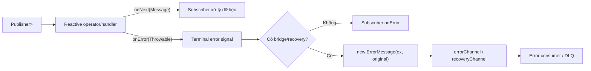
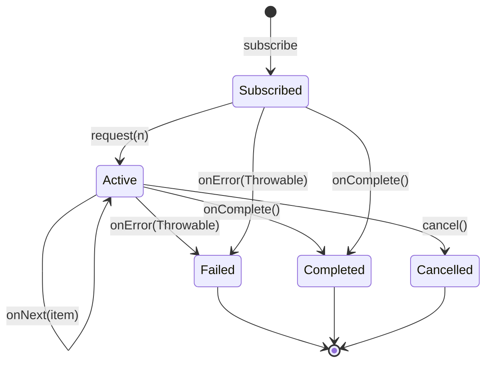
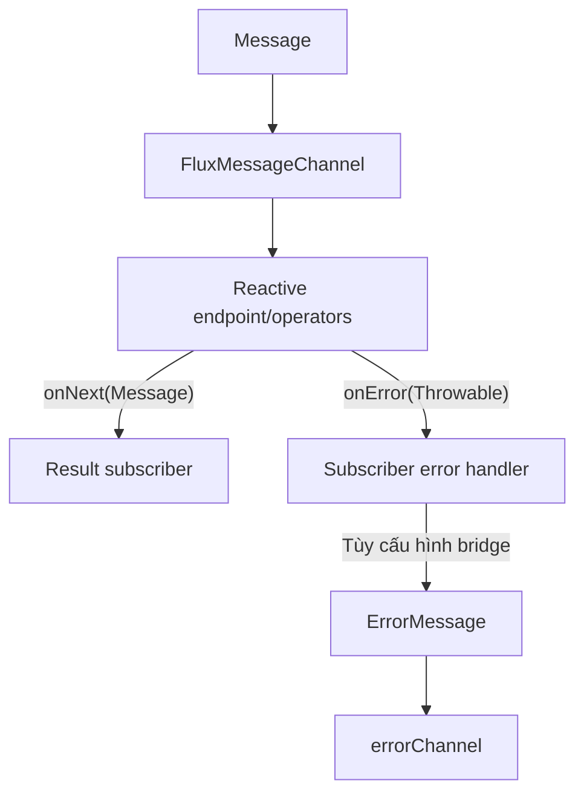

# Error signal khác với ErrorMessage trong Spring Integration reactive runtime

## 1. Cùng một Throwable, hai cơ chế khác nhau

Trong module **SPRING_INTEGRATION_RUNTIME**, message đi qua channel, endpoint, consumer, poller và executor. Khi một flow dùng **Reactive Streams** hoặc **Project Reactor**, lỗi không chỉ xuất hiện dưới dạng Java exception lan theo call stack, mà còn có thể trở thành **tín hiệu `onError`** của một subscription. Tín hiệu đó **không phải** một `ErrorMessage` được gửi trên `MessageChannel`.

Bài **Reactive runtime → Error signal khác với ErrorMessage** tập trung vào:

1. `onError(Throwable)` là terminal signal gì; vì sao một `Flux` có thể dừng ở item lỗi.
2. `ErrorMessage` của Spring Messaging chứa exception và message gốc như thế nào.
3. Khi nào lỗi được biến thành message trên `errorChannel`, và khi nào chỉ có reactive signal.
4. Sự khác nhau giữa retry/recovery bằng operator Reactor và error flow của Spring Integration.
5. Ảnh hưởng đến transaction, threading, acknowledgement, backpressure, message store và correlation.
6. Cách kiểm chứng với ví dụ Java chạy được và fault injection có kiểm soát.

**Nguyên tắc:** `onError` là **tín hiệu kết thúc của một subscription**. `ErrorMessage` là **một message mang Throwable** có thể được gửi qua channel. Không có quy tắc chung rằng cứ có `onError` là Spring Integration sẽ tự gửi `ErrorMessage` đến global `errorChannel`.



Một `ErrorMessage` cũng có thể phát sinh **trực tiếp** từ exception do poller, executor hoặc inbound adapter xử lý; không bắt buộc phải có Reactive Streams.

## 2. So sánh hai contract

| Đặc tính | Reactive `onError` | Spring `ErrorMessage` |
| --- | --- | --- |
| Bản chất | Terminal signal từ `Publisher` tới `Subscriber` | `org.springframework.messaging.support.ErrorMessage` |
| Dữ liệu | `Throwable` | Payload là `Throwable`, kèm headers và tùy chọn original message |
| Cách phát | `Subscriber.onError(Throwable)` | `MessageChannel.send(errorMessage)` hoặc `onNext(errorMessage)` |
| Sau khi phát | Subscription kết thúc; không còn `onNext`/`onComplete` hợp lệ | Channel/stream vẫn có thể tiếp tục nhận các messages khác |
| Backpressure | Không phải một `onNext` item tiêu thụ demand | Nếu phát qua `onNext`, đây là một item chịu demand |
| Recovery | `onErrorResume`, `onErrorReturn`, `retryWhen`, subscriber | Consumer của error channel, recoverer, DLQ |
| Tự rollback hoặc requeue? | Không | Không |
| Có input message gốc? | Phải chủ động giữ trong closure/context | Có thể dùng constructor nhận `originalMessage` |

Ví dụ **terminal signal**:

```java
Flux.just("A", "B", "C")
    .map(value -> {
        if ("B".equals(value)) {
            throw new IllegalStateException("Cannot process B");
        }
        return value.toLowerCase();
    })
    .subscribe(
        value -> System.out.println("NEXT " + value),
        error -> System.out.println("ON_ERROR " + error.getMessage()),
        () -> System.out.println("COMPLETE")
    );
```

Kết quả:

```text
NEXT a
ON_ERROR Cannot process B
```

`C` không đến được subscriber này, và callback `COMPLETE` không chạy. Vì lỗi ở operator đã kết thúc **outer subscription**.

Ví dụ **ErrorMessage như dữ liệu**:

```java
Flux.<Message<?>>just(
        MessageBuilder.withPayload("A").build(),
        new ErrorMessage(new IllegalStateException("B failed")),
        MessageBuilder.withPayload("C").build())
    .subscribe(m -> System.out.println(
            "ON_NEXT payloadType=" +
            m.getPayload().getClass().getSimpleName()));
```

Dòng thứ hai phát một `ErrorMessage` bằng **`onNext`**, không phải `onError`; nếu subscriber không ném lỗi, cả ba item có thể đi qua và publisher hoàn tất bình thường.

## 3. Vòng đời Reactive Streams: onError là terminal



`onError` và `onComplete` là hai cách kết thúc **khác nhau**. `cancel()` cũng ngừng nhận event nhưng không đồng nghĩa thành công hoặc thất bại nghiệp vụ. Một subscriber nhận terminal error không được mong chờ thêm các item từ cùng subscription.

Lỗi có thể được dựng ngay:

```java
Mono<String> failed =
        Mono.error(new IllegalStateException("Remote service unavailable"));
```

Hoặc được chuyển thành signal khi thao tác thực thi:

```java
Mono<String> task = Mono.fromCallable(() -> callRemoteService());
```

Với `Mono.fromCallable`, callback của **cold publisher** thường chạy lúc subscription. Nếu `callRemoteService()` ném exception, Reactor chuyển exception thành `onError`. Khi retry resubscribe, callback **có thể chạy lại**; điều này cực kỳ quan trọng nếu nó đã gọi API hoặc ghi dữ liệu bên ngoài.

### Những operator hay bị hiểu sai

| Operator | Hành vi | Rủi ro |
| --- | --- | --- |
| `doOnError` | Quan sát lỗi, log/metric | **Không** xử lý và không nuốt lỗi |
| `onErrorMap` | Biến `Throwable` thành loại khác | Mất root cause nếu mapping sai |
| `onErrorResume` | Thay nguồn đã lỗi bằng publisher mới | Biến failure thành success/complete, có thể ack sớm |
| `onErrorReturn` | Trả fallback value | Success giả nếu giá trị fallback không hợp contract |
| `onErrorComplete` | Hoàn tất thay vì báo lỗi | Có thể bỏ qua công việc thất bại |
| `retryWhen` | Resubscribe khi nhận lỗi | Lặp side effects, có thể replay item trước đó |
| `onErrorContinue` | Cố gắng bỏ item lỗi tại operator hỗ trợ | Operator-dependent, khó dự đoán; không dùng đại trà |
| `doFinally` | Quan sát complete/error/cancel | Không tạo ErrorMessage |

`doOnError` chỉ có tác dụng phụ:

```java
Mono.fromCallable(() -> sendOrder())
    .doOnError(ex -> logger.warn("Send failed", ex));
```

Subscriber vẫn nhận `onError`, trừ khi một operator khác phục hồi nó.

## 4. ErrorMessage là Message<Throwable>

`ErrorMessage` kế thừa `GenericMessage<Throwable>`. Nó có payload Throwable, headers và có thể mang original message:

```java
Message<String> original = MessageBuilder
        .withPayload("ORDER-42")
        .setHeader("eventId", "evt-42")
        .setHeader("traceId", "trace-42")
        .build();

Throwable cause =
        new IllegalStateException("Shipping API unavailable");

ErrorMessage error = new ErrorMessage(cause, original);

Throwable exception = error.getPayload();
Message<?> input = error.getOriginalMessage();
```

**`getOriginalMessage()` có thể trả `null`.** `new ErrorMessage(cause)` không chứa message gốc. Nếu exception là `MessagingException`, nó có thể chứa `failedMessage` riêng; vẫn không nên giả định mọi Throwable đều có ngữ cảnh ấy.

Một consumer message-based:

```java
@ServiceActivator(inputChannel = "integrationErrors")
public void handle(ErrorMessage error) {
    Message<?> original = error.getOriginalMessage();
    System.out.println("ERROR " + error.getPayload().getMessage());
    System.out.println("ORIGINAL " +
            (original == null ? "unknown" : original.getPayload()));
}
```

Đây là handler nhận một message lỗi qua channel. Việc nó hoàn thành bình thường **không tự động rollback** database hoặc yêu cầu broker redelivery cho message nguồn.

### errorChannel hoạt động ở đâu?

Spring Integration có cơ chế phát `ErrorMessage` đến error channel ở **các ranh giới có hỗ trợ**, ví dụ error handler của một số poller, executor hoặc inbound adapter. Channel đích có thể được chỉ định theo adapter, header `errorChannel` hoặc global channel tùy cấu hình.

Điều quan trọng là **ai tạo ErrorMessage** và **ai gửi nó**. Bean global tên `errorChannel` không có khả năng tự bắt mọi `Publisher.onError` trong toàn application. Với một reactive pipeline tùy biến, bạn thường phải đặt bridge hoặc sử dụng cơ chế chuyển lỗi của component cụ thể.

## 5. Ba tình huống runtime không được đánh đồng

### 5.1. DirectChannel đồng bộ

```text
sender.send(message)
    -> DirectChannel
    -> @ServiceActivator throws
    -> exception trở về sender nếu không bị catch/trap
```

Người gọi `send()` có thể nhận exception/wrapper; một `ErrorMessage` **không nhất thiết** xuất hiện trên global `errorChannel`. Nếu có imperative transaction ngoài cùng trong cùng call stack và exception đi qua transaction boundary, nó có thể gây rollback.

### 5.2. ExecutorChannel hoặc poller

```text
Thread A: send -> ExecutorChannel -> handoff accepted
Thread B: handler throws -> error handler của worker (nếu cấu hình)
                           -> có thể publish ErrorMessage
```

Thread A thường không bắt được lỗi xảy ra sau trong thread B. Spring Integration hỗ trợ các cơ chế như `MessagePublishingErrorHandler` ở các boundary phù hợp, nhưng phải kiểm tra endpoint, adapter và config thực tế. **Không** suy rằng toàn bộ exception bất đồng bộ đều được publish cùng cách.

### 5.3. Publisher/FluxMessageChannel

```text
Publisher<Message<?>> -> reactive operators -> Subscriber
                                      |
                                      +-- onError(Throwable) terminal
```

Reactive operator có thể phát `onError` tới subscriber mà không tạo `ErrorMessage`. Hướng bridge phụ thuộc API và subscription ownership của reactive endpoint.

## 6. Recovery theo từng message khác recovery cả stream

Giả sử một stream chứa `order-1`, `broken`, `order-3`:

```java
Flux.just("order-1", "broken", "order-3")
    .map(this::process)
    .onErrorResume(ex -> Flux.empty())
    .subscribe(System.out::println);
```

Nếu `process("broken")` ném lỗi, **outer** `onErrorResume` thay cả source đã lỗi bằng publisher rỗng. Nó không nhảy trở lại item `order-3`.

Để tiếp tục với event tiếp theo, đặt error boundary **bên trong mỗi inner publisher**:

```java
Flux.just("order-1", "broken", "order-3")
    .concatMap(id ->
        Mono.fromCallable(() -> process(id))
            .onErrorResume(ex -> {
                recordFailure(id, ex);
                return Mono.empty();
            }))
    .subscribe(System.out::println);
```

`concatMap` chờ từng inner publisher theo thứ tự; một lỗi được recover ở inner Mono không kết thúc outer source. Nếu dùng `flatMap`, các inner publishers có thể thực thi đồng thời và kết quả đến theo thứ tự khác. Giới hạn concurrency theo năng lực backend và contract nghiệp vụ.

**Cần tránh:** dùng `onErrorContinue` như giải pháp tổng quát để bỏ những event hỏng. Semantics phụ thuộc operator upstream và dễ tạo side effects khó truy vết. Per-event `onErrorResume` rõ nghĩa hơn.

## 7. Ví dụ Java chạy được: bridge signal sang ErrorMessage

Ví dụ Java 17+, Spring Boot, Spring Integration và Reactor. Đặt toàn bộ nội dung vào **một file** `ReactiveErrorDemoApplication.java` trong package `demo.integration`. Dùng Spring Integration core/starter và `reactor-core` phiên bản phù hợp. App tạo channel `integrationErrors` riêng, **không dùng ngầm global errorChannel**.

```java
package demo.integration;

import java.util.concurrent.atomic.AtomicInteger;

import org.springframework.beans.factory.annotation.Qualifier;
import org.springframework.boot.ApplicationRunner;
import org.springframework.boot.SpringApplication;
import org.springframework.boot.autoconfigure.SpringBootApplication;
import org.springframework.context.annotation.Bean;
import org.springframework.integration.annotation.MessageEndpoint;
import org.springframework.integration.annotation.ServiceActivator;
import org.springframework.integration.channel.DirectChannel;
import org.springframework.integration.config.EnableIntegration;
import org.springframework.messaging.Message;
import org.springframework.messaging.MessageChannel;
import org.springframework.messaging.support.ErrorMessage;
import org.springframework.messaging.support.MessageBuilder;

import reactor.core.publisher.Flux;
import reactor.core.publisher.Mono;

@SpringBootApplication
@EnableIntegration
public class ReactiveErrorDemoApplication {

    public static void main(String[] args) {
        SpringApplication.run(ReactiveErrorDemoApplication.class, args);
    }

    @Bean("integrationErrors")
    MessageChannel integrationErrors() {
        return new DirectChannel();
    }

    @Bean
    ApplicationRunner demo(
            @Qualifier("integrationErrors") MessageChannel errors) {

        return args -> {
            Flux.just("order-1", "broken", "order-3")
                .concatMap(id -> {
                    Message<String> input = MessageBuilder
                        .withPayload(id)
                        .setHeader("eventId", "evt-" + id)
                        .setHeader("traceId", "trace-" + id)
                        .build();

                    return Mono.fromCallable(() -> process(input))
                        .doOnError(ex -> System.out.println(
                                "REACTOR_ERROR event=" + id))
                        .onErrorResume(ex -> {
                            // Explicit bridge: onError -> ErrorMessage.
                            errors.send(new ErrorMessage(ex, input));

                            // Kết thúc inner publisher lỗi;
                            // outer source chuyển sang event sau.
                            return Mono.empty();
                        });
                })
                .doOnNext(value ->
                        System.out.println("RESULT " + value))
                .doOnComplete(() ->
                        System.out.println("OUTER_COMPLETE"))
                .blockLast();
        };
    }

    private static String process(Message<String> message) {
        String id = message.getPayload();

        if ("broken".equals(id)) {
            throw new IllegalStateException(
                    "Simulated downstream failure");
        }

        return "processed:" + id;
    }
}

@MessageEndpoint
class ErrorConsumer {

    private final AtomicInteger count = new AtomicInteger();

    @ServiceActivator(inputChannel = "integrationErrors")
    public void handle(ErrorMessage error) {
        Message<?> original = error.getOriginalMessage();
        Object eventId = original == null
                ? "unknown"
                : original.getHeaders().get("eventId");

        System.out.println("ERROR_MESSAGE #" +
                count.incrementAndGet() +
                " event=" + eventId +
                " cause=" +
                error.getPayload().getClass().getSimpleName());
    }
}
```

Kết quả logic dự kiến:

```text
RESULT processed:order-1
REACTOR_ERROR event=broken
ERROR_MESSAGE #1 event=evt-broken cause=IllegalStateException
RESULT processed:order-3
OUTER_COMPLETE
```

Vì `concatMap` xử lý tuần tự và `DirectChannel` đồng bộ, thứ tự log tương đối rõ. Nếu thay bằng `flatMap` hoặc error channel bất đồng bộ, thứ tự khác đi.

### Phân tích từng bước

1. `blockLast()` tạo subscription để `Flux.just(...)` chạy.
2. `concatMap` xây một `Message<String>` với `eventId`, `traceId` cho từng item.
3. `Mono.fromCallable` gọi `process(message)` khi inner Mono được subscribe.
4. Khi `broken` làm method ném `IllegalStateException`, inner Mono phát **`onError`**.
5. `doOnError` chỉ log; `onErrorResume` **chủ động** gửi `new ErrorMessage(ex, input)` đến `integrationErrors`.
6. `@ServiceActivator` của `ErrorConsumer` nhận ErrorMessage qua `DirectChannel`.
7. Inner publisher lỗi trả `Mono.empty()`, vì thế outer `concatMap` tiếp tục `order-3`.

**Điểm quan trọng:** `onErrorResume` ở demo biến failure thành **completion bình thường của inner publisher**. Error consumer mới chỉ in log, không có lưu lỗi bền vững. Trong hệ thống broker, phục hồi tương tự có thể làm message được acknowledge mặc dù nghiệp vụ không hoàn tất. Chỉ swallow error sau khi recovery contract cho phép.

### Kiểm thử đối chứng: outer recovery

```java
Flux.just("order-1", "broken", "order-3")
    .map(id -> {
        if ("broken".equals(id)) {
            throw new IllegalStateException("broken event");
        }
        return "processed:" + id;
    })
    .onErrorResume(ex -> {
        System.out.println("RECOVER OUTER");
        return Flux.empty();
    })
    .subscribe(System.out::println);
```

Có output `processed:order-1` và `RECOVER OUTER`, không có `processed:order-3`. `onErrorResume` ngoài thay **source đã terminal**, không quay lại item tiếp theo.

## 8. Hai cách bridge có semantics khác nhau

### Cách A: publish error rồi complete

```java
Mono<Result> result = remoteCall(message)
    .onErrorResume(ex -> {
        errorChannel.send(new ErrorMessage(ex, message));
        return Mono.empty();
    });
```

Phù hợp khi **có chủ đích** cho phép original message được xem là đã kết thúc sau khi chuyển vào recovery đáng tin cậy. Kiểm tra: channel chấp nhận message không, error consumer đã persist DLQ chưa, async handoff có xảy ra không và upstream ack theo điều kiện gì.

### Cách B: publish error nhưng vẫn propagate

```java
Mono<Result> result = remoteCall(message)
    .doOnError(ex -> errorChannel.send(
        new ErrorMessage(ex, message)));
```

`doOnError` không nuốt signal, nên subscriber downstream vẫn có thể thấy lỗi. Có thể phù hợp khi adapter nguồn phải nhận failure để rollback/nack/redeliver. Nhưng nếu error publishing của adapter cũng tạo `ErrorMessage`, một lỗi có thể bị ghi **hai lần**. Nên chọn một owner của error publishing hoặc dùng eventId và idempotency cho error records.

Nếu `errorChannel.send()` tự throw, lỗi của callback cũng có thể ảnh hưởng pipeline. Không xem publishing error như thao tác luôn thành công.

### materialize khác ErrorMessage

Reactor `materialize()` chuyển `onNext/onError/onComplete` thành các object `Signal<T>`; `dematerialize()` dựng lại tín hiệu. `Signal.error` vẫn **không phải** `ErrorMessage`. Muốn gửi vào Spring MessageChannel phải mapping tường minh và giữ original message.

## 9. FluxMessageChannel không phải errorChannel

`FluxMessageChannel` là channel hỗ trợ Reactive Streams trong Spring Integration:

```java
@Bean("reactiveOrders")
FluxMessageChannel reactiveOrders() {
    return new FluxMessageChannel();
}
```

Cần import `org.springframework.integration.channel.FluxMessageChannel`. Tạo bean không tự tạo subscriber, không tự bật persistent store, retry hay bridge error.



Một `Flux<Message<?>>` phát `ErrorMessage` như **`onNext`** vẫn có thể tiếp tục. Một publisher phát **`onError`** thì subscription tương ứng kết thúc. Cách một IntegrationFlow hay adapter quản lý subscription khác nhau theo endpoint và version; phải xác định ai subscribe, ai route errors.

`FluxMessageChannel` cũng **không phải queue bền vững** qua restart. Cần message store/broker và ack/replay policy độc lập nếu yêu cầu durability.

## 10. retryWhen: resubscribe không nhất thiết retry một message duy nhất

```java
Mono<String> request = Mono.defer(() -> remoteCall())
    .retryWhen(
        Retry.backoff(2, Duration.ofMillis(100))
            .filter(ex -> ex instanceof TransientServiceException)
    );
```

Snippet cần import `reactor.util.retry.Retry`, `java.time.Duration` và định nghĩa `remoteCall()`/`TransientServiceException`. `Retry.backoff(2,...)` cho phép **hai retries sau lần đầu**, tối đa ba attempts. Chỉ retry lỗi tạm thời; cần timeout, backoff, deadline và idempotency.

### Đặt retry ngoài hay trong Flux?

```java
Flux<Result> output = receiveEvents()
    .flatMap(this::process)
    .retryWhen(Retry.max(2));
```

Với **cold/replayable source**, outer retry có thể subscribe lại nguồn và phát lại những item đã xử lý thành công trước lỗi. Với hot source/broker adapter, replay phụ thuộc semantics nguồn.

```java
Flux<Result> output = receiveEvents()
    .concatMap(event -> process(event)
        .retryWhen(Retry.backoff(2, Duration.ofMillis(100)))
        .onErrorResume(ex -> quarantine(event, ex)));
```

Đoạn này là skeleton; các method `receiveEvents`, `process`, `quarantine` phải có publisher types tương thích. Inner retry thường giới hạn phạm vi theo logical event.

**Lưu ý:** một `Mono` đã cache lỗi không nhất thiết chạy lại I/O khi resubscribe; dùng `Mono.defer` hoặc cold source đúng contract nếu muốn re-execute.

| Cơ chế | Phạm vi | Điều cần xem |
| --- | --- | --- |
| Reactor `retryWhen` | Publisher được gắn operator | Resubscribe, side effect lặp |
| `RequestHandlerRetryAdvice` | Request-handler invocation | Có thể không thấy error signal phát sau khi handler trả publisher |
| Broker redelivery | Message delivery theo adapter | Ack/nack/transaction và retry nhiều tầng |

Không bật retry cả ba tầng mà không biết **số attempts thực tế**. Một API đã thực hiện side effect nhưng response timeout có thể bị gọi lại; luôn cân nhắc idempotency key.

## 11. Transaction, ack, error flow: bốn sự kiện riêng biệt

Không có phép đồng nhất:

```text
Reactive onError
    != Spring ErrorMessage
    != database rollback
    != broker redelivery
```

Imperative Spring transaction (JDBC/JPA) thông thường gắn với thread. `publishOn`, `subscribeOn` hay handoff sang executor có thể đổi thread và thời điểm thực thi; transaction caller **không tự truyền** qua toàn bộ publisher bất đồng bộ.

Reactive transaction với `ReactiveTransactionManager`, `TransactionalOperator` hoặc reactive `@Transactional` sử dụng **Reactor Context** của subscription khi cấu hình đúng. Đó không phải ThreadLocal JDBC transaction.

| Tình huống | Downstream thấy | Ý nghĩa ack/rollback |
| --- | --- | --- |
| Inner Mono `onError`, không recover | Error signal | Reactive TX/adapter có thể phản hồi lỗi theo config |
| `onErrorResume(ex -> Mono.empty())` | Complete bình thường | Upstream có thể ack và coi message đã xử lý |
| `doOnError` publish ErrorMessage rồi propagate | Error signal vẫn đến subscriber | Adapter có thể nack/rollback; error records có thể trùng |
| ErrorMessage vào `DirectChannel` | Error consumer chạy đồng bộ | Không tự rollback message nguồn |
| ErrorMessage vào async channel | Handoff có thể thành công trước khi ghi DLQ | Cần guarantee/persistence riêng |
| Reactive transaction bao toàn bộ publisher | Commit khi complete, rollback khi error theo policy | Phụ thuộc manager và subscription boundary |

Với broker, chỉ recover thành complete sau khi message lỗi đã được ghi bền vững theo yêu cầu. Nếu cần redelivery, đừng nuốt exception trước khi container/adapter quan sát được.

## 12. Correlation và Reactor Context

Khi tạo `ErrorMessage`, cần giữ:

- `eventId`/idempotency key để xác định cùng logical event qua retry/replay.
- `correlationId`, `sequenceNumber`, `sequenceSize` nếu có splitter/aggregator.
- `traceId` để nối log khi chuyển thread.
- Exception class, cause chain và thông tin endpoint/channel có thể ghi nhận an toàn.
- Original message hoặc durable reference tới raw payload để xử lý lại.

`MessageHeaders.ID` có thể thay đổi khi message được dựng lại. `Reactor Context` thuộc subscription, còn `MessageHeaders` thuộc **message object**. Chuyển context sang headers (và ngược lại) cần mapping rõ; không giả định MDC/ThreadLocal tự lan qua `publishOn`/`subscribeOn`.

## 13. Backpressure, concurrency và error storm

Trong Reactive Streams, `request(n)` điều tiết số `onNext` item. **`onError` không phải item dùng riêng một slot demand**; đó là terminal signal.

Nếu ứng dụng biến mỗi error thành một `ErrorMessage` đưa vào một publisher bằng `onNext`, chúng là data items chịu demand. Nếu gửi sang `DirectChannel` trong `onErrorResume`, error consumer đồng bộ **có thể block Reactor thread**. Nếu chuyển sang `ExecutorChannel`, backlog có thể chuyển sang executor queue.

Ví dụ giả lập:

```text
Input: 10.000 logical events/s
  -> 10.000 inner onError/s khi downstream outage
  -> 10.000 ErrorMessages/s được publish
  -> error store xử lý chỉ 1.000/s
  -> backlog +9.000/s nếu không có giới hạn
```

Đây là số minh họa, không phải thông số framework. Error path cần concurrency limit, bounded buffering, rate limit, DLQ/storage capacity và alert; không cho error storm làm bão hòa success path.

| Reactor operator | Vai trò | Rủi ro |
| --- | --- | --- |
| `flatMap(f, concurrency)` | Giới hạn inner publishers đồng thời | Output/lỗi có thể xen kẽ |
| `concatMap(f)` | Tuần tự theo source order | Head-of-line blocking |
| `onBackpressureBuffer` | Giữ tạm item chờ | Buffer vô hạn làm hết bộ nhớ |
| `onBackpressureDrop` | Loại item khi quá tải | Có thể mất dữ liệu nghiệp vụ |
| `publishOn` | Dịch downstream sang scheduler | Thay đổi thread/ThreadLocal |
| `subscribeOn` | Đổi execution của subscription/source | Không ép mọi stage chạy một thread |
| `timeout` | Chậm thành error signal | Retry có thể gây duplicate side effects |

Với thư viện blocking JDBC/HTTP, tránh gọi trên event loop; dùng scheduler phù hợp như `Schedulers.boundedElastic()` hoặc nonblocking client. Nhưng chuyển thread không sửa transaction correctness hoặc ack semantics.

## 14. Vì sao không thấy onError hoặc ErrorMessage?

Một cold publisher có thể được tạo nhưng **chưa subscribe**:

```java
Mono<Void> call = Mono.fromRunnable(() -> sendRequest());
// Chưa subscribe => sendRequest() chưa chạy.
```

Nếu framework/endpoint không compose/subscribe publisher mà method chỉ trả đối tượng Mono, công việc có thể chưa được thực hiện. Việc framework subscribe thay hay không **phụ thuộc API và version endpoint đang dùng**.

Một subscriber không có error consumer phù hợp có thể khiến Reactor báo lỗi qua log/global hook; đây **không phải** error store bền vững và không mặc nhiên là Spring `ErrorMessage`.

### Triệu chứng và cách xử lý

| Hiện tượng | Nguyên nhân | Kiểm chứng |
| --- | --- | --- |
| `doOnError` log nhưng `errorChannel` trống | Chưa có bridge/message publisher | Tìm nơi tạo ErrorMessage |
| Event sau event lỗi không chạy | Terminal error của outer stream | Đặt inner recovery |
| ErrorMessage ghi được, broker vẫn redeliver | Vẫn propagate error | Chọn ack/recovery contract, dedupe |
| Không thấy remote call | Chưa subscribe cold publisher | Truy subscription lifecycle |
| Hai error records cho cùng event | Bridge thủ công + adapter tự publish | Chọn một owner hoặc idempotency |
| `onErrorResume` làm mất message | Nuốt lỗi trước durable recovery | Quarantine/DLQ rồi ack |
| `retryWhen` tạo duplicate | Resubscribe nguồn hoặc side effects | Retry per-event, eventId ổn định |
| Transaction không rollback | Async error xảy ra sau TX caller | Reactive transaction boundary đúng |
| Log mất traceId | ThreadLocal/MDC không propagate | MessageHeaders/Reactor Context |
| Sender `send()` thành công nhưng worker throw | Async channel boundary | Xem worker error handler |
| Error consumer nghẽn | DirectChannel/blocking I/O hoặc queue quá tải | Bounded capacity và metrics |
| Poison event retry mãi | Same bytes/schema lỗi | Định tuyến quarantine thay retry vô hạn |

## 15. Metrics và fault injection

Nên phân biệt metric cho **signals** và **messages**:

- `reactive.error.signal.count`: số error signals quan sát ở operator/subscriber.
- `integration.error.message.published` và `integration.error.message.handled`.
- `recovery.persisted`, `recovery.failed`, `deadletter.count`.
- `message.retry.attempts`, `message.redelivery.count`, timeout/cancellation.
- `flow.inflight`, `flow.input.rate`, `flow.output.rate`.
- Executor queue, scheduler saturation, connection pool usage.
- p50/p95/p99 latency từ nhận message tới ack/commit.

Các tên trên là **gợi ý instrumentation**, không phải danh sách metric mặc định đã có. Không tag raw eventId/orderId vì cardinality cao; dùng endpoint, event type, exception class, outcome; event ID giữ trong trace/log theo chính sách bảo mật.

Thực hiện fault injection có kiểm soát:

1. Outer `Flux.map` ném exception ở event thứ hai: xác nhận event thứ ba không tới subscriber.
2. Inner `Mono` có `onErrorResume`: xác nhận event thứ ba được xử lý.
3. Error consumer của `integrationErrors` ném exception: xem lỗi **mới** từ `send()` ảnh hưởng pipeline ra sao.
4. Thay error channel bằng executor: xem timing, thread, backlog và việc sender không chờ consumer.
5. Đặt `retryWhen` ngoài stream rồi trong inner publisher: đếm số lần side effect.
6. Cancel subscription trước khi remote request trả về: quan sát cleanup, timeout, ack.
7. Chuyển thread qua `publishOn`, đối chiếu transaction active, trace headers và Reactor context.
8. Cho DLQ/store lỗi: xác định chính sách propagate hay retry thay vì ack im lặng.

## 16. Bài thực hành

1. Chạy `ReactiveErrorDemoApplication`; xác nhận một `REACTOR_ERROR`, một `ERROR_MESSAGE`, hai `RESULT` và `OUTER_COMPLETE`.
2. Bỏ inner `onErrorResume`; xem `order-3` và outer complete còn xuất hiện không.
3. Chuyển recovery ra sau `concatMap`; giải thích vì sao không tiếp tục source đã terminal.
4. Phát `ErrorMessage` qua `Flux.<Message<?>>just(...)` như item dữ liệu; phân biệt với `Flux.error(...)`.
5. Thử `Retry.backoff(2,...)` trên `Mono.defer` với counter; đo tối đa ba attempts.
6. Thêm `onErrorMap` giữ cause, kiểm tra `ErrorMessage.getOriginalMessage()` với constructor có/không truyền input.
7. Dùng `doOnError` publish error và vẫn propagate; xác định chỗ có nguy cơ duplicate audit.
8. Thử `flatMap` concurrency 4, delay một event, đối chiếu thứ tự với `concatMap`.
9. Dựng một `FluxMessageChannel` và reactive consumer bằng API phiên bản dự án; xem ai sở hữu subscription.
10. Với broker test, so sánh propagate error để redelivery và recover sau khi lưu DLQ; kiểm tra idempotency.
11. Với persistent message store, cố tình đưa poison payload, xác định lỗi decode trước hay sau reactive operator.
12. Thêm alert cho error signal rate, ErrorMessage publish/handle rate và recovery failure.

### Checklist trước production

- Phân biệt **terminal `onError`** và **`ErrorMessage` như message data**.
- Cần stream tiếp tục qua event lỗi thì recover trong phạm vi **per-event**.
- Không swallow error trước khi recovery/ack contract cho phép.
- Chỉ một owner phát error event hoặc có dedupe rõ.
- Retry có giới hạn, backoff, timeout và idempotency.
- Xác minh ai subscribe và error từ async completion đi đâu.
- Giữ original message, eventId/correlationId và traceId khi route lỗi.
- Transaction/ack/message store/replay được kiểm chứng ở từng boundary.
- Bounded concurrency và backpressure áp dụng cho success lẫn error path.
- Có metric, fault injection và kế hoạch xử lý DLQ outage.

## 17. Nguồn tham khảo chính thức

- [Spring Integration — Reactive Streams Support](https://docs.spring.io/spring-integration/reference/reactive-streams.html): hỗ trợ channel và endpoint reactive.
- [Spring Integration — Error Handling](https://docs.spring.io/spring-integration/reference/error-handling.html): ErrorMessage, errorChannel và các error publishing boundaries.
- [Spring Integration — Message Channel Implementations](https://docs.spring.io/spring-integration/reference/channel/implementations.html): DirectChannel, ExecutorChannel, FluxMessageChannel.
- [Project Reactor — Error Handling](https://projectreactor.io/docs/core/release/reference/coreFeatures/error-handling.html): terminal signals và error operators.
- [Project Reactor — Schedulers](https://projectreactor.io/docs/core/release/reference/coreFeatures/schedulers.html): publishOn, subscribeOn và boundedElastic.
- [Project Reactor — Context](https://projectreactor.io/docs/core/release/reference/advancedFeatures/context.html): context theo subscription.
- [Spring Framework Javadoc — ErrorMessage](https://docs.spring.io/spring-framework/docs/current/javadoc-api/org/springframework/messaging/support/ErrorMessage.html): payload và original message.
- [Reactive Streams Specification](https://www.reactive-streams.org/): Publisher/Subscriber và terminal signal contract.
