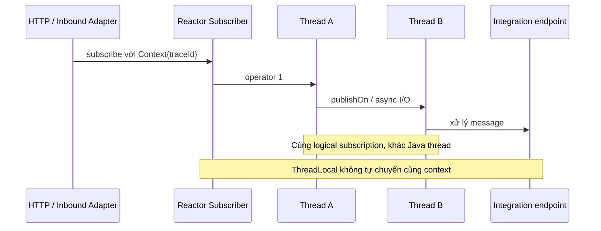
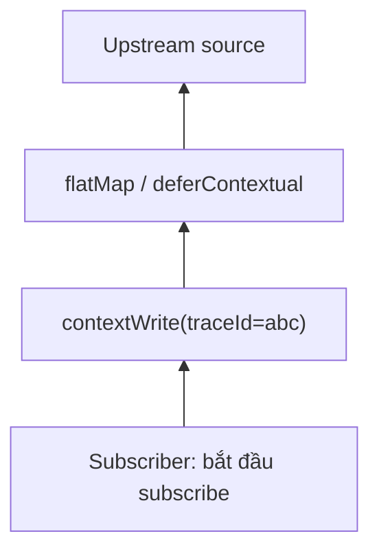
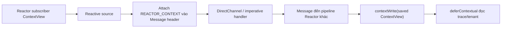
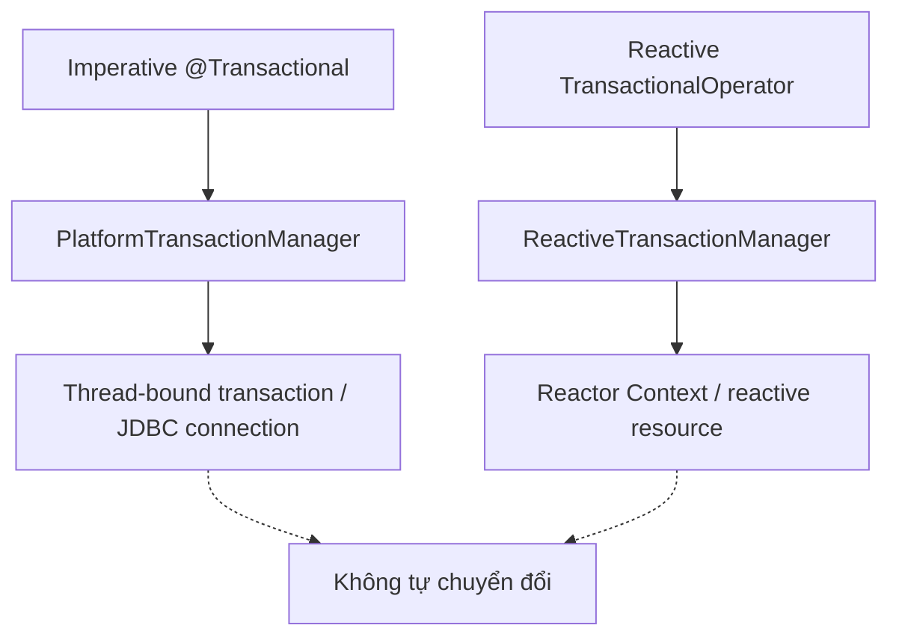
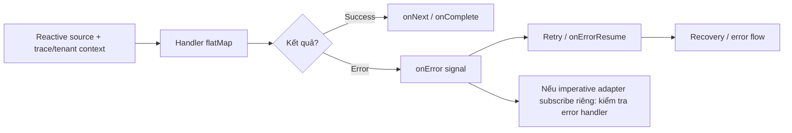

# Context propagation trong reactive execution của Spring Integration

## Mục tiêu và bối cảnh

Trong module **SPRING_INTEGRATION_RUNTIME**, một message có thể đi qua `MessageChannel`, consumer endpoint, poller, executor rồi tới một đoạn `Mono`/`Flux` trước khi xử lý tiếp. Khi có thao tác bất đồng bộ, thread đang chạy thay đổi, subscription có thể bắt đầu sau lúc nhận request, và các thư viện quan sát/ủy quyền có thể cần thông tin ngữ cảnh (trace, security, tenant, locale). Nếu nhầm **Reactor Context**, **ThreadLocal** và **Spring Message headers** là cùng một thứ, hệ thống dễ mất correlation, ghi log sai trace hoặc kiểm tra quyền bằng ngữ cảnh của request khác.

Bài thuộc chương **Reactive runtime**, tập trung vào **context propagation trong reactive execution** khi Spring Integration trộn reactive flow với imperative endpoint. Đây là bài về cách **truyền ngữ cảnh xử lý**, không phải bài thay thế cho riêng tracing hoặc Java thread management.

Sau bài này, bạn có thể:

- Phân biệt `Context`/`ContextView` của Reactor, `ThreadLocal`/MDC, Spring Integration `MessageHeaders` và các giá trị nghiệp vụ.
- Giải thích vì sao `publishOn`, `subscribeOn` và `ExecutorChannel` có thể đổi thread nhưng Reactor Context vẫn đi cùng một **subscription**, trong khi `ThreadLocal` không tự được bảo toàn.
- Dùng `contextWrite`, `deferContextual`, `contextCapture` và Micrometer Context Propagation đúng chiều truyền dữ liệu.
- Sử dụng `IntegrationMessageHeaderAccessor.REACTOR_CONTEXT` và `StaticMessageHeaderAccessor.getReactorContext(message)` để vượt qua ranh giới reactive → imperative → reactive trong Spring Integration 6.0.5+.
- Hiểu giới hạn của automatic context propagation, MDC, Micrometer Observation, SecurityContext, transaction context, backpressure và error handling.
- Kiểm thử per-subscriber isolation, context loss, thread switch, missing headers, concurrent requests và restart/persistence boundary.

Phần code dùng Java 17+, Spring Integration 6.5.x, Reactor Core 3.5+ và Micrometer Context Propagation theo dependency phù hợp. Một số ví dụ Spring Boot có cấu hình khác giữa các phiên bản; dự án thật nên dùng BOM/dependency management để đồng bộ Reactor, Spring Integration và Micrometer.

## 1. Vấn đề: thread không còn đại diện cho một request

Trong ứng dụng blocking truyền thống, người ta thường gắn trace ID vào `ThreadLocal` hoặc SLF4J `MDC`. Nếu toàn bộ request chạy trên một thread, đó là cách thuận tiện. Nhưng khi chuyển sang reactive:



Điểm quan trọng: Reactor Context **không** là biến global của một thread và cũng **không** là map nằm trong payload message. Nó được gắn với `Subscriber`/`Subscription`. Các operator trong **cùng reactive composition** có thể đọc nó ngay cả khi scheduler đổi thread, miễn là ngữ cảnh được nối đúng qua operators.

Ngược lại, `ThreadLocal` được lưu ở **thread cụ thể**. Khi operator chuyển từ Netty event-loop sang bounded-elastic worker, đọc `ThreadLocal.get()` có thể ra `null` hoặc một giá trị không liên quan nếu code/framework không xử lý capture/restore đúng.

### Bốn nơi có thể chứa một “trace ID”

| Nơi giữ dữ liệu | API thường gặp | Phạm vi | Có tự vượt thread? |
|---|---|---|---|
| Reactor `ContextView` | `Mono.deferContextual(...)` | Một subscriber/subscription và các operators cùng chuỗi | Có trong composition Reactor đúng cách |
| Java `ThreadLocal` | `ThreadLocal.get()`, MDC | Một Java thread | Không |
| Spring `MessageHeaders` | `message.getHeaders().get(...)` | Một message, khi headers được giữ/copy đúng | Có thể, vì là dữ liệu message; không tự thành Reactor Context |
| Context carrier qua transport | HTTP trace headers, broker headers, baggage | Qua network/process theo protocol và instrumentation | Chỉ khi được **inject/extract** rõ ràng |
| Business correlation ID | `orderId`, `batchId`, `correlationId` | Quy trình nghiệp vụ do ứng dụng định nghĩa | Chỉ khi người viết flow giữ/định tuyến nó |

**Trace ID khác correlation ID.** Một trace có thể gồm nhiều spans; một business correlation ID có thể liên kết nhiều yêu cầu, message hoặc retry attempts. Không thay `traceId` bằng `correlationId` rồi coi distributed tracing đã hoạt động.

## 2. Reactor Context hoạt động ra sao?

`reactor.util.context.Context` là một cấu trúc key/value bất biến về mặt API: các thao tác như `put` tạo một context mới. `ContextView` cho quyền đọc. Giá trị trong context vẫn có thể trỏ tới object mutable, vì vậy “Context bất biến” không có nghĩa mọi object bên trong đều thread-safe.

```java
import reactor.core.publisher.Mono;
import reactor.util.context.Context;

Mono<String> operation =
        Mono.deferContextual(ctx ->
                Mono.just("trace=" + ctx.getOrDefault(
                        "traceId", "missing")));

String result = operation
        .contextWrite(Context.of("traceId", "trace-001"))
        .block();

System.out.println(result); // trace=trace-001
```

Điểm cần nhớ:

- `Mono.deferContextual` đọc context tại **subscription time**, thay vì đọc một biến mutable được ghi khi dựng pipeline.
- `contextWrite(...)` bổ sung/ghi đè context cho **các operators phía upstream** (gần source hơn). Context đi từ downstream subscriber lên upstream trong quá trình subscribe.
- Nhiều subscribers có thể subscribe cùng một `Mono` definition với context khác nhau.
- `ContextView.get(key)` ném lỗi nếu key vắng; `getOrDefault(...)` hoặc `hasKey(...)` phù hợp khi context tùy chọn.

### Context được nhìn từ hướng nào?



Đừng cho rằng `contextWrite` là một phép thay đổi global áp dụng ngược và xuôi toàn pipeline. Nó thay đổi context mà upstream thấy. Cách đặt operator trong chuỗi có ý nghĩa, đặc biệt khi có nhiều `contextWrite` cùng key.

### Thử nhiều subscribers

```java
Mono<String> sharedDefinition =
        Mono.deferContextual(ctx ->
                Mono.just(ctx.get("tenantId")));

String a = sharedDefinition
        .contextWrite(Context.of("tenantId", "tenant-A"))
        .block();

String b = sharedDefinition
        .contextWrite(Context.of("tenantId", "tenant-B"))
        .block();

// a = tenant-A; b = tenant-B
```

Nếu dùng một `static ThreadLocal` và quên cleanup, dữ liệu tenant có thể chảy sang request khác do thread pool được tái sử dụng. Reactor Context được thiết kế để gắn giá trị với subscriber thay vì trạng thái global tùy ý.

## 3. Scheduler đổi thread không nhất thiết làm mất Reactor Context

`publishOn` và `subscribeOn` điều chỉnh ngữ cảnh thực thi (scheduler/thread) của các signals/subscription. Chúng **không tự động xóa Reactor Context** của subscription đang được composition đúng.

```java
import reactor.core.publisher.Mono;
import reactor.core.scheduler.Schedulers;
import reactor.util.context.Context;

Mono<String> flow =
        Mono.deferContextual(ctx -> Mono.just(
                        "tenant=" + ctx.get("tenantId")))
                .publishOn(Schedulers.parallel())
                .map(value -> value
                        + ", thread=" + Thread.currentThread().getName())
                .contextWrite(Context.of("tenantId", "shop-7"));

String result = flow.block();
// Bắt đầu bằng "tenant=shop-7", thread tùy scheduler.
```

Chú ý:

- `publishOn` chuyển execution downstream của nó sang scheduler chỉ định theo Reactor semantics.
- `subscribeOn` thay đổi nơi phần subscription/source được thực hiện; không nên suy ra toàn bộ chain luôn chạy trên duy nhất một thread.
- `parallel()`, `flatMap` hoặc các async operators có thể tạo concurrency. Context vẫn thuộc từng subscription/subscriber tương ứng.
- `Thread.currentThread().getName()` chỉ giúp chẩn đoán scheduling, không chứng minh identity của một business request.

### Khi nào context thật sự bị đứt?

Ranh giới nguy hiểm là **tạo một subscription khác** hoặc đi ra khỏi Reactor composition:

```java
Mono.just("input")
    .doOnNext(value -> {
        // Anti-pattern: subscription riêng, không tự nhận Context bên ngoài.
        Mono.deferContextual(ctx ->
            Mono.just(ctx.getOrDefault("traceId", "missing")))
            .subscribe(System.out::println);
    })
    .contextWrite(Context.of("traceId", "outer-trace"))
    .block();
```

Inner `subscribe()` tạo một subscription **độc lập**, không được bảo đảm thừa hưởng context của outer subscriber. Nó còn biến side effect thành fire-and-forget, khiến lỗi/completion khó liên kết tới acknowledgment của message gốc.

Thay bằng **composition**:

```java
Mono<String> composed =
        Mono.just("input")
                .flatMap(value ->
                        Mono.deferContextual(ctx ->
                                Mono.just(value + ":"
                                        + ctx.get("traceId"))))
                .contextWrite(Context.of("traceId", "outer-trace"));

// Kết quả: input:outer-trace
```

Nếu bắt buộc tạo một subscription độc lập (ví dụ message tách sang một flow khác), phải lựa chọn **context carrier** phù hợp và thiết kế lifecycle/error handling chứ không trông chờ context tự “nhảy” qua.

## 4. Spring Integration reactive execution không phải lúc nào cũng thuần Reactive Streams

Spring Integration dùng message/channel/endpoint làm thành phần chính. Reactive support bổ sung `FluxMessageChannel`, `ReactiveStreamsConsumer`, `ReactiveMessageHandler` và các adapter/gateway tích hợp Reactor, nhưng nhiều endpoint/adapter vẫn thực hiện lời gọi blocking hoặc imperative.

| Thành phần | Đặc điểm chính | Rủi ro context |
|---|---|---|
| `FluxMessageChannel` | Vừa là `MessageChannel` vừa là `Publisher<Message<?>>`; kết nối reactive subscribers | Context tùy subscriber/đường subscribe, cần xét header khi bridge |
| `ReactiveStreamsConsumer` | Consume qua Reactive Streams, có thể áp dụng `flatMap` để xử lý reactive handler | Thread có thể đổi; không đọc `ThreadLocal` tùy ý |
| `ReactiveMessageHandler` | Handler trả `Mono<Void>`, hỗ trợ reactive clients | Trong imperative flow có thể được subscribe riêng; phạm vi composition khác |
| `DirectChannel` | Dispatch đồng bộ trên thread gửi (thông thường) | Không tạo Reactor subscription mới nhưng cũng không đảm bảo caller mang đầy đủ Reactor Context |
| `ExecutorChannel` | Dispatch trên worker thread | ThreadLocal của sender không tự được kế thừa |
| `QueueChannel` + poller | Receiver chạy sau trên thread khác | Thread-local/subscriber context cũ không tự sống cùng message |
| `@MessagingGateway` trả `Mono<?>` | Có thể defer send-and-receive đến lúc subscribe | Cần kiểm tra context ở subscription, không chỉ khi gọi method |
| WebFlux/RSocket inbound gateway | Có reactive request scope | Có cơ chế chuyển ContextView vào message header của Spring Integration |
| JDBC/JPA handler blocking | Không biến thành non-blocking chỉ nhờ đặt cạnh Flux | Block event-loop, transaction/ThreadLocal có semantics khác |

Với `FluxMessageChannel`, Reactive Streams consumer thực sự có thể duy trì backpressure trong đoạn hỗ trợ reactive. Nếu flow gọi JDBC blocking hoặc `.block()` trên event-loop, context propagation đúng cũng không giải quyết hiệu năng; cần non-blocking driver hoặc cách ly blocking call bằng scheduler thích hợp.

## 5. Điểm đặc thù: REACTOR_CONTEXT message header từ Spring Integration 6.0.5

Từ **Spring Integration 6.0.5**, framework cung cấp:

```java
IntegrationMessageHeaderAccessor.REACTOR_CONTEXT
StaticMessageHeaderAccessor.getReactorContext(message)
```

Header `REACTOR_CONTEXT` mang một `reactor.util.context.ContextView`. Nó giúp vượt qua đoạn code imperative hoặc việc đổi sang một Reactor pipeline khác.



Spring Integration document mô tả những thành phần như `WebFluxInboundEndpoint` và `RSocketInboundGateway` có thể đưa context vào message headers. `FluxMessageChannel.subscribeTo(Publisher)` có hỗ trợ sử dụng header này để khôi phục context cho message khi phát từ publisher nguồn. Đây là khả năng **cụ thể của các integration components**, không phải bằng chứng mọi custom `MessageChannel.send()` hoặc every producer tự thêm header.

### Header này không phải MDC

Dù message có `REACTOR_CONTEXT`, một imperative handler gọi `MDC.get("traceId")` vẫn có thể nhận `null`. Header là **carrier của ContextView**; còn việc khôi phục `ThreadLocal`/MDC cần Micrometer context propagation hoặc code scope rõ ràng.

Tương tự, việc gửi `REACTOR_CONTEXT` trong headers **không** tự mở reactive transaction ở một endpoint khác và **không** tái tạo một subscriber đã hoàn tất.

## 6. Ví dụ end-to-end: Reactor → DirectChannel → đọc context trong handler

Ví dụ Java configuration sau cho thấy cách **chủ động attach** Reactor context vào một Spring message trước khi gửi qua channel imperative.

```java
import org.springframework.context.annotation.AnnotationConfigApplicationContext;
import org.springframework.context.annotation.Bean;
import org.springframework.context.annotation.Configuration;
import org.springframework.integration.IntegrationMessageHeaderAccessor;
import org.springframework.integration.StaticMessageHeaderAccessor;
import org.springframework.integration.annotation.ServiceActivator;
import org.springframework.integration.channel.DirectChannel;
import org.springframework.integration.config.EnableIntegration;
import org.springframework.messaging.Message;
import org.springframework.messaging.MessageChannel;
import org.springframework.messaging.support.MessageBuilder;
import reactor.core.publisher.Mono;
import reactor.core.scheduler.Schedulers;
import reactor.util.context.Context;
import reactor.util.context.ContextView;

@Configuration
@EnableIntegration
public class ReactorContextBridgeDemo {

    @Bean
    public MessageChannel orderRequests() {
        return new DirectChannel();
    }

    @Bean
    public OrderHandler orderHandler() {
        return new OrderHandler();
    }

    public static class OrderHandler {

        @ServiceActivator(inputChannel = "orderRequests")
        public void handle(Message<String> message) {
            ContextView saved =
                    StaticMessageHeaderAccessor.getReactorContext(message);

            String traceId = saved == null
                    ? "missing"
                    : saved.getOrDefault("traceId", "missing");

            String tenantId = saved == null
                    ? "missing"
                    : saved.getOrDefault("tenantId", "missing");

            System.out.printf(
                    "payload=%s trace=%s tenant=%s thread=%s%n",
                    message.getPayload(),
                    traceId,
                    tenantId,
                    Thread.currentThread().getName());
        }
    }

    public static void main(String[] args) {
        try (var ctx = new AnnotationConfigApplicationContext(
                ReactorContextBridgeDemo.class)) {

            MessageChannel input = ctx.getBean(
                    "orderRequests", MessageChannel.class);

            Mono<Boolean> operation = Mono.deferContextual(reactorContext -> {
                Message<String> message =
                        MessageBuilder.withPayload("ORDER-42")
                                .setHeader(
                                        IntegrationMessageHeaderAccessor.REACTOR_CONTEXT,
                                        reactorContext)
                                .build();

                // DirectChannel.send() là imperative/blocking call.
                return Mono.fromCallable(() -> input.send(message))
                        .subscribeOn(Schedulers.boundedElastic());
            });

            Boolean sent = operation
                    .contextWrite(Context.of(
                            "traceId", "trace-42",
                            "tenantId", "tenant-9"))
                    .block();

            System.out.println("sent=" + sent);
        }
    }
}
```

**Điều cần quan sát:**

1. `Mono.deferContextual` chỉ đọc context khi có subscriber (ở đây `block()` tạo subscription tại boundary demo).
2. Context chứa hai key được attach vào `Message` bằng header có tên chuẩn của Spring Integration.
3. `DirectChannel` gọi `OrderHandler` trên thread thực hiện `send`; vì ví dụ dùng `boundedElastic`, thread handler có thể khác thread main.
4. Handler đọc `ContextView` trực tiếp từ message header, **không yêu cầu** `ThreadLocal` hay automatic hook.
5. `sent=true` chỉ nói channel đã nhận message theo contract `send`; không có nghĩa đã commit một database transaction hay đã hoàn tất một reactive workflow ngoài handler.

Trong code production, trả `Mono<Boolean>` cho caller reactive và để framework/protocol subscriber quyết định subscribe. `block()` chỉ có trong `main` demo, không gọi nó trên Netty event-loop hoặc bên trong một operator reactive.

### Đừng quên kiểm tra header vắng mặt

Nếu message được gửi từ plain JMS/File adapter mà không có `REACTOR_CONTEXT`, getter có thể không có thông tin context. Không nên dùng `get("traceId")` mà không có chính sách missing; nếu correlation bắt buộc, validate và trả error rõ thay vì mượn giá trị từ thread cũ.

Header có thể bị thay đổi khi dùng custom `MessageBuilder`, transformer hoặc serialization; cần kiểm tra các điểm chuyển message và loại payload/header được adapter cho phép.

## 7. Reactor mới khôi phục ContextView như thế nào?

Nếu một imperative handler muốn chuyển message sang một **pipeline Reactor độc lập**, lấy `ContextView` từ header rồi truyền bằng `contextWrite(...)`.

```java
import org.springframework.integration.StaticMessageHeaderAccessor;
import org.springframework.messaging.Message;
import reactor.core.publisher.Mono;
import reactor.util.context.ContextView;

public Mono<String> resumeReactive(Message<?> message) {
    ContextView saved =
            StaticMessageHeaderAccessor.getReactorContext(message);

    Mono<String> pipeline = Mono.deferContextual(ctx ->
            Mono.just("traceId=" +
                    ctx.getOrDefault("traceId", "missing")
                    + " payload=" + message.getPayload()));

    // ContextView vắng thì tiếp tục với Context mặc định.
    return saved == null ? pipeline : pipeline.contextWrite(saved);
}
```

Dữ liệu `saved` được gắn với subscriber mới khi pipeline được subscribe. Nếu `resumeReactive` chỉ trả một `Mono` mà chưa có subscriber, chưa có xử lý nào được thực thi. Khi dùng reply gateway, nên trả publisher theo contract của gateway/reactive endpoint để runtime nối vào composition, không tự `subscribe()` fire-and-forget trong một message handler nếu còn cần backpressure và error propagation.

### Cần phân biệt hai thao tác

| Thao tác | Kết quả |
|---|---|
| `message.getHeaders().get(REACTOR_CONTEXT)` | Lấy object `ContextView` đã được lưu trong header |
| `pipeline.contextWrite(saved)` | Cung cấp context đó cho subscriber **mới**, upstream operators có thể đọc |
| `ctx.get("traceId")` trong `deferContextual` | Đọc key từ Reactor Context tại subscription |
| `MDC.get("traceId")` | Đọc ThreadLocal-backed logging context hiện tại; **không tự** phản ánh header/context |
| `SecurityContextHolder.getContext()` | Imperative security context theo thread; không giống `ReactiveSecurityContextHolder` |

Chỉ khi có một mechanism bridge/restore `ThreadLocal` phù hợp mới nên kỳ vọng MDC/imperative SecurityContext hoạt động tại một operator nhất định.

## 8. Micrometer Context Propagation: nối ThreadLocal và Reactor Context

Thư viện `io.micrometer:context-propagation` cung cấp các abstraction:

| Thành phần | Chức năng |
|---|---|
| `ThreadLocalAccessor<T>` | Đọc, đặt và xóa một giá trị `ThreadLocal` có key xác định |
| `ContextRegistry` | Đăng ký các accessors/context accessors |
| `ContextSnapshot` | Chụp giá trị context và khôi phục trong scope khác |
| Reactor `ReactorContextAccessor` | Cho Micrometer hiểu `Context`/`ContextView` của Reactor, qua ServiceLoader khi có dependency phù hợp |
| Reactor `contextCapture()` | Capture các ThreadLocal **đã đăng ký** lúc subscribe vào Reactor Context |
| Reactor `Hooks.enableAutomaticContextPropagation()` | Bật khôi phục ThreadLocal trong nhiều operators, cho **new subscriptions** |

Reactor 3.5+ có integration với Micrometer context-propagation khi thư viện hiện diện trên classpath. Nó không có nghĩa **mọi** ThreadLocal tùy ý được capture: cần `ThreadLocalAccessor` đúng key, hoặc instrumentation từ thư viện sử dụng.

### Ví dụ ThreadLocalAccessor với automatic propagation

```java
import io.micrometer.context.ContextRegistry;
import reactor.core.publisher.Mono;
import reactor.core.publisher.Hooks;
import reactor.core.scheduler.Schedulers;
import reactor.util.context.Context;

public final class MicrometerContextExample {

    private static final ThreadLocal<String> TENANT = new ThreadLocal<>();

    public static void main(String[] args) {
        ContextRegistry registry = ContextRegistry.getInstance();
        registry.registerThreadLocalAccessor("tenantId", TENANT);

        // Gọi khi app khởi động, trước khi subscriptions được tạo.
        Hooks.enableAutomaticContextPropagation();

        try {
            String result = Mono.deferContextual(ctx -> Mono.just(
                            "context=" + ctx.get("tenantId")
                            + ", threadLocal=" + TENANT.get()))
                    .publishOn(Schedulers.parallel())
                    .contextWrite(Context.of("tenantId", "tenant-9"))
                    .block();

            System.out.println(result);
            // Với automatic propagation + accessor đã đăng ký:
            // context=tenant-9, threadLocal=tenant-9
        }
        finally {
            // Cleanup phù hợp vì đây là chương trình demo độc lập.
            Hooks.disableAutomaticContextPropagation();
            registry.removeThreadLocalAccessor("tenantId");
            TENANT.remove();
        }
    }
}
```

**Quan trọng:** hook này ảnh hưởng global Reactor behavior và áp dụng cho những subscriptions mới sau khi bật. Trong production bật một lần lúc bootstrap nếu đã quyết định sử dụng; không bật/tắt quanh từng request. Trên môi trường test chạy chung JVM, cleanup để không làm thay đổi tests khác.

### Không bật automatic mode thì sao?

Reactor có chế độ **default/limited**: khi có Micrometer dependency, các operator `handle(...)` và `tap(...)` có khả năng khôi phục ThreadLocal cho callback của chúng từ ContextView tương ứng. Nhưng **`doOnNext(...)`, `map(...)` tùy ý không được bảo đảm** có giá trị ThreadLocal được khôi phục như ở automatic mode.

Ngay cả trong automatic mode, chất lượng kết quả phụ thuộc đăng ký đúng accessor, cách capture context, thư viện instrumentation, cùng các đoạn code nằm ngoài Reactor mà bạn tự tạo thread/subscription.

### Capture từ imperative ThreadLocal vào Reactor Context

Khi một imperative callback đã có ThreadLocal:

```java
ContextRegistry.getInstance()
        .registerThreadLocalAccessor("tenantId", TENANT);

TENANT.set("tenant-123");
try {
    String value = Mono.deferContextual(ctx ->
                    Mono.just(ctx.getOrDefault("tenantId", "missing")))
            .subscribeOn(Schedulers.parallel())
            .contextCapture()
            .block();

    // value = tenant-123, nếu accessor được đăng ký đúng.
}
finally {
    TENANT.remove();
}
```

`contextCapture()` chụp các ThreadLocal đã đăng ký **lúc subscription**, sau đó đưa vào Reactor Context cho upstream. Nó không phải một phép chụp mọi ThreadLocal từ khi **lắp ráp** pipeline và không tự khôi phục một ThreadLocal đã mất trước thời điểm subscribe.

Trong automatic mode, một số blocking terminal operations như `Mono.block()` có thể tự làm context capture; đừng dựa vào chi tiết này ở nhiều API khác nhau mà không test. Khi đi qua imperative/reactive boundary phức tạp, explicit context hoặc `ContextSnapshot` thường dễ kiểm chứng hơn.

## 9. Manual restore ThreadLocal/MDC trong một scope hẹp

Khi cần gọi thư viện imperative phụ thuộc MDC mà chưa có automatic instrumentation, có thể đọc Reactor Context rồi thiết lập MDC **chỉ trong phạm vi callback**:

```java
import org.slf4j.MDC;
import reactor.core.publisher.Mono;

public Mono<Void> logWithContext() {
    return Mono.deferContextual(ctx ->
            Mono.fromRunnable(() -> {
                String traceId = ctx.getOrDefault(
                        "traceId", "unknown");

                String previous = MDC.get("traceId");
                try {
                    MDC.put("traceId", traceId);
                    System.out.println("MDC trace=" + MDC.get("traceId"));
                }
                finally {
                    if (previous == null) {
                        MDC.remove("traceId");
                    }
                    else {
                        MDC.put("traceId", previous);
                    }
                }
            }));
}
```

Cách này không cần bật global hook cho một trường hợp đơn giản. Nó bảo vệ khỏi leak do thread pool reuse bằng `finally`, nhưng vẫn có các giới hạn:

- Chỉ callback **bên trong scope** có MDC.
- Một lời gọi bất đồng bộ khởi phát trong scope nhưng kết thúc sau đó không thừa hưởng MDC được đảm bảo.
- Không đặt toàn bộ `Message` hoặc token nhạy cảm vào MDC.
- `System.out` trong ví dụ chỉ để minh họa; production dùng logger có pattern và policy redaction phù hợp.
- Với tracing thực tế, ưu tiên Micrometer Observation/Tracing + instrumentation đã được kiểm tra thay vì tự copy traceId vào MDC và tự coi là một span hợp lệ.

## 10. Spring Boot auto propagation và TaskExecutor

Với Spring Boot có hỗ trợ cấu hình, một tùy chọn là:

```yaml
spring:
  reactor:
    context-propagation: auto
```

Cấu hình này dùng để bật Reactor automatic context propagation trong các dòng Boot có hỗ trợ (ví dụ Boot 3.5). Điều đó **không** tự động propagate tất cả ThreadLocal qua một custom `ExecutorService` do ứng dụng tạo. Với một executor Spring riêng, có thể dùng `ContextPropagatingTaskDecorator` để chụp và khôi phục context của task.

```java
import org.springframework.context.annotation.Bean;
import org.springframework.context.annotation.Configuration;
import org.springframework.core.task.support.ContextPropagatingTaskDecorator;
import org.springframework.scheduling.concurrent.ThreadPoolTaskExecutor;

@Configuration
class ContextAwareExecutorConfig {

    @Bean
    ThreadPoolTaskExecutor integrationWorkerExecutor() {
        ThreadPoolTaskExecutor executor = new ThreadPoolTaskExecutor();
        executor.setCorePoolSize(4);
        executor.setMaxPoolSize(8);
        executor.setQueueCapacity(100);
        executor.setTaskDecorator(new ContextPropagatingTaskDecorator());
        return executor;
    }
}
```

Bản thân bean executor này chưa gắn với một `ExecutorChannel` hay endpoint; cần truyền nó vào cấu hình channel/handler cụ thể. Task decorator hỗ trợ capture/restore những context mà Micrometer có accessor phù hợp, không biến một JDBC transaction thread-bound thành transactional resource chia sẻ an toàn trên worker khác.

### Ranh giới nào cần giải pháp nào?

| Ranh giới | Cách giữ ngữ cảnh phù hợp |
|---|---|
| `publishOn`/`subscribeOn` trong cùng pipeline | `Reactor Context`; dùng `deferContextual` |
| Reactive callback → imperative `send(Message)` | Attach `REACTOR_CONTEXT` hoặc copy những header nghiệp vụ cần thiết |
| Message → pipeline Reactor khác | `StaticMessageHeaderAccessor.getReactorContext` + `contextWrite` |
| ThreadLocal tại imperative entry → Reactor | Đăng ký accessor + `contextCapture`/`ContextSnapshot` |
| Reactor Context → imperative library dùng ThreadLocal | Automatic mode hoặc scope restore (Micrometer/explicit code) |
| `ExecutorChannel`/`@Async` custom executor | TaskDecorator hoặc snapshot wrapper, cộng message headers phù hợp |
| Qua broker/HTTP/network | Inject/extract trace/baggage theo protocol instrumentation; không serialize nguyên ContextView |
| Qua restart/JDBC message store | Chỉ persist các ID/metadata tối thiểu, serializable, hợp lệ và được bảo vệ |

## 11. Security context: tránh dùng nhầm ThreadLocal

Trong Spring Security Reactive, `ReactiveSecurityContextHolder` làm việc với Reactor `Context`. Nó không giống `SecurityContextHolder` trong imperative processing (thường dựa trên ThreadLocal).

Ví dụ:

```java
import org.springframework.security.core.Authentication;
import org.springframework.security.core.context.ReactiveSecurityContextHolder;
import reactor.core.publisher.Mono;

public Mono<String> currentUserName() {
    return ReactiveSecurityContextHolder.getContext()
            .map(security -> security.getAuthentication().getName());
}
```

Khi dựng test hoặc pipeline có authentication:

```java
Mono<String> user =
        currentUserName()
                .contextWrite(
                        ReactiveSecurityContextHolder
                                .withAuthentication(authentication));
```

`authentication` là object đã được ứng dụng/test thiết lập hợp lệ. Code trên chưa tạo user/login hoặc tự cấp quyền.

**Không dùng một plain message header như `"user":"admin"` làm nguồn tin cậy để bypass authorization.** Khi đi qua broker/transport hoặc một endpoint khác, phải xác thực danh tính và áp dụng security policy của boundary đó. Việc copy nguyên SecurityContext/Auth object vào message bền vững có thể rò rỉ token/principal và gây lỗi serialize.

Nếu cần chuyển danh tính tới một system khác, dùng token/claim đã được xác minh và giao thức bảo mật thích hợp; không chỉ “propagate ThreadLocal” rồi cho rằng quyền tự động đi theo mọi thread.

## 12. Reactive transaction context khác imperative transaction

Một `PlatformTransactionManager` điển hình như `DataSourceTransactionManager`/`JpaTransactionManager` quản lý transaction theo thread-bound state. Một `ReactiveTransactionManager` (ví dụ cho R2DBC) dùng **Reactor Context** để gắn resource/transaction với reactive pipeline.



Ví dụ reactive transaction:

```java
import org.springframework.transaction.ReactiveTransactionManager;
import org.springframework.transaction.reactive.TransactionalOperator;
import reactor.core.publisher.Mono;

public class ReactiveOrderService {

    private final ReactiveOrderRepository repository;
    private final TransactionalOperator operator;

    public ReactiveOrderService(
            ReactiveOrderRepository repository,
            ReactiveTransactionManager transactionManager) {
        this.repository = repository;
        this.operator =
                TransactionalOperator.create(transactionManager);
    }

    public Mono<Void> saveAndCheckpoint(OrderEvent event) {
        return repository.saveOrder(event)
                .then(repository.saveCheckpoint(event.eventId()))
                .as(operator::transactional)
                .then();
    }
}
```

`ReactiveOrderRepository` và `OrderEvent` là API nghiệp vụ cần tự triển khai với driver reactive, ví dụ R2DBC. Để có atomicity, cả hai thao tác phải tham gia cùng reactive transaction/resource phù hợp.

**Không nhầm lẫn:** truyền một `ContextView` từ Reactor sang imperative handler không khiến `JdbcTemplate` ở thread khác tự tham gia R2DBC transaction. Ngược lại, đặt `.subscribeOn(boundedElastic())` quanh JDBC call không biến JDBC transaction thành reactive transaction. Cần boundary DB nhất quán và giao thức outbox/idempotency khi nhiều resources không thể atomic.

### Cancellation và transaction

Reactor có `onCancel`/`doFinally`; một subscriber có thể hủy khi timeout, client disconnect hoặc `take(...)` dừng sớm. Reactive transaction trong Spring Framework có hành vi rollback khi cancel (theo phiên bản/framework docs). Không nên suy luận “client đã ngắt” đồng nghĩa remote side effect cũng rollback: những request đã gửi tới hệ thống ngoài có thể hoàn tất.

Nếu error handling chuyển `onError` thành `Mono.empty()` hoặc fallback thành công, điều đó có thể thay đổi outcome của transaction/gateway. Kiểm tra `TransactionalOperator`, retry, cancellation và acknowledgment theo integration test thực tế.

## 13. Correlation, MDC, error flow và retry trong reactive runtime

Một lỗi không mất đi vì reactive code chạy trên thread khác. Nó có thể chuyển thành `onError` signal thay vì exception được ném đồng bộ vào caller.

### Đường lỗi và context



Với `FluxMessageChannel` và reactive consumer, lỗi thường đi trong reactive stream. Khi chuyển sang `DirectChannel`/poller/executor, lỗi có thể chuyển sang cơ chế `MessagingException`/`ErrorMessage` của Spring Integration theo endpoint. Đừng giả định cả hai đường cùng xuất hiện hoặc mọi reactive `onError` đều được gửi tới global `errorChannel`.

### Retry và context

`retryWhen(...)` tạo resubscription theo chính sách của Reactor. Context được gắn ở vị trí phù hợp của chain có thể tiếp tục được đọc trong mỗi attempt, nhưng nếu mỗi attempt tự tạo thread/subscription mới hoặc copy headers thiếu, context có thể thay đổi.

```java
Mono<String> retried =
        Mono.deferContextual(ctx ->
                remoteCall(ctx.get("traceId")))
            .retryWhen(
                    reactor.util.retry.Retry.backoff(
                            3, java.time.Duration.ofMillis(100)))
            .contextWrite(Context.of("traceId", "trace-42"));
```

`remoteCall` là API ứng dụng trả `Mono<String>` và nên có timeout, idempotency khi có side effect. `Retry.backoff(3, ...)` ở đây cho tối đa **3 retry sau lần gọi đầu** (khác cách đặt `maxAttempts` của Spring Retry). Đừng sao chép số 3 giữa hai thư viện mà không kiểm tra ý nghĩa.

Giữ business correlation key ổn định qua attempts/redeliveries, nhưng không dùng một `traceId` như idempotency key cho payment hoặc order. Trace được dùng để quan sát; event ID nghiệp vụ là khóa chống duplicate.

### ErrorMessage và ContextView

`ErrorMessage` có payload `Throwable`, `originalMessage` hoặc `failedMessage` có thể giữ input message nếu publisher cung cấp. Nếu input message đã có `REACTOR_CONTEXT` header và publisher giữ original context, error handler có thể dùng metadata phù hợp. Tuy nhiên, không phải mọi error publisher giữ header hoặc subscription context, vì vậy phải kiểm tra `null` và fallback rõ.

Đừng dump toàn bộ context vào error log: có thể chứa security data, object references hoặc baggage nhạy cảm.

## 14. Persistence và network: không serialize cả ContextView

Header `REACTOR_CONTEXT` được thiết kế hữu ích để **khôi phục ngữ cảnh trong JVM/luồng phối hợp**, không phải một chuẩn wire format hay persistence schema.

Khi message đi qua `JdbcMessageStore`, broker, filesystem hoặc service khác:

- `ContextView` có thể chứa object không serializable, subscription-specific references, security context hoặc Observation/Span.
- Gửi nguyên ContextView vào broker headers dễ gây serialization failure, memory leaks hoặc lộ dữ liệu.
- Scheduler/job sau restart không còn subscriber/context cũ. Việc load một serialized object (nếu serialize được) không tự làm sống lại tracing span hoặc reactive transaction.
- Cách an toàn là **whitelist những giá trị cần truyền**: `traceparent`/`tracestate` theo tracing protocol, correlation ID, tenant ID đã được xác thực, business event ID; tất cả cần giới hạn dung lượng và chính sách bảo mật.
- Khi consumer phía đích nhận message, **extract** context theo instrumentation, tạo observation/span mới phù hợp và dùng `contextWrite` hoặc tracing framework để gắn vào subscriber mới.

### Ví dụ thiết kế carrier cho broker

```text
Spring Message nội bộ:
  payload = OrderEvent(eventId=EV-42)
  headers:
    correlationId = batch-9
    reactorContext = ContextView(...)      // chỉ in-process, khi phù hợp

Broker message:
  key = EV-42
  payload = JSON có schema/version
  headers:
    traceparent = 00-...                    // chuẩn tracing
    tenantId = tenant-9                     // chỉ nếu đã validate
    correlationId = batch-9

Consumer khởi tạo subscriber/observation mới từ headers hợp lệ
```

Trường `traceparent` không nên được tạo thủ công bằng cách ghép trace ID tùy ý; dùng auto-configured Micrometer Tracing/OpenTelemetry instrumentation và propagator tương ứng.

## 15. Debug khi context bị mất hoặc lẫn request

| Triệu chứng | Giải thích thường gặp | Cách kiểm tra |
|---|---|---|
| `deferContextual` không thấy `traceId` | `contextWrite` đặt sai vị trí hoặc không có key trong subscription | Xem thứ tự operators và subscriber thực tế |
| Context còn trong Reactor nhưng MDC rỗng | ThreadLocal chưa được restore; limited mode hoặc thiếu accessor | Kiểm tra Micrometer library, `ThreadLocalAccessor`, automatic hook |
| MDC có trace của request trước | Thread reuse + code đặt MDC mà không cleanup | Dùng scope/`finally`, ContextSnapshot hoặc tracing instrumentation |
| Context mất sau `doOnNext(...subscribe())` | Inner subscription độc lập | Thay bằng `flatMap` hoặc truyền context explicit |
| Sau `ExecutorChannel` mất security context | ThreadLocal không đi theo executor | Chọn TaskDecorator/ContextSnapshot, không tự coi copy là authorization |
| `REACTOR_CONTEXT` header vắng | Producer custom không attach hoặc transformer làm mất header | Ghi lại header trước và sau channel/adapter |
| Message có header nhưng pipeline mới không đọc được | Chưa gọi `contextWrite(saved)` khi tạo subscription mới | Khôi phục ContextView ở boundary mới |
| Trace parent mất qua broker | Chỉ giữ ContextView Java object, không inject wire headers | Cấu hình tracing propagator và instrumentation |
| `@Transactional` không còn hiệu lực trong reactive method | Dùng wrong transaction manager hoặc đổi subscription/thread | Kiểm tra `ReactiveTransactionManager`/`TransactionalOperator` |
| Lỗi async không tới global `errorChannel` | Lỗi đang là `onError` của subscriber khác | Kiểm tra subscription/adapter/error handler ở đúng tầng |
| Tenant ID lẫn nhau khi concurrency | Shared mutable state/global cache hay ThreadLocal leak | Test hai subscriptions song song với IDs khác |
| Hiệu năng suy giảm khi bật hook | Nhiều operators/ThreadLocal accessors bị capture/restore | Đo throughput/latency trước-sau, giữ số context keys tối thiểu |

### Quy trình chẩn đoán theo ranh giới

1. Xác định **subscriber** hiện tại: ai gọi `subscribe()`/gateway `Mono`/`block()`? Nó có context nào?
2. Trước khi đổi scheduler, đọc `deferContextual` để xác nhận key tồn tại.
3. Sau `publishOn`, kiểm tra lại Reactor Context; **đừng lấy kết quả MDC làm bằng chứng context đã mất**.
4. Tại `DirectChannel`/`ExecutorChannel`, kiểm tra message headers và `REACTOR_CONTEXT`.
5. Tại pipeline Reactor tiếp theo, kiểm tra có dùng `contextWrite(saved)` trước subscription không.
6. Kiểm tra `ContextRegistry` có accessor cho ThreadLocal cần dùng; hook đã bật trước subscription?
7. Nếu qua broker/JDBC store, kiểm tra allowlist và extractor/injector thay vì serialize ContextView.
8. Xem error signal, cancellation, gateway timeout và nguồn acknowledgment trước khi kết luận xử lý đã hoàn thành.
9. Test concurrent tenants, thread reuse và recovery sau restart, không chỉ một request chạy đơn lẻ.

## 16. Bài tập thực hành và kiểm thử

### Bài 1 — Context không phụ thuộc thread

Dùng `Mono.deferContextual` kết hợp `publishOn(Schedulers.parallel())` rồi `contextWrite(Context.of(...))`. Xác nhận value của `tenantId` đúng mặc dù thread name khác. Thêm `subscribeOn(Schedulers.boundedElastic())` và kiểm tra lại.

**Kết quả cần thấy:** Context gắn với subscription, không phụ thuộc identity của thread thực thi.

### Bài 2 — Mất context khi subscribe riêng

Chạy anti-pattern `doOnNext(...subscribe())` ở mục 3. Quan sát inner subscriber không tự nhận `traceId` của outer pipeline. Sửa thành `flatMap` để giữ composition.

**Kết quả:** không còn một subscription fire-and-forget bị tách rời error/cancellation/backpressure.

### Bài 3 — Reactive → imperative → reactive

1. Chạy `ReactorContextBridgeDemo` với `traceId=trace-42`, `tenantId=tenant-9`.
2. Xác nhận imperative `OrderHandler` đọc được hai giá trị từ `REACTOR_CONTEXT`.
3. Thêm `Mono<String> resumeReactive(Message<?>)` dùng `StaticMessageHeaderAccessor.getReactorContext` và `contextWrite`.
4. Kiểm tra pipeline mới đọc được context.
5. Gửi message **không có header**; xác nhận dùng fallback hoặc báo lỗi theo contract.

### Bài 4 — ThreadLocal và MDC

1. Đăng ký `ThreadLocalAccessor("tenantId", TENANT)`.
2. Dùng `contextCapture()` khi ThreadLocal có giá trị tại subscription, xác nhận `deferContextual` đọc được.
3. So sánh limited mode và automatic mode; đừng giả định `doOnNext` khôi phục ThreadLocal khi hook chưa bật.
4. Thử hai tenant đồng thời, kiểm tra không leak giá trị qua thread reuse.
5. Nếu tự đặt MDC, xác nhận `finally` trả về giá trị cũ hoặc xóa đúng key.

### Bài 5 — Transaction, error và restart

1. Dùng reactive repository và `TransactionalOperator`, quan sát state commit/rollback khi `onError` và cancel.
2. Thử lệnh JDBC blocking trong `FluxMessageChannel`; xác nhận cần chuyển sang executor/boundedElastic hoặc thay driver reactive.
3. Đưa một Spring message có `REACTOR_CONTEXT` vào serializer/persistent store test; thiết kế chính sách **không persist ContextView tùy ý**.
4. Đưa trace/correlation IDs tối thiểu qua broker, tạo tracing context mới ở consumer.
5. Kiểm tra retry có giữ event ID và context đúng nhưng không tạo duplicate business effect.

### Gợi ý assertions với Reactor Test

```java
import reactor.core.publisher.Mono;
import reactor.test.StepVerifier;
import reactor.util.context.Context;

Mono<String> operation = Mono.deferContextual(ctx ->
        Mono.just(ctx.get("traceId")));

StepVerifier.create(
        operation.contextWrite(Context.of("traceId", "trace-A")))
        .expectNext("trace-A")
        .verifyComplete();

StepVerifier.create(
        operation.contextWrite(Context.of("traceId", "trace-B")))
        .expectNext("trace-B")
        .verifyComplete();
```

Muốn chứng minh context isolation khi concurrency, tạo hai publishers cùng thời điểm với IDs khác nhau và assertions riêng. Để kiểm tra asynchronous effects, dùng `StepVerifier`/`VirtualTimeScheduler` khi phù hợp; tránh `Thread.sleep()` hoặc assertions dựa vào thread name cố định trên CI.

Trong integration test dùng Spring Boot, tracing/exporters có thể không được auto-configure giống production; cần xác minh test context, instrumentation và registry trước khi kết luận propagation đã hoạt động.

## 17. Checklist khi triển khai production

- [ ] Xác định rõ dữ liệu nào là business message header, dữ liệu nào thuộc Reactor Context, và giá trị nào là ThreadLocal/Observation.
- [ ] Dùng `deferContextual` đọc context tại subscription; đặt `contextWrite` đúng hướng upstream.
- [ ] Không tạo inner `subscribe()` tùy tiện trong `doOnNext` hay handler đang cần error/cancellation/backpressure.
- [ ] Xác định mọi ranh giới `FluxMessageChannel`, `DirectChannel`, `ExecutorChannel`, poller và reactive adapter.
- [ ] Khi reactive → imperative → reactive, có `REACTOR_CONTEXT`/`contextWrite` hoặc một carrier explicit phù hợp.
- [ ] Không giả định header chứa ContextView tự khôi phục MDC hay SecurityContextHolder.
- [ ] Chỉ bật Reactor automatic propagation khi có nhu cầu và đã đăng ký accessors đúng.
- [ ] Bật hook ở bootstrap trước subscriptions; không thay đổi global hook quanh từng request.
- [ ] Custom executor có TaskDecorator/snapshot wrapper khi cần ThreadLocal context, đồng thời giữ lifecycle rõ.
- [ ] Không đưa ContextView/Observation/SecurityContext object nguyên vẹn vào broker/JDBC persistence.
- [ ] Wire headers chứa tracing/correlation IDs hợp lệ, được inject/extract bằng instrumentation/protocol phù hợp.
- [ ] Security authorization không dựa vào tenant/user header do bên ngoài tự đặt mà chưa validate.
- [ ] Phân biệt imperative `PlatformTransactionManager` và reactive `ReactiveTransactionManager`.
- [ ] Không gọi `block()` trong Netty event-loop; cách ly I/O blocking hoặc thay bằng reactive driver.
- [ ] Retry, error flow và cancellation có contract rõ; side effects dùng idempotency.
- [ ] Kiểm thử multi-subscriber, đổi scheduler, thiếu key, concurrent tenants, async executor và restart.
- [ ] Đo overhead của capture/restore, latency, queue backlog và log correlation sau khi bật instrumentation.

## Tài liệu tham khảo

- [Spring Integration 6.5 Reference — Reactive Streams Support](https://docs.spring.io/spring-integration/reference/6.5/reactive-streams.html): reactive gateway, `FluxMessageChannel`, `ReactiveStreamsConsumer` và phần **Reactive to Imperative Context Propagation**.
- [Spring Integration 6.5 Javadoc — IntegrationMessageHeaderAccessor](https://docs.spring.io/spring-integration/docs/6.5.x/api/org/springframework/integration/IntegrationMessageHeaderAccessor.html): `REACTOR_CONTEXT` và `getReactorContext()`.
- [Spring Integration 6.5 Javadoc — StaticMessageHeaderAccessor](https://docs.spring.io/spring-integration/docs/6.5.0/api/org/springframework/integration/StaticMessageHeaderAccessor.html): đọc `ContextView` từ `Message`.
- [Spring Integration 6.5 Javadoc — FluxMessageChannel](https://docs.spring.io/spring-integration/docs/6.5.x/api/org/springframework/integration/channel/FluxMessageChannel.html): subscription và lifecycle.
- [Project Reactor Reference — Adding a Context to a Reactive Sequence](https://projectreactor.io/docs/core/release/reference/advancedFeatures/context.html): `contextWrite`, `deferContextual` và subscriber context.
- [Project Reactor Reference — Context-Propagation Support](https://projectreactor.io/docs/core/release/reference/advanced-contextPropagation.html): limited/automatic mode, `contextCapture` và `Hooks.enableAutomaticContextPropagation`.
- [Micrometer Context Propagation — Purpose](https://docs.micrometer.io/context-propagation/reference/purpose.html): `ContextRegistry`, `ThreadLocalAccessor`, `ContextSnapshot`.
- [Spring Boot Reference — Observability](https://docs.spring.io/spring-boot/3.5/reference/actuator/observability.html): `spring.reactor.context-propagation=auto` và task decorator.
- [Spring Security Reference — Reactive Method Security](https://docs.spring.io/spring-security/reference/reactive/authorization/method.html): `ReactiveSecurityContextHolder`.
- [Spring Framework Reference — Programmatic Transaction Management](https://docs.spring.io/spring-framework/reference/data-access/transaction/programmatic.html): `ReactiveTransactionManager` và `TransactionalOperator`.

**Ghi nhớ:** Trong reactive execution, **Reactor Context thuộc subscriber**, còn **ThreadLocal thuộc thread** và **MessageHeaders thuộc message**. Spring Integration 6.0.5+ có thể dùng `REACTOR_CONTEXT` để chuyển `ContextView` qua đoạn imperative, nhưng chỉ khôi phục context nếu endpoint/pipeline phía sau dùng đúng cơ chế. Giữ ngữ cảnh đúng cần thiết cho tracing, security và diagnostics; nó không tự tạo transaction chung, exactly-once delivery hoặc durability qua restart.

