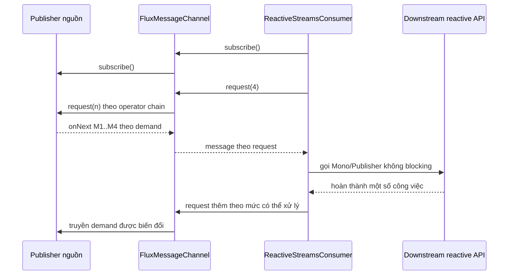
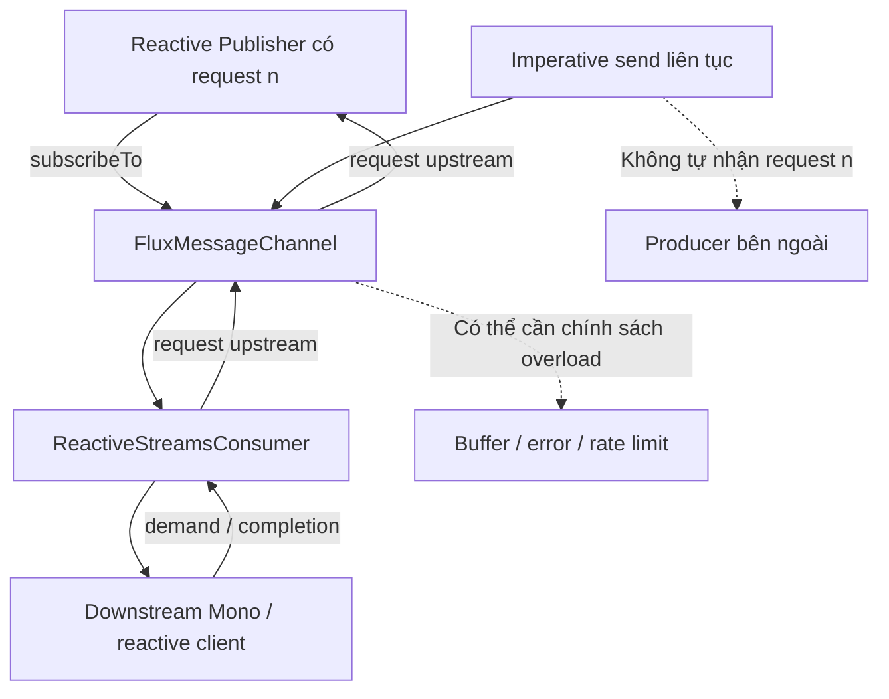
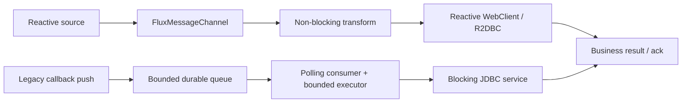

# Chọn reactive runtime khi downstream hỗ trợ backpressure trong Spring Integration

## 1. Vấn đề cần giải quyết: nguồn nhanh hơn đích

Trong module `SPRING_INTEGRATION_RUNTIME`, Spring Integration điều phối message qua **channel, endpoint, consumer, poller và executor**, đồng thời xử lý transaction, retry, message store, lỗi, correlation và trạng thái runtime. Cùng một flow có thể chạy theo mô hình **imperative push** hoặc kết hợp **Reactive Streams**. Quyết định chọn reactive runtime nên bắt đầu từ một câu hỏi: **downstream có thật sự hỗ trợ cơ chế yêu cầu số phần tử có thể nhận (backpressure), và tín hiệu đó có truyền ngược được tới nguồn không?**

Giả sử một adapter đọc sự kiện từ nguồn có thể phát 10.000 message/giây, còn dịch vụ đích chỉ xử lý được 1.000 message/giây:

- Với push vô hạn, chênh lệch có thể tích tụ trong `QueueChannel`, executor queue, buffer của network driver hoặc heap.
- Nếu nguồn **hỗ trợ Reactive Streams Publisher và thực sự tôn trọng `request(n)`**, downstream có thể điều tiết lượng message phát ra.
- Nếu nguồn là callback/adapter không hỗ trợ dừng hoặc giảm nhịp, chỉ thêm `FluxMessageChannel` **không biến nó thành nguồn có backpressure end-to-end**.
- Nếu handler vẫn gọi JDBC blocking hoặc HTTP blocking trên event-loop, dùng Reactor API không tự khiến thao tác ấy non-blocking.

Mục tiêu không phải “mọi thứ đều reactive” mà là **đặt ranh giới reactive đúng nơi downstream và upstream cùng tuân thủ demand**, còn những chặng không hỗ trợ thì phải có **hàng đợi hữu hạn, chính sách overflow, concurrency limit, retry và recovery**.

### Kết quả học tập

Sau bài này, bạn cần có khả năng:

1. Giải thích `Publisher`, `Subscriber`, `Subscription.request(n)` và đường truyền demand.
2. Nhận ra ranh giới mà `FluxMessageChannel`, `ReactiveStreamsConsumer` hoặc một adapter reactive **giữ được** hay **mất đi** backpressure.
3. Dùng `IntegrationFlow`/`handleReactive` khi downstream là API non-blocking trả `Mono`/`Flux`.
4. Giới hạn độ đồng thời, prefetch và bộ nhớ; xử lý tình huống nguồn không thể giảm tốc.
5. Phân biệt lỗi reactive `onError`/`cancel` với `errorChannel`, transaction, ack, retry và idempotency.
6. Đưa ra quyết định chọn **reactive, imperative hoặc hybrid** bằng phép đo runtime, không chỉ bằng cú pháp API.

## 2. Backpressure là một hợp đồng, không phải một kiểu channel

Trong Reactive Streams, `Subscriber` nhận một `Subscription` và gọi `request(n)` để thông báo còn khả năng nhận thêm tối đa `n` phần tử. `Publisher` không được phát nhiều phần tử `onNext` hơn demand chưa tiêu thụ. Nếu downstream không còn demand, publisher tuân thủ hợp đồng phải dừng hoặc điều phối việc phát tiếp.



Sơ đồ là **mô hình**; các operator như `flatMap`, `publishOn` và `limitRate` có thể **biến đổi lượng request và prefetch**. Không mặc định request từ subscriber được truyền nguyên con số qua từng thành phần.

### Những khái niệm cơ bản

| Khái niệm | Ý nghĩa runtime | Điều cần tránh suy diễn |
|---|---|---|
| `Publisher<T>` | Nguồn có thể phát `onNext`, `onError`, `onComplete` sau khi được subscribe | Có Publisher chưa chắc dữ liệu bên ngoài hỗ trợ demand thật |
| `Subscriber<T>` | Bên tiêu thụ, nhận `Subscription` và điều khiển demand | `subscribe()` kiểu lambda thông thường của Reactor có thể yêu cầu `Long.MAX_VALUE` |
| `Subscription.request(n)` | Tín hiệu yêu cầu thêm `n` phần tử | Không phải API để tăng kích thước disk queue hay retry message |
| `Subscription.cancel()` | Hủy subscription và yêu cầu dừng phát | Không rollback một HTTP/DB side effect đã commit |
| `Mono<T>` | Publisher phát tối đa một phần tử, hoặc hoàn thành rỗng/lỗi | Tạo `Mono.just(blockingCall())` **vẫn gọi blockingCall ngay** |
| `Flux<T>` | Publisher phát 0..N phần tử | `Flux` không có nghĩa mọi operator và adapter đều non-blocking |
| `Demand / in-flight` | Lượng request còn mở và các công việc đang xử lý | Demand, concurrency và queue capacity là **ba đại lượng khác nhau** |

Hợp đồng backpressure giúp tránh buộc consumer phải buffer vô hạn trong mô hình async, nhưng **không hứa rằng toàn bộ hệ thống sẽ dùng bộ nhớ hằng số**: operator còn có prefetch, buffer; producer có thể không tuân thủ; nhiều request đang chạy có thể giữ payload lớn; error/retry và trace/log vẫn tốn tài nguyên.

## 3. Quy tắc quyết định: chọn reactive khi nào?

Chọn reactive runtime khi **đồng thời** đạt những điều kiện then chốt:

1. **Nguồn có thể điều tiết**: một `Publisher` từ reactive driver, polling source được gói đúng contract, hoặc adapter có thể kiểm soát nhịp nhận/ack.
2. **Đường đi tiếp tục giữ reactive semantics**: sử dụng `FluxMessageChannel`/`ReactiveStreamsConsumer` hoặc các bridge đã kiểm chứng, tránh vô tình chuyển về push vô hạn ở giữa.
3. **Downstream trả kết quả bất đồng bộ thực sự**: Reactor Netty, WebFlux, R2DBC, reactive MongoDB hoặc client có API Publisher; không gọi `block()` trong event-loop.
4. **Bộ nhớ và concurrency có giới hạn**: xác định in-flight calls, prefetch, queue, timeout, overload và cách đo.
5. **Hợp đồng recovery rõ ràng**: hủy subscription hoặc mất kết nối có ý nghĩa gì đối với message chưa ack, transaction, retry và idempotency.

Nếu một trong các điều kiện không đạt, **imperative hoặc hybrid** thường là lựa chọn an toàn, dễ chẩn đoán hơn.

| Tình huống | Lựa chọn nên khảo sát | Vì sao |
|---|---|---|
| Nguồn là reactive Publisher; đích là WebClient/R2DBC hỗ trợ demand | Reactive flow với `FluxMessageChannel` và reactive endpoint | Có cơ hội truyền demand xuyên suốt, giảm tích tụ buffer do push |
| Nguồn non-reactive có thể poll theo lịch; đích reactive | Reactive polling bridge hoặc hybrid | Giữ nhịp lấy message phù hợp demand, nhưng vẫn phải kiểm thử cách `receive()` hoạt động |
| Nguồn callback push không điều tiết; đích reactive | Boundary **bounded buffer** + overflow/flow control tại nguồn nếu có | Downstream không thể bắt nguồn không hỗ trợ backpressure ngừng phát chỉ bằng `request(n)` |
| Handler dùng JDBC blocking hoặc file I/O đồng bộ | Imperative bounded executor/poller hoặc hybrid tách blocking | Reactor API không biến blocking I/O thành non-blocking |
| Work cần transaction JDBC thread-bound lớn, tuần tự | Imperative `@Transactional` trong consumer thread | Transaction imperative và reactive scheduler không tự chuyển context |
| Cần throughput cao, nhiều request I/O đồng thời nhưng non-blocking | Reactive, đo concurrency/prefetch và saturation | Tối ưu resource usage có thể đáng kể khi wait I/O nhiều |
| Đích cần thứ tự nghiêm ngặt per customer/correlation | Reactive có `concatMap`/partition theo key hoặc imperative serialized consumer | `flatMap` có thể đảo completion order nếu không thiết kế thứ tự |

**Tối ưu hóa thực tế:** nếu chỉ có 100 event/phút và JDBC nhỏ, mô hình imperative có transaction rõ ràng thường dễ vận hành. Reactive mang thêm yêu cầu quan sát subscription, cancel, scheduler, buffer và resource cleanup. Chọn dựa trên dữ liệu về nhu cầu concurrency, I/O wait và backlog.

## 4. FluxMessageChannel khác DirectChannel, ExecutorChannel và QueueChannel thế nào?

Spring Integration có nhiều triển khai channel; tính chất channel quyết định đường đi xử lý.

| Channel | Cơ chế chính | Backpressure/demand | Ranh giới thread | Durability |
|---|---|---|---|---|
| `DirectChannel` | Gửi đồng bộ vào handler trong call stack của producer | Chặn producer bằng thời gian xử lý đồng bộ, **không** là Reactive Streams demand | Cùng thread thông thường | Không lưu backlog |
| `ExecutorChannel` | Giao message cho `TaskExecutor` | Theo capacity/rejection của executor, không có `Subscription.request(n)` end-to-end | Sang thread executor | Queue trong executor thường không durable |
| `QueueChannel` | Lưu message rồi polling consumer lấy | Có capacity/`sendTimeout`, nhưng không phải Reactive Streams demand | Producer và poller tách nhau | Phụ thuộc MessageStore |
| `FluxMessageChannel` | `MessageChannel` đồng thời là `Publisher<Message<?>>` và `ReactiveStreamsSubscribableChannel` | Có thể liên kết upstream Publisher với downstream Subscriber theo demand | Theo operator/scheduler, không mặc định đổi thread | Không tự trở thành persistent queue |

`FluxMessageChannel` **không phải `SubscribableChannel` hay `PollableChannel` thông thường**. Các consumer reactive được kết nối bằng contract `Publisher`/`Subscriber`, với `ReactiveStreamsConsumer` làm cầu nối cho endpoint của Spring Integration.

### Hai đầu vào vào FluxMessageChannel không tương đương

- **`subscribeTo(Publisher<? extends Message<?>>)`:** kết nối một upstream Publisher để channel đăng ký nhận khi sẵn sàng; demand có cơ hội truyền ngược theo Reactive Streams.
- **`send(Message<?>)`:** một caller imperative đẩy message vào kênh. Dòng gọi `send()` **không được biến thành một reactive Publisher tôn trọng `request(n)`** chỉ vì đích là `FluxMessageChannel`. Với burst push, phải tìm hiểu buffer, overflow/rejection semantics của phiên bản, producer rate-limit và backpressure tại nguồn.



Đường reactive chính xác phụ thuộc component và operator: không có “backpressure tự động end-to-end” nếu sau channel vẫn là handler đẩy kết quả qua queue không giới hạn hoặc call blocking mất khả năng nhận demand.

## 5. ReactiveStreamsConsumer và reactive handler thực thi ra sao?

Trong Spring Integration, `ReactiveStreamsConsumer` nối subscriber semantics của Reactor với endpoint/`MessageHandler`. Điểm khác biệt cốt lõi: **khi dùng nguồn reactive và handler có Publisher**, công việc có thể được nối vào stream, thay vì subscribe tách biệt cho từng message.

### 5.1. ReactiveMessageHandler

`ReactiveMessageHandler` trả một `Mono<Void>` mô tả công việc bất đồng bộ. Ví dụ:

```java
@FunctionalInterface
public interface AsyncWorkClient {
    reactor.core.publisher.Mono<Void> execute(WorkRequest request);
}
```

Nếu handler này được sử dụng trong **imperative flow**, Spring Integration phải subscribe kết quả trong adapter để thực thi; ở điểm đó không thể suy ra end-to-end demand của một reactive graph. Nếu input/output và consumer đều reactive, framework có thể compose publisher vào flow để downstream điều tiết.

Spring Integration 6.1+ có DSL `handleReactive(...)` cho terminal handler. Với adapter còn dùng hệ thống external, phải xác định **reactive client thực** chứ không dựa vào kiểu trả `Mono` giả.

### 5.2. Reply dạng Mono/Flux

Một service activator có thể trả `Mono<Reply>` hoặc `Flux<Reply>`. Khi output là `ReactiveStreamsSubscribableChannel` (ví dụ `FluxMessageChannel`), Spring Integration có thể flatten/react theo demand. Nếu output là imperative channel, kết quả có thể được xử lý theo cơ chế async hoặc bọc Publisher thành payload; **không mặc định mọi `Flux` được subscribe/flatten như nhau ở mọi output channel**.

Với gateway trả `Mono<?>`, thao tác request–reply có thể được hoãn đến khi subscriber đăng ký. Tuy nhiên **không phải mọi nhánh downstream phía sau gateway đều reactive**, đặc biệt nếu có JDBC blocking hoặc adapter không hỗ trợ demand.

### 5.3. Dùng reactive endpoint trên kênh thường

Từ Spring Integration 5.5, endpoint DSL có lựa chọn `reactive()`, tương ứng annotation `@Reactive` cho các messaging annotation như `@ServiceActivator`. Lựa chọn này có thể đưa một endpoint vào mô hình `ReactiveStreamsConsumer` dù input channel không phải `FluxMessageChannel`.

**Giới hạn:** chuyển một `DirectChannel` sang subscriber bridge **không cấp cho caller imperative cơ chế `request(n)`**; bạn đã tạo một ranh giới hybrid, phải đo công suất và chính sách buffer/cancel.

## 6. Ví dụ Spring Boot + Spring Integration: downstream là Mono non-blocking

Ví dụ dùng Spring Boot, Spring Integration **6.1+**, Reactor Core và Java 17+. Đoạn code mô phỏng một downstream bất đồng bộ bằng `Mono.delay()` để có thể quan sát pipeline mà không gọi network; nó **không** đại diện cho transaction hoặc client thực. Khi áp dụng production, thay bằng client reactive như `WebClient`/R2DBC hoặc adapter phù hợp.

Một class Java hoàn chỉnh:

```java
package example.integration;

import java.time.Duration;

import org.springframework.boot.ApplicationRunner;
import org.springframework.boot.SpringApplication;
import org.springframework.boot.autoconfigure.SpringBootApplication;
import org.springframework.context.annotation.Bean;
import org.springframework.integration.channel.FluxMessageChannel;
import org.springframework.integration.config.EnableIntegration;
import org.springframework.integration.dsl.IntegrationFlow;
import org.springframework.messaging.Message;
import org.springframework.messaging.support.MessageBuilder;

import reactor.core.publisher.Flux;
import reactor.core.publisher.Mono;

@SpringBootApplication
@EnableIntegration
public class ReactiveRuntimeDemo {

    public record WorkRequest(String eventId) {}

    @FunctionalInterface
    public interface ReactiveWorkClient {
        Mono<Void> process(WorkRequest work);
    }

    @Bean
    public FluxMessageChannel reactiveWorkIn() {
        return new FluxMessageChannel();
    }

    @Bean
    public ReactiveWorkClient reactiveWorkClient() {
        return work -> Mono.delay(Duration.ofMillis(80))
                .doOnNext(tick ->
                        System.out.println("Completed " + work.eventId()
                                + " on " + Thread.currentThread().getName()))
                .then();
    }

    @Bean
    public IntegrationFlow reactiveWorkFlow(
            FluxMessageChannel reactiveWorkIn,
            ReactiveWorkClient reactiveWorkClient) {

        return IntegrationFlow.from(reactiveWorkIn)
                .handleReactive(message ->
                        reactiveWorkClient.process(
                                (WorkRequest) message.getPayload()));
    }

    @Bean
    public ApplicationRunner publishAfterStartup(
            FluxMessageChannel reactiveWorkIn) {

        return args -> {
            Flux<Message<?>> source = Flux.range(1, 100)
                    .doOnRequest(n ->
                            System.out.println("Publisher requested " + n))
                    .map(i -> (Message<?>) MessageBuilder
                            .withPayload(new WorkRequest("evt-" + i))
                            .build());

            // Kết nối một Publisher, KHÔNG loop 100 lần gọi send().
            reactiveWorkIn.subscribeTo(source);
        };
    }

    public static void main(String[] args) {
        SpringApplication.run(ReactiveRuntimeDemo.class, args);
    }
}
```

### 6.1. Điều được minh họa

1. `reactiveWorkIn` vừa là `MessageChannel` vừa là reactive `Publisher<Message<?>>`.
2. `IntegrationFlow.from(reactiveWorkIn)` gắn endpoint reactive với kênh; `handleReactive(...)` thực hiện `Mono<Void>` khi subscribed.
3. `publishAfterStartup` kết nối một upstream `Flux` bằng `subscribeTo(source)`, cho phép framework phối hợp demand với subscriber downstream.
4. `Mono.delay` mô phỏng I/O **không chặn thread**; chương trình không dùng `Thread.sleep` hoặc `Mono.block` trong handler.
5. `doOnRequest` giúp thấy demand được phát từ phía downstream; các giá trị in ra có thể được **batch/prefetch** bởi operator, không nhất thiết đúng 1 cho từng message.

**Không hiểu “subscribeTo thành công” là hoàn tất 100 event.** Việc subscribe và xử lý xảy ra theo lifecycle của các publisher/endpoint, có thể còn đang diễn ra khi callback cấu hình nguồn trả về. `Mono<Void>` hoàn tất chỉ chứng minh handler giả lập đã hoàn thành; với business production cần thêm ack/commit.

### 6.2. Vì sao ví dụ không tự cho biết concurrency tối đa?

`handleReactive` nối handler vào framework, còn lượng công việc in-flight phụ thuộc vào cách `ReactiveStreamsConsumer` phối hợp source, concurrency, prefetch và operator. Để đặt một **giới hạn có thể nhìn thấy ngay trong code**, ta xét một pipeline Reactor thuần ở mục 7. Không suy diễn “Mono.delay 80 ms” nghĩa là tự động chạy đúng 1 hoặc đúng 8 yêu cầu cùng lúc.

### 6.3. Dependency và version

Ví dụ sử dụng:

- `spring-integration-core` (thường qua `spring-boot-starter-integration`), Spring Boot tương thích.
- Reactor Core qua Spring Integration/runtime dependencies phù hợp.
- Java 17+.
- `handleReactive` xuất hiện từ Spring Integration **6.1**; nếu đang dùng 5.x/6.0, phải thay bằng cấu hình `ReactiveMessageHandler`/endpoint tương ứng.
- Nếu thay giả lập bằng WebClient hoặc R2DBC, thêm dependency client/driver thực tế.

**Đây là flow minh họa**, không phải job queue bền vững. `Flux.range` được tái tạo mỗi lần chạy; nếu app chết trước khi xử lý xong, không có cơ chế tự ghi lại offset/ack từ nguồn giả lập này.

## 7. Đặt concurrency, prefetch và demand có giới hạn

`flatMap` cho phép nhiều tác vụ bất đồng bộ đang chạy. Reactor có overload `flatMap(mapper, concurrency)` và `flatMap(mapper, concurrency, prefetch)`. Số `concurrency` khống chế số inner publishers có thể active, nhưng tổng memory còn phụ thuộc buffer/prefetch, payload, publisher nội bộ và hệ thống đích.

Ví dụ Reactor độc lập, dùng sau khi đã có một `Flux<Message<?>> publisher`:

```java
import java.time.Duration;
import org.springframework.messaging.Message;
import reactor.core.publisher.Flux;
import reactor.core.publisher.Mono;

Flux<Message<?>> processed = publisher
        .flatMap(message ->
                Mono.delay(Duration.ofMillis(80))
                        .thenReturn(message),
                8)                      // tối đa 8 inner publishers active
        .limitRate(16);                 // điều chỉnh nhịp yêu cầu upstream

processed
        .doOnNext(message ->
                System.out.println("Processed " + message.getHeaders().getId()))
        .doOnError(error -> System.err.println("Failure " + error))
        .subscribe();
```

Đoạn này **không gắn vào flow mục 6**; nó minh họa cơ chế Reactor thuần để giải thích `concurrency`/`limitRate`. Biến `publisher` là một `Flux<Message<?>>` upstream do ứng dụng cung cấp.

**Ba giới hạn không giống nhau:**

| Khái niệm | Điều kiểm soát | Điều không bảo đảm |
|---|---|---|
| `flatMap(..., 8)` | Tối đa 8 inner publishers được subscribe đồng thời tại operator | Không giới hạn toàn bộ buffer, message size hay concurrency của nhiều pipeline khác |
| `prefetch` | Số phần tử operator yêu cầu trước để có sẵn theo chính sách riêng | Không phải kích thước byte của heap hoặc Redis/JDBC queue |
| `limitRate(16)` | Chia request lớn thành các batch request nhỏ hơn ở upstream | Không phải token bucket/rate limiter chính xác 16 request/giây |
| `concatMap` | Xử lý/emit theo trình tự từng inner publisher | Có thể giảm throughput khi I/O latency lớn |
| `onBackpressureBuffer(capacity)` | Tạo vùng đệm có giới hạn khi có nguồn push/đoạn thiếu demand | Không tự làm nguồn callback bên ngoài dừng phát; overflow phải có policy |

Nếu business yêu cầu ordering theo key, có thể tách theo partition/correlation rồi serialize trong từng partition. `flatMap` không giữ thứ tự **hoàn thành** khi các request có latency khác nhau; `flatMapSequential` giữ thứ tự output nhưng vẫn có thể làm nhiều inner cùng lúc và buffer kết quả.

### 7.1. Demand không đồng nghĩa tốc độ cố định

Nếu downstream chỉ xử lý được `μ` event/giây, operator demand có thể giảm tốc độ nguồn **nếu nguồn hợp tác**. Nó không giống rate limiting: một subscriber có thể request 32 phần tử rồi xử lý rất nhanh; burst vẫn xảy ra trong giới hạn đã request.

Đối với downstream API có quota (ví dụ 200 calls/giây), ngoài backpressure còn cần **rate limiter**, concurrency limit, retry backoff và bảo vệ timeout. Nếu nguồn không chịu demand, đặt ranh giới overflow rõ thay vì tạo buffer không giới hạn.

## 8. Khi downstream không hỗ trợ backpressure, thiết kế hybrid thế nào?

Có ba trường hợp nên nhận diện:

### 8.1. Nguồn không thể dừng

Một callback từ legacy library liên tục gọi `send(message)` có thể đẩy nhanh hơn downstream xử lý. `FluxMessageChannel` nhận dạng Publisher ở phía tiêu thụ nhưng callback producer **không nhận `Subscription.request(n)`**.

Giải pháp khả thi:

- Sử dụng API pause/resume của driver nếu có, hoặc chỉ poll khi consumer còn capacity.
- Áp dụng bounded queue/buffer có **capacity theo số message và byte**, timeout, overflow policy (reject/drop chỉ khi nghiệp vụ cho phép).
- Dùng durable broker hoặc `JdbcChannelMessageStore` nếu không được phép mất message khi overflow hoặc restart.
- Đặt metric `rejected`, `oldestBacklogAge`, `bufferUsed`, `producerLag`, `inFlight` và cảnh báo theo SLA.
- Khi nguồn có thể replay, reject có kiểm soát và ack/nack theo đúng hợp đồng có thể an toàn hơn memory buffer không giới hạn.

**Không tự động dùng `onBackpressureBuffer()` không đối số** cho luồng production có tải không biết trước. Bộ đệm không giới hạn chuyển vấn đề áp lực từ downstream sang heap, có thể dẫn tới OOM. Với `onBackpressureDrop`/`Latest`, xác nhận nghiệp vụ cho phép mất những event bị loại; không dùng cho thanh toán hoặc command không thể tái tạo.

### 8.2. Downstream còn JDBC blocking

Gọi JDBC trực tiếp trong Reactor event-loop gây block thread, tăng latency của những stream khác. Trong trường hợp chưa thể thay driver:

```java
import reactor.core.publisher.Mono;
import reactor.core.scheduler.Schedulers;

Mono<Receipt> bridgeBlockingJdbc(String eventId) {
    return Mono.fromCallable(() -> legacyJdbcService.loadReceipt(eventId))
            .subscribeOn(Schedulers.boundedElastic());
}
```

Đoạn minh họa này giả định `Receipt` và `legacyJdbcService` do ứng dụng định nghĩa. `boundedElastic` **cách ly** blocking call khỏi event-loop và giới hạn tài nguyên theo scheduler config; nó **không làm JDBC non-blocking**. Phải đo thread/queue saturation, connection-pool capacity và tối đa số `flatMap` subscriptions; một blocking call bị timeout ở Reactor không nhất thiết đã bị hủy ở driver.

Nếu nghiệp vụ cần atomic transaction JDBC, cách ly toàn bộ các câu lệnh liên quan trong một service chạy **cùng thread blocking được cấp**, dùng `@Transactional` qua proxy. Đừng coi transaction gắn ThreadLocal của thread hiện tại là thứ tự động truyền qua `publishOn` hoặc `subscribeOn`.

### 8.3. Nguồn/đích hỗn hợp

Một kiến trúc thực tế có thể là:



Không cần ép cả hai nhánh thành reactive chỉ để đồng nhất code. Chọn cầu nối theo **hợp đồng nguồn/đích**, có thể vừa reactive cho HTTP non-blocking vừa imperative cho JDBC transaction.

## 9. Poller và publisher: demand đi tới nguồn được đến đâu?

`SourcePollingChannelAdapter` thông thường dựa vào `TaskScheduler` để gọi một `MessageSource` theo lịch. Khi output là `ReactiveStreamsSubscribableChannel`, Spring Integration có cơ chế tạo publisher dựa vào trigger/poll, cho phép downstream subscription/demand ảnh hưởng việc lấy message.

`ReactiveMessageSourceProducer` cũng có thể biến `MessageSource` thành nguồn reactive-style với các lần `Mono` resubscribe; framework sử dụng scheduler thích hợp để tránh chặn reactive thread khi gọi nguồn blocking. Đây là **bridge** giúp điều phối demand, chứ không chứng minh bản thân JDBC/file source đã có native reactive API.

Những giới hạn bắt buộc kiểm tra:

- `receive()` của nguồn có thể **có side effect**: pop queue, claim file, ack broker hoặc commit offset; nếu subscriber cancel, thao tác đã thực hiện có thể không đảo ngược được.
- Poller có `maxMessagesPerPoll`, trigger và transaction advice; số message poll theo mỗi chu kỳ khác với số phần tử demand của subscriber.
- Khi chỉ có `QueueChannel` in-memory, restart có thể làm mất backlog; reactive channel không tự thay persistence.
- Khi transaction JDBC nằm trên thread poller nhưng kết quả chuyển qua reactive scheduler/executor, transaction **không tự kéo dài** theo downstream.
- Khi `MessageSource` trả `null` (không có dữ liệu), cách lặp lại và delay phụ thuộc bridge/policy; tránh busy loop nếu nguồn rỗng.

Cần đọc đúng tài liệu của **adapter** đang dùng (JDBC, FTP, Kafka, HTTP, RSocket, MongoDB, R2DBC...) để biết khi nào message được ack, có pause/resume, có native reactive API và có backpressure thật hay không.

## 10. Subscription, lifecycle và hủy flow

Trong Reactor, **khai báo pipeline** và **thực thi pipeline** là hai giai đoạn. Một cold Publisher thường không thực hiện việc tạo sự kiện trước khi có subscription. Ngược lại, `FluxMessageChannel` chứa một hot-source/sink bên trong; gọi `send()` có thể phát theo thời điểm gửi. Phân biệt hot/cold khi thử nghiệm và thiết kế khởi động:

| Thao tác | Cần hiểu |
|---|---|
| Khai báo `Flux`/`Mono` cold | Thường chưa chạy work cho tới `subscribe`; mỗi subscription có thể tạo lại việc |
| `subscribe()` | Bắt đầu thực thi; overload lambda mặc định thường request không giới hạn |
| `cancel()`/`Disposable.dispose()` | Hủy nhận tín hiệu, nhưng không rollback resource external đã commit |
| `onComplete` | Publisher phát xong theo contract, không nhất thiết broker ack đã hoàn tất nếu source/handler contract khác |
| `onError` | Terminal error của một subscription; policy retry/restart phải có chủ sở hữu |
| ApplicationContext `stop()` / flow stop | Dừng adapter/endpoint theo lifecycle; không mặc định xóa persistent state hoặc hoàn tác request ngoài hệ thống |

Java DSL Spring Integration có `toReactivePublisher()` và biến thể `toReactivePublisher(boolean autoStartOnSubscribe)` để nối flow thành Publisher và điều phối lifecycle. Đăng ký flow động cần kiểm tra lúc start/stop, subscriber hủy, và chuyện một Publisher nóng được subscribe nhiều lần.

**Không có subscriber ≠ không có dữ liệu cần lưu.** Với nguồn push hoặc broker, dữ liệu có thể tiếp tục tồn tại ở upstream hoặc buffer. Phải biết ai giữ message trong thời gian không có demand hoặc sau restart. `FluxMessageChannel` không phải message store durable.

## 11. Lỗi, retry và cancel không thay thế rollback hoặc idempotency

Mô hình signal reactive có ba sự kiện kết thúc: `onComplete`, `onError`, `cancel` (hủy từ downstream). Một error terminal có thể dừng subscription; ở một số flow, nếu không có recovery/retry thì upstream không phát tiếp nữa.

### 11.1. Ví dụ retry đúng cấp độ

```java
import java.time.Duration;
import reactor.core.publisher.Mono;
import reactor.util.retry.Retry;

Mono<Receipt> callService(String businessId) {
    return webClientCall(businessId)
            .retryWhen(Retry.backoff(3, Duration.ofMillis(200))
                    .filter(this::isTransientFailure));
}
```

Snippet giả định `webClientCall` và `isTransientFailure` do ứng dụng định nghĩa. `retryWhen` **resubscribe** vào upstream publisher khi gặp lỗi; nếu producer có side effect, mỗi attempt có thể thực hiện lại. Chỉ dùng retry khi operation có idempotency key hoặc cơ chế chống tác dụng trùng, lỗi là tạm thời và có retry budget.

**Phân biệt:**

- `retryWhen` của Reactor: resubscribe reactive chain.
- `RequestHandlerRetryAdvice` của Spring Integration: retry quanh handler theo advice chain.
- Broker redelivery: message đến lại theo nguồn/ack, có thể sau restart.

Kết hợp cả ba mà không có giới hạn có thể nhân số attempt ngoài mong muốn. Đặt metric `attemptCount`, deadline, backoff và giới hạn tổng; luôn có đường DLQ/quarantine/đối soát cho lỗi cuối.

### 11.2. Timeout và cancel

`timeout(Duration)` có thể phát lỗi và hủy subscription, nhưng **không bảo đảm HTTP provider đã dừng** hoặc business DB đã rollback. Một request server-side có thể đã commit trước khi client nhận timeout. Nếu retry sau timeout, dùng **business event ID/idempotency key** giữ nguyên.

### 11.3. ErrorMessage khác onError

Trong imperative message flow, lỗi ở handler có thể thành `MessagingException` và được gửi thành `ErrorMessage` đến `errorChannel` khi có error publisher thích hợp. Trong một reactive subscription, lỗi có thể đi qua signal `onError` và bị xử lý bằng `onErrorResume`, `doOnError` hoặc terminal subscriber. **Không mặc định mọi `onError` đều đi qua global `errorChannel`**.

Với source adapter reactive, semantics reject/ack có thể phụ thuộc failed message, `AcknowledgmentCallback` và cách framework bắt `MessagingException`. Do đó cần kiểm thử chính xác:

1. Lỗi nằm ở source adapter, mapper, handler reactive, output channel hay external API?
2. Lỗi được **propagate** thành `onError`, convert thành `ErrorMessage`, log rồi nuốt, hay retry?
3. Một message chưa được xử lý đã bị ack chưa? Có thể replay hay cần DLQ?
4. Khi cancel subscription, source dừng/ack/release claim ra sao?
5. Khi flow restart, có idempotency marker bảo vệ business effect không?

Đừng dùng `onErrorContinue` như giải pháp mặc định để bỏ qua lỗi: operator này có semantics đặc thù và có thể làm mất ngữ cảnh lỗi ở upstream; nếu cần bỏ message poison, nên phân loại lỗi và tạo recovery path rõ ràng.

## 12. Transaction trong reactive flow: ThreadLocal khác Reactor Context

Trong mô hình Spring transaction imperative, `PlatformTransactionManager` quản lý transaction gắn với **thread hiện tại**; một `@Transactional` trên service JDBC chỉ có hiệu lực khi gọi qua Spring proxy và giữ trong đúng boundary đó.

Reactive transaction dùng `ReactiveTransactionManager`, gắn transaction với **Reactor Context** của reactive chain, không phải tự động lan từ JDBC ThreadLocal. Một chain dùng `publishOn`, `subscribeOn` hoặc nhiều thread khác nhau cần transaction model phù hợp với resource:

| Resource/cách gọi | Mô hình transaction thường phù hợp | Cảnh báo |
|---|---|---|
| `JdbcTemplate` blocking | `PlatformTransactionManager` + service gọi trong thread blocking phù hợp | Đừng chuyển JDBC transaction sang event-loop rồi mong không block |
| R2DBC reactive | `ReactiveTransactionManager`/`R2dbcTransactionManager` và reactive `@Transactional`/`TransactionalOperator` | Transaction chỉ bao các reactive operation tham gia cùng context/resource |
| Reactive WebClient tới bên ngoài | Không nằm trong local JDBC/R2DBC transaction | API đích phải hỗ trợ idempotency/compensation |
| Broker ack/offset | Giao thức transaction/ack riêng của adapter | Đừng coi completion của `Mono` là ack đã durable nếu adapter không cam kết |

Ví dụ Reactor-style transaction R2DBC (một fragment, cần `TransactionalOperator operator` và reactive repository):

```java
Mono<Void> saveInTransaction(OrderEvent event) {
    return reactiveRepository.save(event)
            .then()
            .as(transactionalOperator::transactional);
}
```

Fragment dùng tên `OrderEvent`, `reactiveRepository` và `transactionalOperator` do ứng dụng cung cấp; cần cấu hình một `ReactiveTransactionManager` thực sự điều khiển resource R2DBC. Nó không bao gồm HTTP/email/broker ack trừ khi có cơ chế phân tán đặc biệt được thiết kế và kiểm thử riêng.

## 13. Sizing: backpressure không thay cho capacity planning

Khi áp dụng reactive, cần đo **độ dài hàng chờ ẩn và số công việc in-flight**.

Giả sử:

- `λ` là tốc độ event vào trung bình (event/giây).
- `μ` là tốc độ đích hoàn tất (event/giây).
- `L` là latency trung bình một request downstream (giây).
- `C` là số request in-flight được cấp (concurrency).
- `S` là kích thước serialized payload trung bình.

Để đạt throughput mục tiêu `μ` với I/O latency `L`, một ước lượng sơ bộ theo Little's Law là:

\[
C \gtrsim \mu \times L
\]

Ví dụ downstream hoàn tất 500 event/giây và mỗi API call mất trung bình 100 ms, số in-flight mục tiêu ban đầu có thể khoảng **50** nếu client/server đủ capacity. Đây là ước lượng **cần đo lại theo phân phối latency, quota, CPU và database pool**, không phải một tham số Spring Integration cố định.

Nếu nguồn đẩy không kiểm soát và `λ = 1.000`, `μ = 500` trong 60 giây:

\[
B \approx \max(0,\lambda-\mu)\times 60 = 30.000 \text{ events}
\]

30.000 message × 20 KiB ≈ 586 MiB payload thô; còn overhead heap/headers/buffer chưa được tính. Demand chỉ làm giảm backlog nếu thực sự **ngăn nguồn phát** hoặc chuyển áp lực lên nơi lưu bền vững upstream; không thể xóa chênh lệch tốc độ bằng annotation.

### Chỉ số cần có

| Metric | Giải thích |
|---|---|
| `source_requested_total`, `source_emitted_total` | Publisher có tôn trọng demand và phát đúng số phần tử không? |
| `inflight_async_operations` | Downstream hiện có bao nhiêu request đang chờ? |
| `flatmap_buffered` / queue size | Có buffer/prefetch không quan sát được từ throughput không? |
| `p95/p99_processing_latency` | Latency khi overload, không chỉ throughput bình quân |
| `scheduler_queued_tasks`, `boundedElastic_active_threads` | Có đang che một nguồn blocking bằng thread pool quá tải không? |
| `channel_send_failed`, `overflow_total` | Push producer có bị reject/drop khi downstream chậm không? |
| `retries_total`, `duplicates_total`, `dlq_total` | Lỗi/cancel có sinh lại message hoặc side effect trùng không? |
| `oldest_unacked_age`, `pending_ack_count` | Recovery từ broker/queue có bị kẹt sau restart không? |
| `error_signal_total`, `subscription_cancel_total` | Reactive subscription kết thúc vì lý do nào? |

Tên metric phía trên là **đề xuất instrument cho ứng dụng**, không phải tên Micrometer metric Spring Integration tự tạo sẵn. Gắn business correlation ID (không chứa secrets) để theo dõi message xuyên scheduler/adapter.

## 14. Thực hành kiểm tra demand: StepVerifier và subscriber có giới hạn

### 14.1. Kiểm tra một cold Publisher trước khi gắn vào flow

Ví dụ dùng `reactor-test`:

```java
import reactor.core.publisher.Flux;
import reactor.test.StepVerifier;

Flux<Integer> source = Flux.range(1, 10)
        .doOnRequest(n -> System.out.println("upstream requested " + n))
        .doOnCancel(() -> System.out.println("cancelled"));

StepVerifier.create(source, 0)
        .thenRequest(1)
        .expectNext(1)
        .thenRequest(2)
        .expectNext(2, 3)
        .thenCancel()
        .verify();
```

`initialRequest = 0` giúp thấy không có `onNext` cho tới khi subscriber chủ động yêu cầu; đây là test **Reactor demand cơ bản**, chưa chứng minh một hệ thống broker/JDBC adapter tôn trọng demand end-to-end.

### 14.2. Subscriber tự yêu cầu từng message

Một subscriber dùng `BaseSubscriber` có thể hạn chế demand:

```java
import org.reactivestreams.Subscription;
import org.springframework.messaging.Message;
import org.springframework.messaging.support.MessageBuilder;
import reactor.core.publisher.BaseSubscriber;
import reactor.core.publisher.Flux;

Flux<Message<?>> stream = Flux.range(1, 10)
        .map(i -> (Message<?>) MessageBuilder
                .withPayload("item-" + i).build());
stream.subscribe(new BaseSubscriber<Message<?>>() {

    @Override
    protected void hookOnSubscribe(Subscription subscription) {
        request(1);
    }

    @Override
    protected void hookOnNext(Message<?> message) {
        System.out.println("Received " + message.getHeaders().getId());
        request(1);
    }
});
```

Nguồn `Flux.range` ở đây là cold Publisher minh họa; muốn kiểm tra một adapter thực, thay nó bằng Publisher do adapter cung cấp và đo `request(n)` tại nguồn. **Cảnh báo:** ví dụ này chỉ cho thấy demand từ subscriber. Nếu `hookOnNext` gọi một API bất đồng bộ rồi **request ngay** trước khi API hoàn tất, nó không giới hạn số tác vụ downstream đang chạy. Muốn điều tiết theo completion, phối hợp `flatMap(concurrency)` hoặc request thêm **chỉ sau** khi tác vụ bất đồng bộ thực sự hoàn thành, đồng thời xử lý error/cancel đúng cách.

### 14.3. Thử lỗi có chủ đích

Trong flow mẫu mục 6, thay client giả lập bằng một `Mono` có delay hoặc throw với xác suất điều khiển được. Đo demand upstream, error signal và số message thực tế được xử lý sau khi một subscription gặp lỗi. Bổ sung retry hữu hạn rồi so sánh attempt count với business event ID. Không dùng random lỗi trên production; nên có failure injection deterministic trong bài test.

## 15. Playbook lựa chọn reactive runtime

Đi qua lần lượt các câu hỏi sau:

1. **Nguồn có phải Reactive Streams Publisher thật?** Nếu không, có API pause/resume, broker consumer flow control hoặc polling điều tiết được không?
2. **Downstream có thể trả Mono/Flux và không blocking?** Nếu còn JDBC/file/HTTP sync, quyết định tách bounded scheduler hoặc giữ imperative.
3. **Demand có đi xuyên qua mọi ranh giới?** Xác định `FluxMessageChannel`, `ReactiveStreamsConsumer`, output channel, splitter/aggregator và adapter.
4. **Có bao nhiêu message/request in-flight?** Giới hạn concurrency, prefetch, buffer capacity, rate và byte size.
5. **Nhánh lỗi đi đâu?** Phân biệt `onError`, `errorChannel`, retry advice, redelivery, timeout và cancellation.
6. **Nguồn ack lúc nào?** Tác dụng nghiệp vụ đã commit chưa; có bị phát lại sau crash/timeout không; có idempotency key ổn định không?
7. **Ordering và correlation có bắt buộc?** `flatMap` có thể hoàn thành sai thứ tự; cân nhắc `concatMap`, partition và message group state.
8. **Transaction nào thực sự được giữ?** JDBC thread-bound hay R2DBC reactive context; có ranh giới executor/poller không?
9. **Quy trình stop/restart** có bảo toàn message chưa xử lý không? Cần durable queue/store hoặc replay, không dựa vào memory channel.
10. **Có bằng chứng đo tải?** So throughput, heap, p95 latency, backlog age và failure recovery giữa reactive và imperative.

### Bảng quyết định cuối

| Tiêu chí | Reactive | Imperative/hybrid |
|---|---|---|
| Upstream Publisher hỗ trợ demand thật | Rất phù hợp | Có thể, nhưng thường bỏ lợi ích điều tiết end-to-end |
| Downstream non-blocking, nhiều I/O in-flight | Rất phù hợp | Tốn nhiều thread hơn nếu blocking wait |
| Blocking JDBC transaction lớn | Cần boundary riêng, không ép lên event-loop | Thường rõ ràng hơn |
| Nguồn push không thể giảm tốc | Không đủ nếu thiếu bounded buffer/overflow | Bounded queue/worker và policy recovery có thể dễ kiểm soát |
| Yêu cầu replay và durable delivery | Cần thêm broker/store và idempotency | Cũng cần nguồn durable và idempotency |
| Đội chưa có tracing/subscription/error observability | Tăng rủi ro vận hành | Có thể chọn mô hình đơn giản hơn trước |

## 16. Bài tập kiểm chứng trong runtime

1. **Publisher theo demand:** chạy `StepVerifier` mục 14, quan sát `request(1)` rồi `request(2)`, giải thích vì sao source không phát đủ 10 phần tử.
2. **Flow reactive:** chạy ví dụ Boot mục 6, quan sát `doOnRequest`, thread name và thời gian xử lý 100 event.
3. **Giảm tốc downstream:** tăng `Mono.delay` từ 80 ms lên 500 ms; đo số in-flight, throughput, buffer và hoàn thành sau khi flow được stop.
4. **Đổi kết nối nguồn:** thay `subscribeTo(source)` bằng loop imperative `send(message)` trong một biến thể thử nghiệm; xác minh vì sao tín hiệu demand của subscriber không điều khiển loop producer.
5. **Concurrency:** tạo Reactor `flatMap` với 4, 8, 32 inner subscriptions, đo p95 latency và throughput; giải thích sự bão hòa của đích.
6. **Ordering:** cho các request có delay khác nhau, so output của `flatMap` và `concatMap`. Dùng business key/correlation để xác minh thứ tự yêu cầu.
7. **Blocking call:** thêm JDBC/`Thread.sleep` trong Reactor operator ở test; quan sát scheduler saturation, sau đó chuyển blocking work sang `boundedElastic` (chỉ như bridge) và đo lại.
8. **Retry và idempotency:** cho client trả lỗi tạm thời, áp dụng retry hữu hạn; xác minh cùng event ID không tạo nhiều side effect.
9. **Cancel và restart:** hủy subscription khi còn in-flight, restart ứng dụng; giải thích message nào cần retry/ack theo nguồn thật và vì sao demo memory-only không bảo đảm recovery.
10. **Transaction:** so một handler JDBC `@Transactional` chạy trong boundedElastic với một R2DBC transaction theo Reactor Context; xác định scope commit/rollback.

Mỗi bài ghi ít nhất: **source type**, demand và request log, in-flight count, scheduler/thread, thời gian xử lý, queue/overflow, `onError`/`cancel`, ack/retry và kết quả nghiệp vụ cuối. Đây là bằng chứng để quyết định reactive runtime có thực sự cải thiện hệ thống không.

## 17. Quy tắc cần nhớ

- Chỉ chọn **reactive runtime vì backpressure** khi nguồn và downstream đều có cách phối hợp `request(n)`, không phải vì API trả `Flux`/`Mono` trông hiện đại.
- `FluxMessageChannel` là `Publisher<Message<?>>` và `ReactiveStreamsSubscribableChannel`; dùng `subscribeTo(Publisher)` để nối nguồn reactive. Một producer imperative `send()` **không tự biến thành nguồn tôn trọng demand**.
- `ReactiveStreamsConsumer` và `handleReactive` giúp compose reactive handler, nhưng hiệu quả end-to-end phụ thuộc **cả adapter và các endpoint trung gian**.
- `flatMap(concurrency)`, prefetch, `limitRate` và bounded buffer là các công cụ **khác nhau**; không được dùng một tham số để tuyên bố hệ thống không thể quá tải.
- Blocking JDBC/HTTP sync vẫn blocking dù nằm trong `Mono`. Dùng bounded scheduler để cô lập hoặc dùng driver reactive đúng nghĩa; phân biệt transaction JDBC ThreadLocal với reactive transaction Context.
- `onError`, cancellation, timeout, retry, `errorChannel` và broker ack có **hợp đồng khác nhau**; phải kiểm tra idempotency và khả năng khôi phục sau crash.
- Reactive không thay thế durable message store, DLQ, correlation hay observability. Đánh giá bằng **throughput, p95/p99 latency, in-flight, backlog, lỗi và recovery**, không chỉ bằng code style.

### Tài liệu tham khảo chính thức

- [Spring Integration Reference — Reactive Streams Support](https://docs.spring.io/spring-integration/reference/reactive-streams.html): `FluxMessageChannel`, `ReactiveStreamsConsumer`, reactive handlers/adapters, gateway, source polling và Java DSL.
- [Spring Integration Reference — Message Channels](https://docs.spring.io/spring-integration/reference/channel.html): `DirectChannel`, `ExecutorChannel`, `QueueChannel`, `FluxMessageChannel` và các ranh giới xử lý.
- [Spring Integration Reference — Annotation Support](https://docs.spring.io/spring-integration/reference/configuration/annotations.html): `@Reactive` và cấu hình endpoint.
- [Spring Integration Javadoc — FluxMessageChannel](https://docs.spring.io/spring-integration/api/org/springframework/integration/channel/FluxMessageChannel.html): `subscribeTo`, `subscribe` và lifecycle.
- [Project Reactor Reference — Backpressure](https://projectreactor.io/docs/core/release/reference/subscribe-backpressure.html): `request(n)`, `limitRate`, prefetch, `BaseSubscriber` và giới hạn demand.
- [Project Reactor Reference — Schedulers](https://projectreactor.io/docs/core/release/reference/coreFeatures/schedulers.html): `boundedElastic` và cách cách ly blocking work.
- [Spring Framework Reference — Reactive Transaction Management](https://docs.spring.io/spring-framework/reference/data-access/transaction/programmatic.html): reactive transaction và `TransactionalOperator`.
