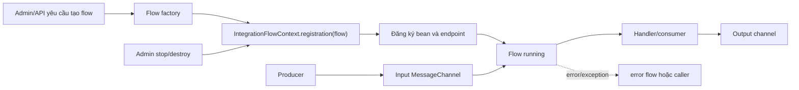
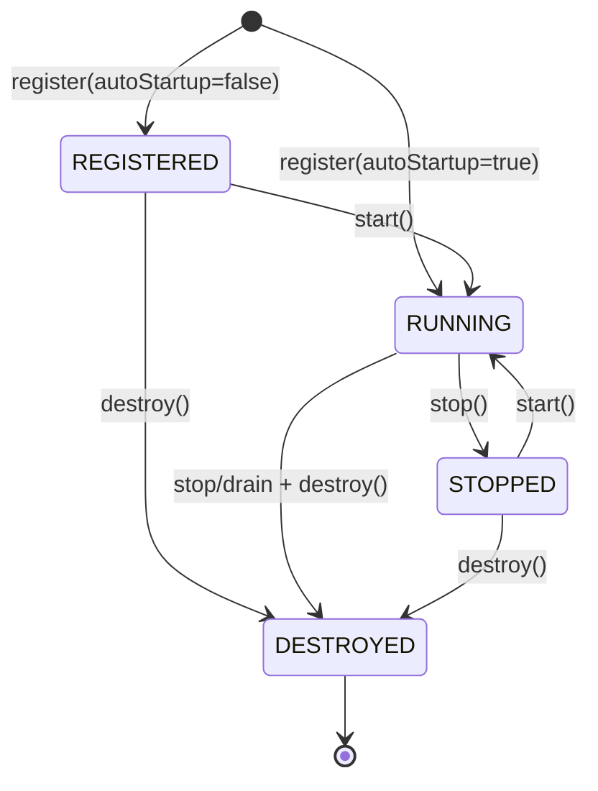
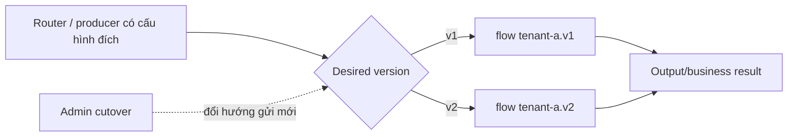
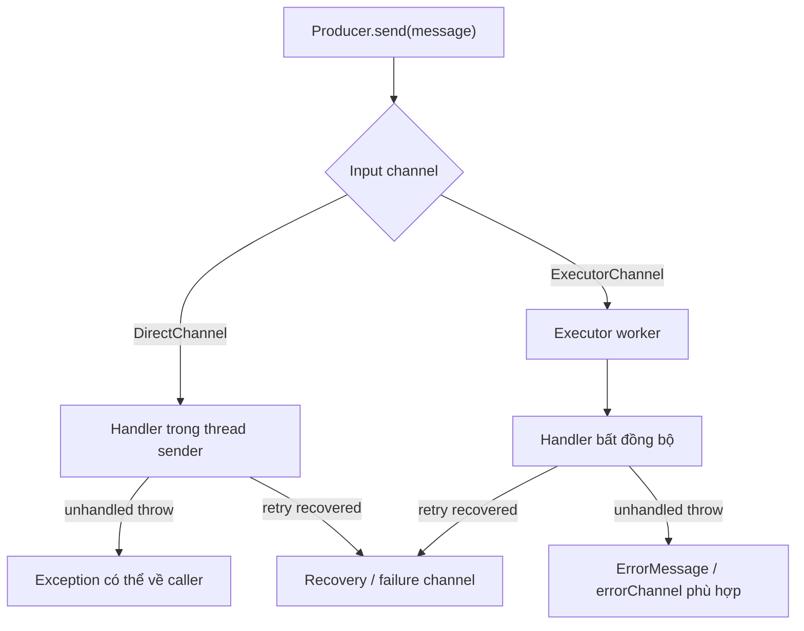
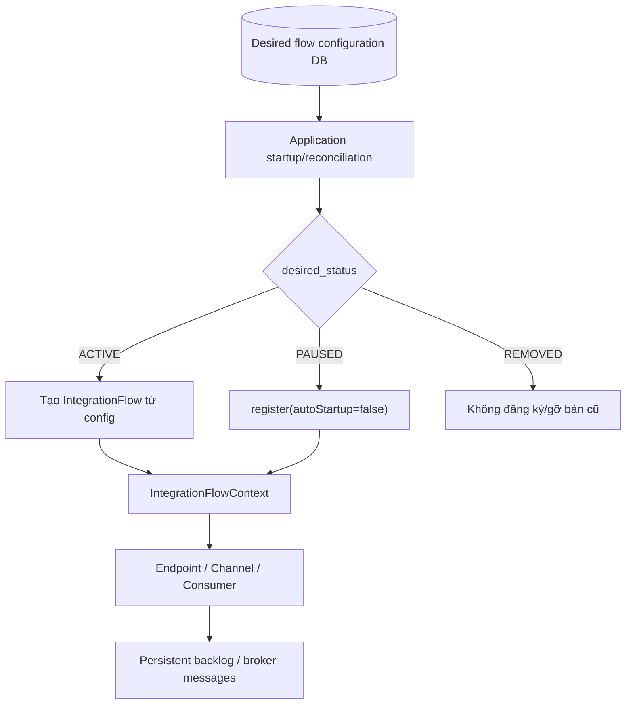

# Đăng ký channel, endpoint và flow khi ứng dụng đang chạy trong Spring Integration

## 1. Vì sao cần dynamic runtime?

Thông thường Spring Integration xây dựng các `MessageChannel`, consumer endpoint và `IntegrationFlow` khi `ApplicationContext` khởi động. Nhưng có những hệ thống mà số lượng luồng hoặc cấu hình của chúng chỉ được biết **sau startup**:

- Một SaaS multi-tenant cho phép khách hàng tự thêm hoặc tạm dừng kết nối SFTP, FTP, TCP, JMS.
- Quản trị viên bật một route xử lý đơn hàng mới mà không khởi động lại toàn bộ dịch vụ.
- Ứng dụng tạo một flow cho mỗi đối tác, với địa chỉ, credentials, bộ lọc và output channel riêng.
- Một subscription hoặc nguồn `Publisher<Message<?>>` chỉ tồn tại khi người dùng đăng ký phiên xử lý.
- Khi đối tác ngừng hợp tác, ứng dụng phải **dừng, giải phóng tài nguyên và xóa flow** mà không ảnh hưởng tenant khác.

Trong chương **Dynamic runtime** của module **SPRING_INTEGRATION_RUNTIME**, bài học **“Đăng ký channel, endpoint và flow khi ứng dụng đang chạy”** tập trung vào việc dùng đúng các API Spring Integration để cấu hình, đăng ký, vận hành, dừng và loại bỏ các thành phần trong một application context đã chạy.

Mục tiêu không chỉ là “tạo thêm bean”. Một giải pháp đúng còn cần trả lời:

1. Channel nào nhận message, endpoint nào subscribe hoặc poll nó?
2. Bean, flow và endpoint có **định danh duy nhất** không?
3. Khi thêm hoặc xóa flow, message đang xử lý được quản lý thế nào?
4. Retry, transaction, `errorChannel`, executor và message store có còn đúng semantics?
5. State nào phải tồn tại qua restart và ai dựng lại flow sau restart?

> **Nguyên tắc:** Đăng ký flow động khác việc lưu trữ flow bền vững. `IntegrationFlowContext` quản lý **bean và lifecycle runtime** trong JVM hiện tại; nó không tự lưu định nghĩa flow vào database để tự phục hồi sau restart.

## 2. Ba cấp độ thay đổi ở runtime

Không phải mọi yêu cầu dynamic đều cần tái tạo cả `IntegrationFlow`.

| Nhu cầu | Công cụ nên cân nhắc | Lưu ý |
| --- | --- | --- |
| Bật hoặc tắt một endpoint đã tồn tại | `SmartLifecycle`, `IntegrationFlowRegistration.start()/stop()` | Giữ nguyên registration và các bean |
| Thêm subscriber/consumer cho một channel có sẵn | Đăng ký một flow mới bắt đầu từ channel đó | Phân biệt dispatch của `DirectChannel` và broadcast của `PublishSubscribeChannel` |
| Tạo channel, endpoint, handler và kết nối thành một flow mới | **`IntegrationFlowContext.registration(flow).register()`** | Đơn giản hóa bean registration, phụ thuộc và lifecycle |
| Tạo một bean channel độc lập cần được các hệ thống khác tra cứu bằng tên | `GenericApplicationContext.registerBean(...)` hoặc bean definition registry | Phải tự quản lý tên, quyền sở hữu và cleanup |
| Thay cấu hình của flow đang chạy | Dừng/đăng ký flow mới, cutover có kiểm soát | Không phải hot swap nguyên tử mặc định |
| Tạo nhiều bản của cùng một mẫu flow | `.id(flowId).useFlowIdAsPrefix()` | Giảm va chạm tên các bean/endpoint bên trong |
| Giữ flow sau restart | Lưu **desired configuration** riêng; dựng lại lúc startup | Registration trong JVM không tự bền vững |

Với yêu cầu đăng ký **cả channel lẫn endpoint** để chúng hoạt động cùng nhau, nên bắt đầu từ `IntegrationFlowContext`. Cơ chế này được thiết kế riêng cho việc quản lý dynamic integration flows, thay vì tự đăng ký từng bean rồi gọi `afterPropertiesSet()` và `start()` theo cách thủ công dễ bỏ sót.

## 3. Flow lúc runtime gồm những thành phần gì?

Một flow không chỉ có một handler. Khi đăng ký Java DSL, Spring Integration có thể cần thêm:

- **Input channel:** điểm nhận `Message<?>`; có thể được tạo tự động hoặc là một channel có sẵn.
- **Endpoint:** ví dụ `EventDrivenConsumer` cho channel kiểu publish/subscribe hoặc polling consumer cho `PollableChannel`.
- **Message handler:** transformer, filter, router, service activator, gateway hoặc handler adapter.
- **Output/reply/error channel:** nơi chuyển kết quả hoặc sự kiện lỗi.
- **Source adapter hoặc poller:** nguồn file, JDBC, TCP, broker hay publisher; có `SmartLifecycle` tương ứng.
- **Support beans:** connection factory, serializer, header mapper, retry advice, transaction manager tham chiếu.
- **Executor/scheduler:** thread dùng cho async boundary hoặc polling; có ownership và lifecycle riêng.



Spring Integration tạo **các bean phụ thuộc** và thực hiện initialization/lifecycle cần thiết khi đăng ký flow theo API chính thức. Tuy nhiên, “đã đăng ký” không đồng nghĩa message đã được xử lý hoặc output đã được commit.

## 4. API nền tảng: IntegrationFlowContext

`org.springframework.integration.dsl.context.IntegrationFlowContext` là API chính cho việc đăng ký và quản lý `IntegrationFlow` **không phải bean cấu hình tĩnh lúc startup**.

Quy trình:

```text
IntegrationFlow flow = ... xây bằng Java DSL ...;

IntegrationFlowRegistration registration =
    flowContext.registration(flow)
        .id("flow-unique-id")
        .useFlowIdAsPrefix()
        .autoStartup(true)
        .register();

registration.getInputChannel();
registration.getMessagingTemplate();
registration.start();
registration.stop();
registration.destroy();
```

Trong code trên, `IntegrationFlowRegistration` là kiểu lồng trong `IntegrationFlowContext`; nên import `IntegrationFlowContext.IntegrationFlowRegistration`. `getInputChannel()` và `getMessagingTemplate()` chỉ phù hợp nếu flow bắt đầu từ một `MessageChannel`. Với flow bắt đầu bằng `MessageSource`/inbound adapter hoặc nguồn không có input channel kiểu đó, gọi các phương thức này có thể gây `IllegalStateException`.

### Các API quan trọng

| API | Ý nghĩa |
| --- | --- |
| `registration(flow)` | Tạo builder cho flow sẽ được đăng ký |
| `.id(flowId)` | Chọn flow ID duy nhất trong application context |
| `.useFlowIdAsPrefix()` | Dùng flow ID làm tiền tố cho các tên bean bên trong, yêu cầu khai báo `id` |
| `.autoStartup(false)` | Đăng ký nhưng không tự khởi động flow |
| `.addBean(name, bean)` | Đăng ký bean hỗ trợ thuộc vòng đời flow |
| `.setSource(source)` | Gắn mô tả nguồn cấu hình để hỗ trợ chẩn đoán |
| `.register()` | Đăng ký flow cùng các thành phần phụ thuộc; trả registration |
| `registration.start()/stop()` | Điều khiển lifecycle của registration |
| `registration.destroy()` | Loại flow và các bean phụ thuộc thuộc quyền sở hữu registration |
| `flowContext.remove(flowId)` | Hủy flow theo ID và dọn cache quản lý nội bộ |
| `flowContext.getRegistrationById(flowId)` | Tìm registration nếu có |
| `flowContext.getRegistry()` | Quan sát mapping các flow đã đăng ký |

**Lưu ý phiên bản:** Tài liệu Spring Integration 6.x và 7.x đều mô tả mô hình `IntegrationFlowContext`; các overload và builder metadata tùy phiên bản. Ví dụ trong bài ưu tiên API phổ biến, nếu dùng method mới cần kiểm tra Javadoc đúng phiên bản dependency của dự án.

## 5. Ví dụ end-to-end: tạo một flow chuẩn hóa order lúc ứng dụng đang chạy

Mẫu này tạo flow khi có yêu cầu, không đòi hỏi phải định nghĩa sẵn một `@Bean IntegrationFlow`. Mỗi flow nhận một `String`, chuẩn hóa chữ, và chuyển vào `QueueChannel` kết quả dành riêng cho flow đó.

### 5.1. Lớp quản lý đăng ký

```java
import java.util.Locale;

import org.springframework.integration.channel.QueueChannel;
import org.springframework.integration.dsl.IntegrationFlow;
import org.springframework.integration.dsl.context.IntegrationFlowContext;
import org.springframework.integration.dsl.context.IntegrationFlowContext.IntegrationFlowRegistration;

public final class RuntimeFlowManager {

    private final IntegrationFlowContext flowContext;

    public RuntimeFlowManager(IntegrationFlowContext flowContext) {
        this.flowContext = flowContext;
    }

    public record FlowHandle(
            IntegrationFlowRegistration registration,
            QueueChannel resultChannel) {}

    public FlowHandle registerOrderNormalizer(String flowId) {

        // Mỗi registration có channel kết quả riêng.
        QueueChannel results = new QueueChannel();

        IntegrationFlow flow = f -> f
                .<String, String>transform(
                        text -> text.strip().toUpperCase(Locale.ROOT))
                .channel(results);

        IntegrationFlowRegistration registration =
                flowContext.registration(flow)
                        .id(flowId)
                        .useFlowIdAsPrefix()
                        .autoStartup(true)
                        .register();

        return new FlowHandle(registration, results);
    }

    public IntegrationFlowRegistration find(String flowId) {
        return flowContext.getRegistrationById(flowId);
    }

    public void destroy(String flowId) {
        flowContext.remove(flowId);
    }
}
```

Lớp `RuntimeFlowManager` là một service ứng dụng; nó cần được tạo như một bean trong Spring context (ví dụ `@Component` hoặc `@Bean` trong cấu hình) để `IntegrationFlowContext` được inject. Việc kiểm tra quyền admin, lưu desired state và đồng bộ các yêu cầu cấu hình sẽ được bổ sung ở phần production.

`IntegrationFlow flow = f -> ...` sử dụng Java DSL dạng lambda: nếu không chỉ rõ input channel, framework tạo một input channel phù hợp để flow nhận message. Đầu ra `results` là `QueueChannel` *in-memory*; nó giúp bài thực hành chờ kết quả, **không phải queue bền vững qua restart**.

### 5.2. Khởi tạo manager trong Spring

```java
import org.springframework.context.annotation.Bean;
import org.springframework.context.annotation.Configuration;
import org.springframework.integration.config.EnableIntegration;
import org.springframework.integration.dsl.context.IntegrationFlowContext;

@Configuration
@EnableIntegration
public class DynamicFlowsConfiguration {

    @Bean
    public RuntimeFlowManager runtimeFlowManager(
            IntegrationFlowContext flowContext) {
        return new RuntimeFlowManager(flowContext);
    }
}
```

`IntegrationFlowContext` là bean hạ tầng được Spring Integration cung cấp; không cần tự instantiate một bản `StandardIntegrationFlowContext` ngoài application context.

### 5.3. Gửi message và nhận kết quả

```java
import org.springframework.messaging.Message;
import org.springframework.messaging.support.MessageBuilder;

RuntimeFlowManager.FlowHandle handle =
        runtimeFlowManager.registerOrderNormalizer(
                "tenant-a.order-normalizer");

try {
    handle.registration()
            .getInputChannel()
            .send(MessageBuilder
                    .withPayload("  order-42  ")
                    .setHeader("correlationId", "checkout-42")
                    .build());

    Message<?> result = handle.resultChannel().receive(2000);

    if (result == null) {
        throw new IllegalStateException("No output in 2 seconds");
    }
    System.out.println(result.getPayload()); // ORDER-42

} finally {
    handle.registration().destroy();
}
```

**Kỳ vọng:** một flow được đăng ký và auto-start, nhận message từ input channel, chạy transformer, chuyển kết quả vào queue, rồi được hủy trong `finally`. Không nên dùng cùng `flowId` cho hai registration đồng thời; ID phải duy nhất trong context.

`receive(2000)` **tiêu thụ** message khỏi `QueueChannel`; trong production không dùng thao tác này chỉ để “nhìn” một queue cần giữ để replay. Với output bền vững, cần persistent channel store và transaction phù hợp.

## 6. Đăng ký channel động theo hai hướng

Có hai cách chính, với các hệ quả ownership khác nhau.

### 6.1. Channel là thành phần của dynamic flow

Khi flow dùng `MessageChannels.direct()` hoặc `MessageChannels.queue()` trong DSL, framework tạo channel cùng các endpoint liên quan, đăng ký các bean phụ thuộc và có thể hủy theo registration.

```java
import org.springframework.integration.dsl.IntegrationFlow;
import org.springframework.integration.dsl.MessageChannels;

// Bản flow độc lập: input channel được tạo bởi DSL.
IntegrationFlow flow = IntegrationFlow
        .from(MessageChannels.direct())
        .filter((String value) -> !value.isBlank())
        .channel(MessageChannels.queue())
        .get();

// Đăng ký bằng flowContext.registration(flow).id(...).register()
```

Ở ví dụ này, `MessageChannels.queue()` tạo một **in-memory pollable channel**. Cần đăng ký poller nếu thêm downstream handler đọc queue; nếu chỉ dừng ở output queue, code khác có thể dùng một tham chiếu hoặc bean phù hợp để lấy dữ liệu.

Ưu điểm: registration sở hữu các thành phần do nó tạo, cleanup đơn giản hơn. Nhược điểm: nếu channel cần được chia sẻ bởi nhiều flow khác nhau hoặc tồn tại lâu hơn flow hiện tại, không nên xem nó là tài nguyên hoàn toàn riêng của một registration.

### 6.2. Channel là bean chia sẻ trong ApplicationContext

Ví dụ có một channel `tenantEvents` lâu dài, còn subscriber được thêm/bớt tùy tenant.

```java
import org.springframework.context.annotation.Bean;
import org.springframework.integration.channel.PublishSubscribeChannel;

@Bean("tenantEvents")
public PublishSubscribeChannel tenantEvents() {
    return new PublishSubscribeChannel();
}
```

Ta có thể tạo flow động bắt đầu từ `tenantEvents`:

```java
import org.springframework.integration.channel.PublishSubscribeChannel;
import org.springframework.integration.dsl.IntegrationFlow;

// auditHandler là MessageHandler/bean dùng chung, đã được cấu hình riêng.
IntegrationFlow auditFlow =
        IntegrationFlow.from(tenantEvents)
                .handle(auditHandler)
                .get();

flowContext.registration(auditFlow)
        .id("tenant-a.audit-listener")
        .useFlowIdAsPrefix()
        .register();
```

Khi hủy registration, flow và endpoint thuộc registration được dừng/gỡ bỏ. **Channel chia sẻ được định nghĩa bằng bean độc lập không nên bị xóa** chỉ vì một subscriber bị gỡ. Lúc quản lý vòng đời, hãy phân biệt **owned components** với **shared dependencies**.

### 6.3. Tạo một bean channel độc lập sau startup

Khi thật sự cần đăng ký một bean `MessageChannel` trước, rồi để các flow khác tra cứu bằng tên, có thể sử dụng API bean definition của Spring Framework, ví dụ một `GenericApplicationContext`:

```java
import org.springframework.context.support.GenericApplicationContext;
import org.springframework.integration.channel.DirectChannel;
import org.springframework.messaging.MessageChannel;

public MessageChannel registerChannel(
        GenericApplicationContext context,
        String beanName) {

    // Ví dụ đơn giản: gọi từ một điểm điều phối đã kiểm tra ID duy nhất.
    context.registerBean(
            beanName,
            DirectChannel.class,
            DirectChannel::new);

    return context.getBean(beanName, MessageChannel.class);
}
```

Đây là **kỹ thuật nền tảng của Spring**, không thay thế `IntegrationFlowContext`. Nó có giới hạn:

- Chỉ áp dụng trực tiếp khi application context hỗ trợ API tương ứng; đừng cast một `ApplicationContext` bất kỳ sang `GenericApplicationContext`.
- Bean name phải hợp lệ/duy nhất; phải đồng bộ các request admin đăng ký cùng tên.
- Việc tạo bean channel không tạo consumer. Gửi vào `DirectChannel` chưa có subscriber sẽ có thể lỗi dispatch.
- Nếu muốn gỡ bean, cần làm đúng quy trình về endpoint đang tham chiếu, bean definition, singleton instance và lifecycle; không xóa một bean còn được flow khác dùng.
- Với endpoint phụ thuộc vào channel, **đăng ký một IntegrationFlow động thường an toàn và dễ kiểm soát hơn**.

Tài liệu Spring Integration lưu ý từ Spring Framework 5 có thể dùng `BeanDefinitionBuilder.genericBeanDefinition(..., instanceSupplier)` để đăng ký bean definition thay vì chỉ gọi `BeanFactory.registerSingleton()`. Cách bean definition giúp Spring thực hiện các bước initialization/lifecycle theo cơ chế thông thường.

## 7. Endpoint động: điều cần hiểu về consumer và channel

Khi thêm endpoint vào một channel đang chạy, loại channel quyết định **ai nhận message**.

| Channel | Nếu có hai consumer/subscriber | Ứng dụng phù hợp |
| --- | --- | --- |
| `DirectChannel` | Unicast dispatch: mỗi message thường đến **một** subscriber theo dispatcher/load-balancing/failover policy | Hai handler chia tải, không phải broadcast |
| `PublishSubscribeChannel` | Broadcast mỗi message cho các subscriber phù hợp, theo cấu hình | Nhiều listener cùng quan sát một event |
| `ExecutorChannel` | Unicast dispatch qua executor; producer có thể về trước handler | Fan-out công việc xử lý bất đồng bộ theo endpoint |
| `QueueChannel` | Poller/consumer cạnh tranh lấy message qua `receive()` | Work queue với một hoặc nhiều competing consumers |
| `FluxMessageChannel` | Subscriber theo Reactive Streams, có demand/cancellation | Reactive source/processor pipeline |

Ví dụ: nếu mong rằng **một** message order đi đến cả billing và audit mà lại gắn hai consumer vào `DirectChannel`, kết quả có thể chỉ một bên nhận. Hãy dùng `PublishSubscribeChannel` hoặc route rõ ràng. Ngược lại, nếu audit là side effect bắt buộc và có thể thất bại, dùng publish-subscribe đồng bộ có thể làm upstream chịu exception của subscriber; phải xác định transaction/error policy.

### Endpoint không tự nhận message nếu chưa start

Một `@ServiceActivator` tĩnh được quét ở startup là một endpoint. Một flow động khai báo `.handle(handler)` cũng tạo endpoint theo lifecycle framework. Khi registration bật `autoStartup(false)`, endpoint có thể đã được tạo nhưng **chưa subscribe/poll**. Vì vậy:

```text
Bean exists    != endpoint running
Endpoint running != handler has processed message
Message sent    != durable/business commit
```

Nếu đầu vào là `QueueChannel`, message có thể còn đợi trong queue đến lúc poller start. Nếu đầu vào là `DirectChannel` và chưa có consumer, lời gọi send có thể thất bại ngay. Nếu dùng source adapter, connector có thể chưa mở connection/listen khi chưa start.

## 8. Lifecycle: registered, started, stopped, destroyed

Một flow động cần được vận hành theo một state machine rõ ràng:



Đây là **mô hình quản trị do ứng dụng định nghĩa**, không phải enum chính thức của `IntegrationFlowRegistration`. Trong framework, `start()`/`stop()` ủy quyền xuống các lifecycle component trong flow.

### Đăng ký nhưng chưa mở intake

```java
import org.springframework.integration.dsl.context.IntegrationFlowContext.IntegrationFlowRegistration;

IntegrationFlowRegistration registration =
        flowContext.registration(flow)
                .id("tenant-a.manual-flow")
                .useFlowIdAsPrefix()
                .autoStartup(false)
                .register();

// Bean có thể đã được đăng ký, nhưng endpoint chưa chủ động chạy.
registration.start();

// Có thể dừng tạm thời.
registration.stop();

// Khi thật sự muốn gỡ toàn bộ flow thuộc registration:
registration.destroy();
```

`autoStartup` mặc định là `true` khi đăng ký flow động. Nếu đặt `false`, ứng dụng **chịu trách nhiệm gọi `start()`** ở thời điểm muốn flow hoạt động.

### Vì sao stop khác destroy?

- `stop()`: dừng các thành phần `SmartLifecycle`, giữ registration và bean; có thể `start()` lại.
- `destroy()`: gỡ dynamic registration cùng các bean phụ thuộc do nó quản lý, không chỉ pause endpoint.
- `flowContext.remove(flowId)`: thao tác tìm registration theo ID và hủy/cleanup tương ứng.
- `close ApplicationContext`: kết thúc toàn bộ ứng dụng, cũng khiến các dynamic registration trong JVM mất.

**Không mặc định stop sẽ chờ mọi tác vụ đang chạy xong.** Một số inbound endpoint có thể dừng nhận mới nhưng các handler đã được dispatch sang executor vẫn đang chạy. Muốn bảo đảm graceful drain phải thiết kế và kiểm thử theo adapter, scheduler, broker acknowledgment và transaction thực tế.

## 9. Flow ID, bean name và va chạm giữa nhiều registration

Khi tạo nhiều bản của một flow template, lỗi phổ biến là các endpoint/handler bên trong có cùng ID.

Ví dụ có hai khách hàng `tenant-a` và `tenant-b`, cùng dùng một flow template khai báo handler `.id("client")`. Nếu đăng ký trực tiếp các bean với tên đó, context có thể gặp collision.

Spring Integration giải quyết tốt hơn bằng:

```java
flowContext.registration(buildFlow(tenantAConfig))
        .id("tenant-a.connector")
        .useFlowIdAsPrefix()
        .register();

flowContext.registration(buildFlow(tenantBConfig))
        .id("tenant-b.connector")
        .useFlowIdAsPrefix()
        .register();
```

Tài liệu chính thức cho biết `useFlowIdAsPrefix()` hữu ích khi nhiều flow có cùng các component IDs bên trong và **bắt buộc có `.id(...)`**. Chẳng hạn một handler tên `client` có thể có bean name được prefix theo flow ID.

Những quy tắc nên áp dụng:

1. Flow ID phải **duy nhất trong một context**; không chỉ là nhãn UI.
2. Dùng một convention ổn định, ví dụ `tenant.<tenantSlug>.connector.<version>`.
3. Đừng ghép nguyên input tùy ý từ người dùng thành ID/bean name; validate, giới hạn độ dài và ký tự.
4. Không đăng ký hai flow đang hoạt động với cùng ID; phải destroy registration cũ trước khi tái sử dụng ID đó.
5. Với shared channel/bean, đừng đổi tên hoặc hủy chỉ vì flow tenant thay đổi.
6. Nếu tên các component cần được tra cứu trong monitoring hoặc management API, giữ convention ổn định qua deploy.

**Không làm `if (getRegistrationById(id) == null) register(id)` rồi coi như đã đồng bộ.** Hai request admin đồng thời có thể cùng vượt qua check; thiết kế một cơ chế điều phối hoặc chấp nhận một request thất bại do trùng ID và trả trạng thái phù hợp.

## 10. Đăng ký support bean đi kèm flow

Một kết nối động có thể cần một `ConnectionFactory`, serializer, header mapper hoặc client bean được tạo từ cấu hình tenant. `IntegrationFlowRegistrationBuilder.addBean(...)` cho phép đăng ký support bean như thành phần **phụ thuộc của registration**.

```java
import org.springframework.integration.dsl.context.IntegrationFlowContext.IntegrationFlowRegistration;

// connectionFactory và flow được tạo từ cấu hình đã kiểm tra,
// ví dụ TCP/JMS/SFTP; đoạn này chỉ minh họa builder API.
IntegrationFlowRegistration registration =
        flowContext.registration(flow)
                .id("tenant-a.remote-input")
                .useFlowIdAsPrefix()
                .addBean("tenant-a.clientResources", connectionFactory)
                .register();
```

Khi flow bị destroy, những bean phụ thuộc **do registration sở hữu** được cleanup theo cơ chế của framework. Nhưng không nên đăng ký một bean **đang dùng chung giữa 10 flow** vào ownership của một tenant chỉ để tiện tra cứu; nó có thể bị hủy khi một flow dừng, làm ảnh hưởng các tenant khác.

### Không bao giờ quên tài nguyên bên ngoài Spring

Một dynamic connector có thể giữ TCP socket, JMS consumer, SFTP session, timer thread hoặc file watcher. Tài nguyên có thể cần `stop()`/`destroy()` đúng thứ tự và cơ chế đóng của thư viện adapter. Không nên chỉ xóa entry khỏi một `Map<String, IntegrationFlow>` rồi nghĩ rằng thread, socket và subscription đã biến mất.

## 11. Reconfigure/hot swap một flow khi đang nhận message

Một yêu cầu thực tế: đổi endpoint HTTP đối tác hoặc biến đổi payload của flow hiện tại mà không restart.

Có hai cách tiếp cận:

### 11.1. Stop–destroy–register lại cùng ID

```text
1. Tạm ngừng nhận message mới cho tenant.
2. Đợi/điều phối các message đang xử lý theo SLA.
3. Dừng registration cũ.
4. Hủy registration cũ, giải phóng bean phụ thuộc.
5. Đăng ký flow mới với cùng ID và cấu hình mới.
6. Start; mở intake và giám sát.
```

Ưu điểm: đơn giản và dễ quản lý ID. Nhược điểm: có thời gian gián đoạn và nguy cơ mất/duplicate nếu chưa thiết kế nguồn durable, ack, transaction và retry.

### 11.2. Blue/green hoặc versioned flow IDs



Quy trình:

1. Đăng ký `tenant-a.v2` với ID mới, chưa chuyển traffic chính.
2. Kiểm tra health, connectivity, metric và schema của v2.
3. Chuyển message mới sang v2 qua router/config được điều phối.
4. Để v1 drain theo chính sách; khi an toàn thì stop/destroy v1.
5. Giữ audit về cấu hình đã áp dụng và cách rollback.

**Đừng xem cutover là atomic mặc định:** nếu router đọc config không đồng bộ trên nhiều instance, có thể có giai đoạn traffic vào cả hai version. Cần định nghĩa idempotency, correlation và thứ tự nghiệp vụ khi chạy song song. Nếu output v1/v2 cùng ghi một business table, unique key và transaction vẫn là lớp bảo vệ cuối.

## 12. Điều gì xảy ra với message đang chạy khi hủy flow?

Giả sử producer đã gửi message tới `ExecutorChannel`, worker vẫn đang xử lý; admin gọi `registration.destroy()`.

Có thể xảy ra:

- Endpoint không nhận message mới nhưng task đã được dispatch vẫn đang thực thi.
- Một source broker đã poll message nhưng chưa ack; adapter stop sẽ tác động tới requeue/redelivery theo transport.
- Transaction đang xử lý có thể commit hoặc rollback; điều đó không được quyết định chỉ bằng việc xóa bean.
- Nếu output channel/handler phụ thuộc bị gỡ trước khi task hoàn tất, một lời gọi đang chạy có thể gặp lỗi dispatch.
- Một `QueueChannel` in-memory do flow sở hữu có thể bị mất backlog khi bean bị hủy.

Vì vậy, quy trình production thường cần **drain protocol**:

```text
ACTIVE
  |
  v
QUIESCING: chặn intake mới, giữ đủ tài nguyên cho in-flight
  |
  v
DRAINING: đợi in-flight, ack/commit/rollback xác định
  |
  v
STOPPED
  |
  v
DESTROYED: cleanup owned beans
```

Những state này là **thiết kế vận hành của ứng dụng**, không phải các method có sẵn trên `IntegrationFlowRegistration`. Framework hỗ trợ start/stop/destroy; ứng dụng quyết định khi nào an toàn để gọi chúng.

### Nếu cần “không mất message”, phải có durable handoff

`DirectChannel` và `ExecutorChannel` không giữ message bền vững. `QueueChannel` mặc định cũng chỉ lưu trong RAM. Với công việc quan trọng, dùng broker source có redelivery/ack đúng, persistent `QueueChannel` (ví dụ `JdbcChannelMessageStore`) hoặc inbox/outbox có transaction phù hợp trước khi cho phép đổi/hủy flow.

## 13. Dynamic poller, adapter và executor

Flow động có thể bắt đầu từ một nguồn polling hoặc một listener chủ động.

### Polling source

Ví dụ một flow quét dữ liệu sau mỗi giây:

```java
import java.util.concurrent.atomic.AtomicInteger;

import org.springframework.integration.dsl.IntegrationFlow;
import org.springframework.integration.dsl.Pollers;

AtomicInteger sequence = new AtomicInteger();

IntegrationFlow flow = IntegrationFlow.fromSupplier(
            sequence::incrementAndGet,
            e -> e.poller(Pollers.fixedDelay(1000)))
        .handle(message ->
            System.out.println("Polled: " + message.getPayload()))
        .get();

flowContext.registration(flow)
        .id("lab.counter-poller")
        .useFlowIdAsPrefix()
        .autoStartup(false)
        .register();
```

Khi chưa gọi `start()`, endpoint không poll. Khi start, poller chạy theo scheduler của ứng dụng. Nếu mỗi tenant tạo một poller, phải đặt ngân sách tài nguyên và giới hạn số flow. Việc đăng ký 10.000 poller cùng lịch có thể tạo **polling storm**, dù mỗi flow chỉ làm việc rất ít.

### Listening source

Với inbound TCP/JMS/RabbitMQ/SFTP, mỗi dynamic flow có thể mở connection/session hoặc listener container. Hãy phân biệt:

- Bean/connection factory **dùng chung** với nhiều flow, không được hủy cùng một flow.
- Tài nguyên **chỉ của tenant** được đăng ký như owned support bean và cleanup khi destroy.
- Cấu hình thread pool, scheduler, connection pool và giới hạn số subscription.
- Credential rotation, lỗi xác thực và reconnect policy có thể làm flow “running” nhưng thực tế không nhận message.

### Executor boundary

Nếu flow có `ExecutorChannel`, producer có thể trả về trước khi consumer hoàn tất. Khi stop/destroy, không giả định mọi task trong executor queue đã được xử lý. Nếu việc không được phép mất, chuyển vào durable queue hoặc đảm bảo một protocol shutdown/retry rõ ràng trước khi phá hủy endpoint.

## 14. Transaction, retry và error flow sau khi đăng ký động

Đăng ký đúng bean không đủ bảo đảm xử lý lỗi đúng. Mỗi flow có thể có:

- `RequestHandlerRetryAdvice` quanh handler.
- Poller transaction advice hoặc container transaction.
- `ErrorMessage` / header `errorChannel` hoặc global error channel.
- Failure channel, dead-letter sink và persistent message store.
- Correlation ID để nối các attempt, flow version và kết quả.

### DirectChannel và ExecutorChannel khác nhau



Một flow dynamic dùng `DirectChannel` có thể ném lỗi về caller khi handler không catch. Flow dynamic dùng `ExecutorChannel` có thể xuất bản lỗi từ worker thread tới error channel. Nếu retry advice gửi `ErrorMessage` sang recovery channel rồi trả bình thường, caller/outer metric có thể coi lời gọi đã “recovered” dù nghiệp vụ chưa hoàn tất.

Khi flow bị hủy, một error consumer hoặc DLQ writer đang chờ xử lý có thể cũng bị ảnh hưởng nếu nó là bean do flow sở hữu. Với yêu cầu forensic/replay, hãy giữ **failure record bền vững** ở hệ thống không biến mất cùng việc gỡ connector tenant.

### Transaction của poller

Nếu polling source được cấu hình transaction, việc stop giữa xử lý chịu transaction boundary và adapter-specific semantics. Một recovery callback nuốt exception có thể khiến transaction commit; nếu phải rollback, lỗi phù hợp phải thoát ra khỏi boundary. Không mặc định mọi tài nguyên trong flow động chia sẻ một transaction: broker, JDBC, HTTP và TCP có cơ chế commit khác nhau.

## 15. Runtime registry là gì, và nó KHÔNG lưu gì?

`IntegrationFlowContext.getRegistry()` cung cấp mapping flow IDs tới các registration **trong JVM hiện tại**. Đây là dữ liệu hữu ích để quan sát và quản trị:

```java
import java.util.Set;
import org.springframework.integration.dsl.context.IntegrationFlowContext;

public Set<String> flowIds(IntegrationFlowContext flowContext) {
    return Set.copyOf(flowContext.getRegistry().keySet());
}
```

Với tải thay đổi đồng thời, hãy coi danh sách này như **snapshot quan sát**; không dùng nó một mình làm transactional source of truth của hệ thống cấu hình. Nếu controller cần báo “flow đã active” với SLA nghiêm ngặt, còn phải xét bean lifecycle, readiness của adapter và downstream.

### Registry runtime không tương đương persistence

Khi JVM restart:

- `IntegrationFlowContext` mới được tạo.
- Các flow được đăng ký động ở phiên cũ **không tự xuất hiện**.
- Kết nối/socket, poller timer, executor thread và ephemeral reply channel cũng không tồn tại.
- Message trong broker hoặc persistent `MessageStore` có thể **còn**, nhưng không được xử lý nếu flow/poller không được dựng lại.

Vì vậy, cần một **desired state repository** riêng cho cấu hình dynamic flow.

## 16. Khôi phục các flow động sau restart

Một mô hình production đơn giản:

```text
dynamic_flow_desired_state
  tenant_id
  flow_id
  flow_type
  config_version
  config_json / config_ref
  desired_status = ACTIVE | PAUSED | REMOVED
  updated_at
```

Đây là **schema ứng dụng**, không phải bảng Spring Integration tạo sẵn.



Gợi ý quy trình startup:

1. Migrate database schema và đảm bảo secret/config có thể đọc.
2. Đọc tập desired flow configurations đã được duyệt.
3. Kiểm tra version, quyền tenant, tên flow ID và dependency.
4. Với cấu hình `ACTIVE`, đăng ký rồi start khi adapter đã sẵn sàng.
5. Với `PAUSED`, đăng ký nhưng `autoStartup(false)`.
6. Dựng lại poller/reaper/retry scheduler và kết nối tới persistent message store nếu flow cần state.
7. So sánh registry thực tế với desired state; cảnh báo nếu thiếu hoặc thừa flow.

Nếu người dùng thay cấu hình trong lúc ứng dụng restart, cần một **reconciliation loop** (hoặc event + version check) để tránh startup từ snapshot cũ rồi ghi đè yêu cầu mới. Nhiều instance phải có chính sách **mỗi node đều đăng ký connector hay chỉ một node sở hữu connector**; không được mặc định mọi flow tenant nên được chạy ở mọi instance.

### Cẩn thận với security của cấu hình

Đừng đưa password, token hoặc private key nguyên văn vào `setSource`, bean name, flow ID hoặc log exception. Lưu cấu hình an toàn, dùng secret manager, giới hạn quyền thay đổi connector và kiểm tra endpoint đích để tránh SSRF hoặc kết nối đến host không được phép.

## 17. Concurrency khi nhiều admin đồng thời thêm/xóa flow

Sự cố thường không nằm trong handler mà ở **control plane**:

| Race condition | Hậu quả | Biện pháp |
| --- | --- | --- |
| Hai request `register(sameId)` | Một request va chạm ID, rollback một phần nếu code quản lý không tốt | Per-flow lock/serialize operations, xử lý duplicate rõ |
| Admin xóa trong lúc admin khác start | Trạng thái UI và runtime lệch nhau | Version/generation và state machine |
| Thay v1 bằng v2 trong khi producer gửi | Message vào hai phiên bản, thiếu hoặc lặp xử lý | Quiesce + cutover versioned routing |
| Cleanup bean khi handler còn chạy | Dispatch lỗi, mất task chưa commit | In-flight/drain protocol |
| Hai node khởi động cùng một connector external | Trùng consumer hoặc trùng poller | Leader election/lease khi yêu cầu một owner |
| Config DB đã đổi nhưng registration lỗi | Desired state ≠ actual state | Reconciliation + alert, retry có backoff |

**Check rồi act không nguyên tử:** `if (getRegistrationById(id)==null) register(...)` không chặn hai request đồng thời. Có thể dùng lock keyed theo flow ID trong admin service và unique constraint/version tại DB; song lock trong một JVM **không** bảo vệ request đi tới hai application instance.

### Error khi register thất bại

Registration có thể thất bại do invalid DSL, bean collision, thiếu dependency, listener không bind được port, lỗi credential, hay component initialization. Nên:

1. Ghi lại flow ID, config version, lỗi **đã làm sạch** và outcome.
2. Giữ desired state là `ERROR`/`PENDING_RETRY` tùy thiết kế; không báo ACTIVE khi chưa start thành công.
3. Cleanup registration/bean đã tạo một phần nếu API trả đối tượng phù hợp; tránh gỡ shared beans.
4. Không retry register vô hạn ngay lập tức trong control plane nếu dependency đang down.
5. Bảo đảm một request idempotent không tạo thêm một flow mới không mong muốn mỗi lần caller retry.

## 18. Observability cho dynamic runtime

Một flow xuất hiện hoặc biến mất mà không có log/metric sẽ rất khó chẩn đoán. Các thông tin cần theo dõi:

| Quan sát | Câu hỏi trả lời |
| --- | --- |
| Flow ID và config version | Runtime đang dùng cấu hình nào? |
| Desired vs actual state | Flow có đúng ACTIVE/PAUSED/REMOVED không? |
| Registration/start/stop/destroy result | Lifecycle chuyển trạng thái thành công không? |
| Endpoint count theo type | Có rò rỉ endpoint sau nhiều lần cập nhật không? |
| Active connections/listeners | Có socket, file watcher, JMS consumer nào còn mở không? |
| Thread pool / scheduler | Số task chạy, queue depth, rejected tasks |
| Message count và p95/p99 latency | Flow có xử lý được traffic và bị nghẽn không? |
| Retry/error/DLQ counters | Lỗi đang đi đâu và có được lưu bền vững không? |
| Queue backlog / oldest age | Có message bị kẹt khi flow dừng không? |
| In-flight count lúc drain | Khi nào an toàn để destroy? |
| Correlation/trace ID | Có lần theo một message qua flow version không? |

Đặt metric tags theo **flow type**, trạng thái và loại lỗi có cardinality thấp; nếu số flow ID/tenant rất lớn, phải cân nhắc chi phí cardinality trước khi gắn từng ID vào meter. Dùng logs, trace hoặc một bảng flow management để tra cứu chi tiết theo tenant/flow ID.

### Phân biệt ba loại “healthy”

- **Registered:** bean/flow đã xuất hiện trong registry.
- **Running:** lifecycle endpoint đang chạy.
- **Ready/processing:** adapter kết nối được, poller thực sự hoạt động, consumer xử lý message và downstream khả dụng.

Một flow TCP ở trạng thái running nhưng remote host unreachable không có nghĩa ready. Một flow aggregator có thể running nhưng chưa có đủ fragment để release. Health check phải thể hiện đúng điều người vận hành muốn biết.

## 19. Chẩn đoán lỗi phổ biến

| Triệu chứng | Nguyên nhân có thể | Cách kiểm tra |
| --- | --- | --- |
| `getRegistrationById` trả `null` | Flow ID sai hoặc đã destroy; JVM vừa restart | Kiểm tra desired state, startup reconcile, registry |
| `send()` tới input channel lỗi “no subscribers” | Endpoint chưa start, input là `DirectChannel` | Kiểm tra `autoStartup` và registration.start() |
| Handler chạy hai lần | Có hai flow/subscriber hoặc retry/redelivery | Kiểm tra channel semantics, registry và business key |
| Thêm một listener không nhận message | Dùng `DirectChannel` thay vì broadcast | Đổi sang `PublishSubscribeChannel` hoặc route rõ |
| ID collision | Nhiều flow có component bean names giống nhau | `.id(...).useFlowIdAsPrefix()` |
| Registration thành công nhưng không mở cổng TCP | Listener bind lỗi hoặc lifecycle chưa start | Log adapter, port, credential, readiness |
| Remove xong vẫn có task chạy | Executor đã dispatch in-flight; stop chưa drain | Thread dump, in-flight metrics và commit/ack |
| Restart xong flow mất, message còn trong DB | Dynamic registration không persistent | Dựng lại từ desired config |
| Stop flow làm backlog phình to | Producer vẫn gửi hoặc source vẫn push | Quiesce intake, backpressure, broker lag |
| DLQ trống dù handler lỗi | Exception đi về caller/được recover ở advice | Trace retry/error channel và thread boundary |
| Memory/thread tăng sau nhiều lần register/destroy | Rò rỉ support bean, subscriber, scheduler, connection | So sánh thread/socket/subscription count qua nhiều chu kỳ |
| Một tenant dừng khiến tenant khác lỗi | Shared bean bị đưa nhầm vào ownership của flow | Rà soát `addBean`, shared dependencies |

### Debug có hệ thống

1. Ghi request admin: `flowId`, `operation`, `configVersion` và request ID.
2. Kiểm tra registry có đúng flow ID và component IDs, không collision.
3. Kiểm tra endpoint đang registered, running hay disabled.
4. Truy sơ đồ channel → handler → output/error; phân biệt `DirectChannel`, `QueueChannel` và `ExecutorChannel`.
5. Gửi một message test có correlation ID; ghi nhận send acceptance, handler attempt, reply và error.
6. Stop flow, xác minh intake thật sự dừng và backlog được bảo vệ.
7. Destroy flow, kiểm tra bean phụ thuộc, thread/socket và registry được giải phóng.
8. Restart app, xác minh config được phục hồi và flow không đăng ký hai lần.

## 20. Bộ bài thực hành

### Lab A: đăng ký và hủy flow trong lúc app đang chạy

1. Khởi động ứng dụng chỉ có `@EnableIntegration` và `RuntimeFlowManager`.
2. Gọi `registerOrderNormalizer("tenant-a.order-normalizer")`.
3. Gửi `"  order-42  "`; kiểm tra output `"ORDER-42"`.
4. Gửi thêm message và đọc một lần kết quả qua `QueueChannel`.
5. Gọi `registration.destroy()`; xác minh `flowContext.getRegistrationById(id) == null`.
6. Đăng ký lại cùng ID; kiểm tra bean collision không còn.

**Kỳ vọng:** registration mới hoạt động bình thường; không có bean cũ bị giữ trong registry. Việc hủy một flow không xóa các shared dependencies khác.

### Lab B: autoStartup và hành vi channel

1. Đăng ký flow cùng ID mới nhưng `autoStartup(false)`.
2. Không gửi vào `DirectChannel` input khi chưa có subscriber; dự đoán và quan sát lỗi dispatch.
3. Gọi `start()` rồi gửi message; xác nhận handler chạy.
4. Gọi `stop()`; kiểm tra channel/endpoint và producer behavior.
5. Đổi input sang `QueueChannel` có poller và thử gửi khi stop; xác minh pending message theo capacity/persistence.

**Kỳ vọng:** “bean tồn tại” và “consumer running” là hai điều khác nhau; buffering phụ thuộc channel type.

### Lab C: hai endpoint động trên cùng channel

1. Tạo một `PublishSubscribeChannel` dùng chung.
2. Đăng ký hai flow listener có ID riêng; gửi một message.
3. Kiểm tra cả hai subscriber nhận sự kiện theo broadcast semantics.
4. Thử với `DirectChannel`; quan sát unicast dispatch khác biệt.
5. Hủy một registration, gửi lần nữa; xác nhận listener còn lại vẫn hoạt động.
6. Kiểm tra shared channel vẫn tồn tại.

**Kỳ vọng:** thêm endpoint không tự thay đổi cơ chế dispatch của channel.

### Lab D: concurrent register/remove

1. Cho 20 admin tasks đồng thời đăng ký cùng một flow ID.
2. Kiểm tra chỉ một registration hợp lệ, các request còn lại nhận lỗi trùng/được trả kết quả idempotent theo policy.
3. Cho hai task tranh nhau stop/destroy/start; xác nhận controller dùng lock/version/state machine rõ.
4. Lặp 100 chu kỳ register–start–stop–destroy; so sánh số thread, bean và connection.
5. Thêm một biến thể dùng hai application instance chung desired-state DB.

**Kỳ vọng:** không rò tài nguyên, không có hai flow active cùng owner logic, và control plane có kết quả rõ khi cạnh tranh.

### Lab E: restart và backlog bền vững

1. Lưu config flow vào desired-state DB.
2. Đăng ký flow đọc một persistent `QueueChannel` hoặc broker durable có consumer.
3. Pause flow, gửi một số message và xác minh backlog được ghi bền vững.
4. Restart app; loader đọc config và đăng ký flow với cùng ID/channel/region.
5. Start flow, kiểm tra message được xử lý lại, idempotency bảo vệ duplicate.
6. Đổi version của config trong lúc restart và thử reconciliation.

**Kỳ vọng:** flow được **dựng lại**, message được **khôi phục từ nguồn durable**; không phải JVM tự khôi phục registration hoặc thread cũ.

### Lab F: recovery khi register thành công nhưng phụ thuộc hỏng

1. Cấu hình connector dynamic cần kết nối external service.
2. Làm service đích unavailable.
3. Đăng ký flow, quan sát trạng thái lifecycle và lỗi kết nối.
4. Phân biệt registration failed với registration succeeded nhưng connector chưa ready.
5. Khôi phục dependency, bật retry/reconnect có giới hạn và quan sát metrics.
6. Destroy flow và kiểm tra connection/thread không còn.

**Kỳ vọng:** quản trị viên nhìn thấy lỗi đúng loại và không nhận nhầm trạng thái “registered” là “processing healthy”.

## 21. Checklist production

- **ID/namespace:** Flow ID duy nhất, có quy ước cho tenant/version; dùng `useFlowIdAsPrefix()` để tránh collision.
- **Ownership:** Thành phần nào do registration sở hữu, thành phần nào là shared bean?
- **Lifecycle:** Có API start/stop/destroy và state machine/quiesce/drain trước khi cleanup?
- **Channel semantics:** Unicast, publish-subscribe, executor, queue hay reactive; biết ai có quyền nhận message?
- **Concurrency:** Các yêu cầu admin trùng ID, thay version, stop/delete đồng thời được điều phối ra sao?
- **Resource limits:** Số flow, số poller, socket, thread, connection và queue backlog có quota?
- **Failure handling:** Retry, transaction, `errorChannel`, recovery sink, DLQ và ack của source rõ ràng?
- **Persistence:** Pending message, correlation group, metadata/checkpoint và desired config có sống qua restart?
- **Reconciliation:** Khởi động lại/rolling deploy có tạo đúng flow, không duplicate listener?
- **Security:** RBAC, validate connector endpoint, secrets, tenant isolation, audit ai thay flow?
- **Observability:** Flow registry, readiness, latency, throughput, memory, thread leak, config version, correlation ID?
- **Tests:** Register/remove, autoStartup, stop/drain, hot swap, multi-instance race, crash/restart và lỗi adapter?

**Câu hỏi tổng hợp:** Khi một tenant vừa đổi connector trong lúc hai message đang xử lý và một instance restart, app có biết **flow version nào sở hữu message**, giữ được dữ liệu chưa commit, tránh tạo hai consumer ngoài ý muốn và dọn đúng tài nguyên phiên bản cũ không? Nếu không trả lời được, dynamic runtime mới chỉ hoàn chỉnh ở mức đăng ký bean.

## 22. Kết luận

`IntegrationFlowContext` là API trọng tâm để **đăng ký, điều khiển và loại bỏ Spring Integration flows khi ứng dụng đang chạy**. Nó quản lý các bean/endpoint phụ thuộc trong application context, hỗ trợ `id`, `useFlowIdAsPrefix()`, `autoStartup`, `start()`, `stop()` và `destroy()`. Khi chỉ cần một channel độc lập, có thể đăng ký bean definition bằng Spring Framework; nhưng với một channel kèm consumer/endpoint, dynamic `IntegrationFlow` thường là abstraction dễ vận hành hơn.

Đăng ký động chỉ là một phần của runtime. Tính đúng đắn còn phụ thuộc **dispatch semantics, thread/executor, poller, transaction, retry/error flow, message store, correlation và lifecycle**. Để chạy production, hãy bổ sung kiểm soát đồng thời ở control plane, drain trước khi destroy, giới hạn tài nguyên, desired-state persistence và reconciliation khi restart.

## Tài liệu tham khảo

- [Spring Integration Reference — Dynamic and Runtime Integration Flows](https://docs.spring.io/spring-integration/reference/dsl/java-runtime-flows.html)
- [Spring Integration API — IntegrationFlowContext](https://docs.spring.io/spring-integration/api/org/springframework/integration/dsl/context/IntegrationFlowContext.html)
- [Spring Integration API — IntegrationFlowRegistrationBuilder](https://docs.spring.io/spring-integration/docs/6.5.0/api/org/springframework/integration/dsl/context/IntegrationFlowContext.IntegrationFlowRegistrationBuilder.html)
- [Spring Integration API — IntegrationFlowRegistration](https://docs.spring.io/spring-integration/docs/6.2.6/api/org/springframework/integration/dsl/context/IntegrationFlowContext.IntegrationFlowRegistration.html)
- [Spring Integration Reference — Java DSL](https://docs.spring.io/spring-integration/reference/dsl.html)
- [Spring Integration Reference — Channel Implementations](https://docs.spring.io/spring-integration/reference/channel/implementations.html)
- [Spring Integration Reference — Message Store](https://docs.spring.io/spring-integration/reference/message-store.html)
- [Spring Integration Reference — Error Handling](https://docs.spring.io/spring-integration/reference/error-handling.html)

