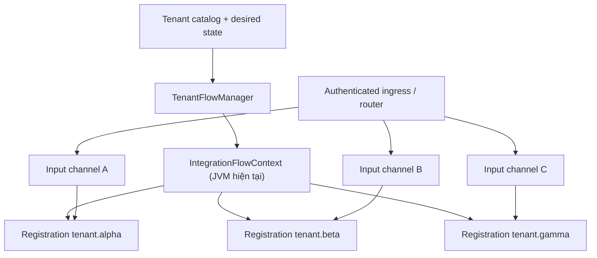
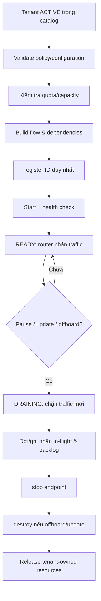
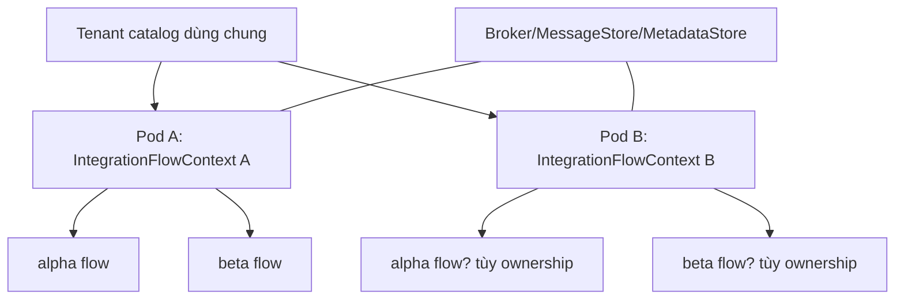

# IntegrationFlowContext với flow theo tenant

## 1. Bài toán và mục tiêu

Trong Spring Integration, một `IntegrationFlow` thường được khai báo dưới dạng bean khi khởi động application context. Nhưng hệ thống **đa tenant** có thể cần tạo hoặc hủy message flow ngay khi ứng dụng đang chạy: tenant mới được kích hoạt, tenant cũ bị tạm dừng, một nguồn SFTP được cấu hình lại hoặc một tenant cần cấu hình retry/connection riêng.

`IntegrationFlowContext` là API cho phép **đăng ký, start, stop và hủy những IntegrationFlow được tạo tại runtime**. Bài học thuộc chương **Dynamic runtime** của module `SPRING_INTEGRATION_RUNTIME`, gắn với điều phối message qua channel, endpoint, consumer, poller, executor; quản lý vòng đời flow, transaction, retry, message store, error và correlation.

Ví dụ thực tế:

- Tenant `alpha` sử dụng SFTP server riêng; `beta` dùng một JMS destination khác.
- Khi onboarding `gamma`, hệ thống đăng ký flow mới, kiểm tra kết nối rồi bật nhận message.
- Khi `beta` ngừng dịch vụ, chỉ các endpoint do beta sở hữu được stop/destroy; alpha vẫn hoạt động.
- Khi đổi cấu hình một tenant, hệ thống tạo flow version mới và chuyển routing không làm mất request đang thực thi.
- Khi ứng dụng restart, trạng thái tenant được đọc lại từ **catalog bền vững** và các flow được dựng lại.

**Kết quả học tập:** tạo flow động theo tenant với Java DSL; dùng `IntegrationFlowContext.registration(...)` và `IntegrationFlowRegistration`; giải quyết trùng ID/bean names; kiểm soát gửi message khi flow pause/offboard; xác định ranh giới thread/transaction, dữ liệu giữa tenant và scale out nhiều replica; kiểm thử lifecycle, concurrency và restart.

> **Phiên bản minh họa:** Spring Integration 6.5, Java 17, Spring Boot 3.x. Ví dụ chọn `DirectChannel` + transformer đồng bộ để tập trung vào lifecycle. Khi chuyển sang poller/adapter mạng phải bổ sung cleanup và draining tương ứng.

## 2. Có nên tạo riêng một flow cho mỗi tenant?



Hai mô hình kiến trúc:

| Mô hình | Phù hợp với | Đánh đổi |
|---|---|---|
| **Flow chung** có router theo `tenantId` | Rất nhiều tenant, pipeline giống nhau, chỉ khác business data | Phải kiểm soát header và isolation trong shared service |
| **Một flow động cho mỗi tenant** | Tenant có protocol adapter, connection, poller, lịch chạy, timeout hoặc retry riêng | Nhiều bean/endpoint/poller, cần lifecycle controller và resource quota |

Ví dụ một luồng chung:

```text
HTTP ingress -> Authentication -> tenantId header -> shared flow
                                              -> tenant-aware repository
```

Ví dụ flow riêng:

```text
alpha -> alpha SFTP inbound adapter -> alpha processor
beta  -> beta JMS inbound adapter  -> beta processor
gamma -> gamma TCP inbound gateway -> gamma processor
```

**Khuyến nghị:** đừng tạo 10.000 flow chỉ vì một method cần thay đổi chuỗi `tenantId`. Flow riêng hợp lý khi có lifecycle hoặc tài nguyên độc lập thật sự. Flow chung có router thường rẻ hơn nếu logic và hạ tầng giống nhau.

### Ai sở hữu trách nhiệm nào?

| Thành phần | Trách nhiệm |
|---|---|
| Tenant catalog | Desired state, revision, credentials reference, quota; bền vững qua restart |
| Provisioning manager | Validate, serialize create/update/remove, quản lý registration handle |
| `IntegrationFlowContext` | Đăng ký flow/dependent beans trong Spring context **hiện tại** |
| Request router | Tìm tenant đã xác thực và chuyển request vào đúng input channel |
| Handler/poller/adapter | Xử lý message, transaction, retry và error theo contract của tenant |
| Message store/broker | Giữ message bền vững **nếu được cấu hình**; độc lập với vòng đời bean |

## 3. API quan trọng của IntegrationFlowContext

`IntegrationFlowContext` được Spring Integration cung cấp như một bean hạ tầng. Hãy inject nó vào service quản lý flow thay vì tạo một context khác để giữ registry riêng.

### 3.1. Tạo registration

```java
import org.springframework.integration.dsl.IntegrationFlow;
import org.springframework.integration.dsl.context.IntegrationFlowContext;
import org.springframework.integration.dsl.context.IntegrationFlowContext
        .IntegrationFlowRegistration;

IntegrationFlowRegistration registration = flowContext
        .registration(flow)
        .id("tenant-flow.alpha")
        .useFlowIdAsPrefix()
        .autoStartup(true)
        .register();
```

| Phương thức | Ý nghĩa |
|---|---|
| `registration(flow)` | Xây builder để đăng ký `IntegrationFlow` đã định nghĩa |
| `id(flowId)` | Đặt flow ID; **unique trong cùng application context** |
| `useFlowIdAsPrefix()` | Prefix tên các component bean trong flow; cần ID tường minh |
| `autoStartup(boolean)` | Start tự động sau register hay không; mặc định `true` |
| `addBean(bean)` / `addBean(name, bean)` | Đăng ký support bean do flow phụ thuộc, như connection factory |
| `setDescription(String)` | Đặt mô tả cho flow, có từ Spring Integration 6.4 |
| `setSource(Object)` | Gắn nguồn cấu hình để hỗ trợ chẩn đoán |
| `register()` | Hoàn tất bean registration và trả handle điều khiển flow |

Spring Integration khuyến nghị đặt ID rõ ràng. Với flow có component cùng ID nội bộ (ví dụ TCP outbound handler tên `client`), `useFlowIdAsPrefix()` giúp tránh trùng bean name giữa alpha và beta.

### 3.2. Các thao tác lifecycle

| Phương thức | Cần nhớ |
|---|---|
| `registration.getId()` | ID của flow |
| `registration.getInputChannel()` | Input channel nếu flow bắt đầu từ `MessageChannel` |
| `registration.getMessagingTemplate()` | Template có default destination là input channel, dùng send/request–reply |
| `registration.getIntegrationFlow()` | Lấy đối tượng flow |
| `registration.start()` | Start các endpoint thuộc registration |
| `registration.stop()` | Stop nhưng **giữ registration** để start lại |
| `registration.destroy()` | Destroy flow và các bean phụ thuộc do registration quản lý |
| `flowContext.remove(flowId)` | Hủy registration theo ID |
| `flowContext.getRegistrationById(flowId)` | Tìm registration hoặc `null` |
| `flowContext.getRegistry()` | Xem mapping ID → registration **trong JVM này** |
| `flowContext.messagingTemplateFor(flowId)` | Lấy template qua flow ID |

**Quan trọng:** `getMessagingTemplate()` và `messagingTemplateFor()` chỉ sử dụng được nếu flow bắt đầu bằng một input `MessageChannel`. Nếu flow bắt đầu từ polling source hoặc inbound network adapter, không thể tùy ý gọi nó như request channel; API có thể ném `IllegalStateException`.

### 3.3. Stop khác destroy

```text
CREATE -> REGISTERED -> STARTED -> STOPPED -> STARTED ...
                          |          |
                          +-- destroy
                                |
                             REMOVED
```

- Tenant tạm khóa: `stop()` rồi `start()` khi cần.
- Tenant offboard: `destroy()` hoặc `flowContext.remove(id)`; chỉ dùng một đường.
- Tenant đổi cấu hình: drain, destroy v1 và register v2 cùng ID hoặc dùng ID có revision để chuyển traffic.
- Destroy bean **không đồng nghĩa** xóa dữ liệu trong Redis, JDBC MessageStore, Kafka, SFTP hay broker. Durable backlog cần chính sách riêng.

## 4. Ví dụ Spring Boot: flow theo tenant và request–reply

Ta xây dịch vụ có hai tenant `alpha`/`beta`. Mỗi tenant được cấp một `DirectChannel` riêng và một transformer trả payload dạng `"tenant=<id>;body=<input>"`. Ví dụ không cần SFTP/JMS thật để giúp kiểm tra lifecycle độc lập.

### 4.1. Dependency và ứng dụng

```groovy
dependencies {
    implementation 'org.springframework.boot:spring-boot-starter-integration'
    testImplementation 'org.springframework.boot:spring-boot-starter-test'
}
```

```java
import org.springframework.boot.SpringApplication;
import org.springframework.boot.autoconfigure.SpringBootApplication;
import org.springframework.integration.config.EnableIntegration;

@SpringBootApplication
@EnableIntegration
public class TenantRuntimeApplication {
    public static void main(String[] args) {
        SpringApplication.run(TenantRuntimeApplication.class, args);
    }
}
```

### 4.2. Manager tạo, chạy và hủy flow

Manager sử dụng một map `tenant → registration`. Thao tác quản trị `provision/pause/resume/offboard` được serialize trong một JVM; khóa đọc/ghi theo tenant bảo vệ lời gọi **đồng bộ** khi quản trị đang stop/destroy. Đây là code mẫu cho một runtime process, không phải distributed coordinator.

```java
import java.util.Map;
import java.util.concurrent.ConcurrentHashMap;
import java.util.concurrent.locks.Lock;
import java.util.concurrent.locks.ReentrantReadWriteLock;

import org.springframework.integration.channel.DirectChannel;
import org.springframework.integration.dsl.IntegrationFlow;
import org.springframework.integration.dsl.context.IntegrationFlowContext;
import org.springframework.integration.dsl.context.IntegrationFlowContext
        .IntegrationFlowRegistration;
import org.springframework.stereotype.Service;

@Service
public final class TenantFlowManager {

    private final IntegrationFlowContext context;
    private final Map<String, Slot> slots = new ConcurrentHashMap<>();

    public TenantFlowManager(IntegrationFlowContext context) {
        this.context = context;
    }

    private static final class Slot {
        final IntegrationFlowRegistration registration;
        final ReentrantReadWriteLock gate = new ReentrantReadWriteLock(true);
        volatile boolean enabled = true;

        Slot(IntegrationFlowRegistration registration) {
            this.registration = registration;
        }
    }

    private String checkedTenant(String tenantId) {
        // ID theo chuẩn của hệ thống; không nhận tùy ý từ raw user input.
        if (tenantId == null
                || !tenantId.matches("[a-z0-9][a-z0-9-]{0,39}")) {
            throw new IllegalArgumentException("Invalid tenant ID");
        }
        return tenantId;
    }

    public synchronized String provision(String tenantId) {
        String tenant = checkedTenant(tenantId);
        Slot found = slots.get(tenant);
        if (found != null) {
            return found.registration.getId();
        }

        String flowId = "tenant-flow." + tenant;
        IntegrationFlow flow = IntegrationFlow.from(new DirectChannel())
                .<String, String>transform(
                        body -> "tenant=" + tenant + ";body=" + body)
                .get();

        IntegrationFlowRegistration registration = context
                .registration(flow)
                .id(flowId)
                .useFlowIdAsPrefix()
                .autoStartup(true)
                .register();

        slots.put(tenant, new Slot(registration));
        return registration.getId();
    }

    public String execute(String tenantId, String payload) {
        String tenant = checkedTenant(tenantId);
        if (payload == null) {
            throw new IllegalArgumentException("Payload is required");
        }

        Slot slot = slots.get(tenant);
        if (slot == null) {
            throw new IllegalStateException("Tenant not provisioned");
        }

        Lock read = slot.gate.readLock();
        read.lock();
        try {
            if (!slot.enabled || slots.get(tenant) != slot) {
                throw new IllegalStateException("Tenant flow unavailable");
            }

            String reply = slot.registration.getMessagingTemplate()
                    .convertSendAndReceive(payload, String.class);

            if (reply == null) {
                throw new IllegalStateException("Tenant returned no reply");
            }
            return reply;
        }
        finally {
            read.unlock();
        }
    }

    public synchronized void pause(String tenantId) {
        Slot slot = required(tenantId);
        Lock write = slot.gate.writeLock();
        write.lock();
        try {
            slot.enabled = false;
            slot.registration.stop();
        }
        finally {
            write.unlock();
        }
    }

    public synchronized void resume(String tenantId) {
        Slot slot = required(tenantId);
        Lock write = slot.gate.writeLock();
        write.lock();
        try {
            slot.registration.start();
            slot.enabled = true;
        }
        finally {
            write.unlock();
        }
    }

    public synchronized void offboard(String tenantId) {
        String tenant = checkedTenant(tenantId);
        Slot slot = slots.get(tenant);
        if (slot == null) {
            return;
        }

        Lock write = slot.gate.writeLock();
        write.lock();
        try {
            slot.enabled = false;
            slot.registration.destroy();
            slots.remove(tenant, slot);
        }
        finally {
            write.unlock();
        }
    }

    private Slot required(String tenantId) {
        Slot slot = slots.get(checkedTenant(tenantId));
        if (slot == null) {
            throw new IllegalStateException("Tenant not provisioned");
        }
        return slot;
    }
}
```

**Giải thích từng lựa chọn:**

- Tạo `new DirectChannel()` riêng cho mỗi flow để không có hai tenant vô tình dùng chung input channel.
- Biến `tenant` mà transformer capture là chuỗi bất biến, không dùng singleton mutable `currentTenant` vốn gây lẫn dữ liệu khi nhiều request concurrent.
- Dùng ID `tenant-flow.<tenant>`; ID chỉ chấp nhận ký tự đã validate, không lấy trực tiếp dấu gạch chéo, dấu chấm hoặc tên từ input chưa xác thực.
- `provision()` trả ID cũ khi tenant đã được tạo, tránh đăng ký lần hai; `synchronized` bảo vệ phần check/register trong JVM.
- `execute()` giữ khóa đọc cho đến khi lời gọi request–reply đồng bộ hoàn tất; admin cần khóa ghi để pause/offboard, nên không destroy trong giữa lời gọi đó.
- `resume()` gọi `registration.start()` trên registration cũ; `offboard()` mới destroy và xóa map.
- `slots` là map **trong bộ nhớ JVM**, không bền vững sau restart. Cần rehydrate từ tenant catalog ngoài.

**Giới hạn:** Kiểu khóa này chỉ bảo vệ những lời gọi **đồng bộ** đi qua `execute()`. Nếu flow dùng `ExecutorChannel`, task scheduler, `QueueChannel` hoặc adapter nhận message từ bên ngoài, có công việc vẫn chạy sau khi `execute()` kết thúc. Khi đó cần draining, in-flight tracking và xử lý ack/queue riêng, không coi `stop()` là bằng chứng mọi task đã kết thúc.

Đối với handler đồng bộ chặn vô hạn vì mạng, việc giữ khóa đọc có thể làm admin offboard cũng chờ vô hạn. Phải cấu hình I/O timeout, deadline và runbook cưỡng bức phù hợp.

### 4.3. Gọi manager

```java
manager.provision("alpha");
manager.provision("beta");

System.out.println(manager.execute("alpha", "hello"));
// tenant=alpha;body=hello

System.out.println(manager.execute("beta", "hello"));
// tenant=beta;body=hello

manager.pause("alpha");
// manager.execute("alpha", "hello") bị từ chối.

manager.resume("alpha");
manager.offboard("beta");
// Beta không còn registration.
```

Một lớp controller ở production phải lấy tenant từ **principal/token đã được xác thực** rồi kiểm tra quyền gọi, không tin `tenantId` nằm trong một message header do khách hàng tự gửi.

## 5. Lifecycle và trình tự onboarding/offboarding



### 5.1. Register nhưng chưa start

```java
IntegrationFlowRegistration registration = flowContext
        .registration(flow)
        .id("tenant-flow.alpha")
        .useFlowIdAsPrefix()
        .autoStartup(false)
        .register();

// Hạ tầng bean đã được tạo; chưa mở receive traffic từ endpoint.
registration.start();
```

`autoStartup(false)` chỉ hoãn start lifecycle; lỗi trong constructor/bean initialization vẫn có thể xảy ra lúc register. Với inbound adapter, cần health check kết nối trước khi đánh dấu tenant READY. `register()` thành công không tự chứng minh remote system đã sẵn sàng.

### 5.2. Pause, drain và destroy

Quy trình offboarding an toàn:

1. Đánh dấu tenant `DRAINING` trong catalog và ngăn router chấp nhận message mới.
2. Chờ các request đồng bộ đang chạy hoặc task/ack async theo deadline; ghi nhận kết quả chưa rõ.
3. Stop poller/adapter để ngăn thêm công việc mới.
4. Giải quyết persistent queue backlog theo chính sách: giữ để re-onboard, chuyển DLQ, hay xử lý nốt.
5. Destroy registration và các bean thuộc quyền sở hữu flow; không đóng shared resources của tenant khác.
6. Cập nhật catalog và xóa routing; ghi audit event với flow ID/revision.

**Không xóa nhầm state bền vững:** `destroy()` xóa flow/dependent beans trong Spring context nhưng không mặc nhiên xóa row của JDBC MessageStore, metadata checkpoint hoặc broker messages.

### 5.3. Register lỗi một phần

Khi `register()` thất bại do trùng ID, bean dependency lỗi hoặc configuration không hợp lệ, đừng ghi trạng thái READY. Cần:

- Tìm root cause trong exception và flow ID đã định tạo.
- Kiểm tra `flowContext.getRegistrationById(id)`; chỉ cleanup thành phần thực sự thuộc provisioning này.
- Giữ desired state là FAILED/RECONCILING, tránh retry vô hạn tạo trùng bean.
- Dùng idempotent reconciliation để thử lại khi nguyên nhân được sửa.
- Test resource leak nếu bean phụ thuộc đã mở socket/thread trong quá trình register.

## 6. Bean naming: phòng ngừa trùng component ID

Hai flow có thể dùng cùng ID nội bộ `"client"` (ví dụ TCP outbound handler), nhưng đăng ký khác flow ID:

```java
flowContext.registration(buildFlowFor("alpha"))
        .id("tenant.alpha")
        .useFlowIdAsPrefix()
        .register();

flowContext.registration(buildFlowFor("beta"))
        .id("tenant.beta")
        .useFlowIdAsPrefix()
        .register();
```

Đoạn trên minh họa API; `buildFlowFor(String)` là factory method do ứng dụng định nghĩa. Với component có ID `client`, bean name tương ứng có thể mang prefix `tenant.alpha.` và `tenant.beta.`. Cần kiểm tra tên bean thực tế vì một số bean được đăng ký thủ công không tự động chịu prefix.

**Bốn lưu ý:**

- Flow ID chỉ được tái sử dụng sau khi registration cũ đã `destroy()`/`remove()`.
- `useFlowIdAsPrefix()` yêu cầu ID tường minh, giúp tránh collision khi các flow giống nhau có named endpoints.
- Khi dùng `addBean("name", dependency)`, tên bean phụ thuộc cũng phải được thiết kế unique và ownership rõ.
- Không nên đăng ký shared `TaskExecutor`, shared `DataSource`, global error channel thành dependent bean sẽ bị destroy cùng một tenant.

## 7. Cập nhật flow khi tenant đổi cấu hình

### 7.1. Stop–destroy–register cùng ID

```text
tenant.alpha v1 ACTIVE
  -> DRAINING
  -> stop
  -> destroy
  -> register v2 cùng ID
  -> start + health check
  -> ACTIVE
```

Ưu điểm: đơn giản, không có hai instance flow trùng ID. Nhược điểm: có khoảng downtime và nếu register v2 lỗi, phải dựng lại v1 từ config đã lưu.

### 7.2. Blue/green theo revision

```text
tenant.alpha.v41 -- ACTIVE
tenant.alpha.v42 -- REGISTERED, kiểm tra xong
                  -> chuyển routing sang v42
tenant.alpha.v41 -> DRAIN, STOP, DESTROY
```

Ưu điểm: có thể giảm downtime và rollback routing. **Nhưng** không start hai inbound poller cùng đọc một nguồn độc quyền trước khi giải quyết quyền sở hữu: có thể tạo duplicate/redelivery. Với flow chỉ nhận request từ router chung, blue/green thường đơn giản hơn.

Catalog nên giữ `desiredRevision`, `appliedRevision`, `desiredState`, ID nguồn/credential và trạng thái reconciliation. `getRegistry()` chỉ phản ánh registration trong một context, không phải nguồn sự thật bền vững.

## 8. Restart và scale out: IntegrationFlowContext không tự đồng bộ giữa các pod

**Mỗi JVM/ApplicationContext có một registry riêng.** Nếu gọi `flowContext.registration(...)` ở pod A, pod B không tự nhận flow đó. Nếu gọi `destroy()` trên A, flow của cùng tenant trên B cũng không tự dừng.



### 8.1. Hai chiến lược vận hành

**Active-active:** nhiều instance cùng có flow tenant alpha. Phải bảo đảm broker/consumer group phân phối message đúng, handler idempotent và mỗi instance đủ cấu hình để giữ dữ liệu tenant không bị trộn.

**Một active consumer per tenant/source:** dùng distributed lease, leader election, broker partition ownership hoặc `LockRegistry` phù hợp để một node được phép start nguồn cho tenant. Nếu node mất lease hoặc bị network partition, cần stop/fencing để tránh hai node xử lý một nguồn không idempotent.

`IntegrationFlowContext` **không cung cấp distributed lock hoặc tenant coordinator**. Một metadata key dùng chung có thể hỗ trợ coordination nhưng không tự động giải quyết lease expiration, fencing hoặc crash windows.

### 8.2. Hành vi khi application restart

1. Nạp tenant catalog bền vững (ví dụ database) với desired state của mỗi tenant.
2. Validate config version và credential references của tenant.
3. Đăng ký lại các flow cần có bằng ID/region/group ID phù hợp.
4. Khôi phục trạng thái ACTIVE/PAUSED; không tự start flow mà policy yêu cầu pause.
5. Với persistent queue, kết nối lại **đúng** storage, namespace và group ID; tránh orphan messages.
6. Đối chiếu registry thực tế với desired state để cleanup các registration không còn hợp lệ.
7. Chỉ mở routing/ingress sau khi endpoint và dependency đã sẵn sàng.

Không coi registry trong RAM là nguồn dữ liệu tenant. Khi restart, flow beans do runtime tạo trước đó không tự được Spring phục hồi nếu không có logic **rehydrate/reconcile**.

### 8.3. Dynamic flow không bảo đảm dữ liệu bền vững

| Thành phần | Nếu JVM restart thì sao? |
|---|---|
| Registration trong `IntegrationFlowContext` | Phải đăng ký lại từ catalog/logic ứng dụng |
| `QueueChannel` in-memory | Backlog trong RAM mất |
| `JdbcChannelMessageStore` hoặc broker được cấu hình bền vững | Message có thể tồn tại, nhưng flow mới phải trỏ đúng store/destination |
| `SimpleMetadataStore` | Marker trong RAM mất, có thể xử lý lại |
| `JdbcMetadataStore`/Redis backend có durability | State còn theo contract storage, không tự ánh xạ sang registry mới |
| Temporary reply channel của gateway invocation cũ | Không hồi sinh Java caller sau process restart |

Một flow động tạo thành công không có nghĩa dữ liệu bên trong nó tự bền vững. Cần thiết kế persistence độc lập.

## 9. Tenant isolation: khác tên bean chưa đủ an toàn

Chỉ có `tenant.alpha` và `tenant.beta` là hai flow riêng **không đảm bảo** data/security isolation.

| Vùng rủi ro | Ví dụ | Biện pháp |
|---|---|---|
| Tenant identity | Caller tự đổi header `tenantId=beta` | Lấy tenant từ principal/token đáng tin; authorization ở ingress |
| Input channel | Client gọi thẳng vào channel bean của tenant khác | Không phơi channel/management API công khai, đóng access theo service boundary |
| Mutable state | Singleton handler có trường `currentTenant` thay đổi mỗi message | Stateless service hoặc instance bất biến theo tenant |
| DB | SQL update thiếu `WHERE tenant_id=?` | Tenant-aware repository, RLS/schema isolation, unique constraint đúng phạm vi |
| Metadata/store | Hai tenant cùng dùng key `order:17` | Composite key có tenant/source/version; region/group namespace đúng |
| Error & DLQ | Global logger in payload beta khi xử lý alpha | Gắn identity/correlation đã xác minh, kiểm soát quyền đọc log/DLQ |
| Secret & connection | Flow alpha dùng nhầm SFTP credential beta | Secret reference theo tenant, isolation và rotation |
| Scheduler/executor | Một tenant chậm chiếm hết thread | Bulkhead, quota, queue giới hạn, backpressure |

**Không coi header `tenantId` là bằng chứng xác thực.** Header là dữ liệu; nếu có thể được tạo từ client không tin cậy, nó chỉ đáng tin sau khi lớp ingress kiểm tra với security context. Nếu flow nhận message từ broker, tenant identity phải được xác minh qua chính sách producer, destination/ACL và message contract.

### 9.1. Thiết kế correlation và metadata key

Giả sử alpha và beta cùng có `orderId=17`. Một `IdempotentReceiverInterceptor` dùng key `"order:17"` có thể khiến alpha vô tình làm beta bị xem là duplicate. Nên dùng tuple tenant + nghiệp vụ, mã hóa key không mơ hồ:

```text
tenant=alpha, order=17 -> alpha/order/17
tenant=beta,  order=17 -> beta/order/17
```

`CorrelationStrategy` của aggregator cũng cần nhận diện tenant nếu cùng một message group store được dùng cho nhiều tenant; `ReleaseStrategy` và retention vẫn cần được cấu hình riêng.

## 10. Error handling, retry, poller và transaction khi flow được tạo động

### 10.1. Error channel

- Với `DirectChannel`, handler thường chạy đồng bộ trên thread caller; exception có thể truyền trực tiếp tới sender hoặc messaging gateway.
- Với `ExecutorChannel`, `QueueChannel`/poller, lỗi xuất hiện ở thread khác và có thể trở thành `ErrorMessage` trên error flow phù hợp.
- Global `errorChannel` có thể dùng cho nhiều tenant, **nhưng phải có tenant/correlation đáng tin** và chính sách truy cập phù hợp.
- Error channel riêng theo tenant hữu ích cho retention, DLQ hoặc SLA khác nhau, nhưng làm tăng số bean/consumer và tài nguyên vận hành.

Không tự đăng ký cùng tên `errorChannel` local trong mọi flow tenant rồi kỳ vọng mỗi tenant có channel riêng. Nếu chọn tên cố định, nó có thể trỏ global channel hoặc gây collision. Hãy đặt rõ ownership của error route.

### 10.2. Retry khi offboard/update

Một tenant có thể đang retry kết nối HTTP/SFTP trong khi admin yêu cầu stop. Cần xác định:

- Retry advice có đang chạy trong cùng handler invocation hay có source redelivery?
- Có message còn ở queue/persistent store không?
- Stop có ngăn lần poll tiếp theo không, và task đã bắt đầu còn chạy đến đâu?
- Poison message sau restart có quay lại không?
- DLQ có giữ đúng tenant/source identity không?

Retry không được tạo thêm xử lý nghiệp vụ trùng sau caller timeout; dùng business idempotency key và chính sách retry có giới hạn.

### 10.3. Transaction boundary

```text
Tenant A: DirectChannel -> handler -> DB
  (có thể cùng thread/transaction nếu scope được cấu hình đúng)

Tenant B: ExecutorChannel -> worker -> DB
  (worker chạy transaction khác; không kế thừa thread-local transaction)

Tenant C: QueueChannel + PollingConsumer -> handler
  (transaction poller có thể cần mở trước receive() để rollback store)
```

`register()`, `stop()` và `destroy()` không phải business transaction. Việc destroy endpoint không rollback một DB transaction đã commit. Nếu dùng SFTP/file/broker/DB ngoài, mỗi resource có cơ chế commit/ack/rollback riêng.

### 10.4. Gateway reply khi tenant bị stop

Trong request–reply flow, gateway thường chờ temporary reply channel. Nếu admin stop flow trước khi downstream trả reply, caller có thể timeout hoặc nhận delivery exception; **không** suy ra business đã rollback. Cần thiết kế:

1. Ngăn request mới (DRAINING).
2. Theo dõi in-flight request và deadline.
3. Đợi reply hoặc ghi trạng thái cần reconcile.
4. Stop/destroy sau khi quyết định disposition của outstanding requests.

Trong ví dụ manager, khóa đọc/ghi giúp tránh destroy ở giữa **lời gọi DirectChannel đồng bộ**. Nó không xử lý được async completion sau khi hàm gửi trả về; production cần tracking độc lập.

## 11. Quota, resource ownership và chi phí scale

Dynamic flow tạo thêm bean, handler, poller, task scheduler jobs, network connections và metrics. 5.000 tenant với 5.000 SFTP poller có thể làm cạn nguồn lực dù chỉ có vài message mỗi giây.

### 11.1. Những giới hạn cần đo

- Số flow active/stopped và tổng số bean trong context.
- Số scheduled pollers, thread pool queue length và executor saturation.
- Connection pool (JMS/HTTP/SFTP/TCP), open sockets và reconnect rate.
- Message/store backlog, group age và error/DLQ rate theo tenant.
- Memory của cached registrations, payload/stateful handler và leaked resources sau destroy.
- Thời gian create/start/stop/destroy; độ trễ request và thời gian drain.

### 11.2. ai sở hữu tài nguyên?

| Resource | Ownership hợp lý |
|---|---|
| Connection factory riêng chỉ alpha dùng | Có thể register bằng `addBean()` làm dependency của alpha và cleanup khi offboard |
| Shared DataSource, global TaskExecutor | Đăng ký ở application context chung; **không** destroy cùng một tenant flow |
| Persistent JDBC queue/store | Có thể do hạ tầng chung sở hữu; destroy flow không tự xóa data |
| Per-tenant poller/endpoint | Thuộc dynamic flow và được stop/destroy với registration |
| File/remote path chứa dữ liệu | Là dữ liệu bên ngoài; cần retention/offboarding policy độc lập |

Phân biệt quản lý bean và quản lý tài nguyên bên ngoài. Một bean `destroy()` được gọi không có nghĩa remote connection/download đã hoàn thành, bản ghi broker đã ack hay file đã được cleanup đúng quy trình.

### 11.3. Quy tắc để không rò rỉ flow

- Giới hạn số flow tối đa mỗi JVM/worker pool.
- Không provision flow chỉ vì một tenant ID lạ nằm trong header chưa được xác minh.
- Có idle policy để hibernate/offboard tenant không hoạt động.
- Bảo đảm offboard có bước remove registration, cleanup mapping và log.
- Test repeated create–destroy 100 lần và quan sát bean/thread/connection count.
- Không giữ reference tới flow/handler đã destroy trong singleton registry khác.

## 12. Kiểm thử TenantFlowManager bằng JUnit 5

Với các class `TenantRuntimeApplication` và `TenantFlowManager` ở mục 4, có thể kiểm tra hành vi mà không cần SFTP/JMS thật.

### 12.1. Test isolation, pause/resume và offboard

```java
import static org.junit.jupiter.api.Assertions.*;

import org.junit.jupiter.api.AfterEach;
import org.junit.jupiter.api.Test;
import org.springframework.beans.factory.annotation.Autowired;
import org.springframework.boot.test.context.SpringBootTest;
import org.springframework.integration.dsl.context.IntegrationFlowContext;

@SpringBootTest(classes = TenantRuntimeApplication.class)
class TenantFlowManagerTest {

    @Autowired TenantFlowManager manager;
    @Autowired IntegrationFlowContext context;

    @AfterEach
    void cleanup() {
        manager.offboard("alpha");
        manager.offboard("beta");
    }

    @Test
    void tenantResponsesAreIsolated() {
        manager.provision("alpha");
        manager.provision("beta");

        assertEquals("tenant=alpha;body=hello",
                manager.execute("alpha", "hello"));
        assertEquals("tenant=beta;body=hello",
                manager.execute("beta", "hello"));
    }

    @Test
    void provisioningTwiceDoesNotCreateAnotherFlow() {
        String a = manager.provision("alpha");
        String b = manager.provision("alpha");

        assertEquals(a, b);
        assertNotNull(context.getRegistrationById(a));
    }

    @Test
    void pauseAndResumeKeepRegistration() {
        manager.provision("alpha");
        manager.pause("alpha");

        assertThrows(IllegalStateException.class,
                () -> manager.execute("alpha", "ignored"));

        manager.resume("alpha");

        assertEquals("tenant=alpha;body=ok",
                manager.execute("alpha", "ok"));
    }

    @Test
    void offboardRemovesTheFlowAndAllowsRecreate() {
        String id = manager.provision("alpha");
        manager.offboard("alpha");

        assertNull(context.getRegistrationById(id));
        assertThrows(IllegalStateException.class,
                () -> manager.execute("alpha", "ignored"));

        assertEquals(id, manager.provision("alpha"));
        assertEquals("tenant=alpha;body=again",
                manager.execute("alpha", "again"));
    }

    @Test
    void rejectsInvalidTenantBeforeProvision() {
        assertThrows(IllegalArgumentException.class,
                () -> manager.provision("../../admin"));
        assertNull(context.getRegistrationById(
                "tenant-flow.../../admin"));
    }
}
```

Test dùng `@AfterEach` để tránh dynamic registration còn sót sang test kế tiếp khi Spring Boot tái sử dụng context. Không đặt `@Transactional` lên test chỉ để “dọn bean”, vì transaction DB không quản lý lifecycle dynamic beans.

### 12.2. Test hai admin requests cùng tạo một tenant

```java
import java.util.concurrent.*;

ExecutorService pool = Executors.newFixedThreadPool(2);
try {
    CountDownLatch ready = new CountDownLatch(2);
    CountDownLatch start = new CountDownLatch(1);

    Callable<String> provision = () -> {
        ready.countDown();
        if (!start.await(5, TimeUnit.SECONDS)) {
            throw new TimeoutException("Start barrier timed out");
        }
        return manager.provision("alpha");
    };

    Future<String> first = pool.submit(provision);
    Future<String> second = pool.submit(provision);

    assertTrue(ready.await(5, TimeUnit.SECONDS));
    start.countDown();

    String a = first.get(10, TimeUnit.SECONDS);
    String b = second.get(10, TimeUnit.SECONDS);
    assertEquals(a, b);
    assertNotNull(context.getRegistrationById(a));
}
finally {
    pool.shutdownNow();
    manager.offboard("alpha");
}
```

Đây là đoạn dùng trong method JUnit đã inject `manager`/`context`, với JUnit và concurrent imports phù hợp. `CountDownLatch` tăng khả năng hai request cùng lúc; phải stress test nhiều thread hơn nếu muốn kiểm chứng race phức tạp. Bài thực hành không dùng `Thread.sleep()` để suy ra đã hoàn tất.

### 12.3. Những test bổ sung theo tình huống production

| Kịch bản | Thiết lập | Assertion |
|---|---|---|
| Tenant A/B concurrent | Hai thread gửi request tới hai flow | Reply không lẫn tenant; không dùng mutable global tenant state |
| Offboard khi handler đang chạy | Handler chờ latch, admin offboard | Draining/timeout được tuân thủ; không destroy giữa synchronous invocation |
| Đăng ký lỗi | Component ID/bean name trùng | Không báo READY; cleanup flow resources đúng ownership |
| Flow chưa auto start | `autoStartup(false)` | Chưa nhận traffic trước `start()`; vẫn có registration |
| Pause poller tenant | Poller có message source thật | Không poll mới khi stop; backlog giữ theo contract |
| Restart process | Catalog persist tenant và database message store | Rehydrate flow từ desired state, không mất durable backlog |
| Two pods same tenant | Hai contexts kết nối chung broker/source | Đúng active-ownership/partition/idempotency policy |
| Upgrade blue/green | Cấu hình v1/v2 khác nhau | Traffic chuyển theo revision, không tạo hai active source ngoài ý muốn |
| Repeated create/destroy | Tạo/xóa nhiều lần | Không tăng vô hạn bean count, threads, sockets |

## 13. Chẩn đoán lỗi dynamic flow theo tenant

| Triệu chứng | Nguyên nhân thường gặp | Cách kiểm tra |
|---|---|---|
| `register()` lỗi bean name collision | ID registration/component trùng; quên prefix | Kiểm tra `getRegistrationById()`, `useFlowIdAsPrefix()` |
| Tenant A nhận dữ liệu B | Header giả mạo, shared input channel, handler mutable | Kiểm tra authentication, route mapping, channel instance |
| `getMessagingTemplate()` ném lỗi | Flow bắt đầu từ inbound source thay vì input channel | Gửi theo protocol source hoặc dùng flow có input channel phù hợp |
| Có registration nhưng không nhận message | `autoStartup(false)` hoặc flow đã `stop()` | Kiểm tra lifecycle endpoint, poller và subscription |
| Gateway timeout dù handler log success | Reply route bị đổi hoặc async task trả chậm | Kiểm tra temporary reply channel, timeout và in-flight |
| Flow mất sau restart | Registry chỉ sống trong context | Reconcile từ persistent tenant catalog |
| Queue cũ có message nhưng không poll được | Đổi JDBC store/region/group ID hoặc broker subscription | Xác nhận identity storage và serializer version |
| Một tenant tạo quá nhiều beans/threads | Unbounded provisioning hoặc không offboard | Flow quota, resource ownership, leak test |
| Stop xong vẫn còn log xử lý | Async task in-flight hoặc source chưa ack | Quản lý DRAINING, tracking task và timeout |
| Shared pool bị đóng khi offboard một tenant | Shared bean bị đăng ký làm dependent bean | Đưa shared resource ra application scope |
| Hai pod cùng poll nguồn độc quyền | Không có leader/lease/fencing | Distributed coordination và idempotency |

### Quan sát runtime nên thu thập

```text
timestamp=...
tenantId=alpha
flowId=tenant-flow.alpha
revision=42
desiredState=ACTIVE
runtimeState=STARTED
event=REGISTER|START|STOP|DRAIN|DESTROY|FAIL
requestId=...
channel=...
thread=...
durationMs=...
errorCode=...
```

Không ghi credentials, access token hoặc payload chứa thông tin nhạy cảm vào log. Đối với async flow, truyền correlation ID trong message headers/tracing context theo cơ chế framework thay vì dựa hoàn toàn vào thread-local.

Theo dõi số active flows và stopped flows, số lần register fail, thời gian start/stop, poller backlog, executor queue, số connection, DLQ per tenant và tỷ lệ error. Những metric này có thể cần instrumentation riêng; không phải mọi metric đều có sẵn mặc định.

## 14. Quy trình đưa vào production

1. **Chọn kiến trúc:** chỉ dùng flow per tenant nếu thực sự có lifecycle/tài nguyên riêng; còn lại cân nhắc shared flow/router.
2. **Định danh:** validate tenant ID, cấu trúc flow ID và revision; đặt `useFlowIdAsPrefix()` khi cần.
3. **Kiểm soát provisioning:** một JVM dùng synchronization/atomic registry; đa pod có desired-state reconciliation và source ownership.
4. **Tách bảo mật:** tenant từ principal đã xác thực, không tin header tự khai; hạn chế management endpoints.
5. **Xác định ownership:** bean/connection/executor tenant-specific hay shared? Hủy đúng resource.
6. **Định nghĩa lifecycle:** onboarding, health check, pause, drain, resume, offboard, failed registration cleanup.
7. **Thiết kế state bền vững:** catalog, JDBC/broker/metadata, stable group ID/region, replay/idempotency.
8. **Cấu hình error/retry/transaction:** phù hợp DirectChannel vs async/poller, DLQ và bounded retries.
9. **Đo capacity:** quota, số poller, task scheduler threads, socket/connection, latency, memory.
10. **Kiểm thử:** concurrent provision, offboard khi in-flight, restart, crash window, blue/green và multi-pod source ownership.

## 15. Câu hỏi tự kiểm tra

**Câu 1.** Vì sao `IntegrationFlowContext` thích hợp để tạo flow cho tenant mới mà không restart ứng dụng?  
**Đáp án:** Nó đăng ký `IntegrationFlow` và các component cần thiết vào Spring context trong runtime, trả `IntegrationFlowRegistration` để thao tác lifecycle.

**Câu 2.** Khác nhau giữa `stop()` và `destroy()`?  
**Đáp án:** Stop giữ registration để có thể start lại; destroy hủy flow và dependent beans, cho phép đăng ký mới với ID cũ sau khi cleanup.

**Câu 3.** Hai flow cùng có handler ID nội bộ `client` phải làm gì để tránh collision?  
**Đáp án:** Dùng flow IDs riêng và `useFlowIdAsPrefix()`; nếu tên bean do code tự đặt thì vẫn cần đảm bảo unique.

**Câu 4.** Vì sao `getMessagingTemplate()` không dùng được cho mọi flow?  
**Đáp án:** Nó yêu cầu flow bắt đầu từ input `MessageChannel`. Flow có inbound source/poller không mặc nhiên có channel đầu vào để template gửi request.

**Câu 5.** Gọi `destroy()` flow alpha trên pod A có stop alpha trên pod B không?  
**Đáp án:** Không. Mỗi JVM có context/registry riêng; nhiều pod cần coordinator/desired state và source ownership.

**Câu 6.** Tại sao không dùng singleton mutable `currentTenantId` trong handler?  
**Đáp án:** Concurrent requests có thể ghi đè tenant identity và làm trộn dữ liệu; dùng context đã xác thực, key/handler stateless hoặc per-tenant immutable state.

**Câu 7.** Sau restart, dynamic flow biến mất; message trong JDBC MessageStore có mất theo không?  
**Đáp án:** Không nhất thiết. Registration là JVM-local; dữ liệu message bền vững tồn tại theo store, nhưng flow mới phải kết nối đúng database/region/group ID để xử lý.

**Câu 8.** `stop()` có bảo đảm mọi asynchronous task kết thúc và business transaction đã commit chưa?  
**Đáp án:** Không. Cần draining và theo dõi in-flight task, ack, rollback/commit theo từng nguồn.

**Câu 9.** Khi nào shared flow/router tốt hơn per-tenant flow?  
**Đáp án:** Khi số tenant lớn nhưng pipeline/tài nguyên giống nhau, chỉ thay tenant ID hoặc business parameters; shared flow giảm số bean/poller/connection.

**Câu 10.** Register cùng ID đã tồn tại báo lỗi: sửa như thế nào?  
**Đáp án:** Dùng idempotent provisioning nếu cùng cấu hình; khi thay đổi, drain và destroy registration cũ trước khi register mới, hoặc dùng ID version mới và routing blue/green.

## 16. Tài liệu tham khảo chính thức

1. [Spring Integration 6.5 — Dynamic and Runtime Integration Flows](https://docs.spring.io/spring-integration/reference/6.5/dsl/java-runtime-flows.html): đăng ký flow, quản lý vòng đời, generated bean names và `useFlowIdAsPrefix()`.
2. [Spring Integration 6.5 API — IntegrationFlowContext](https://docs.spring.io/spring-integration/docs/6.5.0/api/org/springframework/integration/dsl/context/IntegrationFlowContext.html): `registration()`, `remove()`, `getRegistry()`, `messagingTemplateFor()`.
3. [Spring Integration 6.5 API — IntegrationFlowRegistrationBuilder](https://docs.spring.io/spring-integration/docs/6.5.0/api/org/springframework/integration/dsl/context/IntegrationFlowContext.IntegrationFlowRegistrationBuilder.html): `id`, `autoStartup`, `useFlowIdAsPrefix`, `addBean`, `setDescription`.
4. [Spring Integration 6.5 API — IntegrationFlowRegistration](https://docs.spring.io/spring-integration/docs/6.5.0/api/org/springframework/integration/dsl/context/IntegrationFlowContext.IntegrationFlowRegistration.html): `getInputChannel()`, `getMessagingTemplate()`, `start()`, `stop()`, `destroy()`.
5. [Spring Integration 6.5 API — IntegrationFlow](https://docs.spring.io/spring-integration/docs/6.5.0/api/org/springframework/integration/dsl/IntegrationFlow.html): `from(MessageChannel)`, DSL building và reply flow.
6. [Spring Integration 6.5 — Messaging Channels](https://docs.spring.io/spring-integration/reference/6.5/channel.html): DirectChannel/ExecutorChannel/QueueChannel.
7. [Spring Integration 6.5 — Error Handling](https://docs.spring.io/spring-integration/reference/6.5/error-handling.html): sync/async errors và error channels.
8. [Spring Integration 6.5 — Transaction Support](https://docs.spring.io/spring-integration/reference/6.5/transactions.html): poller transaction, thread boundaries và commit/rollback.
9. [Spring Integration 6.5 — Message Store](https://docs.spring.io/spring-integration/reference/6.5/message-store.html): persistence cho messages và message groups.
