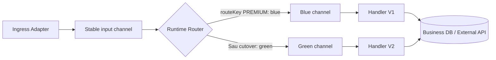
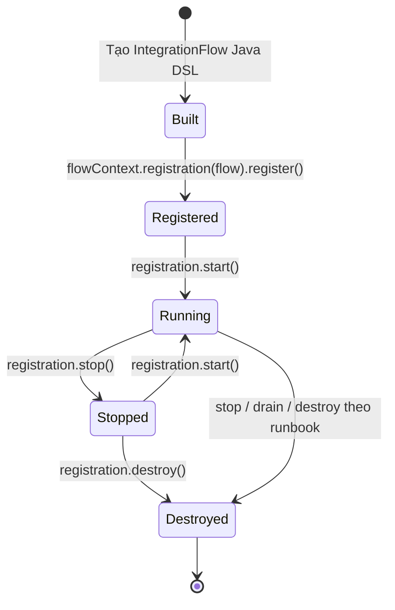
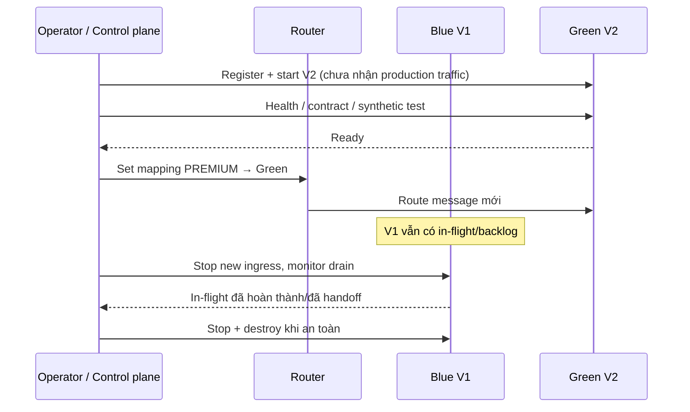

# Thay đổi route hoặc handler runtime trong Spring Integration

## 1. Khi nào cần thay đổi flow mà không restart ứng dụng?

Một hệ thống tích hợp có thể cần điều hướng message tới một nhà cung cấp khác khi đối tác gặp lỗi, đưa nhóm khách hàng sang phiên bản handler mới, tạo pipeline theo tenant hoặc thay quy tắc xử lý sau khi bật feature flag. Đó là nhu cầu **thay đổi route hoặc handler lúc ứng dụng đang chạy** (*dynamic runtime reconfiguration*).

Ví dụ, header `routeKey=PREMIUM` đang đưa message tới handler `paymentBlue`; khi triển khai canary, cùng key được chuyển sang `paymentGreen`. Các message mới có thể đi qua green mà không cần restart toàn bộ JVM. Nhưng những message đã vào blue, đang chờ trong queue, bị retry hoặc giữ trong transaction **không tự di chuyển** sang green. Đó là ranh giới cần hiểu trước khi điều hành hệ thống thật.

Bài thuộc chương **Dynamic runtime** của module **SPRING_INTEGRATION_RUNTIME**, liên hệ trực tiếp tới cách Spring Integration điều phối channel, endpoint, consumer, poller và executor; cách start/stop `IntegrationFlow`; transaction, retry, message store, error channel, correlation, threading và quan sát hiệu năng/trạng thái runtime.

Sau bài này, bạn có thể:

1. Chọn giữa **đổi mapping của router**, **đổi delegate handler** và **đăng ký/hủy phiên bản IntegrationFlow**.
2. Thay route theo key qua `HeaderValueRouter` và `AbstractMappingMessageRouter`, bảo đảm không cho header tùy ý định tuyến tới channel nội bộ.
3. Dùng `IntegrationFlowContext` để đăng ký flow mới với ID riêng, start/stop/destroy và đọc trạng thái registration.
4. Thiết kế **blue–green/canary cutover**, xử lý message đang chạy, rollback và isolation giữa các phiên bản.
5. Kiểm thử các tình huống race, retry, transaction, persistent queue, correlation và lỗi chuyển route.

> **Phạm vi API:** Ví dụ sử dụng **Spring Integration 6.5.x**, Java 17+ và Spring Framework 6.x. Các thao tác thay đổi runtime cần được thử nghiệm với đúng phiên bản thư viện và channel/adapter đang vận hành.

## 2. Ba chiến lược runtime: thay cái gì, giữ cái gì?

| Chiến lược | Thay đổi gì? | Phù hợp nhất khi | Điều không tự được bảo đảm |
| --- | --- | --- | --- |
| **Dynamic router mapping** | Khóa route → tên output channel. | Chuyển một hoặc nhiều nhóm traffic giữa các luồng đã tồn tại. | Không đăng ký handler mới; message đang xử lý không tự di chuyển. |
| **Swappable/delegating handler** | Handler bên trong một endpoint chuyển sang delegate mới. | Thay thuật toán xử lý nhỏ, giữ nguyên channel và topology. | Không dừng delegate cũ đang chạy; transaction/side effect không được tự migrate. |
| **Dynamic IntegrationFlow registration** | Thêm, start, stop và hủy cả một flow cùng những bean phụ thuộc nó. | Tenant flow, endpoint/adapter tạo theo cấu hình, blue–green versioned flow. | Không tự copy queue, message group, metadata hay lịch sử xử lý sang flow mới. |

Đừng gọi mọi trường hợp là “hot reload Spring bean”. Việc đổi tham chiếu bean trong một object **không mặc nhiên** thay mọi subscriber, handler và infrastructure đã được Spring Integration đăng ký. Nên sử dụng API quản lý router/flow tương ứng, hoặc một delegate do chính ứng dụng thiết kế.

### Một đường đi có hai phiên bản



Sơ đồ thể hiện **quy tắc chọn đích tại thời điểm router xử lý message**. Không nên suy ra router thay đổi là thao tác nguyên tử trên toàn hệ thống: producer, router, consumer và store có thể chạy trên các thread hoặc pod khác nhau.

## 3. Dynamic router: thay mapping khi flow vẫn chạy

`HeaderValueRouter` xác định channel key từ một header, rồi ánh xạ key đó sang tên channel. Nó kế thừa `AbstractMappingMessageRouter`, hỗ trợ các method:

| API | Vai trò | Lưu ý |
| --- | --- | --- |
| `setChannelMapping(key, channelName)` | Thêm hoặc cập nhật **một** key. | Hợp cho thay đổi đơn giản. |
| `removeChannelMapping(key)` | Xóa mapping cụ thể. | Nếu fallback bật, key có thể bị hiểu như tên channel! |
| `setChannelMappings(Map<String,String>)` | Thay cả bảng mapping. | Dùng cho cutover nhiều key nhất quán; không làm các message đã dispatch quay lại. |
| `replaceChannelMappings(Properties)` | Biến thể phù hợp control bus với tham số `Properties`. | Phải validate chuỗi key/value và quyền gọi. |
| `getChannelMappings()` | Xem snapshot mapping đang quản lý. | Không sửa trực tiếp kết quả của getter. |
| `setChannelKeyFallback(false)` | Không xem key lạ là tên channel. | Đặc biệt quan trọng nếu header đến từ nguồn không tin cậy. |
| `setDefaultOutputChannelName(name)` | Đưa message không có mapping sang channel đã chỉ định. | Có thể dùng cho quarantine/unknown route; consumer cần xử lý rõ. |

Theo tài liệu Spring Integration, route gồm ba bước: tính **channel identifier**, tra mapping để có **channel name**, rồi resolve tên thành một `MessageChannel`. Khi router trả thẳng `MessageChannel` instance từ bước đầu, việc đổi bảng mapping không còn tác dụng lên nhánh đã resolve đó.

### 3.1. Ví dụ Java DSL có thể thay route Blue → Green

Ví dụ hoàn chỉnh sau dùng `DirectChannel` để đảm bảo khi `send()` trở về, message đã được định tuyến vào `QueueChannel` đầu ra (hoặc ném lỗi). Không có network I/O và không dùng executor nên có thể assert ngay sau lệnh gửi.

```java
import org.springframework.context.annotation.Bean;
import org.springframework.context.annotation.Configuration;
import org.springframework.integration.annotation.EnableIntegration;
import org.springframework.integration.channel.DirectChannel;
import org.springframework.integration.channel.QueueChannel;
import org.springframework.integration.dsl.IntegrationFlow;
import org.springframework.integration.router.HeaderValueRouter;
import org.springframework.messaging.MessageChannel;
import org.springframework.messaging.PollableChannel;

@Configuration
@EnableIntegration
class DynamicRouteConfiguration {

    @Bean
    MessageChannel runtimeRouteInput() {
        return new DirectChannel();
    }

    @Bean
    PollableChannel blueOut() {
        return new QueueChannel();
    }

    @Bean
    PollableChannel greenOut() {
        return new QueueChannel();
    }

    @Bean
    PollableChannel unknownRoutes() {
        return new QueueChannel();
    }

    @Bean
    HeaderValueRouter liveRouter() {
        HeaderValueRouter router = new HeaderValueRouter("routeKey");
        router.setChannelKeyFallback(false);
        router.setDefaultOutputChannelName("unknownRoutes");
        router.setChannelMapping("PREMIUM", "blueOut");
        router.setChannelMapping("STANDARD", "blueOut");
        return router;
    }

    @Bean
    IntegrationFlow liveRoutingFlow(HeaderValueRouter liveRouter) {
        return IntegrationFlow.from("runtimeRouteInput")
                .route(liveRouter)
                .get();
    }
}
```

Sau khi context khởi động, gửi message qua input channel, rồi thay mapping:

```java
import org.springframework.context.ApplicationContext;
import org.springframework.integration.router.HeaderValueRouter;
import org.springframework.messaging.Message;
import org.springframework.messaging.MessageChannel;
import org.springframework.messaging.PollableChannel;
import org.springframework.messaging.support.MessageBuilder;

void demonstrateRouting(ApplicationContext context) {
    MessageChannel in =
            context.getBean("runtimeRouteInput", MessageChannel.class);
    PollableChannel blue =
            context.getBean("blueOut", PollableChannel.class);
    PollableChannel green =
            context.getBean("greenOut", PollableChannel.class);
    HeaderValueRouter router = context.getBean(HeaderValueRouter.class);

    in.send(MessageBuilder.withPayload("invoice-101")
            .setHeader("routeKey", "PREMIUM")
            .setHeader("correlationId", "order-101")
            .build());
    Message<?> first = blue.receive(0);
    if (first == null || !"invoice-101".equals(first.getPayload())) {
        throw new IllegalStateException("Expected BLUE route");
    }

    router.setChannelMapping("PREMIUM", "greenOut");

    in.send(MessageBuilder.withPayload("invoice-102")
            .setHeader("routeKey", "PREMIUM")
            .setHeader("correlationId", "order-102")
            .build());
    Message<?> second = green.receive(0);
    if (second == null || !"invoice-102".equals(second.getPayload())) {
        throw new IllegalStateException("Expected GREEN route");
    }
}
```

Ở đây, message `invoice-101` đã được đưa vào `blueOut` trước thay đổi; nó **không chuyển sang green** chỉ vì bảng mapping đổi. Message `invoice-102` tới sau dùng mapping mới. Trong môi trường đồng thời, ranh giới là thời điểm mỗi message thực sự đọc bảng mapping, **không** nhất thiết là thời điểm producer bắt đầu `send()`.

### 3.2. Thay nhiều route trong một thao tác

Nếu cập nhật hai mapping bằng hai lệnh riêng, các message đang chạy có thể nhìn thấy trạng thái trung gian. Spring Integration có `setChannelMappings(Map<String,String>)` để cập nhật cả bảng cùng lúc:

```java
import java.util.Map;
import org.springframework.integration.router.HeaderValueRouter;

void switchAllRoutes(HeaderValueRouter router) {
    router.setChannelMappings(Map.of(
            "PREMIUM", "greenOut",
            "STANDARD", "blueOut"));
}
```

Thao tác này nhất quán **ở mức bảng mapping trong một router/JVM**, chứ không phải giao dịch phân tán giữa nhiều application instances. Nếu mỗi pod có một router riêng, thay bảng trên pod A không cập nhật pod B. Ngoài ra, việc thay map không làm transaction của handler V1 bị rollback, không hủy message in-flight và không bảo đảm các message gửi sát nhau cùng phiên bản.

### 3.3. Bảo vệ route khỏi input không tin cậy

Mặc định ở nhiều `AbstractMappingMessageRouter`, key lạ có thể được dùng làm **tên channel** nếu `channelKeyFallback` còn bật. Một client gửi header giống tên channel nội bộ có thể khiến message đi vào vị trí không dự kiến, thậm chí tạo vòng lặp về input router. Hãy **tắt fallback**, chỉ allowlist key hợp lệ, dùng default/quarantine channel có kiểm soát và không cho client trực tiếp đặt tên bean/channel.

Khi routing thất bại do channel đích không tồn tại, cấu hình `resolutionRequired`, default channel và fallback quyết định có exception hay redirect. Tách rõ unknown key (lỗi hợp đồng đầu vào) và channel đã cấu hình nhưng đang lỗi (lỗi vận hành). Không âm thầm đưa cả hai vào `nullChannel` nếu nghiệp vụ yêu cầu audit/replay.

## 4. Tạo và quản lý IntegrationFlow động bằng `IntegrationFlowContext`

Khi cần thay cả chuỗi endpoint (không chỉ đổi tên output channel), dùng `IntegrationFlowContext`. API này hỗ trợ **đăng ký IntegrationFlow sau giai đoạn khai báo bean ban đầu**, tạo các bean phụ thuộc, khởi động và hủy flow thông qua một registration.

Một quy trình tiêu biểu:



Khi đăng ký, có thể đặt `.id(flowId)`, `.autoStartup(false)`, `.useFlowIdAsPrefix()` và `.addBean(...)` nếu flow cần bean phụ trợ không có sẵn trong context. ID **phải duy nhất trong application context**; cùng ID chỉ được tái sử dụng sau khi registration trước đã bị hủy. Spring Integration 6.5 hỗ trợ `getRegistrationById(id)`, `getRegistry()`, `messagingTemplateFor(id)` và `remove(id)` để tra cứu/quản lý từ context.

### 4.1. Ví dụ Java: đăng ký phiên bản flow mới

Ví dụ sau độc lập với router ở mục 3. Nó tạo một input `DirectChannel` riêng cho mỗi flow; đầu ra là `QueueChannel` **được khai báo trước trong Spring context** để test có thể nhận kết quả ngay. Không chia sẻ cùng một input `DirectChannel` cho cả V1 và V2 nếu bạn đang cần xác định rõ mỗi message đi vào phiên bản nào.

```java
import org.springframework.integration.channel.DirectChannel;
import org.springframework.integration.dsl.IntegrationFlow;
import org.springframework.integration.dsl.context.IntegrationFlowContext;
import org.springframework.integration.dsl.context.IntegrationFlowContext.IntegrationFlowRegistration;
import org.springframework.messaging.MessageChannel;
import org.springframework.messaging.PollableChannel;
import org.springframework.messaging.support.GenericMessage;

final class TenantFlowManager {
    private final IntegrationFlowContext flowContext;
    private final MessageChannel results;

    TenantFlowManager(IntegrationFlowContext flowContext,
                      MessageChannel results) {
        this.flowContext = flowContext;
        this.results = results;
    }

    IntegrationFlowRegistration register(String tenant, String version) {
        // Giá trị tenant/version phải được validate và tránh collision.
        String flowId = "tenant." + tenant + "." + version;
        DirectChannel input = new DirectChannel();

        IntegrationFlow flow = IntegrationFlow.from(input)
                .<String, String>transform(value -> version + ":" + value)
                .channel(results)
                .get();

        return flowContext.registration(flow)
                .id(flowId)
                .useFlowIdAsPrefix()
                .autoStartup(false)
                .register();
    }

    void send(IntegrationFlowRegistration registration, String value) {
        registration.getInputChannel().send(new GenericMessage<>(value));
    }

    void retire(IntegrationFlowRegistration registration) {
        // Production: đã ngừng cấp message mới và đã drain theo chính sách.
        registration.stop();
        registration.destroy();
    }
}
```

Trong một ứng dụng Spring đã bật integration infrastructure và có `IntegrationFlowContext`, sử dụng:

```java
import org.springframework.integration.dsl.context.IntegrationFlowContext.IntegrationFlowRegistration;
import org.springframework.messaging.Message;
import org.springframework.messaging.PollableChannel;

void demo(TenantFlowManager manager, PollableChannel results) {
    IntegrationFlowRegistration v2 = manager.register("tenant7", "v2");
    v2.start(); // autoStartup(false) nên phải start rõ ràng.
    manager.send(v2, "job-1");

    Message<?> reply = results.receive(0);
    if (reply == null || !"v2:job-1".equals(reply.getPayload())) {
        throw new IllegalStateException("Wrong dynamic flow output");
    }

    manager.retire(v2);
}
```

Để tạo `results`, có thể khai báo bean `@Bean PollableChannel dynamicResults() { return new QueueChannel(); }` rồi inject dưới kiểu `MessageChannel` vào manager và dưới kiểu `PollableChannel` vào nơi test/consume. Ví dụ tách manager khỏi configuration để minh họa API; trong ứng dụng thật, tạo bean manager bằng `@Bean`/`@Component` và inject bằng qualifier phù hợp.

**Phân biệt ownership:**

- `IntegrationFlowRegistration.destroy()` hủy flow và các **bean phụ thuộc được registration quản lý**. Không hiểu nó sẽ tự xóa mọi tài nguyên bên ngoài (database rows, broker queue, HTTP callbacks), hoặc xóa một shared `@Bean` được context khác sở hữu.
- `registration.getInputChannel()` và `getMessagingTemplate()` chỉ dùng trực tiếp khi flow có **input channel**. Nếu flow bắt đầu từ `MessageSource`, timer hoặc một adapter không có channel đầu vào, `getMessagingTemplate()` có thể ném `IllegalStateException`.
- `registration.stop()` là tín hiệu vòng đời, **không phải lệnh nguyên tử drain mọi message đang chạy**. Worker có thể có nhiệm vụ đang thực thi; persistent store có thể còn backlog.
- Dùng `getRegistry()` để xem registrations ở **JVM hiện tại**, không phải danh sách flow trên mọi pod.

### 4.2. ID và tên bean: tại sao phải version hóa?

Đặt ID ổn định, có namespace và version, ví dụ `tenant.tenant7.v2`. Mỗi phiên bản có ID riêng cho phép **V1 và V2 tồn tại song song** để canary, sau đó chủ động chuyển ingress. `useFlowIdAsPrefix()` hữu ích khi cùng một DSL được dùng tạo nhiều flow có component ID giống nhau, tránh trùng bean name do components sinh từ template.

Không tạo flow ID từ chuỗi tùy ý của client mà không validate độ dài, ký tự và quyền truy cập. Nếu đăng ký liên tục các flow theo input không giới hạn, sẽ tăng số bean, thread, connection, MBean và memory footprint, dẫn tới cạn tài nguyên.

## 5. Thay handler bên trong một endpoint mà không dựng lại flow

Nếu muốn giữ nguyên topology nhưng thay thuật toán xử lý, có thể dùng một **delegating handler** nắm `AtomicReference<MessageHandler>`. Đây là **mẫu do ứng dụng triển khai**, không phải chức năng tự động thay bean của `IntegrationFlowContext`.

Mỗi message khi vào handler chụp một delegate hiện tại. Việc gọi `replace(...)` là phép thay tham chiếu nguyên tử trong cùng JVM; message đã đọc delegate cũ vẫn có thể hoàn tất bằng V1.

```java
import java.util.Objects;
import java.util.concurrent.atomic.AtomicReference;
import org.springframework.messaging.Message;
import org.springframework.messaging.MessageHandler;

final class SwitchingHandler implements MessageHandler {
    private final AtomicReference<MessageHandler> current;

    SwitchingHandler(MessageHandler initial) {
        current = new AtomicReference<>(Objects.requireNonNull(initial));
    }

    void replace(MessageHandler next) {
        current.set(Objects.requireNonNull(next));
    }

    @Override
    public void handleMessage(Message<?> message) {
        MessageHandler selected = current.get(); // Một snapshot cho invocation.
        selected.handleMessage(message);
    }
}
```

Ví dụ delegate thực hiện một transformation một chiều rồi đưa kết quả tới output queue. Để rõ ràng, nó tạo message mới và bảo toàn các header hữu ích:

```java
import org.springframework.messaging.Message;
import org.springframework.messaging.MessageChannel;
import org.springframework.messaging.MessageHandler;
import org.springframework.messaging.support.MessageBuilder;

final class PrefixHandler implements MessageHandler {
    private final String prefix;
    private final MessageChannel output;

    PrefixHandler(String prefix, MessageChannel output) {
        this.prefix = prefix;
        this.output = output;
    }

    @Override
    public void handleMessage(Message<?> incoming) {
        Message<String> outgoing = MessageBuilder
                .withPayload(prefix + incoming.getPayload())
                .copyHeaders(incoming.getHeaders())
                .build();
        output.send(outgoing);
    }
}
```

Gắn `SwitchingHandler` như một handler bean trong flow và đổi delegate tại runtime:

```java
import org.springframework.beans.factory.annotation.Qualifier;
import org.springframework.context.annotation.Bean;
import org.springframework.context.annotation.Configuration;
import org.springframework.integration.annotation.EnableIntegration;
import org.springframework.integration.channel.QueueChannel;
import org.springframework.integration.dsl.IntegrationFlow;
import org.springframework.messaging.MessageChannel;
import org.springframework.messaging.PollableChannel;

@Configuration
@EnableIntegration
class SwitchingHandlerConfiguration {

    @Bean
    PollableChannel versionedResults() {
        return new QueueChannel();
    }

    @Bean
    SwitchingHandler switchingHandler(
            @Qualifier("versionedResults") MessageChannel output) {
        return new SwitchingHandler(new PrefixHandler("v1:", output));
    }

    @Bean
    IntegrationFlow switchingFlow(SwitchingHandler switchingHandler) {
        return IntegrationFlow.from("switchingInput")
                .handle(switchingHandler)
                .get();
    }
}
```

Khi cần đổi:

```java
// Thực thi bởi trusted admin/controller trong cùng JVM.
switchingHandler.replace(new PrefixHandler("v2:", resultChannel));
```

**Trade-off:** mẫu này ít thay đổi bean lifecycle, nhưng không đổi contract của channel, số endpoint, advice chain hoặc transaction boundary. Nó chỉ tác động **JVM chứa `switchingHandler` đó**. Nếu handler mới cần connection factory, scheduler, database transaction manager hay Spring lifecycle callbacks, chỉ gán object mới vào `AtomicReference` là chưa đủ. Khi đó nên đăng ký flow/versioned handler qua container có lifecycle đầy đủ.

**Retry và advice chain:** nếu một retry advice bọc `SwitchingHandler`, attempt đầu có thể chọn V1 còn attempt sau chọn V2 khi admin thay delegate giữa chừng. Nếu cần tính nhất quán per-event, phải **pin phiên bản xử lý theo message ID/immutable header hoặc một công việc đang chạy**, và kiểm thử những attempts đi qua cùng version. `AtomicReference` chỉ bảo đảm tham chiếu hợp lệ, không bảo đảm mọi attempts của một business event có cùng semantics.

## 6. Chọn cách thay handler theo mức độ ảnh hưởng

| Thay đổi | Cách khuyến nghị | Vì sao |
| --- | --- | --- |
| Chuyển traffic `PREMIUM` từ Blue sang Green; cả hai flow đang sẵn sàng. | `HeaderValueRouter.setChannelMapping` / `setChannelMappings`. | Thay quyết định route, không động tới lifecycle handlers. |
| Đổi thuật toán không state, một chiều, không phụ thuộc resource lifecycle. | `SwitchingHandler` với `AtomicReference`. | Snapshot đơn giản per invocation, dễ rollback tham chiếu. |
| Thêm handler/advice/channel/adapter theo tenant. | `IntegrationFlowContext.registration(...).register()`. | Container quản lý lifecycle bean và endpoint phụ thuộc. |
| Thay schema payload, transaction, persistent store, correlation/release strategy. | Versioned flows + migration/drain theo runbook. | Không thể làm an toàn chỉ bằng đổi mapping hay delegate. |
| Bật/tắt nguồn polling/adapter theo lịch. | `SmartLifecycle` / registration `start/stop` hoặc control bus có kiểm soát. | Chỉ điều khiển nguồn, không đòi thay toàn bộ topology. |
| Đổi giữa nhiều pod và có SLA chặt về consistency. | Cấu hình versioned từ control plane + kiểm soát rollout của cả fleet. | Một lệnh trên một JVM không update cluster nguyên tử. |

**Đừng thay hẳn `MessageHandler` bean trong `BeanFactory` bằng cùng tên rồi mong endpoint đang chạy tự nhận instance mới.** Endpoint đã được khởi tạo có thể giữ tham chiếu cũ; bean override còn có thể bị Spring cấm. Dùng API container/flow hoặc delegation được thiết kế có chủ đích.

## 7. Blue–green runtime cutover: trước, trong và sau thời điểm chuyển

Thay route từ Blue sang Green chỉ là một phần nhỏ của thao tác vận hành. Một lần cutover thực tế gồm **chuẩn bị phiên bản mới**, **chọn lúc chuyển ingress**, **xử lý backlog của phiên bản cũ** và **đánh giá rollback**.



### 7.1. Runbook đề xuất

1. **Chốt hợp đồng thay đổi:** route key nào đổi, tác động nghiệp vụ nào thay, schema input/output có tương thích, có thay transaction manager/message store/correlation key không?
2. **Đăng ký V2 với ID mới:** dùng `IntegrationFlowContext` để dựng flow và bean phụ trợ. Chạy health check, kiểm tra connections, converter, serializer, error channel, advice chain và readiness. Chưa route traffic production.
3. **Kiểm tra synthetic messages:** sử dụng key dành riêng cho test hoặc nguồn dữ liệu cô lập, xác minh reply, error, timeout và side effect có thể quan sát được; không gửi giao dịch thật chỉ để “thử route”.
4. **Đặt chính sách overlap:** có cho V1/V2 cùng xử lý không? Nếu có, phải có idempotency key, partitioning/ordering và schema tương thích. Nếu không, quiesce ingress rồi drain trước khi đổi.
5. **Đổi router theo một configuration generation:** lưu `mappingVersion` và bản cấu hình mong muốn; áp dụng `setChannelMappings(...)` nhất quán cho **từng router instance**. Trong hệ thống multi-node phải xác nhận từng pod đã áp dụng.
6. **Giám sát sau cutover:** theo dõi throughput, error rate, active tasks, queue backlog/age, retry, DLQ, correlation và kết quả nghiệp vụ ở cả V1 và V2.
7. **Drain và retire V1:** ngừng cấp traffic mới, đợi xử lý pending hoặc chuyển sang durable handoff có kiểm chứng; sau đó `stop()` và `destroy()` registration V1 nếu nó được quản lý động.
8. **Rollback có điều kiện:** chuyển mapping về Blue chỉ khi Blue còn chạy và **đọc được contract/dữ liệu hiện tại**. Các tác động do Green đã tạo không tự được đảo ngược.

### 7.2. Ranh giới “in-flight” nghĩa là gì?

| Message đang ở đâu khi đổi mapping? | Điều thường xảy ra | Cần kiểm tra |
| --- | --- | --- |
| Chưa vào router | Có thể dùng mapping mới nếu router đã cập nhật. | Độ trễ producer, channel đầu vào và config propagation. |
| Đang tính route trên một worker | Có thể nhìn mapping trước hoặc sau cutover. | Không hứa hard boundary nếu có concurrent sends. |
| Đã enqueue trong Blue `QueueChannel` | Vẫn ở queue Blue; không tự chuyển sang Green. | Backlog, persistent store, poller và consumers V1. |
| Handler V1 đang gọi HTTP/DB | Tiếp tục theo logic V1 trừ khi đã thiết kế cancellation an toàn. | Timeout, transaction, idempotency và kết quả không chắc chắn. |
| Handler bị retry sau khi đổi handler delegate | Có thể chọn delegate mới nếu không pin version. | Advice order, retry state, business event identity. |
| Aggregator V1 đang giữ partial group | Group vẫn nằm trong message group store của V1. | Correlation/release strategy, lock registry, late messages. |
| Request–reply gateway đang chờ | Reply có thể trở về quá hạn hoặc qua channel đã biến mất. | Reply channel, deadline, correlation và xử lý late replies. |

**Nguyên tắc quan trọng:** `stop()` ngừng một hoặc nhiều thành phần theo lifecycle; `destroy()` dọn các bean của registration. Không có API nào ở đây tự biến mọi in-flight request thành một chuyển giao exactly-once sang flow mới. Nếu queue/handler của V1 là memory-only, dừng hoặc destroy khi còn backlog có thể làm mất công việc.

### 7.3. Canary theo key và pin phiên bản

Để chuyển 5% traffic thay vì tất cả, có thể xác định một quyết định route **ổn định theo business key** (ví dụ hash được chuẩn hóa của `customerId`), sau đó ghi version vào header như `processingVersion=v2`. Không nên dùng randomness độc lập ở mỗi retry nếu một event phải luôn được xử lý bởi cùng thuật toán.

Ví dụ một ứng dụng tính route ở ingress rồi đưa header đã được **backend tin cậy** xác định:

```java
import java.util.Objects;
import org.springframework.messaging.Message;
import org.springframework.messaging.support.MessageBuilder;

Message<?> pinVersion(Message<?> original, String customerId) {
    int bucket = Math.floorMod(Objects.requireNonNull(customerId).hashCode(), 100);
    String selected = bucket < 5 ? "GREEN" : "BLUE";

    return MessageBuilder.fromMessage(original)
            .setHeader("routeKey", selected)
            .setHeader("processingVersion", selected.equals("GREEN") ? "v2" : "v1")
            .build();
}
```

Nếu business key thay đổi giữa retries, quyết định route cũng có thể đổi. Với yêu cầu nghiêm ngặt, lưu version được chọn trong durable inbox/state theo `businessEventId` và áp dụng lại quyết định đó cho mọi attempts/redelivery; header chỉ là phương tiện truyền quyết định, không phải chứng cứ dữ liệu đã persist.

## 8. Transaction, retry, message store và correlation khi đổi route

### 8.1. Transaction không tự chuyển giữa các luồng

Một `DirectChannel` có thể giữ lời gọi xử lý trên cùng thread và transaction của caller. Nhưng khi router đưa message qua `ExecutorChannel`, `QueueChannel` hay poller, transaction đã mở ở upstream **không tự lan sang thread downstream**. Khi chuyển route Blue → Green, nếu hai flow khác transaction boundary, cùng business event có thể thay đổi cách commit/rollback.

Ví dụ: Blue ghi vào database của ứng dụng trong một transaction; Green gửi qua Kafka/JMS hoặc gọi HTTP trước khi DB commit. Kết quả xử lý sau cutover có thể không tương đương dù payload giống nhau. Hãy làm rõ cơ chế ack/retry của mỗi bên, không chỉ so sánh output String.

### 8.2. Retry có thể nhân tác dụng phụ

Nếu một handler V1 đã ghi dữ liệu vào dịch vụ ngoài nhưng trả timeout, rồi message được redeliver sau khi router đổi sang V2, **cả V1 lẫn V2 có thể thực hiện cùng side effect**. Một số tình huống:

- Retry advice ở handler lặp method hiện tại; nếu dùng `SwitchingHandler`, attempt sau có thể chọn delegate mới.
- Broker redelivery tạo một invocation mới; router tính lại mapping theo **trạng thái mới**.
- Poller transaction rollback đưa message về persistent queue của Blue; message vẫn thuộc queue Blue, trừ khi có chuyển giao/migrate có chủ đích.
- Recovery callback có thể gửi `ErrorMessage` tới channel khác rồi trả `null`; điều này có thể khiến upstream coi invocation đã kết thúc.

Để giữ an toàn, dùng **business idempotency key**, unique constraint/inbox, outbox hoặc phía nhận hỗ trợ idempotency, cùng chính sách reconciliation khi kết quả của external API không rõ. `correlationId` giúp truy vết nhưng **không tự bảo đảm** một nghiệp vụ chỉ chạy một lần.

### 8.3. Store và state không tự đổi phiên bản

| State | Khi retire flow phải hỏi gì? |
| --- | --- |
| Persistent `QueueChannel` store | Có message chưa được poll, có dùng `region/groupId` khác giữa V1/V2 không, có transaction bảo vệ receive không? |
| `MessageGroupStore` của aggregator/resequencer | Có partial group chưa hoàn tất, completed marker, late arrivals hoặc group timeout không? |
| `MetadataStore` / idempotent receiver | Key strategy và region V2 có nhận diện event đã xử lý trong V1 không? |
| Delay/retry state | Có message được hẹn chạy sau cutover hay retry cache còn state theo version cũ? |
| `replyChannel/errorChannel` | Gateway đang chờ ở version cũ có còn đích reply hợp lệ không? |
| Dynamic endpoint registration | Có bean/thread/connection nào được registration sở hữu cần hủy, và bean nào được dùng chung cần giữ? |

**Chỉ chuyển mapping không migrate nội dung store.** Nếu Blue và Green dùng cùng bảng JDBC nhưng serializer/schema version khác, cần kiểm thử backward reader hoặc thực hiện expand–migrate–contract; không cho phiên bản cũ đọc payload mới khi chưa tương thích.

## 9. Multi-instance, control bus và quyền quản trị

Các method đổi router mapping có thể được điều khiển bằng reference Java, JMX hoặc **Spring Integration control bus**. Control bus nhận command theo biểu thức, có khả năng gọi method trên managed components, nên **không mở nó trực tiếp cho client không tin cậy**. Chỉ ứng dụng/service quản trị được xác thực và phân quyền mới được cập nhật route hoặc lifecycle flow.

### 9.1. API cập nhật route tối thiểu

Một quản trị viên có thể xây dựng service chuyên biệt nhận yêu cầu như:

```json
{
  "changeId": "chg-2026-114",
  "expectedVersion": 17,
  "nextVersion": 18,
  "mappings": {
    "PREMIUM": "greenOut",
    "STANDARD": "blueOut"
  }
}
```

Service cần validate allowlist key/channel, kiểm tra các channel tồn tại, kiểm soát version bằng compare-and-set ở cấu hình nguồn sự thật, ghi audit trail và **sau đó** áp dụng routing table trên các node. API `setChannelMappings(Map)` không tự có tham số `expectedVersion`; optimistic locking/versioning là phần **ứng dụng/control plane** cần thực hiện.

Với nhiều pod, đây là một ví dụ về điều phối **eventual consistency**:

1. Admin lưu cấu hình version 18 vào một store bền vững có kiểm soát cạnh tranh.
2. Mỗi node đọc sự kiện thay đổi, validate mapping và áp dụng version 18.
3. Control plane nhận acknowledgment/status version của từng node.
4. Nếu còn node ở version 17, quyết định tiếp tục rollout, rollback hoặc tạm dừng ingress, tùy yêu cầu consistency.

Việc mỗi node đã áp dụng version 18 **không** có nghĩa các message vào trước đó đều theo V2. Để có ranh giới cắt nghiêm ngặt, cần ngừng nhận traffic, chờ xử lý đến checkpoint, cập nhật đồng loạt theo quy trình rồi mở traffic.

### 9.2. Không coi các thao tác quản trị là vô hại

- Gọi `removeChannelMapping(key)` có thể làm message dùng fallback hoặc rơi vào unknown route; không chỉ “tắt một rule”.
- Đưa mapping vào input channel của chính router có thể tạo vòng lặp và stack overflow nếu không kiểm soát.
- `destroy()` registration khi còn task có thể làm mất endpoint cần xử lý reply/error hoặc rò rỉ công việc chưa hoàn thành.
- Đổi handler giữ state mà không đồng bộ có thể gây state races; `AtomicReference` chỉ đảm bảo publish một tham chiếu, không migrate state trong object cũ.
- Đăng ký flow theo tenant không giới hạn số lượng có thể cạn thread pool, connection pool hoặc bean registry.
- Những thao tác trên phải có **audit log, actor identity, change ID, before/after configuration, rollback action** và cảnh báo nếu không đạt readiness.

## 10. Kiểm thử route, handler và vòng đời runtime

### 10.1. Test router: chỉ message đến sau dùng mapping mới

Đoạn test dưới đây dùng cấu hình `DynamicRouteConfiguration` ở mục 3 và JUnit Jupiter. Test không cần sleep vì đường xử lý đến output `QueueChannel` hoàn toàn đồng bộ qua `DirectChannel`.

```java
import java.util.Map;

import org.junit.jupiter.api.Test;
import org.springframework.beans.factory.annotation.Autowired;
import org.springframework.beans.factory.annotation.Qualifier;
import org.springframework.integration.router.HeaderValueRouter;
import org.springframework.messaging.Message;
import org.springframework.messaging.MessageChannel;
import org.springframework.messaging.PollableChannel;
import org.springframework.messaging.support.MessageBuilder;
import org.springframework.test.context.junit.jupiter.SpringJUnitConfig;

import static org.junit.jupiter.api.Assertions.*;

@SpringJUnitConfig(DynamicRouteConfiguration.class)
class LiveRouterTest {
    @Autowired
    @Qualifier("runtimeRouteInput")
    MessageChannel input;

    @Autowired
    @Qualifier("blueOut")
    PollableChannel blue;

    @Autowired
    @Qualifier("greenOut")
    PollableChannel green;

    @Autowired
    @Qualifier("unknownRoutes")
    PollableChannel unknown;

    @Autowired
    HeaderValueRouter router;

    @Test
    void switchTargetsOnlyMessagesRoutedAfterTheUpdate() {
        send("before", "PREMIUM");
        Message<?> first = blue.receive(0);
        assertNotNull(first);
        assertEquals("before", first.getPayload());
        assertNull(green.receive(0));

        router.setChannelMappings(Map.of(
                "PREMIUM", "greenOut",
                "STANDARD", "blueOut"));

        send("after", "PREMIUM");
        Message<?> second = green.receive(0);
        assertNotNull(second);
        assertEquals("after", second.getPayload());
        assertNull(blue.receive(0));
        assertEquals("greenOut",
                router.getChannelMappings().get("PREMIUM"));

        send("unmapped", "NOT_APPROVED");
        Message<?> rejectedRoute = unknown.receive(0);
        assertNotNull(rejectedRoute);
        assertEquals("unmapped", rejectedRoute.getPayload());
    }

    private void send(String payload, String key) {
        assertTrue(input.send(MessageBuilder.withPayload(payload)
                .setHeader("routeKey", key)
                .setHeader("correlationId", "test-" + payload)
                .build()));
    }
}
```

Test này chứng minh **route selection, input channel wiring và output channel selection**. Nó không chứng minh handler downstream xử lý đúng vì output ở ví dụ vẫn là queue chưa có consumer. Hãy thêm consumer giả lập nếu yêu cầu kiểm tra side effect, retry, transaction hoặc reply.

### 10.2. Test đăng ký và hủy flow

Với `TenantFlowManager`, nên assert cả **registration tồn tại/biến mất** và **message đi qua flow đúng version**. Khi muốn kiểm chứng restart, dùng một test riêng có context lifecycle:

```java
import org.springframework.integration.dsl.context.IntegrationFlowContext;
import org.springframework.integration.dsl.context.IntegrationFlowContext.IntegrationFlowRegistration;
import org.springframework.messaging.Message;
import org.springframework.messaging.PollableChannel;

void verifyRegistration(IntegrationFlowContext context,
                        PollableChannel output) {
    TenantFlowManager manager = new TenantFlowManager(context, output);
    IntegrationFlowRegistration reg = manager.register("t1", "v2");

    try {
        String id = reg.getId();
        if (context.getRegistrationById(id) == null) {
            throw new AssertionError("Flow must be registered");
        }
        reg.start();
        manager.send(reg, "hello");
        Message<?> result = output.receive(0);
        if (result == null || !"v2:hello".equals(result.getPayload())) {
            throw new AssertionError("Wrong flow result");
        }
    }
    finally {
        reg.stop();
        reg.destroy();
    }

    if (context.getRegistrationById("tenant.t1.v2") != null) {
        throw new AssertionError("Destroyed flow is still registered");
    }
}
```

Một `Registration` có `autoStartup(false)` không được kiểm tra bằng cách giả định mọi lần gửi trước `start()` đều ném cùng một exception. Hãy kiểm tra trạng thái lifecycle của endpoint và việc không xử lý message theo hợp đồng cụ thể; nếu input là một `QueueChannel`, gửi message trước start **có thể chỉ xếp hàng**.

### 10.3. Test thay delegate đang có in-flight message

Giả sử V1 chờ ở một `CountDownLatch`. Test chạy V1 trên executor, đợi chắc chắn V1 đã **chụp delegate cũ**, rồi gọi `switchingHandler.replace(v2)` và đưa message thứ hai. Trước khi giải phóng latch của V1, assert message thứ hai dùng V2; sau khi giải phóng, assert message đầu tiên vẫn hoàn tất theo V1. Đây là bằng chứng thực tế về **atomic reference snapshot**, không phải bằng chứng toàn hệ thống không có hai phiên bản xử lý song song.

Thay vì `Thread.sleep(500)`, dùng `CountDownLatch.await(timeout)`, `Future.get(timeout)` và dọn executor trong `finally` để test không chập chờn. Nếu muốn chỉ một version tại một thời điểm, thiết kế cần thêm quiescing/barrier hoặc pin version, không chỉ thêm lock nhỏ quanh `current.set(...)`.

### 10.4. Ma trận kiểm thử trước production

| Kịch bản | Tiêm thay đổi/lỗi | Assertion cần có |
| --- | --- | --- |
| Route switch thông thường | Blue → Green khi không có in-flight. | Message sau thay đổi vào Green; message trước ở Blue. |
| Unknown route key | Header do client đưa ra không nằm trong allowlist. | Không truy cập channel tùy ý; message vào unknown/quarantine. |
| Multi-key switch | Thay PREMIUM và STANDARD cùng một map. | Không thấy bảng mapping trung gian trong một router khi concurrency. |
| Handler swap in-flight | V1 đang chờ, sau đó swap sang V2. | V1 message hoàn tất theo V1; message mới theo V2. |
| Retry xuyên cutover | Attempt V1 timeout, admin thay route/handler. | Phiên bản per-event đúng policy; không tạo side effect trùng. |
| Dynamic flow lifecycle | Register → start → stop → destroy. | Có đúng một registration ID; dependent endpoints dừng và được dọn. |
| Duplicate flow ID | Đăng ký hai registration cùng ID. | Thất bại rõ ràng, không ghi đè âm thầm flow đang sống. |
| Persistent queue backlog | Blue còn N messages khi chuyển Green. | N messages được xử lý/replay đúng kế hoạch, không biến mất. |
| Restart hoặc rollback | V2 đã ghi dữ liệu, khởi chạy V1. | Đọc schema/metadata cũ-mới an toàn, hoặc rollback bị chặn có thông báo. |
| Multi-node config update | Pod A/B nhận mapping version khác nhau tạm thời. | Phát hiện drift và kiểm soát cutover theo tiêu chí consistency. |
| Transaction failure | Green handler ném lỗi sau DB write. | Rollback/recovery/ack đúng chính sách, message không bị mất sai. |
| Async backpressure | Green executor đầy hoặc poller chậm. | Queue tăng có giới hạn, cảnh báo, không coi `send()` thành công là xử lý xong. |

## 11. Trạng thái runtime, lỗi thường gặp và cách chẩn đoán

Khi route thay đổi mà message “đi sai nơi”, điều tra theo thứ tự:

1. **Xác định nơi message thực sự đi qua:** input channel nào, router bean nào, endpoint subscription đang chạy, `routeKey` có giá trị gì?
2. **Kiểm tra bảng mapping tại node xử lý message:** `getChannelMappings()`, version cấu hình, `channelKeyFallback`, default channel và tên channel đích có tồn tại không?
3. **Xác định thời điểm của message:** đã qua router trước cutover, đang ở Blue queue hay được poll sau thay đổi? Phân biệt queue backlog với router mapping.
4. **Xem lifecycle registration:** `getRegistrationById(id)` có trả bean không, flow đã start chưa, input channel có subscriber/poller không, registration có bị destroy sớm?
5. **Kiểm tra thread boundary:** message đi qua `DirectChannel` hay `ExecutorChannel/QueueChannel`, poller còn thread, executor có queue/rejection, transaction ở thread nào?
6. **Kiểm tra error và retry:** exception do routing, handler, serializer hay downstream? Error channel có consumer không? Recovery callback có che lỗi không?
7. **Kiểm tra correlation và business effect:** cùng key đã được xử lý bởi V1 hay V2, có hai attempts ghi chung một giao dịch ngoài hay không?
8. **So sánh nhiều node:** mapping generation, active flow IDs, bean/channel names và flags có giống nhau không?

| Triệu chứng | Nguyên nhân thường gặp | Hướng khắc phục |
| --- | --- | --- |
| Đổi mapping nhưng message vẫn vào Blue | Message đã vào Blue trước thay đổi; một pod chưa cập nhật. | Xem routing timestamp, queue backlog và config generation từng node. |
| Message bị route vào một channel không mong muốn | Router bật `channelKeyFallback` và tin header do client tự gửi. | Tắt fallback, allowlist, default unknown route và validate input. |
| Thêm flow bị lỗi bean name trùng | `IntegrationFlowRegistration.id` trùng hoặc components có tên cố định. | ID duy nhất, `useFlowIdAsPrefix()`, destroy bản cũ trước khi tái dùng ID. |
| `getMessagingTemplate()` không hoạt động | Flow bắt đầu từ adapter/source, không có input channel. | Gửi qua ingress phù hợp; chỉ dùng messaging template với flow bắt đầu từ channel. |
| `stop()` xong vẫn còn tác vụ chạy | Có in-flight/executor tasks hoặc nguồn bên ngoài chưa ngừng. | Quiesce nguồn, drain theo checkpoint, đợi tasks/ack trước destroy. |
| Message “mất” sau khi hủy flow | Queue/state memory-only hoặc dynamic registration bị retire khi chưa drain. | Persistent store và handoff an toàn; không destroy khi còn backlog. |
| Route Green trả timeout, Blue bình thường | Green có khác biệt threading, IO timeout, reply channel, advice/transaction. | So sánh end-to-end contract, không chỉ mapping. |
| Reply đến sai phiên bản sau canary | Routing không pin version hoặc replyChannel của gateway cũ không còn. | Stable correlation, routing per-event, kiểm tra reply TTL/timeout. |
| Một message thực thi hai lần | Retry + redelivery qua cutover; side effect không idempotent. | Idempotency key, inbox/outbox và reconciliation. |
| Latency/CPU tăng sau tạo hàng nghìn flow | Quá nhiều poller/adapter/connections/bean registrations. | Giới hạn số flow, dùng shared executor và cleanup registrations. |

**Metric nên theo dõi:** số registration đang sống, trạng thái start/stop, mapping generation, message throughput theo route/handler version, queue backlog và oldest age, handler latency, error/retry/recovery rate, executor active/queued/rejected count, transaction rollback, pool connections và số in-flight theo phiên bản. Đưa `businessEventId` vào trace/log có kiểm soát chứ không đưa vào metric label có độ phân biệt quá cao.

## 12. Bài tập và câu hỏi tự kiểm tra

**Bài tập 1 — Route hot switch:** chạy `DynamicRouteConfiguration`, gửi ba message `PREMIUM` vào Blue rồi đổi mapping sang Green. Gửi thêm ba message, so sánh số lượng trong hai queue và chứng minh message cũ không “nhảy” sang queue mới.

**Bài tập 2 — Atomic mapping và unknown key:** thay hai key bằng `setChannelMappings(Map.of(...))`; thêm `routeKey=INTERNAL_ADMIN`. Xác minh input không thể đi thẳng tới bean/channel nội bộ khi fallback bị tắt. Thử bỏ mapping và quan sát `unknownRoutes`.

**Bài tập 3 — Flow registration:** tạo hai flow `tenant.t1.v1` và `tenant.t1.v2`, gửi message vào từng `getInputChannel()`. Kiểm tra `getRegistry()`, `getRegistrationById()`, `autoStartup(false)`, `start()`, `stop()` và `destroy()`. Sau destroy thử đăng ký lại ID cũ.

**Bài tập 4 — Handler swap concurrent:** tạo `SwitchingHandler` chứa delegate V1 dùng latch, swap sang V2 khi V1 đang xử lý. Assert mỗi message gắn với đúng phiên bản delegate được snapshot. Mở rộng để pin version cho retry attempts.

**Bài tập 5 — Canary có business key:** gắn `processingVersion` theo hash của `customerId`; phát lại cùng event nhiều lần và kiểm tra version không thay đổi. Sau đó đổi tỷ lệ canary từ 5% lên 20% và mô tả cách xử lý những event chưa hoàn tất.

**Bài tập 6 — Backlog và transaction:** Blue có `QueueChannel` persistent với poller JDBC transactional; gửi 20 message, đổi route sang Green khi còn 10 message trong Blue. Lập runbook drain/retire và kiểm chứng không mất business key, có idempotency khi rollback.

**Bài tập 7 — Multi-node drift:** mô phỏng hai Spring application contexts A/B có cùng router cấu hình ban đầu, chỉ đổi mapping A. Phát message qua cả hai, ghi mapping version và kết quả. Thiết kế acknowledgment để control plane biết khi nào cả fleet đã cập nhật.

**Bài tập 8 — Rollback flow:** cho Green đổi payload schema hoặc metadata key, thử quay lại Blue sau khi Green đã xử lý một số events. Xác định trường hợp nào rollback mapping được và trường hợp nào cần schema migration/roll-forward.

**Bài tập 9 — Tải và leak:** đăng ký/destroy 100 flow động tuần tự. So sánh bean count, active threads, executor queue và MBeans trước/sau; xác nhận không còn registration/connection do flow cũ sở hữu.

**Câu hỏi tự kiểm tra:**

1. `setChannelMapping()` khác `setChannelMappings()` trong cập nhật nhiều route như thế nào?
2. Vì sao phải gọi `setChannelKeyFallback(false)` khi routeKey đến từ nguồn không tin cậy?
3. Khi router đổi sang Green, message đang nằm trong Blue `QueueChannel` sẽ ra sao?
4. `IntegrationFlowRegistration.stop()` và `destroy()` khác nhau như thế nào?
5. Vì sao một flow bắt đầu từ `MessageSource` không dùng `getMessagingTemplate()` như flow bắt đầu từ input channel?
6. `AtomicReference<MessageHandler>` bảo đảm điều gì và không bảo đảm điều gì với in-flight message?
7. Vì sao retry attempt sau cutover có thể thay đổi business semantics?
8. Đổi router trên pod A có tự thay router trên pod B không? Khi nào cần một cutover barrier?
9. Nếu Green handler ghi DB thành công nhưng HTTP timeout, cần bảo vệ idempotency ở đâu?
10. Khi hủy dynamic flow, làm sao chứng minh dữ liệu trong persistent message store không bị bỏ quên?

## 13. Tài liệu chính thức để đối chiếu

- Spring Integration **6.5** — [Dynamic Routers](https://docs.spring.io/spring-integration/reference/6.5/router/dynamic-routers.html): `setChannelMapping`, `setChannelMappings`, fallback, JMX và control bus.
- Spring Integration **6.5** — [Dynamic and Runtime Integration Flows](https://docs.spring.io/spring-integration/reference/6.5/dsl/java-runtime-flows.html): đăng ký flow, `autoStartup`, ID prefix và lifecycle.
- Spring Integration **6.5 API** — [`IntegrationFlowContext`](https://docs.spring.io/spring-integration/docs/6.5.0/api/org/springframework/integration/dsl/context/IntegrationFlowContext.html): registry, registration và removal.
- Spring Integration **6.5 API** — [`IntegrationFlowRegistration`](https://docs.spring.io/spring-integration/docs/6.5.0/api/org/springframework/integration/dsl/context/IntegrationFlowContext.IntegrationFlowRegistration.html): `start`, `stop`, `destroy`, `getInputChannel`, `getMessagingTemplate`.
- Spring Integration **6.5 API** — [`IntegrationFlowRegistrationBuilder`](https://docs.spring.io/spring-integration/docs/6.5.0/api/org/springframework/integration/dsl/context/IntegrationFlowContext.IntegrationFlowRegistrationBuilder.html): `id`, `useFlowIdAsPrefix`, `autoStartup`, `addBean`.
- Spring Integration **6.5 API** — [`AbstractMappingMessageRouter`](https://docs.spring.io/spring-integration/docs/6.5.0/api/org/springframework/integration/router/AbstractMappingMessageRouter.html): cập nhật mapping và mặc định channel key fallback.
- Spring Integration **6.5** — [Control Bus](https://docs.spring.io/spring-integration/reference/6.5/control-bus.html): điều khiển các component có quản lý runtime.
- Spring Integration **6.5** — [Transaction Support](https://docs.spring.io/spring-integration/reference/6.5/transactions.html), [Message Store](https://docs.spring.io/spring-integration/reference/6.5/message-store.html): thread boundary, durable queue và transaction behavior.

**Kết luận:** thay route hoặc handler runtime là một thao tác có thật và hữu ích của Spring Integration, nhưng **thay cấu hình không đồng nghĩa di chuyển state hoặc hủy message đang chạy**. Thiết kế vững cần có ID/version rõ ràng, rollout control, xử lý in-flight, retry/idempotency, quan sát runtime và kế hoạch rollback đã kiểm thử.
