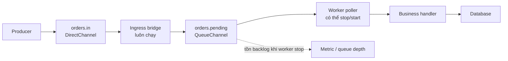
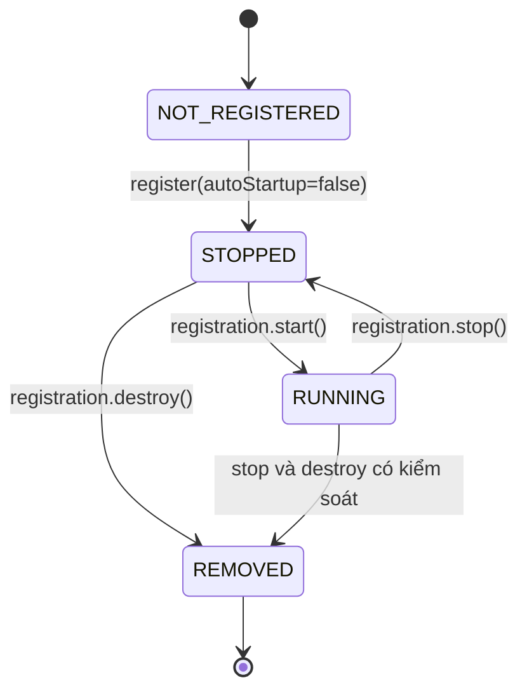
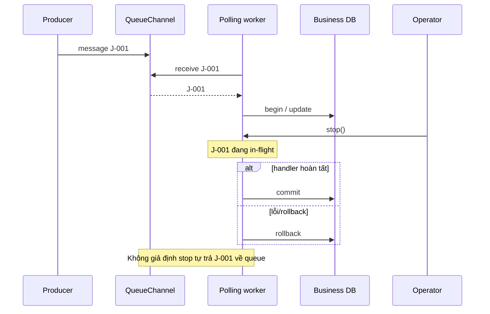

# Start và stop một phần flow

## 1. Bài toán: tạm dừng một nhánh mà không dừng cả ứng dụng

Spring Integration vận hành bằng các **channel**, **endpoint**, **consumer**, **poller**, **executor** và các `IntegrationFlow` kết nối chúng. Trong môi trường thực tế, không phải lúc nào cũng cần dừng toàn bộ Spring application context khi một thành phần phải bảo trì.

Ví dụ dịch vụ đơn hàng có ba nhánh:

- Ingress tiếp nhận yêu cầu và đưa vào queue chờ.
- Worker lấy yêu cầu ra khỏi queue để gọi nghiệp vụ hoặc cập nhật database.
- Nhánh kiểm tra trạng thái, log và xử lý lỗi tiếp tục chạy.

Khi database downstream bảo trì, người vận hành muốn **tạm dừng worker** nhưng giữ ingress và quan sát hoạt động. Sau khi database sẵn sàng, worker được **start** lại, xử lý phần backlog còn chờ. Đây là bài toán **start và stop một phần flow**.

Trong module **SPRING_INTEGRATION_RUNTIME**, cần hiểu việc điều khiển lifecycle này tác động thế nào đến luồng message, subscriber của channel, poller và executor, transaction, retry, message store, error channel, correlation cũng như trạng thái runtime.

> **Điểm cốt lõi:** `stop()` của một consumer endpoint không có nghĩa toàn bộ flow hoặc JVM bị dừng, và cũng không có nghĩa message đang xử lý được rollback. Muốn tạm dừng an toàn, phải xác định chính xác **điểm nhận message**, **buffer**, **công việc đang chạy** và **cách khôi phục**.

## 2. “Một phần flow” thực chất là phần nào?

Một `IntegrationFlow` là mô tả tuyến xử lý; trong runtime, nó có thể tạo nhiều component, bao gồm message channel và nhiều endpoint. Quyền điều khiển khác nhau tùy thành phần:

| Đối tượng | Thao tác thường dùng | Điều được điều khiển |
| --- | --- | --- |
| **Consumer endpoint** | `start()` / `stop()` thông qua `SmartLifecycle` | Việc endpoint tiếp tục nhận/phát động xử lý message; phạm vi tùy loại endpoint. |
| **Polling endpoint** | Dừng/khởi động lifecycle của polling consumer | Lịch nhận message mới từ `PollableChannel` hoặc nguồn polling. |
| **Producer/adapter có lifecycle** | `start()` / `stop()` | Việc adapter tiếp tục thu nhận hoặc phát message từ/đến hệ thống ngoài. |
| **Dynamic IntegrationFlow registration** | `IntegrationFlowRegistration.start()`, `stop()`, `destroy()` | Các component do **registration đó** quản lý, không phải mọi flow trong ứng dụng. |
| **MessageChannel** | Thông thường không có thao tác “pause toàn flow” | Kênh chuyển hoặc giữ message; hiệu ứng dừng phụ thuộc consumer và loại channel. |
| **Spring ApplicationContext** | Đóng/khởi động context | Phạm vi toàn ứng dụng, rộng hơn yêu cầu “một phần flow”. |

`start` và `stop` áp vào **thành phần có lifecycle**. Không được mặc định mọi `MessageChannel`, transformer hay handler bean riêng lẻ đều có thể stop; nhiều thành phần xử lý thuần túy chỉ hoạt động khi được endpoint gọi.

### Hai cách chia phạm vi điều khiển

1. **Điều khiển endpoint trong flow tĩnh:** dùng ID của endpoint và một bean triển khai `SmartLifecycle`. Cách này phù hợp khi topology cố định, chỉ cần tạm ngừng một consumer hoặc inbound adapter.
2. **Đăng ký các flow độc lập rồi quản lý riêng:** dùng `IntegrationFlowContext` tạo `IntegrationFlowRegistration` cho từng nhánh cần bật/tắt. Cách này phù hợp khi luồng thay đổi theo cấu hình runtime, tenant hoặc tác vụ.

Đừng nhầm **flow bean**, **registration**, **endpoint bean** và **channel bean**. Chúng có tên, lifecycle và trách nhiệm khác nhau.

## 3. Chọn ranh giới tạm dừng: DirectChannel hay QueueChannel?



Ở đây, **ingress** và **worker** là hai endpoint khác nhau, nằm ở hai phía của `QueueChannel`:

- Khi worker **running**, poller lấy message khỏi queue để xử lý.
- Khi worker **stopped**, poller không chủ động lấy message mới. Ingress có thể vẫn đưa message vào queue **nếu còn dung lượng**.
- Khi worker **start lại**, poller có thể tiếp tục lấy các message đang chờ.

Đây là một thiết kế hữu ích để tạm dừng **phần tiêu thụ**, nhưng không phải bảo đảm vô điều kiện:

- `QueueChannel` trong bộ nhớ **không bền vững qua restart JVM**.
- Queue có giới hạn dung lượng; khi đầy, producer có thể bị block, timeout hoặc gửi thất bại tùy timeout của `send` và channel/adapter.
- Một message **đã được poller nhận trước khi stop** có thể vẫn đang xử lý; stop không tự hoàn tác side effect.
- Nhiều polling consumer cùng nhận một queue sẽ cạnh tranh lấy message. Dừng **một** consumer không nhất thiết làm cả queue ngừng được tiêu thụ.

### So sánh theo loại channel

| Channel / cơ chế | Khi consumer dừng | Điều cần kiểm tra |
| --- | --- | --- |
| `DirectChannel` | Nếu không còn subscriber, gửi mới có thể thất bại với lỗi kiểu “Dispatcher has no subscribers” | Subscriber còn lại, phản hồi của producer và error handling. |
| `PublishSubscribeChannel` | Consumer đã dừng không nhận message mới; subscriber khác có thể vẫn nhận | Chính sách khi không còn subscriber và yêu cầu delivery. |
| `QueueChannel` | Message mới có thể tích lũy để poller nhận sau | Capacity, send timeout, backlog, persistent store. |
| `ExecutorChannel` | Tác vụ đã dispatch có thể đang chạy hoặc xếp hàng trong executor | Task in-flight, pool shutdown, rejection; queue executor không mặc định bền vững. |
| `PriorityChannel` / pollable channel tương tự | Consumer tạm ngừng nhận nhưng thứ tự nhận có thể theo chính sách riêng | Độ ưu tiên, dung lượng và persistence. |

Vì vậy, “tắt một handler” không phải là một thao tác an toàn giống nhau trên mọi topology. Hãy đặt **buffer hoặc cơ chế backpressure** ở ranh giới phù hợp trước khi thiết kế pause/resume.

## 4. `SmartLifecycle` và endpoint tĩnh

Các endpoint có quản lý vòng đời thường triển khai `SmartLifecycle`, cung cấp những khả năng như:

- `start()`: đưa endpoint vào trạng thái hoạt động.
- `stop()`: yêu cầu endpoint dừng theo hợp đồng lifecycle.
- `isRunning()`: phản ánh trạng thái chạy của thành phần, **không chứng minh mọi message đã hoàn tất**.
- `isAutoStartup()` và `getPhase()`: mô tả auto-start và thứ tự lifecycle khi Spring context khởi động/dừng.

Ví dụ Java DSL tạo một polling endpoint có ID dễ quan sát:

```java
import org.springframework.context.annotation.Bean;
import org.springframework.context.annotation.Configuration;
import org.springframework.beans.factory.annotation.Qualifier;
import org.springframework.integration.channel.QueueChannel;
import org.springframework.integration.config.EnableIntegration;
import org.springframework.integration.dsl.IntegrationFlow;
import org.springframework.integration.dsl.Pollers;
import org.springframework.messaging.PollableChannel;

@Configuration
@EnableIntegration
class StaticWorkerConfig {

    @Bean("jobs.staticPending")
    PollableChannel pending() {
        return new QueueChannel(100);
    }

    @Bean
    IntegrationFlow staticWorkerFlow(
            @Qualifier("jobs.staticPending") PollableChannel pending) {
        return IntegrationFlow.from(pending,
                endpoint -> endpoint
                    .id("jobs.staticPoller")
                    .poller(Pollers.fixedDelay(500)
                        .maxMessagesPerPoll(1)))
            .handle(String.class, (payload, headers) -> {
                System.out.println("Processed: " + payload);
                return null; // Endpoint một chiều, không tạo reply.
            })
            .get();
    }
}
```

Sau khi ứng dụng khởi động, có thể điều khiển endpoint thông qua ID đã được cấu hình:

```java
import org.springframework.context.ApplicationContext;
import org.springframework.context.SmartLifecycle;

SmartLifecycle endpoint =
    context.getBean("jobs.staticPoller", SmartLifecycle.class);

endpoint.stop();
System.out.println("running=" + endpoint.isRunning());

endpoint.start();
```

`context` là `ApplicationContext` đang chạy. Việc `getBean("jobs.staticPoller")` yêu cầu ID đó thực sự là **bean của endpoint** và triển khai `SmartLifecycle`. Nếu phiên bản framework hoặc cách khai báo flow tạo tên khác, hãy kiểm tra danh sách endpoint runtime và dùng ID đúng; không lấy flow bean hoặc channel bean rồi ép kiểu.

> **Cảnh báo:** dừng riêng polling endpoint có thể khiến các thành phần upstream vẫn nhận message. Nếu queue không tồn tại hoặc queue đầy, producer có thể gặp lỗi hoặc bị chặn. Phải kiểm tra tác động tới toàn tuyến, không chỉ thấy `isRunning() == false`.

## 5. `IntegrationFlowContext`: đăng ký một nhánh có thể bật/tắt

Khi cần quản lý một luồng ở runtime, `IntegrationFlowContext` cung cấp cơ chế đăng ký flow programmatically. Một registration có thể có **ID riêng**, được start/stop và cuối cùng destroy.



Sơ đồ biểu diễn **mô hình vận hành**. `register` tạo và quản lý các bean của flow; `start`/`stop` điều khiển lifecycle của registration. `destroy` là bước gỡ đăng ký/cleanup, không tương đương pause. Nó không tự xóa backlog ở một queue độc lập hay undo các side effect đã commit.

### Khi nào dùng?

- Bật/tắt một consumer cho nhóm công việc, tenant hoặc tính năng.
- Đăng ký pipeline xử lý theo một cấu hình runtime cụ thể.
- Thay phiên bản một worker bằng flow mới có lifecycle riêng.
- Giảm số consumer khi downstream bị giới hạn thông lượng.
- Tạm dừng một nhánh để can thiệp dữ liệu, giữ các nhánh giám sát và điều khiển khác hoạt động.

### Những giới hạn

- Registration và topology do `IntegrationFlowContext` tạo trong **memory của JVM**; sau restart cần **tái tạo** các dynamic flow từ một nguồn cấu hình bền vững nếu muốn chúng tồn tại trở lại.
- ID phải được quản lý rõ ràng. Đăng ký hai flow có cùng ID/bean name có thể gây xung đột.
- Cấu hình động ở một instance **không tự lan sang instance khác**. Nếu nhiều replica đều có consumer, phải điều khiển tất cả replica liên quan.
- `start()` trả về không tự chứng minh downstream đã kết nối, queue được xử lý hết hoặc business dependency đã healthy.

## 6. Ví dụ hoàn chỉnh: ingress luôn chạy, worker có thể pause/resume

Giả sử chúng ta nhận `Job` có `jobId` và `tenantId`. Phần ingress sẽ **luôn** đưa message vào queue; phần worker sẽ chỉ poll khi được start. Ví dụ dùng **in-memory queue** để dễ quan sát sự khác nhau giữa pause và restart; phần sau giải thích cách chuyển sang bền vững.

### 6.1. Domain và worker nghiệp vụ

```java
import org.springframework.stereotype.Component;

record Job(String jobId, String tenantId) {}

@Component
class JobWorker {

    void process(Job job) {
        if (job.jobId() == null || job.jobId().isBlank()) {
            throw new IllegalArgumentException("Missing jobId");
        }
        System.out.printf(
            "worker=%s job=%s tenant=%s%n",
            Thread.currentThread().getName(),
            job.jobId(),
            job.tenantId());
        // Demo chỉ log. Production cần business transaction/idempotency.
    }
}
```

### 6.2. Channel và ingress tĩnh

```java
import org.springframework.context.annotation.Bean;
import org.springframework.context.annotation.Configuration;
import org.springframework.integration.channel.DirectChannel;
import org.springframework.integration.channel.QueueChannel;
import org.springframework.integration.config.EnableIntegration;
import org.springframework.integration.dsl.IntegrationFlow;
import org.springframework.messaging.MessageChannel;
import org.springframework.messaging.PollableChannel;

@Configuration
@EnableIntegration
class JobChannelsConfig {

    @Bean("jobs.in")
    MessageChannel jobsIn() {
        return new DirectChannel();
    }

    @Bean("jobs.pending")
    PollableChannel jobsPending() {
        return new QueueChannel(100);
    }

    @Bean
    IntegrationFlow jobsIngressFlow() {
        return IntegrationFlow.from("jobs.in")
            .bridge()
            .channel("jobs.pending")
            .get();
    }
}
```

`jobs.in` tiếp nhận message đồng bộ, còn `jobs.pending` là hàng đợi giữa hai phần của tuyến. Nhờ có bridge endpoint hoạt động, producer không phụ thuộc trực tiếp vào subscriber của worker. Khi worker dừng, ingress vẫn hoạt động **đến khi queue đầy hoặc gặp lỗi khác**.

`QueueChannel(100)` chỉ chứa tối đa 100 message đang chờ; nó không tự mở rộng dung lượng và **không persist qua restart JVM**.

### 6.3. Quản lý dynamic worker flow

```java
import org.springframework.integration.dsl.IntegrationFlow;
import org.springframework.integration.dsl.Pollers;
import org.springframework.integration.dsl.context.IntegrationFlowContext;
import org.springframework.stereotype.Component;

@Component
class JobFlowManager {

    private final IntegrationFlowContext flowContext;
    private final JobWorker worker;

    private IntegrationFlowContext.IntegrationFlowRegistration registration;

    JobFlowManager(IntegrationFlowContext flowContext, JobWorker worker) {
        this.flowContext = flowContext;
        this.worker = worker;
    }

    // Mỗi instance JVM quản lý một registration demo.
    public synchronized void install() {
        if (registration != null) {
            throw new IllegalStateException("Worker flow already installed");
        }

        IntegrationFlow workerFlow = IntegrationFlow
            .from("jobs.pending",
                endpoint -> endpoint.poller(
                    Pollers.fixedDelay(500).maxMessagesPerPoll(1)))
            .handle(Job.class, (payload, headers) -> {
                worker.process(payload);
                return null;
            })
            .get();

        registration = flowContext.registration(workerFlow)
            .id("jobs-worker-v1")
            .autoStartup(false)
            .register();
    }

    public synchronized void start() {
        requireInstalled();
        registration.start();
    }

    public synchronized void stop() {
        requireInstalled();
        registration.stop();
    }

    public synchronized void remove() {
        requireInstalled();
        registration.stop();
        registration.destroy();
        registration = null;
    }

    private void requireInstalled() {
        if (registration == null) {
            throw new IllegalStateException("Worker flow not installed");
        }
    }
}
```

Đoạn trên dùng API Java DSL/`IntegrationFlowContext` của các dòng Spring Integration hiện đại; khi áp dụng cần đối chiếu chữ ký API với phiên bản dependency đang dùng. `autoStartup(false)` cho phép **đăng ký trước nhưng chưa chạy**. `registration.start()` kích hoạt worker; `registration.stop()` dừng các endpoint được quản lý bởi registration này; `destroy()` gỡ hẳn registration.

`synchronized` ở đây chỉ ngăn các lời gọi quản trị đồng thời lên **một object trong cùng JVM**. Nó không khóa việc consumer đang xử lý message trên poller thread, không tạo distributed lock và không ngăn một replica khác khởi động worker riêng.

### 6.4. Thực nghiệm pause/resume

```java
import org.springframework.context.ApplicationContext;
import org.springframework.messaging.MessageChannel;
import org.springframework.messaging.support.MessageBuilder;

void runDemo(ApplicationContext context, JobFlowManager manager) {
    manager.install(); // Registration tồn tại, worker chưa poll.

    MessageChannel input = context.getBean(
        "jobs.in", MessageChannel.class);

    input.send(MessageBuilder
        .withPayload(new Job("J-001", "tenant-A"))
        .build(), 500);

    input.send(MessageBuilder
        .withPayload(new Job("J-002", "tenant-A"))
        .build(), 500);

    // Lúc này hai message đang chờ trong jobs.pending.
    manager.start();

    // Khi poller nhận và xử lý xong các message, có thể pause.
    manager.stop();

    input.send(MessageBuilder
        .withPayload(new Job("J-003", "tenant-A"))
        .build(), 500);

    // J-003 chờ trong queue; worker đang stop nên chưa poll tiếp.
    manager.start();

    // Sau khi chứng minh xử lý xong và muốn bỏ registration:
    // manager.remove();
}
```

Ví dụ minh họa lời gọi điều khiển, không phải một bài test có điều kiện chờ chặt chẽ. Trong test tự động, phải **đợi có bằng chứng rằng J-001/J-002 đã xử lý xong** (latch/metric hoặc trạng thái DB), rồi mới gọi `stop()`. Nếu gọi stop ngay sau start, một hoặc cả hai message có thể vẫn chưa được poll.

Lệnh `send(message, 500)` đặt thời gian chờ khi kênh/adapter hỗ trợ; giá trị trả về cần được kiểm tra trong chương trình thực. `send() == true` chỉ cho biết bước gửi đã được chấp nhận theo hợp đồng của channel, **không chứng minh nghiệp vụ đã commit**.

## 7. Start, stop, destroy khác nhau ở đâu?

| Thao tác | Điều thường xảy ra | Không được giả định |
| --- | --- | --- |
| `registration.start()` | Khởi động các endpoint lifecycle thuộc registration nếu chưa chạy | Không tự sửa lỗi database, error channel hoặc backlog bị hỏng. |
| `registration.stop()` | Yêu cầu các endpoint đó ngừng nhận/phát động công việc theo lifecycle | Không tức thì hủy mọi xử lý in-flight hoặc rollback transaction. |
| `registration.destroy()` | Gỡ registration và bean/component do registration quản lý | Không có nghĩa queue bên ngoài registration và dữ liệu business bị xóa. |
| `SmartLifecycle.stop()` cho một endpoint | Dừng **đúng endpoint đó** | Không dừng mọi endpoint khác dùng chung input channel hoặc cùng process. |
| Đóng `ApplicationContext` | Dừng gần như toàn bộ hạ tầng Spring của context | Không thay thế recovery đối với hard crash và dữ liệu RAM. |

Trong ví dụ, `jobs.in` và `jobs.pending` là bean của flow/khai báo tĩnh, còn `jobs-worker-v1` do registration động quản lý. Vì thế `destroy()` worker **không có nghĩa** các bean ingress và queue cùng bị xóa.

Ngược lại, nếu dynamic registration **tự tạo cả nguồn, channel và consumer**, destroy có thể làm mất các component đó theo phạm vi quản lý. Không áp máy móc kết luận của một topology cho mọi flow.

### Tránh xung đột ID và bean

Đặt ID mang tính nghiệp vụ/phiên bản như `jobs-worker-v1` thay vì ID sinh tùy hứng nếu cần quản trị. Nhưng đừng gọi `register` nhiều lần với cùng ID mà không kiểm tra trạng thái cũ. Khi thay flow:

1. Dừng nhận công việc mới ở nhánh cần thay.
2. Xác định trạng thái in-flight và backlog.
3. Stop rồi destroy registration cũ theo chính sách.
4. Register flow mới với ID/phiên bản rõ ràng.
5. Start, kiểm chứng readiness và xử lý backlog.

Không xem việc đổi ID là đủ để ngăn **hai consumer** cùng poll một queue, nếu registration cũ vẫn chạy.

## 8. Stop một consumer có dừng công việc đang chạy không?

**Không thể kết luận chỉ từ `stop()`.** Hãy phân biệt:

- **Not-yet-received:** message còn nằm trong queue/broker. Dừng poller có thể ngăn nhận mới.
- **Received/in-flight:** message đã được poller lấy và handler đang chạy. Tùy implementation, stop có thể chờ, ngắt, hoặc cho xử lý tiếp; phải kiểm tra trên phiên bản và cấu hình thực tế.
- **Committed/acknowledged:** side effect đã hoàn tất hoặc message đã ack. Stop không tự đảo ngược trạng thái đó.
- **Queued in executor:** task đã xếp hàng nhưng chưa bắt đầu; semantics phụ thuộc executor, shutdown policy và endpoint.



Nếu handler gọi một HTTP API chậm hoặc chờ JDBC lock, `stop()` không mặc định hủy được I/O đó. Vì vậy cần timeout từng tầng, cơ chế drain và shutdown deadline. Nếu endpoint dùng polling transaction hoặc broker acknowledgement, xác định rõ chính sách **receive → process → commit → ack**; không dựa vào tên phương thức `stop()` để đoán trạng thái message.

## 9. Kế hoạch pause an toàn: quiesce, drain, stop, resume

Một thủ tục thực tế khi cần bảo trì downstream:

1. **Đặt chế độ quiesce** cho nhánh cần dừng: ngăn nhận công việc mới ở nguồn, hoặc tiếp tục nhận vào một buffer có giới hạn rõ ràng.
2. **Đo backlog và in-flight:** số message còn trong queue, số worker đang xử lý, tổng thời gian giữ transaction.
3. **Đợi drain có thời hạn** nếu cần không còn công việc đang chạy. Khi không thể đợi, xác định chính sách rollback/redelivery.
4. **Stop endpoint/registration** của nhánh worker. Kiểm tra trạng thái running và đảm bảo không còn polling mới.
5. **Thực hiện bảo trì**, liên tục quan sát queue depth, send timeouts, error flow.
6. **Kiểm tra readiness** của database/broker/target service trước khi start lại.
7. **Start đúng nhánh**, theo dõi backlog giảm và số lỗi/retry. Chỉ mở hoàn toàn traffic khi số liệu thỏa điều kiện.

### Có thể tiếp tục nhận vào queue khi worker dừng không?

Có, nhưng cần tính capacity:

Giả sử ingress nhận **80 message/giây**, worker dự kiến stop **120 giây**; backlog lý thuyết tăng khoảng `80 × 120 = 9.600` message, chưa kể message tồn trước đó. `QueueChannel(100)` trong ví dụ sẽ đầy rất sớm. Tăng `maxMessagesPerPoll` hoặc số worker **không giúp gì khi worker đang stop**; phải dùng buffer bền vững đủ sức chứa, giảm tốc ingress hoặc chủ động phản hồi backpressure.

Với queue in-memory, kể cả capacity đủ, crash trong lúc worker stop có thể làm mất toàn bộ backlog. Nếu không được phép mất message, dùng durable broker/channel store và kiểm tra khả năng replay qua restart.

## 10. Transaction, retry và MessageStore khi resume

### Transaction boundary

Với `DirectChannel` đồng bộ, handler có thể tham gia transaction từ thread producer; với `ExecutorChannel` hoặc poller, handler thường chạy ở thread khác. Khi stop/resume một poller, transaction của message **đã được nhận** phụ thuộc transaction advice hoặc manager trên thread xử lý.

Cần kiểm tra riêng:

- **Transaction nghiệp vụ:** JDBC commit/rollback có bảo vệ đúng các câu SQL không?
- **Receive/dequeue:** có rollback được thao tác lấy message không, hay message đã rời queue?
- **Acknowledgement:** nguồn broker có biết message đã xử lý thành công không?
- **Error publication:** nếu handler lỗi trên worker, exception được gửi vào error channel, retry hoặc DLQ thế nào?

Dừng poller **không tạo transaction** cho receive nếu trước đó chưa có.

### Retry boundary

Nếu job lỗi và retry advice đang chờ backoff, việc stop endpoint có thể xảy ra giữa các attempt. Không giả định stop hủy mọi retry callback đang chạy, hoặc attempt đã thành công. Nên đặt:

- Số lần retry và backoff có giới hạn;
- Idempotency key như `jobId` tại database/API đích;
- Recovery hoặc DLQ khi retry exhausted;
- Metric cho retry in-flight và outcome sau resume.

Một message đã commit DB rồi bị redeliver sau stop/crash có thể chạy lại. Cần unique constraint, idempotent update hoặc transactional outbox phù hợp; **lifecycle stop không bảo đảm exactly-once**.

### Message store và group state

| State | Khi stop một endpoint nhưng JVM vẫn sống | Khi JVM restart |
| --- | --- | --- |
| `QueueChannel` in-memory | Message có thể tiếp tục nằm trong queue | Mất nếu không có cơ chế persistence khác. |
| `QueueChannel` với persistent channel message store | Message đã lưu/commit có thể còn | Phụ thuộc storage, transaction receive và serialization. |
| Aggregator với `MessageGroupStore` in-memory | Group có thể vẫn tồn tại trong cùng context | Group chưa hoàn tất có thể mất. |
| Persistent `MessageGroupStore` | Group state có thể được giữ trong backend | Cần tái tạo endpoint/flow, giữ đúng correlation/release policy. |
| `MetadataStore` dùng cho checkpoint/idempotency | Dấu mốc có thể còn trong JVM | Cần shared/persistent implementation nếu muốn giữ qua restart. |
| Dynamic flow registration | Registration tiếp tục tồn tại cho đến khi destroy/context đóng | Phải register lại từ cấu hình bền vững. |

`start()` một endpoint sau restart **không đủ** nếu bản thân endpoint chưa được tạo lại; dữ liệu bền vững và topology/lifecycle là hai phần của recovery.

## 11. Error channel và khả năng quan sát lúc worker stop

Nếu chỉ dừng worker nhưng giữ producer, trạng thái lỗi có thể xuất hiện ở các điểm khác:

| Tình huống | Lỗi/triệu chứng có thể gặp | Kiểm tra |
| --- | --- | --- |
| Dừng subscriber cuối trên `DirectChannel` | Lỗi phân phối “Dispatcher has no subscribers” | Subscriber count, endpoint đang running. |
| Dừng poller đọc `QueueChannel` | Queue depth tăng, không có completion | Poller running, queue capacity, send timeout. |
| Queue đầy | Producer bị chặn hoặc gửi thất bại | Send latency, timeout, failed sends. |
| Dừng error flow nhưng nghiệp vụ còn chạy | `ErrorMessage` không được xử lý hoặc lỗi thứ cấp | Error channel, subscriber/error handler lifecycle. |
| Stop khi còn executor task | Task tiếp tục chạy, bị reject hoặc thất bại theo shutdown policy | Executor active tasks, queue depth, error logs. |
| Dừng flow động rồi restart app | Flow không tồn tại nếu không được tái tạo | Dynamic configuration source và quy trình đăng ký. |

Quan sát cả **trạng thái control plane** (registration/endpoint running, thời điểm start/stop, người thực hiện) và **data plane** (message accepted, dequeued, processing, committed, failed).

Ví dụ log hữu ích:

```text
component=jobs-worker-v1 action=stop requestedAt=10:01:00
component=jobs-worker-v1 state=stopped pending=240 inflight=2
component=jobs-worker-v1 action=start requestedAt=10:03:00
component=jobs-worker-v1 state=running pending=240
component=jobs-worker-v1 completed=200 errors=1 pending=39
```

Các con số chỉ minh họa; `isRunning=false` **không** chứng minh `inflight=0`. Muốn đưa in-flight vào log, ứng dụng phải có cách đo thực sự. Với `PollableChannel`, queue depth có thể đo được theo implementation; với broker, dùng backlog/lag từ chính hệ thống broker thay vì suy ra từ `MessageChannel`.

## 12. Nhiều instance và thay đổi flow động

Một API “stop worker” gửi vào **instance A** không làm worker ở **instance B** tự dừng. Nếu cả hai poll cùng broker hoặc cùng persistent store, B vẫn có thể tiêu thụ công việc. Vì vậy, yêu cầu tạm dừng ở cấp hệ thống cần:

1. Phân biệt **instance-local pause** với **global pause**.
2. Điều phối lệnh theo danh sách replica đang sống, có xác nhận từng instance.
3. Ngăn instance mới được autoscale/start trong lúc hệ thống đang ở trạng thái pause.
4. Lưu **desired state** (ví dụ `PAUSED`/`RUNNING` cùng version) ở nguồn cấu hình bền vững nếu muốn qua restart.
5. Kiểm tra effective state và backlog trên từng instance; không chỉ dựa vào trạng thái mong muốn.
6. Giải quyết race giữa hai lệnh admin `start`/`stop` hoặc giữa deploy mới và reconcile job.

`synchronized` trong `JobFlowManager` chỉ giải quyết concurrency nội bộ một JVM. Với nhiều instance, phải dùng cơ chế điều phối phân tán hoặc control plane phù hợp; không mặc định Spring Integration cung cấp một lệnh pause toàn cluster.

### Nâng cấp flow không làm mất message

Khi thay phiên bản worker từ `jobs-worker-v1` sang `v2`:

- Dừng hoặc drain v1 trước khi v2 xử lý **cùng công việc** nếu nghiệp vụ không cho phép hai phiên bản chạy đồng thời.
- Nếu cùng nhận `QueueChannel`, hai poller sẽ **cạnh tranh** nhận message chứ không tự nhân bản.
- Nếu muốn canary với tỷ lệ traffic, dùng routing/filter/channel chia nguồn theo chủ đích; không “canary” bằng cách khởi động hai poller rồi kỳ vọng tỉ lệ cố định.
- Giữ tương thích payload/header, serializer, transaction/ack và message store giữa v1/v2.
- Ghi rõ chính sách khi một message đã dequeue ở v1 nhưng chưa hoàn tất đúng lúc stop.
- Nếu destroy registration, lưu đủ cấu hình để rollback về v1 mà không dựa vào trạng thái JVM đã mất.

## 13. Quản lý ID, phase và startup order

`SmartLifecycle` có `isAutoStartup()` và `getPhase()`. Spring có thể dùng phase để quản lý thứ tự start/stop giữa các component. Tuy nhiên, thứ tự lifecycle toàn ứng dụng **không thay thế** việc thiết kế phụ thuộc thực sự của một nhánh dynamic.

Ví dụ, worker chỉ được start khi:

- Database/migration đã sẵn sàng;
- Error handler và metric pipeline thiết yếu đã chạy;
- Channel/queue mà worker poll tồn tại và đúng schema;
- Các component phụ thuộc như lock registry hoặc message store đã kết nối.

Khi startup, `IntegrationFlowContext.registration(...).autoStartup(false)` cho phép không bắt đầu poller trước khi control plane xác nhận điều kiện. Với flow tĩnh, có thể điều khiển auto startup và phase tại endpoint phù hợp theo DSL/bean lifecycle.

**Quy tắc về ID:** dùng một namespace rõ ràng như `jobs.consumer.tenantA.v2`, không đặt trùng tên channel/endpoint có sẵn. Log ID của registration và ID của endpoint để người vận hành tìm được đúng đối tượng. Một flow có thể tạo nhiều endpoint: `stop` một endpoint cụ thể khác với `stop` toàn registration.

## 14. Kiểm thử start/stop một phần flow

Một kiểm thử tốt phải quan sát **message trước khi stop, đang xử lý lúc stop, và đến sau khi stop**.

| Test ID | Thao tác | Điều cần assert |
| --- | --- | --- |
| S01 | Register worker với `autoStartup(false)` | Endpoint không poll; gửi message vào buffer còn dung lượng. |
| S02 | Start worker | Message đã chờ được xử lý; backlog giảm. |
| S03 | Stop worker khi queue rỗng | Không có lần poll/processing mới sau khi stop ổn định. |
| S04 | Gửi message khi worker stopped | Queue nhận message nếu còn chỗ; nghiệp vụ chưa chạy. |
| S05 | Start lại worker | Message S04 được xử lý; không tạo xử lý trùng do logic startup. |
| S06 | Stop khi handler đang xử lý SQL/HTTP | Ghi rõ in-flight outcome, rollback/ack và timeout; không dự đoán từ trạng thái running. |
| S07 | Để buffer đầy khi worker stop | Producer gặp backpressure/timeout theo chính sách, không mất message im lặng. |
| S08 | Stop subscriber cuối trên `DirectChannel` | Chẩn đoán chính xác message delivery error. |
| S09 | Destroy registration rồi thử start instance cũ | Registration cũ không còn hợp lệ; cần register lại. |
| S10 | Restart JVM với in-memory queue | Message chờ có thể mất; không gắn nhãn “durable”. |
| S11 | Restart JVM với persistent source | Tái tạo dynamic flow, xác minh recovery và idempotency. |
| S12 | Có hai replica, chỉ stop một | Replica còn lại có thể tiếp tục xử lý; xác minh phạm vi lệnh. |

### Assertions mẫu cho demo

```text
Given: manager.install(), chưa start
When: gửi J-001 và J-002 vào jobs.in
Then: pending tăng thêm 2; processed = 0

When: manager.start() và đợi J-001, J-002 hoàn tất
Then: processed = 2; pending = 0

When: manager.stop(); gửi J-003
Then: processed vẫn = 2; pending = 1

When: manager.start() và đợi hoàn tất
Then: processed = 3; pending = 0
```

Để assertion đáng tin cậy, nên dùng `CountDownLatch`, bộ đếm thread-safe hoặc dữ liệu nghiệp vụ đã commit, có timeout chờ hợp lý. **Không dùng một lần `Thread.sleep(1000)` làm bằng chứng chắc chắn** poller đã xử lý; thời gian scheduler, máy CI hoặc database có thể thay đổi.

## 15. Checklist vận hành và xử lý lỗi

| Dấu hiệu bất thường | Nguyên nhân khả dĩ | Hành động kiểm tra |
| --- | --- | --- |
| Stop rồi nhưng vẫn thấy xử lý | Message in-flight hoặc poller/consumer khác đang chạy | Log thread/endpoint ID, active tasks, toàn bộ consumers. |
| Start rồi queue không giảm | Poller chưa start, handler lỗi, sai input channel hoặc store không truy cập được | `isRunning`, poll count, error channel, queue/store metrics. |
| Producer gửi lỗi sau stop | Dừng subscriber cuối của subscribable channel | Topology và subscriber count; thêm buffer phù hợp. |
| Producer bị treo khi worker stop | Queue đầy, `send` đang chờ capacity | Send timeout, backlog, capacity và backpressure. |
| Backlog mất sau restart | Queue nằm trong bộ nhớ | Durable broker/channel message store và test SIGKILL. |
| Flow đã destroy nhưng bean còn xung đột | ID trùng hoặc component ở ngoài registration | Phân biệt static bean với dynamic bean; kiểm tra scope và ID. |
| Message được xử lý hai lần sau resume | Redelivery/retry hoặc hai consumer cùng hoạt động | Idempotency key, ack, transaction, consumer count. |
| Error channel không nhận lỗi | Error endpoint cũng stopped hoặc routing sai | Lifecycle error handler, `errorChannel` header, subscriber. |
| Chỉ một replica stop nhưng hệ thống vẫn xử lý | Lệnh chỉ có hiệu lực cục bộ | Điều phối toàn bộ replica và desired state. |
| Stop kéo dài bất thường | Handler đang chờ SQL/network/lock, executor shutdown policy | Thread dump, transaction timeout, active tasks, lock wait. |
| Flow start quá sớm lúc deploy | Sai startup order/readiness/autoStartup | Kiểm tra dependencies, phase và đăng ký dynamic flow. |

**Checklist trước khi vận hành:**

1. Biết chính xác bean/registration nào được stop và channel nào vẫn có producer.
2. Có chính sách xử lý message đến trong lúc worker paused: buffer, reject hoặc backpressure.
3. Đo backlog, in-flight, processing time, retry và error rate.
4. Xác định timeout, transaction và ack của message đã được nhận trước stop.
5. Có kế hoạch phục hồi khi JVM restart; không dựa vào queue in-memory nếu cần durability.
6. Đảm bảo admin control có xác thực, phân quyền và log audit.
7. Nếu nhiều replica, xác định rõ local hay global pause.
8. Test resume và rollback với message ID/correlation ID trước khi áp trên tải thật.

## 16. Bài thực hành và câu hỏi tự kiểm tra

**Bài 1 — Start/stop một polling endpoint tĩnh.** Dùng `StaticWorkerConfig`, lấy bean `SmartLifecycle` theo ID `jobs.staticPoller`, gọi stop, gửi message vào queue rồi start. Quan sát `isRunning()` và số message được xử lý. Giải thích vì sao queue vẫn nhận được message trong lúc poller dừng.

**Bài 2 — Đăng ký dynamic flow ở trạng thái stopped.** Dùng `JobFlowManager` gọi `install()`, gửi J-001 và J-002, đợi xác minh chúng còn trong queue, rồi start và đo thời gian xử lý backlog. Tăng tốc poller hoặc `maxMessagesPerPoll` có làm kết quả khác không?

**Bài 3 — In-flight khi stop.** Cho `JobWorker.process` đợi trên `CountDownLatch` trước khi kết thúc, start poller, gửi J-003, rồi stop trong lúc handler vẫn đợi. Ghi lại trạng thái endpoint, in-flight, thời điểm commit giả lập và điều gì xảy ra khi release latch. Không làm bài này trên dữ liệu production.

**Bài 4 — Backpressure khi queue đầy.** Giữ worker stopped và gửi hơn 100 message đến `jobs.in`. Cấu hình timeout gửi phù hợp, ghi số gửi thành công/thất bại và thời gian chờ. Thiết kế một cách phản hồi rõ ràng cho producer khi queue không còn chỗ.

**Bài 5 — Từ RAM sang persistence.** Thay `jobs.pending` bằng channel có persistent message store tương thích hoặc dùng durable broker. Thực hiện pause, gửi backlog, kill JVM thử nghiệm, restart và đăng ký lại dynamic worker. Kiểm chứng các message đã commit vào store được phục hồi.

**Bài 6 — Retry và transaction.** Cho worker cập nhật database rồi ném exception; so sánh transaction quanh handler với transaction quanh poller/receive, kiểm tra rollback và message có được redeliver không. Sau resume, dùng `jobId` để xác minh không tạo side effect trùng.

**Bài 7 — Thay worker v1 sang v2.** Tạo hai phiên bản worker dùng chung queue, đo nguy cơ cả hai poller đồng thời. Đề xuất quy trình stop/drain/destroy v1, install/start v2 và rollback khi v2 không healthy.

**Bài 8 — Nhiều instance.** Chạy hai replica, mỗi replica có `IntegrationFlowContext` riêng. Stop worker của replica A, chứng minh B có thể tiếp tục. Thiết kế desired-state control và quy trình reconcile ở mọi replica khi startup.

### Câu hỏi tự kiểm tra

1. Dừng một `IntegrationFlowRegistration` khác với đóng `ApplicationContext` ở đâu?
2. Vì sao `DirectChannel` có thể báo “no subscribers” sau khi consumer cuối cùng bị stop?
3. Vì sao `QueueChannel` giúp tạm ngừng worker nhưng chưa bảo đảm chống mất message qua crash?
4. `stop()` có bảo đảm transaction đang chạy bị rollback không? Muốn biết kết quả cần quan sát gì?
5. `SmartLifecycle.isRunning() == false` có chứng minh không còn message in-flight không?
6. Sự khác nhau giữa `registration.stop()` và `registration.destroy()` là gì?
7. Vì sao dynamic registration cần được tái tạo sau khi JVM restart?
8. Nếu queue có 100 slot, ingress 80 message/giây, worker stop 2 phút, hệ quả là gì?
9. Vì sao stop một worker không nhất thiết stop toàn bộ consumers của cùng queue?
10. Khi kết hợp `ExecutorChannel` và poller, những task nào có thể vẫn chạy sau khi operator gọi stop?
11. Vì sao cần idempotency ngay cả khi đã có stop/drain và transaction?
12. Làm cách nào kiểm chứng pause toàn cluster thay vì chỉ một JVM?

**Nguyên tắc vận hành:** điều khiển đúng **consumer endpoint hoặc dynamic registration**, giữ ranh giới **input–buffer–worker** rõ ràng và có khả năng quan sát, rồi mới quyết định pause/resume. Đánh giá riêng trạng thái running, backlog, in-flight, transaction, acknowledgement và persistence. Một lệnh `stop()` chỉ an toàn khi hệ thống biết **message đã ở đâu, còn ai đang xử lý, và điều gì sẽ xảy ra khi start lại hoặc JVM chết**.
