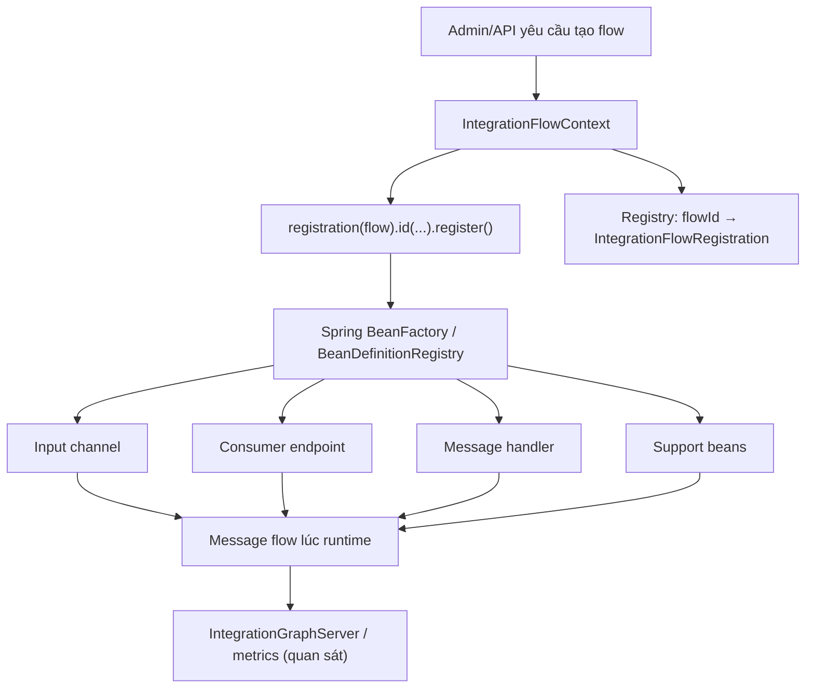
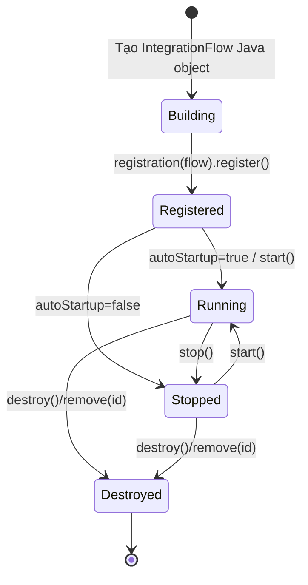
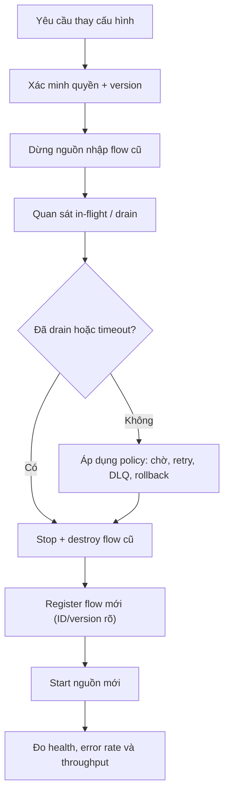
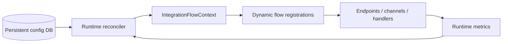

# Registry của integration component trong Spring Integration Runtime

## 1. Vì sao cần registry khi flow được tạo lúc ứng dụng đang chạy?

Một nền tảng tích hợp ban đầu chỉ nhận đơn hàng từ một nguồn. Sau đó, quản trị viên cho phép khách hàng tự kết nối các nguồn dữ liệu mới: mỗi tenant có endpoint, channel, bộ lọc, handler và chính sách retry riêng. Không thể restart ứng dụng mỗi lần có tenant mới. Hệ thống cần **đăng ký, tìm, điều khiển và gỡ bỏ** các thành phần tích hợp ngay trong runtime.

Trong **Spring Integration Runtime** (`SPRING_INTEGRATION_RUNTIME`), cách làm chủ đạo là đăng ký một `IntegrationFlow` động thông qua **`IntegrationFlowContext`**. Framework kết nối các thành phần của flow với Spring application context, quản lý bean/lifecycle rồi cung cấp một **registration** để tra cứu và điều khiển flow. Đây là chủ đề **“Registry của integration component”**, thuộc chương **Dynamic runtime**.

Registry không thay thế channel hay endpoint: nó là **lớp quản lý các đối tượng tạo ra channel, endpoint và handler**. Một flow có thể chứa `DirectChannel`, `QueueChannel`, consumer dùng poller, handler gửi async reply, hoặc adapter kết nối broker. Sau đăng ký, những thành phần đó vẫn tuân theo quy tắc threading, transaction, retry, message store và error handling vốn có.

Mục tiêu của bài:

1. Phân biệt registry của `IntegrationFlowContext`, Spring bean registry và runtime integration graph.
2. Đăng ký một `IntegrationFlow` tại runtime bằng `IntegrationFlowContext.registration(...)`.
3. Hiểu flow ID, bean name, prefix, dependent beans và cách tra cứu registration.
4. Điều khiển `start()`, `stop()`, `destroy()` hoặc `remove(flowId)` đúng lifecycle.
5. Gửi message tới một flow động, phân biệt flow có/không có input `MessageChannel`.
6. Thiết kế cập nhật cấu hình, xóa flow an toàn, tránh race và rò rỉ tài nguyên.
7. Chẩn đoán các lỗi runtime: đăng ký trùng ID, thiếu subscriber, poller còn chạy, reply channel sai, connection không đóng, mất state sau restart.

**Phạm vi phiên bản:** API được trình bày theo dòng Spring Integration 6.x; một số tùy chọn như `setDescription(...)` có từ 6.4. Bài đưa các ví dụ tự chứa ở mức Java DSL và chỉ dùng tính năng có ý nghĩa trong runtime. Luôn đối chiếu API với đúng phiên bản dependency của hệ thống.

## 2. Ba lớp “registry” không nên nhầm lẫn

Từ *registry* có thể xuất hiện trong nhiều tài liệu Spring, nhưng không phải lớp nào cũng quản lý cùng một tập đối tượng.

| Cơ chế | Chứa những gì? | Trường hợp sử dụng |
| --- | --- | --- |
| **`BeanFactory` / `BeanDefinitionRegistry`** | Bean definitions và các Spring beans trong application context | Framework khởi tạo/lắp ghép channel, endpoint, handler, connection factory, service. |
| **`IntegrationFlowContext`** | Map các `IntegrationFlowRegistration` của flow được đăng ký động | Đăng ký, tìm theo flow ID, điều khiển lifecycle và xóa flow động. |
| **`IntegrationGraphServer`** | Mô hình đồ thị của integration components trong ứng dụng | Quan sát quan hệ channel–endpoint–handler và trạng thái runtime; có thể tích hợp metrics. |

Một flow động là **tập các Spring beans có quan hệ với nhau**. Khi gọi `register()`, framework làm công việc bean registration/initialization cần thiết, thay vì chỉ bỏ một Java object vào `Map`. Ngược lại, `getRegistry()` chỉ hiển thị **những registration do `IntegrationFlowContext` quản lý**; nó **không** phải danh sách tuyệt đối của mọi Spring bean hay tất cả flow tĩnh được định nghĩa bằng `@Bean`.



### 2.1. Những định danh khác nhau

| Định danh | Ví dụ | Ý nghĩa |
| --- | --- | --- |
| `flowId` | `tenant-acme-orders` | Khóa đăng ký flow động, cần **duy nhất trong context**. |
| Component/bean name | `tenant-acme-orders.validator` | Tên bean của handler/channel/endpoint trong Spring context, chịu quy tắc prefix/ID. |
| Message ID | UUID do `MessageHeaders` sinh | Nhận diện **một message**, không phải flow hay tenant. |
| Correlation ID | `orderId = SO-42` | Ghép những message cùng một nghiệp vụ/nhóm. |
| Business tenant ID | `acme` | Khóa domain dùng để suy ra flow ID; cần chuẩn hóa và kiểm tra quyền. |

Không nên dùng ngẫu nhiên `MessageHeaders.ID` để tạo `flowId` nếu cần tái lập flow sau restart. Flow ID nên xuất phát từ một định danh nghiệp vụ/configuration **ổn định**, ví dụ `tenant-acme-orders-v3`.

## 3. Hợp đồng API của `IntegrationFlowContext`

Interface `org.springframework.integration.dsl.context.IntegrationFlowContext` được Spring Integration cung cấp như một bean khi framework integration được kích hoạt. Nó là API dành cho **đăng ký flow động**, không phải một global static registry.

| Phương thức | Tác dụng | Lưu ý |
| --- | --- | --- |
| `registration(IntegrationFlow)` | Trả builder để cấu hình rồi đăng ký flow | Chưa đăng ký cho tới khi gọi `register()`. |
| `getRegistrationById(flowId)` | Trả `IntegrationFlowRegistration` của flow động, hoặc `null` nếu không tìm thấy | Không được suy ra flow đang running chỉ vì có registration. |
| `getRegistry()` | Cung cấp map flow ID → registration | Dùng để quan sát; không sửa map trực tiếp để tạo/xóa flow. |
| `messagingTemplateFor(flowId)` | Lấy `MessagingTemplate` có default destination là input channel của flow | Flow phải bắt đầu từ `MessageChannel`; không dùng được với mọi source. |
| `remove(flowId)` | Hủy flow động và các dependent beans được quản lý, dọn cache registry | Khác với chỉ stop flow; cần kiểm tra in-flight work. |

Một `IntegrationFlowContext.IntegrationFlowRegistration` cung cấp:

- `getId()`: flow ID đã đăng ký.
- `getIntegrationFlow()`: đối tượng flow tương ứng.
- `getInputChannel()`: kênh đầu vào nếu flow có đầu vào là channel.
- `getMessagingTemplate()`: template thuận tiện để gửi vào input channel.
- `start()` và `stop()`: điều khiển lifecycle của registration.
- `destroy()`: hủy flow và những dependent beans thuộc registration.

**Quy tắc quan trọng:** không bao giờ đồng nhất `stop()` với `destroy()`. `stop()` giữ cấu hình/registration để có thể `start()` lại. `destroy()` hoặc `remove(flowId)` dọn registration và những bean liên quan; sau đó phải tạo/đăng ký flow mới nếu muốn dùng lại ID đó.

## 4. Vòng đời một integration component được đăng ký động



Đây là **mô hình giải thích**; trạng thái `Registered`, `Running`, `Stopped` không phải enum của `IntegrationFlowRegistration`. Nhiều endpoint/component có interface lifecycle riêng như `SmartLifecycle`. Registration đại diện cho tập component được quản lý, không phải một transaction.

### Các mốc cần phân biệt

1. **Building:** tạo định nghĩa flow, handler và các object phụ trợ, chưa thể kỳ vọng channel/endpoint đã hiện diện trong application context.
2. **Register:** framework đăng ký flow và những dependent beans, áp dụng initialization/lifecycle phù hợp. `autoStartup(true)` là mặc định.
3. **Running:** những component có khả năng start được khởi động; inbound adapter/poller có thể bắt đầu lấy message.
4. **Stop:** yêu cầu các component có lifecycle dừng nhận dữ liệu theo semantics của chúng. Stop **không mặc định hủy** channel, store hoặc trạng thái đã persist.
5. **Destroy/remove:** hủy các bean do registration sở hữu và xóa entry trong registry. Đây là thao tác quản trị có side effect; cần xử lý công việc đang chạy trước đó.

**Không coi `stop()` là hủy cưỡng bức mọi tác vụ đang thực thi.** Một handler đang gọi remote API, một `Mono` đã subscribe hoặc message đã được bàn giao sang executor có thể còn hoạt động theo contract của component. Muốn “drain” trước khi thay flow, cần thêm logic quan sát in-flight và chính sách timeout riêng.

## 5. Builder đăng ký flow và các tùy chọn quan trọng

`IntegrationFlowContext.registration(flow)` trả về `IntegrationFlowRegistrationBuilder`. Các option phổ biến:

| Builder API | Ý nghĩa | Khuyến nghị |
| --- | --- | --- |
| `id(String flowId)` | Đặt ID duy nhất cho flow trong context | Luôn đặt rõ; tránh ID tự phát khó truy vết. |
| `autoStartup(boolean)` | Chọn có tự khởi động sau `register()`; mặc định `true` | Dùng `false` nếu cần kiểm tra config rồi mới start. |
| `useFlowIdAsPrefix()` | Thêm `flowId.` vào tên các bean/component được đặt ID trong flow | Hữu ích khi tạo nhiều flow có component ID giống nhau. |
| `addBean(Object)` | Đăng ký thêm support bean phụ thuộc flow | Chỉ dùng cho bean thuộc sở hữu flow, không vô tình destroy tài nguyên chia sẻ. |
| `addBean(String, Object)` | Đăng ký support bean có tên | Chú ý tên bean trùng và quyền sở hữu khi gỡ flow. |
| `setDescription(String)` | Mô tả dễ đọc cho flow (6.4+) | Ghi mục đích/owner bằng nội dung không nhạy cảm. |
| `setSource(Object)` | Gắn đối tượng mô tả nguồn cấu hình (5.2+) | Hữu ích để lần theo cấu hình khi có lỗi. |
| `register()` | Thực thi đăng ký và trả registration | Cần bắt lỗi, dọn tài nguyên nếu đăng ký thất bại. |

Từ Spring Integration 5.0.6, framework hỗ trợ prefix tự sinh theo flow ID; gọi `useFlowIdAsPrefix()` đặc biệt hữu ích khi **nhiều bản sao flow cùng khai báo explicit component ID**. Phương thức này yêu cầu **đã chỉ định `id(...)`**. Ví dụ hai flow khác nhau đều có handler tên `"validator"`: khi dùng prefix, tên bean được phân biệt theo `flowId`; không phải đổi tên handler của từng tenant bằng tay.

### 5.1. Một API là builder, một API là registration

```java
IntegrationFlow flow = /* định nghĩa flow */;

// Chưa đăng ký:
var builder = flowContext.registration(flow)
        .id("tenant-acme-orders")
        .autoStartup(false)
        .useFlowIdAsPrefix();

// Từ đây mới có registration do Spring quản lý:
IntegrationFlowContext.IntegrationFlowRegistration registration =
        builder.register();

registration.start();
```

Mẫu trên chỉ minh họa trình tự; `flow` và `flowContext` cần được tạo/inject trong ứng dụng. Không giữ builder trong cache như một flow đã chạy, và không gọi `register()` hai lần cho cùng flow ID.

## 6. Ví dụ đầy đủ: service đăng ký và quản lý flow theo tenant

Giả sử mỗi tenant có một flow riêng để nhận lệnh xử lý đơn hàng. API quản trị cung cấp các thao tác: đăng ký → start → gửi message → stop → xóa. Ví dụ dưới đây dùng **`DirectChannel` và handler đồng bộ** để kiểm thử lifecycle mà không cần broker hay kết nối ngoài.

**`TenantFlowManager.java`**

```java
package demo.dynamic;

import org.springframework.integration.dsl.IntegrationFlow;
import org.springframework.integration.dsl.MessageChannels;
import org.springframework.integration.dsl.context.IntegrationFlowContext;
import org.springframework.integration.dsl.context.IntegrationFlowContext.IntegrationFlowRegistration;
import org.springframework.messaging.Message;
import org.springframework.messaging.support.MessageBuilder;
import org.springframework.stereotype.Service;

@Service
public class TenantFlowManager {
    private final IntegrationFlowContext flowContext;
    private final OrderProcessor processor;

    public TenantFlowManager(
            IntegrationFlowContext flowContext, OrderProcessor processor) {
        this.flowContext = flowContext;
        this.processor = processor;
    }

    // synchronized chỉ điều phối các lời gọi trên instance service này.
    // Nhiều JVM cần cơ chế coordination/ownership bổ sung.
    public synchronized String register(String tenantId) {
        String flowId = flowId(tenantId);
        if (flowContext.getRegistrationById(flowId) != null) {
            throw new IllegalStateException("Flow already registered: " + flowId);
        }

        IntegrationFlow flow = IntegrationFlow
                .from(MessageChannels.direct())
                .handle((Message<?> message) -> {
                    OrderCommand command = (OrderCommand) message.getPayload();
                    if (!tenantId.equals(command.tenantId())) {
                        throw new IllegalArgumentException("Tenant mismatch");
                    }
                    processor.process(tenantId, command.orderId());
                })
                .get();

        IntegrationFlowRegistration registration = flowContext.registration(flow)
                .id(flowId)
                .useFlowIdAsPrefix()
                .autoStartup(false)
                .register();

        return registration.getId();
    }

    public void start(String tenantId) {
        requiredRegistration(tenantId).start();
    }

    public void submit(String tenantId, String orderId) {
        IntegrationFlowRegistration registration = requiredRegistration(tenantId);
        Message<OrderCommand> request = MessageBuilder
                .withPayload(new OrderCommand(tenantId, orderId))
                .setHeader("eventId", tenantId + ":" + orderId)
                .build();
        registration.getMessagingTemplate().send(request);
    }

    public void stop(String tenantId) {
        requiredRegistration(tenantId).stop();
    }

    public synchronized void remove(String tenantId) {
        String flowId = flowId(tenantId);
        IntegrationFlowRegistration registration =
                flowContext.getRegistrationById(flowId);
        if (registration != null) {
            registration.stop();
            registration.destroy();
        }
    }

    public boolean exists(String tenantId) {
        return flowContext.getRegistrationById(flowId(tenantId)) != null;
    }

    private IntegrationFlowRegistration requiredRegistration(String tenantId) {
        String id = flowId(tenantId);
        IntegrationFlowRegistration registration =
                flowContext.getRegistrationById(id);
        if (registration == null) {
            throw new IllegalArgumentException("Unknown integration flow: " + id);
        }
        return registration;
    }

    private static String flowId(String tenantId) {
        // Không lấy trực tiếp bean name từ input chưa được validate.
        if (tenantId == null || !tenantId.matches("[A-Za-z0-9_-]{1,48}")) {
            throw new IllegalArgumentException("Invalid tenant ID");
        }
        return "tenant-" + tenantId + "-orders";
    }

    public record OrderCommand(String tenantId, String orderId) {}

    public interface OrderProcessor {
        void process(String tenantId, String orderId);
    }
}
```

**`DynamicFlowConfiguration.java`** — tạo application context để chạy demo:

```java
package demo.dynamic;

import org.springframework.context.annotation.Bean;
import org.springframework.context.annotation.ComponentScan;
import org.springframework.context.annotation.Configuration;
import org.springframework.integration.config.EnableIntegration;

@Configuration
@EnableIntegration
@ComponentScan(basePackageClasses = TenantFlowManager.class)
public class DynamicFlowConfiguration {
    @Bean
    public TenantFlowManager.OrderProcessor orderProcessor() {
        return (tenantId, orderId) ->
                System.out.println("Processed " + tenantId + "/" + orderId);
    }
}
```

**`Demo.java`**

```java
package demo.dynamic;

import org.springframework.context.annotation.AnnotationConfigApplicationContext;

public class Demo {
    public static void main(String[] args) {
        try (var context = new AnnotationConfigApplicationContext(
                DynamicFlowConfiguration.class)) {
            TenantFlowManager manager = context.getBean(TenantFlowManager.class);

            manager.register("acme");                // Registered, not started
            manager.start("acme");                   // Start consumer lifecycle
            manager.submit("acme", "SO-42");         // One-way message
            manager.stop("acme");                    // Registration still exists
            System.out.println(manager.exists("acme")); // true
            manager.remove("acme");                  // Destroy + remove registry entry
            System.out.println(manager.exists("acme")); // false
        }
    }
}
```

### 6.1. Vì sao ví dụ dùng input channel trực tiếp?

`IntegrationFlow.from(MessageChannels.direct())` tạo flow với đầu vào `MessageChannel` được quản lý khi đăng ký, cho phép `registration.getInputChannel()` hoặc `getMessagingTemplate()` gửi message vào. Handler trong ví dụ trả kiểu `void` qua `MessageHandler` nên đây là flow **one-way**; không nên gọi `sendAndReceive` rồi đợi một reply không tồn tại.

`DirectChannel` chạy consumer trên thread sender trong trường hợp handler đồng bộ. Vì vậy `submit(...)` có thể nhận exception của handler ngay tại lời gọi gửi. Nếu đổi sang `ExecutorChannel` hoặc đặt `QueueChannel`/poller, caller có thể trả về trước khi consumer thực sự hoàn tất; lúc đó cần mô hình error/correlation/ack riêng.

### 6.2. Ví dụ này cố ý không giải quyết điều gì?

- `synchronized` chỉ bảo vệ method `register/remove` trên **một instance** manager. Nó không khóa ngang các JVM, không tự bảo đảm `submit` và `remove` an toàn khi hai thread chạy xen kẽ.
- `OrderProcessor` là bean được dùng chung bởi các flow; ví dụ không thêm nó vào dependent bean registration để tránh hủy nhầm khi xóa một tenant.
- `stop()` không đồng nghĩa “mọi công việc của tenant đã hoàn tất”; nếu processor chậm hoặc flow được đổi sang async, cần drain/in-flight tracking.
- Không có durable store: flow động và request chưa xử lý **không tự tồn tại qua restart**.
- Không có xác thực ở `submit`: trong production, tenant ID phải đến từ security context đã xác minh, không chỉ từ một header mà client tự cung cấp.

## 7. Tra cứu registry, input channel và template

### 7.1. `getRegistrationById` và `getRegistry`

Sau đăng ký, có thể kiểm tra ID đã có:

```java
IntegrationFlowContext.IntegrationFlowRegistration reg =
        flowContext.getRegistrationById("tenant-acme-orders");

if (reg != null) {
    String id = reg.getId();
    IntegrationFlow definition = reg.getIntegrationFlow();
    System.out.println("Registered flow " + id);
}

// Lấy snapshot để trình bày/monitor; không sửa map registry trực tiếp.
java.util.Set<String> ids = java.util.Set.copyOf(
        flowContext.getRegistry().keySet());
System.out.println("Dynamic flow IDs: " + ids);
```

`getRegistrationById` trả `null` khi không có flow động với ID đó. `getRegistry()` phản ánh map registration, không phải danh sách flow đang running theo thời gian thực; một flow `autoStartup(false)` vẫn xuất hiện trong map.

**Không thực hiện:** `flowContext.getRegistry().put(id, customRegistration)` hay `remove(id)` trực tiếp trên map. Các thao tác ấy không thay thế khởi tạo/hủy bean và có thể làm registry lệch với application context.

### 7.2. `getInputChannel()` và `getMessagingTemplate()`

Khi flow bắt đầu bằng `MessageChannel`, có thể gửi:

```java
import org.springframework.messaging.support.MessageBuilder;

var reg = flowContext.getRegistrationById("tenant-acme-orders");
if (reg == null) {
    throw new IllegalStateException("Flow not registered");
}

reg.getInputChannel().send(
        MessageBuilder.withPayload("ORDER-42").build());

reg.getMessagingTemplate().convertAndSend("ORDER-43");
```

Hai lời gửi trên chỉ minh họa API; **payload type phải tương thích** với handler của flow được đăng ký (trong ví dụ tenant manager trước đó, handler cần `OrderCommand` chứ không nhận `String`).

`flowContext.messagingTemplateFor(flowId)` cũng cho phép lấy template với default destination, kể cả một số flow được định nghĩa tĩnh. Nhưng khi flow **không bắt đầu từ `MessageChannel`** — ví dụ bắt đầu bằng một inbound adapter/source có lịch poll riêng — các API lấy input channel/template không áp dụng và có thể ném `IllegalStateException`. Không “gửi thủ công” message vào một source polling chỉ vì biết flow ID.

### 7.3. Request–reply qua template

Nếu flow **có handler tạo reply** và routing reply hợp lệ, `MessagingTemplate` có thể được dùng cho `sendAndReceive`/`convertSendAndReceive`. Thiết lập timeout hữu hạn, xử lý `null` khi không có reply và kiểm tra error channel riêng. Một flow one-way không tạo reply chỉ vì người gọi chọn API request–reply.

```java
// Minh họa giao diện dùng template; yêu cầu flow có reply hợp lệ.
var template = flowContext.messagingTemplateFor("dynamic-request-reply");
template.setReceiveTimeout(3_000L);
String reply = template.convertSendAndReceive("ping", String.class);
if (reply == null) {
    throw new IllegalStateException("Reply timeout or no reply");
}
```

Trong runtime có nhiều correlation/reply, đừng chỉ dựa vào default timeout. Cần xác định `replyChannel`, gateway và adapter có preserve headers đúng contract hay không.

## 8. ID và bean name: lỗi trùng tên khi sinh nhiều flow giống nhau

Một tình huống phổ biến là dùng lại cùng cấu trúc DSL cho 50 tenant:

```text
Tenant acme:   flowId=tenant-acme-orders   handler id=validator
Tenant beta:   flowId=tenant-beta-orders   handler id=validator
Tenant gamma:  flowId=tenant-gamma-orders  handler id=validator
```

Nếu handler/channel được đặt explicit ID trùng nhau, việc đăng ký có thể gặp **bean name collision**. `useFlowIdAsPrefix()` giúp phân biệt tên bean thuộc các flow:

```java
IntegrationFlowContext.IntegrationFlowRegistration first =
        flowContext.registration(buildTenantFlow("acme"))
                .id("tenant-acme-orders")
                .useFlowIdAsPrefix()
                .register();

IntegrationFlowContext.IntegrationFlowRegistration second =
        flowContext.registration(buildTenantFlow("beta"))
                .id("tenant-beta-orders")
                .useFlowIdAsPrefix()
                .register();
```

Đoạn này giả định `buildTenantFlow(tenantId)` tạo **flow mới, có object endpoint/handler được quản lý đúng ownership** mỗi lần gọi. Không dùng cùng một mutable handler/endpoint instance thuộc hai registration độc lập rồi trông đợi framework sẽ tự chia sẻ lifecycle an toàn.

**Nguyên tắc đặt tên:**

1. Flow ID duy nhất, ổn định và có namespace, ví dụ `tenant-acme-import-v2`.
2. Dùng `useFlowIdAsPrefix()` khi tái sử dụng các component IDs giữa flow.
3. Không dùng chuỗi tùy ý do client cung cấp làm tên bean mà không validate.
4. Tránh bean global trùng tên với generated bean của flow khác.
5. Nếu muốn thay flow với cùng ID, phải hoàn tất quy trình stop/destroy/remove cũ **trước** khi register flow mới.

Framework có cơ chế tránh race khi tạo bean name tự động, nhưng điều đó **không có nghĩa đăng ký cùng một explicit flow ID từ hai thread sẽ được gộp thành một lần**. Quy trình cấp phát ID vẫn phải được đồng bộ ở mức ứng dụng.

## 9. Dependent beans: registry không chỉ lưu mỗi flow object

Một flow động sử dụng TCP adapter có thể cần connection factory, serializer và deserializer riêng. Một flow đọc SFTP có thể cần session factory; flow dùng AMQP hoặc JMS có thể cần connection factory, mapping, error handler và scheduler. Những support objects này có thể cần Spring lifecycle, dependency injection, initialization và cleanup.

`IntegrationFlowRegistrationBuilder.addBean(...)` cho phép đăng ký **bean phụ thuộc vào flow** cùng với registration:

```java
// Minh họa: factory và flow được tạo riêng cho cùng một tenant.
TenantConnectionFactory factory = new TenantConnectionFactory(config);
IntegrationFlow flow = buildTenantFlow(factory);

var registration = flowContext.registration(flow)
        .id("tenant-acme-tcp")
        .useFlowIdAsPrefix()
        .addBean("tenant-acme-tcp.connectionFactory", factory)
        .register();
```

`TenantConnectionFactory` và `buildTenantFlow(...)` là những đối tượng/phương thức nghiệp vụ giả định; đoạn này minh họa **ownership**, không phải API TCP chuẩn hoàn chỉnh.

### 9.1. Quy tắc ownership khi addBean

| Kiểu bean | Cách quản lý khuyến nghị |
| --- | --- |
| Connection/session factory tạo **riêng cho một flow** | Có thể quản lý như dependent bean, kiểm thử init/stop/destroy thật. |
| Client/connection pool **chia sẻ bởi nhiều flow** | Tạo dưới application context cha; không gắn ownership vào registration của một flow đơn lẻ. |
| Bean handler đã là component của flow DSL | Tránh đăng ký hai lần cùng object với tên/xử lý lifecycle xung đột. |
| Bean có thread riêng, timer, executor | Xác minh stop/destroy và resource cleanup sau khi gỡ flow. |
| Config object chứa secret | Không đưa raw secret vào flow ID, description, source metadata hay log/graph. |

`destroy()` hủy những bean phụ thuộc **do registration sở hữu**, nhưng không nên diễn giải là nó tự đóng mọi connection ở bên ngoài JVM hoặc dọn dữ liệu durable. Một resource chỉ được cleanup đúng nếu bean và integration adapter thực hiện đúng lifecycle/destroy contract.

### 9.2. Vì sao không gọi thẳng `registerSingleton()`?

Spring BeanFactory cho phép đăng ký singleton hoặc bean definition thủ công, nhưng như vậy ứng dụng phải tự bảo đảm initialization, lifecycle, bean name, dependency và cleanup. Spring Integration cung cấp `IntegrationFlowContext` để gom những việc này cho **một flow và các thành phần phụ thuộc**. Nếu chỉ muốn tạo IntegrationFlow động, hãy ưu tiên API này thay vì tự lắp lại cả quy trình registry.

Khi cần register một custom bean **không thuộc flow**, sử dụng Spring bean registration API đúng trường hợp; không cố nhét mọi đối tượng vào `IntegrationFlowContext` như một service locator chung.

## 10. Flow động bắt đầu từ đâu: channel, poller hay inbound adapter?

Không phải flow nào cũng có thể điều khiển bằng `MessagingTemplate`.

| Nguồn đầu flow | Ví dụ | Ảnh hưởng tới registry/lifecycle |
| --- | --- | --- |
| `MessageChannel` đầu vào | `DirectChannel` nhận lệnh từ service khác | `getInputChannel()` và template có thể dùng để gửi thử. |
| `PollableChannel` + consumer poller | `QueueChannel` lấy message định kỳ | Start/stop điều khiển polling consumer; queue/store có lifecycle riêng. |
| `MessageSource` với `SourcePollingChannelAdapter` | File, JDBC polling, SFTP inbound polling | Poller tự receive; flow có thể **không** cung cấp input channel để người gọi send. |
| Message-driven inbound adapter | JMS, AMQP, TCP listener | Start/stop có thể tác động listener/connection; acknowledgment theo adapter. |
| Reactive inbound source | Publisher/`FluxMessageChannel` | Subscription và cancellation ảnh hưởng hoạt động runtime; chưa chắc có durable queue. |

### 10.1. Khi component có poller

Một flow động khởi tạo source polling có thể bắt đầu quét ngay khi `register()` nếu `autoStartup(true)`. Nếu các bean phụ thuộc chưa được cấp credential/permission hoặc metadata store chưa sẵn sàng, poller có thể thất bại ngay lập tức.

Với thao tác provisioning an toàn:

1. Tạo cấu hình/source và validate trong giới hạn có thể.
2. Gọi `registration(flow).autoStartup(false).register()`.
3. Xác minh bean phụ thuộc, địa chỉ, credentials và monitoring.
4. Gọi `registration.start()` khi thực sự được phép nhận dữ liệu.
5. Quan sát ít nhất một chu kỳ poll hoặc một health signal có ý nghĩa.

Không đưa handler blocking lâu vào thread scheduler chỉ vì đăng ký flow thành công. Poller, `TaskExecutor`, transaction manager và connection pool vẫn cần cấu hình vận hành riêng.

### 10.2. Channel/reference nằm bên ngoài registration

Một flow có thể subscribe vào một **global shared channel** do ứng dụng tạo từ trước. Khi destroy flow, framework dọn các endpoint/dependent beans do flow sở hữu; nó **không được hiểu là xóa cả shared channel và các subscriber của flow khác**.

Do vậy cần quyết định rõ:

- Channel nào **do flow sở hữu**, channel nào **do application context cha sở hữu**.
- Một inbound source có được gán cho nhiều flow cùng lúc không, và ai chịu trách nhiệm ack.
- Khi flow bị gỡ, downstream listener/subscription có còn tham chiếu đến handler cũ không.
- Nếu channel `DirectChannel` không còn subscriber sau remove, hành vi `send()` có thể thất bại; producer cần xử lý lỗi hoặc routing fallback.

## 11. Dừng và thay flow khi hệ thống đang có message

Thay flow là quy trình nhiều bước, không phải một phép gán `registry[id] = newFlow`. Giả sử flow `tenant-acme-orders-v1` đang nhận message; quản trị viên muốn dùng một processor v2.



Trong hệ thống có yêu cầu không gián đoạn, có thể **đăng ký flow v2 song song với v1** bằng flow ID mới, chuyển router/producer sang v2, đợi v1 hết in-flight rồi destroy v1. Cách này tránh khoảng trống giữa destroy–register nhưng cần ngăn hai flow cùng tiêu thụ một nguồn hoặc hai lần xử lý một event.

### 11.1. Tại sao stop không đủ cho hot swap?

`stop()` là lifecycle signal. Nó không nhất thiết:

- Hủy một remote HTTP request đã gửi.
- Rollback một database transaction đã commit.
- Hủy những message đang nằm trong `QueueChannel` hoặc broker.
- Chặn một `CompletableFuture`/`Mono` đã tiếp tục chạy ở thread khác.
- Gỡ bean name cũ để đăng ký flow mới cùng ID.

Nếu chỉ stop rồi register lại **cùng ID**, sẽ gặp lỗi flow ID đã tồn tại. Cần `destroy()/remove()` trước khi tái sử dụng ID, hoặc dùng ID phiên bản mới. Không xóa flow bằng cách tự mutate map `getRegistry()`.

### 11.2. Drain và an toàn message

Phương pháp drain phụ thuộc topology:

| Topology | Cần quan sát trước khi destroy |
| --- | --- |
| `DirectChannel` đồng bộ | Số call đang chạy; chặn request mới ở router/API. |
| `ExecutorChannel` | Thread/task đang chạy, executor queue, callback hoàn tất. |
| `QueueChannel` hoặc store JDBC | Queue depth, message ownership, transaction và nơi resume. |
| Poller | Source ack/checkpoint, chu kỳ poll đang chạy, rollback/redelivery. |
| JMS/Kafka inbound | Listener container stop, prefetch/in-flight, offset commit/ack. |
| Reactive pipeline | Active subscription, cancellation, nguồn durable và retry. |

Không được tuyên bố registry tự cung cấp **exactly-once** hoặc **drain toàn bộ**. Một message đang xử lý có thể hoàn thành hoặc lỗi *sau* khi thao tác stop trả về, phụ thuộc handler/adapter.

## 12. Runtime state không đồng nghĩa cấu hình bền vững

`IntegrationFlowContext.getRegistry()` nằm trong **application context của một JVM**. Sau restart, các flow động đã đăng ký trước đó không tự được tái tạo chỉ vì một instance registry từng có ID của chúng. Để tồn tại lâu dài, cần một **configuration source of truth** riêng:

```text
Database/config service:
  tenant=acme, flowVersion=3, enabled=true, source=sftp-1
  tenant=beta, flowVersion=2, enabled=false, source=jms-5

Application startup:
  đọc cấu hình đã duyệt
  → dựng IntegrationFlow object
  → đăng ký qua IntegrationFlowContext
  → start chỉ các flow enabled
```



### 12.1. Chú ý phân biệt các loại state

- **Configuration state:** danh sách tenant, flow version, source address, enabled flag; cần persistence và audit.
- **Registry state:** các `IntegrationFlowRegistration` trong JVM đang chạy; sẽ mất khi context bị hủy.
- **Message state:** message trong broker, `MessageStore`, `MessageGroupStore` hoặc queue memory; độ bền riêng.
- **Processing state:** checkpoint, idempotency key, transaction outcome, retry attempts; thường dùng metadata store/DB.
- **Observability state:** metrics/graph/log; không thay thế nguồn sự thật để tái tạo flow.

Một flow đã xuất hiện trong registry không có nghĩa checkpoint SFTP đã được lưu bền, không chứng minh broker đã ack, và cũng không nói gì về thứ tự message sau restart.

### 12.2. Reconciliation khi khởi động lại

Một service khởi động có thể:

1. Đọc tất cả cấu hình flow được phép chạy từ database/service tin cậy.
2. Validate config schema, owner, security policy và version.
3. Tính `flowId` ổn định từ tenant + purpose + version.
4. Kiểm tra `getRegistrationById(flowId)` để tránh đăng ký lặp trong JVM.
5. Register với `autoStartup(false)`, gắn support beans.
6. Start flow theo trạng thái mong muốn.
7. So sánh **desired state** với actual registry state, cảnh báo các flow thiếu/thừa.

Với nhiều JVM, reconciler phải có phân quyền **ownership/sharding**: không phải cứ cả hai node đọc được một config thì hai node nên đều mở TCP port hoặc cùng quét một thư mục. Nếu mục tiêu là active-active, phải thiết kế transport, locking, idempotency và partitioning để chịu được đồng thời; `IntegrationFlowContext` không điều phối phân tán thay bạn.

## 13. Đăng ký đồng thời và race condition

Khi REST API nhận hai yêu cầu `POST /flows/tenant-acme-orders` gần nhau, cả hai request có thể cùng đọc thấy chưa có registration. Nếu sau đó cùng `register()` với một explicit ID, một yêu cầu có thể lỗi duplicate bean/flow ID.

```text
Thread A: getRegistrationById("acme") → null
Thread B: getRegistrationById("acme") → null
Thread A: register("acme") → success
Thread B: register("acme") → duplicate ID / registration failure
```

**Check–then–act** không phải thao tác nguyên tử. `getRegistry()` là công cụ quan sát, không phải transactional compare-and-set cho thao tác đăng ký.

### 13.1. Khuyến nghị theo phạm vi

| Phạm vi | Cách làm |
| --- | --- |
| Một service manager trong một JVM | `synchronized` hoặc lock theo flow ID quanh register/replace/remove; tất cả caller phải đi qua manager đó. |
| Nhiều service trong một JVM | Dùng shared coordinator/lock chung, không mỗi service tự tạo mutex. |
| Nhiều JVM active-active | Dùng cơ chế distributed ownership/config version/lease tương thích nguồn message; từng JVM vẫn có registry riêng. |
| Có yêu cầu trạng thái bền vững | Source of truth trong DB/config service, reconcile actual state; không đồng bộ bằng cách sửa raw registry map. |

Tránh giữ một **global lock** qua thao tác network lâu: điều đó làm onboarding một tenant chặn các tenant khác. Có thể dùng lock theo `flowId` và giới hạn thời gian chờ; khi fail cần dọn partial resources và trả lỗi rõ ràng.

### 13.2. Tránh rò rỉ tài nguyên khi đăng ký thất bại

Một registration thất bại giữa chừng có thể để lại resource do **ứng dụng tự tạo ngoài Spring**, như socket, client hoặc scheduled task khởi chạy trước khi đăng ký. Nên:

1. Validate config trước khi tạo connection đắt đỏ.
2. Ưu tiên để lifecycle của Spring quản lý support beans thuộc flow.
3. Không bật poller/inbound adapter trước khi đăng ký hoàn tất nếu có thể.
4. Khi lỗi, tra cứu ID và cleanup **qua API quản lý chính thức** nếu registration đã hình thành; dọn các resource tự tạo còn lại theo ownership rõ ràng.
5. Có log/metric ghi flowId, tenant, exception, stage và cleanup outcome.

Không xử lý lỗi đăng ký bằng `catch(Exception ignored)` rồi thông báo flow đã sẵn sàng.

## 14. Quan sát registry và integration graph

Sau khi đăng ký flow động, cần biết **flow nào đang hiện diện**, **nó có endpoint nào**, **message chạy qua đâu** và **component nào gặp lỗi**. Có hai góc nhìn bổ sung nhau:

**Registry view:** `IntegrationFlowContext.getRegistry()` cung cấp các registration IDs thuộc context. Cần cho thao tác quản trị: “tenant acme đã được đăng ký chưa?”, “có thể stop flow này không?”, “có bao nhiêu flow động?”.

**Runtime graph view:** `IntegrationGraphServer` cung cấp sơ đồ liên kết các integration components và có thể đi kèm metrics. Cần cho chẩn đoán: “channel có subscriber không?”, “handler ở endpoint nào?”, “flow mới có xuất hiện trong runtime model không?”.

Không sử dụng runtime graph để **đăng ký hoặc xóa flow**; đó là công cụ quan sát, không thay thế lifecycle API.

### 14.1. Ví dụ theo dõi registry

```java
import java.util.ArrayList;
import java.util.List;
import org.springframework.integration.dsl.context.IntegrationFlowContext;

public final class DynamicFlowInventory {
    private final IntegrationFlowContext flowContext;

    public DynamicFlowInventory(IntegrationFlowContext flowContext) {
        this.flowContext = flowContext;
    }

    public List<String> registeredFlowIds() {
        // Snapshot. Không giữ reference đến map để mutate từ nơi khác.
        List<String> ids = new ArrayList<>(flowContext.getRegistry().keySet());
        ids.sort(String::compareTo);
        return List.copyOf(ids);
    }
}
```

Việc xuất toàn bộ flow IDs ra endpoint công khai có thể làm lộ tên tenant hoặc topology nội bộ. Admin API cần kiểm tra quyền và giới hạn dữ liệu hiển thị; có thể dùng mã định danh nội bộ thay tên dễ suy ra của khách hàng.

### 14.2. Integration graph và trạng thái hoạt động

`IntegrationGraphServer` được đăng ký như một bean nếu ứng dụng muốn truy cập mô hình integration graph. Có thể dùng nó cùng cơ chế quản lý/JMX/Actuator (tùy dependencies và cấu hình) để quan sát:

- Input/output channel của các endpoint.
- Số lượng subscriber của channel hỗ trợ.
- Quan hệ từ source/poller tới consumer/handler.
- Các component đã được register hoặc gỡ khỏi application context.
- Metrics message count, error count, send duration và active state nếu được bật ở phần component tương ứng.

Đồ thị được lấy từ **mô hình runtime**, nên sau khi thêm hoặc gỡ flow có thể cần refresh/rebuild graph tùy API và cách công cụ quản trị cache kết quả. Đừng coi một snapshot graph cũ là bằng chứng bean mới chưa được đăng ký.

### 14.3. Metrics vận hành cần có

| Tín hiệu | Ý nghĩa | Cảnh báo |
| --- | --- | --- |
| `dynamic_flow_registered_total` | Số lần đăng ký thành công | Tăng đột ngột có thể do retry vô hạn từ admin. |
| `dynamic_flow_registration_failed_total` | Đăng ký lỗi theo loại exception | Duplicate ID, bean collision hoặc adapter init lỗi. |
| `dynamic_flows_current` | Số registration hiện tại | Tăng mãi khi tenant bị xóa có thể là leak. |
| `dynamic_flow_start_stop_total` | Tần suất start/stop | Churn cao có thể làm connection/poller mất ổn định. |
| `dynamic_flow_destroy_duration` | Thời gian gỡ và cleanup | Tăng có thể do resource không giải phóng kịp. |
| `inflight_messages{flowId}` | Message đang xử lý | Dùng để drain trước khi destroy. |
| `error_messages{flowId}` | Lỗi ở flow/error channel | Cần nối trace với tenant và flow version. |
| `poller_active / scheduler_queue` | Flow nào còn polling | Dò task bị bỏ quên sau remove. |
| `connection_active{flowId}` | Số connection/listener của adapter | Tăng sau mỗi replace là dấu hiệu resource leak. |

Tên metrics trong bảng là **gợi ý instrumentation của ứng dụng**, không phải tất cả đều có sẵn trong Spring Integration. Khi triển khai thực tế, sử dụng Micrometer và Spring Integration management phù hợp phiên bản, tránh high-cardinality tags chứa ID quá chi tiết.

## 15. Tác động của registry tới transaction, retry và error flow

Registry quản lý **cấu trúc và lifecycle**; không quyết định transactional correctness của message. Một flow được đăng ký động có thể dùng transaction manager, message store và retry advice giống flow tạo tĩnh.

### 15.1. Đăng ký flow không phải một database transaction

```text
Admin request:
  register IntegrationFlow
    → tạo beans, subscribe consumer, start adapter
  → trả flowId

Message execution (riêng):
  poll / receive
    → BEGIN business TX (nếu cấu hình)
    → handler / DB update
    → COMMIT hoặc ROLLBACK
```

Không suy ra **DB rollback của một message** sẽ hủy flow registration. Ngược lại, khi `destroy()` thành công, framework cũng không tự rollback các transaction đã commit, xóa offset Kafka, xóa file đã nhận hoặc dọn các message còn trong persistent store.

### 15.2. Ranh giới thread vẫn giữ nguyên

| Thành phần của flow động | Hành vi | Lưu ý khi start/stop/remove |
| --- | --- | --- |
| `DirectChannel` | Consumer thường cùng thread sender | Exception có thể truyền ngược; ngừng subscriber khiến sender gặp lỗi nếu không có đường dự phòng. |
| `ExecutorChannel` | Chuyển message tới worker | Stop flow không tự hủy mọi task đã gửi vào executor. |
| `QueueChannel` + poller | Lấy message định kỳ trên poller thread | Cần theo dõi pending queue và transaction receive. |
| Inbound adapter với scheduler | Có tác vụ riêng khi running | Xác nhận scheduled task ngừng sau stop/destroy. |
| JMS/Kafka inbound container | Broker ack/offset theo adapter | Stop có thể thay đổi consumer assignment và redelivery; phải kiểm thử. |
| Reactive source | Subscription/cancellation theo reactive runtime | In-flight publisher có thể cần cleanup/timeout riêng. |

### 15.3. Error channel phải được thiết kế từ lúc xây flow

Mỗi flow động có thể cần:

- Một `errorChannel` chung với header nhận diện `flowId`/`tenantId` và filter quyền.
- Hoặc error flow riêng của từng tenant, được **đăng ký và gỡ theo cùng lifecycle** nếu phù hợp.
- Một retry policy gắn đúng endpoint, tránh lặp retry trong JVM cộng broker redelivery.
- Recovery/DLQ đủ bền để không mất message khi tenant flow bị xóa.

`ErrorMessage.getOriginalMessage()` có thể `null`, `MessagingException.getFailedMessage()` không phải lúc nào cũng có; đừng chỉ dùng các trường ấy để xác định flow nếu message đã đi qua nhiều adapter. Gắn stable `eventId`, `correlationId` và flow version theo contract cho phép.

**Ví dụ lỗi cần tránh:** khi một adapter mới đăng ký nhưng resource chưa sẵn sàng, handler nhận lỗi liên tục rồi retry không giới hạn trong poller. Registry hiện diện không làm health của adapter trở thành healthy. Phải có health gate và circuit breaker/backoff phù hợp.

## 16. Bảo mật khi cho phép tạo flow qua API runtime

Đăng ký flow động cho tenant là một năng lực mạnh: ứng dụng đang cho phép **tạo endpoint, kết nối network và chạy logic xử lý** sau khi deployment đã diễn ra. Nếu thiết kế sai, đó có thể trở thành điểm truy cập tài nguyên nội bộ ngoài ý muốn.

Các nguyên tắc:

1. **Kiểm tra quyền:** chỉ admin/quy trình provisioning được phép register/start/stop/destroy; user tenant không được destroy flow của tenant khác.
2. **Validate cấu hình:** endpoint type, host/port, filesystem path, queue/topic name, timeout và quota cần thuộc allowlist; không đưa arbitrary class name, SpEL expression hay bean reference từ người dùng vào builder.
3. **Namespace hóa ID:** flow ID, bean names, metrics và error events theo tenant/purpose/version đã xác thực.
4. **Hạn chế tài nguyên:** đặt quota số flows/tenant, connections, pollers, executor threads, tasks và message rate.
5. **Quản lý secrets:** để credential trong secret provider, không lưu raw vào `setDescription`, `setSource`, logs hay response API.
6. **Audit lifecycle:** ai tạo, ai thay, ai start/stop/destroy, cấu hình version/hash và kết quả.
7. **Reconcile và revoke:** khi tenant bị vô hiệu hóa, stop nguồn, drain và destroy đúng flow, đồng thời xử lý credential/network access ngoài JVM.

Không coi `flowId` đơn thuần là một token bảo mật. Biết ID không đủ để được phép gọi `stop`/`remove`.

## 17. Bảng chẩn đoán sự cố registry

| Triệu chứng | Nguyên nhân có thể | Hướng kiểm tra |
| --- | --- | --- |
| `register()` báo trùng ID | Flow ID vẫn nằm trong context; có request đồng thời | `getRegistrationById`, race check–register, lifecycle replace. |
| Bean name collision khi tạo nhiều flow | Component ID trùng, chưa prefix hoặc sử dụng shared bean sai cách | `useFlowIdAsPrefix()`, ID của handler/channel và bean ownership. |
| `getRegistrationById(id) == null` | Chưa đăng ký, đã destroy/remove, sai ID/context | Kiểm tra source of truth và instance JVM thực hiện truy vấn. |
| Registry có flow nhưng không xử lý message | `autoStartup(false)`, endpoint stopped, không có subscriber, source chưa nhận | Registration lifecycle, channel subscriber, poller/adapter health. |
| `getInputChannel()`/template lỗi | Flow bắt đầu từ source, không có input `MessageChannel` | Kiểm tra loại điểm đầu DSL, không dùng template cho polling source. |
| Gửi vào channel nhưng không có reply | Flow one-way, `replyChannel` sai, gateway timeout | Xác định output routing và contract request–reply. |
| Flow đã stop nhưng vẫn thấy side effect | In-flight async task, executor/broker redelivery, external call trước stop | Theo dõi processing timeline và drain. |
| Xóa flow rồi bean vẫn tồn tại | Bean là global/shared, không thuộc dependent registration; cleanup chưa hoàn thành | Kiểm tra owner, BeanFactory và destroy methods. |
| Poller chạy dù tenant đã disabled | Chỉ sửa config DB, chưa reconcile runtime; nguồn khác còn active | So sánh desired state với registry và scheduler tasks. |
| Flow mất sau restart | Dynamic registry là state của JVM | Load lại cấu hình persistent và re-register khi startup. |
| Cùng nguồn bị xử lý hai lần qua hai replicas | Hai JVM tự register listener chung, thiếu ownership/idempotency | Sharding, broker group, distributed coordination và checkpoint. |
| Đổi flow xong có duplicate output | Version cũ và mới chạy song song, source redelivery, transaction đã commit một phần | Cutover/drain, eventId, outbox/idempotency. |
| Lỗi xuất hiện khi `register()` nhưng không có ErrorMessage | Bean initialization/registration failure xảy ra ngoài message flow | Bắt exception ở admin service, không trông chờ global errorChannel. |
| Connection/thread tăng sau mỗi replace | Dependent beans không được destroy hoặc external resource không có cleanup | Đo resource count trước/sau destroy; kiểm tra lifecycle. |
| Runtime graph không thấy flow vừa thêm | Snapshot cũ, graph chưa refresh, endpoint thiếu metadata | Rebuild/refresh graph và đối chiếu registry/BeanFactory. |
| Metrics thiếu flow ID sau khi handler async | Header/correlation bị mất qua adapter/thay thread | Truyền metadata ổn định và dùng propagation phù hợp. |

### Quy trình điều tra 8 bước

1. **Tra cứu flow ID trong source of truth**: tenant, purpose, version, enabled.
2. **Tra cứu registry trong đúng JVM**: `getRegistrationById` và `getRegistry()`; ghi nhận ID và lifecycle mong muốn.
3. **Kiểm tra bean/component**: channel, consumer endpoint, handler, poller, connection factory và subscriber.
4. **Kiểm tra thread/source**: endpoint thực sự nhận message chưa; adapter đang poll/listen hay bị stop?
5. **Đối chiếu transaction/error**: message đã commit/ack chưa, retry ở đâu, ErrorMessage đi channel nào?
6. **Đối chiếu tài nguyên**: scheduler tasks, executor queues, sockets, connection pool, message store và queue depth.
7. **Kiểm tra concurrency/replacement**: có nhiều registration requests, hai flow version cùng active hay hai JVM sở hữu cùng nguồn?
8. **Khôi phục có kiểm soát**: drain/stop/remove/re-register hoặc chuyển router; đo lỗi và duplicate sau cutover.

Không xóa bean từ `BeanFactory` thủ công khi chưa biết flow registration sở hữu bean nào. Việc gỡ lẻ có thể để registration/graph và lifecycle trong trạng thái không nhất quán.

## 18. Kiểm thử một registry động

Một unit test của phương thức tạo `IntegrationFlow` chưa chứng minh Spring đã đăng ký bean, subscriber và lifecycle thành công. Nên có **integration test với ApplicationContext thật**.

### 18.1. Kiểm thử register, lookup, stop, destroy

```java
package demo.dynamic;

import static org.junit.jupiter.api.Assertions.*;

import org.junit.jupiter.api.Test;
import org.springframework.context.annotation.AnnotationConfigApplicationContext;
import org.springframework.integration.dsl.context.IntegrationFlowContext;

class TenantFlowManagerTest {

    @Test
    void registersThenDestroysDynamicFlow() {
        try (var context = new AnnotationConfigApplicationContext(
                DynamicFlowConfiguration.class)) {
            TenantFlowManager manager =
                    context.getBean(TenantFlowManager.class);
            IntegrationFlowContext flowContext =
                    context.getBean(IntegrationFlowContext.class);

            String id = manager.register("acme");
            assertEquals("tenant-acme-orders", id);
            assertNotNull(flowContext.getRegistrationById(id));

            manager.start("acme");
            manager.submit("acme", "SO-42");

            // Stop không xóa registration.
            manager.stop("acme");
            assertTrue(manager.exists("acme"));

            manager.remove("acme");
            assertFalse(manager.exists("acme"));
            assertNull(flowContext.getRegistrationById(id));
        }
    }

    @Test
    void rejectsDuplicateId() {
        try (var context = new AnnotationConfigApplicationContext(
                DynamicFlowConfiguration.class)) {
            TenantFlowManager manager =
                    context.getBean(TenantFlowManager.class);
            manager.register("beta");
            assertThrows(IllegalStateException.class,
                    () -> manager.register("beta"));
            manager.remove("beta");
        }
    }
}
```

Bộ test này dựa trên `TenantFlowManager` và `DynamicFlowConfiguration` ở mục 6, giả định có JUnit Jupiter và Spring Integration Java DSL trong project. Nó chứng minh **registration API và lifecycle cơ bản**, chưa đo durability, adapter connection shutdown hoặc trạng thái của message in-flight.

### 18.2. Test matrix cần có khi triển khai thật

| Test case | Điều phải xác nhận |
| --- | --- |
| Đăng ký ID hợp lệ | Tạo được registration; channel/handler khởi tạo; có thể start/send. |
| Duplicate ID | Yêu cầu thứ hai thất bại có kiểm soát; không tạo flow ẩn hoặc rò rỉ bean. |
| `autoStartup(false)` | Flow đã đăng ký nhưng nguồn không tự poll/listen trước `start()`. |
| `stop()` rồi `start()` | Registration vẫn có; consumer tiếp tục hoạt động theo lifecycle. |
| `destroy()`/`remove()` | Registry entry biến mất, dependent beans đúng ownership bị cleanup. |
| 50 tenant cùng component ID | Không bean name collision nhờ prefix và unique IDs. |
| Fail khi tạo adapter/connection | Admin nhận lỗi; resources được cleanup; không báo flow ready sai. |
| Stop khi đang xử lý | In-flight policy đúng; không gây mất/trùng message ngoài ý muốn. |
| Update v1 → v2 | Không hai versions cùng nhận nhầm nguồn; event ID không bị xử lý hai lần. |
| App restart | Reconciler dựng lại flow enabled từ config DB; offset/idempotency không mất. |
| Hai admin requests đồng thời | Chỉ có một registration theo ID, lỗi còn lại rõ ràng. |
| Hai JVM cùng nhận config | Ownership/sharding không làm hai node cùng mở port hoặc cùng xử lý một nguồn trái policy. |
| Error trong handler async | Error channel/correlation đúng, không chỉ kiểm tra kết quả `register()`. |

Không dùng `Thread.sleep(...)` làm phép kiểm chứng “đã stop hết mọi task”. Với endpoint async, dùng latch, await với timeout, metrics in-flight và quan sát source/broker riêng. Nếu test nhiều JVM, dùng một backend thực sự chia sẻ thay vì hai mock registries độc lập.

## 19. Bài tập thực hành

### Bài tập A — Viết admin service đơn giản

1. Dùng `IntegrationFlowContext` xây API service `register/start/stop/remove/list` cho flow động có input `DirectChannel`.
2. Gửi message vào flow bằng `registration.getInputChannel()` và `getMessagingTemplate()`.
3. Đặt `autoStartup(false)`, thử gửi trước start rồi quan sát hành vi thực tế theo phiên bản/channel.
4. Dừng flow; chứng minh `getRegistrationById(id)` vẫn trả registration.
5. Destroy flow; chứng minh registry không còn ID và có thể đăng ký instance mới cùng ID.

### Bài tập B — Hai flow giống nhau, khác namespace

1. Tạo hai `IntegrationFlow` giống DSL nhưng cùng đặt ID cho handler là `"validator"`.
2. Đăng ký với `id("tenant-acme")` và `id("tenant-beta")`, gọi `useFlowIdAsPrefix()`.
3. Kiểm tra bean names trong Spring context, đối chiếu generated prefix.
4. Gỡ flow acme, bảo đảm beta vẫn hoạt động.
5. Thử dùng chung một mutable support bean không đúng ownership và giải thích vì sao việc destroy có thể ảnh hưởng tenant còn lại.

### Bài tập C — Dynamic poller và restart

1. Tạo một flow polling với `autoStartup(false)`; đăng ký nhưng chưa start.
2. Bật start và đo số lần poll/second; sau stop xác minh nguồn không còn nhận message mới theo contract.
3. Lưu desired configuration của flow vào DB hoặc file cấu hình riêng của bài tập.
4. Restart application context, reconcile và dựng lại flow enabled.
5. Thêm queue/message store bền vững và kiểm tra message còn chờ sau restart.

### Bài tập D — Hot swap có điều phối

1. Tạo `tenant-acme-v1` xử lý đơn hàng bằng processor version 1.
2. Đăng ký `tenant-acme-v2` với handler mới nhưng chưa nhận message.
3. Chuyển một router/producer sang v2 bằng thao tác có version check.
4. Chờ v1 hết in-flight, sau đó stop/destroy v1.
5. Cố tình gây lỗi ở thời điểm cutover và đề xuất idempotency key, rollback/retry, DLQ và phương án rollback cấu hình.

### Câu hỏi tự đánh giá

1. `IntegrationFlowContext.getRegistry()` khác `BeanFactory` và `IntegrationGraphServer` ở điểm nào?
2. Vì sao một flow động không còn sau restart dù `getRegistry()` từng có ID của nó?
3. `registration(flow)` và `register()` khác nhau về thời điểm tạo bean/lifecycle như thế nào?
4. `stop()` có xóa ID ra khỏi registry không? Khi nào dùng `destroy()`?
5. Vì sao `useFlowIdAsPrefix()` hữu ích khi tạo 20 bản sao cùng một DSL?
6. `addBean(...)` có rủi ro gì nếu support bean được chia sẻ giữa nhiều tenants?
7. Vì sao `messagingTemplateFor(flowId)` không áp dụng cho mọi flow bắt đầu từ một inbound source?
8. Lỗi đăng ký bean có chắc đi tới global `errorChannel` của message flow không?
9. Một flow có `ExecutorChannel` đã stop thì các tác vụ đã nhận có chắc bị cancel không?
10. Đăng ký cùng một flow ID từ hai thread: vì sao `getRegistrationById(...)` rồi `register()` có thể race?
11. Nếu hai JVM cùng chạy reconciler, còn cần coordination nào ngoài `IntegrationFlowContext`?
12. Registry giúp quản lý lifecycle, nhưng điều gì mới bảo vệ message khỏi bị xử lý lặp sau cutover?

## 20. Checklist trước khi dùng registry trong production

1. Chọn **flow ID ổn định, unique và không chứa dữ liệu nhạy cảm**.
2. Tách **desired configuration** bền vững khỏi registry trong JVM.
3. Dùng `IntegrationFlowContext.registration(...)` và chỉ thao tác qua API registration; không sửa map cache trực tiếp.
4. Đặt `autoStartup(false)` khi flow cần bước validate/provisioning trước khi nhận dữ liệu.
5. Đặt namespace/prefix để tránh bean ID collision giữa những flow giống nhau.
6. Xác định **dependent bean ownership**, lifecycle và việc đóng external connections.
7. Phân biệt flow **có input MessageChannel** với inbound adapter/source tự polling.
8. Xây workflow **stop → drain → destroy** hoặc versioned cutover, kèm timeout và recovery.
9. Kiểm soát concurrency register/remove trong JVM và ownership khi có nhiều replicas.
10. Gắn error, metrics, correlation và audit với flow ID + version.
11. Dùng durable store/idempotency/outbox theo yêu cầu nghiệp vụ; registry không thay thế chúng.
12. Kiểm thử failure injection, restart, duplicate flow ID và resource cleanup.

## 21. Tài liệu tham khảo

- [Spring Integration Reference — Dynamic and Runtime Integration Flows](https://docs.spring.io/spring-integration/reference/6.4/dsl/java-runtime-flows.html)
- [Spring Integration API 6.4.2 — IntegrationFlowContext](https://docs.spring.io/spring-integration/docs/6.4.2/api/org/springframework/integration/dsl/context/IntegrationFlowContext.html)
- [Spring Integration API 6.4.2 — IntegrationFlowRegistration](https://docs.spring.io/spring-integration/docs/6.4.2/api/org/springframework/integration/dsl/context/IntegrationFlowContext.IntegrationFlowRegistration.html)
- [Spring Integration API 6.4.2 — IntegrationFlowRegistrationBuilder](https://docs.spring.io/spring-integration/docs/6.4.2/api/org/springframework/integration/dsl/context/IntegrationFlowContext.IntegrationFlowRegistrationBuilder.html)
- [Spring Integration Reference — Integration Graph](https://docs.spring.io/spring-integration/reference/graph.html)
- [Spring Integration Reference — Java DSL](https://docs.spring.io/spring-integration/reference/dsl.html)
- [Spring Integration Reference — Message Endpoints and Pollers](https://docs.spring.io/spring-integration/reference/endpoint.html)
- [Spring Integration Reference — Message Store](https://docs.spring.io/spring-integration/reference/message-store.html)
- [Spring Integration Reference — Error Handling](https://docs.spring.io/spring-integration/reference/error-handling.html)
