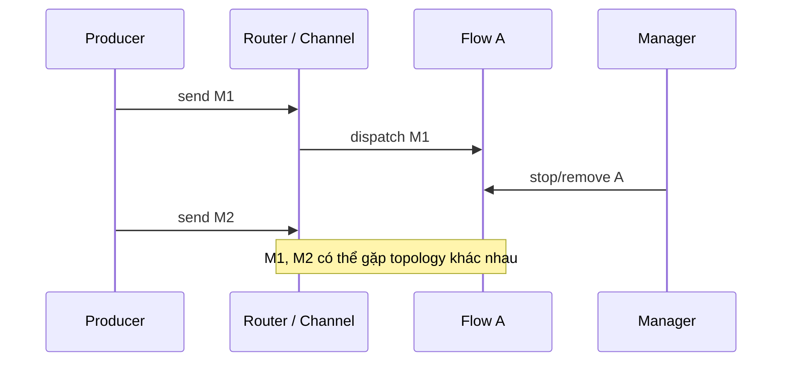
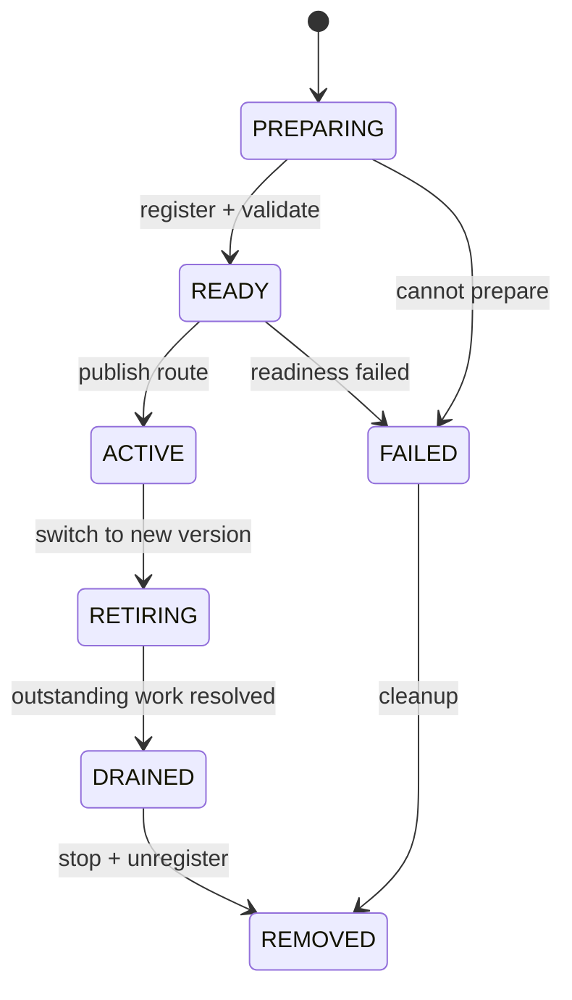
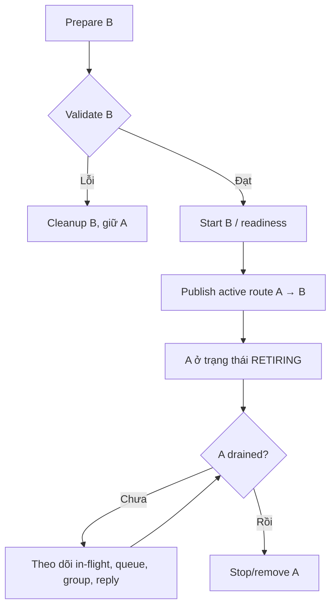
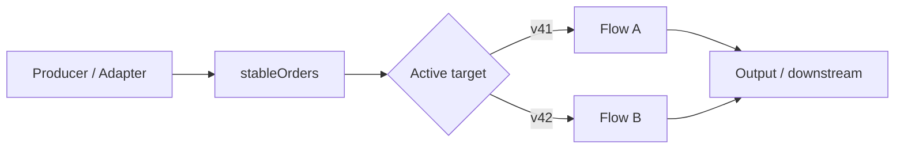
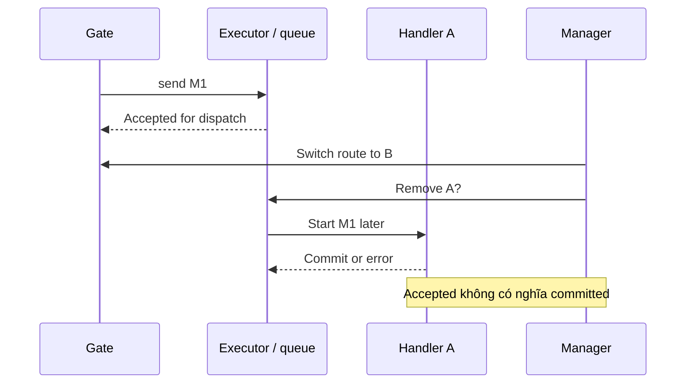
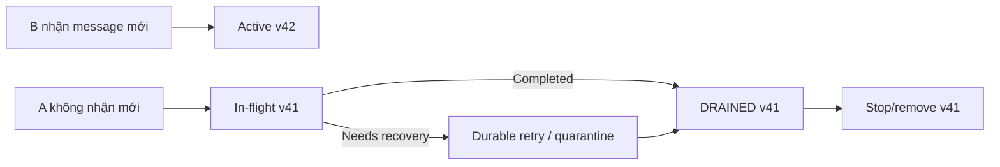
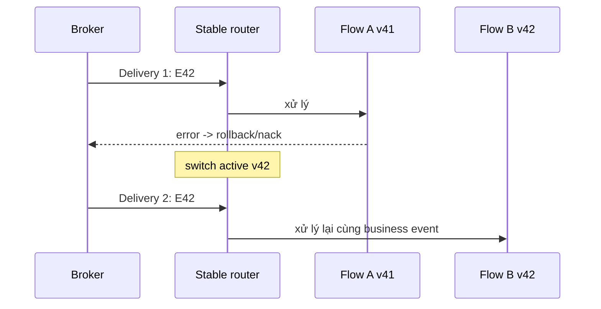
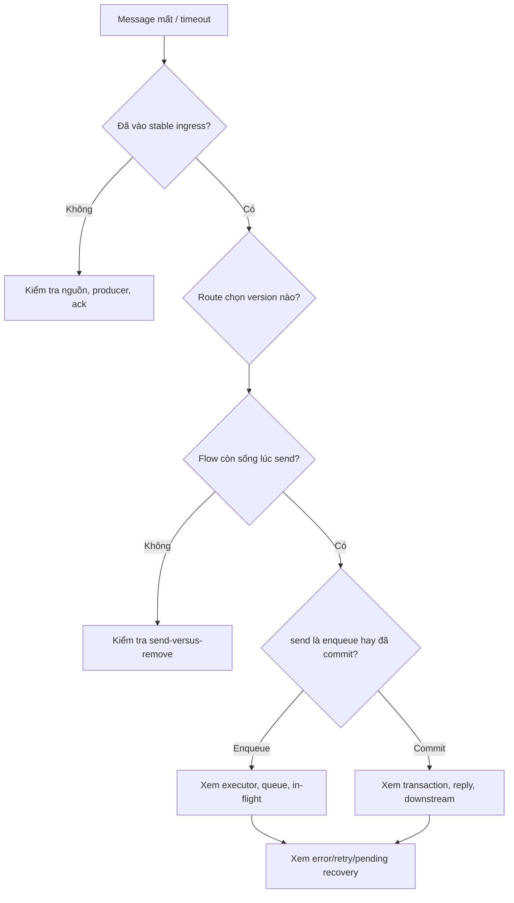

# Tránh race khi thay đổi topology

Trong **Spring Integration runtime**, topology là mạng lưới gồm channel, endpoint, router, handler, poller, executor, inbound/outbound adapter và các message store. Bên cạnh flow được khai báo lúc ứng dụng khởi động, một hệ thống có thể đăng ký, bắt đầu, dừng hoặc tháo gỡ `IntegrationFlow` ngay khi đang hoạt động. Đây là nền tảng để thêm luồng theo tenant, cập nhật tuyến xử lý, thay đổi nguồn dữ liệu hoặc nâng cấp handler mà không khởi động lại toàn bộ dịch vụ.

Thách thức là **message và thao tác quản trị không chạy trên cùng một timeline**. Một thread đã lấy tham chiếu tới channel cũ, thread khác bắt đầu remove flow; poller có thể đã dequeue một message khi lệnh stop tới; callback bất đồng bộ còn chạy khi phiên bản mới được publish. Nếu không có protocol cutover, kết quả là message bị bỏ sót, duplicate, lỗi định tuyến hoặc state thuộc hai phiên bản không tương thích.

Bài thuộc chương **Dynamic runtime** của module `SPRING_INTEGRATION_RUNTIME`. Trọng tâm là cách tránh race khi thay đổi topology: `IntegrationFlowContext`, vòng đời flow động, staged registration, stable ingress, atomic cutover, quiesce/drain, transaction, retry/redelivery, message store, correlation và kỹ thuật chẩn đoán threading, hiệu năng, trạng thái runtime.

## 1. Race trong thay đổi topology là gì?

Race condition xảy ra khi kết quả phụ thuộc vào thứ tự thực thi của các thao tác đồng thời mà ứng dụng chưa kiểm soát. Khi thay topology, ít nhất ba hoạt động có thể chồng lấn: **message đang đến**, **message đang xử lý** và **lệnh thay đổi cấu hình**.



| Cửa sổ race | Tình huống | Rủi ro |
| --- | --- | --- |
| **Send vs remove** | Producer chọn destination A trước khi A bị gỡ | Không có subscriber hoặc gửi vào endpoint đã dừng |
| **Start vs source ownership** | Flow B bật adapter trước khi A ngừng lấy dữ liệu | Tranh consumer, duplicate hoặc phân chia message ngoài ý muốn |
| **Ack vs async completion** | Nguồn xác nhận sau khi enqueue nhưng handler async còn chạy | Lỗi ở handler không còn đường redelivery |
| **Retry vs cutover** | Delivery 1 chạy trên A, redelivery trên B | Khác logic/schema và tác dụng phụ không nhất quán |
| **Pending group vs cleanup** | Aggregator A đang giữ phần 1/3, B nhận phần 2/3 | Group không hoàn tất hoặc bị trộn |
| **Concurrent admin commands** | Hai lệnh cùng thay từ revision 41 | Bản cũ ghi đè bản mới |
| **Late callback vs destroy** | Reply/HTTP future của A hoàn thành sau remove | Lỗi callback, mất reply hoặc cập nhật state cũ |

Điểm phải bảo vệ không phải chỉ là một con trỏ Java: đó là **hợp đồng ai còn có quyền nhận message, ai sở hữu các công việc đã nhận và bao giờ có thể giải phóng tài nguyên cũ**.

## 2. Định nghĩa trạng thái riêng cho topology

Spring Integration cung cấp lifecycle cho các component, nhưng ứng dụng thường cần thêm **trạng thái quản trị** để quyết định có được chuyển tuyến hoặc remove flow hay chưa.



| Trạng thái | Điều kiện đúng cần kiểm chứng |
| --- | --- |
| `REGISTERED` | Bean và endpoint đã được đăng ký vào context |
| `STARTED` | Lifecycle đã gọi start cho component liên quan |
| `READY` | Có khả năng nhận và xử lý traffic phù hợp; dependency hợp lệ |
| `ACTIVE` | Điểm cấp phát message mới đã chọn phiên bản này |
| `RETIRING` | Không nhận việc mới; vẫn phải hoàn thành việc cũ |
| `DRAINED` | Không còn in-flight, backlog, pending reply/group hoặc nghĩa vụ khác cần phiên bản cũ |
| `REMOVED` | Flow đã stop/unregister và giải phóng tài nguyên thích hợp |

**Registered không có nghĩa Ready; Started không có nghĩa Active; Stopped không có nghĩa Drained.** Đây là các khái niệm khác nhau, đặc biệt với `ExecutorChannel`, poller và nguồn có ack/redelivery.

## 3. IntegrationFlowContext và những gì API thực sự làm

Spring Integration cho phép đăng ký một `IntegrationFlow` động bằng `IntegrationFlowContext`. Luồng được đăng ký có ID, các endpoint và lifecycle riêng. Các thao tác quen thuộc:

- `flowContext.registration(flow)` tạo builder cho registration.
- `id("orders-v42")` chọn định danh duy nhất của flow mới.
- `autoStartup(false)` cho phép đăng ký mà chưa tự khởi động (nếu API phiên bản hỗ trợ).
- `register()` đưa flow vào context, trả về registration.
- `registration.start()` và `registration.stop()` yêu cầu chạy/dừng các endpoint sở hữu.
- `registration.getInputChannel()` lấy input channel cho flow được thiết kế nhận message theo kiểu đó.
- `flowContext.remove(flowId)` gỡ flow động theo ID.

```java
// Fragment minh họa khi đã inject IntegrationFlowContext flowContext.
IntegrationFlow flow = f -> f.handle(message ->
        System.out.println("v42: " + message.getPayload()));

var reg = flowContext.registration(flow)
        .id("orders-v42")
        .autoStartup(false)
        .register();

// Bước prepare/validate nằm ngoài fragment này.
reg.start();
MessageChannel input = reg.getInputChannel();

// Chỉ stop/remove sau khi phiên bản không nhận thêm công việc
// và tất cả nghĩa vụ in-flight đã được giải quyết.
reg.stop();
flowContext.remove("orders-v42");
```

Đây là **fragment vòng đời**, không phải thuật toán thay topology hoàn chỉnh. Không đặt `start()` và `remove()` nối tiếp rồi kết luận các message trước đó đã được commit. Chi tiết method/semantics lifecycle cần đối chiếu phiên bản Spring Integration ứng dụng đang dùng.

### 3.1. Flow có đầu vào ổn định và flow tự sở hữu nguồn

**Channel-driven flow** chỉ nhận khi producer/router gửi vào input channel. Đây là kiểu dễ tạo phiên bản B trước rồi mới chuyển traffic.

**Source-driven flow** sở hữu một file poller, JMS listener, HTTP adapter hoặc scheduler. Nếu start B, B có thể **bắt đầu lấy message ngay lập tức** dù router chưa chuyển sang B. Khi nâng cấp source-driven flow, phải điều phối ownership ở nguồn hoặc quiesce nguồn cũ, không áp dụng máy móc quy trình dành cho channel-driven flow.

## 4. Tại sao hai cách replace phổ biến đều có lỗi?

### 4.1. Remove cũ trước

```text
T0  A đang active
T1  remove(A)
T2  Producer gửi M1 -> không còn handler thích hợp
T3  register(B)
T4  start(B)
```

Khoảng trống T1–T4 có thể khiến message fail. Nếu nguồn không giữ lại message để retry, công việc sẽ mất.

### 4.2. Start nguồn mới trước, stop nguồn cũ sau

```text
T0  A đang đọc file/broker
T1  register(B) và start(B)
T2  A và B cùng đọc
T3  stop(A)
```

Với broker competing consumers, message có thể được **chia** cho A và B thay vì luôn duplicate, nhưng phiên bản xử lý từng message không được kiểm soát; với file polling và metadata store không phối hợp, duplicate có thể xảy ra. **Không coi việc start B là một cutover atomic.**

### 4.3. Bài học

Phân biệt **đăng ký flow** khỏi **cấp quyền nhận production traffic**. Chỉ một bước đổi tuyến có kiểm soát nên quyết định phiên bản nào được nhận message mới.

## 5. Quy trình thay đổi có kiểm soát: prepare → publish → drain → retire

Một kế hoạch vận hành thực tế gồm bảy bước:

1. **Serialize control-plane change:** mỗi lệnh có `operationId`, `expectedRevision` và bản cấu hình mong muốn.
2. **Prepare B:** xây flow B với registration ID mới; chưa cấp traffic thật.
3. **Validate B:** kiểm tra bean, input/output channel, schema, dependency, transaction manager, executor, retry/error path.
4. **Start B:** nếu B là channel-driven, có thể start trước cutover; xác minh readiness.
5. **Publish route:** đổi điểm định tuyến ổn định sang B tại một ranh giới được bảo vệ.
6. **Drain A:** ngừng cấp message mới cho A và đợi những nhiệm vụ đã thuộc A hoàn thành hoặc được chuyển sang recovery bền vững.
7. **Retire A:** stop/remove đúng registration cũ, sau đó cleanup tài nguyên và state đã hết nghĩa vụ.



**Cutover thành công không đồng nghĩa deployment hoàn tất**: A có thể tiếp tục tồn tại ở `RETIRING` đến khi pending state hết. Không có lý do kỹ thuật chung nào bảo đảm mọi flow drain tức thì.

## 6. Stable ingress giúp tránh buộc producer đổi channel

Giữ một input channel lâu dài như `stableOrders`; producer không biết handler A hay B đang active. Một router/gate chọn channel đầu vào của flow đang được publish.



Stable ingress giúp giới hạn vùng thay đổi nhưng **không tự loại bỏ send-versus-remove race**. Nếu router đọc tham chiếu A và management thread xóa A trước `send()`, producer vẫn có thể gửi vào flow đã bị hủy.

### 6.1. Gate bảo vệ quá trình chọn route và handoff đồng bộ

Đoạn Java sau dùng `ReentrantReadWriteLock` để đảm bảo lệnh chuyển route không xen ngang giữa việc chọn target và **lời gọi `send()` đồng bộ**. Ví dụ dành cho đường one-way; ứng dụng request–reply phải giữ đúng reply/timeout contract của gateway.

```java
import java.util.concurrent.locks.ReentrantReadWriteLock;

import org.springframework.context.annotation.Bean;
import org.springframework.context.annotation.Configuration;
import org.springframework.integration.annotation.EnableIntegration;
import org.springframework.integration.annotation.ServiceActivator;
import org.springframework.integration.channel.DirectChannel;
import org.springframework.messaging.Message;
import org.springframework.messaging.MessageChannel;
import org.springframework.messaging.MessageDeliveryException;
import org.springframework.stereotype.Component;

@Configuration
@EnableIntegration
class StableTopologyConfig {
    @Bean
    MessageChannel stableOrders() {
        return new DirectChannel();
    }
}

@Component
class StableIngressGate {
    private final ReentrantReadWriteLock gate =
            new ReentrantReadWriteLock(true);

    private volatile MessageChannel activeTarget;

    @ServiceActivator(inputChannel = "stableOrders")
    public void forward(Message<?> message) {
        var readLock = gate.readLock();
        readLock.lock();
        try {
            MessageChannel target = activeTarget;
            if (target == null || !target.send(message)) {
                throw new MessageDeliveryException(
                        message, "No active flow accepted message");
            }
        }
        finally {
            readLock.unlock();
        }
    }

    // Gọi từ management thread độc lập với handler.
    MessageChannel switchTo(MessageChannel newTarget) {
        if (newTarget == null) {
            throw new IllegalArgumentException("Missing target");
        }
        var writeLock = gate.writeLock();
        writeLock.lock();
        try {
            MessageChannel previous = activeTarget;
            activeTarget = newTarget;
            return previous;
        }
        finally {
            writeLock.unlock();
        }
    }
}
```

Một `forward()` đã vào vùng read-lock giữ route ổn định cho đến khi lời gọi `send()` trả về. `switchTo()` dùng write-lock để chờ các thao tác send đang giữ read-lock rồi mới publish target mới.

**Giới hạn cần nhớ:** nếu target là `ExecutorChannel` hoặc `QueueChannel`, `send()` có thể trả về sau khi **enqueue** chứ chưa có business commit. Gate trên chỉ chặn race lúc **handoff**, không chứng minh mọi nhiệm vụ A đã hoàn thành. Muốn hủy A vẫn phải drain. Ngoài ra, không gọi `switchTo()` từ chính thread đang giữ read-lock; upgrade read-lock sang write-lock có thể deadlock.

### 6.2. Vì sao AtomicReference một mình chưa đủ?

```java
// RACE nếu một thread khác remove flow chứa target.
MessageChannel target = activeChannel.get();
// Management thread có thể destroy A tại đây.
target.send(message);
```

`AtomicReference` làm phép thay pointer atomic, nhưng **không giữ sống object mà pointer cũ trỏ tới**. Có thể bổ sung gate, reference-count/lease hoặc pause ingress trước khi thay. Cơ chế nào phù hợp tùy việc nhận message là đồng bộ, async, durable hay không.

## 7. Đăng ký phiên bản B rồi publish tại một điểm

Nên cấp registration ID theo phiên bản thay vì tái dùng một ID khi A vẫn hiện diện.

```java
// Fragment minh họa; flowContext và gate được inject từ Spring.
IntegrationFlow v42 = f -> f.handle(message ->
        System.out.println("handler v42: " + message.getPayload()));

var newRegistration = flowContext.registration(v42)
        .id("orders-v42")
        .autoStartup(false)
        .register();

// Phần validate phụ thuộc hệ thống: dependencies, output, health.
newRegistration.start();

MessageChannel newInput = newRegistration.getInputChannel();
// Bên quản trị chỉ gọi khi ready:
MessageChannel previousInput = gate.switchTo(newInput);

// Không remove registration v41 ở đây.
// Theo dõi in-flight/pending state của v41 cho tới khi drained.
```

Flow kiểu `IntegrationFlow` này nhận message qua input channel do registration cung cấp; nếu bản dựng có input đặc biệt hoặc `getInputChannel()` không hợp lệ, không được publish trước khi sửa thiết kế ingress. Một source-driven flow không nên start theo cách này nếu việc start lập tức nhận message production ngoài tuyến đang quản lý.

**Quy tắc ID:** `orders-v41` và `orders-v42` là hai flow khác nhau. Các endpoint ID/bean name được định nghĩa rõ trong flow cũng phải tránh va chạm; không nên giả định một ID đăng ký mới tự giải quyết mọi tên bean trùng.

## 8. Đừng nhầm handoff hoàn tất với xử lý hoàn tất

Với `DirectChannel`, handler đồng bộ thường chạy trên caller thread. Với `ExecutorChannel` hoặc `QueueChannel`, `send()` có thể chỉ enqueue và kết thúc sớm. Reactive flow cũng có thể trả về trước khi async I/O kết thúc.



Một định nghĩa drain vận hành có thể là:

```text
drained(A) =
    no_new_admissions(A)
    AND sender_handoffs(A) == 0
    AND queued_messages(A) == 0
    AND in_flight_handlers(A) == 0
    AND pending_replies(A) == 0
    AND pending_groups_or_barriers(A) == 0
    AND unresolved_recovery_obligations(A) == 0
```

Đây là hợp đồng cần **tùy biến theo từng flow**. Không phải mọi flow có đủ tất cả thành phần; một gateway có pending reply, aggregator có pending group, JMS listener có unacked message, một scheduled endpoint có callback sắp chạy.

### 8.1. Đếm in-flight theo phiên bản

```java
import java.util.concurrent.atomic.AtomicInteger;

final class InFlightTracker {
    private final AtomicInteger active = new AtomicInteger();

    void begin() {
        active.incrementAndGet();
    }

    void finish() {
        active.decrementAndGet();
    }

    int count() {
        return active.get();
    }
}

// Minh họa vùng đồng bộ:
tracker.begin();
try {
    handler.process(message);
}
finally {
    tracker.finish();
}
```

Mã `try/finally` chỉ chính xác nếu `handler.process()` thực sự xử lý **đồng bộ**. Nếu nó trả `CompletableFuture` hoặc `Mono`, `finish()` phải gắn vào callback hoàn thành/error/cancel, không thực hiện ngay sau khi khởi tạo tác vụ. Ngược lại, counter in-flight bằng 0 cũng không chứng minh queue đã rỗng.

**Điều kiện tiên quyết:** sau khi tuyên bố `RETIRING`, không còn producer nào có thể tăng in-flight cho A. Nếu không, số 0 tại một thời điểm chỉ là snapshot tạm thời.

## 9. Quiesce rồi drain trước khi remove

**Quiesce**: ngừng cấp thêm message mới cho A. **Drain**: đợi mọi việc A đã nhận hoàn tất hoặc đã chuyển thành recovery bền vững.

1. Publish B và đóng admission tới A tại tất cả entry points.
2. Đợi các thread đã chọn A hoàn tất handoff.
3. Theo dõi queue/backlog và handler in-flight theo version.
4. Theo dõi pending reply, aggregator group và trigger barrier nếu flow có.
5. Đặt deadline có chính sách: tiếp tục giữ A, migrate state hoặc ghi durable recovery.
6. Khi đạt `DRAINED`, stop/remove đúng registration A và cleanup tài nguyên liên quan.



**Đừng gỡ A chỉ vì queue depth bằng 0**: handler có thể đã dequeue nhưng đang xử lý. `SmartLifecycle.stop()` của một component không phải cam kết chung rằng mọi future, transaction hoặc callback downstream đã xong.

## 10. Điều phối cả cluster: local atomic switch chưa đủ

Nếu dịch vụ có ba instance, mỗi node có router riêng:

```text
Node 1: active route = v42
Node 2: active route = v41
Node 3: active route = v42
```

Thao tác `switchTo` atomic trong từng JVM nhưng **không đảm bảo** mọi node chuyển cùng lúc. Để tránh mixed-version ngoài ý muốn, control plane cần:

- Một **desired revision** bền vững, tăng đơn điệu.
- Một **operationId** chống áp dụng lặp cùng lệnh.
- Một cơ chế rollout và **applied revision** theo node.
- Readiness của phiên bản mới và cách loại node lỗi khỏi ingress nếu cần.
- Tính tương thích schema/message trong khoảng old/new cùng hoạt động.
- Reconciliation khi node restart giữa các bước.

Lock phân tán có thể serialize thay đổi cấu hình, nhưng **không tự biến nhiều node thành một atomic transaction topology**. Các node vẫn phải báo trạng thái và được điều phối.

### 10.1. Chống stale control-plane update bằng revision

Hai admin cùng thấy revision 41. Một lệnh muốn v42, lệnh kia muốn v43. Với optimistic update:

```sql
UPDATE topology_config
SET revision = 42,
    desired_flow_id = 'orders-v42'
WHERE service_id = 'orders'
  AND revision = 41;
```

Chỉ lệnh nào update được đúng một hàng mới được coi là đã **được nhận**. Lệnh trả về 0 hàng phải đọc lại revision, không thực thi bản config stale. SQL này là protocol ghi **desired state**, chưa thực hiện đăng ký/đổi flow ở mỗi node.

## 11. Readiness: register thành công chưa đủ

Flow B có thể đăng ký nhưng chưa nhận được message đúng cách:

| Kiểm tra | Vì sao quan trọng |
| --- | --- |
| Bean/endpoint registration | Chứng minh đã tạo flow, nhưng chưa chứng minh hoạt động |
| Channel subscriber/output | Tránh `DirectChannel` không có consumer hoặc output sai |
| Connection đến DB/broker/API | Phát hiện dependency không sẵn sàng |
| Transaction manager/message store | Phát hiện sai schema, quyền, propagation |
| Error/retry/recovery channel | Đảm bảo lỗi không mất ở đường mới |
| Handler contract/schema compatibility | Phát hiện payload version cũ gây lỗi ở B |
| Synthetic canary | Kiểm tra đường đi thật, nhưng không gây side effect production |
| Lifecycle health/startup errors | Xác minh `start()` đã thành công trong phạm vi component |

**Ready phải được định nghĩa theo kiểu source.** Một flow nguồn file/JMS chỉ có thể được kiểm tra readiness mà không vô tình lấy message thật nếu có cách cô lập hoặc chủ động pause nguồn.

## 12. Poller, listener và source-driven topology

Giả sử poller gọi `receive()` rồi management thread gọi `stop()`:

```text
T0  poller bắt đầu receive()
T1  manager gọi stop()
T2  receive() trả M1
T3  M1 đã được handler nhận
T4  stop/callback hoàn tất
```

Không thể suy luận tại T1 rằng không còn message mới. Với broker JMS/AMQP, listener còn có prefetch/unacked và redelivery policy. Với `QueueChannel` RAM, dequeue thông thường không tự rollback khi handler ném exception. Với transactional JDBC message store, rollback receive có thể cho phép poll lại nếu transaction boundary phù hợp.

| Source | Câu hỏi trong cutover |
| --- | --- |
| File adapter + accept-once | File đã được đánh dấu accepted nhưng business import đã commit chưa? |
| JMS/AMQP listener | Message prefetch/unacked nào đang thuộc A? |
| JDBC-backed queue | Transaction dequeue/lock có còn active khi stop? |
| HTTP gateway | Request nào đang đợi reply từ A? |
| Scheduler/cron | Tick đã lên lịch và callback đang chạy còn không? |
| Reactive pipeline | Subscription nào còn active, cancel có làm mất công việc không? |

Với source-driven flow, **dừng cấp message mới ở nguồn** rồi chuyển ownership thường là chiến lược khác với publish một router nội bộ. Không ép tất cả loại adapter vào cùng một bản vá.

## 13. Retry và redelivery vượt qua phiên bản topology

Một message có thể fail ở A và được source giao lại sau khi route đã chuyển sang B:



Nếu A và B có logic/schema khác nhau, cùng một business event có thể chịu hai bộ quy tắc. Cần quyết định:

1. **Version pinning:** message mang `flowVersion`/`schemaVersion` hoặc key ownership để retry quay lại A.
2. **Backward compatibility:** B chấp nhận replay của event cũ và xử lý nhất quán.
3. **State migration:** chuyển state A sang B bằng protocol rõ ràng.
4. **Idempotency:** cùng `eventId` không nhân đôi side effect dù được xử lý hai lần.

Cần phân biệt **retry advice cùng invocation** và **broker redelivery với delivery mới**. `RequestHandlerRetryAdvice` có thể gọi handler nhiều lần; recovery callback trả bình thường có thể khiến adapter coi công việc đã xong. Cutover không tự sửa các semantics đó.

## 14. Correlation state: aggregator, resequencer, barrier và reply

Một aggregator A đang chờ:

```text
group ORDER-42 (v41):
  part 1/3 -> arrived
  part 3/3 -> arrived
  part 2/3 -> missing
```

Nếu `part 2/3` được router chuyển sang aggregator B với store/region riêng, hai phiên bản cùng giữ **nhóm chưa hoàn tất** dù hệ thống đã có đủ ba phần. Nếu B dùng chung store nhưng release strategy khác, lại có nguy cơ trộn state.

Ba hướng xử lý:

| Cách làm | Khi phù hợp | Điều phải bảo đảm |
| --- | --- | --- |
| Pin group theo version | Group cũ phải hoàn thành với cùng processor/strategy | Route những phần tiếp theo và trigger đúng owner |
| Quiesce/drain toàn bộ nhóm | Có thể chờ hoặc có timeout hữu hạn | Expiry/discard/recovery cho nhóm thiếu |
| Migrate group state | Cần chuyển state sang version mới | Schema, atomicity và khóa admission khi chuyển |

**Resequencer** cũng cần giữ chuỗi `sequenceNumber`/`sequenceSize` nhất quán; **barrier** cần trigger đúng correlation key và đúng phiên bản còn chờ. Không xóa message group store hoặc barrier state của A chỉ vì B đã active.

Với request–reply, reply của A có thể tới muộn sau cutover. Nếu callback/reply channel hoặc correlation state của A đã bị hủy, caller có thể timeout hoặc mất kết quả. Một pending request cần có owner và đường hoàn tất/recovery rõ ràng.

## 15. Transaction boundary không đổi theo pointer

Một management thread đổi route **không tự tác động** tới transaction đang mở ở consumer thread:

```text
Consumer:
  BEGIN TX-A
  handle M1 on A
  ... DB work still active ...

Manager:
  publish B
  remove A?  (nguy hiểm)

Consumer:
  COMMIT or ROLLBACK TX-A
```

Nếu dùng `ExecutorChannel`, transaction poller có thể đã commit khi message mới được enqueue; handler downstream chạy thread khác và không tự tham gia transaction đó. Vì vậy cần xác định rõ **receive/ack transaction**, **handler transaction**, **error handling** và **async completion**.

Khi chuyển flow giữa hai schema DB, phải áp dụng chiến lược tương thích như **expand/contract migration**, để handler A đang chạy vẫn có thể hoàn thành. Gỡ database column ngay khi B active có thể phá A dù route switch hoàn toàn atomic.

## 16. Lỗi từng phần và rollback route

Thay topology là quy trình nhiều bước nên có nhiều điểm thất bại:

| Thất bại | Trạng thái còn lại | Hành động hợp lý |
| --- | --- | --- |
| `register(B)` fail | A active, B chưa hoàn chỉnh | Giữ A, cleanup B |
| `start(B)` fail | B registered nhưng không ready | Gỡ B, không publish |
| Health check fail | B chưa nhận traffic | Giữ A và báo nguyên nhân |
| Publish route fail | Không rõ pointer nếu code lỗi giữa chừng | Đọc lại active revision trước khi thử |
| B fail sau khi nhận message | B có thể đã commit một phần | Reconcile business state, cân nhắc rollback route |
| A không drain được | A còn group/reply/in-flight | Giữ A hoặc durable recovery |
| `remove(A)` fail | A có thể ở trạng thái dở dang | Ghi cleanup pending và retry idempotently |

### 16.1. Rollback route khác rollback business changes

Giả sử B đã xử lý 20 đơn rồi mới phát hiện lỗi. Chuyển route về A **không hoàn tác** 20 đơn đã commit. Muốn rollback an toàn cần compatibility, compensation hoặc recovery/replay. Vì vậy topology version phải xuất hiện trong log business outcome, không chỉ trong log management.

Rollback control-plane cũng cần `expectedRevision`: nếu một admin khác đã publish C sau B, lệnh “đưa về A” không được mù quáng ghi đè C.

## 17. Một lệnh thay đổi phải có một owner rõ ràng

Nếu hai admin cùng gửi:

```text
Change X: expectedRevision=41, desired=v42
Change Y: expectedRevision=41, desired=v43
```

chỉ một lệnh được chấp nhận ở revision 41. Manager cần:

- `operationId` để nhận diện retry của cùng lệnh.
- `expectedRevision` để chặn stale update.
- Nhật ký trạng thái `PREPARING/READY/ACTIVE/RETIRING/FAILED`.
- Ownership của registration và tài nguyên cleanup.
- Khả năng reconcile desired/applied state sau restart.
- Số lượng flow version tối đa được phép giữ đồng thời.

Trong một JVM, một management executor đơn luồng có thể serialize thao tác cục bộ; trong cluster cần shared revision/coordination. **Một lock trong một pod không điều phối được toàn bộ cluster.**

## 18. Monitoring và chẩn đoán runtime

Nên đo cả **control plane** (lệnh thay topology) và **data plane** (message thật):

| Signal | Giải thích |
| --- | --- |
| Desired/applied revision per node | Node nào chưa áp dụng topology mới? |
| Register/start/stop/remove outcomes | Bước lifecycle nào lỗi? |
| Active/retiring flow IDs | Có bao nhiêu version đang sống? |
| Route selected count per version | Có traffic mới vào A sau cutover không? |
| Sender handoff count | Có `send()` đang giữ target A không? |
| In-flight handler count | A còn xử lý task nào? |
| Queue depth, broker unacked, poller lag | Backlog còn ở đâu? |
| Pending replies/groups/barriers | State cũ còn nghĩa vụ gì? |
| Commit/rollback, retry/redelivery | Message có đang xử lý lại hoặc thất bại? |
| Drain duration, cutover latency | Thay topology ảnh hưởng SLA thế nào? |

Ghi `operationId`, `flowId`, revision, instance/thread và business correlation ID. Đừng dùng message ID động làm label metrics gây cardinality cao.

### 18.1. Decision tree khi mất message sau cutover



Nếu cùng event xử lý hai lần, điều tra **retry advice**, **redelivery source**, **hai adapter cùng nguồn**, **route duplicate** và **business idempotency**. Một message được gửi tới một flow chỉ là một giai đoạn, không chứng minh đúng một lần business effect.

## 19. Kiểm thử race bằng lịch thực thi chủ động

Các race hiếm khi xuất hiện ở test gửi message tuần tự. Hãy sử dụng `CountDownLatch` để đặt message vào đúng cửa sổ chuyển route.

```java
import java.util.concurrent.CountDownLatch;
import java.util.concurrent.TimeUnit;

// Fragment test minh họa, không phải test class hoàn chỉnh.
CountDownLatch handlerEntered = new CountDownLatch(1);
CountDownLatch releaseHandler = new CountDownLatch(1);

void handleA(String payload) throws InterruptedException {
    handlerEntered.countDown();
    if (!releaseHandler.await(5, TimeUnit.SECONDS)) {
        throw new IllegalStateException("Timed out waiting in test");
    }
    recordHandledByA(payload);
}

// Test orchestration:
// 1. Producer thread gửi M1 vào A.
// 2. handlerEntered.await(...) xác nhận A đang xử lý M1.
// 3. Management thread stage/start B và switch route.
// 4. Producer gửi M2 -> kỳ vọng B nhận.
// 5. Assert A chưa bị remove khi M1 còn chờ.
// 6. releaseHandler.countDown(), chờ drained, rồi remove A.
```

`recordHandledByA` là hàm giả lập do test cung cấp. Với `DirectChannel`, producer gửi M1 bị block trong handler A, nên phải dùng producer thread riêng để test concurrent cutover.

### 19.1. Ma trận kiểm thử đề xuất

| Kịch bản | Assertion quan trọng |
| --- | --- |
| B start lỗi | A vẫn active, không mất route |
| Gửi liên tục khi switch | Mỗi message có outcome rõ, không silently dropped |
| Read pointer A rồi remove | Gate/retire protocol ngăn send vào flow đã hủy |
| `ExecutorChannel` còn task | Không remove A chỉ vì `send` trả về |
| Poller đang `receive` | Stop không giả định hoàn tất trước receive |
| Redelivery sau cutover | Tương thích version và không duplicate business effect |
| Aggregator còn group thiếu phần | Group có owner/migration/recovery |
| Reply muộn từ A | Caller nhận kết quả hoặc timeout có audit |
| Hai update control-plane đồng thời | Stale revision bị từ chối |
| Node mất kết nối khi update | Applied revision được reconcile |
| JVM crash lúc B staged | Restart xử lý cleanup hoặc tiếp tục theo desired state |
| Cleanup A thất bại | Không xóa state cần phục hồi, có cơ chế retry cleanup |

Không chỉ assert `isRunning`. Cần kiểm tra business commit/ack, số message trong store, số lần redelivery và outcome cuối của từng `eventId`.

## 20. Bài thực hành

### Bài 1 — Thay topology sai cách

Đăng ký A rồi producer liên tục gửi message. Thử `remove(A)` trước `register(B)`, đo lỗi gửi trong khoảng trống. Đổi sang staged B + stable ingress; so sánh lỗi và thời điểm message được chuyển tuyến.

### Bài 2 — AtomicReference không pin flow lifetime

Đặt latch sau khi thread gửi đọc pointer A nhưng trước `send`. Management thread remove A, rồi cho sender tiếp tục. Quan sát lỗi; sửa bằng read/write gate hoặc reference pinning. Giải thích tại sao cleanup async vẫn cần drain.

### Bài 3 — Handoff và business completion

Cho A dùng `ExecutorChannel`, handler chậm, rồi chuyển route B. Xác minh `send()` đã trả về nhưng A vẫn có task in-flight. Định nghĩa drain bằng queue depth + in-flight, không phải chỉ queue depth.

### Bài 4 — Cutover giữa retry/redelivery

Cho E42 fail ở A, source redeliver sau khi B active. Log `eventId`, version, retry attempt và delivery count. Thiết kế inbox/idempotency để E42 không ghi business DB trùng.

### Bài 5 — Correlation group dang dở

Aggregator A nhận part 1/3 và 3/3. Switch B rồi gửi part 2/3. Quan sát group bị tách; thử pin group về A hoặc migrate state. Xác định khi nào mới được remove A.

### Bài 6 — Hai thay đổi đồng thời

Tạo hai request `expectedRevision=41` đến v42/v43. Sử dụng compare-and-set hoặc SQL optimistic update; chỉ một request thành công. Bảo đảm cleanup không gỡ nhầm version mới.

### Bài 7 — Poller, transaction, rollback

Tạo poller nhận message từ nguồn transactional, handler lỗi giữa lúc management gọi stop. Ghi thread, receive, rollback/commit, redelivery. So sánh với `QueueChannel` RAM.

### Bài 8 — Một node cluster không apply được version mới

Mô phỏng ba replica, một node mắc kẹt ở v41. Đề xuất readiness và routing ingress phù hợp; xác minh node đó không nhận payload v42 không tương thích. Sau restart, reconcile desired/applied state.

## 21. Anti-pattern cần tránh

| Anti-pattern | Hệ quả | Cách sửa |
| --- | --- | --- |
| Remove cũ trước register mới | Khoảng trống không có consumer | Prepare/publish/drain/retire |
| Start hai adapter tự đọc cùng nguồn | Tranh quyền hoặc duplicate | Điều phối source ownership |
| Tái sử dụng flow ID đang active | Bean/endpoint name collision | Versioned IDs |
| Chỉ đổi `AtomicReference` rồi remove A | Send-versus-remove race | Gate/lease và drain |
| Coi `send()` thành công là commit | Async task còn chạy | Đo business completion và ack |
| Coi `stop()` là drain | Callback/group còn pending | Quiesce và kiểm tra outstanding obligations |
| Xóa message store của A ngay lúc cutover | Mất group/reply/retry state | Pin/migrate/expire có kiểm soát |
| Không có revision cho admin updates | Bản cũ ghi đè bản mới | Expected revision + operation ID |
| Dùng lock cục bộ để đồng bộ cluster | Node giữ version khác nhau | Shared desired state |
| Rollback route và coi như rollback DB | Side effect đã commit vẫn còn | Compensation/idempotency |
| Bỏ qua ack/redelivery source | Message có thể mất hoặc lặp | Transaction/recovery đúng boundary |
| Không log version theo business event | Khó xác định phiên bản gây lỗi | Trace flow ID + correlation |
| Cleanup force khi timeout không có policy | Mất nghĩa vụ nghiệp vụ | Durable recovery/quarantine |

## 22. Tự kiểm tra kiến thức

1. **Vì sao `register(B)` và `remove(A)` không tự là một thao tác atomic?** Vì nhiều lifecycle, thread và source nằm ngoài một transaction chung.
2. **`Started` có đồng nghĩa `Ready` không?** Không; dependency hoặc output path vẫn có thể lỗi.
3. **Stable ingress giải quyết vấn đề gì?** Producer giữ một entry point, router có thể chuyển version tại một điểm.
4. **`AtomicReference` có đủ để remove flow cũ ngay sau switch không?** Không; thread đã đọc pointer A còn có thể send.
5. **Vì sao `ExecutorChannel.send()` return chưa đủ để retire A?** Handler downstream có thể chưa bắt đầu hoặc chưa commit.
6. **Quiesce khác drain thế nào?** Quiesce dừng nhận mới, drain giải quyết việc đã nhận.
7. **Tại sao cần ID phiên bản khác nhau?** Để stage/rollback song song, tránh collision và truy vết.
8. **Cutover có rollback transaction đang mở trên A không?** Không tự động.
9. **Message E42 có thể được redeliver sang B dù delivery đầu đã ở A không?** Có, nếu source gửi lại sau route switch.
10. **Vì sao aggregator cần pin/migrate group state?** Nếu không, các phần cùng correlation key có thể bị phân tách giữa hai version.
11. **Tại sao local lock không đủ cho cluster?** Mỗi JVM có routing/lifecycle state riêng.
12. **Rollback active route có xóa side effect B đã commit không?** Không; cần đối soát/compensation.
13. **Khi B start thất bại nên làm gì?** Giữ A active, không publish B, cleanup B.
14. **Điều kiện cơ bản trước remove A là gì?** Không còn admissions mới và các nghĩa vụ in-flight/pending của A đã hoàn tất hoặc có recovery bền vững.

## 23. Tài liệu tham khảo theo phiên bản

- [Spring Integration Reference](https://docs.spring.io/spring-integration/reference/): dynamic flow registration, messaging, endpoint và lifecycle.
- [Spring Integration Java DSL](https://docs.spring.io/spring-integration/reference/dsl.html): tạo và đăng ký `IntegrationFlow`.
- [Spring Integration Transaction Support](https://docs.spring.io/spring-integration/reference/transactions.html): ranh giới transaction, poller và thread handoff.

Khi triển khai, cần kiểm tra chính xác API `IntegrationFlowContext`, auto-startup và lifecycle theo phiên bản đang dùng; các flow với custom adapter, channel hoặc publisher có semantics dừng/khôi phục khác nhau.

## 24. Tổng kết

**Tránh race khi thay đổi topology là thiết kế một protocol thay phiên bản, không phải gọi `register/remove` thật nhanh.** Quy trình có thể tin cậy phải tách **prepare, validate, publish route, quiesce, drain và retire**; bảo vệ khoảng giữa việc chọn destination và gửi message; theo dõi in-flight thật; duy trì state cũ cho retry/redelivery, request–reply và correlation; đồng thời quản lý revision khi nhiều admin hoặc nhiều node cùng thay đổi.

Khi điều tra lỗi, hãy đặt hai timeline cạnh nhau: **message selected → accepted/enqueued → handler started → commit/ack → cleanup** và **flow registered → started → published → stopped → removed**. Cửa sổ nào bị chồng lấn sai sẽ chỉ ra race thật sự. **Thêm lock, tăng timeout hoặc kiểm tra `isRunning()` không thay thế được boundary, idempotency, transaction và durable recovery đúng.**
