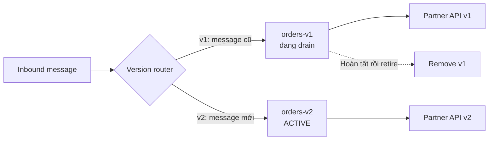
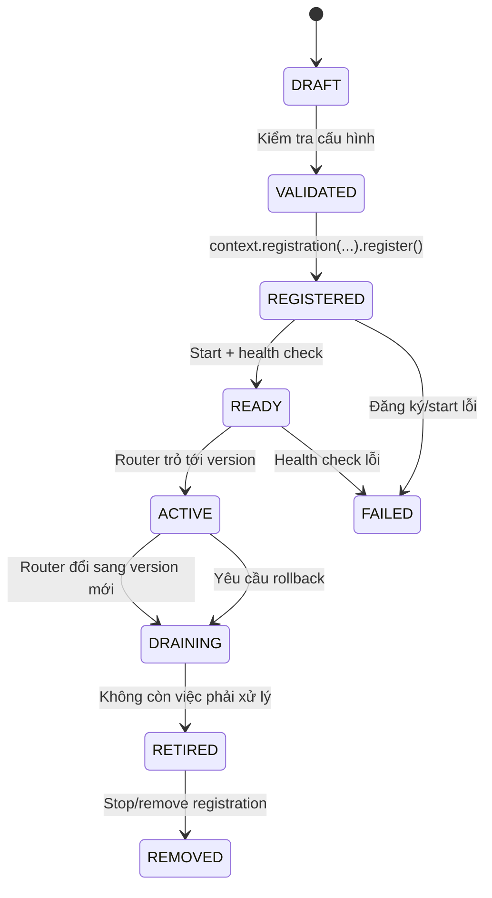
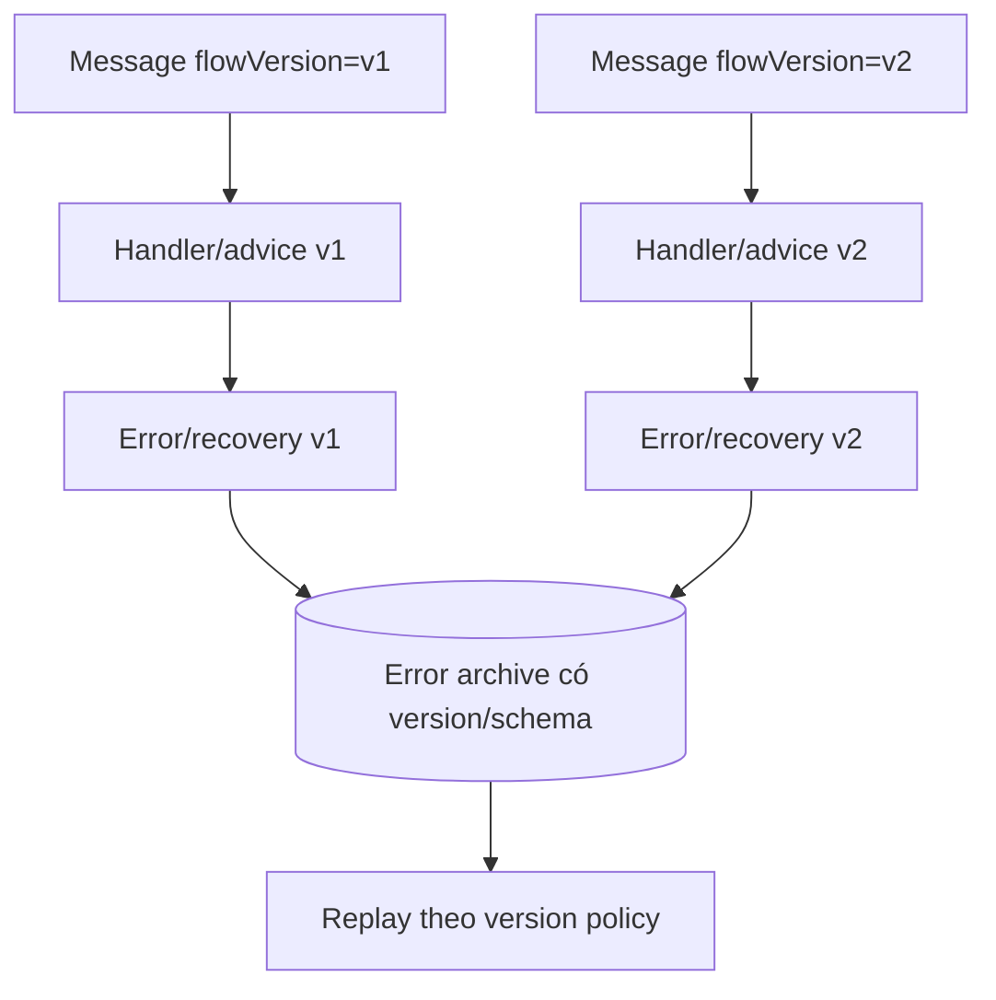

# Version hóa dynamic flow trong Spring Integration

## Mục tiêu học tập

Một ứng dụng Spring Integration có thể dựng các `IntegrationFlow` ngay khi Spring context khởi động. Nhưng trong hệ thống đa tenant, mỗi đối tác có quy tắc định tuyến khác nhau; cấu hình mapping, endpoint đích hoặc chính sách retry có thể thay đổi khi ứng dụng đang chạy. Khi đó, ta có thể **đăng ký và quản lý flow động (dynamic flow)** mà không phải tái khởi động toàn bộ ứng dụng.

Bài **Version hóa dynamic flow** thuộc chương **Dynamic runtime** của module **SPRING_INTEGRATION_RUNTIME**. Phạm vi bài là phiên bản của **định nghĩa flow và cách chuyển phiên bản trong runtime**, không phải chỉ đặt hậu tố `-v2` vào một tên bean. Ta sẽ kết nối việc đăng ký/gỡ flow với message channel, consumer, poller, executor, transaction, retry, message store, error handling, correlation, threading, hiệu năng và chẩn đoán hoạt động khi hệ thống còn message đang xử lý.

Sau bài học, bạn có thể:

- Phân biệt **flow definition version**, **deployment version**, **runtime registration ID** và **business/message schema version**.
- Tạo phiên bản flow bất biến, đăng ký với `IntegrationFlowContext`, kiểm tra ID, start/stop và remove theo đúng lifecycle.
- Thiết kế thay thế flow theo hướng **đăng ký phiên bản mới → kiểm thử → đổi tuyến → drain → retire phiên bản cũ**.
- Giải thích vì sao `stop()` và `remove()` không tự đảm bảo đã hết message in-flight hoặc đã commit nghiệp vụ.
- Gắn message với flow version và correlation ổn định để retry/replay không vô tình chuyển sang flow không tương thích.
- Xây chính sách rollback, khôi phục sau restart, rollout nhiều instance và giám sát rò rỉ endpoint/consumer.
- Viết kiểm thử chuyển phiên bản trong lúc nhận message, khi downstream lỗi và khi ứng dụng bị kill.

## 1. Version hóa dynamic flow giải quyết vấn đề gì?

Giả sử doanh nghiệp tích hợp đơn hàng với đối tác vận chuyển. Phiên bản ban đầu chuyển đổi payload theo schema A và gọi endpoint cũ. Một đối tác nâng schema lên B, cần thêm header và đổi API đích. Nếu sửa trực tiếp flow đang phục vụ mọi request, rất khó biết message đến sát thời điểm thay đổi sẽ dùng quy tắc nào. Nếu gỡ flow cũ quá sớm, message đang chờ hoặc đang thực thi có thể bị bỏ dở.

Một phương án an toàn hơn là chạy tạm hai phiên bản song song:



Trong giai đoạn chuyển tiếp, flow cũ vẫn sống đủ lâu cho những message được gắn với v1, còn message mới được gửi tới v2. **Đổi định tuyến và tiêu hủy flow là hai hành động khác nhau**.

### 1.1. Những câu hỏi phải trả lời trước khi nâng version

1. Message nào phải chạy theo logic cũ, message nào được phép theo logic mới?
2. Phiên bản mới dùng channel, endpoint, retry advice và message store nào? Có xung đột bean name hay group key không?
3. Nếu có một `QueueChannel`, poller hoặc executor đang xử lý v1, làm sao biết đã drain xong?
4. Có message v1 đã ghi vào broker/DLQ, đến một tuần sau mới replay không?
5. Thay đổi schema có đọc được dữ liệu cũ trong persistent store hay không?
6. Sau restart, ứng dụng tái tạo đúng flow version và active route bằng cách nào?
7. Nếu v2 lỗi, rollback sang v1 có an toàn khi một phần side effect của v2 đã xảy ra không?

Đó mới là phạm vi đầy đủ của **version hóa**, thay vì chỉ thêm trường `version=2` rồi gọi `register()` lần nữa.

## 2. Bốn loại version và định danh không được nhầm

| Khái niệm | Ví dụ | Mục đích | Có nên bất biến? |
| --- | --- | --- | --- |
| **Definition version** | `order-flow@2.1.0` | Mô tả topology, routing, transformer, handler, policies | Có; sửa logic thì phát hành version/revision mới |
| **Runtime registration ID** | `tenant-a.order.v2-r7` | Định danh flow đang được đăng ký trong `IntegrationFlowContext` của một JVM | Phải duy nhất trong phạm vi context khi tồn tại |
| **Active route/alias** | `tenant-a.order.active -> v2-r7` | Chỉ phiên bản nhận message mới | Có thể đổi có kiểm soát |
| **Message/schema version** | `schemaVersion=2` | Cách diễn giải payload/header đã được tạo hoặc lưu | Theo hợp đồng dữ liệu, không nhất thiết trùng flow version |
| **Application deployment version** | `service-build-2026.11` | Bản build/container đang chạy | Độc lập với version của từng flow |
| **Business workflow run ID** | `order-42/run-3` | Phân biệt các đợt xử lý nghiệp vụ | Ổn định trong một workflow run |

Ví dụ pod A và pod B đều chạy cùng một build, nhưng pod A đã đăng ký `order.v2` còn pod B mới có `order.v1`. Lúc này **deployment version giống nhau không bảo đảm active dynamic flow giống nhau**.

Một flow version có thể xử lý nhiều loại schema thông qua converter; ngược lại một message schema v2 có thể đi qua flow v1 nếu bạn cố ý giữ backward compatibility. Không suy luận hai trường `flowVersion` và `schemaVersion` luôn bằng nhau.

### 2.1. ID bất biến và alias thay đổi

Có hai cách đặt tên:

```text
Không nên dùng cùng ID cho nội dung thay đổi:
  order.flow -> definition A
  remove(order.flow)
  order.flow -> definition B

Nên tạo ID bất biến và con trỏ tuyến:
  order.flow.v1-r3  -> definition A
  order.flow.v2-r1  -> definition B
  order.active      -> order.flow.v2-r1
```

Cách đầu khiến log, metric và error record khó xác định một message đã chạy theo code nào; khoảng trống giữa remove và register còn tạo cửa sổ không có consumer. Với **flow ID theo version**, v1 và v2 có thể cùng tồn tại để hỗ trợ draining hoặc rollback.

Thêm **revision** hoặc digest cấu hình khi cùng version logic nhưng thay đổi tham số, để không tái sử dụng ID với nội dung thực sự khác. Tài liệu trạng thái có thể lưu:

```json
{
  "logicalFlow": "tenant-a.order",
  "definitionVersion": "2.1.0",
  "revision": 7,
  "registrationId": "tenant-a.order.v2-r7",
  "configDigest": "sha256:example-digest",
  "status": "ACTIVE",
  "schemaVersionsAccepted": [1, 2]
}
```

JSON này là **schema registry do ứng dụng thiết kế**, không phải một record mà Spring Integration tự tạo. Trong thực tế, digest phải tính từ cấu hình chuẩn hóa và đủ dữ kiện để tái tạo cùng flow; chuỗi `example-digest` chỉ minh họa.

## 3. Lifecycle thực tế của một dynamic flow

Với Spring Integration Java DSL, `IntegrationFlowContext` cho phép đăng ký flow sau khi application context đã hoạt động. Một registration được Spring quản lý theo cơ chế của API; nó có thể có endpoint/subscriber và các bean phụ thuộc tương ứng.



Các trạng thái `DRAFT/VALIDATED/READY/ACTIVE/DRAINING/RETIRED` trong sơ đồ là **state machine ứng dụng nên tự lưu**, không phải một `enum` mặc định của `IntegrationFlowContext`. Framework hỗ trợ các thao tác quản lý registration; **quyết định version nào được nhận message mới, có được retire hay không là trách nhiệm orchestration**.

### 3.1. Ý nghĩa của register, start, stop, remove

| Thao tác | Nó làm gì ở mức runtime | Nó không bảo đảm |
| --- | --- | --- |
| `registration(flow).id(id).register()` | Đăng ký các thành phần flow theo một ID với context | Không tự lưu definition vào DB bền vững để tái tạo sau restart |
| `autoStartup(false)` | Cho phép đăng ký nhưng chưa khởi chạy theo tùy chọn builder | Không có nghĩa flow đã READY hoặc có subscriber phục vụ |
| `registration.start()` | Yêu cầu các thành phần lifecycle được quản lý khởi chạy | Không chứng minh downstream đang khỏe hay business transaction đã commit |
| `registration.stop()` | Dừng các thành phần lifecycle thuộc registration theo contract tương ứng | Không tự hủy mọi I/O đã in-flight hoặc drain queue bên ngoài |
| `flowContext.remove(registrationId)` | Gỡ registration đã được quản lý bằng ID | Không tự xóa broker backlog, message store, metadata hoặc lịch sử nghiệp vụ |

**Điểm quan trọng:** một flow chỉ được phép nhận traffic khi đã đăng ký, start, có endpoint/subscriber cần thiết và qua health check. Một flow vừa `register()` xong nhưng `autoStartup(false)` thì chưa được coi là ACTIVE.

### 3.2. Những tài nguyên được phép thay đổi sau register?

Một khi flow version đã được publish, nên coi **topology và policy là bất biến**. Không sửa trực tiếp object handler, transformer hoặc `RetryTemplate` dùng chung với v1 trong khi v1 vẫn chạy chỉ để biến nó thành v2. Việc chia sẻ mutable singleton dễ khiến flow cũ thay đổi hành vi bất ngờ.

Các dependency chỉ-đọc hoặc connection pool dùng chung có thể hợp lý, nhưng mọi thành phần có **mutable state theo version** (retry/circuit-breaker advice, aggregator, scheduler/poller, channel queue, idempotent receiver, correlation registry) cần được kiểm tra rõ phạm vi sử dụng.

## 4. Ví dụ Java: đăng ký hai dynamic flow độc lập

Ví dụ Spring Integration 6.x dùng `IntegrationFlowContext` để đăng ký một flow sau startup. Mỗi phiên bản có một **input channel riêng**, registration ID duy nhất và handler được khởi tạo theo version.

```java
import org.springframework.integration.channel.DirectChannel;
import org.springframework.integration.dsl.IntegrationFlow;
import org.springframework.integration.dsl.context.IntegrationFlowContext;
import org.springframework.messaging.Message;
import org.springframework.messaging.MessageHandler;
import org.springframework.stereotype.Component;

@Component
public class DynamicOrderFlows {

    private final IntegrationFlowContext flowContext;
    private final VersionedOrderHandler orderHandler;

    public DynamicOrderFlows(
            IntegrationFlowContext flowContext,
            VersionedOrderHandler orderHandler) {
        this.flowContext = flowContext;
        this.orderHandler = orderHandler;
    }

    public String registerVersion(String registrationId, String version) {
        // Kiểm tra ID là bước riêng để không đè flow đang chạy.
        if (flowContext.getRegistrationById(registrationId) != null) {
            throw new IllegalStateException("Flow already exists: "
                    + registrationId);
        }

        DirectChannel versionInput = new DirectChannel();

        MessageHandler handler = message ->
                orderHandler.process(version, message);

        IntegrationFlow definition = IntegrationFlow
                .from(versionInput)
                .handle(handler)
                .get();

        // Register mà chưa tự động start để kiểm tra readiness trước.
        var registration = flowContext.registration(definition)
                .id(registrationId)
                .autoStartup(false)
                .register();

        return registration.getId();
    }

    public void startVersion(String registrationId) {
        var registration = flowContext.getRegistrationById(registrationId);
        if (registration == null) {
            throw new IllegalArgumentException(
                    "Unknown flow: " + registrationId);
        }
        registration.start();
    }

    public void retireVersion(String registrationId) {
        var registration = flowContext.getRegistrationById(registrationId);
        if (registration == null) {
            return;
        }

        // Chỉ gọi sau khi lớp điều phối đã xác minh drain xong.
        registration.stop();
        flowContext.remove(registrationId);
    }

    public interface VersionedOrderHandler {
        void process(String version, Message<?> message);
    }
}
```

Đoạn code tập trung vào **API lifecycle**, chưa phải hệ quản lý rollout hoàn chỉnh. Cần các dependency Spring Integration và Spring context; triển khai `VersionedOrderHandler` bằng một bean có thật. Bản code dùng `var` nên cần phiên bản Java phù hợp với Spring Integration 6.x.

Điểm cần nắm:

1. `registrationId` nên có logic name, version và revision, ví dụ `tenant-a.order.v2-r7`, không dùng `order.active` làm ID của chính registration.
2. `DirectChannel` mới giúp mỗi flow version có điểm vào riêng. Không cùng dùng một input channel nếu muốn chọn đích **chỉ một** version; `DirectChannel` không phải fan-out và hai subscriber trên cùng channel có thể trở thành competing consumers.
3. `autoStartup(false)` cho phép register trước khi start; chỉ sau `startVersion()` và readiness check mới được hướng message mới vào flow.
4. `retireVersion()` **không tự xác định** version đã hết in-flight; chính sách drain phải nằm ở lớp quản lý bên ngoài.
5. Kiểm tra ID trước `register()` giúp báo lỗi dễ hiểu nhưng chưa đủ để chống hai luồng thao tác concurrent cùng đăng ký ID; cần serialization/lock ở lớp điều phối và bắt exception đăng ký trùng.

### 4.1. Lấy input channel từ registration

Trong runtime, caller có thể lấy input channel của registration khi flow được cấu hình với input phù hợp:

```java
var registration =
        flowContext.getRegistrationById("tenant-a.order.v2-r7");

if (registration == null || registration.getInputChannel() == null) {
    throw new IllegalStateException("Flow input is unavailable");
}

Message<?> message = MessageBuilder
        .withPayload("ORDER_CREATED")
        .setHeader("businessKey", "tenant-a:ORD-42")
        .build();
boolean accepted = registration.getInputChannel().send(message);
if (!accepted) {
    throw new IllegalStateException("Message was not accepted");
}
```

Đây là đoạn minh họa tại lớp routing có quyền truy cập `flowContext`. **Không nên để các producer tự truy vấn hoặc tự hard-code registration ID**: nếu router được tập trung quản lý, việc cutover và rollback an toàn, dễ theo dõi hơn.

Một lời gọi `send()` trả `true` không phải lúc nào cũng chứng minh business transaction đã commit. Với `DirectChannel` trong ví dụ, handler được gọi đồng bộ; nếu sau này thay thành `ExecutorChannel` hoặc thêm queue, semantics completion sẽ thay đổi.

## 5. Đặt active route ở ngoài flow version

Để thay phiên bản mà không có khoảng trống service, cần **một lớp tuyến ổn định** nằm ngoài các dynamic flow. Lớp này giữ ánh xạ:

```text
tenant-a.order.active = tenant-a.order.v2-r7
tenant-b.order.active = tenant-b.order.v1-r4
```

Nếu request mới đến và chưa mang `flowVersion`, router gán version theo active route. Nếu một message đang được replay và đã có version hợp lệ trong header, router cần xác định có giữ version cũ, migrate có kiểm soát hay gửi vào error/recovery queue; **không tự ép replay chạy flow mới**.

### 5.1. Minh họa router có alias trong một JVM

```java
import java.util.concurrent.atomic.AtomicReference;

import org.springframework.integration.dsl.context.IntegrationFlowContext;
import org.springframework.messaging.Message;
import org.springframework.messaging.MessageChannel;
import org.springframework.messaging.support.MessageBuilder;

final class LocalVersionRouter {
    private final IntegrationFlowContext context;
    private final AtomicReference<String> activeRegistration =
            new AtomicReference<>();

    LocalVersionRouter(IntegrationFlowContext context) {
        this.context = context;
    }

    void setActive(String registrationId) {
        if (context.getRegistrationById(registrationId) == null) {
            throw new IllegalArgumentException("Unknown version");
        }
        activeRegistration.set(registrationId);
    }

    void routeNew(Message<?> input) {
        String chosen = activeRegistration.get();
        if (chosen == null) {
            throw new IllegalStateException("No active version");
        }

        var registration = context.getRegistrationById(chosen);
        if (registration == null) {
            throw new IllegalStateException("Version was removed: " + chosen);
        }

        MessageChannel channel = registration.getInputChannel();
        if (channel == null) {
            throw new IllegalStateException("No input channel: " + chosen);
        }

        Message<?> routed = MessageBuilder.fromMessage(input)
                .setHeader("flowVersion", chosen)
                .build();

        if (!channel.send(routed)) {
            throw new IllegalStateException("Message rejected by " + chosen);
        }
    }
}
```

Đây là **ví dụ single-JVM tối giản**, không phải router production đa instance:

- `AtomicReference.set()` đổi alias nguyên tử trong một JVM, nhưng **không** tạo transaction phân tán giữa các node.
- Thread A có thể đọc ID v1 ngay trước khi thread B đổi alias sang v2. Vì thế **v1 phải còn sống đủ lâu** cho các request đã chọn v1; nếu remove ngay sẽ có race. Cần reference counting, quiescence protocol hoặc một giai đoạn grace phù hợp.
- `getRegistrationById()` tồn tại không đảm bảo flow thực sự READY; lớp điều phối cần trạng thái và health check riêng.
- `flowVersion` được ghi ở điểm **quyết định tuyến** nhằm hỗ trợ retry/replay/tracing. Nếu input đã có version từ lần xử lý trước, không nên dùng `routeNew()` để âm thầm ghi đè.
- Channel có thể throw thay vì trả `false`. Caller cần policy lỗi/transaction/ack theo hợp đồng của source, không chỉ kiểm tra boolean.

### 5.2. Chính sách với message đã gắn version

Một quy tắc phổ biến:

```text
Message chưa từng xử lý:
  version missing -> chọn active -> gắn flowVersion -> durable handoff/route

Message đang xử lý hoặc được replay:
  flowVersion đã có -> giữ version đã chọn
  nếu version đã retire -> migration có kiểm soát hoặc error/recovery,
                           không tùy tiện đổi sang active mới
```

Giữ version cho phép message trải qua retry mà không đổi transformer/schema giữa chừng. Nếu phiên bản cũ chứa lỗ hổng bảo mật hoặc bị đối tác ngừng hỗ trợ, có thể buộc migrate message cũ, nhưng cần validation, schema conversion và kế hoạch rollback phù hợp.

## 6. Quy trình cutover: register → warm up → switch → drain → remove

```mermaid
sequenceDiagram
    participant O as Orchestrator
    participant C as IntegrationFlowContext
    participant R as Stable Router
    participant V1 as Flow v1
    participant V2 as Flow v2
    O->>C: Register v2 (autoStartup=false)
    O->>C: Start v2
    O->>V2: Health/contract check
    V2-->>O: READY
    O->>R: Switch ACTIVE alias v1 -> v2
    Note over R,V1: New messages route v2; v1 vẫn còn in-flight
    R->>V2: New order message
    O->>V1: Monitor in-flight/backlog
    V1-->>O: Drained / retry policy resolved
    O->>C: Stop + remove v1
```

### Bước 1 — Build/validate cấu hình version mới

Bản định nghĩa phải chứa topology, các loại message được hỗ trợ, endpoint đích, timeout, retry/backoff, error channel, transaction boundary, claim-check/message store và resource quotas. Kiểm tra:

- Không trùng `registrationId`, channel name hoặc bean name có tính duy nhất.
- Handler/transformer có đúng kiểu payload và header contract.
- Không để cấu hình từ nguồn chưa tin cậy tự tạo SpEL expression, class loading hoặc outbound URL tùy ý.
- Tài nguyên thread pool/poller có đủ năng lực khi v1/v2 chạy song song.
- Dependency có khỏe và v2 có khả năng xử lý schema cũ trong giai đoạn giao thoa, nếu cần.

### Bước 2 — Register nhưng chưa nhận traffic mới

Dùng `autoStartup(false)` và một ID bất biến. Đăng ký xong **không ngay lập tức đổi route**. Nếu registration lỗi giữa chừng, giữ alias v1 và dọn registration tạo dở theo kết quả thực; không tự tạo v2 lần nữa bằng ID khác rồi để rò rỉ bean.

### Bước 3 — Start và health/contract check

Start v2, xác minh endpoint đã subscribe vào channel phù hợp, mọi poller/adapter riêng của v2 được cấu hình đúng, và các bài test có thể chạy qua **đường dành riêng** mà không gây side effect thật. Nếu flow có inbound adapter tự chạy, cần phân biệt “start để warm up” với “bắt đầu tiêu thụ nguồn”: có thể cần start thành phần theo pha hoặc thiết kế nguồn ổn định ở ngoài các flow version.

### Bước 4 — Chuyển active alias

Chỉ sau khi v2 READY mới chuyển alias. Thao tác phải được ghi thành một sự kiện có version, operator, config digest, timestamp và expected previous value. Với nhiều orchestrator, dùng compare-and-swap hoặc khóa điều phối để tránh hai rollout ghi đè quyết định của nhau.

### Bước 5 — Drain v1

Giữ v1 tiếp nhận **công việc đã chọn v1**, nhưng không chọn v1 cho request mới. Đợi các message in-flight, backlog, transaction, retry và pending group của v1 được giải quyết theo một deadline đã công bố. Không dùng duy nhất “`send()` trả về” hoặc “không thấy CPU hoạt động” để kết luận drain xong.

### Bước 6 — Stop và remove

Sau khi không còn công việc mà v1 phải xử lý, dừng rồi gỡ registration bằng đúng ID. Kiểm tra endpoint, subscriber, poller, thread, scheduled task, resource và metric của v1 không còn active. Việc gỡ registration **không phải lệnh xóa** message store, DLQ, checkpoint, audit hay schema cũ: cleanup các dữ liệu đó là một quy trình retention/migration riêng.

## 7. Drain là gì và tại sao khó hơn stop?

“Drain” nghĩa là **ngừng đưa công việc mới vào một version trong khi cho phép công việc đã thuộc version đó hoàn tất hoặc được chuyển sang trạng thái bền vững có thể phục hồi**.

| Dạng endpoint | Công việc có thể còn sau khi ngừng route mới | Cách chứng minh drain |
| --- | --- | --- |
| `DirectChannel` đồng bộ | Handler đang chạy trên sender thread; sender đã chọn v1 chưa kịp `send()` | Số invocation đang chạy, routing leases/grace, transaction outcomes |
| `ExecutorChannel` | Task còn trong executor queue hoặc đang chạy | Active tasks, queue depth theo version, kết quả handler |
| `QueueChannel` / persistent queue | Message chờ poller/consumer | Queue depth, claim state, pending/retry backlog |
| Polling consumer | Poll đang chạy hoặc nguồn còn giao lại | Poller state, batch đang xử lý, source ack |
| Inbound message-driven adapter | Delivery in-flight, broker redelivery | Consumer state, ack/nack, delivery count, retry queue |
| Aggregator | Message group chưa đủ phần | Group pending theo correlation/version, timeout và release |
| Gateway request/reply | Caller còn đợi reply hoặc timeout | Pending requests, reply/error outcomes |

### 7.1. Ghi nhận in-flight đúng phạm vi

Có thể đo số lượt bắt đầu và kết thúc tại endpoint/handler theo `flowVersion`. Với xử lý reactive/bất đồng bộ, số lượt in-flight phải giảm khi **completion thật sự kết thúc**, không phải khi code gọi `subscribe()` hoặc `send()` trả về.

Một số ví dụ metric gợi ý:

```text
flow.inflight{version="v1"} = 12
flow.queue.depth{version="v1"} = 33
flow.group.pending{version="v1"} = 5
flow.error.deferred{version="v1"} = 7
flow.gateway.pending{version="v1"} = 0
```

Đây là **tên metric đề xuất**, không phải metric Spring Integration mặc định. Tránh gắn một `correlationId` riêng cho từng message thành metric label vì cardinality cao.

Khi `inflight=0`, vẫn cần kiểm tra message đang chờ ở queue, retry queue, message group hoặc broker. Với flow bất đồng bộ, drain hoàn tất chỉ khi **tất cả nguồn công việc liên quan** đã hết hoặc đã được bàn giao có kiểm soát.

### 7.2. Quy tắc khi drain quá deadline

Nếu sau 15 phút vẫn có một request mắc kẹt:

1. Không remove v1 mù quáng chỉ vì hết deadline.
2. Xác định handler đang chặn I/O, transaction đang treo hay còn group thiếu message.
3. Chọn **wait**, **cancel có kiểm soát**, **requeue/durable snapshot**, **migrate sang v2** hoặc **quarantine** theo chính sách nghiệp vụ.
4. Đảm bảo thông tin message, schema và version cũ được lưu trước khi chuyển.
5. Ghi lý do operator chọn forced retirement; đo số message ảnh hưởng và xác minh idempotency.

Nếu handler đã gọi thành công API ngoài nhưng chưa nhận response, cancel không đảm bảo tác dụng phụ được rollback. Bất kỳ retry/migration nào sau đó đều cần idempotency key ổn định.

## 8. Version pinning, correlation và group ID

Để một message không đổi hành vi giữa retry, error flow và replay, có thể gắn:

```text
headers:
  businessKey:    "tenant-a:ORD-42"
  correlationId:  "order-42/run-3"
  flowVersion:    "tenant-a.order.v2-r7"
  schemaVersion:  2
  attempt:        1
```

- `businessKey` dùng nhận diện nghiệp vụ/idempotency.
- `correlationId` dùng liên kết các message thuộc cùng workflow.
- `flowVersion` xác định định nghĩa xử lý được chọn.
- `schemaVersion` mô tả cách đọc payload và headers.
- `attempt` là metadata cho retry/observability, không phải định danh một workflow mới.

Một `MessageHeaders.ID` mới có thể xuất hiện khi tạo message sau transformer hoặc redelivery; vì vậy không coi UUID message instance là khóa version pinning lâu dài.

### 8.1. Ngăn v1/v2 dùng chung group sai cách

Với aggregator, group key có thể được tính bằng correlation expression. Nếu v1 và v2 cùng dùng `groupId="ORD-42"` trong cùng persistent `MessageGroupStore`, các message từ hai phiên bản có thể vào cùng group, làm release sai hoặc deserialize không tương thích.

Hai chính sách hợp lệ tùy hợp đồng:

**Tách group theo version:**

```text
groupId = tenantId + ":" + flowVersion + ":" + workflowRunId

tenant-a:v1:run-3 -> Message group của v1
tenant-a:v2:run-3 -> Message group của v2
```

**Chia sẻ group có chủ đích:** chỉ khi v1/v2 có cùng schema, correlation, release contract và có kiểm thử concurrency/replay, đồng thời có một owner rõ ràng để release. Không chia sẻ chỉ vì muốn giảm số bảng lưu trữ.

**Lưu ý:** correlation ID của workflow có thể giữ ổn định qua version trong error record, còn **group ID nội bộ** có thể bổ sung namespace version để tránh va chạm. Không bắt buộc ghi đè `correlationId` để làm group key: aggregator có thể tính key bằng expression hoặc strategy.

### 8.2. Message cũ đến muộn

Nếu broker redeliver một message gắn `flowVersion=v1` sau khi v1 đã remove, router không được tự động chuyển sang v2 chỉ vì active alias đã đổi. Các hướng xử lý:

- Giữ v1 còn phục vụ trong cửa sổ redelivery/replay đã cam kết.
- Duy trì adapter/transformer tương thích v1 ở một recovery flow tách biệt.
- Migrate payload sang schema v2 với kế hoạch chuyển đổi có version, audit và kiểm thử.
- Quarantine/DLQ nếu phiên bản cũ đã bị cấm hoặc không thể thực thi an toàn.

Dù chọn cách nào, vẫn giữ business key và dữ liệu chứng minh **message đã được xử lý hay chưa** để tránh lặp side effect.

## 9. Retry, transaction và error flow khi đổi version

Một flow version thường chứa hoặc tham chiếu các advice như retry, transaction và circuit breaker. Nếu v2 thay đổi `maxAttempts`, `backoff` hoặc chính sách recovery, hai message gần nhau có thể có kết quả khác nhau — đó là lý do cần version pinning.



### 9.1. Không thay đổi advice mutable đang dùng chung

Giả sử cả hai flow cùng tham chiếu một singleton `RequestHandlerRetryAdvice` rồi code update retry template khi phát hành v2. Lúc này v1 có thể thay đổi chính sách dù ID vẫn là `v1`. Để bất biến thật sự, hoặc tách advice stateful theo version, hoặc dùng dependency có hợp đồng version-independent và immutable.

Các vấn đề khác:

- **`TransactionInterceptor`**: ranh giới commit/rollback của v1 và v2 phải được mô tả. Stop/remove không biến một transaction đã commit thành rollback.
- **`ErrorMessage`**: ở flow đồng bộ, exception có thể về caller; ở executor/poller, error handler có thể đưa vào error channel. Cấu hình `errorChannel` version-aware giúp giữ context.
- **`RecoveryCallback`**: nếu nuốt exception và trả về bình thường, source có thể coi lượt xử lý thành công/ack theo cấu hình. Không để quy tắc này đổi ngầm giữa phiên bản.
- **`Circuit breaker`**: state/threshold theo v1 không nhất thiết phản ánh sức khỏe v2; dùng chung breaker có thể khiến v2 vừa start đã bị OPEN do lỗi của v1.

### 9.2. Crash giữa chuyển tuyến

```text
T0: v1 ACTIVE
T1: v2 REGISTERED + READY
T2: ACTIVE alias -> v2
T3: process crash
T4: application restart
```

Nếu active alias chỉ nằm trong `AtomicReference`, sau restart nó biến mất. Cần lưu **desired state** bền vững, ví dụ một record:

```json
{
  "logicalFlow": "tenant-a.order",
  "activeRegistrationId": "tenant-a.order.v2-r7",
  "generation": 12,
  "updatedBy": "deployment-controller",
  "status": "ACTIVE"
}
```

Sau restart, orchestrator phải **tái tạo định nghĩa v2** từ cấu hình đã version hóa, register/start, xác minh READY rồi mới áp dụng active route. Không nhất thiết khôi phục được một `IntegrationFlow` Java lambda bằng cách deserialize nó từ database. Hãy lưu **cấu hình có thể tái dựng** (DSL factory, artifact version, manifest, allowlisted components) và trạng thái định tuyến riêng.

## 10. Nhiều JVM/pod: active version không tự đồng bộ

`IntegrationFlowContext` quản lý registration trong application context hiện tại. Pod A không tự biết pod B vừa `register()`, `start()` hay `remove()` một flow. Trong triển khai nhiều instance:

```text
Shared desired-state registry:
  tenant-a.order.active = v2, generation = 12
                    |
            +-------+-------+
            |               |
         Pod A             Pod B
        v2 READY           v1 ACTIVE (chưa sync)
            |               |
        route v2           route v1
```

Để cutover nhất quán cần một cơ chế orchestration:

1. Lưu **desired version/generation** ở một kho bền vững.
2. Cho từng node register/start v2 và báo trạng thái READY.
3. Chỉ chuyển tuyến global khi đạt chính sách readiness, ví dụ toàn bộ node phục vụ tenant hoặc nhóm node dự kiến đều READY.
4. Đồng bộ alias/generation đến các node; reject hoặc trì hoãn message nếu node chưa có version được pin.
5. Theo dõi từng node đã drain v1 và gỡ registration theo quy trình.
6. Xử lý node mất mạng, restart giữa rollout và thông báo cập nhật đến sai thứ tự.

Không coi `AtomicReference` ở ví dụ mục 5 là một distributed lock. Nếu đồng thời có hai người thao tác rollout, cần compare-and-swap theo `generation`, quyền sở hữu thay đổi và audit log. Nếu một node còn v1, load balancer/ingress phải biết nó có thể phục vụ phiên bản nào.

### 10.1. Một active alias không thay thế rollout traffic policy

Trong các hệ thống lớn, cutover có thể dùng canary:

```text
90% message mới -> v1
10% message mới -> v2
sau khi metrics tốt -> 50/50 -> 100% v2
```

Khi dùng canary, **tính quyết định** là quan trọng: một message được chọn v2 ở lần giao đầu thì retry/redelivery nên tiếp tục theo v2, không random lại. Có thể hash `businessKey` ổn định để chọn bucket và ghi `flowVersion` vào durable message.

Nếu hai phiên bản tạo side effect không tương thích, không nên canary ngẫu nhiên giữa các message của cùng một workflow. Hãy gắn toàn bộ workflow vào một version ngay ở ingress.

## 11. Persistent store, restart và version compatibility

Dynamic registration là trạng thái runtime. Các store có thể lưu **dữ liệu được flow xử lý**, nhưng thường không tự lưu **định nghĩa flow**:

| Thành phần | Có thể tồn tại sau restart khi cấu hình bền vững | Không tự được khôi phục |
| --- | --- | --- |
| `MessageStore` | Một message đã ghi và commit theo UUID | Bean/handler/flow Java dùng để đọc và xử lý lại message đó |
| `MessageGroupStore` | Group pending và message phần đã commit | Correlation/release strategy code cũ nếu app không tái tạo |
| `MetadataStore` | Cursor, accept-once marker, dedupe key | Poller/adapter và phiên bản logic nào phải dùng key |
| Broker/queue durable | Delivery chưa ack hoặc scheduled redelivery tùy adapter | Quyết định route sang version nào nếu header/registry mất |
| Config/definition registry | Manifest version, digest, desired alias, rollout state | In-flight threads và transaction của JVM cũ |
| DB nghiệp vụ | Record đã commit, unique business key | Việc chạy lại handler tự động nếu không có worker/source |

### 11.1. Cần version hóa các key lưu trữ

Ví dụ:

```text
Message group ID: tenant-a:v2:order-42/run-3
Metadata key:    si:order:v2:tenant-a:poller:checkpoint
Error record:    flowVersion=tenant-a.order.v2-r7
Payload schema:  order-event/v2
```

Tuy nhiên, **không phải key nào cũng nên đổi prefix theo version**. Nếu đổi checkpoint của cùng một nguồn từ `si:order:v1:lastCursor` sang `si:order:v2:lastCursor` mà không migrate giá trị, poller v2 có thể đọc lại toàn bộ nguồn hoặc bỏ qua dữ liệu. Dấu vết idempotency cũng có thể cần **ổn định xuyên version** để chống xử lý trùng.

Tách hai loại state:

- **State gắn với flow definition:** group aggregation nội bộ, cache, counters, handler-specific progress; thường cần namespace phiên bản.
- **State gắn với business/source continuity:** nguồn offset, idempotency ledger, workflow status; thường cần hợp đồng liên tục qua version và migration có kế hoạch.

Quy tắc không phải “thêm `v2` vào mọi key”, mà là **xác định owner và vòng đời của từng loại state**.

### 11.2. Upcasting và migration payload

Nếu v1 dùng `OrderEventV1` còn v2 chỉ biết `OrderEventV2`, message v1 nằm trong `MessageStore` hoặc DLQ có thể không deserialize/validate được sau deploy. Các lựa chọn:

1. Giữ decoder/handler tương thích v1 trong giai đoạn retention.
2. Chuyển payload v1 → v2 bằng hàm upcaster có version, test và audit.
3. Giữ message gốc bất biến và lưu thêm bản chuyển đổi để không mất bằng chứng.
4. Nếu không thể chuyển an toàn, quarantine, không tự phát lại vào v2.

Test migration phải bao gồm **headers và correlation**, không chỉ JSON payload. Một message mất `flowVersion` hoặc `correlationId` có thể đi nhầm vào group hoặc endpoint khác.

## 12. Security và giới hạn tài nguyên cho dynamic definitions

Cho phép tạo flow động mang lại tính linh hoạt, nhưng cũng mở rộng bề mặt tấn công và lỗi cấu hình. Một yêu cầu từ bên ngoài không nên được phép tùy ý đưa Java class name, SpEL expression, outbound URL, bean reference hay script vào flow.

Các kiểm soát nên có:

- **Allowlist** loại endpoint, transformer, adapter, protocol và đích gửi.
- **Validation** message type/schema, topology, timeout, error channel, transaction và retry policy.
- **RBAC/audit** với thao tác create, activate, rollback và delete flow.
- **Quota** số flow, endpoint, scheduled task, thread pool, connection và message backlog mỗi tenant.
- **Tách bí mật** khỏi manifest; lấy credentials qua secret store theo quyền phù hợp.
- **Dry-run/contract test** trước activate và giới hạn side effect của health check.
- **Giới hạn phiên bản sống đồng thời** để tránh hàng trăm registration bị bỏ quên.

Một version “đã register thành công” không chứng minh flow an toàn. Phải xác minh nó không tạo vòng routing vô hạn, không làm lộ dữ liệu tenant khác và không khiến retry storm xuất hiện khi downstream lỗi.

## 13. Quan sát lifecycle và giám sát resource leak

Khi chạy dynamic flow lâu dài, những lỗi phổ biến là không remove registration cũ, còn subscriber/poller đang hoạt động hoặc active alias trỏ đến một version đã dừng. Hãy đo theo logical flow, definition version, registration ID và instance:

| Tín hiệu | Ý nghĩa |
| --- | --- |
| `dynamic.flow.registered` | Số registration đang tồn tại |
| `dynamic.flow.active` | Version mà router thực sự chọn cho message mới |
| `dynamic.flow.ready` | Flow đã start và qua readiness checks |
| `dynamic.flow.inflight` | Invocation chưa hoàn tất thật sự |
| `dynamic.flow.queue.depth` | Message chờ trước/thuộc version |
| `dynamic.flow.group.pending` | Aggregator group chưa release |
| `dynamic.flow.error.rate` | Lỗi execution, retry exhausted và recovery |
| `dynamic.flow.latency` | Thời gian xử lý end-to-end theo version |
| `dynamic.flow.cutover.generation` | Phát hiện node chưa đồng bộ desired state |
| `dynamic.flow.retire.age` | Version DRAINING quá lâu |
| `dynamic.flow.resource.count` | Subscriber, scheduler task, active thread, bean và connection |
| `dynamic.flow.rollback.count` | Số lần quay lại version trước |

Tên metric trên là **đề xuất instrumentation**, không phải tất cả đều có sẵn mặc định của Spring Integration. Với nhiều tenant/version, giữ cardinality trong giới hạn: metric label theo **loại flow và version tập hợp**, không đưa mỗi message ID hay correlation ID làm label; dùng structured log/tracing cho chi tiết.

### 13.1. Log một lần cutover

```text
event=DYNAMIC_FLOW_REGISTER logicalFlow=tenant-a.order
  registrationId=tenant-a.order.v2-r7 configDigest=sha256:... outcome=SUCCESS

event=DYNAMIC_FLOW_READY logicalFlow=tenant-a.order
  registrationId=tenant-a.order.v2-r7 instance=pod-a outcome=PASS

event=DYNAMIC_FLOW_ACTIVATE logicalFlow=tenant-a.order
  oldVersion=tenant-a.order.v1-r3 newVersion=tenant-a.order.v2-r7
  generation=12 operator=deploy-controller

event=DYNAMIC_FLOW_RETIRE logicalFlow=tenant-a.order
  registrationId=tenant-a.order.v1-r3 inflight=0 pendingGroups=0 outcome=REMOVED
```

Log cần phản ánh trạng thái đã xác minh, không chỉ ý định gọi API. Nếu `remove()` thất bại, không ghi `outcome=REMOVED`. Trong đa instance, thêm instance ID và trạng thái desired/observed của node.

## 14. Bảng chẩn đoán tình huống thường gặp

| Triệu chứng | Nguyên nhân khả dĩ | Kiểm tra đầu tiên |
| --- | --- | --- |
| Register v2 lỗi vì ID trùng | Tái sử dụng registration ID hoặc concurrent rollout | `getRegistrationById()`, registry, generation |
| Message mới vẫn chạy v1 | Alias chưa đổi ở node đó, producer hard-code channel cũ | Router logs, node readiness, active route |
| Một message chạy hai phiên bản | Fan-out nhầm, replay không pin version, source redelivery | Header `flowVersion`, idempotency, broker delivery count |
| Sau cutover `send()` thất bại | v2 chưa start/không có subscriber hoặc channel bị gỡ | Registration state, `getInputChannel()`, readiness |
| Gỡ v1 làm mất công việc | Remove trước khi drain queue/in-flight/group | Queue depth, pending groups, ack/transaction |
| JVM memory tăng sau nhiều lần cập nhật | Old registration/handler/poller/subscriber chưa cleanup | Bean lifecycle, listeners, executors, scheduler tasks |
| Restart mất active alias | Alias chỉ nằm trong `AtomicReference` | Desired state registry, bootstrap sequence |
| Một số pod chọn v1, số khác v2 | Không có rollout coordination/generation | Per-instance version, registry watch/refresh |
| Aggregator trộn message của v1/v2 | Group ID thiếu version namespace hoặc release contract đổi | Correlation strategy, group store, payload schema |
| Checkpoint bị reset sau nâng v2 | Đổi prefix metadata nhưng không migrate | Old/new metadata keys, source cursor |
| Retry message cũ không tìm được flow | v1 đã retire, error archive còn version v1 | Version retention/migration/replay policy |
| Rollback sang v1 nhưng payload không đọc được | v2 đã ghi schema mới hoặc thay side effect | Schema compatibility, idempotent migration |
| Circuit breaker của v2 mở ngay | Chia sẻ stateful advice với v1 | Advice instance ownership, failure counters |
| Router chọn ID đã xóa | Race giữa atomic pointer và remove | Grace period, routing lease/refcount, drain protocol |
| Gateway timeout trong cutover | Handler chưa sẵn sàng, retry/backoff hoặc queue backlog | Gateway timeout, endpoint health, latency |
| Metadata còn mà flow không hoạt động | Store giữ state, không tự tái tạo Java registration | Startup registry replay, flow lifecycle |

### 14.1. Trình tự điều tra một sự cố chuyển phiên bản

1. Chọn `businessKey` và `correlationId` của message gặp lỗi.
2. Xác định **flowVersion đã được gắn tại ingress** và version thực tế endpoint nhận.
3. Đối chiếu `registrationId`, definition digest, active alias và `generation` trên từng node.
4. Kiểm tra thời điểm v2 register/start/READY và thời điểm alias được chuyển.
5. Tìm message in-flight, queue/poller backlog, pending group và error archive của v1/v2.
6. Kiểm tra transaction/ack/retry: message đã tạo side effect ở version nào?
7. Xác minh schema/headers và store namespace trước khi quyết định rollback, migrate hoặc replay.
8. Chốt outcome và ghi postmortem: version nào bị ảnh hưởng, bao nhiêu message, đã xử lý duplicate chưa.

## 15. Chiến lược rollback và giới hạn của nó

Rollback thường nghĩa là **đổi active alias sang một version trước đó**, sau khi chắc chắn version ấy còn chạy và còn tương thích. Nó **không tự đảo ngược** side effect hoặc dữ liệu đã được v2 tạo.

Một rollback an toàn cần trả lời:

- v1 có đọc được schema hiện tại và các header do v2 đã phát không?
- v2 có sửa DB schema hoặc hợp đồng API theo hướng không tương thích không?
- Có message đã gắn v2 đang chờ ở queue/retry group hay không?
- Có cần giữ v2 sống để drain các message v2 trong lúc message mới chuyển về v1?
- Nếu v2 đã gửi lệnh ghi ra hệ thống ngoài, v1 có thể lặp lại không? Idempotency ledger đã đồng bộ chưa?
- Nếu nguyên nhân rollback là lỗ hổng nghiêm trọng, có cần quarantine các message v2 thay vì cho v2 xử lý tiếp?

Quy trình gợi ý:

```text
v2 đang ACTIVE
    -> đánh giá incident và tính tương thích
    -> bảo đảm v1 READY
    -> đổi active alias về v1 (có generation/audit)
    -> v2 chuyển sang DRAINING hoặc QUARANTINED
    -> xử lý riêng backlog gắn v2
    -> chỉ remove v2 sau khi không còn việc hoặc đã bàn giao an toàn
```

**Không dùng** rollback như một cách “phát lại mọi message từ đầu” khi chưa xác định kết quả nghiệp vụ. Nếu API phía ngoài đã xử lý mà client timeout, replay có thể ghi hai lần dù flow đã quay lại v1.

## 16. Ma trận kiểm thử version hóa dynamic flow

| Kịch bản | Hành động kiểm thử | Điều phải xác minh |
| --- | --- | --- |
| Register v1 | Đăng ký, start, gửi message | Đúng registration ID, handler v1 được gọi |
| Register v2 song song | Thêm version mới trong khi v1 ACTIVE | v1 vẫn phục vụ bình thường; không trùng bean/channel |
| Register ID trùng | Đăng ký lại cùng ID | Không ghi đè âm thầm; lỗi được quan sát |
| Chưa start v2 | Đưa v2 vào registry nhưng `autoStartup(false)` | Router không gửi message mới vào version chưa READY |
| Cutover | Start v2, check READY, đổi alias | Message mới chọn v2, message đã pin v1 giữ v1 |
| Routing race | Một thread đọc v1 ngay trước khi alias đổi | v1 chưa bị remove trước khi message cũ vào được |
| Draining executor | v1 có task đang chờ và đang chạy | Không retire khi chỉ thấy `inflight=0` mà queue còn |
| Draining aggregator | v1 có group thiếu phần | Retention/timeout/migration được quyết định rõ |
| Retry/redelivery | Message v1 thất bại, phát lại sau cutover | Vẫn theo version policy, giữ idempotency |
| Rollback | v2 lỗi; alias chuyển về v1 | v1 READY, message v2 được xử lý theo kế hoạch |
| Process crash | Kill sau khi alias đã cập nhật | Bootstrap khôi phục desired version và register/start trước ingress |
| Multi-pod skew | Một pod chậm đăng ký v2 | Router/rollout không gửi vào node chưa READY |
| Schema migration | Message v1 trong store, application đã lên v2 | Có decoder/upcaster hoặc quarantine an toàn |
| Remove version | Retire flow đã drain | Không còn subscriber/scheduler/resource leak; archive còn theo retention |
| Error archive | v1 lỗi rồi v1 bị retire | Còn khả năng tìm lại version/schema và replay có kiểm soát |
| Concurrency | Hai operator đồng thời activate | CAS/generation/audit bảo đảm một quyết định nhất quán |

### 16.1. Kiểm thử bằng một fake handler đo version

Dùng một bean xử lý giả ghi lại version và message ID:

```java
import java.util.List;
import java.util.concurrent.CopyOnWriteArrayList;

import org.springframework.messaging.Message;

final class RecordingOrderHandler
        implements DynamicOrderFlows.VersionedOrderHandler {

    record Invocation(String version, Object businessKey, Object messageId) {}

    final List<Invocation> events = new CopyOnWriteArrayList<>();

    @Override
    public void process(String version, Message<?> message) {
        events.add(new Invocation(
                version,
                message.getHeaders().get("businessKey"),
                message.getHeaders().getId()));
    }
}
```

Đăng ký `tenant-a.order.v1-r1` và `tenant-a.order.v2-r1`, start cả hai, chỉ định alias v1 rồi gửi ba message. Chuyển alias v2 và gửi thêm ba message. Kiểm tra 3 invocation đầu thuộc v1, 3 invocation sau thuộc v2 và không có một message nào chạy cả hai. Sau đó thêm message v1 đang chạy lâu để mô phỏng drain: router đã đổi sang v2 nhưng **v1 không được remove cho đến khi invocation đó kết thúc**.

`CopyOnWriteArrayList` chỉ phù hợp cho demo/test với số lần ghi ít; không dùng làm nơi lưu trạng thái in-flight hay audit bền vững ở production.

### 16.2. Kiểm thử restart thật

1. Lưu manifest v1/v2, active alias và generation vào registry bền vững.
2. Đăng ký cả hai, chuyển active sang v2, ghi vài message v1/v2 vào nguồn bền vững.
3. Kill ứng dụng ở điểm sau khi nguồn giao message nhưng trước khi handler hoàn tất.
4. Khởi động instance mới, bootstrap version cần thiết từ manifest.
5. Xác minh input chưa mở trước khi flow tương ứng READY.
6. Cho broker/source redeliver và kiểm tra header `flowVersion` vẫn đúng.
7. Xác minh side effect chỉ ghi nhận một lần theo business key; lỗi không thể phục hồi đi vào error archive đúng version.
8. Kiểm tra sau cleanup không còn registration zombie và không xóa nhầm checkpoint/message group cũ.

## 17. Bài thực hành

### Bài A — Version là ID bất biến, alias có thể đổi

Viết một bảng registry với hai definition `order.v1`, `order.v2` và một active alias. Đăng ký hai flow có `DirectChannel` độc lập. Thực hiện việc đổi alias mà không remove ngay v1.

**Kết quả mong đợi:** bản định nghĩa và ID v1/v2 không thay đổi; chỉ con trỏ alias di chuyển. Không có message mới chọn v1 sau cutover, ngoại trừ request đã chọn v1 trước khi alias đổi.

### Bài B — Lifecycle và duplicate registration

Cho orchestrator đăng ký v2 với `autoStartup(false)`. Thử gửi trước start, sau start và sau stop. Đăng ký hai lần cùng ID và kiểm tra lỗi; stop/remove rồi kiểm tra số registration còn lại.

**Kết quả mong đợi:** phân biệt REGISTERED với READY/ACTIVE; flow trùng ID không bị ghi đè; remove không được gọi khi còn pending work.

### Bài C — Draining qua ExecutorChannel

Thay `DirectChannel` bằng một executor có worker hữu hạn, cho handler v1 ngủ giả trong lúc v2 đã READY. Chuyển alias rồi đo active tasks và queue depth. Thử retire v1 sớm và quan sát tác động.

**Kết quả mong đợi:** `send()` trả về không chứng minh handler đã hoàn tất; phải đo in-flight và queue backlog theo version trước khi remove.

### Bài D — Aggregator, correlation và group version

Tạo một workflow gồm ba phần `PAYMENT`, `INVENTORY`, `SHIPPING`. Cho v1/v2 cùng dùng persistent group store nhưng khác schema. Thử dùng `groupId=orderId` rồi chuyển thành `tenantId:flowVersion:workflowRunId`.

**Kết quả mong đợi:** group ID không có version có thể gây trộn dữ liệu hoặc chờ sai; tách namespace cho state nội bộ cần thiết, trong khi business key/idempotency có thể giữ xuyên version.

### Bài E — Retry/redelivery sau cutover

Gửi message gắn `flowVersion=v1`, cho handler lỗi rồi lưu vào error archive. Chuyển active sang v2, sau đó replay v1 từ archive. Thử cả khi v1 còn đăng ký và đã bị retire.

**Kết quả mong đợi:** message cũ không tự đổi sang v2. Khi v1 đã retire, cần một quyết định replay/migration/quarantine có lưu audit; side effect có idempotency.

### Bài F — Rollback không hoàn tác side effect

Cho v2 ghi thành công một đơn hàng ra fake DB nhưng timeout trước response. Chuyển alias về v1 và để nguồn redeliver cùng business key. Kiểm tra duplicate khi chưa có unique constraint và khi đã có idempotent key.

**Kết quả mong đợi:** rollback chỉ đổi nơi xử lý message mới; không tự rollback database/API đã commit. Business idempotency là lớp bảo vệ riêng.

### Bài G — Khôi phục registry sau restart

Lưu manifest của v1/v2 và active alias ở một backend bền vững. Restart Spring context, dùng registry để tái tạo flow thay vì cố deserialize một `IntegrationFlow` Java lambda. Chỉ mở ingress sau khi active flow READY; kiểm tra generation và consistency trên hai instance.

**Kết quả mong đợi:** runtime registration phải được tái tạo sau restart, nhưng message store/metadata/error records và version pinning vẫn được bảo toàn theo hợp đồng.

## 18. Câu hỏi tự kiểm tra

1. Version của flow, ID của registration và version schema message khác nhau ở điểm nào?
2. Vì sao không nên đăng ký definition v2 bằng cách remove rồi tái sử dụng đúng ID v1 khi hệ thống đang nhận message?
3. `IntegrationFlowContext.registration(...).id(...).register()` làm gì, và điều gì nó không tự lưu bền vững?
4. `autoStartup(false)` giúp gì cho việc rollout an toàn?
5. Vì sao cần tách **active alias** khỏi registration ID bất biến?
6. Khi `AtomicReference` được đổi sang v2, một thread vừa đọc alias v1 có thể gặp race gì?
7. Vì sao `stop()` và `remove()` không đủ để kết luận mọi message v1 đã được xử lý xong?
8. Trong flow có `ExecutorChannel` hoặc poller, cần quan sát những loại backlog nào trước khi retire?
9. Nên giữ `flowVersion` của message qua retry/redelivery như thế nào?
10. Khi v1/v2 dùng chung một `MessageGroupStore`, rủi ro của việc chỉ dùng `orderId` làm group key là gì?
11. Vì sao prefix của checkpoint/dedupe metadata không nên tự động đổi theo version trong mọi trường hợp?
12. Rollback từ v2 về v1 có hoàn tác những API call v2 đã thực hiện không?
13. `IntegrationFlowContext` trên pod A có tự đồng bộ registration với pod B không?
14. Khi v2 đã ACTIVE nhưng app bị restart, cần thông tin nào để phục hồi đúng active route?
15. Khi một message v1 nằm trong DLQ một tuần rồi được replay, có nên ép nó chạy v2 chỉ vì v2 là active không?
16. Dùng chung một stateful retry/circuit-breaker advice giữa v1/v2 có thể gây lỗi gì?
17. Vì sao `inflight=0` một mình chưa đủ để tuyên bố DRAINING hoàn thành?
18. Cần kiểm thử những gì để chứng minh flow v2 không làm mất/tạo trùng message trong lúc cutover?
19. Định nghĩa flow động do tenant gửi lên phải được validate và giới hạn tài nguyên thế nào?
20. Những dữ liệu quan sát nào giúp điều tra “pod A chạy v2, pod B vẫn chạy v1”?

**Ghi nhớ:** **version hóa dynamic flow** đòi hỏi nhiều hơn việc thêm số phiên bản vào tên flow. Hãy đăng ký **definition bất biến dưới ID riêng**, giữ **active route tách biệt**, chỉ chuyển traffic khi phiên bản mới READY và **drain đầy đủ** trước khi remove phiên bản cũ. Duy trì version pinning, correlation, persistence, transaction, retry/error flow và idempotency xuyên suốt cutover, rollback và restart; với nhiều node cần **desired-state registry và điều phối phiên bản** để runtime thật sự nhất quán.

