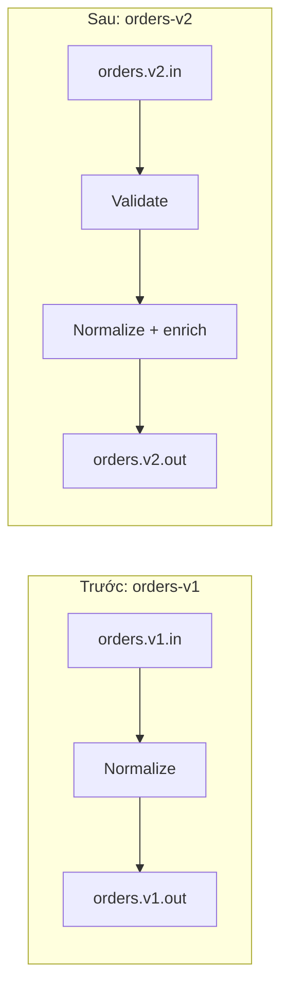
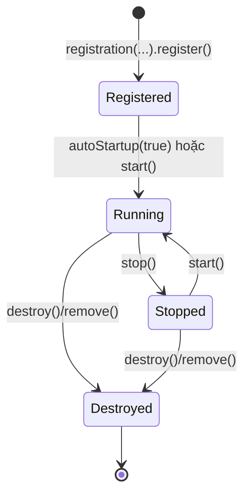
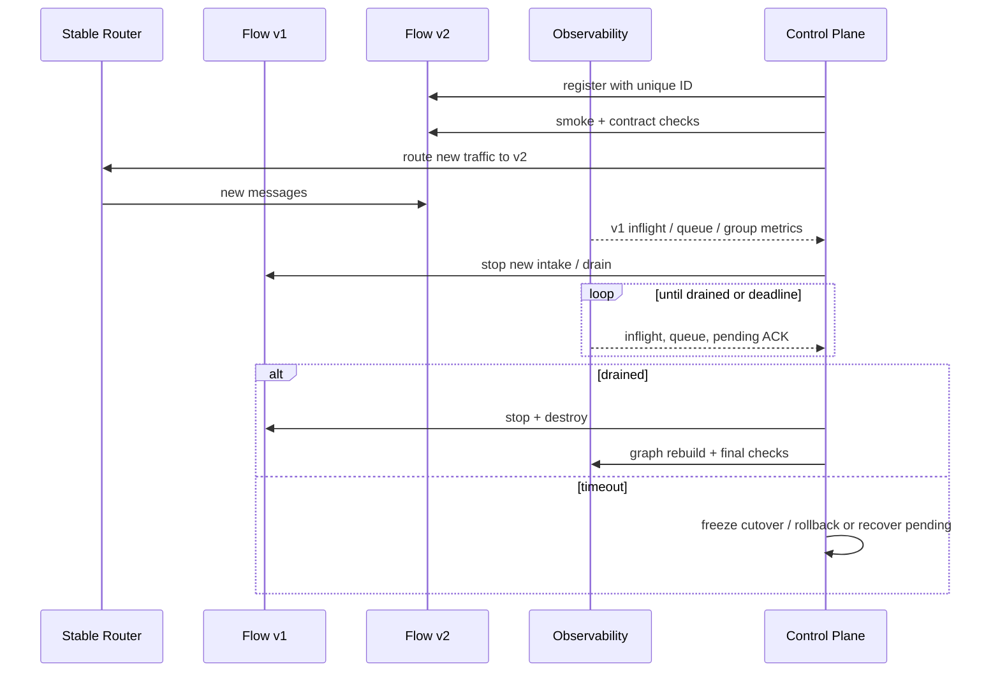
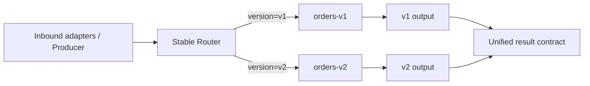
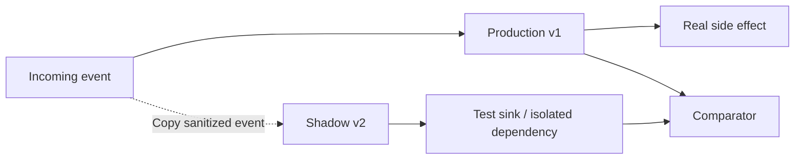

# Kiểm thử topology trước và sau thay đổi trong Spring Integration Dynamic Runtime

## 1. Vì sao phải kiểm thử topology khi thay đổi flow lúc runtime?

Trong hệ thống Spring Integration, một message đi qua chuỗi **channel → endpoint → handler → channel**; tùy flow còn có inbound adapter, polling consumer, executor, router, splitter, aggregator, retry advice, transaction và message store. Khi đăng ký, dừng hoặc tháo một `IntegrationFlow` ngay trong lúc ứng dụng đang chạy, ta không chỉ đổi code mà còn đổi **sơ đồ kết nối thực tế** và vòng đời của các thành phần đó.

Ví dụ, một dịch vụ thanh toán có flow xử lý v1 và cần chuyển sang v2 để thêm bước xác thực. Code mới có thể hoạt động khi thử một message riêng lẻ nhưng vẫn gây sự cố vì:

- Router còn trỏ tới channel của flow đã `destroy()`.
- Một channel `DirectChannel` còn hai subscriber, khiến message được điều phối tới handler không mong muốn.
- Poller của flow v1 vẫn đang lấy message từ queue khi v2 đã khởi động.
- Endpoint v2 đã được tạo nhưng có `autoStartup=false`, nên không có consumer.
- Trong lúc chuyển đổi, message đang ở giữa transaction/retry/aggregation, còn component bị tháo.
- Hai flow cùng dùng `MessageGroupStore` hoặc correlation key, làm nhóm cũ và nhóm mới bị trộn.
- Metrics hiển thị graph cũ vì `IntegrationGraphServer` chưa được `rebuild()`.

Vì vậy, **kiểm thử topology trước và sau thay đổi** không đơn giản là kiểm tra flow bean tồn tại. Ta phải xác minh **đồ thị các thành phần**, **các tuyến message**, **trạng thái lifecycle**, **hành vi đầu-cuối**, và **tình trạng công việc đang xử lý**.

Bài thuộc chương **Dynamic runtime** của module **`SPRING_INTEGRATION_RUNTIME`**, gắn với nội dung điều phối message qua channel, endpoint, consumer, poller và executor; quản lý vòng đời `IntegrationFlow`, transaction, retry, message store, lỗi, correlation, threading và hiệu năng vận hành.

**Sau bài học bạn có thể:**

1. Mô tả topology ở hai lớp: **cấu trúc graph** và **hành vi hoạt động**.
2. Tạo baseline/snapshot trước thay đổi và định nghĩa rõ những sai khác được phép.
3. Sử dụng `IntegrationFlowContext`, `IntegrationFlowRegistration` và `IntegrationGraphServer` để đăng ký, quan sát, dừng, xóa flow động.
4. Viết JUnit integration test so sánh v1/v2, khẳng định input/output cách ly và dọn resource sau test.
5. Kiểm thử router, error channel, executor/poller, retry, transaction, correlation và in-flight processing.
6. Xây kế hoạch thay đổi/rollback với điều kiện chặn triển khai, canary/shadow và quan sát runtime.

**Phiên bản tham chiếu:** Spring Integration **6.x** (API 6.5), Spring Framework 6.x, Java 17+, JUnit 5. Các thành phần testing chuyên dụng nằm trong `spring-integration-test`; cần kiểm tra dependency/BOM đang sử dụng trước khi áp dụng ví dụ vào repository thật.

## 2. Topology là gì và phải kiểm tra ở những lớp nào?

### 2.1. Topology logic, graph runtime và trạng thái vận hành

Một sơ đồ mô tả “input → transformer → handler → output” thường bỏ qua rất nhiều thành phần Spring Integration tạo ra ở runtime.

| Lớp | Mô tả | Câu hỏi kiểm thử |
|---|---|---|
| **Topology logic** | Các bước nghiệp vụ và các tuyến rẽ nhánh mong đợi | Message thuộc loại A đi đúng nhánh A chứ? |
| **Topology vật lý Spring Integration** | `MessageChannel`, endpoint, handler, adapter và các liên kết | Có thiếu/thừa consumer, channel hoặc link? |
| **Lifecycle** | `start()`, `stop()`, `destroy()`, auto-startup | Endpoint nào đang hoạt động? |
| **State/data plane** | `QueueChannel`, message groups, retry state, transaction, message store | Dữ liệu chưa xử lý có còn hợp lệ sau thay đổi? |
| **Concurrency** | Thread pool, poller, subscriptions, lock registry | Có hai phiên bản cùng consume một nguồn? |
| **Error/reply plane** | `errorChannel`, `replyChannel`, discard/recovery channels | Lỗi và reply còn về đúng đích? |
| **Observability** | Integration graph, message history, Micrometer và logs | Graph/metrics có phản ánh topology thật không? |

Một test chỉ khẳng định `ApplicationContext.containsBean("orders-v2")` mới chứng minh bean có tồn tại; nó **không chứng minh** v2 đã start, input đã có subscriber hoặc message được xử lý đúng.

### 2.2. Ví dụ thay đổi v1 → v2

Giả sử v1 chuẩn hóa mã đơn hàng, v2 bổ sung validation trước khi gửi sang hệ thống khác:



Đây là ví dụ **hai flow song song với các input độc lập**, phù hợp kiểm thử/blue-green. Trong production, có thể có một **router ổn định** ở phía trước để chọn v1 hoặc v2, thay vì để producer tự biết tên input từng phiên bản.

### 2.3. Phân biệt thay đổi mong muốn và regression

| Thuộc tính | Baseline v1 | Mong đợi v2 | Regression điển hình |
|---|---|---|---|
| Inbound path | `orders.v1.in` | `orders.v2.in` | Producer vẫn gửi vào input đã tháo |
| Handler | Normalize | Validate → normalize | Validation không chạy |
| Output path | `orders.v1.out` | `orders.v2.out` | Reply đi nhầm channel cũ |
| Consumer | Một consumer active | Một consumer v2 active ở giai đoạn cutover | Cả v1/v2 cùng subscribe vào nguồn cạnh tranh |
| Correlation | `tenant/order/run` | Giữ quy ước, hoặc migration có kế hoạch | Dùng key cũ gây trộn nhóm |
| Error | Đưa lỗi validation vào error path đã định nghĩa | Lỗi có thể quan sát và recover | Lỗi bị log rồi bỏ |
| Data state | Queue/groups còn đang xử lý | Được drain/migrate/replay có kiểm soát | Xóa flow làm mất state |
| Timeout/SLO | Theo baseline | Không vượt ngưỡng đã thống nhất | Backlog tăng vì poller chưa start |

Trước khi viết test, phải ghi ra **hợp đồng thay đổi**: cái gì được phép đổi, cái gì bắt buộc bất biến.

## 3. Kiến thức nền về API quản lý flow động

### 3.1. IntegrationFlowContext

`IntegrationFlowContext` là API quản lý `IntegrationFlow` được đăng ký **thủ công tại runtime**, thay vì chỉ khai báo bean ở pha khởi tạo context.

```java
import org.springframework.integration.dsl.IntegrationFlow;
import org.springframework.integration.dsl.context.IntegrationFlowContext;
import org.springframework.integration.dsl.context.IntegrationFlowContext.IntegrationFlowRegistration;

IntegrationFlow flow = buildFlow();

IntegrationFlowRegistration registration = flowContext
        .registration(flow)
        .id("orders-v2")
        .useFlowIdAsPrefix()
        .autoStartup(true)
        .register();
```

`buildFlow()` là hàm xây flow do ứng dụng cung cấp; `flowContext` là bean `IntegrationFlowContext` đã inject từ Spring.

Các phương thức đáng nhớ:

| API | Mục đích | Chú ý |
|---|---|---|
| `flowContext.registration(flow)` | Bắt đầu cấu hình đăng ký một flow động | Chưa register ngay |
| `.id("orders-v2")` | Đặt flow ID | Phải duy nhất trong application context |
| `.useFlowIdAsPrefix()` | Prefix bean names sinh từ flow bằng flow ID | Hữu ích khi có nhiều phiên bản với ID component trùng nhau |
| `.autoStartup(false)` | Đăng ký nhưng không tự start | Dùng khi muốn kiểm tra trước kích hoạt |
| `.register()` | Đăng ký flow cùng dependent beans, trả registration | Thường auto-start nếu không đặt false |
| `getRegistrationById(id)` | Tìm flow động đã đăng ký | Có thể trả `null` |
| `getRegistry()` | Xem các flow registration động | Không phải toàn bộ graph Spring |
| `messagingTemplateFor(id)` | Lấy template gửi vào input channel của flow | Chỉ hợp lệ khi flow bắt đầu bằng `MessageChannel` |
| `remove(id)` | Hủy flow và dependent beans | Cần kế hoạch draining trước khi gọi |

Việc tạo `IntegrationFlowRegistration` có thể dẫn tới nhiều bean do framework quản lý, bao gồm endpoint, channel và handler phụ thuộc. `remove()`/`destroy()` xóa những thành phần thuộc phạm vi registration, không tự xóa các bean dùng chung bên ngoài hoặc dữ liệu ở remote broker/database.

### 3.2. IntegrationFlowRegistration và lifecycle

```java
String id = registration.getId();
registration.getInputChannel();   // Flow phải bắt đầu bằng MessageChannel
registration.getMessagingTemplate();

registration.stop();              // Dừng flow
registration.start();             // Start lại nếu registration còn tồn tại
registration.destroy();           // Hủy đăng ký và dependent beans
```

Cần phân biệt:

- **`stop()`** là thay đổi trạng thái lifecycle; flow vẫn được đăng ký và có thể `start()` lại.
- **`destroy()`** là tháo flow khỏi context; không thể giả định gọi `start()` trên registration đã hủy.
- **`remove(id)`** trên `IntegrationFlowContext` là cách khác để hủy flow theo ID.
- **Cùng một ID không thể register lần nữa khi registration cũ còn tồn tại.** Phải hủy trước, hoặc dùng ID theo phiên bản khi triển khai song song.
- **Đăng ký thành công không chứng minh end-to-end xử lý đúng.** Cần chạy synthetic message và assert kết quả.

Nếu registration bắt đầu bằng inbound adapter/`MessageProducer` chứ **không** bằng `MessageChannel`, `getInputChannel()`/`getMessagingTemplate()` không phải cách test trực tiếp phù hợp. Hãy kích hoạt nguồn qua test fixture hoặc thay source bằng mock; tránh ép gửi message vào một endpoint không có input channel.

### 3.3. Flow ID làm prefix để tránh bean name collision

Khi v1 và v2 cùng sống, generated bean names hay endpoint IDs có thể đụng nhau. Mẫu thường dùng:

```java
flowContext.registration(buildFlow(configV1))
        .id("orders-v1")
        .useFlowIdAsPrefix()
        .register();

flowContext.registration(buildFlow(configV2))
        .id("orders-v2")
        .useFlowIdAsPrefix()
        .register();
```

`useFlowIdAsPrefix()` không tự tách hai flow khỏi **cùng một external source/queue**, cũng không tạo namespace cho correlation key của persistent message groups. Nó giải quyết **bean naming** trong context. Việc tránh cross-consume và state collision là phần trách nhiệm khác.

## 4. Chụp topology từ IntegrationGraphServer

### 4.1. Graph ở runtime

Spring Integration có `org.springframework.integration.graph.IntegrationGraphServer` dựng mô hình đồ thị với các `IntegrationNode` và `LinkNode`. Thông tin chính:

```java
import org.springframework.integration.graph.Graph;
import org.springframework.integration.graph.IntegrationGraphServer;

IntegrationGraphServer graphServer = ...;

Graph before = graphServer.rebuild(); // Chụp cấu trúc thực tế
Collection<?> nodes = before.getNodes();
Collection<?> links = before.getLinks();
```

Các node phản ánh channel, endpoint, gateway/adapter...; mỗi `LinkNode` cho biết mối liên hệ giữa các node qua `getFrom()`, `getTo()` và `getType()`. Graph cung cấp mô hình **có thể quan sát**, không phải toàn bộ dữ liệu về thread hoặc transaction.

Hai API quan trọng:

- `getGraph()`: trả **graph đang được cache**; stats có thể động nhưng cấu trúc có thể là snapshot cũ.
- `rebuild()`: **xây lại cấu trúc và cache**; dùng sau khi thêm/xóa component.

**Quy tắc:** khi so sánh topology trước và sau đăng ký/hủy flow, gọi `rebuild()` tại cả hai thời điểm; không dựa vào `getGraph()` cũ để kết luận flow mới không tồn tại.

### 4.2. Dựng snapshot có thể diff

`Graph` lưu node theo ID số nội bộ. Các ID đó có thể thay đổi sau mỗi lần rebuild; **không nên so nguyên chuỗi JSON graph hoặc so `nodeId` như khóa nghiệp vụ**.

Có thể tạo biểu diễn chuẩn hóa (*canonical*) bằng tên thành phần, loại node và các cạnh đã dịch ID sang tên:

```java
import java.util.Map;
import java.util.Set;
import java.util.function.Function;
import java.util.stream.Collectors;

import org.springframework.integration.graph.Graph;
import org.springframework.integration.graph.IntegrationNode;
import org.springframework.integration.graph.LinkNode;

record TopologySnapshot(
        Set<String> nodes,
        Set<String> links) {}

static TopologySnapshot snapshot(Graph graph) {
    Map<Integer, IntegrationNode> byId =
            graph.getNodes().stream()
                    .collect(Collectors.toMap(
                            IntegrationNode::getNodeId,
                            Function.identity()));

    Set<String> nodes = graph.getNodes().stream()
            .map(n -> n.getName() + "|" + n.getComponentType())
            .collect(Collectors.toSet());

    Set<String> links = graph.getLinks().stream()
            .map(link -> {
                IntegrationNode from = byId.get(link.getFrom());
                IntegrationNode to = byId.get(link.getTo());

                if (from == null || to == null) {
                    throw new IllegalStateException(
                            "Graph contains unresolved link");
                }

                return from.getName() + " -> " + to.getName()
                        + " [" + link.getType() + "]";
            })
            .collect(Collectors.toSet());

    return new TopologySnapshot(nodes, links);
}
```

Đây là một **mẫu test helper**, không phải API sẵn có tên `TopologySnapshot` của Spring Integration. Mỗi tên bean/endpoint nên ổn định, có ý nghĩa và tránh dữ liệu bí mật.

Khi tên được sinh tự động (`channel#0`, endpoint với index), snapshot có thể khác chỉ vì thứ tự tạo bean, dù nghiệp vụ không đổi. Với các thành phần quan trọng, **đặt ID tường minh** hoặc so sánh các đường nghiệp vụ đã chuẩn hóa, thay vì “snapshot mọi thứ rồi assert byte-by-byte”.

### 4.3. So sánh tập node/link mà không làm mất nguyên nhân

```java
TopologySnapshot baseline = snapshot(before);
TopologySnapshot candidate = snapshot(after);

Set<String> removed = new java.util.HashSet<>(baseline.links());
removed.removeAll(candidate.links());

Set<String> added = new java.util.HashSet<>(candidate.links());
added.removeAll(baseline.links());

System.out.println("Removed links: " + removed);
System.out.println("Added links: " + added);
```

Khi v1 và v2 cùng tồn tại trong giai đoạn canary, **việc thêm node/link là dự kiến**; khi hủy v1, việc mất node/link v1 mới là dự kiến. Test nên đối chiếu với **diff được duyệt**, không mặc định “topology phải y hệt” sau một thay đổi có chủ ý.

### 4.4. Không phơi graph runtime ra công khai

Mô hình graph có thể tiết lộ tên channel, adapter, endpoint, các loại hệ thống nội bộ và tên flow. Nếu expose qua `IntegrationGraphController`/HTTP management endpoint, cần bảo vệ bằng authentication, authorization và cấu hình mạng/CORS phù hợp. Với CI test, gọi `IntegrationGraphServer` trực tiếp thay vì mở endpoint management cho mọi người.

## 5. Lập baseline và hợp đồng trước khi thay đổi

### 5.1. Baseline phải bao gồm dữ liệu động

Trước thay đổi, ghi nhận **bốn nhóm bằng chứng**:

1. **Cấu trúc:** tập các flow registrations, node/link graph, ID của channel/endpoint/handler.
2. **Hành vi:** message test qua nhánh chính, nhánh lỗi, correlation/reply, timeout, retry và discard.
3. **Trạng thái:** `isRunning()` của endpoint cần thiết, active consumers, poller schedule, executor queue, message groups, pending ACK.
4. **Sức khỏe:** throughput, p95/p99 latency, queue depth/oldest age, errors, retry rate, số thread và memory.

Khi dữ liệu có sự thay đổi theo thời gian (graph stats, message count, thread IDs), cần so với **ngưỡng hoặc quy tắc bất biến**, không so sánh bằng tuyệt đối với một snapshot ở thời điểm khác.

### 5.2. Golden topology: điều kiện cần giữ nguyên

Ví dụ hợp đồng:

```yaml
topologyContract:
  flowFamily: orders
  change: v1-to-v2
  required:
    - input-to-handler-route
    - output-to-reply-path
    - error-and-recovery-route
    - correlation-headers-preserved
    - no-double-consume-on-shared-source
  mayChange:
    - add-validation-step
    - add-v2-endpoints
  afterCutover:
    - no-new-messages-to-v1
    - v1-inflight-count-zero-before-destroy
    - v2-synthetic-message-passes
  rollback:
    - old-flow-can-be-restarted-if-not-destroyed
    - durable-message-state-recoverable
```

Đây là **mẫu contract minh họa trong bài**, không phải một schema Spring Integration chính thức. CI có thể đọc contract qua code/config quản lý của ứng dụng, nhưng STEP 4 chỉ cần diễn giải và kiểm thử, không tạo file contract ngoài hai tệp được giao.

### 5.3. Tiêu chí pass/fail rõ ràng

| Gate | Ví dụ pass | Ví dụ fail |
|---|---|---|
| **G1 – Structural** | Các link mong muốn của v2 xuất hiện, không còn link tới endpoint đã hủy | Graph vẫn còn route qua v1 sau cutover |
| **G2 – Lifecycle** | v2 active, v1 stopped theo kế hoạch | v2 đã register nhưng không start |
| **G3 – Contract** | Payload/headers/reply/error semantics giữ như yêu cầu | Reply sang channel sai |
| **G4 – State** | Queue/groups/ACK/in-flight được drain/migrate | Có message chưa commit nhưng nguồn đã tháo |
| **G5 – Performance** | Throughput và p99 đáp ứng SLA | Executor saturation hoặc poller lag tăng |
| **G6 – Rollback** | Có thể quay routing về v1 hoặc khôi phục trạng thái | Bean cũ đã destroy, state không thể phục hồi |
| **G7 – Cleanup** | Không có bean/subscription/scheduler orphan | Stop/start nhiều lần gây xử lý trùng |

## 6. Ví dụ Java: đăng ký hai phiên bản flow với input độc lập

### 6.1. Fixture tối giản

Một cách thử an toàn là **mỗi phiên bản có `DirectChannel` riêng và `QueueChannel` nhận reply riêng**, để kết quả không bị trộn hoặc bị một subscriber khác giành mất.

```java
import java.util.Locale;
import java.util.function.UnaryOperator;

import org.springframework.integration.channel.DirectChannel;
import org.springframework.integration.channel.QueueChannel;
import org.springframework.integration.dsl.IntegrationFlow;

public final class VersionedOrderFlows {

    private VersionedOrderFlows() {}

    static IntegrationFlow build(
            UnaryOperator<String> normalize,
            QueueChannel resultQueue) {

        DirectChannel input = new DirectChannel();

        return IntegrationFlow.from(input)
                .<String, String>transform(normalize::apply)
                .channel(resultQueue)
                .get();
    }

    static UnaryOperator<String> v1() {
        return value -> "v1:" + value.trim();
    }

    static UnaryOperator<String> v2() {
        return value -> "v2:"
                + value.trim().toUpperCase(Locale.ROOT);
    }
}
```

Đây là ví dụ **thử nghiệm topology**, không thực hiện outbound HTTP hay ghi database. Dùng `DirectChannel` nên phần `transform` chạy đồng bộ khi gửi message; dùng `QueueChannel` giúp bài test kiểm tra output bằng `receive(timeout)`.

Điểm then chốt là **không dùng chung một `DirectChannel` cho v1 và v2** trong phép thử riêng biệt này. Nếu muốn kiểm thử canary qua một router ổn định, phải thêm router riêng với luật định tuyến rõ, không dựa vào nhiều subscriber của `DirectChannel` để chia 50/50 traffic.

### 6.2. Đăng ký, gửi message và tháo flow

```java
import org.springframework.integration.channel.QueueChannel;
import org.springframework.integration.dsl.IntegrationFlow;
import org.springframework.integration.dsl.context.IntegrationFlowContext;
import org.springframework.integration.dsl.context.IntegrationFlowContext.IntegrationFlowRegistration;
import org.springframework.messaging.Message;
import org.springframework.messaging.support.GenericMessage;

IntegrationFlowContext flowContext = ...;

QueueChannel v1Replies = new QueueChannel();

IntegrationFlow v1Flow =
        VersionedOrderFlows.build(
                VersionedOrderFlows.v1(), v1Replies);

IntegrationFlowRegistration v1 = flowContext
        .registration(v1Flow)
        .id("orders-v1")
        .useFlowIdAsPrefix()
        .register();

// getInputChannel() hợp lệ vì flow bắt đầu bằng DirectChannel.
v1.getInputChannel().send(new GenericMessage<>("  ord-42 "));

Message<?> oldReply = v1Replies.receive(1_000);
if (oldReply == null) {
    throw new IllegalStateException("No reply from v1");
}
System.out.println(oldReply.getPayload()); // v1:ord-42

QueueChannel v2Replies = new QueueChannel();
IntegrationFlowRegistration v2 = flowContext
        .registration(VersionedOrderFlows.build(
                VersionedOrderFlows.v2(), v2Replies))
        .id("orders-v2")
        .useFlowIdAsPrefix()
        .register();

v2.getInputChannel().send(new GenericMessage<>("  ord-42 "));
Message<?> newReply = v2Replies.receive(1_000);
System.out.println(newReply.getPayload()); // v2:ORD-42

// Chỉ dừng/hủy v1 khi đã xác nhận drain và không còn caller đang dùng.
v1.stop();
v1.destroy();

// Hủy v2 khi kết thúc một fixture/test.
v2.destroy();
```

**Các giả định của ví dụ:**

- `flowContext` đã được inject trong một context có `@EnableIntegration`.
- Cả hai flow auto-start sau đăng ký (mặc định của registration builder).
- Không có task async hoặc message in-flight trong ví dụ này; `stop()`/`destroy()` được gọi sau khi đã nhận reply.
- Việc truyền `QueueChannel` object vào DSL cho phép test đọc reply trực tiếp. Khi production dùng broker/store, cấu hình resource ownership và cleanup khác.
- Chuỗi `"v1:..."` và `"v2:..."` giúp test quan sát phiên bản, **không phải contract dữ liệu thực**; khi thay đổi production, nên có feature flag/version metadata không rò rỉ vào payload nếu không được phép.

### 6.3. Vì sao không thay flow cùng ID ngay lập tức?

`IntegrationFlowRegistrationBuilder.id(String)` yêu cầu ID duy nhất trong context; registration cũ phải bị hủy trước khi dùng lại ID. Nếu production đang chạy:

```text
orders-flow (v1) -> destroy -> register orders-flow (v2)
```

thì có **khoảng trống nhận traffic**, rủi ro send không có subscriber hoặc missing endpoint nếu thay đổi thất bại.

Phương án an toàn hơn thường là:

```text
orders-router (ID ổn định)
   ├── orders-v1 (đang phục vụ)
   └── orders-v2 (mới register, chờ kiểm thử)
       └── chuyển routing/canary khi sẵn sàng
```

Cần bảo đảm route thông qua **một entrypoint hợp đồng rõ ràng** và trong giai đoạn cutover không vô tình double-consume từ cùng inbound source.

## 7. JUnit integration test: khẳng định trạng thái trước và sau

### 7.1. Fixture có context thật, không có external adapter

Phép thử dưới đây dùng JUnit 5 + Spring Test, đăng ký flow **thực** bằng `IntegrationFlowContext` rồi gửi message tới input channel, không cần mock handler. Đây là mức test đầu tiên để chứng minh thay đổi v1/v2 không phá hợp đồng routing và cleanup.

```java
import static org.junit.jupiter.api.Assertions.*;

import java.util.ArrayList;
import java.util.List;
import java.util.function.UnaryOperator;

import org.junit.jupiter.api.AfterEach;
import org.junit.jupiter.api.Test;
import org.springframework.beans.factory.annotation.Autowired;
import org.springframework.context.annotation.Configuration;
import org.springframework.integration.channel.QueueChannel;
import org.springframework.integration.config.EnableIntegration;
import org.springframework.integration.dsl.context.IntegrationFlowContext;
import org.springframework.integration.dsl.context.IntegrationFlowContext.IntegrationFlowRegistration;
import org.springframework.messaging.Message;
import org.springframework.messaging.support.GenericMessage;
import org.springframework.test.context.junit.jupiter.SpringJUnitConfig;

@SpringJUnitConfig(classes = DynamicTopologyTest.Config.class)
class DynamicTopologyTest {

    @Configuration
    @EnableIntegration
    static class Config { }

    @Autowired
    IntegrationFlowContext flowContext;

    private final List<String> registrations = new ArrayList<>();

    private IntegrationFlowRegistration register(
            String flowId,
            UnaryOperator<String> version,
            QueueChannel output) {

        IntegrationFlowRegistration registration = flowContext
                .registration(VersionedOrderFlows.build(version, output))
                .id(flowId)
                .useFlowIdAsPrefix()
                .register();

        registrations.add(flowId);
        return registration;
    }

    private static String exchange(
            IntegrationFlowRegistration registration,
            QueueChannel output,
            String payload) {

        assertTrue(registration.getInputChannel()
                .send(new GenericMessage<>(payload)));

        Message<?> response = output.receive(1_000);
        assertNotNull(response, "Missing reply from " + registration.getId());

        return response.getPayload().toString();
    }

    @Test
    void topologyBeforeAndAfterChange() {
        QueueChannel oldOutput = new QueueChannel();
        IntegrationFlowRegistration v1 = register(
                "orders-v1", VersionedOrderFlows.v1(), oldOutput);

        // Baseline: v1 hiện hữu và xử lý theo hợp đồng cũ.
        assertNotNull(flowContext.getRegistrationById("orders-v1"));
        assertEquals("v1:ord-42",
                exchange(v1, oldOutput, "  ord-42  "));

        QueueChannel newOutput = new QueueChannel();
        IntegrationFlowRegistration v2 = register(
                "orders-v2", VersionedOrderFlows.v2(), newOutput);

        // Trong canary, cả hai flow đều tồn tại.
        assertNotNull(flowContext.getRegistrationById("orders-v1"));
        assertNotNull(flowContext.getRegistrationById("orders-v2"));

        assertEquals("v2:ORD-42",
                exchange(v2, newOutput, "  ord-42  "));
        assertEquals("v1:ord-99",
                exchange(v1, oldOutput, " ord-99 "));

        // Không nhầm output giữa hai input tách biệt.
        assertNull(oldOutput.receive(0));
        assertNull(newOutput.receive(0));

        // Mô phỏng cutover đã drain: dừng và remove v1.
        v1.stop();
        flowContext.remove("orders-v1");
        assertNull(flowContext.getRegistrationById("orders-v1"));

        // v2 còn sống và xử lý bình thường.
        assertEquals("v2:ORD-100",
                exchange(v2, newOutput, " ord-100 "));
    }

    @AfterEach
    void cleanup() {
        for (String id : registrations) {
            IntegrationFlowRegistration r =
                    flowContext.getRegistrationById(id);
            if (r != null) {
                r.destroy();
            }
        }
        registrations.clear();
    }
}
```

Mẫu này dựa trên lớp `VersionedOrderFlows` đã định nghĩa ở mục 6. Nó kiểm tra **hành vi** và **registry**, không đòi hỏi graph server. Nếu có thêm graph server, ta có thể xây phép so sánh node/link độc lập.

**Đáng chú ý:**

- `@AfterEach` dọn flow động kể cả khi assertion thất bại; test sau không bị ảnh hưởng bởi cùng flow ID.
- Mỗi flow có output riêng; test không mặc định thứ tự nhận giữa hai phiên bản khi chạy đồng thời.
- `assertNull(output.receive(0))` chỉ kiểm tra queue trống ở một thời điểm, **không phải bằng chứng mạnh về không mất message dưới concurrency**. Để kiểm chứng dưới tải, cần đo message ID đầu-cuối, in-flight và eventually semantics.
- Test này không chứng minh transactional durability hay ACK của broker, vì không có broker/database; các khía cạnh đó phải được test bằng integration fixture phù hợp.

### 7.2. Test nếu flow được đăng ký nhưng không start

Một lỗi deployment phổ biến: bean có tồn tại nhưng endpoint không hoạt động vì `autoStartup(false)`.

```java
QueueChannel output = new QueueChannel();

IntegrationFlowRegistration candidate = flowContext
        .registration(VersionedOrderFlows.build(
                VersionedOrderFlows.v2(), output))
        .id("orders-candidate")
        .useFlowIdAsPrefix()
        .autoStartup(false)
        .register();

assertNotNull(flowContext.getRegistrationById("orders-candidate"));

// Chỉ khẳng định tồn tại KHÔNG đủ.
// Gọi start() trước khi thực hiện message exchange:
candidate.start();

candidate.getInputChannel().send(new GenericMessage<>(" x "));
assertEquals("v2:X", output.receive(1_000).getPayload());

candidate.destroy();
```

Mã trên minh họa thao tác điều khiển lifecycle. Tùy endpoint và channel, gửi vào flow chưa start có thể ném lỗi không có subscriber hoặc message không được xử lý; không viết test dựa trên một loại exception cố định cho tất cả nguồn.

**Test cần thêm:** đăng ký cùng ID lần hai trước khi hủy phải bị từ chối; sau `destroy()` ID được tái sử dụng nếu không còn dependent bean collision. Không thử điều này trên flow production đang có in-flight message.

## 8. Assertions cho graph node và link

### 8.1. Snapshot trước, sau đăng ký và sau remove

Nếu ApplicationContext có `IntegrationGraphServer` được đăng ký, phép thử có thể kiểm tra **thay đổi cấu trúc**:

```java
import org.springframework.integration.graph.Graph;
import org.springframework.integration.graph.IntegrationGraphServer;

IntegrationGraphServer graphServer = ...;

Graph baseline = graphServer.rebuild();

// Đăng ký flow candidate qua IntegrationFlowContext.

Graph withCandidate = graphServer.rebuild();
TopologySnapshot afterRegister = snapshot(withCandidate);

// Sau khi đã dừng và hủy flow cũ.
Graph afterRemoval = graphServer.rebuild();
TopologySnapshot afterCutover = snapshot(afterRemoval);
```

Phương thức `snapshot()` là test helper mục 4. `IntegrationGraphServer` có thể được cung cấp qua Spring Integration management infrastructure; khi ứng dụng chưa có bean này, phải cấu hình nó và kiểm tra lifecycle của server trong test context thay vì giả định có sẵn ở mọi app.

### 8.2. Chỉ so sánh phần thuộc flow cần kiểm thử

Graph có thể có nhiều infrastructure nodes không liên quan, như error channel, null channel, management endpoint, Micrometer observation hoặc gateway khác. So sánh toàn bộ sẽ tạo “false positives”.

Một chiến lược:

1. Đặt flow ID duy nhất, ví dụ `orders-v2`, và bật `useFlowIdAsPrefix()`.
2. Đặt `id` rõ cho những endpoint có nhiệm vụ ổn định (validator, transformer, outbound adapter).
3. Xây allowlist node/link thuộc flow family được kiểm thử.
4. Từ graph, dịch `nodeId` thành `getName()` và `getComponentType()`.
5. So sánh với expected **edge set**, không so thứ tự collection.
6. Chỉ đưa vào assertion những node/edge có ý nghĩa hợp đồng.

Ví dụ minh họa assertion cho prefix:

```java
Graph g = graphServer.rebuild();

boolean foundCandidateNodes = g.getNodes().stream()
        .map(node -> node.getName())
        .anyMatch(name -> name.contains("orders-v2"));

assertTrue(foundCandidateNodes, "Candidate nodes missing from graph");
```

Khi dùng generated names hoặc các channel object tạo thủ công, tên thực tế trong graph có thể khác ví dụ; xem graph một lần rồi đặt các **tên/ID ổn định** trước khi viết production assertion. Không dùng `contains("v2")` chung chung nếu app có các bean unrelated cùng chuỗi đó.

### 8.3. Test cấu trúc không thay thế end-to-end behavior

Graph có link từ router đến endpoint nhưng router có thể luôn trả key sai, hoặc endpoint chưa start. Một `MessageHandlerNode` tồn tại không chứng minh outbound API hoạt động. Vì vậy **phải có cả:**

- Assertion structural: node/link/registration.
- Assertion behavior: gửi message và kiểm tra output.
- Assertion error semantics: validation error, retry, discard và recovery.
- Assertion lifecycle: stop/start/destroy.
- Assertion state: queue/group/ACK/in-flight.

Đây là một ma trận, không phải các lựa chọn thay thế nhau.

## 9. Kiểm thử hợp đồng message, header và định tuyến

### 9.1. Payload và header nào phải giữ?

Nếu v2 thêm transformer, việc “payload trông đúng” chưa đủ. Cần xác định:

| Trường | Vì sao cần test |
|---|---|
| `MessageHeaders.ID` | Message ID có thể thay đổi qua transform; không dùng nó làm duy nhất business ID |
| `correlationId` | Splitter/aggregator và reply path cần tương quan chính xác |
| `sequenceNumber` / `sequenceSize` | Giữ đúng grouping khi có split/resequence |
| `replyChannel` | Gateway trả về đúng caller; không chuyển nhầm giữa v1/v2 |
| `errorChannel` | Lỗi đi đúng error path |
| `tenantId`, `orderId`, `processingRunId` | Multi-tenant và retry không lẫn state |
| `contentType` / custom schema version | Downstream deserialize/route đúng |
| Tracing headers | Có thể theo dõi end-to-end nhưng không dùng làm business identity |

Không phải tất cả headers đều bắt buộc giữ nguyên. Chẳng hạn transform có thể tạo message mới với ID mới, và một gateway có thể dùng temporary reply channel khác. Test nên khẳng định **invariant nghiệp vụ và giao thức**, không yêu cầu mọi header bằng tuyệt đối.

### 9.2. Định tuyến phủ cả nhánh dương và nhánh âm

Với router dựa trên `tenantId`, `eventType` hoặc feature flag, cần test:

- Key được hỗ trợ v1/v2.
- Key không hợp lệ, null hoặc thiếu header.
- Tenant không được phép vào v2.
- Route tới default/discard channel nếu cấu hình có.
- Lỗi từ route v2 không quay nhầm vào error handler v1.
- Dynamic endpoint không tồn tại hoặc đã stop: hành vi reject/timeout phải rõ.

Ví dụ bảng case:

| Input | Expected route | Expected outcome |
|---|---|---|
| `eventType=PAYMENT`, canary=false | v1 | V1 response contract |
| `eventType=PAYMENT`, canary=true | v2 | V2 response contract |
| `eventType=UNKNOWN` | reject/default | Error hoặc discard có audit |
| `tenantId` thiếu | không được rơi vào tenant mặc định tùy tiện | Validation failure |
| `processingRunId` đã dùng ở flow v1 | Giữ đúng run ownership | Không trộn vào group của v2 |

Nếu cắt traffic bằng hash/percentage, test không nên assert chính xác 5% từ một mẫu nhỏ ngẫu nhiên. Nên dùng **deterministic assignment** theo `tenantId`/business key và test đúng tập được chọn; đo phần trăm trong load test dài hơn.

### 9.3. Contract test bằng producer-consumer fixture

Kiểm thử một tuyến message theo kiểu:

```text
Input
  ├── Valid payload -> transformer -> outbound mock -> reply channel
  ├── Invalid payload -> error channel / discard channel
  ├── Transient failure -> retry advice -> recovery
  └── Duplicate business event -> idempotency / expected dedupe
```

Với outbound HTTP/JMS/AMQP, nên dùng wire mock hoặc test container phù hợp để assert **số lần thực sự gọi**; chỉ đếm số lần handler được invoker trong app có thể bỏ sót retry hoặc adapter-level redelivery.

### 9.4. MockIntegrationContext và @SpringIntegrationTest

`spring-integration-test` cung cấp `@SpringIntegrationTest` và `MockIntegrationContext` để thay message source/handler trong test context.

```java
@SpringJUnitConfig
@SpringIntegrationTest(noAutoStartup = {"realInbound*", "*Source*"})
class ContractTest {
    @Autowired
    MockIntegrationContext mockContext;
}
```

Chức năng phù hợp khi cần:

- Ngăn adapter inbound thật tự kết nối API/broker trong test.
- Thay `MessageSource` bằng source có dữ liệu được kiểm soát.
- Thay `MessageHandler` bằng mock/`MockMessageHandler` để ghi nhận message.
- Đặt lại components sau mỗi test bằng `mockContext.resetBeans()`.

**Đặc biệt:** `substituteMessageHandlerFor()` cần tên **consumer endpoint bean**, không phải tùy tiện tên `MessageHandler` bên trong flow. Với dynamic registration có prefix, tên endpoint có thể khác; kiểm tra graph/bean registration và đặt ID ổn định trước khi mock. Không mock toàn bộ tuyến rồi tuyên bố đã kiểm chứng topology thật: luôn giữ một vài smoke tests có đủ các endpoint thật.

## 10. Kiểm thử lifecycle: start, stop, destroy và orphan components

### 10.1. Các trạng thái cần quan sát



Lưu ý: hình trên là **mô hình kiểm thử logic**. Khi `autoStartup(false)`, flow có thể bắt đầu ở Registered/Stopped; chi tiết trạng thái của từng endpoint phụ thuộc component. `Registration` không nhất thiết cung cấp một `isRunning()` thống nhất cho mọi nội bộ.

Kiểm tra theo thứ tự:

1. Registration tồn tại sau `register()`.
2. Input channel usable nếu flow bắt đầu bằng channel.
3. Endpoint có thể xử lý smoke message sau `start()`.
4. Sau `stop()`, nguồn tạo message mới được dừng theo hợp đồng.
5. Sau `destroy()`/`remove()`, registration không còn và dependent beans không bị orphan.
6. Dùng graph `rebuild()` xác nhận các node/link liên quan được tháo.
7. Start/register phiên bản mới không tạo duplicate consumers hoặc bean name collision.

### 10.2. Stop không mặc nhiên drain queue

Khi dừng `PollingConsumer`, `QueueChannel` có thể vẫn còn message chưa được lấy; với `SimpleMessageStore` in-memory, dữ liệu có thể biến mất khi process restart. Nếu dùng `JdbcChannelMessageStore` hoặc broker durable, message có thể tồn tại để xử lý sau, tùy transaction và ACK.

Vì vậy, test **stop → backlog còn → start lại → xử lý hết đúng một lần theo khả năng** phải được thực hiện trên đúng loại store/adapter. Đừng tự xóa queue hoặc reset memory store chỉ để làm sạch graph khi production còn message chưa xử lý.

### 10.3. Destroy khác stop

`IntegrationFlowRegistration.destroy()` và `IntegrationFlowContext.remove(id)` làm **hủy** flow cùng những dependent beans do registration quản lý. Nhưng không nên mặc định chúng dọn:

- Kết nối hoặc bean singleton được chia sẻ ngoài registration.
- Persisted records trong database message store.
- Remote broker queues/consumer groups.
- Business side effects và transaction đã commit.
- Runnable/callback do code tự submit vào một executor ngoài flow.
- Subscription được code tự `subscribe()` mà không có owner/lifecycle.

Cần test orphan tài nguyên bằng metrics active threads, scheduler tasks, connection count, subscriptions, cached lock registry và dependent beans. Nếu dynamic flow tạo tài nguyên bên ngoài, có thể dùng registration builder `addBean(...)` cho những dependent beans cần được container quản lý, nhưng ownership phải được định nghĩa rõ để không destroy một bean dùng chung.

### 10.4. Test nhiều vòng thay đổi

Một test có thể chạy:

```text
register(v1) -> start -> smoke -> stop -> destroy
register(v2) -> start -> smoke -> stop -> destroy
register(v1) -> start -> smoke -> stop -> destroy
... lặp 30-100 vòng trên staging/test
```

Quan sát:

- Số bean do flow sở hữu không tăng mãi.
- Số thread/connection/subscription còn hoạt động sau cleanup không tăng.
- Các flow IDs tái sử dụng được sau destroy nếu phù hợp.
- Không còn handler cũ nhận message khi v2 đã được chọn.
- Không còn lỗi bean registration duplicate hoặc scheduler task chạy nền.

Đây là **soak test ownership/lifecycle**, không phải performance benchmark; nên chạy dưới kiểm soát và kết hợp sampling heap/thread dumps khi phát hiện leak.

## 11. In-flight messages: thách thức lớn nhất khi cutover

### 11.1. Đăng ký flow mới không hủy công việc cũ

Nếu v1 đã gọi external API, rồi flow v2 được register và router đổi đường đi, v1 có thể vẫn đang:

- Chờ HTTP response.
- Chờ poller tiếp tục xử lý từ `QueueChannel`.
- Ở giữa transaction/commit.
- Retry theo `RequestHandlerRetryAdvice`.
- Giữ `MessageGroup` chưa release ở aggregator.
- Chờ `LockRegistry` hoặc `ExecutorChannel` worker.

Không thể gọi `remove(v1)` rồi suy ra các phần việc đó không còn tồn tại. Cần một **draining protocol** tường minh.

### 11.2. Quy trình drain kiểm thử được

Một phương án tổng quát:



**Điều kiện drain** nên dựa trên nhiều số liệu, chẳng hạn `inflight=0`, queue backlog=0, no pending ACK, no active group work và no in-flight external calls. Với loại flow có message được giữ lâu hợp lệ (aggregator/batch), quyết định giữ store/chuyển ownership/expire phải theo business SLA.

### 11.3. Vì sao inflight=0 chưa chắc an toàn?

Một bộ đếm application có thể giảm trước khi message được ACK/commit, hoặc không tính các tác vụ đã tách ra sang executor khác. Cần đối chiếu:

- `QueueChannel.getQueueSize()`/message store group size.
- Broker lag/unacked messages.
- Pending transaction status hoặc retry tasks.
- Gateway waiting replies và scheduled timeouts.
- Active handler calls/HTTP clients.
- MessageStore cleanup/group completion, bao gồm late arrivals.

Nếu dữ liệu không thể drain ngay, chọn **blue-green coexistence có versioned message state** hoặc **quarantine/replay** thay vì destroy đột ngột.

## 12. Transaction, retry và correlation khi topology đổi

### 12.1. Transaction boundary có thể đã thay

V1:

```text
QueueChannel -> @Transactional handler -> commit -> reply
```

V2:

```text
QueueChannel -> ExecutorChannel -> @Transactional handler -> reply
```

Dù nhìn gần giống nhau, `ExecutorChannel` đổi thread thực thi; một transaction gắn thread tại phía trước có thể **không đi xuyên qua async boundary**. Sau thay đổi, ACK/rollback không nhất thiết hoạt động như v1.

Test cần cố ý tạo exception **sau điểm có side effect**, rồi kiểm tra:

1. Transaction nào được mở?
2. Database đã commit/rollback?
3. Message có được redeliver?
4. Retry diễn ra trên thread nào?
5. Reply/error tới channel nào?
6. Nếu caller timeout rồi retry, có duplicate side effect không?

Không đánh giá transaction chỉ bằng việc graph có hay không có node `ExecutorChannel`.

### 12.2. Retry advice placement và side effect

Khi v2 chuyển `RequestHandlerRetryAdvice` từ handler sang poller hoặc đổi thứ tự advice, **phạm vi xử lý lại** thay đổi. Retry ở poller có thể chạy lại cả chuỗi xử lý đồng bộ được poller kích hoạt; retry tại handler thường hạn chế phạm vi theo handler. Điều này tác động số HTTP calls, số lần ghi dữ liệu và thời gian giữ transaction.

Một bộ test tối thiểu:

| Kịch bản | Expected contract |
|---|---|
| Transient timeout lần 1, thành công lần 2 | Đúng số attempts/backoff và một kết quả nghiệp vụ |
| Lỗi không retry được | Lỗi vào recovery/error channel, không loop vô hạn |
| Retry cạn | Có `ErrorMessage`/DLQ hoặc báo lỗi theo hợp đồng |
| Caller timeout giữa retry | Không suy ra remote side effect đã bị hủy |
| Retry sau cutover | Message của run v1 không tự trôi vào state v2 trái quy tắc |

### 12.3. Message group và correlation namespace

Hai phiên bản aggregator cùng dùng `MessageGroupStore` và correlation key `orderId` có thể dẫn tới group trộn. Khi topology đổi, cần quyết định:

- Group của v1 có tiếp tục được xử lý tại v1?
- V2 có được phép đọc lại group chưa hoàn tất của v1 không?
- Key có chứa tenant, workflow, **processingRunId** và flow version/stage?
- Release strategy v2 có tương thích với group metadata/sequence của v1?
- Completed tombstone/expiry/reaper có thể khiến message v2 bị discard hoặc message cũ trộn vào group mới không?

**Quy tắc mặc định an toàn:** không để hai flow phiên bản khác nhau cùng mutate group state nếu chưa có quy trình migration/ownership. Với persisted store, migration cần kiểm thử schema, lock, transaction và rollback tương ứng.

### 12.4. LockRegistry trong lúc triển khai nhiều phiên bản

Nếu v1/v2 cùng sửa một tài nguyên, hai flow phải có **cùng quy ước lock key** và cơ chế phối hợp phù hợp. Hai `DefaultLockRegistry` độc lập trong hai JVM không phối hợp dù key bằng nhau. Với persistent shared store, cần distributed registry/lock và thiết kế idempotency.

Test concurrency nên đặt hai yêu cầu cùng business key vào v1 và v2 đồng thời, assert version/business consistency sau commit. Một mutex/lock chỉ serialize thao tác, không tự sửa key correlation sai hoặc loại bỏ duplicate message.

## 13. Kiểm thử tải đồng thời, backpressure và thứ tự xử lý

### 13.1. Cấu trúc đúng dưới một message chưa đủ

Một graph có đầy đủ endpoint vẫn có thể lỗi khi có 1.000 message cùng đến. Các tình huống phải kiểm tra:

- `DirectChannel`: handler được gọi trên thread gửi, có nguy cơ block caller khi downstream chậm.
- `ExecutorChannel`: đổi execution context, queue task và số worker; downstream có thể xử lý **không đúng thứ tự đến**.
- `QueueChannel`: producer có thể gửi nhanh hơn poller rút, làm queue đầy hoặc kéo dài latency.
- Poller đổi `fixedDelay`, `fixedRate`, `maxMessagesPerPoll`: thay đổi throughput, batch và transaction scope.
- `FluxMessageChannel` hoặc reactive adapter: xem publisher/subscriber lifecycle, backpressure, cancellation và cleanup.
- Router cân bằng tải: hai phiên bản cùng tồn tại có thể tạo requests trùng nếu shadow branch có side effect.

**Kiểm thử không chỉ về TPS**, mà còn về tính đúng đắn theo message ID và business key.

### 13.2. Bộ bất biến khi test với N messages

Giả sử một bài thử gửi N logical messages, một số message cố tình gây lỗi:

| Bất biến | Ý nghĩa |
|---|---|
| `accepted + rejected = N` | Biết rõ đường đi của tất cả input |
| `completed + recovered + pending = accepted` | Không “biến mất” message khỏi quan sát (cần định nghĩa các trạng thái không chồng nhau) |
| Business ID hợp lệ không có duplicate side effect | Retry/redelivery không tạo thanh toán hai lần |
| Không có output v1 sau khi đã xác nhận v1 drained và destroy | Không còn worker/subscriber cũ |
| Không có flow instance orphan sau N vòng restart | Lifecycle cleanup đúng |
| Queue age và group age nằm trong SLA | Flow có thể bền vững khi tải kéo dài |

Không viết một assertion chung rằng **mọi input phải có đúng một output** nếu hệ thống có filter/discard/aggregator/multi-output hợp lệ. Hãy lập bảng phân loại đầu ra theo **contract thực**.

### 13.3. Test đồng thời với CountDownLatch

Để tái hiện race trong thời điểm cutover, nên dùng `CountDownLatch` hoặc `CyclicBarrier` để chủ động giữ một handler đang chạy thay vì dựa vào `Thread.sleep()` và hy vọng may mắn.

Một kịch bản:

```text
T1: v1 handler đã nhận message A, chờ latch trong critical section
T2: quản trị đăng ký v2, smoke test thành công
T3: router chuyển message B sang v2
T4: gọi stop(v1), nhưng KHÔNG destroy vì A đang in-flight
T5: giải phóng latch, A hoàn tất commit/reply
T6: in-flight v1 = 0, queue v1 = 0
T7: destroy(v1), rebuild graph
T8: xác nhận output A và B đúng routing, không duplicate
```

Một test hữu ích phải ghi lại **event order** và business IDs, chẳng hạn:

```java
CountDownLatch enteredV1 = new CountDownLatch(1);
CountDownLatch mayFinishV1 = new CountDownLatch(1);

// Trong mock handler v1:
enteredV1.countDown();
if (!mayFinishV1.await(3, TimeUnit.SECONDS)) {
    throw new IllegalStateException("Timed out waiting for cutover test");
}
```

Đây là **đoạn code trong test handler**, không phải phần hoàn chỉnh của production integration flow. Dùng bounded waits trong test để CI không treo vô hạn khi có lỗi.

### 13.4. Kiểm tra performance trước/sau trên điều kiện tương đương

Một bài benchmark có ý nghĩa cần giữ tương đương:

- Payload distribution, kích thước headers và key cardinality.
- Tốc độ nguồn vào, concurrent requests và số partition/consumer.
- Database, cache, remote mock và network latency.
- JVM heap, CPU/memory limits, GC và thread pool.
- Transaction/retry policy, polling interval và resource pools.

Đặt threshold ví dụ:

```text
Baseline: 400 msg/s, p99 end-to-end 450 ms, error 0.1%
Candidate: >= 380 msg/s, p99 <= 550 ms, error <= 0.2%
Queue oldest age <= 10 s trong cửa sổ 10 phút
Không có message group tồn quá SLA
```

Đây là **ngưỡng minh họa**, phải tùy SLA thật. Không lấy p99 từ hai lượt test có lượng tải rất khác nhau rồi kết luận topology v2 chậm hơn vì thêm một node.

## 14. Chiến lược triển khai: blue-green, canary và shadow

### 14.1. Blue-green với router ổn định

Đưa một routing layer ổn định làm entrypoint. Luồng cũ và mới có channel/flow ID khác nhau:



Ưu điểm:

- Có thể register/smoke test v2 **trước** khi đổi route.
- Khi v2 lỗi, có thể trả traffic mới về v1 (nếu v1 còn live và tương thích).
- Có thể tách số message in-flight theo từng flow version.

Rủi ro: nếu output schema, transaction semantics hoặc persisted state không tương thích, đổi router ngược chưa chắc khôi phục được business state. Rollback topology **khác** rollback dữ liệu.

### 14.2. Canary có kiểm soát

Ví dụ chỉ một nhóm tenant nội bộ được đi v2:

```text
tenantId ∈ allowlist -> orders-v2
otherwise           -> orders-v1
```

**Không** gắn cùng `DirectChannel` cho hai service activators và kỳ vọng nó tự gửi một phần traffic tới v1, một phần tới v2 theo quy tắc nghiệp vụ. `DirectChannel` có dispatcher và load balancing/failover semantics riêng; canary cần một **router có thể kiểm thử**.

Bộ test nên giữ tập routing cố định và assert:

- Tenant trong allowlist luôn chọn v2.
- Tenant ngoài allowlist luôn đi v1.
- Mỗi logical request có **một** route chính xử lý side effect.
- Lỗi của v2 có error/recovery path riêng mà vẫn đúng hợp đồng.
- Traffic shifting không chuyển một `processingRunId` đang sống giữa hai aggregator versions khi chưa có migration.

### 14.3. Shadow traffic: dễ tạo duplicate side effect

Ở shadow mode, v2 nhận bản sao message để so sánh output với v1 nhưng không được commit nghiệp vụ thật, hoặc phải được sandbox rõ ràng.



**Tuyệt đối không** xem việc gửi cùng một message hai lần tới các payment/outbound handlers là “shadow test” an toàn. Hãy thay outbound adapter bằng sandbox, fake client, discard/test sink hoặc chế độ dry-run được thiết kế có kiểm chứng. Kiểm thử cả trường hợp exception ở shadow branch không làm ảnh hưởng output chính.

### 14.4. Quy tắc cutover bất biến

Trước khi đổi router:

1. Candidate v2 đã register/start và smoke test đạt.
2. Graph `rebuild()` thể hiện node/link v2 cần thiết.
3. Headers, schema, error/reply semantics được kiểm chứng.
4. Inbound source không double-consume theo cách ngoài dự kiến.
5. Observability phân biệt được metrics và log theo flow version.
6. Rollback route còn khả thi trong cửa sổ định trước.

Sau đổi router, chờ v1 drain và mới `destroy()`. Nếu phát hiện lỗi từ v2, **ngừng mở rộng canary**, quyết định khôi phục route hoặc xử lý state tùy severity.

## 15. Rollback: khôi phục topology chưa chắc khôi phục trạng thái

### 15.1. Ba dạng rollback cần phân biệt

| Cấp | Thao tác | Giới hạn |
|---|---|---|
| **Routing rollback** | Đưa traffic mới trở lại v1 | Không hoàn tác messages đã đi v2 |
| **Flow lifecycle rollback** | `stop(v2)`, `start(v1)` hoặc đăng ký lại v1 | Không khôi phục tự động dependent beans/state đã bị destroy |
| **Data/business recovery** | Reconcile DB, replay message, requeue hoặc bù giao dịch | Cần idempotency, transaction, audit và SLA |

Nếu v1 đã bị `destroy()`, gọi `start()` trên registration cũ không phải rollback hợp lệ. Phải xây và register một flow mới, với ID không đụng bean và với dữ liệu phù hợp. Nếu migration schema/state đã xảy ra, flow cũ có thể không còn đọc được state mới.

### 15.2. Runbook triển khai và phục hồi

**Trước thay đổi:**

- Ghi lại config/hash của flow v1 và quyền truy cập version artifact.
- Chụp graph baseline, trạng thái các endpoint, lag, group metrics, active subscriptions.
- Xác định business IDs/message cohorts đang in-flight.
- Chuẩn bị deterministic canary routing và rollback switch.

**Trong khi thay đổi:**

- Register v2 bằng ID khác, kiểm tra graph/contract.
- Chỉ start adapters chưa bị ràng buộc vào nguồn production hoặc đã có cơ chế kiểm soát nguồn.
- Kiểm tra synthetic messages và error handling; mở canary nhỏ.
- Quan sát throughput, latency, reject/retry, external calls, group age, cross-version state.

**Sau thay đổi:**

- Chuyển traffic hoàn toàn khi các gate đạt.
- Chờ flow v1 drain, xác nhận ACK/transaction và group ownership.
- Stop v1, theo dõi để tránh late message.
- Destroy v1 khi đủ điều kiện và rebuild graph; dọn resource owned theo hợp đồng.

**Nếu cần rollback:**

- Ngừng gửi **traffic mới** vào v2; không xóa đột ngột in-flight v2.
- Đánh giá business/data compatibility để quyết định route về v1.
- Drain/quarantine/replay pending messages theo versioned run IDs.
- Xác minh số side effects thực tế và sửa duplicates/missing records.
- Khôi phục graph và các metric sau rollback, lưu incident evidence.

### 15.3. Quy tắc giữ old flow bao lâu?

Không có một thời gian cố định. Phụ thuộc:

- Maximum request lifetime + retry backoff tổng.
- Long-running batch/group timeout/expiry.
- Broker redelivery delay hoặc DLQ replay window.
- Transaction/ACK deadline.
- Khả năng v1 đọc các bản ghi được v2 ghi sau migration.
- Khả năng vận hành hai phiên bản song song an toàn.

Một luồng aggregator giữ message group 24 giờ không thể được tháo sau 10 giây chỉ vì p99 handler time là 200 ms. Ngược lại, một stateless synchronous transformer có thể drain gần như ngay lập tức sau khi ngừng input.

## 16. Quan sát topology trước/sau qua metrics và logs

### 16.1. Cấu trúc graph phải đi cùng dữ liệu runtime

Nên gắn tag **flowVersion**, **endpoint**, **outcome** vào các metric nghiệp vụ và logs (nhưng hạn chế cardinality). Dữ liệu cần so sánh:

| Chỉ số | Trước thay đổi | Trong canary | Sau cutover |
|---|---|---|---|
| Registration IDs | v1 | v1 + v2 | v2 |
| Active inbound consumers | v1 | Theo route và ownership đã định | v2 |
| Graph node/link diff | Baseline | Có node/link v2 | Không còn các node v1 không được phép |
| Message throughput | Reference | Theo version | v2 đạt target |
| Error/discard/recovery count | Reference | So rate theo volume | Không có bất thường |
| Queue depth / oldest message age | Reference | Không tăng không kiểm soát | Quay về steady state |
| Retry attempts / 429 | Reference | Không nhân số external calls | Theo policy |
| Group count / group age | Reference | Theo ownership version | Không còn stranded groups v1 |
| Gateway reply timeout | Reference | Không tăng bất thường | Trong SLA |
| Executor active/queue | Reference | Không saturation | Trong giới hạn |
| Connection/subscription count | Reference | Có thể tăng trong coexistence | Giảm sau destroy |
| Heap after GC | Reference | Có thể tăng do double flow | Không còn leak từ resources cũ |

`IntegrationGraphServer.getGraph()` có thể trả metrics/stats động trên đồ thị cache, nhưng **topology cấu trúc** chỉ được làm mới khi gọi `rebuild()`. Vì vậy dashboard stats cập nhật không đủ chứng minh node mới đã xuất hiện.

### 16.2. Log nên có correlation và version

Ví dụ log có cấu trúc:

```text
event=flow_registered
flowId=orders-v2
changeId=deploy-2026-11-22
autoStartup=false

event=route_decision
flowId=orders-v2
traceId=trace-63af
businessId=order-42
processingRunId=run-09
route=canary

event=flow_drained
flowId=orders-v1
inflight=0
queueDepth=0
unacked=0

event=flow_destroyed
flowId=orders-v1
changeId=deploy-2026-11-22
graphRebuilt=true
```

Đây là **định dạng logging đề xuất**, không phải output Spring Integration tự động sinh. Không dùng raw payload, auth token hoặc PII làm metric labels hay log lines. `businessId`/`processingRunId` cần được mask/hashing khi chính sách yêu cầu.

### 16.3. Giám sát route drift

Một số drift chỉ phát hiện được bằng metrics:

- Graph đã đổi sang v2 nhưng handler v1 vẫn nhận message mới: router/producers giữ reference cũ.
- Graph còn v2 nhưng active consumer count = 0: flow chưa start hoặc source stop.
- Queue age tăng mà throughput vẫn đều: message mắc ở một phân vùng/nhóm riêng.
- Error-channel throughput giảm bất thường: lỗi bị swallow ở async task thay vì recover.
- Số external calls tăng gấp đôi: shadow/canary đang tạo duplicate side effect.
- Bean count hoặc scheduler tasks tăng qua nhiều lần register/remove: resource leak.

Cần có **alert theo bất biến** như “flow v1 không được nhận input sau t_cutover+drain” chứ không chỉ alert CPU/heap.

## 17. Bài tập thực hành

### Bài 1 — Baseline và diff graph

Tạo một `IntegrationGraphServer` trong test context được cấu hình đúng, gọi `rebuild()` để lấy graph v1, đăng ký v2, gọi lại `rebuild()` và so sánh các `IntegrationNode`/`LinkNode` đã chuẩn hóa. Xác định các node mới, các link mới và các phần infrastructure không liên quan.

**Câu hỏi:** tại sao không nên so trực tiếp `nodeId` giữa hai lần rebuild?

### Bài 2 — Test v2 chưa start

Đăng ký flow v2 bằng `autoStartup(false)`; xác nhận registration có tồn tại, nhưng chưa thể suy ra flow có consumer active. Sau `start()`, gửi một message kiểm thử. Sau `stop()`, thử lại theo semantics endpoint và mô tả đường lỗi mong đợi.

### Bài 3 — Flow ID collision

Register hai flow cùng `id("orders")` mà không hủy flow đầu. Quan sát lỗi đăng ký. Đổi thành hai IDs theo phiên bản và `useFlowIdAsPrefix()`, xác minh cả hai tồn tại mà không đụng generated bean names.

### Bài 4 — Wrong router mapping

Tạo router có route canary nhưng cố ý trỏ key `v2` vào `orders-v1.in`. Viết test gửi synthetic message theo canary header, xác nhận output sai phiên bản và sửa mapping. Test thêm key null/default/discard/error.

### Bài 5 — In-flight drain bằng latch

Giữ một message trong v1 handler bằng latch, đăng ký v2, chuyển route, gửi message mới tới v2. Chứng minh nếu v1 chưa drain thì không được destroy. Giải phóng latch và xác minh đủ hai business results, đúng version, không duplicate.

### Bài 6 — Poller và QueueChannel

Tạo `QueueChannel` bounded với polling consumer v1, bơm message nhanh hơn khả năng xử lý. Dừng consumer, quan sát backlog; start lại và xác minh rút queue theo chính sách. Lặp lại với persistent store/transaction và process restart trên môi trường test.

### Bài 7 — Aggregator correlation xuyên phiên bản

Tạo một `MessageGroupStore` dùng chung (test) và hai aggregators dùng cùng `orderId` làm key. Tái hiện collision rồi sửa bằng namespace `stage/tenant/run/version` và migration policy. Kiểm tra late arrivals khi v1 group đã completed.

### Bài 8 — So sánh timeout, retry, transaction

Đổi từ `DirectChannel` sang `ExecutorChannel` ở v2. Gây lỗi sau thao tác DB giả lập; ghi nhận thread, rollback, retry attempts, error path và reply latency trước/sau. Xác minh transaction không tự chuyển theo thread.

### Bài 9 — Shadow flow không tạo side effect

Nhân bản input cho v2 nhưng thay outbound HTTP/DB bằng test sink. So sánh normalized output của v1/v2; chứng minh số production side effects chỉ bằng một cho mỗi business ID. Test lỗi shadow không ảnh hưởng main flow.

### Bài 10 — Vòng lặp lifecycle 100 lần

Register/start/smoke/stop/destroy cùng một flow với ID được tái sử dụng qua nhiều vòng. Đo active subscriptions, thread count, dependent beans, resource open count và heap sau GC. Tìm nguồn orphan nếu số lượng không trở về baseline.

## 18. Checklist triển khai và tài liệu tham khảo

### 18.1. Checklist kiểm thử trước và sau thay đổi

- **Có baseline:** graph, registration IDs, các route, trạng thái lifecycle và số liệu runtime.
- **Có expected diff:** node/link thay đổi được chấp thuận, không so snapshot mù quáng.
- **Có flow ID/version ổn định:** dùng `useFlowIdAsPrefix()` khi cần nhiều instance.
- **Có end-to-end tests:** payload, headers, reply, error, discard và retry.
- **Có negative path tests:** thiếu subscriber, route sai, invalid message, timeout và dependency unavailable.
- **Có transaction/recovery tests:** kiểm tra ACK, rollback, state durability và idempotency.
- **Có concurrency tests:** ordering, duplicate effects, lock/correlation, poller/executor transitions.
- **Có lifecycle tests:** `start/stop/destroy` và multiple register/remove cycles.
- **Có kế hoạch drain:** pending queue/group/ACK/in-flight có điều kiện rõ trước destroy.
- **Có canary/rollback:** router ổn định, shadow không gây side effect, data compatibility đã kiểm tra.
- **Có observability:** graph `rebuild()` sau thay đổi, metrics theo version, alert drift.
- **Có cleanup:** không orphan dependent beans, connections, schedulers hoặc subscriptions.

**Kết luận:** trong **Dynamic runtime**, một thay đổi `IntegrationFlow` chỉ được xem là an toàn khi **cấu trúc topology mới đúng, runtime thực sự xử lý message đúng và state cũ được kết thúc hoặc chuyển tiếp có kiểm soát**. `IntegrationFlowContext` quản lý lifecycle flow, `IntegrationGraphServer` giúp nhìn cấu trúc, nhưng kiểm thử hợp đồng message, transaction, retry, message store và concurrency mới chứng minh được thay đổi an toàn đầu-cuối.

### 18.2. Nguồn tài liệu chính thức

- [Spring Integration 6.5 – Dynamic and Runtime Integration Flows](https://docs.spring.io/spring-integration/reference/6.5/dsl/java-runtime-flows.html): đăng ký flow động, `useFlowIdAsPrefix()`, `destroy()` và dependent beans.
- [IntegrationFlowContext – Spring Integration 6.5 API](https://docs.spring.io/spring-integration/docs/6.5.0/api/org/springframework/integration/dsl/context/IntegrationFlowContext.html): `registration()`, `getRegistry()`, `getRegistrationById()`, `remove()`.
- [IntegrationFlowRegistration – Spring Integration 6.5 API](https://docs.spring.io/spring-integration/docs/6.5.0/api/org/springframework/integration/dsl/context/IntegrationFlowContext.IntegrationFlowRegistration.html): `start()`, `stop()`, `destroy()`, `getInputChannel()`, `getMessagingTemplate()`.
- [IntegrationFlowRegistrationBuilder – Spring Integration 6.5 API](https://docs.spring.io/spring-integration/docs/6.5.0/api/org/springframework/integration/dsl/context/IntegrationFlowContext.IntegrationFlowRegistrationBuilder.html): `id()`, `autoStartup()`, `useFlowIdAsPrefix()` và `register()`.
- [Spring Integration – Integration Graph](https://docs.spring.io/spring-integration/reference/graph.html): mô hình graph, nodes, links và quản lý graph qua server/controller.
- [IntegrationGraphServer – Spring Integration 6.5 API](https://docs.spring.io/spring-integration/docs/6.5.0/api/org/springframework/integration/graph/IntegrationGraphServer.html): `getGraph()` (cache) và `rebuild()` (cấu trúc mới).
- [Graph, IntegrationNode, LinkNode – Spring Integration 6.5 API](https://docs.spring.io/spring-integration/docs/6.5.0/api/org/springframework/integration/graph/Graph.html): `getNodes()`, `getLinks()`, tên/ID component và liên kết.
- [Spring Integration – Testing Support](https://docs.spring.io/spring-integration/reference/testing.html): `@SpringIntegrationTest`, `MockIntegrationContext`, substitution và reset test components.
- [Spring Integration – Message Channels](https://docs.spring.io/spring-integration/reference/channel.html): `DirectChannel`, `ExecutorChannel`, `QueueChannel` và threading/dispatch semantics.
- [Spring Integration – Message Store](https://docs.spring.io/spring-integration/reference/message-store.html): store implementations, queue/group durability và cleanup.
- [Spring Integration – Aggregator](https://docs.spring.io/spring-integration/reference/aggregator.html): correlation, release, group timeout và late arrivals.
- [Spring Integration – Error Handling](https://docs.spring.io/spring-integration/reference/error-handling.html): `errorChannel`, `ErrorMessage` và lỗi đồng bộ/bất đồng bộ.
