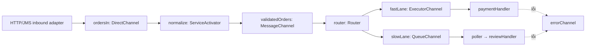
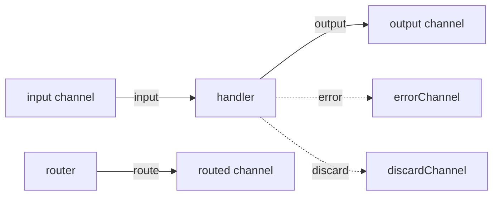
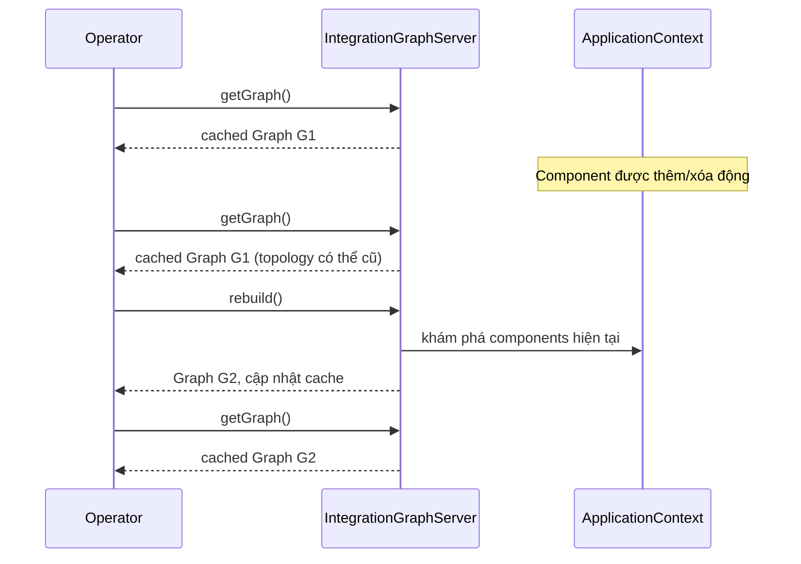
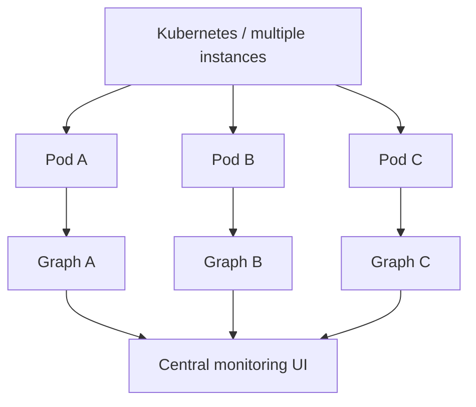

# IntegrationGraphServer và đồ thị runtime trong Spring Integration

## Mục tiêu và bối cảnh

Trong **SPRING_INTEGRATION_RUNTIME**, một ứng dụng có thể có hàng chục hoặc hàng trăm `MessageChannel`, consumer endpoint, inbound adapter, router, service activator, poller, executor và handler. Cùng một flow có thể được cấu hình bằng Java DSL, annotation, XML hoặc đăng ký động. Khi ứng dụng đang chạy, chỉ đọc mã nguồn chưa chắc cho biết **những component nào thực sự tồn tại trong ApplicationContext** và chúng được nối với nhau như thế nào.

Chương **Control và quản trị** giới thiệu **`IntegrationGraphServer`**, thành phần của Spring Integration giúp xây dựng **đồ thị mô hình runtime**. Đồ thị trình bày các nodes đại diện cho integration components và các links thể hiện quan hệ channel/endpoint. Có thể lấy trực tiếp từ Java hoặc từ Spring Boot Actuator endpoint `/actuator/integrationgraph`.

> **Nguyên tắc:** Integration Graph là một **bản đồ topology có thể làm mới**, không phải message trace, transaction log, distributed topology của toàn cluster hay một giao diện tự động điều khiển start/stop flow.

Sau bài học, bạn có thể:

- Giải thích `IntegrationGraphServer`, `Graph`, `IntegrationNode` và `LinkNode`, bao gồm `contentDescriptor`, `nodes` và `links`.
- Đọc các loại cạnh `input`, `output`, `error`, `discard`, `route` để truy vết kết nối.
- Đăng ký và truy vấn một `IntegrationGraphServer` bằng Java trong ApplicationContext.
- Phân biệt `getGraph()` và `rebuild()`, nhất là khi dùng dynamic `IntegrationFlowContext`.
- Bật, truy vấn và bảo vệ Spring Boot Actuator `integrationgraph`; hiểu GET/POST.
- Bổ sung metadata vận hành bằng `setAdditionalPropertiesCallback(...)` mà không làm lộ thông tin nhạy cảm.
- Kết hợp topology với `SmartLifecycle`, Micrometer/Observation, logs, traces và thread dumps để chẩn đoán.
- Viết test để phát hiện flow thiếu channel, endpoint hoặc links; không phụ thuộc `nodeId` ngẫu nhiên theo lần dựng.

Ví dụ tập trung vào Spring Integration **6.5.x**, Spring Framework 6.x, Java 17+ và Spring Boot 3.5.x khi cần Actuator. Với các thế hệ mới hơn, tên API hoặc cấu trúc dữ liệu có thể thay đổi, vì vậy cần kiểm tra Javadoc theo đúng phiên bản dự án.

## 1. Vì sao cần đồ thị runtime?

Giả sử một flow xử lý đơn hàng:



Khi có sự cố “message đã tới `ordersIn` nhưng không tới payment handler”, chúng ta muốn biết:

1. `ordersIn` có được đăng ký thành bean/channel không?
2. Consumer nào đang nối vào nó? Có một hay nhiều subscriber?
3. Handler nào có output channel, error channel hoặc discard channel được cấu hình?
4. Router có những route names nào đã biết?
5. Có thành phần nào được đăng ký động rồi xóa mà bản đồ quản trị chưa cập nhật?
6. Endpoint có đang chạy, có worker thread/queue đang nghẽn, hay chỉ tồn tại về mặt cấu hình?

`IntegrationGraphServer` giúp trả lời **câu 1–5 ở mức mô hình kết nối**, còn câu 6 thường cần dữ liệu bổ sung từ `SmartLifecycle`, metrics, logs và các nguồn quản trị khác. Graph **không tự đo** backlog của mọi `QueueChannel`, không bảo đảm tất cả dynamic destinations đều hiện hữu và không chứng minh một message đã đi qua một link.

### Giá trị của graph trong vận hành

| Nhu cầu | Graph giúp gì? | Cần công cụ bổ sung nào? |
|---|---|---|
| Hiểu topology được đăng ký | Danh sách channels, endpoints và links giữa chúng | Cấu hình flow, dependency/version |
| Tìm đoạn flow thiếu kết nối | So sánh input/output và các link còn thiếu | Log start-up, condition evaluation |
| Rà soát đường lỗi | Xem link `error` hoặc `discard` khi framework biết cấu hình | `ErrorMessage`, error handler, DLQ |
| Kiểm tra dynamic flows | `rebuild()` sau register/remove để cập nhật cấu trúc | `IntegrationFlowContext` và registration IDs |
| Phân tích endpoint đã start/stop | Có thể bổ sung `SmartLifecycle` properties vào node | Kiểm tra live `isRunning()` thật |
| Hiểu hiệu năng | Xác định nơi cần đặt metric/tracing | Micrometer, Observation, thread dump, queue depth |
| Kiểm soát change/regression | Lưu snapshot topology rồi so sánh theo component name/type | Integration tests và deployment metadata |

## 2. IntegrationGraphServer là gì?

Class chính của Spring Integration 6.5:

```java
org.springframework.integration.graph.IntegrationGraphServer
```

Nó được giới thiệu từ Spring Integration 4.3. Thành phần này biết `ApplicationContext` và thu thập các Spring Integration components để dựng `Graph`. Nó triển khai `ApplicationContextAware` và lắng nghe `ContextRefreshedEvent`.

Các API quan trọng:

```java
IntegrationGraphServer server = ...;

Graph current = server.getGraph();
Graph refreshed = server.rebuild();

server.setApplicationName("order-runtime");
server.setAdditionalPropertiesCallback(namedComponent -> ...);
```

Mô hình API:

| API | Trách nhiệm | Điểm cần chú ý |
|---|---|---|
| `new IntegrationGraphServer()` | Tạo server xây dựng graph | Phải đăng ký là **bean** trong Spring context |
| `getGraph()` | Trả **cached graph** | Topology có thể cũ nếu cấu trúc thay đổi; một số dữ liệu runtime trên node là dynamic |
| `rebuild()` | Quét lại component model, tạo và cache graph mới | Gọi khi thêm/xóa component hoặc sau thay đổi topology |
| `setApplicationName(...)` | Đặt tên ứng dụng trong `contentDescriptor.name` | Có thể dùng `spring.application.name` nếu không đặt |
| `setAdditionalPropertiesCallback(...)` | Thêm node properties từ `NamedComponent` | Tránh tính toán đắt và dữ liệu nhạy cảm |
| `onApplicationEvent(ContextRefreshedEvent)` | Khởi tạo/cập nhật theo lifecycle Spring context | Không nên tự gọi để điều khiển flow |

`IntegrationGraphServer` **không phải HTTP server**; nó xây dựng object model trong Spring. Muốn công bố qua HTTP cần một lớp quản trị, chẳng hạn Spring Boot Actuator.

Một số tài liệu cũ nhắc tới package `org.springframework.integration.support.management.graph`. Với **Spring Integration 6.5**, hãy import API công khai dưới package `org.springframework.integration.graph`, phù hợp Javadoc hiện hành của nhánh này.

## 3. Cấu trúc của Graph

Spring Integration 6.5 định nghĩa `org.springframework.integration.graph.Graph` là một class có các getter:

```java
Map<String, Object> descriptor = graph.getContentDescriptor();
Collection<IntegrationNode> nodes = graph.getNodes();
Collection<LinkNode> links = graph.getLinks();
```

Đồ thị được serialize sang JSON cho UI dashboard hoặc Actuator. Ba trường cấp cao:

```json
{
  "contentDescriptor": {
    "provider": "spring-integration",
    "providerFormatVersion": 1.2
  },
  "nodes": [
    {
      "nodeId": 2,
      "name": "errorChannel",
      "componentType": "publish-subscribe-channel",
      "properties": {}
    },
    {
      "nodeId": 3,
      "name": "errorLogger",
      "componentType": "logging-channel-adapter",
      "input": "errorChannel",
      "properties": {}
    }
  ],
  "links": [
    { "from": 2, "to": 3, "type": "input" }
  ]
}
```

Đây là **ví dụ tối giản của response**: JSON thực tế có thể có `providerVersion`, `integrationPatternCategory`, `integrationPatternType`, `observed` và các fields khác tùy component/phiên bản. Nó cũng có thể có thêm `nullChannel` hoặc các bean mặc định của Spring Integration.

### 3.1. contentDescriptor — nguồn gốc và version

`contentDescriptor` mô tả model/application:

- `provider` thường là `spring-integration`.
- `providerVersion` cho biết phiên bản Spring Integration đang cung cấp graph.
- `providerFormatVersion` giúp client hiểu cấu trúc payload.
- `name` có thể lấy từ `setApplicationName(...)` hoặc `spring.application.name`.

Graph của hai bản deploy có cùng component names nhưng khác provider/runtime version có thể khác nhau. Dashboard nên ghi lại version và không cứng hóa layout theo một payload mẫu duy nhất.

### 3.2. nodes — các thành phần

`IntegrationNode` trong 6.5 có các thuộc tính tiêu biểu:

| Trường | Ý nghĩa | Dùng thế nào? |
|---|---|---|
| `nodeId` | ID số tăng dần dùng để nối links **trong graph hiện tại** | Join từ `links.from/to`; không dùng làm business ID ổn định |
| `name` | Tên component/bean/endpoint trong mô hình | Dùng đối chiếu với cấu hình, logs, metrics |
| `componentType` | Loại component như channel/handler/adapter | Xây filter/group trong UI |
| `integrationPatternType` | Kiểu Enterprise Integration Pattern (nếu có) | Phân biệt gateway, router, aggregator, ... |
| `integrationPatternCategory` | Nhóm EIP, ví dụ messaging channel/endpoint | Hiển thị theo loại |
| `input`/`output` | Channel name gắn với endpoint, nếu có | Đọc hướng kết nối |
| `properties` | Metadata của component và custom properties | Chẩn đoán config, lifecycle |
| `observed` | Component có instrumentation observation theo framework hay không | Gợi ý khả năng đo trace/metrics, không phải health flag |

**Không dùng `nodeId` để lưu foreign key ổn định** trong bảng điều khiển lâu dài. Khi `rebuild()`, thay đổi component, restart hoặc thay thứ tự discovery, node IDs có thể thay đổi. So sánh topology giữa deployments nên dựa trên tên đầy đủ, component type, flow namespace và những định danh ổn định do ứng dụng kiểm soát.

Không phải node nào cũng có `input`, `output` hoặc cùng bộ properties. Ví dụ channel thường không có `inputChannel`; một poller có thể được biểu diễn thông qua endpoint/source adapter thay vì một node hoàn toàn giống service activator.

### 3.3. links — quan hệ giữa nodes

`LinkNode` là quan hệ có hướng, gồm `from`, `to` và `type`.

```java
int from = link.getFrom();
int to = link.getTo();
LinkNode.Type type = link.getType();
```

Các link types quan trọng trong Spring Integration graph:

| Type | Hướng liên kết | Ví dụ |
|---|---|---|
| `input` | Channel → consumer endpoint/handler | `ordersIn` → `normalizeHandler` |
| `output` | Handler/producer → output/reply channel | `normalizeHandler` → `validatedOrders` |
| `error` | Thành phần có error-channel → error channel | Poller/adapter → `errorChannel` |
| `discard` | Discarding handler → discard channel | Filter → `rejectedOrders` |
| `route` | Router → channel được route tới | HeaderValueRouter → `priorityLane` |

Một router có thể chọn destination theo runtime data; graph chỉ hiển thị những route mà nó có thể mô tả, chẳng hạn mapping đã cấu hình hoặc dynamic routes đang được giữ. Theo tài liệu, routers thường chỉ giữ tối đa khoảng 100 dynamic routes để phục vụ mô hình, có thể điều chỉnh bằng `dynamicChannelLimit` khi phù hợp.



**Đừng suy ra từ link `output` rằng từng message luôn qua link đó**. Router/filter, exception, timeout, release strategy và dynamic channel selection đều có thể làm message đi đường khác hoặc không phát ra output.

### 3.4. Đồ thị không phải lịch sử xử lý

`IntegrationGraphServer` cho thấy **cấu trúc** của runtime và một số metadata, không lưu “message #123 đi qua handler A lúc 12:03” hay từng attempt retry. Muốn biết thông điệp đã đi đâu, cần logs/traces, Micrometer Observation, message history được bật có chọn lọc và dữ liệu broker/store.

## 4. Ví dụ Java: tạo IntegrationGraphServer và đọc graph trong JVM

Ví dụ dưới đây tạo hai `DirectChannel`, hai service activators và một `IntegrationGraphServer` bean. Chỉ cần Spring Integration Core với các Spring dependencies tương thích; chưa cần Spring Boot Actuator.

```java
import java.util.Collection;
import java.util.HashMap;
import java.util.Map;

import org.springframework.context.SmartLifecycle;
import org.springframework.context.annotation.AnnotationConfigApplicationContext;
import org.springframework.context.annotation.Bean;
import org.springframework.context.annotation.Configuration;
import org.springframework.integration.annotation.ServiceActivator;
import org.springframework.integration.channel.DirectChannel;
import org.springframework.integration.config.EnableIntegration;
import org.springframework.integration.graph.Graph;
import org.springframework.integration.graph.IntegrationGraphServer;
import org.springframework.integration.graph.IntegrationNode;
import org.springframework.integration.graph.LinkNode;
import org.springframework.messaging.MessageChannel;

@Configuration
@EnableIntegration
public class RuntimeGraphExample {

    @Bean
    public MessageChannel ordersIn() {
        return new DirectChannel();
    }

    @Bean
    public MessageChannel ordersValidated() {
        return new DirectChannel();
    }

    @Bean
    public OrderHandlers orderHandlers() {
        return new OrderHandlers();
    }

    @Bean
    public IntegrationGraphServer integrationGraphServer() {
        IntegrationGraphServer server = new IntegrationGraphServer();
        server.setApplicationName("spring-integration-runtime-demo");

        server.setAdditionalPropertiesCallback(component -> {
            if (component instanceof SmartLifecycle lifecycle) {
                Map<String, Object> values = new HashMap<>();
                values.put("autoStartup", lifecycle.isAutoStartup());
                values.put("running", lifecycle.isRunning());
                return values;
            }
            return null;
        });
        return server;
    }

    public static class OrderHandlers {

        @ServiceActivator(
                inputChannel = "ordersIn",
                outputChannel = "ordersValidated")
        public String normalize(String order) {
            return order.trim();
        }

        @ServiceActivator(inputChannel = "ordersValidated")
        public void audit(String order) {
            System.out.println("Processed: " + order);
        }
    }

    public static void main(String[] args) {
        try (var context = new AnnotationConfigApplicationContext(
                RuntimeGraphExample.class)) {

            IntegrationGraphServer graphServer =
                    context.getBean(IntegrationGraphServer.class);

            Graph graph = graphServer.getGraph();

            System.out.println("DESCRIPTOR:");
            System.out.println(graph.getContentDescriptor());

            System.out.println("NODES:");
            for (IntegrationNode node : graph.getNodes()) {
                System.out.printf(
                        "id=%d name=%s type=%s properties=%s%n",
                        node.getNodeId(),
                        node.getName(),
                        node.getComponentType(),
                        node.getProperties());
            }

            System.out.println("LINKS:");
            for (LinkNode link : graph.getLinks()) {
                System.out.printf(
                        "%d -%s-> %d%n",
                        link.getFrom(),
                        link.getType(),
                        link.getTo());
            }

            // Gửi message thật qua channel để đối chiếu flow:
            context.getBean("ordersIn", MessageChannel.class)
                    .send(org.springframework.messaging.support
                            .MessageBuilder.withPayload(" ORDER-001 ").build());
        }
    }
}
```

**Kỳ vọng:** graph chứa các channel `ordersIn` và `ordersValidated` cùng các endpoint service activator đã được Spring Integration đăng ký. Sẽ có thêm nodes mặc định như `errorChannel`/`nullChannel`; không assert số nodes chính xác bằng một hằng số trừ khi đã cố định toàn bộ context.

Ví dụ `setAdditionalPropertiesCallback` chỉ thêm metadata cho những `NamedComponent` thực sự là `SmartLifecycle`; nhiều node có thể không có hai trường `running` và `autoStartup`. Callback không biến graph thành hệ thống quản lý lifecycle, và kết quả được thu tại thời điểm xây dựng graph có thể cần `rebuild()` để phản ánh thay đổi sau đó.

### Vì sao không dùng Graph.toString() như JSON?

`Graph` là object Java. `toString()` không phải một hợp đồng xuất JSON và có thể chỉ trả tên class/identity. Muốn JSON, để Spring Boot Actuator/Jackson serialize object model hoặc gọi `ObjectMapper.writeValueAsString(graph)` nếu project đã có Jackson tương thích.

Ví dụ với Jackson:

```java
ObjectMapper mapper = new ObjectMapper();
String json = mapper.writerWithDefaultPrettyPrinter()
                    .writeValueAsString(graph);
System.out.println(json);
```

Đoạn trên cần import `com.fasterxml.jackson.databind.ObjectMapper` và dependency `jackson-databind`. Khi tạo REST endpoint custom, không trả trực tiếp raw bean data hoặc callback chứa object không serializable; cần chính sách lọc các properties được expose.

## 5. Cached graph: getGraph() khác rebuild()

Đây là khác biệt vận hành quan trọng nhất.



### getGraph()

- Trả mô hình graph đã được cache.
- Phù hợp với truy vấn lặp khi topology không đổi.
- Theo Javadoc, dù graph được cache, **một số dữ liệu runtime như stats là dynamic**.
- Điều đó không đồng nghĩa mọi custom `properties` bạn thêm qua callback sẽ tự được tái tính mỗi lần đọc.
- Không nên dùng như một “scan toàn context” trên mỗi HTTP GET.

### rebuild()

- Dựng lại nodes/links dựa trên những integration components mà server khám phá tại thời điểm đó.
- Cập nhật cache và trả graph mới.
- Cần thiết khi **thêm hoặc xóa** components/flows động.
- Có thể thay đổi `nodeId`/thứ tự nodes, nên client phải join links theo graph snapshot mới.
- Là thao tác quản trị; không tự start/stop endpoints, không xóa messages và không “sửa” một route bị cấu hình sai.

### Hai thay đổi cần phân biệt

| Thay đổi | Có cần rebuild topology? | Lý do |
|---|---|---|
| Đăng ký một `IntegrationFlow` mới | Có | Node/link mới xuất hiện |
| Hủy registration của flow | Có | Node/link cũ phải biến mất |
| Thay một endpoint/component bean trong context | Có | Component model đổi |
| `stop()`/`start()` một endpoint sẵn có | Có thể cần rebuild để cập nhật custom lifecycle properties | Topology vẫn giữ nguyên |
| Một message vừa được xử lý | Thường không | Graph không phải trace từng message |
| Queue backlog tăng | Graph không tự là nguồn queue-depth chuẩn | Cần metric/queue introspection riêng |
| Router phát hiện dynamic destination mới | Có thể cần rebuild để cập nhật route đã biết | Runtime mapping/caching phụ thuộc router |
| Micrometer counter tăng | Không coi rebuild là cách chính để lấy metrics | Dùng MeterRegistry/Actuator metrics |

**Tránh gọi `rebuild()` cho mọi request** trên dashboard chỉ để thấy số messages mới. Với ứng dụng lớn và dynamic components, quét lại toàn bộ model liên tục có thể tăng CPU/độ trễ. Nên rebuild theo sự kiện cấu trúc thay đổi hoặc khi operator yêu cầu refresh, với tần suất được kiểm soát.

## 6. Dynamic IntegrationFlow: cập nhật graph sau đăng ký và hủy

Spring Integration Java DSL có `IntegrationFlowContext` để đăng ký flow khi ứng dụng đang chạy. Đây là trường hợp rất dễ làm cached graph trở nên cũ.

```java
import org.springframework.integration.dsl.IntegrationFlow;
import org.springframework.integration.dsl.IntegrationFlowContext;
import org.springframework.integration.graph.Graph;
import org.springframework.integration.graph.IntegrationGraphServer;

// Trong một Spring-managed service đã inject 2 bean:
IntegrationFlow dynamicFlow = IntegrationFlow.from("runtimeOrdersIn")
        .handle(message -> System.out.println(
                "Dynamic: " + message.getPayload()))
        .get();

IntegrationFlowContext.IntegrationFlowRegistration registration =
        integrationFlowContext
                .registration(dynamicFlow)
                .id("runtime-orders-v1")
                .register();

// Dựng lại mô hình sau khi registration hoàn tất:
Graph afterRegister = integrationGraphServer.rebuild();

// Có thể stop/start flow mà không xóa topology:
registration.stop();
registration.start();

// Khi không cần flow nữa:
registration.destroy();

// Refresh graph để loại nodes/links đã bị xóa:
Graph afterDestroy = integrationGraphServer.rebuild();
```

**Đây là snippet dùng bên trong một method**, giả định `integrationFlowContext` và `integrationGraphServer` là các bean đã được inject. Flow phải có các channel/handler names hợp lệ, không trùng bean IDs đang dùng. Không đăng ký lại `runtime-orders-v1` trước khi destroy registration cũ.

Các điểm cần hiểu:

- `registration.stop()` dừng những endpoint phù hợp nhưng không tự hủy bean/flow; nodes vẫn có thể tồn tại.
- `registration.start()` kích hoạt lại flow theo lifecycle contract.
- `registration.destroy()` xóa flow bean và dependent beans do registration quản lý.
- `rebuild()` phản ánh thay đổi topology. Nó **không** gọi `stop/start/destroy` thay cho bạn.
- Không dùng riêng `afterRegister.getNodes().size() > before.getNodes().size()` như một guarantee cho mọi loại flow; hãy kiểm tra **node names/links dự kiến** và topology snapshot mới.
- Nếu đang có messages trong `QueueChannel` hoặc đang chạy handler, destroy/stop cần được phối hợp với drain/quiesce, source ack và message store. Graph không thể tự quyết định những messages này phải đi đâu.

### Có nên rebuild ở request xử lý business?

Không. Việc register/destroy flow thường là hoạt động **control plane**. Rebuild nên nằm ở lớp quản trị đã được bảo vệ, tránh cạnh tranh với deployment/configuration changes và không chạy trên mọi message trong data plane.

Với nhiều replicas/pods, mỗi `ApplicationContext` có graph riêng. Đăng ký flow trong pod A không đồng nghĩa pod B đã thay đổi; phải xem từng instance, trừ khi control plane của bạn chủ động điều phối.

## 7. Spring Boot Actuator /actuator/integrationgraph

Khi có Spring Boot Actuator cùng `spring-integration-core`, endpoint `integrationgraph` cung cấp đồ thị của ứng dụng cho client quản trị.

### Dependency và cấu hình

Với Spring Boot, dùng starter/phụ thuộc tích hợp phù hợp và:

```text
spring-boot-starter-actuator
spring-integration-core
```

Tùy stack bạn có thể đã có `spring-integration-core` thông qua `spring-boot-starter-integration`. Dùng Spring Boot BOM để quản lý version, không trộn major versions tùy ý.

Một cấu hình HTTP exposure có chọn lọc:

```yaml
spring:
  application:
    name: spring-integration-runtime-demo

management:
  endpoints:
    web:
      exposure:
        include: "health,info,integrationgraph"
  endpoint:
    integrationgraph:
      access: read-only
```

`management.endpoint.integrationgraph.access=read-only` là cấu hình quyền truy cập theo cơ chế của các dòng Boot hỗ trợ thuộc tính `access` (chẳng hạn Boot 3.5). Nó **chặn thao tác write**, nên không dùng khi bạn cần HTTP POST rebuild. Nếu dùng Boot cũ, kiểm tra cấu hình `enabled`/`exposure` và khả năng security tương ứng thay vì sao chép tên property một cách máy móc.

**Mặc định** Spring Boot thường chỉ expose health trên web, không phải mọi Actuator endpoints. Chỉ thêm `integrationgraph` vào exposure nếu thực sự cần vận hành.

### GET — lấy graph

```bash
curl -i http://localhost:8080/actuator/integrationgraph
```

Kỳ vọng HTTP 200 và JSON gồm `contentDescriptor`, `nodes`, `links` nếu endpoint tồn tại, được expose và caller có quyền. Nếu bị 404/403/401, kiểm tra Boot/Actuator dependency, exposure, security và management base path/port; không kết luận graph rỗng ngay.

### POST — rebuild graph

Khi endpoint cho phép thao tác quản trị tương ứng:

```bash
curl -i -X POST http://localhost:8080/actuator/integrationgraph
```

Theo Actuator API, POST thành công trả **HTTP 204 No Content**. Không mong chờ body JSON từ POST; gọi GET tiếp để nhận snapshot mới. Nếu cấu hình `access: read-only`, POST sẽ không được phép. Để cho phép POST phải chủ động cấu hình quyền write/unrestricted phù hợp và bảo vệ bằng authentication/authorization.

**Không nhầm POST rebuild với hành động reload toàn ứng dụng**, restart các consumers hoặc chạy lại messages. Nó chỉ yêu cầu dựng lại model graph.

### Management port/base path

Nếu dùng:

```yaml
management:
  server:
    port: 9090
  endpoints:
    web:
      base-path: /actuator
```

endpoint có thể được phục vụ tại `http://localhost:9090/actuator/integrationgraph` tùy môi trường. Trong production nên đặt management interface ở mạng nội bộ/bind address an toàn và có authentication, không expose thẳng internet.

## 8. Bảo mật Graph và quyền Control Plane

Graph có thể cho biết:

- Tên queue/topic, endpoints/gateway hoặc các đường kết nối tới hệ thống bên ngoài.
- Tên component, cấu trúc route, chính sách error/discard và expression metadata.
- Custom properties do developer cố ý thêm.
- Gợi ý mô hình nghiệp vụ, flow IDs và các điểm có thể tấn công.

**Không đưa API keys, password, access tokens, raw payload hoặc nội dung PII** vào `setAdditionalPropertiesCallback`, log graph hay HTTP response. Đừng serialize đối tượng Spring bean tùy ý vào `properties`; có thể lộ internals hoặc gây lỗi JSON serialization.

### Cấp quyền khác nhau cho GET và POST

- **GET:** có thể dành cho operator/monitoring service được xác thực, tùy độ nhạy topology.
- **POST:** chỉ dành cho admin có quyền cập nhật snapshot (dù không trực tiếp điều khiển flow). Cần audit ai gọi và khi nào.
- Nếu hệ thống chỉ cần đọc topology, nên để endpoint read-only và quản trị rebuild qua quy trình deployment nội bộ.
- Tránh expose đồng thời tất cả Actuator endpoints bằng `include: "*"` trên một management port công khai.
- Khi có custom `SecurityFilterChain`, kiểm tra chính sách Spring Security cho Actuator: không giả định Boot tự bảo vệ toàn bộ endpoints nếu security configuration riêng đã override.

### Ví dụ tư duy phân quyền

```text
Role MONITOR:
    GET /actuator/integrationgraph  -> có thể cho phép
    POST /actuator/integrationgraph -> từ chối

Role INTEGRATION_ADMIN:
    GET /actuator/integrationgraph  -> cho phép
    POST /actuator/integrationgraph -> cho phép theo policy

Anonymous:
    Không được truy cập topology nội bộ
```

Đây là policy gợi ý, không phải cấu hình Spring Security cụ thể. Trong hệ thống thật phải áp dụng `EndpointRequest`/security matcher tương thích Boot version, authentication, network boundary và audit logging.

## 9. Bổ sung lifecycle metadata vào nodes

Graph thường biểu diễn topology. Muốn thấy một endpoint có đang chạy hay không, bạn có thể dùng `setAdditionalPropertiesCallback(...)` để thêm `SmartLifecycle` properties:

```java
server.setAdditionalPropertiesCallback(component -> {
    if (component instanceof SmartLifecycle lifecycle) {
        return Map.of(
                "running", lifecycle.isRunning(),
                "autoStartup", lifecycle.isAutoStartup(),
                "phase", lifecycle.getPhase());
    }
    return null;
});
```

`SmartLifecycle` thuộc `org.springframework.context.SmartLifecycle`. Ví dụ trên dùng `Map.of(...)`, Java 9+, và chỉ thêm properties cho component thực sự triển khai interface này.

**Không nhầm node có `observed=true` với `running=true`.**

- `observed` nói về instrumentation observation của component khi framework có metadata này.
- `running` do callback đọc `SmartLifecycle` tại thời điểm nó được áp dụng.
- `autoStartup` là chính sách khởi động tự động, không phải trạng thái thực tế hiện tại.
- `phase` gợi ý thứ tự lifecycle, không phải số worker hoặc số lần poll.
- Một consumer `isRunning()==true` vẫn có thể không xử lý message vì channel không có dữ liệu, executor cạn thread hoặc downstream block.
- Một handler bean đơn thuần có thể không triển khai `SmartLifecycle`, dù endpoint bao quanh handler lại có lifecycle.

### Cached custom properties có thể cũ

Callback được dùng lúc xây dựng nodes. Nếu endpoint `stop()` sau đó, object graph đã được cache có thể còn `"running": true` tại thời điểm rebuild trước. Khi cần xác minh trạng thái sống, truy vấn bean `SmartLifecycle.isRunning()` thực tế và chỉ dùng graph làm topology reference.

Muốn dashboard hiển thị trạng thái mới mà vẫn dựa trên callback, có thể rebuild theo sự kiện lifecycle hoặc refresh có giới hạn; không nên coi graph là health probe chính.

### Graph không phải công cụ điều khiển start/stop

Để start/stop thực sự:

- Sử dụng `SmartLifecycle` trên đúng endpoint/channel component được quản lý.
- Với dynamic flows, dùng `IntegrationFlowContext.IntegrationFlowRegistration.start()/stop()/destroy()`.
- Khi cần điều khiển có bảo vệ, dùng control bus hoặc một management API được xác thực/ủy quyền.

`IntegrationGraphServer.rebuild()` **không** khởi động lại poller, reset transaction hoặc xóa dữ liệu trong message store.

## 10. Graph so với Metrics và Observability

Spring Integration có Micrometer/Observation để theo dõi xử lý message và hiệu năng. Graph cung cấp bản đồ **nơi những metrics được gắn** và các mối quan hệ giữa components.

| Công cụ | Câu hỏi chính | Ví dụ dữ liệu |
|---|---|---|
| Integration Graph | Component nào nối với component nào? | `nodes`, `links`, `componentType` |
| Micrometer metrics | Tốc độ/lỗi/độ trễ thay đổi như thế nào? | Counter, timer, queue depth nếu instrumented |
| Observation/Tracing | Một request/message cụ thể đi qua các spans nào? | Trace/span ID, duration, outcome |
| Message history | Message đã qua những components nào nếu được bật? | Named endpoints theo message journey |
| Thread dump | Worker nào đang chờ lock, I/O hoặc scheduler? | Thread state, stack frames |
| Message store/broker metrics | Còn bao nhiêu dữ liệu chưa xử lý? | Queue depth, oldest message age |
| `SmartLifecycle` | Endpoint cụ thể có đang chạy? | `isRunning()`, `autoStartup`, phase |

### Lưu ý về phiên bản metrics

Một số ví dụ graph cũ chứa `sendTimers`, `receiveCounters` hoặc `stats`. Spring Integration 5.2 đã deprecate legacy metrics để chuyển sang Micrometer; legacy metrics đã được gỡ từ 5.4. Vì thế **không xây hệ thống giám sát 6.5 dựa trên việc graph JSON phải có `sendTimers` hay `stats`**.

Các fields `observed`/EIP metadata có thể hiện diện nhưng không thay thế việc lấy metrics trực tiếp từ `MeterRegistry` hoặc Actuator `/actuator/metrics`/Prometheus. Để bật observation/management, xem cấu hình `@EnableIntegrationManagement` và Spring Boot Observability tương ứng theo đúng version.

### Cách ghép thông tin khi debugging

Ví dụ queue backlog tăng:

1. Graph cho biết `billingQueue` là một channel nối tới `billingPoller`/handler nào.
2. `SmartLifecycle` cho biết poller có running hay không.
3. Queue-store metrics cho biết backlog, oldest age, rates.
4. Thread dump cho biết poller đang block trong HTTP hay `ReentrantLock`.
5. Error flow cho biết exception hoặc retry exhaustion.
6. Trace/correlation ID giúp tìm message cụ thể.

Nếu graph có link nhưng queue không giảm, nguyên nhân có thể nằm ở executor starvation, poller schedule, transaction, retry, message store hoặc consumer thread chứ không phải graph “thiếu cập nhật”.

## 11. Graph và các loại channel/endpoint

### DirectChannel

`DirectChannel` thường gọi subscriber trên sender thread. Graph giúp nhận biết link từ channel tới consumer endpoint, nhưng không cho biết message đang giữ thread caller bao lâu, transaction boundary hay handler đã block.

### QueueChannel + Poller

`QueueChannel` giữ message cho poller lấy sau. Graph có thể thể hiện channel và consumer/poller endpoint, không thể kết luận dữ liệu đã persisted. Một `QueueChannel` không backed by persistent store có thể mất dữ liệu khi restart, dù nhìn graph hoàn toàn giống flow dùng JDBC-backed store.

### ExecutorChannel

`ExecutorChannel` dispatch work sang `TaskExecutor`. Graph có thể cho thấy channel, không bảo đảm biết queue capacity, active thread count hoặc rejection policy của executor nếu không có instrumentation/bổ sung metadata.

### Gateway

`@MessagingGateway` có thể tạo **nhiều method nodes** theo signature. Một gateway interface không nhất thiết chỉ có một node, đặc biệt nếu có overloads. Vì thế test không nên assert “một gateway bean = một graph node”.

### Router và Filter

Router có link `route` tới các channel đã biết; Filter có thể có `discard` link. Không có `discard` link không phải bằng chứng message không bao giờ bị discard: cấu hình default, dynamic routing, runtime headers hoặc handler logic có thể ảnh hưởng.

### Aggregator/Resequencer

Graph giúp xác định endpoint và input/output channels, nhưng không trực tiếp thể hiện từng `MessageGroup`, correlation key, release strategy đang chờ bao nhiêu phần hay group nào đã orphan. Cần kiểm tra `MessageGroupStore`, group timeout, reaper, late-arrival policy và transaction state.

### ErrorChannel

`errorChannel` thường xuất hiện mặc định cùng một logging subscriber. Có graph link tới `errorLogger` không đồng nghĩa mọi lỗi của đồng bộ `DirectChannel` đều được publish sang `errorChannel`. Cơ chế lỗi đồng bộ/bất đồng bộ, recovery callback và error handler quyết định đường lỗi thực.

## 12. Có giới hạn gì với graph trong nhiều JVM?

`IntegrationGraphServer` làm việc với **ApplicationContext cụ thể**. Trong triển khai nhiều replicas:



Cần xác định:

- Có phải cùng version/config ở mọi pods?
- Pod A có một dynamic flow mà pod B không có?
- Endpoint được bật qua feature flag trên từng instance?
- Một pod đang start/stop hay đã bị restart?
- Các component names có giống nhau nhưng message store/transaction manager khác cấu hình?
- Collector có đánh dấu instance/namespace/pod, snapshot time và version không?

**Không gộp graph từ nhiều instances bằng `nodeId`**: chúng được cấp phát theo từng graph. Hãy dùng tên component và deployment identity đã được quản lý, tạo namespacing cho dashboard.

Graph chỉ phản ánh **local JVM/ApplicationContext**; nó không phải sơ đồ toàn bộ mạng Kafka/JMS/HTTP hay tự phát hiện những remote consumers ở process khác.

## 13. Kiểm thử graph mà không phụ thuộc nodeId

Một integration test có thể yêu cầu rằng `ordersIn` và `ordersValidated` tồn tại, links hợp lệ và sau thay đổi dynamic flow phải cập nhật.

```java
import static org.assertj.core.api.Assertions.assertThat;

import java.util.Set;
import java.util.stream.Collectors;

import org.junit.jupiter.api.Test;
import org.springframework.beans.factory.annotation.Autowired;
import org.springframework.boot.test.context.SpringBootTest;
import org.springframework.integration.graph.Graph;
import org.springframework.integration.graph.IntegrationGraphServer;

@SpringBootTest
class RuntimeGraphTest {

    @Autowired
    IntegrationGraphServer graphServer;

    @Test
    void channelsAndLinksAreRegistered() {
        Graph graph = graphServer.rebuild();

        Set<String> names = graph.getNodes().stream()
                .map(node -> node.getName())
                .collect(Collectors.toSet());

        assertThat(names).contains("ordersIn", "ordersValidated");

        Set<Integer> nodeIds = graph.getNodes().stream()
                .map(node -> node.getNodeId())
                .collect(Collectors.toSet());

        assertThat(graph.getLinks()).allSatisfy(link -> {
            assertThat(nodeIds).contains(link.getFrom());
            assertThat(nodeIds).contains(link.getTo());
        });
    }
}
```

Ví dụ cần `spring-boot-starter-test` và context có bean `IntegrationGraphServer` cùng demo flow. Đây là test cấu trúc cơ bản; hãy bổ sung assertion links giữa đúng names khi muốn đảm bảo wiring, không chỉ kiểm tra “mọi link trỏ tới một node có tồn tại”.

### Test link theo tên thay vì nodeId cố định

```java
Map<Integer, String> nameById = graph.getNodes().stream()
        .collect(java.util.stream.Collectors.toMap(
                n -> n.getNodeId(),
                n -> n.getName()));

boolean hasInputLink = graph.getLinks().stream().anyMatch(link ->
        link.getType().name().equalsIgnoreCase("input")
        && "ordersIn".equals(nameById.get(link.getFrom())));

assertThat(hasInputLink).isTrue();
```

Đoạn này là phần tiếp theo của method test có sẵn biến `graph`. Khi muốn kiểm tra chính xác consumer endpoint đích, bổ sung đối chiếu `nameById.get(link.getTo())` với tên endpoint cố định do bạn khai báo; không suy ra tên endpoint tự sinh nếu chưa kiểm tra framework naming rule.

### Test registration động

1. Lấy graph ban đầu và danh sách component names.
2. Đăng ký dynamic `IntegrationFlow` có ID/key mới.
3. Gọi `rebuild()`, xác nhận các nodes/links mới xuất hiện.
4. `registration.stop()`; xác nhận topology còn.
5. `registration.destroy()`; gọi `rebuild()`, xác nhận nodes của flow mới biến mất.
6. Không assert `nodeId` trước/sau giống nhau; chỉ so sánh các semantics cần bảo vệ.

### Test Actuator

Trong môi trường Spring Boot với Actuator:

- GET endpoint đã expose và đã được cấp quyền → HTTP 200 với `nodes` và `links`.
- POST khi cho phép write → HTTP 204; sau đó GET mới để đọc snapshot.
- POST ở chế độ read-only phải bị từ chối; status cụ thể phụ thuộc routing/security/version.
- Một caller không có quyền không được đọc topology nhạy cảm.
- Không cần đo mỗi message mới sinh ra graph node; đây không phải event store.

## 14. Chẩn đoán khi graph sai, rỗng hoặc quá cũ

| Triệu chứng | Nguyên nhân có thể | Hướng kiểm tra |
|---|---|---|
| `NoSuchBeanDefinitionException` với `IntegrationGraphServer` | Chưa đăng ký bean hoặc auto-config không có | `@Bean`, dependency Spring Integration/Actuator |
| HTTP 404 tại `/actuator/integrationgraph` | Chưa expose endpoint, base path/port khác hoặc endpoint unavailable | Actuator dependency, `management.endpoints.web.exposure.include`, access |
| HTTP 401/403 | Security policy chặn caller | Authentication/authorization cho management interface |
| Graph chỉ có `errorChannel`/`nullChannel` | Flow chưa được đăng ký, đang dùng context khác hoặc component không được Spring quản lý | ApplicationContext thật, `@EnableIntegration`, bean registration |
| Dynamic flow xuất hiện trong app nhưng không có ở graph | Cached topology chưa rebuild | Gọi `rebuild()` sau registration hoàn tất |
| Flow đã destroy nhưng graph vẫn hiển thị | Cache chưa refresh hoặc bean chưa bị xóa | Registration lifecycle, `destroy()`, `rebuild()` |
| `running=true` dù operator đã stop | Custom lifecycle properties được lấy lúc build trước đó | Rebuild hoặc query live `SmartLifecycle` |
| Node/link thiếu dynamic route | Route chưa được khám phá/đã vượt limit | Router mappings và `dynamicChannelLimit` |
| Thiếu `sendTimers`/`stats` trong JSON | Đang dùng phiên bản đã bỏ legacy metrics | Dùng Micrometer/Observation thay vì legacy fields |
| Graph có link nhưng message không đi tới handler | Endpoint dừng, worker kẹt, queue rỗng/đầy, routing/discard | Lifecycle, metrics, thread dump, error flow |
| Graph serialization lỗi | Custom properties chứa object không serializable/circular refs | Chỉ trả primitive/string/collections đơn giản |
| Dashboard nối sai node sau restart | Persist `nodeId` của graph cũ | Join links theo snapshot hiện tại, use stable names |
| Đọc nhầm topology của instance khác | Load balancer đến pod bất kỳ | Gắn instance identity và collect từng pod |
| Rebuild thường xuyên gây chậm | Quét/serialize graph quá nhiều | Cache, debounce cấu trúc thay đổi, giới hạn tần suất |

### Quy trình chẩn đoán đề xuất

1. Xác định process, pod, Spring ApplicationContext, `spring.application.name` và version cụ thể.
2. Lấy `Graph` programmatically hoặc GET Actuator, lưu snapshot có timestamp/instance ID.
3. Kiểm tra `contentDescriptor` để biết provider/runtime version.
4. Dùng `nodes.name/componentType` tìm channel/handler được kỳ vọng.
5. Join `links.from/to` với `nodeId` **trong cùng snapshot**, đọc `type` để vẽ đường đi.
6. Nếu topology vừa thay đổi, gọi `rebuild()` một lần theo quyền quản trị phù hợp.
7. Nếu topology đúng mà business vẫn lỗi, chuyển sang `SmartLifecycle`, metrics, errors, queues và tracing.
8. Khi flow dynamic có thay đổi, ghi audit of registration ID, người thực hiện và thành công/thất bại.
9. So sánh graph giữa pods/deployments bằng stable names/types, không bằng nodeId.
10. Khi thấy nhiều node không kỳ vọng, kiểm tra component auto-registration/naming và default endpoints trước khi cho rằng có leak.

## 15. Bài tập thực hành

### Bài tập 1 — Dựng bản đồ flow

Dùng `RuntimeGraphExample`:

1. Khởi chạy context, lấy `getGraph()`.
2. Tìm nodes `ordersIn`, `ordersValidated`, service activators và `errorChannel`.
3. In `getLinks()`, ánh xạ `from/to` thành node names.
4. Vẽ một sơ đồ Mermaid dựa trên kết quả thật.
5. Gửi một message, so sánh log xử lý với topology, giải thích vì sao graph **không thêm một node** sau mỗi message.

**Kết quả:** nắm được sự khác nhau giữa runtime topology và message history.

### Bài tập 2 — Mô phỏng dynamic flow

1. Đăng ký flow qua `IntegrationFlowContext`.
2. Đọc `getGraph()` trước rebuild: có thể còn cache cũ.
3. Gọi `rebuild()`, kiểm tra nodes/links mới.
4. `stop()` flow và xác nhận graph vẫn có thể giữ topology.
5. `destroy()` flow rồi rebuild, xác nhận topology bị loại.
6. Kiểm tra việc stop/destroy có đang để messages trong queue dở dang không.

### Bài tập 3 — Lifecycle properties

1. Bổ sung callback `SmartLifecycle.isRunning()` và `isAutoStartup()`.
2. Lấy graph lúc startup; ghi properties.
3. Stop một endpoint có lifecycle.
4. Đọc lại cached graph và so với live bean state.
5. Rebuild và giải thích điểm khác nhau.
6. Viết một dashboard có chú thích rõ “last graph rebuild time”.

### Bài tập 4 — Actuator security

1. Expose duy nhất `health,info,integrationgraph`.
2. Xác nhận unauthenticated caller không thể xem graph nếu policy yêu cầu auth.
3. Đặt endpoint read-only và kiểm tra POST bị chặn.
4. Với admin-only môi trường test, cho phép POST, kiểm tra HTTP 204 rồi GET.
5. Kiểm tra management port/base path khác app port và audit trail.
6. Thử custom property chứa secret giả, sửa callback để không expose secret.

### Bài tập 5 — Kết hợp với observability

1. Gây HTTP timeout ở một outbound handler sau `ExecutorChannel`.
2. Dùng graph để xác định channel và handler liên quan.
3. Đọc `isRunning()`/metrics của executor, queue depth và error messages.
4. Thu thread dump để phân biệt backlog vì retry sleep và thread starvation.
5. Dùng business correlation ID và tracing để xác định message chịu lỗi.
6. Giải thích vì sao `Graph.rebuild()` không sửa được deadlock hoặc trả lại message đã mất.

## 16. Checklist triển khai

- [ ] Có `IntegrationGraphServer` bean hoặc Actuator auto-configuration tương ứng với Spring Integration version.
- [ ] Dùng đúng package `org.springframework.integration.graph` với Spring Integration 6.5.
- [ ] Đọc `Graph.getNodes()/getLinks()/getContentDescriptor()`; không giả định `Graph` là JSON string.
- [ ] Join `LinkNode.from/to` theo `nodeId` **trong cùng graph snapshot**.
- [ ] Không persist `nodeId` làm ID component xuyên deploy/restart.
- [ ] Đọc `input/output/error/discard/route` đúng semantics.
- [ ] Không coi graph là message trace hoặc nguồn metrics duy nhất.
- [ ] Gọi `rebuild()` sau register/remove dynamic flow.
- [ ] Không rebuild vô hạn khi không có topology change.
- [ ] Phân biệt graph cached properties với trạng thái live `SmartLifecycle`.
- [ ] Custom properties đơn giản, ít tốn kém và không chứa secret/payload nhạy cảm.
- [ ] Actuator `integrationgraph` chỉ expose khi cần, có authn/authz và network boundary.
- [ ] Phân quyền GET read-only và POST rebuild riêng theo khả năng version/security.
- [ ] Với cluster, thu thập graph từ từng instance và kèm instance identity.
- [ ] Kết hợp với Micrometer, Observation, logs, thread dump, message store và broker metrics.
- [ ] Test stable names/links thay vì hardcode tổng số nodes hoặc node IDs.
- [ ] Dùng flow registration/control bus/lifecycle API cho thao tác start/stop, không gọi `rebuild()` để điều khiển.

## Tài liệu tham khảo

- [Spring Integration 6.5 — Integration Graph](https://docs.spring.io/spring-integration/reference/6.5/graph.html): mô hình topology, `nodes`, `links`, link types và callback.
- [Spring Integration 6.5 Javadoc — IntegrationGraphServer](https://docs.spring.io/spring-integration/docs/6.5.0/api/org/springframework/integration/graph/IntegrationGraphServer.html): `getGraph()`, `rebuild()`, `setApplicationName()` và `setAdditionalPropertiesCallback()`.
- [Spring Integration 6.5 Javadoc — Graph](https://docs.spring.io/spring-integration/docs/6.5.0/api/org/springframework/integration/graph/Graph.html): `getNodes()`, `getLinks()`, `getContentDescriptor()`.
- [Spring Integration 6.5 Javadoc — IntegrationNode](https://docs.spring.io/spring-integration/docs/6.5.0/api/org/springframework/integration/graph/IntegrationNode.html): node metadata, `isObserved()`.
- [Spring Integration 6.5 Javadoc — LinkNode](https://docs.spring.io/spring-integration/docs/6.5.0/api/org/springframework/integration/graph/LinkNode.html): `getFrom()`, `getTo()`, `getType()`.
- [Spring Integration 6.5 Javadoc — IntegrationFlowContext](https://docs.spring.io/spring-integration/docs/6.5.0/api/org/springframework/integration/dsl/context/IntegrationFlowContext.html): dynamic flow registration.
- [Spring Integration 6.5 Javadoc — IntegrationFlowRegistration](https://docs.spring.io/spring-integration/docs/6.5.0/api/org/springframework/integration/dsl/context/IntegrationFlowContext.IntegrationFlowRegistration.html): `start/stop/destroy`.
- [Spring Boot Actuator API — Integration Graph](https://docs.spring.io/spring-boot/3.4/api/rest/actuator/integrationgraph.html): GET graph và POST rebuild.
- [Spring Boot 3.5 — Actuator Endpoints](https://docs.spring.io/spring-boot/3.5/reference/actuator/endpoints.html): exposure, endpoint access và security.
- [Spring Integration Reference — Metrics and Management](https://docs.spring.io/spring-integration/reference/metrics.html): Micrometer/Observation và management.

**Ghi nhớ:** `IntegrationGraphServer` cung cấp **mô hình topology Spring Integration ở runtime**, gồm `Graph.contentDescriptor`, `nodes` và `links`. `getGraph()` lấy graph đang cache, `rebuild()` làm mới topology sau thay đổi; Spring Boot Actuator có thể expose qua `GET/POST /actuator/integrationgraph`. Hãy bảo mật endpoint, dùng node names ổn định để so sánh, và kết hợp graph với lifecycle/metrics/tracing khi cần chẩn đoán luồng message thật.

