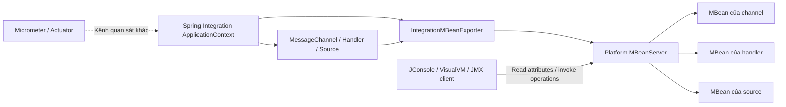
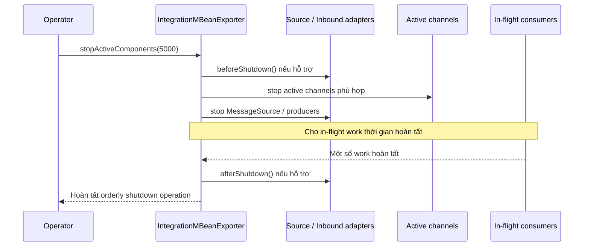

# IntegrationMBeanExporter và JMX trong Spring Integration

## 1. Vì sao cần điều khiển và quan sát message flow lúc runtime?

Trong chương **Control và quản trị** của mô-đun `SPRING_INTEGRATION_RUNTIME`, Spring Integration điều phối message qua **channel, endpoint, consumer, poller và executor**; ứng dụng còn cần quản lý vòng đời `IntegrationFlow`, transaction, retry, message store, lỗi và correlation. Một flow có thể chạy đúng khi test nhưng phát sinh sự cố sau nhiều giờ vận hành: queue tăng dần, handler xử lý chậm, một polling endpoint dừng hoặc quá trình shutdown cắt ngang công việc đang chạy.

**JMX (Java Management Extensions)** cho phép một tiến trình Java công bố các đối tượng quản trị gọi là **MBean**. Công cụ như JConsole, VisualVM hoặc một JMX client được cấp quyền có thể đọc thuộc tính và gọi operation của MBean. Trong Spring Integration, `IntegrationMBeanExporter` là cầu nối giúp các **message channel, message handler, message source** được biểu diễn thành MBean để quan sát và quản trị.

Tình huống xuyên suốt: dịch vụ nhận đơn hàng vào `ordersQueue`, một poller gọi `ordersProcessor` theo chu kỳ. Khi đơn hàng đến nhanh hơn tốc độ xử lý, operator muốn kiểm tra:

- Channel và handler đã được đăng ký chưa, tên hiển thị trên JMX là gì?
- Queue hiện đang có bao nhiêu message; số lần gửi/nhận hoặc lỗi có tăng không?
- Endpoint nào đang hoạt động; có thể điều chỉnh vận hành hoặc dừng một cách có kiểm soát không?
- Trước khi deploy bản mới, có cách yêu cầu **orderly shutdown** để hạn chế ngắt message đang xử lý không?
- JMX có cần bật ra mạng không, và thao tác nào có nguy cơ ảnh hưởng production?

**JMX không phải message broker, message store hay transaction manager.** Nó mở một bề mặt **quản trị tiến trình đang chạy**. Đọc MBean không tự khôi phục message bị mất; gọi operation dừng endpoint không đồng nghĩa dữ liệu đã commit hoặc được ack an toàn.

### Mục tiêu của bài

Sau bài này, bạn có thể:

1. Phân biệt `IntegrationMBeanExporter`, `MBeanServer`, `ObjectName`, MBean, `@EnableIntegrationMBeanExport` và JMX adapter.
2. Cấu hình một ứng dụng Spring Integration để export channel/handler/source lên JMX.
3. Tìm MBean bằng JConsole hoặc `MBeanServer.queryNames(...)` mà không phụ thuộc tên tự sinh mơ hồ.
4. Đọc metrics/thuộc tính và operation **đúng loại component, đúng phiên bản**.
5. Hiểu `stopActiveComponents(long)`, vòng đời đăng ký/hủy đăng ký MBean và ranh giới shutdown.
6. Thiết kế bảo mật truy cập JMX, giám sát nhiều instance và phối hợp với Micrometer/Actuator.
7. Chẩn đoán lỗi không thấy MBean, trùng ObjectName, thiếu metric hoặc shutdown không drain hết queue.

## 2. Kiến trúc JMX: ai đăng ký và ai truy vấn?

Một hệ thống Spring Integration có thể sử dụng MBeanServer **trong cùng JVM**, đồng thời cho client quan sát qua kết nối JMX được bảo vệ:



| Thành phần | Bản chất | Vai trò |
|---|---|---|
| `IntegrationMBeanExporter` | Exporter của Spring Integration, class `org.springframework.integration.monitor.IntegrationMBeanExporter` | Đăng ký MBean cho các component phù hợp và cung cấp một số operation/thống kê quản trị. |
| `MBeanServer` | Registry JMX ở JVM, thường dùng platform MBeanServer | Định danh ObjectName, cung cấp metadata, đọc attribute, gọi operation. |
| `ObjectName` | Tên có `domain` và các cặp key/property, ví dụ `example.integration:type=MessageChannel,name=ordersQueue` | Cách client tìm đúng MBean, không phải địa chỉ message channel. |
| `@EnableIntegrationMBeanExport` | Annotation Spring Integration | Kích hoạt exporter mặc định trong ApplicationContext, có tùy chọn domain, server và lọc component. |
| `MBeanExporter` tiêu chuẩn của Spring Framework | Exporter MBean chung, có thể xuất bean `@ManagedResource` | Không hoàn toàn giống exporter đặc thù của Spring Integration; cần tránh xung đột cùng ObjectName. |
| JMX client | JConsole, VisualVM hoặc client API `MBeanServerConnection` | Đọc thông tin và thực hiện operation nếu được cho phép. |
| Micrometer/Actuator | Metric/observation và endpoint quản trị độc lập | Bổ sung dashboard, time-series và alert; không tự đồng nghĩa với MBean export của Spring Integration. |

`IntegrationMBeanExporter` **tự có khả năng được quản lý** nhưng **không tự đăng ký chính nó làm MBean**; mặc định nó ưu tiên export các component channel/handler/source. Nếu cần gọi operation của **exporter** (chẳng hạn `stopActiveComponents`) **qua JMX**, phải bảo đảm exporter đó được export bổ sung, ví dụ qua Spring Framework MBean exporter, và quản lý việc đăng ký trùng. Nếu gọi **trực tiếp bằng Java** qua bean exporter, không cần bước expose chính exporter qua JMX.

### Hai đường truy cập phải phân biệt

**Đường dữ liệu**: adapter nhận message → channel → poller/consumer → handler → output channel, retry, transaction.

**Đường quản trị**: JMX client → MBeanServer → MBean attribute/operation. Đường này **không phải** một Spring Integration message flow bình thường và có thể gọi hoạt động ảnh hưởng vận hành, ví dụ dừng nguồn nhận. Vì thế JMX phải được cấp quyền và kiểm toán như một API quản trị.

## 3. Bật IntegrationMBeanExporter bằng annotation

Tài liệu Spring Integration 7.1.x mô tả `@EnableIntegrationMBeanExport` trong package:

```java
import org.springframework.integration.jmx.config.EnableIntegrationMBeanExport;
```

Annotation tạo exporter mặc định với **bean name `integrationMbeanExporter`**. Một cấu hình:

```java
import org.springframework.context.annotation.Configuration;
import org.springframework.integration.config.EnableIntegration;
import org.springframework.integration.jmx.config.EnableIntegrationMBeanExport;

@Configuration
@EnableIntegration
@EnableIntegrationMBeanExport(
        defaultDomain = "example.integration",
        managedComponents = {"!ordersSecret*", "orders*"})
public class IntegrationJmxConfig {
}
```

Ví dụ chọn **domain riêng** để MBean của service không bị trộn với ứng dụng khác. `managedComponents` lọc theo **tên thành phần** được export, không phải biểu thức tùy ý trên payload. Các pattern được đánh giá theo thứ tự; **pattern đầu tiên khớp sẽ quyết định** có include hay exclude:

- `"!ordersSecret*"` loại các component bắt đầu bằng `ordersSecret`.
- `"orders*"` bao gồm các component có tên bắt đầu bằng `orders`.
- Nếu đổi thành `{"orders*", "!ordersSecret*"}` thì pattern bao quát ở trước có thể khiến rule loại trừ ở sau **không còn tác dụng**.

Không đưa toàn bộ MBean ra production khi chưa biết mỗi tên đại diện cho component nào. `managedComponents` hỗ trợ giảm bề mặt quan sát/quản trị, nhưng **không phải cơ chế xác thực hoặc phân quyền người dùng JMX**.

### 3.1. Dependency cần có

Với dòng Spring Integration hiện tại, chức năng JMX nằm trong artifact `spring-integration-jmx`. Ví dụ Gradle, để dependency management của dự án/BOM quyết định phiên bản phù hợp:

```groovy
dependencies {
    implementation "org.springframework.boot:spring-boot-starter-integration"
    implementation "org.springframework.integration:spring-integration-jmx"
}
```

Hoặc khi không dùng Spring Boot, thêm `spring-integration-core`, `spring-integration-jmx` và các thư viện Spring/JMX cần thiết cùng một dòng phiên bản tương thích.

**Không trộn version tùy tiện.** Một ví dụ cấu hình trong tài liệu 6.x có thể vẫn đúng cho 7.x, nhưng chữ ký API, thuộc tính MBean hoặc chính sách metric đã thay đổi. Kiểm tra tài liệu của **đúng phiên bản** đang deploy; bài này giải thích hành vi chính và sử dụng minh họa tương thích với hạ tầng Spring Integration hiện đại.

### 3.2. Chọn MBeanServer

Nếu không truyền `server`, annotation dùng platform MBeanServer mặc định. Khi ứng dụng đã có một bean MBeanServer riêng:

```java
import javax.management.MBeanServer;
import java.lang.management.ManagementFactory;
import org.springframework.context.annotation.Bean;
import org.springframework.context.annotation.Configuration;
import org.springframework.integration.jmx.config.EnableIntegrationMBeanExport;

@Configuration
@EnableIntegrationMBeanExport(
        server = "integrationServer",
        defaultDomain = "example.integration")
public class CustomJmxServerConfig {

    @Bean("integrationServer")
    public MBeanServer integrationServer() {
        return ManagementFactory.getPlatformMBeanServer();
    }
}
```

Đây là phương án **thay thế** cấu hình `IntegrationJmxConfig` phía trên, không đăng ký cả hai `@EnableIntegrationMBeanExport` cho cùng một ApplicationContext. Một số dự án đã có MBeanServer bean do Spring Boot hoặc cấu hình khác tạo; hãy reuse thay vì tạo trùng.

## 4. Ví dụ Java/Spring Boot: quan sát QueueChannel và service activator

Ví dụ nhỏ dưới đây minh họa **một input queue và một polling consumer**; Spring Integration làm việc trên cùng JVM, không cần broker hoặc database. Mỗi public class đặt ở file `.java` riêng trong package `example.integration`, Java 17+.

### 4.1. Ứng dụng, channel và dữ liệu mẫu

```java
package example.integration;

import org.springframework.boot.ApplicationRunner;
import org.springframework.boot.SpringApplication;
import org.springframework.boot.autoconfigure.SpringBootApplication;
import org.springframework.context.annotation.Bean;
import org.springframework.integration.channel.QueueChannel;
import org.springframework.integration.config.EnableIntegration;
import org.springframework.integration.jmx.config.EnableIntegrationMBeanExport;
import org.springframework.messaging.support.MessageBuilder;

@SpringBootApplication
@EnableIntegration
@EnableIntegrationMBeanExport(
        defaultDomain = "example.integration",
        managedComponents = {"orders*"})
public class OrdersJmxApplication {

    @Bean("ordersQueue")
    public QueueChannel ordersQueue() {
        return new QueueChannel(10);
    }

    @Bean
    public ApplicationRunner initialMessages(QueueChannel ordersQueue) {
        return args -> {
            ordersQueue.send(
                    MessageBuilder.withPayload("ORD-100").build());
            ordersQueue.send(
                    MessageBuilder.withPayload("ORD-101").build());
            ordersQueue.send(
                    MessageBuilder.withPayload("ORD-102").build());
        };
    }

    public static void main(String[] args) {
        SpringApplication.run(OrdersJmxApplication.class, args);
    }
}
```

`QueueChannel(10)` giới hạn **số message** đang chờ, không phải số byte payload. Một lời gọi `send()` trả về cho biết gửi có được chấp nhận theo contract của channel; chưa chứng minh handler đã xử lý thành công hoặc transaction nghiệp vụ đã commit.

### 4.2. Handler nhận message qua poller

```java
package example.integration;

import org.springframework.integration.annotation.MessageEndpoint;
import org.springframework.integration.annotation.Poller;
import org.springframework.integration.annotation.ServiceActivator;

@MessageEndpoint("ordersProcessor")
public class OrdersProcessor {

    @ServiceActivator(
            inputChannel = "ordersQueue",
            poller = @Poller(fixedDelay = "500", maxMessagesPerPoll = "1"))
    public void process(String orderId) {
        System.out.printf("Processed order %s by %s%n",
                orderId, Thread.currentThread().getName());
    }
}
```

Spring Integration tạo polling consumer cho `ordersQueue`. Mỗi lần poll lấy message khi có dữ liệu rồi gọi method. Khi chạy, những MBean phù hợp với `managedComponents = {"orders*"}` có thể được đăng ký cho channel và các endpoint/handler tương ứng.

**Không giả định exporter tạo một tên MBean duy nhất theo tên class Java.** Handler có thể được đặt tên theo endpoint ID, input channel, hoặc một tên nội bộ do framework sinh. Đối với ví dụ, hãy **truy vấn ObjectName thực tế** trong MBeanServer; đừng hardcode tên handler khi code chưa xác minh.

### 4.3. Kiểm chứng bằng JConsole

Ở môi trường developer:

1. Chạy ứng dụng và mở `jconsole` (được cung cấp cùng JDK có công cụ JConsole).
2. Chọn **local Java process** của `OrdersJmxApplication`; không cần mở JMX remote ra mạng cho bài này.
3. Mở tab **MBeans** và tìm domain `example.integration`.
4. Chọn MBean với `type=MessageChannel` và `name=ordersQueue`, kiểm tra tab Attributes/Operations.
5. Gửi thêm message, đối chiếu thay đổi số lần gửi/nhận hoặc queue count nếu MBean phiên bản đang dùng cung cấp thuộc tính đó.
6. Dừng consumer/poller trong một biến thể kiểm thử có kiểm soát và quan sát backlog; sau đó cho chạy lại để đối chiếu tốc độ drain.

JMX attributes/operations hiển thị cụ thể phụ thuộc loại channel, MBean interface, phiên bản framework và cấu hình management. **Không chọn một operation rồi invoke trong production chỉ để xem nó có hoạt động hay không.**

### 4.4. Đọc MBean trong chính JVM bằng Java

Đoạn sau nên chạy từ một Spring-managed bean trong **cùng tiến trình** với ứng dụng; nếu chạy thành một chương trình Java riêng, `ManagementFactory.getPlatformMBeanServer()` trả về MBeanServer của **tiến trình riêng đó**, không phải MBeanServer của ứng dụng đang theo dõi.

```java
package example.integration;

import java.lang.management.ManagementFactory;
import java.util.Set;
import javax.management.MBeanAttributeInfo;
import javax.management.MBeanInfo;
import javax.management.MBeanServer;
import javax.management.ObjectName;

public final class JmxInspector {

    private JmxInspector() {}

    public static void dumpLocalIntegrationMBeans() throws Exception {
        MBeanServer server = ManagementFactory.getPlatformMBeanServer();

        Set<ObjectName> names = server.queryNames(
                new ObjectName("example.integration:*"), null);

        for (ObjectName name : names) {
            System.out.println("MBean: " + name.getCanonicalName());
            MBeanInfo info = server.getMBeanInfo(name);

            for (MBeanAttributeInfo attribute : info.getAttributes()) {
                System.out.printf("  %s (%s), readable=%s%n",
                        attribute.getName(),
                        attribute.getType(),
                        attribute.isReadable());
            }
        }
    }
}
```

Hàm `dumpLocalIntegrationMBeans()` chỉ liệt kê **metadata** của attribute, tránh tự gọi hàng loạt getter/operation có thể tốn thời gian hoặc thay đổi trạng thái. Có thể gọi nó từ một `ApplicationRunner` khi hệ thống khởi động hoàn tất, hoặc từ một công cụ nội bộ được bảo vệ.

Để đọc một thuộc tính, hãy lấy **tên attribute thật từ `MBeanInfo`** rồi gọi `server.getAttribute(objectName, attributeName)` với quyền phù hợp. Không giả định mọi MBean đều có `QueueSize`, `SendCount` hoặc `Duration`: tên thuộc tính và kiểu MBean khác nhau giữa channel/source/handler và các phiên bản.

## 5. JMX ObjectName: định danh, filter và va chạm

Một `ObjectName` JMX có cấu trúc `domain:key=value,...`. Domain được ví dụ đặt là `example.integration`; nếu không cấu hình, Spring Integration thường dùng domain mặc định `org.springframework.integration` theo tài liệu reference.

| Component | Dạng ObjectName thường gặp | Điều cần nhớ |
|---|---|---|
| `MessageChannel` | `example.integration:type=MessageChannel,name=ordersQueue` | Dựa trên bean/channel name được exporter xác định. |
| `MessageSource` | `example.integration:type=MessageSource,name=...,bean=...` | Có thể chứa endpoint/source name bổ sung. |
| `MessageHandler` | `example.integration:type=MessageHandler,name=...,bean=...` hoặc dạng theo naming strategy | Tên và property thực tế cần xác minh qua `queryNames`; tài liệu/bản triển khai có khác biệt. |
| Exporter được xuất riêng | Có ObjectName theo Spring Framework exporter | **Không tự xuất chính nó** chỉ vì Integration exporter đang chạy. |

Các giá trị `bean` mô tả nguồn sinh tên, chẳng hạn `endpoint`, `anonymous`, `internal` hoặc fallback khác. Một endpoint không đặt ID rõ ràng dễ bị hiển thị tên khó đọc; nên đặt ID/bean name có nghĩa cho component cần quản lý.

**Không dựa tuyệt đối vào bảng tên để dựng URL và automation:** custom `ObjectNamingStrategy`, các thuộc tính tĩnh gắn thêm vào ObjectName, ký tự cần quote (Spring Integration quote một số tên không thuộc identifier hợp lệ) và version có thể thay đổi. Một câu query an toàn hơn:

```java
ObjectName pattern = new ObjectName("example.integration:type=MessageChannel,*");
Set<ObjectName> channels = server.queryNames(pattern, null);
```

Cú pháp `server` và các import như `javax.management.ObjectName` đã có ở ví dụ trước; fragment này chạy trong cùng ngữ cảnh có `MBeanServer server`. `queryNames` không thay thế việc xác thực quyền và chọn đúng JVM.

### 5.1. Trùng ObjectName giữa nhiều context

Khi hai `ApplicationContext` trong **cùng JVM** cùng export `ordersQueue` dưới một domain/type/name, MBeanServer có thể nhận hai yêu cầu đăng ký trùng. Chính sách `RegistrationPolicy.FAIL_ON_EXISTING` là mặc định của annotation; lỗi đăng ký có thể làm startup thất bại.

Có thể giải quyết bằng:

- Chỉ định domain và namespace phù hợp cho từng context, hoặc tên bean khác nhau.
- Dùng `objectNameStaticProperties` hay `ObjectNamingStrategy` tùy cấu hình exporter để thêm định danh ổn định.
- Chỉ export component thật sự cần quản trị bằng `managedComponents`.
- Xem lại tại sao hai context cùng đăng ký một MBean, thay vì mặc định chọn replace/ignore để che xung đột.

Tránh đưa `requestId`, `customerId` hoặc bất kỳ giá trị high-cardinality nào vào ObjectName; nếu không, số MBean lớn và biến động nhanh sẽ làm quản trị JMX nặng, khó query và tăng rủi ro lộ dữ liệu.

### 5.2. Vòng đời đăng ký/hủy đăng ký

`IntegrationMBeanExporter` **không còn triển khai `SmartLifecycle`** để quản lý đăng ký bằng `start()/stop()`. MBean được đăng ký khi ApplicationContext khởi tạo và hủy đăng ký khi context bị destroy. Vì vậy:

- **Stop một poller/endpoint** không có nghĩa MBean của nó tự biến mất.
- **Restart JVM/context** làm các metric chỉ được giữ in-memory có thể về giá trị ban đầu.
- **Dynamic IntegrationFlow** có lifecycle riêng; phải đối chiếu việc tạo/hủy component và đăng ký MBean ở phiên bản thực tế thay vì mặc định mọi flow sinh ra sau startup đều được export giống bean tĩnh.
- **Không gọi `exporter.stop()`** như một operation đăng ký/hủy JMX thông thường vì exporter không có hợp đồng `SmartLifecycle` ấy.

## 6. Attribute, thống kê và operation: đọc thế nào cho đúng?

Exporter giúp expose channel/handler/source và một số đặc tính quản trị. Theo Javadoc, có các phương thức như:

```java
// Dùng trực tiếp từ bean exporter trong ApplicationContext:
IntegrationMBeanExporter exporter =
        context.getBean("integrationMbeanExporter",
                IntegrationMBeanExporter.class);

int channels = exporter.getChannelCount();
int handlers = exporter.getHandlerCount();
int sources = exporter.getSourceCount();
int queuedMessages = exporter.getQueuedMessageCount();

String[] channelNames = exporter.getChannelNames();
String[] handlerNames = exporter.getHandlerNames();
String[] sourceNames = exporter.getSourceNames();
```

Imports:

```java
import org.springframework.integration.monitor.IntegrationMBeanExporter;
// context là ApplicationContext do ứng dụng cấp.
```

**Phân biệt gọi Java trực tiếp và truy cập qua JMX.** Lời gọi Java phía trên được thực hiện khi code đã chạy trong ApplicationContext. Muốn thấy các attribute của **chính exporter** trong JConsole, hãy đảm bảo nó được xuất riêng bởi Spring Framework exporter hoặc cấu hình MBean tương đương. Trong ví dụ mục 4, mục tiêu chính là xem MBean channel và handler; exporter không nhất thiết xuất hiện dưới domain.

### 6.1. Các chỉ số cần quan sát

| Loại component | Tín hiệu hữu ích | Điều chưa thể kết luận |
|---|---|---|
| `MessageChannel` | Số lần send, receive, lỗi gửi/nhận, tần suất; với queue có thể xem số message đang chờ | `send()` thành công không có nghĩa nghiệp vụ downstream đã commit. |
| `MessageHandler` | Số lần xử lý, lỗi, duration/tần suất tùy interface và config | Handler hoàn tất không đồng nghĩa broker ack hoặc HTTP external đã chắc chắn thành công. |
| `MessageSource` | Số lần poll/receive và số message nguồn trả về nếu được instrument | Không có message ở poller chưa chắc nguồn bên ngoài không còn dữ liệu. |
| Exporter tổng hợp | Số channel/handler/source đã đăng ký, số message đang chờ theo exporter | Không tự bao gồm backlog ở Kafka, RabbitMQ, remote broker hoặc database khác. |
| Endpoint/poller lifecycle | Trạng thái start/stop của component khi MBean hỗ trợ | Một endpoint “running” không bảo đảm có subscriber, kết nối nguồn hoặc xử lý tiến triển. |

Các attribute cụ thể phụ thuộc MBean implementation. Luôn phân biệt **counter đơn điệu tính từ khi JVM chạy** với **rate trung bình** và **gauge hiện tại**. Đọc một số đếm không có timestamp/cửa sổ đo không đủ để xác định “đang nghẽn”.

### 6.2. Ước lượng backlog và thời gian drain

Đặt:

- `B`: backlog tại thời điểm đo (message).
- `μ`: tốc độ handler hoàn tất (message/giây).
- `λ`: tốc độ nguồn tiếp tục gửi vào (message/giây).

Khi đã dừng nguồn vào và tốc độ xử lý tương đối ổn định:

\[
T_{\text{drain}}\approx\frac{B}{\mu}
\]

Nếu nguồn vẫn tiếp tục phát và `μ > λ`:

\[
T_{\text{drain}}\approx\frac{B}{\mu-\lambda}
\]

Đây là **ước lượng**; retry, message size, poison message, concurrency, transaction, restart và thay đổi nguồn có thể khiến thực tế khác xa. MBean queue size trong cùng JVM cũng không đại diện cho backlog nằm ở broker ngoài JVM.

**Quan sát cần ghép cặp:** queue count/age, handler throughput, error rate, consumer thread/executor saturation và trạng thái kết nối broker. JMX phù hợp với kiểm tra trực tiếp, còn time-series metrics phù hợp hơn cho cảnh báo theo cửa sổ thời gian.

## 7. Orderly shutdown qua IntegrationMBeanExporter

Một operation quan trọng là:

```java
public void stopActiveComponents(long howLong)
```

Tham số `howLong` là **số mili-giây** dành để chờ những message còn đang xử lý hoàn thành theo thuật toán orderly shutdown; không phải “ngủ lâu đúng howLong” trong mọi trường hợp. Quy trình khái quát trong Spring Integration:



Tài liệu mô tả các bước `beforeShutdown()` và `afterShutdown()` cho `OrderlyShutdownCapable`. Các adapter JMS/AMQP/TCP/HTTP có thể có hành vi riêng khi ngừng nhận mới. Một số poller **được giữ chạy** trong giai đoạn drain để xử lý các message còn lại trong queue; không suy luận rằng mọi poller đều bị stop ngay từ đầu.

### 7.1. Gọi trực tiếp từ Java

Trong một thành phần vận hành đã được phân quyền và có `ApplicationContext context`:

```java
import org.springframework.integration.monitor.IntegrationMBeanExporter;

IntegrationMBeanExporter exporter =
        context.getBean("integrationMbeanExporter",
                IntegrationMBeanExporter.class);

// Ví dụ chỉ thực thi trong thử nghiệm / runbook được phê duyệt.
// Không gọi tự động khi một request nghiệp vụ bất kỳ đến.
exporter.stopActiveComponents(5_000L);
```

### 7.2. Gọi qua JMX

Để operation trên được gọi từ JConsole, **chính exporter phải là MBean đã được đăng ký**. Tài liệu phân biệt hai exporter:

- `IntegrationMBeanExporter` đăng ký MBean cho integration components.
- Spring Framework `MBeanExporter` (ví dụ cấu hình `<context:mbean-export/>` hoặc `@EnableMBeanExport` trong bối cảnh thích hợp) có thể đăng ký bean exporter với `@ManagedResource` của nó.

Khi dùng cả hai, cần thử kỹ **trùng MBean/ObjectName** của các component `@ManagedResource`. Đừng bật hai cơ chế auto-export rộng rãi mà bỏ qua quy tắc component selection/registration. Nếu không cần quản trị qua mạng hoặc JConsole, **gọi bean exporter trực tiếp qua nội bộ** giảm bề mặt tấn công.

### 7.3. Orderly không có nghĩa exactly-once

Ngay cả khi operation orderly shutdown trả về bình thường:

- Worker đang gọi API ngoài có thể chưa dừng hoặc tác dụng bên ngoài đã commit.
- Message chưa xử lý có thể cần quay lại qua durable queue/broker; in-memory queue **không tự bền vững** sau process exit.
- Poller/consumer dùng executor bất đồng bộ có thể có work chưa nằm trong phạm vi theo dõi của thuật toán shutdown như mong đợi.
- Broker ack và JDBC commit có thể ở hai thời điểm khác nhau. Crash sau commit trước ack vẫn dẫn đến redelivery.
- `stopActiveComponents` **không phải** `System.exit()`, không tự bảo đảm đóng JVM hoặc deploy bản mới.

Để deploy an toàn, cần **readiness drain**, chặn new traffic, chờ in-flight theo timeout có đo, stop component theo policy, rồi để orchestration dừng JVM. Các đường recover phải có idempotency key và khả năng replay.

## 8. Phân biệt IntegrationMBeanExporter với JMX channel adapter

Gói `spring-integration-jmx` còn cung cấp các **JMX channel adapter**. Chúng giúp **message flow tương tác với MBean của hệ thống khác**, không phải chỉ xuất MBean của bản thân Spring Integration.

| Thành phần JMX | Dữ liệu đi theo hướng | Trường hợp sử dụng |
|---|---|---|
| `IntegrationMBeanExporter` | Integration component → MBeanServer | Quan sát/quản trị runtime của Spring Integration. |
| Notification-listening inbound channel adapter | JMX notification → Spring Integration message | Phản ứng khi một MBean phát notification. |
| Notification-publishing outbound adapter | Spring Integration message → JMX notification | Phát notification ra hệ sinh thái quản trị JMX. |
| Attribute-polling inbound adapter | Thuộc tính MBean → message theo lịch | Đọc attribute từ MBean của bên khác. |
| Operation-invoking outbound adapter | Message → gọi operation MBean không cần reply | Ra lệnh qua flow một chiều, chỉ dùng khi được phép. |
| Operation-invoking outbound gateway | Message → gọi operation → reply message | Lấy kết quả operation của MBean. |

Ví dụ XML **chỉ minh họa JMX adapter**, không thay thế `@EnableIntegrationMBeanExport`:

```xml
<int-jmx:attribute-polling-channel-adapter
        channel="jmxAttributesIn"
        mbean-server="mbeanServer"
        object-name="java.lang:type=Memory"
        attribute-name="HeapMemoryUsage">
    <int:poller fixed-rate="5000"/>
</int-jmx:attribute-polling-channel-adapter>
```

Fragment cần khai báo namespaces `int-jmx`/`int`, một `jmxAttributesIn` channel và bean `mbeanServer` trỏ tới MBeanServer phù hợp; phải dùng đúng cú pháp adapter/phiên bản khi tích hợp thực. Adapter polling **tạo message từ một MBean attribute**; bản thân nó không làm mọi Spring Integration handler xuất hiện trong tab MBeans.

Một thao tác quản trị nhạy cảm như gọi operation “stop” từ message qua outbound adapter cần có **control channel được bảo vệ**, người gửi được xác thực/phân quyền và audit. Không để payload từ nguồn không tin cậy tự quyết định tên MBean, operation và tham số.

## 9. JMX, Micrometer, Actuator và Integration Graph khác gì?

Trong Spring Integration hiện đại, **Micrometer/Observation** là đường chính để lấy time-series metrics và distributed tracing ở nhiều hệ thống. JMX phù hợp để truy vấn MBean trong JVM hoặc thực thi một số operation quản trị có kiểm soát.

| Công cụ/cơ chế | Mục tiêu chính | Ưu điểm | Giới hạn |
|---|---|---|---|
| JMX + `IntegrationMBeanExporter` | Kiểm tra/điều khiển component trong JVM | Attributes và operations gần runtime; JConsole/VisualVM quen thuộc | Dữ liệu thường theo instance; remote JMX nhạy cảm bảo mật; cần kiểm tra MBean registration. |
| Micrometer `MeterRegistry` | Counter/timer/gauge dạng metrics | Tổng hợp time-series, dashboard và alert nhiều instance | Không thay thế operation quản trị start/stop; metric cần tag và cấu hình. |
| Micrometer `ObservationRegistry` | Observation/tracing | Liên kết latency và trace theo flow khi instrument đúng | Có thể có overhead và yêu cầu trace context propagation. |
| Spring Boot Actuator | Health, metrics, management endpoints được cấp quyền | HTTP/JMX integration, phân quyền/exposure theo cấu hình | Endpoint Actuator **không giống** MBean exporter Spring Integration; cần cấu hình riêng. |
| Spring Integration Graph | Hình dung topology/cấu trúc flow | Giúp biết channel nối handler nào, phục vụ chẩn đoán | Không tự chứng minh throughput, transaction hay message đã hoàn tất. |

Một ứng dụng có thể dùng **cả JMX và Micrometer**. `@EnableIntegrationMBeanExport` không đồng nghĩa đã bật toàn bộ metrics/trace; `@EnableIntegrationManagement` và `MeterRegistry`/`ObservationRegistry` có vai trò riêng tùy version.

Ví dụ tên một số metric được tài liệu Spring Integration mô tả: `spring.integration.send` và `spring.integration.receive` với tag component/result, hoặc metrics Observation như `spring.integration.handler`. Chọn tên metric **theo version/registry thực tế**, không chuyển tên JMX attribute thành metric Prometheus mà không xác minh.

Nếu dùng Spring Boot Actuator, cấu hình `management.endpoints.jmx.exposure.include` điều khiển **Actuator endpoints được export qua JMX**; nó không tự thay thế `@EnableIntegrationMBeanExport` cho channel/handler. Không suy ra “bật Actuator JMX” nghĩa là toàn bộ Spring Integration components được xuất với cùng ObjectName.

## 10. Bảo mật và quản trị nhiều JVM

JMX cho phép **đọc thông tin runtime** và có thể **gọi operation làm thay đổi trạng thái hệ thống**. Đây là bề mặt cần hardening như một API admin.

### 10.1. Local JMX trước, remote JMX sau

- Trong môi trường học tập và development, ưu tiên JConsole **attach vào local JVM**.
- Trong production, nếu bắt buộc remote JMX, chỉ mở qua mạng quản trị được giới hạn; cấu hình **authentication, TLS hoặc transport an toàn phù hợp**, firewall và kiểm soát danh tính.
- Không bật cấu hình remote JMX **tắt authentication hoặc tắt SSL** trên giao diện có thể truy cập từ bên ngoài. Tránh ví dụ “tiện debug” mở port công khai.
- Không export MBean chứa secrets, token, credential hoặc payload chứa dữ liệu cá nhân. Audit operation nhạy cảm, hạn chế quyền gọi.
- Quyền truy cập JMX không tự được Spring Security HTTP bảo vệ. Phải cấu hình bảo vệ cho **đường JMX** riêng.

### 10.2. Nhiều replica trong cluster

Mỗi JVM có **MBeanServer riêng**. Hai pod cùng export `example.integration:type=MessageChannel,name=ordersQueue` trong **hai JVM khác nhau** không phải lỗi ObjectName collision, vì mỗi pod có registry riêng. Nhưng một client phải biết nó đang nối tới **pod nào**.

Khi tổng hợp metrics:

- Gắn `instance/pod` metadata ở hệ giám sát, **không làm tăng số MBean theo từng message ID**.
- Queue length ở pod A không tự bằng queue length ở pod B; tổng backlog của Kafka/JDBC broker phải xem tại nguồn chung.
- Khi rolling restart, counter của pod mới có thể reset. Dashboard phải phân biệt process uptime và instance churn.
- Nếu dùng JMX để stop một endpoint ở pod A, endpoint tương ứng ở pod B **không tự dừng**. Quản trị cluster cần cơ chế orchestration và phân quyền rõ.

### 10.3. JMX không phải nơi điều khiển tự động mọi lỗi

Không nên đặt “thấy queue lớn → tự động stopActiveComponents() ngay” như một luật không giới hạn. Queue tăng có thể do tải cao tạm thời, poison message, downstream chậm, DB outage hoặc đang thực hiện retry có kiểm soát. Trước thao tác thay đổi state, hãy quan sát **queue age, error rate, throughput, transaction backlog, in-flight và nguồn nhận**.

Quy tắc runbook tốt là: **phân loại sự cố → xác minh component và replica → dự kiến ảnh hưởng → thực thi operation được phép → kiểm tra hệ quả và rollback/recovery**.

## 11. Chẩn đoán các lỗi JMX thường gặp

| Triệu chứng | Nguyên nhân có thể | Cách kiểm tra |
|---|---|---|
| Không thấy domain `example.integration` | Chưa thêm `spring-integration-jmx`, annotation/exporter chưa được load, chọn sai JVM/MBeanServer | Kiểm tra dependency, bean `integrationMbeanExporter`, `queryNames` trong cùng JVM. |
| Có MBean nhưng thiếu channel mong đợi | `managedComponents` lọc mất, tên component khác dự kiến, component tạo động sau startup | Đọc bean name/endpoint ID và ObjectNames thực tế. |
| Handler được export dưới tên khó nhận diện | Endpoint không có tên/ID rõ ràng, fallback từ input channel/handler name | Đặt ID tường minh, dùng query wildcard và xem property `bean`. |
| Không thấy exporter có operation shutdown | Exporter không tự export chính nó | Đăng ký exporter bằng standard MBean exporter có kiểm soát hoặc gọi trực tiếp bean Java. |
| Startup lỗi `InstanceAlreadyExistsException` hoặc trùng ObjectName | Nhiều context/exporter cùng đăng ký tên giống nhau trong một MBeanServer | Kiểm tra domain, object naming strategy, registration policy và cấu hình exporter trùng. |
| Queue count luôn 0 nhưng broker tồn nhiều message | MBean chỉ đo channel local; backlog nằm ngoài JVM | Xem broker metrics, adapter và channel thực; không dùng một gauge làm nguồn sự thật duy nhất. |
| Metric JMX không giống dashboard Prometheus | Khác instrumentation, phạm vi đo hoặc reset khi restart | Phân biệt JMX attributes, Micrometer meters và Observation, so version. |
| Poller còn running nhưng không có message | Source rỗng, thread bị tắc, filter bỏ message, store/broker không kết nối | Kiểm tra poller logs, executor/DB state và source metrics. |
| Stop operation chạy xong nhưng còn work dở | Có async handoff, external I/O, in-flight vượt timeout, ack nằm ngoài phạm vi | Đối chiếu timeline shutdown, broker ack, transaction và recovery. |
| Remote JConsole không kết nối | RMI/JMX port, firewall, auth/TLS, network hoặc sai JVM | Kiểm tra cấu hình JMX server an toàn và chính sách network; không tắt bảo mật để né lỗi. |
| Bean xuất hiện hai lần hoặc biến mất bất ngờ | Standard Spring exporter và Integration exporter cùng quản lý bean | Rà soát `@EnableMBeanExport`, `@EnableIntegrationMBeanExport` và scopes/filter. |

**Trình tự điều tra khuyến nghị:**

1. Xác định đúng JVM/instance và ApplicationContext.
2. Kiểm tra `spring-integration-jmx` đã có và bean `integrationMbeanExporter` tồn tại.
3. Dùng `queryNames("*:*")` có kiểm soát để xem domain, sau đó lọc `example.integration:*`; không mặc định tên handler.
4. Đọc `MBeanInfo` trước khi đọc attribute/gọi operation.
5. So MBean state với **log channel, poller, executor, error channel, transaction và message store** để tìm nguyên nhân.
6. Nếu thay đổi operation, ghi rõ operator, thời điểm, JVM, ObjectName, tham số, outcome và bước đối soát.

## 12. Thực hành theo kịch bản vận hành

Dùng ví dụ `OrdersJmxApplication` trên máy developer. Không thực hiện thao tác stop/shutdown trên production nếu chưa có quyền và runbook đã phê duyệt.

1. **Kiểm tra export:** chạy app, attach JConsole local, tìm `example.integration` và channel `ordersQueue`. So với kết quả của `MBeanServer.queryNames`.
2. **Kiểm tra handler name:** tìm MBean tương ứng `ordersProcessor` hoặc input channel. Ghi lại tên thực tế, loại MBean và các attribute có thể đọc.
3. **Backlog:** sửa handler trong môi trường test để xử lý chậm; gửi nhiều message nhưng không vượt capacity 10. Đo queue size, thời gian drain và số lần xử lý.
4. **Lỗi handler:** cho một đơn hàng mẫu ném exception, quan sát điều gì tăng ở channel/handler MBean và error handling của poller. Không nhầm exception với “message đã được ack”.
5. **Pattern filtering:** thử `managedComponents = {"!ordersSecret*", "orders*"}` và đặt một test bean tên `ordersSecretQueue`. Xác nhận exporter không đăng ký MBean bị loại.
6. **Context collision:** khởi tạo hai ApplicationContext có cùng exporter/domain/name trong một JVM test; quan sát `RegistrationPolicy` mặc định và sửa bằng namespace/domain riêng.
7. **Metrics comparison:** thêm Micrometer `MeterRegistry`, so channel send/receive metric với JMX attribute; giải thích vì sao tên và phạm vi khác nhau.
8. **Orderly shutdown:** trong test, lấy bean exporter và gọi `stopActiveComponents(5_000L)` khi queue còn message; xem những message nào kịp hoàn tất, có còn queue local và cần replay không.
9. **Two-instance:** chạy hai app riêng biệt, cùng domain/ObjectName; nối vào từng JVM và chứng minh JMX state là **per JVM**.
10. **Security review:** xác định ai có quyền truy cập local/remote JMX và operation nhạy cảm; ghi checklist auth/TLS/network, tuyệt đối không dùng cấu hình mở port không bảo vệ.

Bảng ghi kết quả:

| Thành phần được kiểm tra | Thông tin cần ghi |
|---|---|
| JVM/instance | PID, context ID, uptime, phiên bản Spring Integration |
| MBean identity | Domain, ObjectName, component type và bean name |
| Metrics | Attribute thật, thời điểm đo, giá trị trước/sau khi phát message |
| Thread/poller | Polling interval, thread và trạng thái consumer |
| Failure path | Exception/error channel, retry và transaction outcome |
| Shutdown | Timeout, in-flight count, message còn chờ, commit/ack |
| Security | Local/remote, quyền người dùng, operation đã được audit |

## 13. Checklist vận hành JMX an toàn

- Chỉ bật `IntegrationMBeanExporter` khi cần quản trị/quan sát; xác định rõ **MBeanServer** và domain theo ứng dụng.
- Dùng `@EnableIntegrationMBeanExport` hoặc cấu hình XML tương ứng, không mặc định cả hai cùng tạo exporter.
- Giới hạn `managedComponents` theo tên cần quản lý; dùng **deny pattern trước allow pattern** khi cần loại trừ.
- Đọc ObjectName và `MBeanInfo` từ registry thực tế; đặt endpoint/bean ID dễ hiểu, không suy luận mọi MBean có cùng attribute.
- Phân biệt exporter Spring Integration với Spring Framework MBean exporter, JMX adapters, Micrometer, Actuator và Integration Graph.
- Đối chiếu JMX metrics với **queue/backlog, error, transaction, retry, thread và nguồn lưu bền**; MBean local không tự mô tả broker cluster.
- Trước `stopActiveComponents`, biết rõ timeout mili-giây, nguồn cần dừng, công việc in-flight và khả năng recovery. **Orderly shutdown không bảo đảm exactly-once.**
- Không mở remote JMX thiếu xác thực/mã hóa; hạn chế mạng quản trị, audit thao tác thay đổi state và không export secrets/payload.
- Kiểm thử restart, nhiều JVM, duplicate ObjectName và timeout shutdown trong môi trường test trước khi đưa runbook vào production.

### Tài liệu tham khảo chính thức

- [Spring Integration Reference — JMX Support](https://docs.spring.io/spring-integration/reference/jmx.html): `IntegrationMBeanExporter`, MBean ObjectNames, pattern filtering, JMX inbound/outbound adapters.
- [Spring Integration API — IntegrationMBeanExporter](https://docs.spring.io/spring-integration/api/org/springframework/integration/monitor/IntegrationMBeanExporter.html): phương thức `getChannelCount`, `getHandlerNames`, `getQueuedMessageCount`, `stopActiveComponents` và lifecycle exporter.
- [Spring Integration API — EnableIntegrationMBeanExport](https://docs.spring.io/spring-integration/api/org/springframework/integration/jmx/config/EnableIntegrationMBeanExport.html): domain, server, `managedComponents`, registration policy.
- [Spring Integration Reference — Orderly Shutdown](https://docs.spring.io/spring-integration/reference/shutdown.html): thứ tự ngừng adapter/channel/source và chờ in-flight messages.
- [Spring Integration Reference — Metrics and Management](https://docs.spring.io/spring-integration/reference/metrics.html): Micrometer `MeterRegistry`, `ObservationRegistry` và metrics của channel/handler/source.
- [Spring Boot Reference — Actuator Endpoints](https://docs.spring.io/spring-boot/reference/actuator/endpoints.html): giới hạn và bảo mật endpoints qua HTTP/JMX.
- [Spring Framework Reference — JMX](https://docs.spring.io/spring-framework/reference/integration/jmx.html): `MBeanExporter`, `@ManagedResource`, ObjectName và kiến trúc JMX của Spring Framework.
