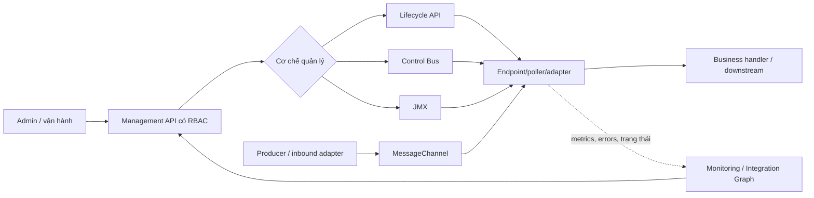
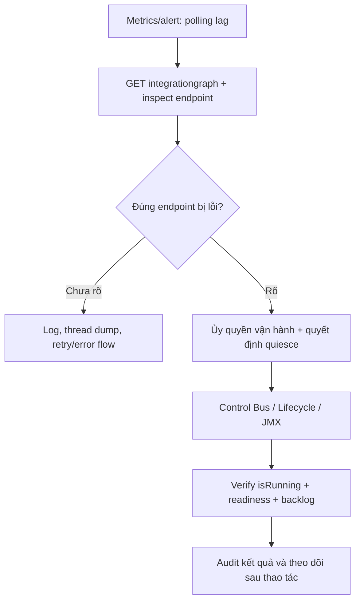
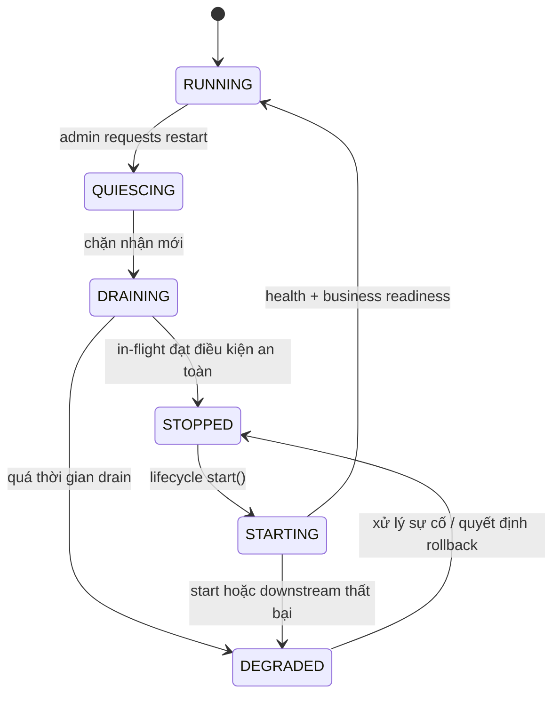

# Start, stop và restart qua management interface trong Spring Integration

## 1. Vì sao phải điều khiển một message flow đang chạy?

Một ứng dụng Spring Integration có thể chứa hàng chục inbound adapters, pollers, consumers, gateways và luồng xử lý message. Không phải lần nào hệ thống gặp vấn đề cũng cần restart toàn bộ JVM. Ví dụ:

- Đối tác ngừng API trong 15 phút: tạm dừng **một inbound adapter** để không tích lũy retry vô ích.
- Một file poller đang đọc dữ liệu sai: dừng riêng poller, điều chỉnh cấu hình rồi mở lại.
- Một queue có backlog cần được xử lý lại sau khi downstream phục hồi: khởi động consumer đúng thời điểm.
- Một tenant bị khóa hoặc connector phải rotate credentials: dừng endpoint liên quan, không ảnh hưởng tenant khác.
- Vận hành muốn tìm hiểu vì sao message không được xử lý: xem lifecycle state, runtime graph, metrics, thread và error flow trước khi quyết định điều khiển.

Trong chương **Control và quản trị** của module **SPRING_INTEGRATION_RUNTIME**, “management interface” bao gồm các cơ chế để điều khiển **các thành phần trong một Spring ApplicationContext đang sống**, chẳng hạn:

1. Gọi API `Lifecycle`/`SmartLifecycle` trực tiếp trên endpoint bean.
2. Gửi lệnh tới **Spring Integration Control Bus** qua một message channel.
3. Sử dụng **JMX** hoặc REST Control Bus Controller được cấu hình/bảo vệ.
4. Điều khiển dynamic `IntegrationFlow` bằng `IntegrationFlowContext`.
5. Dùng Spring Boot Actuator và Integration Graph để **quan sát**, sau đó gọi đúng giao diện để thao tác.

**Start/stop không đồng nghĩa xử lý xong hoặc khôi phục dữ liệu.** Trong runtime, channel, endpoint, consumer, poller, executor, transaction, retry, message store và correlation đều tác động đến kết quả của một lệnh quản trị.

> **Nguyên tắc:** Chỉ thao tác trên **component có lifecycle**, dùng **đúng bean ID**, và phân biệt ba khái niệm: restart endpoint trong JVM; recreate dynamic flow; restart cả process/application. Ba việc không có cùng phạm vi và không mang cùng bảo đảm khôi phục.

## 2. Control plane và data plane phải tách biệt

**Data plane** vận chuyển và xử lý message nghiệp vụ. **Control plane** nhận yêu cầu quản trị như start, stop, pause, inspect hoặc restart một thành phần.



Không để API nghiệp vụ thông thường phát bất kỳ command string nào lên Control Bus. Một message mang lệnh `ordersAdapter.stop` có khả năng làm dừng nhận đơn; đây là **quyền điều hành hệ thống**, không phải một sự kiện nghiệp vụ bình thường.

Các ranh giới cần bảo vệ:

- **Xác thực và phân quyền:** chỉ actor vận hành phù hợp được điều khiển endpoint được phép.
- **Danh sách hành động/đích hợp lệ:** tránh nhận trực tiếp bean name hoặc method name tùy ý từ Internet.
- **Audit:** ai yêu cầu, vì sao, trên instance nào, thay đổi gì, có thành công không.
- **Tính đồng thời:** hai yêu cầu start/stop cùng component có thể cạnh tranh.
- **Readiness:** command được chấp nhận chưa có nghĩa adapter đã kết nối được broker hoặc sẵn sàng xử lý.

## 3. Những đối tượng nào thực sự có lifecycle?

Trong Spring Framework, `Lifecycle` có:

```java
public interface Lifecycle {
    void start();
    void stop();
    boolean isRunning();
}
```

`SmartLifecycle` mở rộng cơ chế này, cung cấp thêm `isAutoStartup()`, `getPhase()` và stop callback cho việc điều phối start/stop trong ApplicationContext.

Trong Spring Integration, nhiều consumer endpoints và inbound adapters implements các hợp đồng lifecycle này; **không phải mọi `MessageChannel` hoặc `MessageHandler` là một đối tượng có thể gọi `start()`**.

| Thành phần | Thường quản lý lifecycle ở đâu? | Hiệu ứng khi dừng |
| --- | --- | --- |
| `EventDrivenConsumer` sau `DirectChannel` | Endpoint bean (không phải channel) | Unsubscribe handler; gửi vào channel không có subscriber có thể thất bại |
| `PollingConsumer` sau `QueueChannel` | Polling endpoint bean | Không tiếp tục poll; queue có thể còn message nếu store giữ chúng |
| `SourcePollingChannelAdapter` | Inbound polling endpoint | Ngừng lịch nhận message từ source |
| JMS/AMQP/TCP inbound adapter | Adapter/listener container/connection factory thích hợp | Dừng nhận mới theo cơ chế transport, tác vụ in-flight cần kiểm chứng |
| `IntegrationFlowRegistration` động | Registration do `IntegrationFlowContext` quản lý | Start/stop các thành phần do registration quản lý |
| `ThreadPoolTaskExecutor` | Executor bean, cơ chế quản lý riêng | Không giống dừng intake; việc đã submit/queue chưa chắc đã xử lý xong |
| `MessageStore` / `MetadataStore` | Storage service | Không phải endpoint để pause; dữ liệu có thể tồn tại độc lập với lifecycle worker |
| `IntegrationGraphServer` | Monitoring infrastructure | Cung cấp runtime topology, không thay thế điều khiển consumer |

### State của lifecycle khác state của nghiệp vụ

`isRunning() == true` chỉ nói endpoint đang ở trạng thái running theo hợp đồng của nó. Nó **không** khẳng định:

- Đã nhận được message gần đây.
- Connection tới downstream đang healthy.
- Queue không bị backlog.
- Handler trả kết quả đúng.
- Có transaction commit thành công.
- Dữ liệu chờ retry, DLQ hoặc group correlation đang được xử lý.

Ngược lại, `isRunning() == false` không có nghĩa tất cả message đã được xử lý xong. Một worker đã được dispatch sang `ExecutorChannel` hoặc một API bên thứ ba có thể vẫn đang chạy.

## 4. Định danh endpoint: biết tên đúng trước khi gửi command

Một lỗi vận hành thường gặp là muốn dừng **consumer endpoint** nhưng lại gọi method trên channel bean hoặc handler bean.

Spring Integration thường có nhiều bean liên quan đến một endpoint:

```text
ordersIn                → input MessageChannel
ordersConsumer          → endpoint (EventDrivenConsumer)
ordersConsumer.handler  → MessageHandler
managementCommands      → Control Bus input channel
controlBusFlow/...      → Control Bus service endpoint
```

Đây là **tên ví dụ**. Tên thực tế phụ thuộc cách khai báo XML, annotation hay Java DSL. Với XML `<int:service-activator id="ordersConsumer" ...>`, endpoint ID thường chính là `ordersConsumer`. Với annotation trên `@Bean`, có thể dùng `@EndpointId` để định danh rõ.

### Ví dụ khai báo endpoint có ID ổn định

```java
import org.springframework.context.annotation.Bean;
import org.springframework.context.annotation.Configuration;
import org.springframework.integration.annotation.EndpointId;
import org.springframework.integration.annotation.ServiceActivator;
import org.springframework.integration.channel.DirectChannel;
import org.springframework.integration.config.EnableIntegration;
import org.springframework.messaging.MessageChannel;
import org.springframework.messaging.MessageHandler;

@Configuration
@EnableIntegration
public class ManagedOrdersConfiguration {

    @Bean("ordersIn")
    public MessageChannel ordersIn() {
        return new DirectChannel();
    }

    @Bean("ordersConsumer.handler")
    @EndpointId("ordersConsumer")
    @ServiceActivator(inputChannel = "ordersIn")
    public MessageHandler ordersHandler() {
        return message ->
                System.out.println("Processing " + message.getPayload());
    }
}
```

Trong cấu hình này, bean `ordersConsumer` là endpoint được đặt tên tường minh bằng `@EndpointId`; bean `ordersConsumer.handler` là handler. Đây là một luồng demo một chiều, chưa có retry advice hoặc persistent queue.

**Khi dùng version hoặc DSL khác:** hãy tra cứu bean thực tế từ `ApplicationContext`, Integration Graph, log startup hoặc bean inspection. Không suy ra tên consumer chỉ từ tên Java method nếu framework đã tạo bean ID theo quy tắc khác.

## 5. Cách 1: gọi SmartLifecycle trực tiếp trong Java

Đây là con đường ngắn nhất khi code quản trị nằm trong chính ứng dụng và đã biết bean endpoint.

```java
import org.springframework.context.ApplicationContext;
import org.springframework.context.SmartLifecycle;

public final class EndpointOperations {

    private final ApplicationContext context;

    public EndpointOperations(ApplicationContext context) {
        this.context = context;
    }

    public boolean stopOrders() {
        SmartLifecycle endpoint =
                context.getBean("ordersConsumer", SmartLifecycle.class);
        endpoint.stop();
        return !endpoint.isRunning();
    }

    public boolean startOrders() {
        SmartLifecycle endpoint =
                context.getBean("ordersConsumer", SmartLifecycle.class);
        endpoint.start();
        return endpoint.isRunning();
    }

    public boolean restartOrders() {
        // "restart" ở đây là QUY TRÌNH do ứng dụng định nghĩa.
        SmartLifecycle endpoint =
                context.getBean("ordersConsumer", SmartLifecycle.class);
        endpoint.stop();
        if (endpoint.isRunning()) {
            return false;
        }
        endpoint.start();
        return endpoint.isRunning();
    }
}
```

Đoạn code minh họa **stop → kiểm tra → start**, không có một `Lifecycle.restart()` mặc định. Phải gọi nó từ một **service quản trị được bảo vệ** và nên tuần tự hóa thao tác theo endpoint ID nếu có nhiều yêu cầu quản trị đồng thời.

Hai điều cần lưu ý:

1. `isRunning()` phản ánh lifecycle state, **không** chứng minh external resource đã ready. Sau khi start JMS/TCP adapter, cần thêm health/connectivity check.
2. `stop()` không tự đợi mọi công việc đã được dispatch ở thread khác hoàn tất. Muốn restart an toàn, cần chính sách **quiesce/drain** trước, nhất là với thanh toán, gửi email hoặc flow có transaction.

### Tại sao không gọi `ordersIn.start()`?

`DirectChannel` là cơ chế truyền message; consumer endpoint mới là nơi đăng ký handler. Khi endpoint đã stop, channel bean vẫn tồn tại. Nếu gửi vào `DirectChannel` không còn subscriber, sender có thể nhận exception dispatch; không có bảo đảm channel sẽ giữ message cho lúc start lại.

## 6. Cách 2: Control Bus — điều khiển bằng message

**Control Bus** là Enterprise Integration Pattern dùng một đường messaging riêng để yêu cầu framework chạy các thao tác quản trị được phép. Đây là khả năng đặc thù của Spring Integration.

### 6.1. Cấu hình Control Bus bằng Java DSL

```java
import org.springframework.context.annotation.Bean;
import org.springframework.context.annotation.Configuration;
import org.springframework.integration.dsl.IntegrationFlow;

@Configuration
public class ControlBusConfiguration {

    @Bean
    public IntegrationFlow controlBusFlow() {
        return IntegrationFlow.from("managementCommands")
                .controlBus()
                .get();
    }
}
```

Cấu hình tạo một channel `managementCommands` làm điểm vào cho quản trị. Tùy cách triển khai có thể dùng annotation `@ServiceActivator` và `ControlBusFactoryBean` hoặc XML:

```xml
<int:control-bus input-channel="managementCommands"/>
```

Chỉ khai báo **một** cơ chế Control Bus cần thiết; không đăng ký hai consumer quản trị ngoài ý muốn trên cùng channel rồi phát command trùng.

### 6.2. Cú pháp lệnh trong các phiên bản hiện hành

**Spring Integration 6.4+ và 7.x** dùng command string dạng:

```text
beanName.methodName
```

Ví dụ:

```java
import org.springframework.messaging.MessageChannel;
import org.springframework.messaging.support.MessageBuilder;

MessageChannel management =
        applicationContext.getBean(
                "managementCommands", MessageChannel.class);

// Dừng endpoint tên ordersConsumer.
management.send(MessageBuilder
        .withPayload("ordersConsumer.stop")
        .build());

// Khởi động lại endpoint.
management.send(MessageBuilder
        .withPayload("ordersConsumer.start")
        .build());
```

Các phương thức thuộc `Lifecycle` như `start` và `stop` được phép theo danh mục command của Control Bus. Đối với method có tham số, đặt danh sách giá trị trong header `IntegrationMessageHeaderAccessor.CONTROL_BUS_ARGUMENTS`, **không nhúng argument tùy ý vào expression string**.

```java
import java.util.List;
import org.springframework.integration.IntegrationMessageHeaderAccessor;
import org.springframework.messaging.support.MessageBuilder;

// Ví dụ riêng: bean threadPool phải có method được Control Bus cho phép.
management.send(MessageBuilder
        .withPayload("threadPool.setMaxPoolSize")
        .setHeader(
                IntegrationMessageHeaderAccessor.CONTROL_BUS_ARGUMENTS,
                List.of(12))
        .build());
```

Control Bus hiện hành dùng `ControlBusCommandRegistry` để tìm bean/method hợp lệ, hỗ trợ những phương thức quản trị có `@ManagedAttribute`, `@ManagedOperation`, hợp đồng `Lifecycle`/`Pausable` và một số cấu hình executor/scheduler. Có thể bật eager command loading bằng `@EnableIntegrationManagement(loadControlBusCommands = "true")` khi phù hợp.

**Khác biệt phiên bản quan trọng:** Một số tài liệu cũ (trước cơ chế command registry) dùng chuỗi SpEL như `@ordersConsumer.stop()`. **Đừng dùng cú pháp SpEL cũ cho ứng dụng 6.4+/7.x.** Khi nâng version, phải cập nhật client gửi lệnh và bài test. Tài liệu reference hiện hành giải thích cú pháp command mới.

### 6.3. Control Bus cũng cần error handling

Nếu tên bean không tồn tại, method không được phép, header argument sai kiểu hoặc method tự ném exception, câu lệnh quản trị có thể thất bại. Với channel quản trị đồng bộ `DirectChannel`, exception thường quay lại người gửi; nếu dùng async boundary, cần kiểm tra đường `ErrorMessage`/`errorChannel` thay vì chỉ nhìn `send()` có trả true hay không.

Một lệnh `ordersConsumer.start` trả về bình thường vẫn cần xác minh `isRunning()` và readiness của adapter. Một lệnh `ordersConsumer.stop` trên target đã stop nên được thiết kế **idempotent ở tầng API quản trị**, ghi audit “already stopped” thay vì coi đó là lỗi nghiêm trọng.

## 7. Control Bus: request/reply và kết quả quản trị

Control Bus là một service-activating endpoint, nên có thể mang reply khi managed method trả về giá trị. Nhưng `start()`/`stop()` có kiểu trả `void`; không nên thiết kế client HTTP chờ một payload khẳng định “đã xử lý hết backlog” chỉ vì command đã được gửi.

Phân biệt ba bước:

```text
1. Command accepted
   Message được đưa vào management channel.

2. Operation executed
   Managed method start/stop chạy hoặc ném lỗi.

3. Desired state verified
   Endpoint state, connectivity và dữ liệu in-flight
   được kiểm tra theo chính sách vận hành.
```

Đối với API quản trị production, nên trả một **operation ID** và trạng thái `REQUESTED → APPLIED/FAILED → VERIFIED` nếu có thay đổi phức tạp, ghi audit và tránh lặp lệnh từ retry HTTP.

Dùng command bus nội bộ là một lựa chọn triển khai; API quản trị có thể gọi `SmartLifecycle` trực tiếp. Không bắt buộc đưa mọi thao tác qua messaging nếu làm vậy tăng độ phức tạp hoặc khiến lỗi điều khiển khó theo dõi.

## 8. Cách 3: REST Control Bus Controller (Spring Integration 6.4+)

Từ Spring Integration 6.4, module HTTP có annotation `@EnableControlBusController` để expose **Control Bus Controller** tại đường dẫn mặc định `/control-bus`, khi ứng dụng có hạ tầng web tương ứng.

Giao diện này **khác Spring Boot Actuator**. Theo reference:

| Request | Mục đích |
| --- | --- |
| `GET /control-bus` | Liệt kê các bean và managed commands có thể được gọi |
| `POST /control-bus/{beanName.methodName}` | Thực thi một managed command |
| Body của POST | Có thể chứa danh sách argument và type nếu method có tham số |

Ví dụ lệnh không có tham số (chỉ chạy trong môi trường đã bật controller và bảo vệ endpoint):

```bash
# Đường dẫn thực tế phụ thuộc reverse proxy và context path.
curl -X POST \
  http://localhost:8080/control-bus/ordersConsumer.stop

curl -X POST \
  http://localhost:8080/control-bus/ordersConsumer.start
```

Ví dụ method có tham số theo định dạng tài liệu:

```json
[
  {
    "value": "12",
    "parameterType": "int"
  }
]
```

Body này đi với một command mà method nhận `int`, không dùng cho `start/stop` vốn không có tham số.

**Không mở công khai `/control-bus`.** Nó là đường điều khiển có thể làm thay đổi hành vi ứng dụng. Phải có authentication, RBAC, network isolation, audit, rate limit và kiểm soát command allowlist. Chỉ expose phía quản trị nội bộ, không cho khách hàng tạo đường dẫn bean/method tùy ý. Cấu hình controller **không tự mở** chỉ vì có `spring-boot-starter-actuator` hoặc `@EnableIntegration`.

## 9. Cách 4: JMX và IntegrationMBeanExporter

Nếu hệ thống dùng JMX/JConsole/VisualVM hay công cụ quản trị doanh nghiệp, Spring Integration hỗ trợ xuất các thành phần có thể quản lý qua `IntegrationMBeanExporter`. Cấu hình có thể dùng `@EnableIntegrationMBeanExport` hoặc XML `<int-jmx:mbean-export .../>` khi module JMX và MBeanServer thích hợp đã sẵn sàng.

Ví dụ định hướng Java:

```java
import org.springframework.context.annotation.Configuration;
import org.springframework.integration.config.EnableIntegration;
import org.springframework.integration.jmx.config.EnableIntegrationMBeanExport;

@Configuration
@EnableIntegration
@EnableIntegrationMBeanExport
public class IntegrationJmxManagementConfig {
}
```

Trong một số phiên bản/cấu hình, exporter chỉ xuất các loại bean/operation thuộc phạm vi quản lý; **không giả định mọi endpoint đều có cùng tên MBean hoặc lệnh stop/start trên JMX**. Hãy kiểm tra ObjectName thực tế, managed operations và quyền truy cập. `IntegrationMBeanExporter` có thể được expose cùng các thành phần quản trị khác bằng cấu hình Spring JMX phù hợp.

Đường JMX hữu ích cho:

- Inspect thuộc tính/counters của channel, message handler/source.
- Gọi các managed operations được expose.
- Theo dõi component hoặc phục vụ script vận hành trong hạ tầng hỗ trợ JMX.
- Thực hiện **orderly shutdown** qua managed operation của exporter khi cần.

Nhưng JMX remote cần cấu hình an toàn (TLS, xác thực, network ACL, không lộ port JMX/RMI). Không bật JMX ngoài Internet chỉ vì muốn một nút “Restart consumer”.

### JMX có cùng ý nghĩa với Control Bus không?

Chúng có mục tiêu quản trị gần nhau nhưng đường truy cập khác nhau. Control Bus chạy command qua message channel; JMX gọi managed operation của MBean. Cả hai vẫn phải được kiểm tra **quyền điều khiển, trạng thái sau thao tác và tình trạng in-flight**. Việc command có thể được gọi ở cả hai đường không bảo đảm không có race giữa hai operator độc lập.

## 10. Cách 5: Spring Boot Actuator và Integration Graph — quan sát, không phải nút restart

Với Spring Boot Actuator và `spring-integration-core`, endpoint **`integrationgraph`** có thể hiển thị sơ đồ runtime gồm nodes, links, input/output/error channels và thông tin component.

```bash
# Khi management endpoint đã được expose và người gọi có quyền:
curl http://localhost:8080/actuator/integrationgraph
```

Để cho phép quan sát qua HTTP trong một cấu hình Spring Boot phù hợp:

```properties
management.endpoints.web.exposure.include=health,info,integrationgraph
```

**Cần phân biệt:**

- `GET /actuator/integrationgraph`: đọc graph.
- `POST /actuator/integrationgraph`: **rebuild/refresh graph** để phản ánh topology hiện tại. **Không restart flow hoặc application.**
- `GET /control-bus` và `POST /control-bus/{command}`: REST management của Spring Integration HTTP (khi bật `@EnableControlBusController`), **khác Actuator integrationgraph**.

Graph có thể chỉ ra một endpoint có input channel nào và nối đến handler nào. Với cấu hình `IntegrationGraphServer.setAdditionalPropertiesCallback(...)` phù hợp, có thể bổ sung thuộc tính `isRunning()`/`isAutoStartup()` của `SmartLifecycle` vào graph. Tuy nhiên, graph **không mặc nhiên là snapshot transactional nhất quán** của mọi in-flight message, scheduler task hoặc transaction.

### Mẫu quan sát rồi hành động



Actuator cho ta **khả năng quan sát**; việc cho phép quản trị mutation nên được thiết kế bằng một **management API có chính sách rõ** thay vì tự gắn nhầm `POST integrationgraph` với restart.

## 11. Start, stop và restart có phạm vi khác nhau

Không tồn tại một `restart()` chung trên mọi endpoint. Khi vận hành nói “restart”, cần xác định mục tiêu chính xác:

| Yêu cầu | Thao tác | Có thay bean? | Có restart JVM? |
| --- | --- | --- | --- |
| Resume một endpoint đã stop | `endpoint.start()` | Không | Không |
| Pause một endpoint | `endpoint.stop()` hoặc API pause được hỗ trợ | Không | Không |
| Restart endpoint tại chỗ | `stop()` → xác minh → `start()` | Không | Không |
| Thay cấu hình connector động | Stop/drain, destroy registration, register version mới | Có thể | Không |
| Restart ứng dụng/container | Terminate process và tạo `ApplicationContext` mới | Có | Có |
| Restart toàn bộ dịch vụ nhiều instance | Orchestrated rolling restart theo deployment | Có | Có trên các process được chọn |

**Stop/start không đọc lại tùy ý mọi config của bean.** Nếu muốn thay URL/secret/mapper mà bean không hỗ trợ reconfigure, thường cần tạo bean/flow mới; chỉ gọi `stop(); start();` sẽ có thể tiếp tục dùng cấu hình cũ.

### SmartLifecycle phase

`SmartLifecycle.getPhase()` giúp Spring sắp thứ tự start/stop các thành phần khi context lifecycle diễn ra: nhìn chung **phase thấp được start sớm hơn và stop muộn hơn phase cao**. Tuy nhiên, gọi `stop()` trực tiếp lên một endpoint không tự động thực hiện “stop tất cả các bean liên quan theo phase”.

Trong hệ thống có input adapter và downstream sink, cần đặt strategy shutdown rõ để nguồn dừng nhận trước, các handler còn đủ thời gian hoàn tất, và recovery/commit resources không bị đóng sớm.

## 12. Điều gì xảy ra khi stop từng loại endpoint?

Đây là phần quyết định rủi ro mất message.

| Flow/chỗ dừng | Hành vi điển hình | Nguy cơ | Cần làm |
| --- | --- | --- | --- |
| `DirectChannel → EventDrivenConsumer` | Consumer unsubscribe khi stop | Producer gửi vào channel không có subscriber và gặp lỗi | Tạm dừng producer hoặc dùng durable boundary |
| `QueueChannel → PollingConsumer` | Poller không còn lấy message | Queue in-memory mất khi JVM restart hoặc bị hủy | Dùng persistent store/broker nếu cần |
| `SourcePollingChannelAdapter` | Lịch poll dừng | File/feed mới đến vẫn ở nguồn, nhưng checkpoint cần đúng | Kiểm soát accept-once marker và next poll |
| `ExecutorChannel → handler` | Endpoint ngừng tiếp nhận qua subscription | Task đã submit có thể còn trong executor queue/worker | Drain và đo in-flight thay vì chỉ isRunning |
| JMS/AMQP/Kafka inbound | Listener/container stop theo adapter | Ack/commit/redelivery/partition assignment thay đổi | Test đúng transport |
| `FluxMessageChannel`/reactive endpoint | Subscription có thể bị cancel/stop | Demand và in-memory signal mất; cold source có thể phát lại | Phân biệt cancellation, replay, durability |
| Aggregator/resequencer | Correlating handler không tiếp nhận thêm | Group incomplete/timeout/reaper có chính sách riêng | Persistent MessageGroupStore, expiry/release policy |
| Error/recovery consumer | Lỗi không còn nơi được xử lý | Exception publish lỗi, DLQ không ghi | Duy trì recovery sink đến khi kết thúc công việc |

`QueueChannel` **không tự bền vững**: một queue nằm trong RAM chỉ giữ message trong lifetime JVM. Nếu management API cho phép stop poller suốt nhiều giờ nhưng producer vẫn gửi, cần hạn mức capacity, alert backlog, retention và khả năng restart an toàn.

## 13. Quiesce, drain và restart có kiểm soát

Trong production, “gọi stop rồi start ngay” có thể tạo duplicate hoặc mất side effect. Một runbook tốt dùng giai đoạn:



Đây là **state machine ứng dụng đề xuất**, không phải enum mặc định của Spring Integration. Framework hỗ trợ lifecycle operations; ứng dụng/đội vận hành định nghĩa điều kiện “safe to stop”.

Quy trình đề xuất cho một endpoint có side effect quan trọng:

1. **Xác định target**: endpoint ID, flow version, source và những component dùng chung.
2. **Khóa thao tác quản trị**: tránh một actor start trong khi actor khác đang drain.
3. **Quiesce intake**: chặn message mới đi vào phạm vi cần dừng.
4. **Đợi in-flight có giới hạn**: theo dõi worker, transaction, executor queue và pending acks.
5. **Xử lý timeout**: chọn rollback/requeue, DLQ hoặc tiếp tục phục vụ theo policy; không hứa “stop luôn đợi xong”.
6. **Stop đúng endpoint/resource**: không destroy shared connection factory một cách vô ý.
7. **Start/recreate khi ready**: kiểm tra datasource/broker/secret/consumer subscription và schema.
8. **Verify business outcome**: backlog giảm, retry/error rate không tăng bất thường, không xử lý trùng.
9. **Audit**: actor, reason, operation ID, trạng thái trước/sau, số in-flight còn lại.

Nếu operator chỉ muốn **pause poller** trong thời gian ngắn, `stop()` đôi khi là đủ. Nhưng nếu muốn nâng cấp code hoặc thay config, phải dùng quy trình drain/migration tương ứng.

## 14. Orderly Shutdown: khi cần dừng toàn bộ application processing

Spring Integration cung cấp managed operation `IntegrationMBeanExporter.stopActiveComponents(Long timeout)` cho **orderly shutdown của các thành phần active**, với timeout tính bằng mili giây. Tính năng này **khác** gọi `stop()` trên một endpoint đơn lẻ.

Theo tài liệu, quá trình có thể gồm:

1. Gọi `beforeShutdown()` trên các bean `OrderlyShutdownCapable`.
2. Dừng những active channels cần thiết, chẳng hạn channel dựa trên broker.
3. Dừng `MessageSource`.
4. Dừng các inbound `MessageProducer` còn lại.
5. Đợi phần thời gian còn lại để in-flight messages hoàn tất.
6. Gọi `afterShutdown()` để cleanup cuối, như đóng socket.

```text
stopActiveComponents(timeout)
  → prevent/limit NEW inbound
  → allow SOME in-flight processing to finish
  → clean up integration resources
```

Đây là cơ chế dừng **hạ tầng Integration** có phối hợp; nó **không phải giải pháp để tự restart toàn bộ JVM** và không đảm bảo mọi công việc đã hoàn thành nếu timeout hết. Cũng không nên giả định chỉ có thể restart bằng cách gọi một method đối xứng `startActiveComponents()` khi method đó không được xác nhận trong phiên bản sử dụng.

**Lưu ý scope:** `stopActiveComponents` tác động rộng; không dùng thay cho “pause một consumer của tenant A”. Khi chuẩn bị shutdown container hoặc deploy, kết hợp nó với readiness/ingress draining và chính sách orchestration thực tế.

## 15. Dynamic IntegrationFlow: quản lý registration khác với static endpoint

Nếu flow được đăng ký lúc runtime bằng `IntegrationFlowContext`, quản lý lifecycle qua `IntegrationFlowRegistration`:

```java
import org.springframework.integration.dsl.context.IntegrationFlowContext;
import org.springframework.integration.dsl.context.IntegrationFlowContext.IntegrationFlowRegistration;

public final class DynamicFlowOperations {

    private final IntegrationFlowContext context;

    public DynamicFlowOperations(IntegrationFlowContext context) {
        this.context = context;
    }

    public boolean restartFlow(String flowId) {
        IntegrationFlowRegistration registration =
                context.getRegistrationById(flowId);

        if (registration == null) {
            return false; // Không có dynamic flow mang ID này trong JVM.
        }

        registration.stop();
        registration.start();
        return true; // Chỉ xác nhận đã gọi lifecycle methods.
    }

    public void removeFlow(String flowId) {
        context.remove(flowId); // Destroy/gỡ registration động.
    }
}
```

- `stop/start` giữ registration và các bean trong context.
- `remove`/`destroy` gỡ flow và bean phụ thuộc do registration quản lý.
- `getRegistrationById` là API của **dynamic registrations**; nó không phải công cụ tìm mọi endpoint được định nghĩa tĩnh.
- Khi JVM restart, registration động trước đó **không tự tồn tại**. Cần lưu desired configuration ở database/repository và tạo lại các flow.

**Không dùng destroy để “restart nhẹ”.** Khi hủy, các owned beans có thể bị cleanup và backlog in-memory biến mất. Nếu một connector cần thay cấu hình, dùng quiesce/drain và re-register version mới có kiểm soát thay vì chỉ stop/start.

## 16. Persistence, transaction và restart: bảo đảm nào còn hiệu lực?

Management interface chỉ đổi lifecycle state; **nó không tự thay đổi hợp đồng lưu trữ/commit của message**.

### Ba ranh giới quan trọng

```text
Producer → durable handoff → consumer → business side effect
                |                |             |
           enqueue commit    dequeue/ack   external outcome
```

Một crash hoặc stop vào các thời điểm khác nhau có thể cho kết quả khác nhau.

| Thời điểm | Có thể xảy ra | Thiết kế bảo vệ |
| --- | --- | --- |
| Trước commit message vào persistent store | Message chưa thật sự được chấp nhận bền vững | Producer retry/confirm và request ID |
| Sau enqueue commit, trước poll | Message còn chờ sau stop/restart | Persistent `JdbcChannelMessageStore` hoặc broker |
| Poller đã lấy message, transaction chưa commit | Rollback có thể cho phép redelivery | Transaction boundary đúng và consumer idempotent |
| External API đã thành công, ack nguồn chưa commit | Message được giao lại, side effect có thể lặp | Idempotency key và reconciliation |
| Retry advice đang backoff, endpoint bị stop/crash | Thread/timer retry có thể không được lưu | Durable retry job/source redelivery khi cần |
| Aggregator đã giữ 2/3 phần, app restart | Nhóm có thể mất nếu in-memory | Persistent `MessageGroupStore` |
| Error handler đã log nhưng DLQ chưa ghi | Không còn message lỗi để replay | Chỉ confirm recovery sau durable sink |
| Dynamic registration bị destroy | Java flow/bean bị gỡ | Desired state repository để dựng lại |

Khi dùng `RequestHandlerRetryAdvice`, một recovery callback có thể gửi `ErrorMessage` và trả bình thường. Poller transaction có thể **commit** vì outer boundary không thấy exception ban đầu. Đừng coi “stop/start thành công” là đảm bảo rằng những business messages đã lỗi sẽ tự retry.

### Correlation khi restart

Giữ `correlationId`, business command ID và idempotency key qua redelivery/replay. Message ID của framework có thể đổi khi tái tạo message. Với aggregator, phải giữ correlation strategy, group store, serializer và group expiry policy nhất quán giữa các phiên bản triển khai.

## 17. Hai management command đồng thời: race ở control plane

Giả sử admin A gửi `ordersConsumer.stop`, admin B gửi `ordersConsumer.start` gần như cùng lúc. Không có một thứ tự nghiệp vụ thống nhất nếu hai request qua các thread/instance khác nhau.

```text
T1 Admin A: yêu cầu STOP
T2 Admin B: yêu cầu START
T3 Endpoint: thực hiện start()
T4 Endpoint: thực hiện stop()
T5 UI hiển thị “đã restart” nhưng thực tế endpoint đang STOPPED
```

Để quản trị đáng tin cậy, ứng dụng có thể dùng:

- **Desired state**: `ACTIVE` / `PAUSED` / `REMOVED` lưu bền vững kèm `version`.
- **Per-endpoint serialization**: chỉ một command mutating cùng endpoint được chạy tại một thời điểm.
- **Optimistic locking/CAS**: chỉ ghi thay đổi nếu client cung cấp config version hiện tại.
- **Reconciliation**: đối chiếu desired state và actual runtime state, sửa lệch theo policy.
- **Idempotent command**: stop một endpoint đã dừng là trạng thái “already stopped”, không biến thành lỗi tùy tiện.
- **Operation audit**: mỗi yêu cầu có operation ID và xác nhận trạng thái cuối.

Đối với nhiều app instances, lock chỉ trong JVM không đủ để bảo vệ global ownership. Hãy xác định rõ một lệnh tác động **instance nào** hoặc **toàn cluster**, và liệu một listener có thể chạy đồng thời ở nhiều node hay không.

Không nên để một POST từ UI chạy tuần tự `stop → start` trên *một* instance rồi tuyên bố toàn hệ thống đã restart nếu các instance khác vẫn tiếp tục nhận traffic.

## 18. Bảo mật control interface

Control Bus đặc biệt nhạy cảm vì payload có thể chỉ định method trên bean được quản lý. Ngay cả cú pháp command registry 6.4+ giới hạn các method hợp lệ, đó **không phải** cơ chế authorization theo vai trò người dùng.

Một lớp API quản trị nên:

1. Xác thực actor (admin/service account), áp dụng RBAC theo environment/tenant.
2. Tra allowlist **logical endpoint ID → bean ID** thay vì nhận method path thô từ user.
3. Chỉ cho những operation đã duyệt như `pause`, `resume`, `restartOne`.
4. Kiểm tra precondition: target tồn tại, config version phù hợp, storage/downstream ready.
5. Audit thành công/thất bại và cảnh báo những lệnh nhạy cảm.
6. Bảo vệ HTTP/JMX/control channel bằng network isolation, TLS và throttling.
7. Tách read-only monitoring khỏi mutating operations; tránh expose `/control-bus` ra Internet.
8. Không ghi payload quản trị chứa secret hoặc thông tin cá nhân vào log công khai.

**Không gắn một inbound HTTP gateway public trực tiếp vào `managementCommands`** với body người dùng thành command; nguy cơ người dùng có thể dừng flow hoặc thay cấu hình executor.

## 19. Observability cho start/stop/restart

Một thao tác quản trị không hoàn tất chỉ vì log “Stop requested”. Nên đo ba nhóm số liệu:

### 19.1. Lifecycle

- Số command `start/stop/restart` được yêu cầu, đã áp dụng, bị từ chối và thất bại.
- Thời gian từ yêu cầu tới `isRunning` mục tiêu.
- Số endpoint đang `RUNNING`/`STOPPED` theo loại.
- Thời gian drain, số in-flight còn lại lúc timeout.
- Lịch sử desired vs actual state và config version.

### 19.2. Message flow

- Ingress rate, handler success/failure/retry rate.
- Queue backlog, oldest message age, poller lag.
- Executor active threads, task queue, rejected tasks.
- Correlation group size/age và số group không thể release.
- Error channel publishing failures, DLQ size và recovery success/failure.

### 19.3. External readiness

- Broker listener/connection state, consumer lag, DB pool và transaction commit.
- Độ trễ downstream, HTTP/TCP connection health, rate limit.
- Tỷ lệ duplicate business commands sau resume/restart.

Các chỉ số tên cụ thể tùy phiên bản Micrometer/Spring Integration và instrumentation của ứng dụng. Đừng tạo metric tag với `orderId`/`correlationId` cardinality cao; giữ chúng trong log/tracing/audit để truy sự cố.

## 20. Bảng chẩn đoán nhanh

| Triệu chứng | Nguyên nhân có thể | Cách xác minh |
| --- | --- | --- |
| Control Bus báo không tìm thấy lệnh | Sai bean ID, sai method, sai cú pháp phiên bản | Inspect `ControlBusCommandRegistry`/`GET /control-bus` |
| Payload `@bean.stop()` không chạy | Đang dùng command syntax hiện hành chứ không phải SpEL cũ | Dùng `bean.stop` ở 6.4+/7.x |
| Gửi stop nhưng handler vẫn in log | Task đã dispatch/đang chạy trên worker | Đo in-flight, thread dump, executor queue |
| Stop rồi message gửi vào `DirectChannel` thất bại | Endpoint unsubscribe, không có subscriber | Xem `isRunning` và channel dispatch type |
| Start xong vẫn không nhận message | Source connection fail, không có producer, poller chưa ready | Adapter log, broker/DB connectivity, input rate |
| Queue tăng sau stop | Producer vẫn gửi nhưng poller ngừng | Kiểm tra backlog, capacity/persistence |
| Restart JVM xong dynamic flow biến mất | `IntegrationFlowContext` registry không bền | Dựng lại desired configuration |
| `POST /actuator/integrationgraph` không restart | Lệnh này chỉ refresh runtime graph | Dùng Lifecycle/Control Bus/JMX đúng đích |
| Recovery làm message “mất” | Exception được advice hấp thụ rồi transaction commit | Kiểm tra retry callback, DLQ durable sink |
| Restart tạo side effect trùng | Message redelivery sau crash hoặc ack muộn | Idempotency key, transaction/offset |
| UI nói running nhưng adapter không healthy | `isRunning` chỉ là lifecycle flag | Readiness check external connection |
| JMX exporter hiện component nhưng không có stop method | MBean type/managed operations không giống endpoint lifecycle | Tra MBean ObjectName và target bean ID |

Một chẩn đoán chuẩn luôn có **trước/sau** của trạng thái endpoint, timeline command và business message. Không dùng kết quả `send() == true` hoặc HTTP status thành công làm bằng chứng duy nhất rằng flow đã drain hoặc xử lý hết.

## 21. Bài thực hành quản trị runtime

### Lab A: thao tác SmartLifecycle trực tiếp

1. Chạy cấu hình `ManagedOrdersConfiguration` ở phần 4.
2. Lấy bean `ordersConsumer` dưới kiểu `SmartLifecycle`.
3. Gửi message `ORDER-1` khi endpoint running; xác nhận handler được gọi.
4. Gọi `stop()`, đọc `isRunning()`; thử gửi vào `DirectChannel` và quan sát lỗi dispatch khi không còn subscriber.
5. Gọi `start()` rồi gửi `ORDER-2`; xác nhận handler hoạt động lại.
6. Giải thích vì sao message gửi thất bại lúc stop **không tự xuất hiện** sau khi start.

**Kỳ vọng:** lifecycle đổi trạng thái, không có cơ chế replay ẩn trong `DirectChannel`.

### Lab B: điều khiển qua Control Bus

1. Thêm `ControlBusConfiguration` với `managementCommands`.
2. Gửi `ordersConsumer.stop` qua channel quản trị.
3. Kiểm tra `isRunning() == false` và log handler.
4. Gửi `ordersConsumer.start` rồi xác minh endpoint hoạt động.
5. Thử command sai tên bean để thấy error path.
6. Thử cú pháp SpEL legacy ở project 6.4+/7.x để nhận biết sự khác biệt, **chỉ trong lab**.

**Kỳ vọng:** Control Bus thực thi các managed operations hợp lệ theo registry; command string không phải một script tự do.

### Lab C: Actuator graph vs Control Bus Controller

1. Bật Actuator `integrationgraph` theo cấu hình được bảo vệ.
2. Gọi `GET /actuator/integrationgraph`, ghi nhận node của channel/endpoint.
3. Gọi `POST /actuator/integrationgraph`, xác minh graph refresh nhưng endpoint không bị stop/start.
4. Nếu dùng Spring Integration HTTP 6.4+ và `@EnableControlBusController`, bật REST management trong mạng kiểm thử; gọi `GET /control-bus` để xem danh sách allowed commands.
5. Dùng POST control command trên endpoint test, kiểm tra audit và `isRunning`.
6. Tắt/giới hạn truy cập mutating endpoint trước khi đưa hệ thống ra mạng bên ngoài.

**Kỳ vọng:** rõ ranh giới giữa observation và management mutation.

### Lab D: queue, poller và persistence

1. Tạo `QueueChannel` và một `PollingConsumer` có endpoint ID rõ.
2. Start, gửi các message có business ID, quan sát poller xử lý.
3. Stop poller, tiếp tục enqueue và đo backlog.
4. Start lại, kiểm tra backlog được tiêu thụ.
5. Restart cả ứng dụng khi backlog đang chờ: với queue in-memory, dữ liệu có thể mất; với `JdbcChannelMessageStore` đã commit, có thể khôi phục.
6. Cho handler ném lỗi và kiểm tra transaction rollback/retry/error flow của từng cấu hình.

**Kỳ vọng:** pause consumer không làm một queue trở thành persistent; restart process là bài test khác stop/start endpoint.

### Lab E: in-flight, retry và drain

1. Cho handler làm việc chậm 5 giây trên `ExecutorChannel`, gửi một số message.
2. Khi active tasks chưa xong, gọi `stop()` trên endpoint liên quan.
3. Quan sát worker vẫn chạy hay bị dừng theo loại endpoint/executor; ghi số in-flight.
4. Chạy lại với quiesce + drain có timeout rồi stop.
5. Cố tình crash sau side effect nhưng trước ack, kiểm tra idempotency khi restart.
6. Đo retry exhausted và DLQ sink, không để recovery chỉ log rồi coi như đã hoàn tất.

**Kỳ vọng:** lifecycle không thay thế cam kết transaction, acknowledgment hay idempotency.

### Lab F: hai admin tranh cùng endpoint

1. Gửi gần như đồng thời hai command `ordersConsumer.stop` và `ordersConsumer.start`.
2. Ghi timeline và trạng thái cuối.
3. Thêm per-endpoint lock/desired-state version trong service quản trị.
4. Thử hai request thay version khác nhau, xác nhận request có version cũ bị reject rõ ràng.
5. Nếu triển khai nhiều JVM, kiểm tra lệnh nhắm đúng instance hoặc chính sách cluster ownership.
6. Ghi audit actor, reason, operation ID, before/after và kết quả verify.

**Kỳ vọng:** command điều khiển đồng thời không tạo trạng thái UI và runtime mâu thuẫn.

## 22. Checklist production

- **Đúng target:** xác định endpoint/adapter bean có lifecycle, không nhầm channel hay handler bean.
- **Đúng version:** Control Bus 6.4+/7.x dùng `beanName.methodName`; các ví dụ SpEL legacy phải được nâng cấp.
- **Đúng giao diện:** SmartLifecycle/Control Bus/REST Controller/JMX dùng để mutate; Actuator `integrationgraph` là monitoring/refresh.
- **Phân quyền:** RBAC, allowlist, network isolation, audit và tránh lộ control endpoint.
- **Vòng đời:** `autoStartup`, `phase`, `isRunning` và readiness được hiểu đúng.
- **Quiesce/drain:** biết ai dừng intake, ai chờ in-flight và xử lý timeout thế nào.
- **Durability:** pending message, retry, DLQ, group correlation và idempotency có store/nguồn durable phù hợp.
- **Transaction:** xác định ack/commit/rollback khi endpoint stop/crash/recover.
- **Dynamic flow:** stop/start giữ registration; destroy/remove có thể xóa owned resources; restart JVM cần dựng lại từ desired state.
- **Cluster:** lệnh nhắm đúng instance hay toàn bộ cluster; hai operator không tranh nhau start/stop.
- **Observability:** kiểm tra trạng thái trước/sau, health, backlog, latency, thread, error và business outcome.
- **Tests:** thực hành stop/start, restart process, in-flight, recovery failure, multi-instance và security.

## 23. Kết luận

Spring Integration cung cấp **nhiều management interface** để điều khiển component trong runtime: `Lifecycle`/`SmartLifecycle` cho endpoint bean, **Control Bus** với managed command messages, **JMX** cho các thành phần được export, và `IntegrationFlowRegistration` cho flow đăng ký động. Spring Boot Actuator `integrationgraph` hỗ trợ quan sát topology và làm mới graph, **không phải một lệnh restart flow**.

Một thao tác “restart” đáng tin cậy phải xác định đúng phạm vi, thực hiện `stop → verify/drain → start → verify readiness` theo yêu cầu, và bảo vệ công việc chưa commit bằng transaction, persistence, retry/recovery và idempotency. Trong hệ thống chạy nhiều thread và nhiều instance, management command là **thao tác thay đổi trạng thái hệ thống** cần được bảo mật, tuần tự hóa và ghi audit như một hành động nghiệp vụ quan trọng.

## Tài liệu tham khảo

- [Spring Integration Reference — Control Bus (current)](https://docs.spring.io/spring-integration/reference/control-bus.html)
- [Spring Integration Reference — Control Bus Controller (HTTP, 6.4+)](https://docs.spring.io/spring-integration/reference/http/control-bus-controller.html)
- [Spring Integration Reference — JMX Support và MBean Exporter](https://docs.spring.io/spring-integration/reference/jmx.html)
- [Spring Integration Reference — Orderly Shutdown](https://docs.spring.io/spring-integration/reference/shutdown.html)
- [Spring Integration Reference — Integration Graph](https://docs.spring.io/spring-integration/reference/graph.html)
- [Spring Boot Reference — Actuator Endpoints](https://docs.spring.io/spring-boot/reference/actuator/endpoints.html)
- [Spring Boot Actuator API — integrationgraph](https://docs.spring.io/spring-boot/api/rest/actuator/integrationgraph.html)
- [Spring Integration Reference — Dynamic and Runtime Flows](https://docs.spring.io/spring-integration/reference/dsl/java-runtime-flows.html)
- [Spring Integration Reference — Endpoint Lifecycle](https://docs.spring.io/spring-integration/reference/overview.html)

