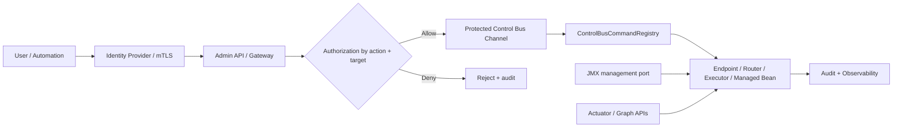
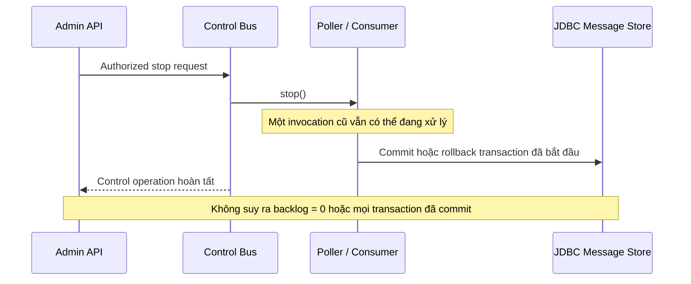

# Quyền truy cập tới control operation trong Spring Integration runtime

## 1. Vì sao control operation là bề mặt bảo mật đặc biệt?

Một message nghiệp vụ thường yêu cầu ứng dụng **xử lý dữ liệu**. Một **control operation** lại yêu cầu ứng dụng **đổi cách nó vận hành**: dừng hoặc khởi động endpoint, đổi mapping router, điều chỉnh thread pool, tạm ngừng poller, thay cấu hình monitoring hay gọi một method quản trị của bean. Nếu lệnh quản trị bị gửi bởi người không đủ quyền, tác động có thể lan rộng tới nhiều message và tài nguyên.

Ví dụ: dịch vụ đang xử lý lệnh thanh toán từ `paymentInput`. Một operator hợp lệ cần tạm dừng poller để xử lý sự cố. Nếu một caller thông thường cũng gửi được lệnh `paymentPoller.stop` tới Control Bus, hệ thống có thể ngừng nhận message dù người đó không được phép điều hành dịch vụ. Nếu caller còn đổi được `ThreadPoolTaskExecutor.setMaxPoolSize` hoặc router mapping, hậu quả có thể là nghẽn worker, mất throughput, điều hướng sai luồng và phát sinh retry/recovery ngoài ý muốn.

Chủ đề **“Quyền truy cập tới control operation”**, thuộc chương **Control và quản trị** của module **SPRING_INTEGRATION_RUNTIME**, giải thích cách xác thực (*authentication*), phân quyền (*authorization*) và ghi nhận thay đổi (*audit*) cho những thao tác điều khiển runtime. Nó gắn với quá trình Spring Integration điều phối message qua channel, endpoint, consumer, poller, executor; quản lý vòng đời IntegrationFlow, transaction, retry, message store, lỗi và correlation.

Mục tiêu học tập:

1. Nhận diện mọi đường vào một control operation: **Control Bus channel**, REST controller, JMX, Actuator, internal service và automation.
2. Phân biệt **method đủ điều kiện được Control Bus gọi** với **caller được phép gọi method ấy**.
3. Cấu hình `AuthorizationChannelInterceptor` bằng `spring-security-messaging`; kiểm thử caller được quyền và bị từ chối.
4. Bảo vệ REST/JMX riêng, không nhầm cơ chế bảo mật của Actuator với Control Bus controller.
5. Thiết kế quyền tối thiểu theo action/target/environment, xử lý SecurityContext qua thread boundary và audit lệnh thực thi.
6. Giải thích hậu quả lên transaction, retry, backlog, correlation và message store khi một thao tác quản trị được chấp nhận.

> **Phạm vi phiên bản:** Các API minh họa dành cho **Spring Integration 6.5.x**, Spring Framework 6.x, Spring Security 6.x và Java 17+. Cấu hình HTTP ví dụ dùng phong cách Spring Security `SecurityFilterChain`, không sử dụng `WebSecurityConfigurerAdapter` đã bị loại bỏ trong Spring Security mới.

## 2. Control Bus 6.5 thực sự thực thi điều gì?

Trong Spring Integration, **Control Bus** triển khai mẫu Enterprise Integration Pattern cho phép gửi **message điều khiển** tới một channel riêng. Endpoint Control Bus tìm bean và method được quản lý, gọi method, rồi xử lý kết quả/lỗi theo cơ chế messaging.

Với **Spring Integration 6.5**, cú pháp payload là tên lệnh đơn giản:

```text
beanName.methodName
```

Nếu method có tham số, các giá trị phải nằm trong header `IntegrationMessageHeaderAccessor.CONTROL_BUS_ARGUMENTS` dưới dạng danh sách. Bean/method được tra cứu bằng `ControlBusCommandRegistry`. Những method đủ điều kiện gồm:

- Method được đánh dấu `@ManagedOperation` hoặc `@ManagedAttribute`;
- Một số method theo `Lifecycle` và `Pausable`;
- Các method cấu hình được hỗ trợ của một số `TaskExecutor` và `TaskScheduler`.

**Đủ điều kiện đăng ký lệnh không có nghĩa người gửi được cấp quyền.** `ControlBusCommandRegistry` chọn command hợp lệ ở tầng framework; **authentication và authorization** vẫn là trách nhiệm của ứng dụng và hạ tầng bảo vệ đường vào.

### 2.1. Không sao chép ví dụ SpEL của phiên bản cũ

Tài liệu Spring Integration 6.2 và các bản cũ hơn mô tả Control Bus diễn giải **Spring Expression Language** với biểu thức như `@bean.method()`. Trong **6.5**, Control Bus cũ dựa trên thực thi SpEL đã bị loại bỏ, thay bằng cơ chế **registry-only** và command `beanName.methodName`. Vì thế:

- Không dùng payload tùy ý như `@someBean.start()` làm ví dụ lệnh chuẩn của 6.5.
- Không giả định có quyền chạy biểu thức/đọc bean tùy ý từ payload trong Control Bus 6.5.
- Nhưng **không vì vậy mà coi Control Bus an toàn khi public**: method được expose vẫn có thể thay đổi trạng thái dịch vụ, và quyền gửi message là ranh giới bảo mật quan trọng.

Ví dụ mẫu lệnh với tham số:

```java
import java.util.List;
import org.springframework.integration.IntegrationMessageHeaderAccessor;
import org.springframework.messaging.Message;
import org.springframework.messaging.support.MessageBuilder;

Message<String> command = MessageBuilder
        .withPayload("myTaskExecutor.setMaxPoolSize")
        .setHeader(IntegrationMessageHeaderAccessor.CONTROL_BUS_ARGUMENTS,
                List.of(12))
        .build();
// Chỉ gửi từ control plane đã xác thực và được phân quyền.
```

Đây là ví dụ **cú pháp**, không phải khuyến nghị expose việc đổi kích thước thread pool ra ngoài. Tùy `TaskExecutor` được quản lý, method có thể là command đủ điều kiện; phải kiểm tra **danh sách lệnh thực tế** của phiên bản ứng dụng trước khi cấp quyền.

### 2.2. Những gì Control Bus không tự bảo đảm

| Tính chất | Control Bus có cung cấp tự động? | Cần làm gì? |
| --- | --- | --- |
| Chỉ thực thi method hợp lệ trong registry | Có, theo quy tắc eligibility của 6.5. | Hạn chế method đánh dấu quản trị; kiểm tra registry. |
| Chỉ ADMIN mới gửi được lệnh | **Không** nếu input channel chưa bảo vệ. | Channel authorization, bảo mật transport và policy ở application. |
| Cấp quyền khác nhau theo từng method/target | Không phải quy tắc RBAC mặc định của Control Bus. | Xây dựng allowlist/command gateway với authorization chi tiết. |
| Lệnh start/stop là transaction với mọi message đang chạy | Không. | Runbook drain, checkpoint và kiểm thử lifecycle. |
| Lệnh đã thực thi đồng nhất trên mọi node | Không; mặc định thao tác vào ApplicationContext hiện tại. | Control plane, generation/ack từng node, eventual consistency. |
| Audit bất biến ai đổi gì | Không tự đầy đủ theo yêu cầu tuân thủ. | Audit độc lập với business log; danh tính, action, target, outcome. |

## 3. Phân loại các đường vào control operation

Không chỉ có channel tên `controlBus`. Một ứng dụng có thể vô tình đưa cùng quyền điều khiển qua nhiều giao diện.



Sơ đồ phân biệt một **đường quản trị có kiểm soát** với các đường phụ JMX, Actuator/graph. Những đường phụ cũng cần xác thực, phân quyền và giới hạn mạng riêng; bảo vệ Admin API không giúp nếu JMX remote hoặc một inbound adapter khác có thể gọi thẳng operation.

| Đường truy cập | Khả năng | Ranh giới cần khóa |
| --- | --- | --- |
| **Control Bus input channel** | Message dạng `bean.method` gọi method quản trị. | Ai có thể `send()`? Có channel interceptor hay adapter bên ngoài nào nối vào? |
| **Control Bus HTTP Controller** | `GET /control-bus` liệt kê command, `POST /control-bus/{bean.method}` thực thi. | Route HTTP, authn/authz, TLS, CSRF khi dùng session/cookie, network. |
| **JMX / MBeans** | Đọc managed attributes, gọi managed operations. | Remote JMX/RMI/TLS/auth, object-name/role, localhost/private network. |
| **Spring Boot Actuator** | Health, metrics, integration graph, logging và một số endpoint có tác động cấu hình. | Endpoint exposure, matcher, role riêng, không mở `*` cho Internet. |
| **Integration Graph Controller** | `GET /integration` và `GET /integration/refresh` theo controller riêng. | Đọc topology/metrics nhạy cảm, refresh có thể tốn tài nguyên; cấu hình Spring Web Security. |
| **Internal Java service / admin tool** | Gọi thẳng `start()`, `stop()`, `setChannelMapping()`, `IntegrationFlowContext.remove()`. | Authorization tại application service, kiểm soát bean injection và quyền của automation. |
| **Broker/JMS/HTTP inbound adapter** | Có thể chuyển dữ liệu bên ngoài thành control message. | Chỉ nối từ nguồn tin cậy, xác thực nguồn và validate payload/header. |

Một lệnh quản trị là **control-plane action**, không phải business command thông thường. Nên tách đường giao nhận, namespace, credentials và audit của hai loại message.

## 4. Nguyên tắc bảo vệ: deny-by-default, least privilege, separation of duties

### 4.1. Cấp quyền theo hành động thực tế

Một ma trận RBAC thực dụng có thể bắt đầu như sau; tên role chỉ là **đề xuất của ứng dụng**, không phải role mặc định của Spring Integration:

| Operation | `FLOW_VIEWER` | `FLOW_OPERATOR` | `FLOW_ADMIN` | Điều kiện bổ sung |
| --- | :---: | :---: | :---: | --- |
| Đọc trạng thái flow/metrics đã khử dữ liệu nhạy cảm | Có | Có | Có | Có phạm vi tenant/service; rate limit. |
| Xem danh sách command và topology | Có điều kiện | Có | Có | Không lộ topology bí mật/credentials. |
| Pause/resume poller được phép | Không | Có | Có | Chỉ endpoint/tenant thuộc scope; audit. |
| Start/stop inbound adapter quan trọng | Không | Có điều kiện | Có | Change ticket, maintenance window và xác nhận backlog. |
| Thay router mapping | Không | Có điều kiện | Có | Allowlist đích, expectedVersion và rollback. |
| Thay thread-pool limit | Không | Không mặc định | Có | Giới hạn min/max, kiểm tra năng lực máy. |
| Đăng ký/hủy dynamic IntegrationFlow | Không | Không mặc định | Có | Quota, ID namespace, drain/replay, chấp thuận. |
| Tắt logging/error reporting hoặc xóa message store | Không | Không | Hạn chế mạnh | Tách người phê duyệt; sao lưu/rollback. |

**Least privilege:** người chỉ cần xem backlog không cần được gửi command. Người được pause một endpoint không nên được quyền shutdown ứng dụng, đổi router của tenant khác hoặc sửa security logging.

**Deny-by-default:** khi chưa có policy rõ, từ chối. Không tự động cho phép mọi method trong `ControlBusCommandRegistry` chỉ vì nó mang `@ManagedOperation`.

**Two-person rule:** với thao tác có thể xóa state, ngắt dịch vụ hoặc đổi route thanh toán, nên có cơ chế approve độc lập hoặc change-control workflow, không để token của một automation có thể thực hiện tất cả.

### 4.2. Authorization phải xét cả target và dữ liệu đầu vào

Chỉ kiểm tra `hasRole("FLOW_OPERATOR")` cho **mọi command** là bước tối thiểu, không đủ khi một operator chỉ được quyền điều khiển tenant A. Quyết định thực sự có thể biểu diễn:

```text
ALLOW iff
  authenticated(actor)
  AND action in allowedActions(actor.roles)
  AND target.tenant in actor.tenantScopes
  AND target is allowlistedFor(action)
  AND arguments satisfy policy
  AND request.version == currentConfigVersion
  AND maintenanceWindowOrApprovalSatisfiedIfRequired
```

Đừng lấy tenant ID, principal hoặc quyền role từ **header do client tự gửi** mà không xác thực. Header có thể bị giả mạo hoặc được sao chép qua bridge. Danh tính đáng tin phải được xác lập từ security context/transport đã xác thực, rồi mới ánh xạ sang yêu cầu control.

### 4.3. Bảo vệ theo nhiều lớp

1. **Network:** management port chỉ bind nội bộ hoặc private network; firewall, mTLS giữa workload, không expose Control Bus/JMX ra Internet.
2. **Authentication:** OIDC/OAuth2 token hoặc service identity phù hợp, hạn dùng ngắn; tách account vận hành với account business.
3. **Authorization:** endpoint HTTP + channel + command-specific allowlist; mỗi lớp chống bypass một đường đi khác.
4. **Validation:** giới hạn command, parameter types, giá trị min/max, target và chống route tới channel không được phép.
5. **Audit/monitoring:** ghi who/what/where/when/outcome, cảnh báo những thay đổi bất thường, kiểm tra config drift giữa node.
6. **Operational safety:** readiness, drain, rollback và backpressure trước những lệnh làm thay đổi lifecycle.

Sự khác nhau cốt lõi: **authentication** trả lời “caller là ai?”, **authorization** trả lời “caller được làm thao tác này trên target này không?”, còn **validation** trả lời “tham số của thao tác có hợp lệ và an toàn không?”. Một lớp không thay thế hai lớp còn lại.

## 5. Bảo vệ Control Bus input channel bằng Spring Security Messaging

Từ **Spring Integration 6.3**, module `spring-integration-security` riêng được loại bỏ để dùng API trong **`spring-security-messaging`**. Với Spring Integration 6.5, cách phổ biến là thêm `org.springframework.security.messaging.access.intercept.AuthorizationChannelInterceptor` vào đúng channel cần bảo vệ; kết hợp `AuthorityAuthorizationManager` để xác định role được phép gửi message.

### 5.1. Cấu hình Java tương đối đầy đủ

Ví dụ sau định nghĩa **channel riêng** cho Control Bus và một bean quản trị *giả lập* có hai thao tác `pauseIntake()`, `resumeIntake()`. Nó minh họa ranh giới phân quyền, **không tự dừng một poller production**.

```java
import java.util.concurrent.atomic.AtomicBoolean;

import org.springframework.context.annotation.Bean;
import org.springframework.context.annotation.Configuration;
import org.springframework.integration.annotation.EnableIntegration;
import org.springframework.integration.channel.DirectChannel;
import org.springframework.integration.dsl.IntegrationFlow;
import org.springframework.jmx.export.annotation.ManagedAttribute;
import org.springframework.jmx.export.annotation.ManagedOperation;
import org.springframework.jmx.export.annotation.ManagedResource;
import org.springframework.security.authorization.AuthorityAuthorizationManager;
import org.springframework.security.messaging.access.intercept.AuthorizationChannelInterceptor;

@Configuration
@EnableIntegration
class SecuredControlBusConfiguration {

    @Bean("securedControlCommands")
    DirectChannel securedControlCommands() {
        DirectChannel channel = new DirectChannel();
        channel.addInterceptor(new AuthorizationChannelInterceptor(
                AuthorityAuthorizationManager.hasRole("FLOW_OPERATOR")));
        return channel;
    }

    @Bean
    IntegrationFlow securedControlBusFlow() {
        return IntegrationFlow.from("securedControlCommands")
                .controlBus()
                .get();
    }

    @Bean("intakeControl")
    IntakeControl intakeControl() {
        return new IntakeControl();
    }

    @ManagedResource(
            objectName = "example.integration:type=FlowControl,name=Intake")
    static class IntakeControl {
        private final AtomicBoolean paused = new AtomicBoolean();

        @ManagedOperation(description = "Mark intake as paused")
        public void pauseIntake() {
            paused.set(true);
        }

        @ManagedOperation(description = "Mark intake as resumed")
        public void resumeIntake() {
            paused.set(false);
        }

        @ManagedAttribute(description = "Current simulated pause flag")
        public boolean isPaused() {
            return paused.get();
        }
    }
}
```

**Phân tích từng lớp:**

1. `DirectChannel` chạy handler đồng bộ trên thread gửi. Khi operator có `SecurityContext` hợp lệ, `AuthorizationChannelInterceptor` kiểm tra role trước khi dispatch Control Bus.
2. `AuthorityAuthorizationManager.hasRole("FLOW_OPERATOR")` mong principal có authority **`ROLE_FLOW_OPERATOR`**. Role không được lấy từ header mà người gửi tự khai.
3. `.controlBus()` sử dụng cơ chế `ControlBusCommandRegistry` của 6.5 để phân giải payload `beanName.methodName`. Nó **không tự cấp quyền**.
4. Bean `intakeControl` có method được `@ManagedOperation` đánh dấu nên được xem xét là command hợp lệ. `@ManagedResource`/`@ManagedAttribute` cũng có thể khiến bean được export qua JMX nếu JMX exporter được bật; phải bảo vệ **đường JMX độc lập**.
5. Giá trị `AtomicBoolean` chỉ thể hiện trạng thái giả lập để học tập. Một thao tác pause thực sự phải điều khiển đúng inbound endpoint/poller theo hợp đồng lifecycle và phải có runbook xử lý backlog.

### 5.2. Gửi command từ caller đã xác thực

Với caller được xác thực và có role phù hợp, code ở **trusted internal application component** có thể gửi:

```java
import org.springframework.beans.factory.annotation.Qualifier;
import org.springframework.messaging.MessageChannel;
import org.springframework.messaging.support.MessageBuilder;

final class IntakeOperator {
    private final MessageChannel commands;

    IntakeOperator(@Qualifier("securedControlCommands")
                   MessageChannel commands) {
        this.commands = commands;
    }

    void pause() {
        commands.send(MessageBuilder
                .withPayload("intakeControl.pauseIntake")
                .build());
    }

    void resume() {
        commands.send(MessageBuilder
                .withPayload("intakeControl.resumeIntake")
                .build());
    }
}
```

Code trên giả định controller/service caller đã được Spring Security **xác thực** và `SecurityContextHolder` mang principal trong **thread đang gửi**. Nếu gọi từ một job/timer không có Authentication, hãy dùng danh tính dịch vụ được cấu hình hợp lệ thay vì cho quyền “anonymous admin”. Không tự set một `ROLE_FLOW_OPERATOR` giả để vượt qua policy trong production.

### 5.3. Dùng global interceptor khi có nhiều channel

Nếu ứng dụng có nhiều control channel, `@GlobalChannelInterceptor(patterns = "securedControl*")` có thể áp một `AuthorizationChannelInterceptor` cho các channel đúng pattern. Tuy nhiên:

- Pattern phải bao trùm **toàn bộ** đường nhận command, không chỉ channel được developer nhớ đặt tên.
- Các `MessageChannel` không khớp pattern không tự được bảo vệ.
- Một flow khác đưa message tới Control Bus qua channel không được guard có thể bypass thiết kế.
- Không áp role admin cho mọi business channel một cách vô tình; phân tách channel quản trị và channel nghiệp vụ giúp policy rõ ràng.

**Channel authorization là lớp thứ hai, không thay thế ingress authorization.** Ví dụ một `@RestController` public trực tiếp gọi `intakeControl.pauseIntake()` sẽ **không đi qua interceptor** và có thể bypass bảo vệ channel. Mọi đường gọi thẳng method phải được bảo vệ bằng method/application authorization tương ứng.

## 6. Phân quyền theo từng control operation, không chỉ theo cả channel

Một `AuthorizationChannelInterceptor` với `hasRole("FLOW_OPERATOR")` cấp quyền gửi **mọi command hợp lệ có thể tới Control Bus** qua channel ấy. Trong môi trường chỉ có một operator tin cậy, điều này có thể chấp nhận được. Nhưng nếu cần role “chỉ pause endpoint X” và “không được đổi thread pool”, cần **policy tinh hơn**.

### 6.1. Ưu tiên gateway quản trị có allowlist

Thay vì public một endpoint nhận chuỗi `beanName.methodName` tùy ý, hãy expose API hữu hạn như:

```text
POST /internal/flow-ops/intake/pause
POST /internal/flow-ops/intake/resume
GET  /internal/flow-ops/intake/status
```

Controller thực hiện authentication, authorize action/target, kiểm tra phiên bản cấu hình và audit; **chỉ sau đó** mới ánh xạ action hợp lệ thành command cố định như `intakeControl.pauseIntake`. Người gọi **không** được tự đặt bean name, method name hoặc `CONTROL_BUS_ARGUMENTS`.

Một lớp ánh xạ allowlist tối giản:

```java
import java.util.Map;
import org.springframework.messaging.MessageChannel;
import org.springframework.messaging.support.MessageBuilder;

final class AllowlistedControlGateway {
    private static final Map<String, String> COMMANDS = Map.of(
            "PAUSE_INTAKE", "intakeControl.pauseIntake",
            "RESUME_INTAKE", "intakeControl.resumeIntake");

    private final MessageChannel securedChannel;

    AllowlistedControlGateway(MessageChannel securedChannel) {
        this.securedChannel = securedChannel;
    }

    void execute(String action) {
        String command = COMMANDS.get(action);
        if (command == null) {
            throw new IllegalArgumentException("Unsupported control action");
        }
        // Authentication/authorization cho action + target được enforce
        // tại application service/controller trước khi tới method này.
        securedChannel.send(MessageBuilder.withPayload(command).build());
    }
}
```

Lớp trên là **thành phần ánh xạ**, không phải một policy engine đầy đủ: với quyền khác nhau cho PAUSE/RESUME hoặc cho từng tenant, cần `@PreAuthorize`/`AuthorizationManager` hoặc service kiểm tra quyền trước khi gọi `execute(...)`. Nếu một module khác lấy được tham chiếu `securedChannel` và gửi command trực tiếp, interceptor vẫn chỉ kiểm tra role chung, nên cũng cần kiểm soát đường gọi bên trong ứng dụng và quyền truy cập của plugin/module.

### 6.2. Phân tách quyền quan sát và quyền thay đổi

Không nên gom mọi quyền quản trị vào role `ADMIN`:

- **Read-only operations**: đọc `isRunning`, metrics, flow graph. Nên có API riêng, hạn chế dữ liệu nhạy cảm và tần suất.
- **Reversible operations**: pause/resume poller, bật flag, đổi mapping trong allowlist. Cần version, audit và xác nhận trạng thái sau lệnh.
- **High-impact operations**: destroy flow, xóa store, đổi concurrency lớn, tắt logging hoặc kiểm soát lỗi. Cần scope hẹp hơn, phê duyệt, kiểm thử rollback/replay.

Hai operation có cùng tên `stop` nhưng target khác nhau có thể rất khác về rủi ro. Authorization nên xét cả **loại bean**, **bean ID**, **tenant/flow**, **environment**, **tham số** và **hậu quả dự kiến**.

### 6.3. Validation của tham số điều khiển

Với `setMaxPoolSize(int)`, chỉ kiểm tra kiểu `int` là chưa đủ. Giá trị `0`, âm, cực lớn hoặc nhỏ hơn active concurrency có thể làm hệ thống lỗi/không ổn định. Validate ngưỡng theo SLA và tài nguyên máy; với router phải chỉ cho phép đích nằm trong allowlist và không tạo self-loop. Ghi rõ expected config generation để tránh hai operator ghi đè thay đổi của nhau.

Lệnh có side effect cần **idempotency/change ID** ở control plane. Việc retry HTTP do timeout có thể gọi operation hai lần; `pause()` thường idempotent hơn `increasePoolSizeBy(1)`. Với update cấu hình, dùng compare-and-set/version để nhận diện retry và xung đột.

## 7. Control Bus REST Controller, Actuator và Integration Graph

### 7.1. `@EnableControlBusController` không phải Actuator endpoint

Từ Spring Integration 6.4, module HTTP hỗ trợ `@EnableControlBusController` để đăng ký REST controller tại `/control-bus`:

- `GET /control-bus` trả danh sách bean và command có thể gọi, bao gồm parameter types.
- `POST /control-bus/{beanName.methodName}` thực thi command; body có thể chứa danh sách tham số và kiểu.

Controller này có khả năng **thay đổi runtime**. Nó **không phải** đường `/actuator/**`, nên một rule chỉ bảo vệ Actuator không tự bảo vệ `/control-bus/**`. Danh sách GET cũng có thể lộ topology và các khả năng quản trị; phải hạn chế cả quyền đọc.

**Ưu tiên kiến trúc:** nếu ứng dụng không thật sự cần API Control Bus tổng quát thì **không bật** `@EnableControlBusController`. Dùng một Admin API nhỏ với allowlist rõ ràng. Nếu đã bật controller, bảo vệ HTTP trước khi mở network access.

### 7.2. Ví dụ Spring Security 6: giới hạn HTTP route

Ví dụ dưới đây minh họa một security chain **chỉ cho `/control-bus`**. Nó giả định ứng dụng đã có hệ thống xác thực phù hợp; `httpBasic` chỉ để làm rõ luồng authentication trong môi trường demo/lab. Production ưu tiên identity provider/OAuth2/mTLS, TLS và private management network.

```java
import org.springframework.context.annotation.Bean;
import org.springframework.context.annotation.Configuration;
import org.springframework.core.annotation.Order;
import org.springframework.http.HttpMethod;
import org.springframework.security.config.Customizer;
import org.springframework.security.config.annotation.web.builders.HttpSecurity;
import org.springframework.security.web.SecurityFilterChain;

@Configuration
class ControlHttpSecurityConfiguration {

    @Bean
    @Order(1)
    SecurityFilterChain controlBusSecurity(HttpSecurity http) throws Exception {
        return http.securityMatcher("/control-bus", "/control-bus/**")
                .authorizeHttpRequests(auth -> auth
                        .requestMatchers(HttpMethod.GET, "/control-bus")
                            .hasAnyRole("FLOW_VIEWER", "FLOW_OPERATOR")
                        .requestMatchers(HttpMethod.POST, "/control-bus/**")
                            .hasRole("FLOW_OPERATOR")
                        .anyRequest().denyAll())
                .httpBasic(Customizer.withDefaults())
                .build();
    }
}
```

**Điểm phải cấu hình thêm trong ứng dụng thật:**

1. Nếu đã tạo `SecurityFilterChain` tùy chỉnh, Spring Boot có thể không còn áp bộ quy tắc Actuator security mặc định. Phải khai báo **một chain khác** cho các route còn lại và bảo vệ riêng Actuator.
2. Với ứng dụng dùng cookie/session, CSRF phải được xử lý đúng: lệnh POST thay đổi trạng thái thường cần CSRF token. Một 403 do thiếu CSRF trong test **không có nghĩa** rule role đã được test. Không vô hiệu CSRF toàn cục chỉ để command chạy được.
3. Với HTTP Basic hoặc bearer token, luôn truyền qua TLS. Ví dụ trên không cấu hình người dùng/mật khẩu; bạn phải gắn `AuthenticationProvider` hoặc hệ thống đăng nhập thật.
4. Role ở controller (`FLOW_OPERATOR`) và role ở channel phải nhất quán. Một request POST được HTTP cho phép nhưng không có `ROLE_FLOW_OPERATOR` ở thread gửi vẫn có thể bị channel từ chối — đây là defense in depth.
5. Rule GET chỉ nên dành cho người có nhu cầu biết lệnh khả dụng; trong môi trường nghiêm ngặt, thay GET command list bằng API inventory đã khử thông tin nhạy cảm.

### 7.3. Actuator và graph controller là hai bề mặt khác

Spring Boot Actuator có hệ thống endpoint exposure và security riêng. Chỉ những endpoint cần thiết mới được đưa lên HTTP; cấu hình `management.endpoints.web.exposure.include=*` là **rủi ro** nếu không có policy/network bảo vệ tương ứng. Tùy phiên bản Boot, có thể dùng `EndpointRequest` để bảo vệ các Actuator endpoints. Nếu tự khai báo security chain, không dựa vào giả định auto-security cũ vẫn có hiệu lực.

Spring Integration còn có `IntegrationGraphController` (khi được enable) với `GET /integration` và `GET /integration/refresh` theo mặc định. Nó có thể lộ tên channel/endpoint/adapter và topology. Dù phần lớn là read/refresh graph, hãy bảo vệ theo Spring Security và giới hạn CORS. Đừng đánh đồng GET graph với GET Control Bus command list; chúng phục vụ mục đích khác nhau.

### 7.4. Mẫu response và cách hiểu lỗi

| Kết quả | Diễn giải thường gặp | Cần kiểm tra |
| --- | --- | --- |
| HTTP 401 | Chưa có hoặc không xác thực được danh tính. | Identity token/session, TLS và auth provider. |
| HTTP 403 | Đã xác thực nhưng thiếu quyền, **hoặc** CSRF thiếu. | Authorization rule, method, CSRF và security context. |
| HTTP 404/405 | Route hoặc method không được expose đúng. | `@EnableControlBusController`, HTTP path, method GET/POST. |
| Control Bus command không tìm được | Method không eligible, bean name sai hoặc command registry chưa có. | `ControlBusCommandRegistry`, annotation, lifecycle và tên bean. |
| Lệnh trả thành công nhưng trạng thái chưa như kỳ vọng | Operation async hoặc chỉ đổi flag, component chưa drain. | Verify target state, in-flight tasks và timeout. |

Không nên viết logic điều hành chỉ dựa vào mã HTTP 2xx mà bỏ qua response/error details và trạng thái thực của endpoint.

## 8. JMX và đường gọi trực tiếp bean cũng phải được bảo vệ

Một method có `@ManagedOperation` hoặc `@ManagedAttribute` có thể là command phù hợp cho Control Bus **và** được JMX exporter đưa ra MBean, nếu JMX được cấu hình. Việc bảo vệ `securedControlCommands` **không hạn chế** client gọi method thông qua JMX hoặc một controller/service trực tiếp. Vì thế cần quản lý:

- **JMX remote access:** chỉ mở khi cần; bind vào management network, bật authentication, mã hóa kết nối, giới hạn MBean/operation, firewall và theo dõi truy cập. Nếu không dùng, không expose JMX remote.
- **JMX export:** kiểm tra danh sách `ObjectName` và methods. `@ManagedOperation` quá rộng có thể vô tình expose thao tác rủi ro ở nhiều transport.
- **Tài khoản của monitoring:** ưu tiên read-only access tới metrics/attributes, không mặc nhiên cho quyền gọi `start`/`stop`/`shutdown`.
- **Internal code path:** method security hoặc application service authorization cần áp dụng tại điểm gọi trực tiếp; `@PreAuthorize` chỉ có hiệu lực khi method security được enable và lời gọi đi qua proxy phù hợp.
- **Automation:** dùng danh tính dịch vụ riêng có scope rất hẹp; không copy quyền quản trị cao nhất cho mọi batch job/health checker.

Một cách giảm bề mặt là không expose nguyên bean có nhiều method nguy hiểm, thay bằng **một façade quản trị nhỏ** chỉ khai báo operations cần thiết. Nhưng cần nhớ những bean framework khác vẫn có các method điều khiển lifecycle/management riêng; façade không thay thế kiểm kê toàn bộ JMX/Control Bus registry.

## 9. SecurityContext qua DirectChannel, ExecutorChannel và poller

Spring Security thường lưu `Authentication` trong `SecurityContextHolder` gắn với **thread hiện tại**. Điều này có hệ quả trực tiếp khi Spring Integration chuyển message từ thread này sang thread khác.

| Đường đi | Context của caller có tự hiện diện tại handler? | Cách bảo vệ |
| --- | --- | --- |
| `DirectChannel` → Control Bus | Thường có, vì dispatch đồng bộ trên cùng thread. | Authorization tại channel, method/service policy, cleanup context sau request. |
| `ExecutorChannel` → handler | **Không mặc định**; task chạy ở worker thread khác. | Propagation an toàn, authorization ở nơi thực thi, kiểm tra cleanup. |
| `QueueChannel` → polling consumer | **Không mặc định**; message có thể đợi lâu hoặc tồn tại qua restart. | Bảo vệ lúc ingress + kiểm chứng/trusted identity ở điểm tiêu thụ; không tin vào header tùy ý. |
| `PublishSubscribeChannel` với executor | Các subscriber có thể chạy nhiều thread. | Security context propagation theo từng subscriber, tránh rò rỉ giữa các tasks. |
| JMS/AMQP/Kafka redelivery | Giao lại có thể chạy process/thread khác, thậm chí sau restart. | Xác thực tại boundary mới hoặc kiểm tra identity/authorization đã được xác lập bền vững theo policy. |

Spring Integration 6.5 khuyến nghị dùng API từ `spring-security-messaging`, bao gồm `SecurityContextPropagationChannelInterceptor`, khi cần chuyển context giữa các thread. Interceptor có cơ chế lấy context lúc gửi và gắn lại khi consumer xử lý, đồng thời **dọn `ThreadLocal` sau xử lý**. Việc dọn sạch rất quan trọng khi thread pool tái sử dụng worker: nếu giữ principal admin từ message trước, message tiếp theo có thể được chạy dưới sai danh tính.

**Không chỉ thêm propagation rồi thôi:** nếu một message chứa header `Authentication` do client tùy ý đặt, việc tin header đó để cấp quyền sẽ tạo cơ chế giả mạo identity. Chỉ lấy Authentication từ ingress đã xác thực, và tuyệt đối không biến việc deserialize một header thành bằng chứng caller hợp lệ. Đối với queue bền qua restart, việc lưu nguyên đối tượng `SecurityContext` không phải chiến lược nhận dạng bền vững; nên cân nhắc **trusted service identity**, signed claims có expiry/audience hoặc tái xác thực ở control boundary.

### 9.1. Vì sao nên giữ Control Bus trên đường đồng bộ, riêng biệt?

Với lệnh có quyền thay đổi runtime, một đường đồng bộ riêng giúp:

- Kiểm tra quyền **trước khi** command bắt đầu, trong context của caller đã xác thực.
- Trả về thành công hoặc exception ở cùng invocation; dễ nối vào audit và change ID.
- Tránh lưu lệnh quản trị vào `QueueChannel` không có chính sách TTL, để đến nhiều giờ sau mới thực thi khi quyền của người gửi đã bị thu hồi.
- Giảm phức tạp retry/redelivery một command thay đổi cấu hình.

Đây là lựa chọn thiết kế, không phải hạn chế cứng của Spring Integration. Một số hệ thống cần control queue bền vững; khi đó phải có **expiry, authorization tại thời điểm thực thi, idempotency key, version fencing và trạng thái pending/approved/completed** để ngăn replay lệnh cũ.

### 9.2. Trường hợp Principal bị mất ở async handler

Giả sử HTTP endpoint đã xác thực operator và gửi message vào `ExecutorChannel`. Interceptor ở input channel có thể cho phép gửi vì người đó đủ role; nhưng khi worker chạy `@PreAuthorize` ở bean đích, `SecurityContextHolder` trên worker có thể rỗng. Kết quả là method bị từ chối dù operator hợp lệ.

**Không sửa bằng cách bỏ kiểm tra quyền ở handler**. Thay vào đó, đặt `SecurityContextPropagationChannelInterceptor` đúng boundary hoặc dùng executor hỗ trợ propagation trong Spring Security, rồi kiểm tra context được clear sau xử lý. Với `QueueChannel` lưu bền qua restart, nên thiết kế command identity có thể kiểm chứng lại sau restart thay vì phụ thuộc transient context cũ.

## 10. Kiểm thử phân quyền với handler quản trị giả lập

Test dưới đây dùng đúng config ở mục 5. Nó tạo `Authentication` giả trong **test scope**, gửi command qua **channel thật**, rồi kiểm chứng action bị từ chối không làm đổi state. Việc tự tạo Authentication trong test là hợp lệ để giả lập các principal; **không làm điều này trong production để tự cấp quyền**.

```java
import java.util.List;

import org.junit.jupiter.api.AfterEach;
import org.junit.jupiter.api.Test;
import org.springframework.beans.factory.annotation.Autowired;
import org.springframework.beans.factory.annotation.Qualifier;
import org.springframework.messaging.MessageChannel;
import org.springframework.messaging.support.GenericMessage;
import org.springframework.security.authentication.UsernamePasswordAuthenticationToken;
import org.springframework.security.core.authority.SimpleGrantedAuthority;
import org.springframework.security.core.context.SecurityContextHolder;
import org.springframework.test.annotation.DirtiesContext;
import org.springframework.test.context.junit.jupiter.SpringJUnitConfig;

import static org.junit.jupiter.api.Assertions.*;

@SpringJUnitConfig(SecuredControlBusConfiguration.class)
@DirtiesContext(classMode = DirtiesContext.ClassMode.AFTER_EACH_TEST_METHOD)
class ControlBusAuthorizationTest {

    @Autowired
    @Qualifier("securedControlCommands")
    MessageChannel commands;

    @Autowired
    SecuredControlBusConfiguration.IntakeControl intake;

    @AfterEach
    void clearSecurityContext() {
        SecurityContextHolder.clearContext();
    }

    @Test
    void operatorCanExecuteAllowedManagedOperation() {
        authenticateAs("FLOW_OPERATOR");

        assertTrue(commands.send(
                new GenericMessage<>("intakeControl.pauseIntake")));

        assertTrue(intake.isPaused());

        assertTrue(commands.send(
                new GenericMessage<>("intakeControl.resumeIntake")));
        assertFalse(intake.isPaused());
    }

    @Test
    void viewerCannotMutateRuntimeState() {
        authenticateAs("FLOW_VIEWER");

        assertThrows(RuntimeException.class,
                () -> commands.send(
                        new GenericMessage<>("intakeControl.pauseIntake")));

        assertFalse(intake.isPaused());
    }

    @Test
    void unauthenticatedCallerCannotMutateRuntimeState() {
        SecurityContextHolder.clearContext();

        assertThrows(RuntimeException.class,
                () -> commands.send(
                        new GenericMessage<>("intakeControl.pauseIntake")));

        assertFalse(intake.isPaused());
    }

    private static void authenticateAs(String role) {
        var auth = new UsernamePasswordAuthenticationToken(
                "operator-in-test",
                "unused-credential",
                List.of(new SimpleGrantedAuthority("ROLE_" + role)));
        SecurityContextHolder.getContext().setAuthentication(auth);
    }
}
```

Với `DirectChannel`, các lời gọi trong ví dụ thường chạy đồng bộ. Bài test không nên chỉ assert exception type ngoài cùng vì framework có thể bọc `AccessDeniedException` hoặc lỗi auth trong `MessagingException`; **assert state không thay đổi** là bất biến quan trọng hơn. Trong bộ test chuyên sâu, có thể duyệt cause chain để kiểm tra đúng lỗi phân quyền, phân biệt với “bean không tồn tại” hoặc “method không eligible”.

### 10.1. Tập test phân quyền phải có cả đường HTTP và đường bên trong

Đừng chỉ viết một test với `MockMvc` rồi kết luận channel đã an toàn. Cần hai loại:

1. **Security MVC test:** gửi HTTP GET/POST qua `/control-bus` hoặc Admin API, với no token, role viewer, role operator, CSRF thiếu/đủ; kiểm tra 401/403/2xx đúng policy.
2. **Message channel integration test:** code gửi trực tiếp vào `securedControlCommands` với security context tương ứng; kiểm tra unauthorized không đến bean. Nếu tồn tại channel/adapter khác nối vào bus, phải có test đường bypass đó.

Ví dụ bảng điều kiện:

| Người gửi | Command | Kỳ vọng HTTP/channel | Bất biến cần assert |
| --- | --- | --- | --- |
| Anonymous | Pause | Reject. | Không thay state; có security audit. |
| Viewer | GET danh sách command (nếu policy cho phép) | Read-only. | Không có quyền gửi command. |
| Viewer | POST `pauseIntake` | Reject. | Intake vẫn chạy. |
| Operator | POST `pauseIntake` | Allow nếu qua TLS, authn và policy đầy đủ. | Một change event, state chuyển paused. |
| Operator | Thử command ngoài allowlist | Reject ở application gateway. | Không có method khác bị gọi. |
| Operator tenant A | Stop endpoint tenant B | Reject dù role đúng. | Không thay lifecycle của tenant B. |
| Operator có token đã hết hạn | Pause | Reject. | Không dùng Authentication cũ. |
| Admin | Thay router tới channel không allowlist | Reject input validation. | Mapping cũ còn nguyên. |
| Client đã xác thực qua HTTP nhưng thiếu CSRF trong phiên cookie/session | POST thay state | Thường 403 nếu CSRF được bật. | Không có mutation. |

### 10.2. Test async propagation và cleanup

Đặt flow test có `ExecutorChannel` hoặc `QueueChannel`, cấu hình `SecurityContextPropagationChannelInterceptor` ở đúng channel, rồi:

1. Gửi message A với danh tính operator; tại consumer ghi lại principal và xác minh đúng operator.
2. Gửi message B không có quyền trên **cùng worker thread tái sử dụng**; xác minh operation không được thực thi dưới principal của A.
3. Sau mỗi completion/exception, xác minh `SecurityContextHolder` được cleanup trong worker và không còn principal cũ.
4. Thử cancellation, timeout, exception từ handler và nhiều consumers đồng thời.

Không dùng `Thread.sleep(1000)` rồi mong worker hoàn tất. Dùng `CountDownLatch`, `Future.get(timeout)` hoặc test utility có timeout rõ; nhớ giải phóng latch và shutdown executor trong `finally`.

### 10.3. Test multi-node: role đúng nhưng node sai

Một API admin trên node A chỉ thay mapping ở A. Nếu node B vẫn xử lý cùng tenant, hệ thống có **config drift** dù operator có quyền. Test cần khởi tạo hai Spring contexts/nodes và kiểm tra command có phạm vi node hay toàn cluster. Đối với tác động toàn fleet, control plane phải kiểm chứng `desiredVersion` và `appliedVersion` của từng node trước khi khẳng định rollout hoàn tất.

## 11. Quyền điều khiển gắn với transaction, retry và runtime lifecycle

Phân quyền là điều kiện **trước khi cho phép** hành động. Sau khi được cho phép, thao tác vẫn có thể tạo rủi ro nghiệp vụ nếu runtime đang có message hoặc transaction chưa hoàn tất.

### 11.1. Start/stop không đồng nghĩa drain

Một lệnh `someEndpoint.stop` có thể ngừng một endpoint theo `Lifecycle`, nhưng không tự chứng minh mọi message đã hoàn thành:

- `DirectChannel` có thể có thread đang xử lý lời gọi từ producer trước khi stop.
- `ExecutorChannel` có thể còn tasks đã submit; lệnh stop một producer không tự hủy tasks trong executor.
- Poller có thể đang nhận message trong transaction; cần biết commit/rollback hoàn tất khi nào.
- `QueueChannel` và persistent `MessageStore` có thể còn backlog sau stop; không được hủy store/flow hoặc đổi group ID trước khi có phương án xử lý.
- Aggregator có thể giữ message group chưa đủ để release; chuyển route/flow có thể làm nhóm cũ bị bỏ lại.
- Gateway đang chờ reply có thể timeout nếu endpoint bị dừng; reply đến muộn cần correlation và error handling.

Vì vậy, một operation “pause inbound adapter” có thể là bước đầu để quiesce, nhưng một operation “destroy dynamic IntegrationFlow” thường cần thêm **drain checkpoint, state inventory và rollback kế hoạch**. Role admin không thay thế điều kiện an toàn vận hành.

### 11.2. Transaction boundary của command và message business

Control operation thường chạy trên thread/transaction của đường quản trị, **không tự tham gia transaction của business message đang ở thread khác**. Ví dụ:



Một lệnh đổi router cũng không di chuyển các message đã vào queue cũ. Một lệnh đổi `TaskExecutor` limit không đảm bảo loại bỏ backlog ngay. Sau mỗi thay đổi cần **verify** qua trạng thái endpoint, active threads, message queue depth, error channel và outcome của business operation.

### 11.3. Retry của control operation không giống retry business message

Giả sử admin HTTP POST chuyển mapping V1 → V2, nhưng response timeout sau khi command đã thực thi. Client retry cùng POST. Nếu operation là “set mapping to V2”, tác dụng có thể idempotent. Nếu operation là “toggle mapping”, gọi hai lần có thể đưa hệ thống **trở về V1**. Vì thế:

- Ưu tiên operation **set desired state** (`setPaused(true)`) thay vì toggle (`flipPaused()`).
- Gắn `changeId` và `expectedVersion`; lưu kết quả thay đổi ở control-plane store trước khi trả ACK.
- Đặt timeout cho command, nhưng timeout không đồng nghĩa command chắc chắn chưa thực thi.
- Không áp retry vô hạn cho “stop/start/destroy/purge” chỉ vì HTTP trả 5xx.
- Phân biệt **command accepted**, **command executed**, **desired state observed**, **fleet converged** trong response và audit.

### 11.4. Recovery và audit khi lệnh thất bại

Lệnh quản trị có thể thất bại vì thiếu quyền, bean/method không hợp lệ, component đang dừng, connection lỗi, transaction bận hoặc xung đột phiên bản. Nên phân loại:

| Loại lỗi | Retry? | Phản hồi vận hành |
| --- | --- | --- |
| Unauthorized/forbidden | **Không** tự retry bằng tài khoản cao hơn. | Trả 401/403 tương ứng, audit và cảnh báo nếu bất thường. |
| Unknown command/target | Không. | Trả lỗi validation, kiểm tra allowlist/config. |
| Stale expectedVersion | Không tự ghi đè. | Yêu cầu reload state, review xung đột. |
| Endpoint tạm bận | Có điều kiện. | Chờ có giới hạn/backoff, chỉ khi operation idempotent và đã xác minh. |
| Timeout chưa biết kết quả | Không giả định failure. | Query trạng thái thực, đối chiếu changeId rồi quyết định retry. |
| Partial multi-node rollout | Có điều phối. | Theo dõi nodes đã áp dụng, có thể rollback/roll-forward theo policy. |

Khi command ném exception, không được âm thầm chuyển nó thành “success” chỉ để tránh alert. Error/recovery channel cho control plane phải được bảo vệ và có consumer đúng chức năng; không để lỗi vận hành trôi vào cùng DLQ business mà thiếu danh tính và change ID.

## 12. Audit trail: chứng minh ai đã thay đổi điều gì?

Audit control operation phải đủ chi tiết để người trực ca có thể giải thích **tại sao** một flow dừng, router đổi và backlog tăng. Log dòng chữ “endpoint stopped” không đủ nếu không biết actor, quyền, target và command xuất phát từ đâu.

### 12.1. Một event audit tối thiểu

Ví dụ cấu trúc log/sự kiện do **ứng dụng quản trị** định nghĩa, không phải class framework tự động sinh:

```json
{
  "changeId": "chg-2026-114",
  "timestamp": "2026-11-22T02:00:00Z",
  "actor": "svc-flow-operator",
  "actorType": "SERVICE",
  "action": "PAUSE_INTAKE",
  "target": "paymentsPoller",
  "tenantScope": "tenant-7",
  "service": "SPRING_INTEGRATION_RUNTIME",
  "node": "integration-worker-2",
  "expectedConfigVersion": 17,
  "appliedConfigVersion": 18,
  "authorization": "ALLOWED",
  "execution": "COMPLETED",
  "before": "RUNNING",
  "after": "STOPPED",
  "requestId": "req-a9f0"
}
```

Các trường hữu ích gồm:

| Nhóm | Trường nên có | Mục đích |
| --- | --- | --- |
| Danh tính | Authenticated subject, service identity, roles/scopes, issuer | Xác định actor được xác thực thật. |
| Lệnh | Action/bean/target, tham số **đã redacted**, expected version | Tái hiện đúng thao tác, không lộ secrets. |
| Ngữ cảnh | Service, node, environment, tenant, change ticket, request ID | Liên kết một thay đổi qua nhiều node. |
| Quyết định | Allowed/denied, lý do từ chối | Phân biệt policy failure với lỗi runtime. |
| Thực thi | Accepted/executed/failed, duration, exception category | Không nhầm “HTTP đã nhận” với “component đã đổi trạng thái”. |
| Hậu kiểm | Before/after state, config generation, in-flight/backlog snapshot | Phát hiện partial cutover hoặc state không như mong đợi. |

**Những điều cần tránh:** ghi password/bearer token, nguyên message payload chứa PII, toàn bộ exception stack có secret hoặc cho caller tự điền `actor` qua header mà không kiểm chứng. Dữ liệu audit nên được bảo vệ khỏi sửa/xóa tùy ý, phân quyền đọc riêng và giữ theo retention policy. Nếu audit sink lỗi, các operation có nguy cơ cao nên cân nhắc **fail-closed** hoặc hàng đợi audit bền vững theo yêu cầu tuân thủ; không để mất mọi chứng cứ mà vẫn tiếp tục xóa tài nguyên.

### 12.2. Correlation và trace

Một command có thể phát sinh nhiều thay đổi:

```text
changeId=chg-114
  ├─ Admin API: ALLOWED PAUSE paymentsPoller
  ├─ Node A: stop requested → stopped
  ├─ Node B: stop requested → failed (timeout)
  └─ Control plane: PARTIALLY_APPLIED, requires reconciliation
```

Gắn `changeId`/`requestId` xuyên qua HTTP → application service → message header/tracing → command invocation → status verification. Không dùng mỗi `correlationId` của **message nghiệp vụ** để thay cho change ID quản trị; hai kiểu sự kiện có vòng đời khác nhau. Trong metrics, dùng tag theo **action/category/service/node**, không dùng `changeId` duy nhất làm metric label để tránh cardinality lớn.

## 13. Checklist bảo mật và runbook trước khi mở quyền quản trị

### 13.1. Threat model ngắn

| Rủi ro | Cửa vào | Hệ quả | Biện pháp |
| --- | --- | --- | --- |
| Anonymous gửi stop | HTTP/JMS adapter nối thẳng Control Bus | Ngừng xử lý message, SLA bị ảnh hưởng | Authn + RBAC + protected channel + private network. |
| Operator đổi router sang channel ngoài allowlist | Payload/arguments quá linh hoạt | Bypass luồng kiểm soát, mất routing đúng | Fixed action gateway, allowlist target, kiểm tra mapping trước apply. |
| Viewer đọc danh sách command | `GET /control-bus` public | Lộ cấu trúc bean và operation nhạy cảm | Bảo vệ GET, hạn chế exposure, audit. |
| JMX bypass channel authorization | MBean exporter hoặc remote RMI | Gọi `@ManagedOperation` trực tiếp | Khóa JMX remote, tài khoản riêng, giới hạn methods. |
| Principal admin rò giữa threads | Executor tái sử dụng `ThreadLocal` | Message khác chạy dưới nhầm identity | Security context propagation/cleanup và test. |
| Old admin command được replay | Queue control bền vững, TTL không có | Dừng flow sau khi kế hoạch đã hết hiệu lực | Expiry, changeId, expectedVersion, re-authorize tại execution. |
| Competing control changes | Hai admin cùng sửa mapping/concurrency | Lost update, config drift | Config generation, CAS, audit và ACK từng node. |
| Broad Actuator exposure | `management.endpoints.web.exposure.include=*` | Lộ hoặc sửa runtime properties | Chỉ include endpoint cần thiết, Spring Security và firewall. |
| Bypass bằng direct bean invocation | Internal controller gọi thẳng method | Bỏ qua channel policy | Method/application authorization cho mọi code path. |
| DoS qua registration/destroy liên tục | Public dynamic flow API | Cạn bean, thread, DB connection | Quota, rate limit, approval và lifecycle cleanup. |

### 13.2. Trước một thao tác high-impact

1. **Định danh:** actor đã qua authentication; token còn hạn và đúng audience/service.
2. **Phân quyền:** kiểm tra action, target, tenant scope, environment; không chỉ xem có `ROLE_ADMIN` chung.
3. **Preconditions:** xác nhận endpoint tồn tại, version cấu hình hiện tại, readiness, quota và cửa sổ bảo trì.
4. **Kiểm tra trạng thái:** active thread/transaction, backlog trong `QueueChannel`, message group chưa xong, retries/recovery đang chờ, gateway correlation.
5. **Chống trùng:** có `changeId`, expected config generation, idempotent desired-state command và biện pháp chống retry double-apply.
6. **Audit:** ghi request/approval trước khi thực thi; lưu outcome và before/after sau đó.
7. **Thực hiện:** dùng control plane/secured channel, timeout có giới hạn; không để command vô hạn trong queue.
8. **Hậu kiểm:** xác minh trạng thái thực tại từng node và outcome nghiệp vụ; nếu partial failure, điều phối rollback/roll-forward.

### 13.3. Nếu nghi ngờ control plane bị lạm dụng

Ngay khi phát hiện actor lạ hoặc lệnh không được phê duyệt:

- Cô lập đường ingress quản trị không tin cậy (HTTP, broker, JMX, token) **mà không xóa audit**.
- Thu hồi credential hoặc scope liên quan; xác minh không có API/adapter khác bypass.
- Đối chiếu registry commands, active IntegrationFlows, router mappings, executor limits và trạng thái poller giữa các node với bản cấu hình được phê duyệt.
- Kiểm tra message backlog và các giao dịch đang xử lý để xác định mất/trùng message; bảo vệ message store và metadata store trước khi thao tác hồi phục.
- Chạy runbook phục hồi theo trạng thái mong muốn, tránh “toggle” mù; thực hiện lại bằng change ID mới và operator được phê duyệt.
- Đóng incident bằng audit timeline, nguyên nhân gốc và test chống tái diễn.

## 14. Bài tập thực hành

**Bài tập 1 — Kết nối channel authorization:** chạy `SecuredControlBusConfiguration`. Giả lập operator và viewer trong test, chứng minh viewer không làm `intakeControl.isPaused()` đổi từ false sang true, còn operator làm được.

**Bài tập 2 — Bypass test:** tạo một test gọi thẳng `intakeControl.pauseIntake()` để thấy channel interceptor không chặn lời gọi trực tiếp. Thiết kế service có `@PreAuthorize`/role check bảo vệ đường Java direct invocation, rồi kiểm tra quyền lại.

**Bài tập 3 — REST access:** bật `@EnableControlBusController` **chỉ trong môi trường test nội bộ**, cấu hình security chain mục 7, dùng `MockMvc` kiểm tra anonymous/viewer/operator với GET/POST và CSRF. Xác minh một 403 do CSRF khác với 403 do thiếu role.

**Bài tập 4 — Allowlist:** mở rộng `AllowlistedControlGateway` thêm command `RESUME_INTAKE` cho tenant A nhưng không cho tenant B. Thử input chứa chuỗi command tùy ý, target không tồn tại và tham số trái giới hạn; tất cả phải bị từ chối trước khi Control Bus chạy.

**Bài tập 5 — JMX exposure:** lập danh sách các managed methods được export khi bật JMX trong test. Chứng minh bảo vệ channel không đồng nghĩa bảo vệ JMX; viết policy tách monitoring read-only khỏi operator có quyền sửa trạng thái.

**Bài tập 6 — SecurityContext threading:** cho lệnh đi qua `ExecutorChannel`, dùng worker thread tái sử dụng và `SecurityContextPropagationChannelInterceptor`. Assert identity đúng tại handler, không rò identity khi chạy task kế tiếp.

**Bài tập 7 — Control-plane concurrency:** hai operator cùng yêu cầu đổi router mapping từ version 17. Chỉ một update được nhận qua expectedVersion/CAS; cập nhật còn lại phải đọc lại config hoặc nhận conflict. Kiểm tra audit cho cả hai quyết định.

**Bài tập 8 — Stop khi còn backlog:** tạo `QueueChannel` chứa 20 messages và poller có transaction. Gọi pause/stop qua một command được phân quyền, quan sát in-flight/backlog, rồi resume. Chứng minh stop không tự xóa message và không ngầm cam kết mọi việc đã hoàn thành.

**Bài tập 9 — Recovery sau timeout:** gửi lệnh `setPaused(true)` nhưng giả lập mất HTTP response sau khi handler thực thi. Client gửi lại cùng `changeId`; ứng dụng phải trả trạng thái thực mà không tạo hai change events hoặc “toggle” ngược.

**Bài tập 10 — Multi-node:** chạy hai application contexts A/B với cùng mapping V1; áp command chỉ vào A. Thiết kế control plane ghi desired version và ACK hai node, đồng thời phân biệt trạng thái `PARTIALLY_APPLIED` với `COMPLETED`.

### Câu hỏi tự kiểm tra

1. Method có `@ManagedOperation` có đồng nghĩa caller nào cũng được phép thực thi không?
2. Cú pháp Control Bus trong Spring Integration **6.5** khác thế nào với cú pháp SpEL của các bản cũ?
3. `AuthorizationChannelInterceptor` bảo vệ đường gọi nào và không bảo vệ đường gọi nào?
4. Vì sao chỉ bảo vệ `/actuator/**` không đủ nếu ứng dụng bật `@EnableControlBusController`?
5. Tại sao ngay cả quyền GET danh sách command cũng cần được xét?
6. Khi `ExecutorChannel` đổi thread, vì sao security context có thể mất và nguy cơ rò `ThreadLocal` là gì?
7. Vì sao gửi `stop()` trả thành công không chứng minh queue đã drain và transaction đã commit?
8. Vì sao command `setPaused(true)` an toàn để retry hơn `togglePaused()`?
9. Điều gì có thể xảy ra khi chỉ cập nhật router trên một pod và quên các pod khác?
10. Một audit event tối thiểu cần trường nào để truy ra người đổi mapping và kết quả sau thay đổi?

## 15. Tài liệu tham khảo chính thức

- Spring Integration **6.5** — [Control Bus](https://docs.spring.io/spring-integration/reference/6.5/control-bus.html): command `beanName.methodName`, `CONTROL_BUS_ARGUMENTS`, `ControlBusCommandRegistry` và các managed methods được hỗ trợ.
- Spring Integration **6.5** — [Control Bus Controller](https://docs.spring.io/spring-integration/reference/6.5/http/control-bus-controller.html): `@EnableControlBusController`, GET command inventory và POST invocation qua HTTP.
- Spring Integration **6.5** — [Security in Spring Integration](https://docs.spring.io/spring-integration/reference/6.5/security.html): `AuthorizationChannelInterceptor`, `AuthorityAuthorizationManager` và `SecurityContextPropagationChannelInterceptor`.
- Spring Integration **6.5** — [Integration Graph Controller](https://docs.spring.io/spring-integration/reference/6.5/integration-graph-controller.html): GET graph/refresh và bảo vệ REST endpoint.
- Spring Integration **6.5** — [JMX Support](https://docs.spring.io/spring-integration/reference/6.5/jmx.html): JMX adapters và managed resources.
- Spring Integration **6.5** — [Transaction Support](https://docs.spring.io/spring-integration/reference/6.5/transactions.html), [Message Store](https://docs.spring.io/spring-integration/reference/6.5/message-store.html), [Dynamic Integration Flows](https://docs.spring.io/spring-integration/reference/6.5/dsl/java-runtime-flows.html): hậu quả lifecycle và persisted state khi thay đổi runtime.
- Spring Boot **3.5** — [Actuator Endpoints: Exposure and Security](https://docs.spring.io/spring-boot/3.5/reference/actuator/endpoints.html): endpoint exposure, custom security filter chains, `EndpointRequest` và CSRF.
- Spring Security **6.x** — [Method Security](https://docs.spring.io/spring-security/reference/servlet/authorization/method-security.html): kiểm soát các đường Java direct invocation bên cạnh HTTP/channel.

**Kết luận:** quyền truy cập tới control operation phải được thực thi tại **mọi đường vào**, không chỉ tên command đủ điều kiện của framework. Một thao tác điều khiển đáng tin cần đồng thời có identity hợp lệ, role/scope trên target, tham số được kiểm soát, audit có thể truy vết và hậu kiểm runtime — bởi một command được phép gọi vẫn có thể làm message flow mất nhất quán nếu vận hành thiếu runbook.
