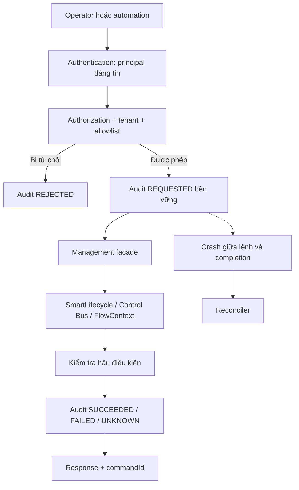

# Audit thao tác quản trị trong Spring Integration Runtime

## 1. Audit thao tác quản trị giải quyết vấn đề gì?

Trong một hệ thống Spring Integration đang hoạt động, operator hoặc automation có thể **start/stop endpoint**, pause poller, đổi cấu hình executor, bật debug logging, đăng ký hoặc destroy `IntegrationFlow` động, thực hiện orderly shutdown, hay quyết định replay message từ DLQ. Những thao tác này làm thay đổi luồng message, transaction, retry, correlation và trạng thái runtime mà không nhất thiết có một lần deploy mới.

Nếu chỉ xem dashboard thấy `ordersInbound` đang stopped, người điều tra chưa biết **ai** dừng nó, **vì sao**, **qua con đường nào**, thay đổi có **được phê duyệt** hay không, **lúc nào** xảy ra, liệu đã xử lý hết các message đang chạy hay chưa và lệnh đó có thất bại/race với lệnh khác không.

Bài **Audit thao tác quản trị** thuộc chương **Control và quản trị** của module `SPRING_INTEGRATION_RUNTIME`. Mục tiêu là thiết kế nhật ký kiểm chứng được những thay đổi khi Spring Integration điều phối channel, endpoint, consumer, poller, executor; đồng thời nắm các tương tác với dynamic flow, lifecycle, message store, transaction, retry, error và threading.

**Sau bài này, bạn có thể:**

1. Phân biệt audit management với message history, application log, metrics và integration graph.
2. Xác định toàn bộ bề mặt cho phép thay đổi runtime: Control Bus, JMX, REST, Actuator, lifecycle API, `IntegrationFlowContext`.
3. Thiết kế audit schema theo actor, action, target, request, trạng thái trước/sau, authorization, outcome, thời gian và instance.
4. Giới hạn Control Bus theo mô hình Spring Integration 6.5 và đặt management façade với allowlist + authorization.
5. Ghi audit bền vững qua các transaction, crash window, retry, race, stop/drain và nhiều replica.
6. Kiểm thử thay đổi thành công, bị từ chối, thất bại, timeout, audit outage và reconciliation.

> **Phiên bản tham chiếu:** Spring Integration 6.5, Spring Framework 6.x, Spring Boot 3.x và Java 17. Cần đặc biệt chú ý thay đổi Control Bus 6.5: cơ chế gọi biểu thức SpEL tùy ý của phiên bản cũ không còn được hỗ trợ; lệnh được giải quyết bằng `ControlBusCommandRegistry`.

## 2. Audit khác logging và monitoring ở điểm nào?

**Audit** là bản ghi bằng chứng về một *yêu cầu quản trị*, *quyết định phân quyền* và *kết quả quan sát được*. Nó không chỉ là dòng `logger.info("Stopped!")` hoặc trạng thái cuối trong một bảng.

Ví dụ event hợp lệ:

```text
commandId     = 9dc1... (UUID)
eventId       = 71aa... (UUID riêng cho sự kiện)
actorId       = operator-24 (từ identity provider)
action        = STOP_ENDPOINT
targetAlias   = orders-poller
actualBean    = ordersInbound
environment   = production
instanceId    = worker-03
tenantId      = tenant-a
reasonCode    = INCIDENT-PAUSE
requestId     = req-120
occurredAt    = 2026-11-22T02:00:00Z
phase         = SUCCEEDED
beforeRunning = true
afterRunning  = false
```

Một command thường có **nhiều event**:

```text
REQUESTED -> AUTHORIZED -> ACCEPTED -> SUCCEEDED
     |
     +------> REJECTED (không thực thi)
     |
     +------> FAILED (exception / hậu điều kiện không đạt)
     |
     +------> UNKNOWN (timeout, crash, chưa rõ kết quả)
```

Không nhất thiết sử dụng mọi phase, nhưng phải tách rõ:

| Phase/outcome | Nghĩa thực tế | Không được diễn giải thành |
|---|---|---|
| `REQUESTED` | Đã nhận yêu cầu với danh tính và mục tiêu | Chưa phải endpoint đã dừng |
| `REJECTED` | Không cho phép vì policy/input/permission | Không có tác động runtime được cấp phép |
| `ACCEPTED` | Đã đưa lệnh vào hàng đợi/runner | Chưa phải thao tác đã hoàn thành |
| `SUCCEEDED` | Lệnh chạy xong và hậu điều kiện đã quan sát | Chưa đồng nghĩa toàn bộ in-flight message đã commit |
| `FAILED` | Lệnh ném lỗi hoặc trạng thái mục tiêu không đạt | Không chắc hệ thống đã rollback toàn bộ side effect |
| `UNKNOWN` | Chưa thể biết chắc outcome do crash/timeout/mất completion | Không tự động cho phép retry không idempotent |
| `RECONCILED` | Đối soát bằng bằng chứng bổ sung sau đó | Không xóa dấu vết UNKNOWN/REQUESTED trước đó |

Với thao tác async, HTTP `202 Accepted` chỉ nên nghĩa lệnh được nhận; caller có thể truy vấn trạng thái bằng `commandId`. Nếu caller chỉ timeout, lệnh vẫn **có thể đã có hiệu lực**.

## 3. Bề mặt quản trị và rủi ro bypass

| Bề mặt | Thao tác thường thấy | Điểm kiểm soát và audit |
|---|---|---|
| **Control Bus** | `beanName.start`, `beanName.stop`, thay quản lý executor | Xác thực người gửi message, allowlist command/bean, record outcome |
| **ControlBusController** | HTTP `/control-bus` GET/POST | Bảo vệ REST, audit principal, method và arguments |
| **JMX / MBean** | Gọi managed operation, orderly shutdown | Bảo vệ remote JMX, ghi identity được xác minh |
| **Actuator/custom REST** | Pause/resume flow, đổi poller settings | Authorization theo role + target/tenant, audit từ HTTP ingress |
| **Direct API** | `SmartLifecycle.start()/stop()` | Chỉ cho phép gọi qua quản trị được audit |
| **IntegrationFlowContext** | `register/start/stop/destroy` flow động | Flow ID, revision, tenant, trạng thái registry trước/sau |
| **Automation/scripts** | Bulk pause, DLQ replay, maintenance | Service identity, ticket/approval, parent/child commands |
| **Admin UI** | Nút Enable/Disable | UI không phải hàng rào cuối; API backend phải quyết định quyền |

**Rủi ro quan trọng:** bạn có thể audit mọi lệnh đi qua admin REST nhưng vẫn bỏ quên một JMX port hoặc Control Bus channel được công khai. Khi đó một thay đổi hợp lệ về kỹ thuật vẫn có thể diễn ra **ngoài audit và ngoài chính sách phân quyền**. Cần inventory mọi đường thay đổi trạng thái, sau đó hạn chế chúng qua một management façade hoặc kiểm soát tương đương.

## 4. Control Bus trên Spring Integration 6.5

### 4.1. 6.5 không chạy SpEL tùy ý trong payload

Tài liệu Spring Integration 6.5 chỉ ra Control Bus sử dụng `ControlBusCommandRegistry`. Payload command là chuỗi:

```text
beanName.methodName
```

Registry xác định method nào có thể gọi. Các method đủ điều kiện bao gồm method gắn `@ManagedOperation`/`@ManagedAttribute`, giao diện Spring `Lifecycle`/`Pausable` và một số method cấu hình `TaskExecutor`/`TaskScheduler` được hỗ trợ.

Nếu method có tham số, chúng được gửi qua header `IntegrationMessageHeaderAccessor.CONTROL_BUS_ARGUMENTS`:

```java
import java.util.List;

import org.springframework.integration.IntegrationMessageHeaderAccessor;
import org.springframework.messaging.Message;
import org.springframework.messaging.support.MessageBuilder;

Message<String> command = MessageBuilder
        .withPayload("myTaskExecutor.setMaxPoolSize")
        .setHeader(
                IntegrationMessageHeaderAccessor.CONTROL_BUS_ARGUMENTS,
                List.of(12))
        .build();
```

Không sao chép ví dụ Control Bus của Spring Integration 6.3 dùng payload SpEL như một biểu thức tự do rồi mong nó chạy trên 6.5. Ở 6.5, DSL `controlBusOnRegistry()` đã bị deprecate, dùng `controlBus()`.

### 4.2. Tạo Control Bus bằng Java DSL

```java
import org.springframework.context.annotation.Bean;
import org.springframework.context.annotation.Configuration;
import org.springframework.integration.dsl.IntegrationFlow;

@Configuration
class ControlBusConfiguration {
    @Bean
    IntegrationFlow controlBusFlow() {
        return IntegrationFlow.from("admin.control.requests")
                .controlBus()
                .get();
    }
}
```

Trong một hệ thống được bảo vệ, service quản trị có thể gửi message như:

```java
import org.springframework.messaging.MessageChannel;
import org.springframework.messaging.support.MessageBuilder;

// adminControlRequests: channel nội bộ được inject.
adminControlRequests.send(
        MessageBuilder.withPayload("ordersInbound.stop").build());
```

**Lưu ý:** command registry giới hạn method đủ điều kiện, **không** tự phân quyền theo actor/tenant/environment và **không** tự lưu audit bền vững. Không cho external client gửi message trực tiếp vào channel admin nếu không qua authentication, authorization và audit.

### 4.3. ControlBusController và quyền truy cập

Từ Spring Integration 6.4, `@EnableControlBusController` trong HTTP module cung cấp:

- `GET /control-bus` để liệt kê các lệnh có thể gọi.
- `POST /control-bus/{beanName.methodName}` để thực thi.
- Body tham số có thể chứa `value` và `parameterType`.

Chỉ bật controller này khi thật sự cần, áp dụng TLS, Spring Security, private management network, rate limiting và audit. Ngay cả việc liệt kê commands cũng có thể làm lộ topology/bean names nội bộ. Đường REST có thể khác nếu ứng dụng khai báo context path/reverse proxy.

### 4.4. Những đường có thể bỏ qua management façade

Nếu một method có `@ManagedOperation` và được lộ qua cả JMX lẫn Control Bus, việc bảo vệ REST API tự viết **không** tự bảo vệ JMX. Hãy rà soát các bề mặt quản trị, giới hạn hoặc tắt những đường không thể cung cấp actor đáng tin và audit đầy đủ.

## 5. MessageHistory, metrics và IntegrationGraph có thay audit được không?

Spring Integration có nhiều công cụ quan sát runtime:

| Công cụ | Dữ liệu chính | Không đáp ứng được |
|---|---|---|
| `@EnableMessageHistory` | Các component mà một business message đã đi qua | Không phải bằng chứng bền vững ai stop một endpoint, có được phê duyệt hay không |
| Micrometer / `@EnableIntegrationManagement` | Counts, latency và error của channel/handler/source | Dữ liệu tổng hợp; thiếu command ID và actor |
| `IntegrationGraphServer` | Snapshot topology, component relationships và thông tin runtime | Không ghi lịch sử ai thay đổi topology |
| Application logs | Log xử lý, exception và timestamps | Có thể rotate, thiếu actor, bị sửa, không có đầy đủ quyết định |
| JMX | Giao diện đọc/gọi managed operations | Là một bề mặt điều khiển, không mặc nhiên là audit ledger |
| Audit store riêng | Lịch sử actor → command → target → outcome | Cần tự bảo vệ durability, immutability, retention, quyền đọc |

Ví dụ bật `MessageHistory`:

```java
import org.springframework.context.annotation.Configuration;
import org.springframework.integration.config.EnableIntegration;
import org.springframework.integration.config.EnableMessageHistory;

@Configuration
@EnableIntegration
@EnableMessageHistory
class MessageHistoryConfiguration {
}
```

`MessageHistory` lưu dấu vết hành trình message trong header `history`. Nó rất hữu ích để điều tra các business message bị ảnh hưởng *sau* khi poller bị dừng; nhưng không có actor, approval và outcome của lệnh stop. Muốn audit quản trị, phải ghi event riêng ở boundary quản lý.

**Mặt khác:** `SmartLifecycle.isRunning() == false` chỉ chứng minh trạng thái endpoint lúc quan sát. Nó không bảo đảm mọi transaction đang chạy đã commit/ack hoặc mọi reply đã được gửi. Nếu cần xác nhận **drained**, phải theo dõi in-flight tasks, poller/executor, backlog và completion của nguồn message.

## 6. Chọn trường thông tin cho audit event

| Field | Lý do |
|---|---|
| `eventId` | ID riêng cho từng sự kiện audit, append-only |
| `commandId` | Liên kết nhiều event của cùng một lần yêu cầu; hỗ trợ idempotency |
| `occurredAt` | Timestamp UTC với thời điểm server ghi nhận |
| `actorId`, `actorType` | User, service account hoặc automation đã được xác thực |
| `action` | START_ENDPOINT, STOP_ENDPOINT, DESTROY_FLOW, UPDATE_POOL_SIZE, REPLAY_DLQ… |
| `targetType`, `targetAlias` | Resource được điều khiển, không để client tùy chọn bean name |
| `beanName`/`flowId` | Bean/flow nội bộ thực sự bị tác động |
| `instanceId`, `environment`, `cluster` | Phân biệt việc stop một pod với toàn cluster |
| `tenantId` | Giới hạn namespace/quyền của tenant |
| `reasonCode`, `ticketId`, `approvalRef` | Lý do/approval/change management |
| `requestId`, `traceId` | Liên kết HTTP/log/messages liên quan |
| `beforeState`, `afterState` | State quan sát trước/sau |
| `phase`, `errorCode`, `attemptNo` | Outcome, loại lỗi và retry |
| `desiredRevision`, `appliedRevision` | Lịch sử cấu hình flow động/version |

Không lưu password, token, cookies, raw message chứa dữ liệu nhạy cảm hoặc full URL có credential trong audit. Với nhiều tenant, cần kiểm soát quyền truy cập của người tra cứu log và chính sách retention.

### Hai ví dụ timeline

```text
2026-11-22T02:01:01Z REQUESTED command=C-9 actor=ops-1
    action=STOP_ENDPOINT target=ordersInbound before=RUNNING
2026-11-22T02:01:01Z SUCCEEDED command=C-9 actor=ops-1
    action=STOP_ENDPOINT target=ordersInbound after=STOPPED
```

```text
2026-11-22T02:05:00Z REQUESTED command=C-10 action=START_ENDPOINT
2026-11-22T02:05:01Z FAILED command=C-10 errorCode=CONNECTION_FAILED
    before=STOPPED after=UNKNOWN
```

Giữ hai event riêng; không thay trực tiếp REQUESTED bằng SUCCEEDED làm mất mốc lịch sử.

## 7. Kiến trúc bảo vệ và ghi audit



**Quy trình đề xuất:**

1. Xác thực principal ở ingress (OAuth2/OIDC, mTLS hoặc cơ chế phù hợp).
2. Kiểm tra action, target, environment, tenant scope, approval/ticket khi cần.
3. Map **public alias → bean name cố định trong allowlist**.
4. Ghi `REQUESTED` bền vững trước thao tác nhạy cảm; nếu audit store lỗi, fail closed theo chính sách.
5. Thực thi command qua API đã kiểm soát.
6. Đọc state hậu điều kiện và quyết định `SUCCEEDED`/`FAILED`/`UNKNOWN`.
7. Ghi completion; trả command ID và phase có nghĩa.
8. Reconcile các command thiếu terminal event sau crash, không tự coi chúng thất bại.

Với command được đưa vào queue, có thể ghi `ACCEPTED` và trả HTTP 202 trước khi worker chạy. Một command chỉ được coi hoàn thành khi worker có bằng chứng thích hợp.

## 8. Ví dụ lưu audit bền vững bằng JDBC

Ví dụ sử dụng Spring Boot, Spring Security và Spring JDBC. SQL minh họa dùng cho H2/PostgreSQL; trong production quản lý schema bằng Flyway/Liquibase và xác nhận dialect/privileges.

### 8.1. Dependencies và schema

```groovy
dependencies {
    implementation 'org.springframework.boot:spring-boot-starter-integration'
    implementation 'org.springframework.boot:spring-boot-starter-jdbc'
    implementation 'org.springframework.boot:spring-boot-starter-security'
    implementation 'org.springframework.boot:spring-boot-starter-aop'
    testImplementation 'org.springframework.boot:spring-boot-starter-test'
    testImplementation 'org.springframework.security:spring-security-test'
    testRuntimeOnly 'com.h2database:h2'
}
```

```sql
CREATE TABLE integration_admin_audit (
    event_id VARCHAR(36) PRIMARY KEY,
    command_id VARCHAR(36) NOT NULL,
    phase VARCHAR(24) NOT NULL,
    occurred_at TIMESTAMP NOT NULL,
    actor_id VARCHAR(128) NOT NULL,
    action_name VARCHAR(64) NOT NULL,
    target_alias VARCHAR(128) NOT NULL,
    instance_id VARCHAR(128) NOT NULL,
    tenant_id VARCHAR(128),
    reason_code VARCHAR(128),
    request_id VARCHAR(128),
    before_running BOOLEAN,
    after_running BOOLEAN,
    error_code VARCHAR(160)
);

CREATE INDEX idx_admin_audit_command
    ON integration_admin_audit(command_id, occurred_at);
```

Có thể có nhiều row cho cùng `command_id` (REQUESTED, SUCCEEDED…). Không đặt unique constraint trên `command_id` một mình. Muốn chống replay, dùng **command ledger/idempotency** riêng; audit event và command ledger phục vụ hai mục đích khác nhau.

### 8.2. DTO và JDBC writer

```java
import java.time.Instant;
import java.util.UUID;

public record AdminAuditEntry(
        UUID eventId,
        UUID commandId,
        String phase,
        Instant occurredAt,
        String actorId,
        String actionName,
        String targetAlias,
        String instanceId,
        String tenantId,
        String reasonCode,
        String requestId,
        Boolean beforeRunning,
        Boolean afterRunning,
        String errorCode
) {
}
```

```java
import org.springframework.jdbc.core.JdbcTemplate;
import org.springframework.stereotype.Service;
import org.springframework.transaction.annotation.Propagation;
import org.springframework.transaction.annotation.Transactional;

@Service
public class AdminAuditWriter {

    private final JdbcTemplate jdbc;

    public AdminAuditWriter(JdbcTemplate jdbc) {
        this.jdbc = jdbc;
    }

    @Transactional(propagation = Propagation.REQUIRES_NEW)
    public void append(AdminAuditEntry e) {
        jdbc.update("""
            INSERT INTO integration_admin_audit (
                event_id, command_id, phase, occurred_at, actor_id,
                action_name, target_alias, instance_id, tenant_id,
                reason_code, request_id, before_running,
                after_running, error_code
            ) VALUES (?, ?, ?, ?, ?, ?, ?, ?, ?, ?, ?, ?, ?, ?)
            """,
            e.eventId().toString(), e.commandId().toString(),
            e.phase(), java.sql.Timestamp.from(e.occurredAt()),
            e.actorId(), e.actionName(), e.targetAlias(),
            e.instanceId(), e.tenantId(), e.reasonCode(), e.requestId(),
            e.beforeRunning(), e.afterRunning(), e.errorCode());
    }
}
```

**Tại sao `REQUIRES_NEW` trên một bean riêng?** Nếu thao tác chính ném exception hoặc business transaction rollback, event REQUESTED/FAILED vẫn có thể được commit độc lập. Phải gọi writer qua Spring proxy; self-invocation `this.append()` có thể bỏ qua transaction advice.

Khi audit DB lỗi, lệnh nên fail closed **trước thao tác** theo policy. Nếu thao tác đã chạy mà ghi SUCCEEDED bị lỗi, không thể tự rollback việc stop/start JVM component; phần khôi phục nằm ở chương transaction và reconciliation bên dưới.

Production cần giới hạn quyền DB của writer theo hướng append-only, tránh UPDATE/DELETE cho tài khoản ứng dụng, bảo vệ backup/replication, ký/hash chain hoặc WORM lưu trữ nếu yêu cầu chống sửa cao. Chỉ có SQL INSERT không tự biến dữ liệu thành bất biến trước database administrator.

## 9. Ví dụ management façade: allowlist, xác thực và lifecycle audit

Trong production, không cho client nhập tự do `beanName.methodName` để gọi mọi command. Một management façade nên nhận **alias ổn định** do hệ thống công bố, kiểm tra permission và gọi đúng endpoint đã được allowlist.

Ví dụ bên dưới giả định một Spring Integration endpoint có bean name `ordersInbound` và triển khai `SmartLifecycle`. Khi dùng DSL hoặc annotation, đặt tên endpoint tường minh và kiểm chứng bean name thực tế trong Spring context. Một `SmartLifecycle` có thể là poller/consumer; trạng thái `isRunning()` không tương đương tình trạng khỏe mạnh của remote dependency.

### 9.1. Command và kết quả

```java
import java.util.UUID;

public enum AdminAction {
    START, STOP
}

public record EndpointAdminCommand(
        UUID commandId,
        AdminAction action,
        String targetAlias,
        String reasonCode,
        String requestId,
        String tenantId
) {
}

public record EndpointAdminResult(
        UUID commandId,
        String targetAlias,
        boolean running
) {
}
```

`commandId` dùng cho correlation giữa các event. `tenantId` client truyền đến **không đủ** để authorize — phải được đối chiếu với tenant trong security principal. Ví dụ giữ phần tenant policy ở lớp bảo mật riêng để tập trung vào audit.

### 9.2. Service thực hiện thao tác và audit

```java
import java.time.Instant;
import java.util.Map;
import java.util.UUID;

import org.springframework.beans.factory.BeanFactory;
import org.springframework.context.SmartLifecycle;
import org.springframework.security.access.prepost.PreAuthorize;
import org.springframework.security.core.Authentication;
import org.springframework.security.core.context.SecurityContextHolder;
import org.springframework.stereotype.Service;

@Service
public class AuditedEndpointAdministration {

    // Alias bên ngoài -> tên bean nội bộ được allowlist.
    private static final Map<String, String> TARGETS = Map.of(
            "orders-poller", "ordersInbound");

    private final BeanFactory beans;
    private final AdminAuditWriter audit;

    public AuditedEndpointAdministration(
            BeanFactory beans, AdminAuditWriter audit) {
        this.beans = beans;
        this.audit = audit;
    }

    @PreAuthorize("hasAuthority('INTEGRATION_ADMIN')")
    public EndpointAdminResult apply(EndpointAdminCommand command) {
        if (command == null || command.commandId() == null
                || command.action() == null || command.targetAlias() == null) {
            throw new IllegalArgumentException("Invalid admin command");
        }

        // Identity lấy từ SecurityContext đã xác thực ở ingress.
        Authentication auth = SecurityContextHolder
                .getContext().getAuthentication();
        String actor = auth.getName();

        String beanName = TARGETS.get(command.targetAlias());
        if (beanName == null) {
            audit.append(event(command, actor, "REJECTED",
                    null, null, "TARGET_NOT_ALLOWED"));
            throw new IllegalArgumentException("Target is not allowed");
        }

        // Nếu REQUESTED không commit được, KHÔNG gọi endpoint.start/stop.
        audit.append(event(command, actor, "REQUESTED",
                null, null, null));

        Boolean before = null;
        Boolean after = null;
        try {
            SmartLifecycle endpoint =
                    beans.getBean(beanName, SmartLifecycle.class);

            before = endpoint.isRunning();
            if (command.action() == AdminAction.START) {
                endpoint.start();
            }
            else {
                endpoint.stop();
            }
            after = endpoint.isRunning();

            boolean expected = command.action() == AdminAction.START;
            if (after != expected) {
                throw new IllegalStateException(
                        "Endpoint did not reach desired lifecycle state");
            }
        }
        catch (RuntimeException failure) {
            try {
                audit.append(event(command, actor, "FAILED",
                        before, after,
                        failure.getClass().getSimpleName()));
            }
            catch (RuntimeException auditFailure) {
                failure.addSuppressed(auditFailure);
            }
            throw failure;
        }

        // Cố ý nằm NGOÀI try/catch: lỗi ghi SUCCEEDED không được
        // biến một lệnh đã chạy thành FAILED giả.
        audit.append(event(command, actor, "SUCCEEDED",
                before, after, null));

        return new EndpointAdminResult(
                command.commandId(), command.targetAlias(), after);
    }

    private AdminAuditEntry event(EndpointAdminCommand c,
                                  String actor, String phase,
                                  Boolean before, Boolean after,
                                  String errorCode) {
        return new AdminAuditEntry(
                UUID.randomUUID(),
                c.commandId(),
                phase,
                Instant.now(),
                actor,
                c.action().name(),
                c.targetAlias(),
                "worker-01", // Thực tế: lấy từ instanceId/config.
                c.tenantId(),
                c.reasonCode(),
                c.requestId(),
                before,
                after,
                errorCode);
    }
}
```

**Những điểm phải hiểu trước khi dùng:**

- `@PreAuthorize` chỉ có hiệu lực khi bật Spring Security method security và lời gọi đi qua Spring proxy. Code đi đường `new AuditedEndpointAdministration(...)` trong unit test không kiểm tra authorization.
- Method security từ chối **trước khi thân method chạy**; audit những lần bị từ chối phải đặt ở Spring Security authorization failure handler/filter hoặc API ingress, không chờ `apply()` ghi event.
- Actor lấy từ `SecurityContextHolder`, **không từ request body**. Với executor/task bất đồng bộ, security context không tự truyền nếu chưa cấu hình propagation; nên truyền identity đã xác thực ở command envelope có provenance rõ.
- Allowlist tránh gọi tùy ý Spring beans. Các policy về tenant, production approval và scope phải được kiểm tra thêm ngoài role `INTEGRATION_ADMIN`.
- `REQUESTED` được ghi **trước** khi gọi lifecycle. `SUCCEEDED` được ghi sau khi đọc lại `isRunning()`; `FAILED` được ghi khi invocation lỗi hoặc hậu điều kiện không đạt.
- Lỗi ghi `SUCCEEDED` sau khi stop thành công **không làm endpoint start trở lại**. Audit REQUESTED có thể còn đơn độc và phải được reconciler kiểm tra.
- Ví dụ không có distributed command ledger/target lock; quản trị thực tế cần bổ sung để chống hai lệnh concurrent hoặc HTTP retry.
- Đây là ví dụ cho **một endpoint trong một JVM**. Không được trả "cả cluster đã stop" chỉ vì một `SmartLifecycle` local trả về.

### 9.3. Cấu hình method security

```java
import org.springframework.context.annotation.Configuration;
import org.springframework.security.config.annotation.method.configuration.EnableMethodSecurity;

@Configuration
@EnableMethodSecurity
class AdminMethodSecurityConfig {
}
```

Hệ thống thực tế còn cần cấu hình HTTP/JMX/Control Bus access: đăng nhập OIDC/OAuth2/mTLS phù hợp, phân quyền tenant/resource, TLS, rate limits, network isolation và CSRF khi dùng browser session. **Không** mở `/control-bus` ra Internet rồi trông chờ method-level authorization của façade bảo vệ các lệnh Control Bus đi qua đường khác.

## 10. Audit thao tác với IntegrationFlowContext và tenant

Đối với dynamic runtime, các thao tác quản trị có thể gồm:

- `REGISTER_FLOW`: `flowContext.registration(flow).id(flowId).register()`.
- `START_FLOW` / `STOP_FLOW`: `IntegrationFlowRegistration.start()/stop()`.
- `DESTROY_FLOW`: `registration.destroy()` hoặc `flowContext.remove(flowId)`.
- `RECONFIGURE_FLOW`: đổi revision/poller/destination/credential reference, thực hiện blue/green.

Khi audit, bổ sung `tenantId`, `flowId`, desired/applied revision, old/new destination (đã loại bỏ secret), source owner và trạng thái registry.

| Thao tác | Bằng chứng nên ghi | Rủi ro cần quan sát |
|---|---|---|
| Register | ID không tồn tại trước, registration xuất hiện sau | Bean collision, endpoint start fail |
| Start | Trước STOPPED, sau STARTED, health check | Remote adapter chưa sẵn sàng dù isRunning=true |
| Stop | Không nhận thêm message, in-flight đang drain | Gateway timeout, ack/transaction dở dang |
| Destroy | Registry không còn flow, dependent beans giải phóng | Nhầm shared resource, durable queue vẫn có backlog |
| Reconfigure | Revision và routing chuyển từ v1 sang v2 | Hai flow cùng poll một source |
| Replay DLQ | Target queue/message IDs, dry-run và evidence xử lý | Replay lặp, side effect không idempotent |

### Bulk operations

Nếu operator yêu cầu stop 100 flows và chỉ 96 thành công, audit phải có **parent command ID** và child event cho từng target. Parent outcome là `PARTIALLY_SUCCEEDED`, không ghi `STOP_ALL SUCCEEDED` vì 4 flow chưa đạt mục tiêu.

### Nhiều replica

`IntegrationFlowContext.getRegistry()` và `SmartLifecycle` là local trong một application context. Stop ở pod A không stop pod B. Mọi audit event cần ghi `instanceId` và phạm vi ONE_INSTANCE/ALL_INSTANCES; đối với lệnh cluster-wide, coordinator phải thu kết quả từng node và đối soát lệnh còn treo.

## 11. Transaction, audit durability và crash window

### 11.1. Vì sao audit không nên rollback cùng business transaction?

Một handler có thể ném exception khiến transaction rollback. Nếu audit record đặt trong cùng transaction đó, **dòng ghi nhận nỗ lực thất bại cũng biến mất**. Vì vậy ví dụ dùng `AdminAuditWriter` với `REQUIRES_NEW` trên bean riêng.

| Cấu hình | Tác dụng và rủi ro |
|---|---|
| Audit chung transaction nghiệp vụ | Rollback nghiệp vụ có thể xóa bằng chứng thất bại |
| Audit `REQUIRES_NEW` | REQUESTED/FAILED có thể bền vững dù business rollback; cần pool và transaction manager phù hợp |
| Audit trên `QueueChannel` RAM | JVM crash sau lệnh nhưng trước khi event được ghi → mất audit |
| Audit trên persistent outbox | Có thể publish/đẩy SIEM theo retry; consumer và delivery phải idempotent |
| Audit trực tiếp tới dịch vụ ngoài | Phải chọn fail-closed/fail-open khi audit dependency outage |

**Fail-closed trước lệnh:** Nếu policy yêu cầu audit bắt buộc và không ghi được REQUESTED, đừng thực hiện thay đổi. **Sau lệnh:** nếu completion event ghi lỗi, thao tác có thể đã có hiệu lực và không còn một transaction chung để rollback Spring lifecycle. Khi đó phát cảnh báo và đối soát, không tự ghi FAILED giả.

### 11.2. Crash window

```text
t0: INSERT audit REQUESTED, commit
t1: endpoint.stop()
t2: endpoint đang STOPPED
t3: JVM crash trước INSERT audit SUCCEEDED
t4: restart, audit chỉ có REQUESTED
```

Không được suy ra `STOP FAILED` hoặc tự chạy lại lệnh destructive. Reconciler tìm command quá hạn chưa terminal, kiểm tra desired-state catalog và runtime sau restart, sau đó append event `UNKNOWN`/`RECONCILED`. Với dynamic flow, registry sau restart được tái tạo, vì vậy không thể chứng minh lệnh cũ thành công chỉ bằng việc flow hiện không tồn tại.

### 11.3. Retry và idempotency

Caller có thể retry cùng một lệnh vì HTTP timeout. Ghi một `commandId` ổn định xuyên retry, dùng **command ledger** có unique key để tránh thực thi duplicate khi chính sách không cho phép. Audit event giữ riêng mỗi attempt. Nếu status UNKNOWN, điều tra trạng thái trước khi quyết định retry.

`MessageHeaders.ID` không thay thế commandId nghiệp vụ vì mỗi lần gửi lại có thể tạo message ID mới. Lệnh `STOP` thường tương đối idempotent nhưng `DESTROY_FLOW`/`REPLAY_DLQ`/`CHANGE_CONFIG` cần hợp đồng idempotency rõ.

## 12. Đồng thời start/stop và tính nhất quán mong muốn

Tình huống:

```text
Operator A: STOP ordersInbound
Operator B: START ordersInbound
Hai yêu cầu đến gần đồng thời.
```

Không có serialize per-target, hai method có thể đan xen; log có thể chứa hai lệnh SUCCEEDED nhưng trạng thái cuối không phản ánh thứ tự operator dự kiến.

Các biện pháp:

1. **Lock/command queue per target** trong một JVM để serialize start–stop.
2. Lưu `desiredRevision` trong catalog và dùng optimistic concurrency khi admin cập nhật revision.
3. Ghi actor, commandId, expected/observed state, revision và sequence.
4. Với multi-pod, dùng coordinator/lease/distributed lock nếu hai node điều khiển cùng một source; lock trong JVM không bảo vệ cluster.
5. Đặt deadline cho operation; không giữ lock vô hạn khi endpoint/adapter block bởi I/O.
6. Có policy precondition: ví dụ STOP chỉ khi đang RUNNING; nếu đã STOPPED, ghi NO_OP hay SUCCEEDED idempotent một cách rõ ràng.

**Phân biệt:** start/stop endpoint và thao tác commit/ack của business message là hai trạng thái khác nhau. Stop ngăn việc nhận thêm, không bảo đảm các worker async đang chạy đã hoàn thành. Khi cần bảo đảm `DRAINED`, theo dõi in-flight tasks, broker ack, transaction và queue backlog.

## 13. Tính bảo mật và khả năng truy vết

### Quyền truy cập phải theo action + target

Một user có role quản trị test không nhất thiết có quyền destroy flow production của tenant khác. Policy nên kiểm tra role, tenant scope, target resource, environment, approval/ticket, thời điểm thay đổi và mức độ ảnh hưởng.

Với thao tác rủi ro cao (destroy persistent flow, replay hàng loạt, đổi connection credentials), cân nhắc hai người phê duyệt hoặc approval workflow, giới hạn số target/bulk, dry-run và yêu cầu reasonCode/ticket.

### Các đường bypass phải được rà soát

1. Custom HTTP admin APIs.
2. `/control-bus` HTTP controller và input channel Control Bus nếu bật.
3. JMX remote operations và exporter.
4. Actuator endpoints có khả năng thay đổi cấu hình.
5. Code trực tiếp gọi `SmartLifecycle` hay `IntegrationFlowContext`.
6. Scheduled automation/scripts/CLI.

Nếu một đường không thể cung cấp actor đáng tin và audit bền vững, hãy hạn chế/tắt nó ở production. Command registry chỉ biết method nào có thể gọi; nó không giải quyết authorization theo tenant hay mục đích.

### Ghi rejected attempts

`@PreAuthorize` có thể chặn trước khi thân `apply()` chạy. Ghi REJECTED ở security filter/authorization failure handler (hoặc API layer đã xác thực), không chỉ trong service method. Không log token/JWT/raw hostile content; tránh để attacker làm nổ audit storage bằng flood denied attempts — có rate limit và alert phù hợp.

## 14. Truy vấn và quan sát hậu sự cố

### 14.1. Đọc chuỗi sự kiện của một command

```sql
SELECT command_id, phase, occurred_at, actor_id, action_name,
       target_alias, instance_id, before_running,
       after_running, error_code
FROM integration_admin_audit
WHERE command_id = ?
ORDER BY occurred_at, event_id;
```

### 14.2. Tìm các command có REQUESTED nhưng chưa có terminal outcome

```sql
SELECT r.command_id, MIN(r.occurred_at) AS first_requested_at
FROM integration_admin_audit r
WHERE r.phase = 'REQUESTED'
  AND NOT EXISTS (
      SELECT 1
      FROM integration_admin_audit t
      WHERE t.command_id = r.command_id
        AND t.phase IN ('SUCCEEDED', 'FAILED', 'UNKNOWN')
  )
GROUP BY r.command_id;
```

Job đối soát cần có ngưỡng thời gian và quyền truy cập state runtime. Đừng đánh dấu FAILED tự động cho mọi lệnh chờ lâu; nó có thể đang chạy hoặc đã thành công trước khi process crash.

### 14.3. Metrics và correlation

| Metric đề xuất | Ý nghĩa |
|---|---|
| `admin.commands.requested` | Tần suất thay đổi runtime |
| `admin.commands.rejected` | Denied attempts và policy violation |
| `admin.commands.failed` | Lỗi thực thi theo target |
| `admin.commands.unknown` | Các command cần reconciliation |
| `admin.audit.write.failures` | Mức độ rủi ro thiếu bằng chứng |
| `admin.command.latency` | Độ trễ start/stop/reconfigure |
| `admin.state.drift` | Desired khác actual state |
| `admin.recovery.actions` | Replay, rollback/compensation sau incident |

Các metric trên là **đề xuất instrumentation của ứng dụng**, không phải những tên metric Spring Integration mặc định phát. Kết hợp metrics, message history, integration graph, errorChannel, transaction logs và audit ledger theo cùng trace/command ID để điều tra nguyên nhân.

## 15. Kiểm thử audit quản trị

### 15.1. Ma trận kiểm thử

| Test | Điều kiện | Điều cần assert |
|---|---|---|
| STOP hợp lệ | Admin có quyền, endpoint running | REQUESTED rồi SUCCEEDED, before=true/after=false |
| START hợp lệ | Endpoint stopped | REQUESTED rồi SUCCEEDED, before=false/after=true |
| AuthZ denied | User không có authority | Endpoint không bị gọi; REJECTED ghi ở security layer |
| Target ngoài allowlist | Alias không được quản lý | REJECTED, không gọi bean lạ |
| `stop()` ném exception | Endpoint lỗi | REQUESTED, FAILED và errorCode |
| Không đạt hậu điều kiện | `isRunning()` không đổi | Không ghi SUCCEEDED |
| Audit REQUESTED lỗi | JDBC unavailable | Không gọi start/stop |
| Audit SUCCEEDED lỗi | Endpoint đổi trạng thái rồi writer lỗi | REQUESTED tồn tại; reconcile UNKNOWN |
| JVM crash giữa lệnh | REQUESTED commit, completion chưa ghi | Không ghi success giả; đối soát sau restart |
| Two admin commands concurrent | START/STOP cùng target | Thứ tự/lock/desired revision được tuân thủ |
| Duplicate commandId | HTTP retry | Không lặp action ngoài contract; audit attempts có liên kết |
| Dynamic flow destroy | Flow ID hiện hữu | Registration biến mất, durable backlog policy đúng |
| Multi-pod bulk stop | Có node fail | Từng child outcome, parent PARTIALLY_SUCCEEDED |
| Denial/secret in payload | Input không tin cậy | Không ghi token/password hoặc raw payload nhạy cảm |

### 15.2. Unit test hoạt động của façade

Có thể test logic service bằng Mockito; test này **không kiểm tra Spring Method Security proxy**, nên phải có integration test authorization riêng.

```java
import static org.junit.jupiter.api.Assertions.*;
import static org.mockito.Mockito.*;

import java.util.List;
import java.util.UUID;

import org.junit.jupiter.api.Test;
import org.mockito.ArgumentCaptor;
import org.springframework.beans.factory.BeanFactory;
import org.springframework.context.SmartLifecycle;
import org.springframework.security.authentication.UsernamePasswordAuthenticationToken;
import org.springframework.security.core.authority.SimpleGrantedAuthority;
import org.springframework.security.core.context.SecurityContextHolder;

class AuditedEndpointAdministrationTest {

    @Test
    void stopProducesRequestedAndSucceededEvents() {
        BeanFactory factory = mock(BeanFactory.class);
        SmartLifecycle endpoint = mock(SmartLifecycle.class);
        AdminAuditWriter audit = mock(AdminAuditWriter.class);

        when(factory.getBean("ordersInbound", SmartLifecycle.class))
                .thenReturn(endpoint);
        when(endpoint.isRunning()).thenReturn(true, false);

        SecurityContextHolder.getContext().setAuthentication(
                new UsernamePasswordAuthenticationToken(
                        "ops-1", "N/A",
                        List.of(new SimpleGrantedAuthority(
                                "INTEGRATION_ADMIN"))));

        try {
            var manager = new AuditedEndpointAdministration(
                    factory, audit);
            var command = new EndpointAdminCommand(
                    UUID.randomUUID(), AdminAction.STOP,
                    "orders-poller", "INCIDENT", "REQ-1", "tenant-a");

            EndpointAdminResult result = manager.apply(command);

            assertFalse(result.running());
            verify(endpoint).stop();

            var captor = ArgumentCaptor.forClass(
                    AdminAuditEntry.class);
            verify(audit, times(2)).append(captor.capture());

            var events = captor.getAllValues();
            assertEquals("REQUESTED", events.get(0).phase());
            assertEquals("SUCCEEDED", events.get(1).phase());
            assertEquals(command.commandId(),
                    events.get(1).commandId());
            assertEquals(Boolean.TRUE,
                    events.get(1).beforeRunning());
            assertEquals(Boolean.FALSE,
                    events.get(1).afterRunning());
        }
        finally {
            SecurityContextHolder.clearContext();
        }
    }
}
```

Nếu dùng `@PreAuthorize`, integration test phải gọi qua Spring proxy với `@EnableMethodSecurity` và `@WithMockUser`/không có quyền. Dùng H2/PostgreSQL test DB thật để chứng minh INSERT audit đã commit; mock chỉ xác minh call và ordering, không chứng minh database durability.

### 15.3. Failure injection đáng làm

- Cho `AdminAuditWriter.append(REQUESTED)` throw: assert `endpoint.stop()` **chưa được gọi**.
- Cho `endpoint.stop()` throw: assert có FAILED với loại exception; không ghi SUCCEEDED.
- Cho `AdminAuditWriter.append(SUCCEEDED)` throw: endpoint có thể đã dừng; không ghi FAILED giả.
- Cho một admin request bị deny bằng Spring Security proxy: audit rejection ở security layer, endpoint không chạy.
- Cố tình kill process sau REQUESTED: restart và chạy reconciler.
- Gửi hai lệnh STOP/START cùng thời điểm: assert serialization/expected revision, không chỉ kiểm tra một lệnh thành công.
- Thử flow động register/destroy và assert resource không rò, tenant ID không lẫn.
- Với poller, assert stop ngăn poll mới; kiểm tra in-flight ack/transaction tách biệt.

## 16. Runbook khi trạng thái hệ thống đổi bất thường

**Tình huống:** Từ 10:05, message không đi tiếp và dashboard thấy `ordersInbound` đang stopped.

1. Xác nhận endpoint bean/instance và lifecycle thực; kiểm tra flow, poller, executor, broker.
2. Truy vấn audit log theo target và mốc thời gian; lấy actor, command ID, phase, reason, trước/sau.
3. Kiểm tra event REJECTED và những đường JMX/Control Bus/automation có thể bypass.
4. Nếu có STOP SUCCEEDED: xác thực ticket/approval, kiểm tra command tác động đúng node/tenant.
5. Nếu chỉ có REQUESTED: đối chiếu crash/deploy, desired state và task đang thực thi; xử lý UNKNOWN.
6. Nếu không có audit: xem khả năng autoStartup, shutdown process, direct bean call, JVM fail và missing audit coverage; không tự kết luận operator cố ý stop.
7. Chỉ resume sau khi kiểm tra downstream DB/broker đã khỏe và backlog có thể xử lý; tạo **command START mới có audit riêng**.
8. Theo dõi throughput, errorChannel, queue age, retry, DLQ và transaction để biết hệ thống thật sự phục hồi.
9. Ghi kết quả postmortem và bổ sung test cho đường thiếu audit.

## 17. Checklist triển khai production

1. **Liệt kê toàn bộ bề mặt quản trị**: REST, Control Bus, JMX, Actuator, script, dynamic flow manager.
2. **Chặn bypass** bằng management façade hoặc interceptor/audit tương đương trên mọi đường.
3. **Lấy actor từ identity đã xác thực**, không tin body/header do client tự khai.
4. **Phân quyền theo action, target, tenant và environment**, có approval cho thao tác nguy hiểm.
5. **Allowlist command/bean**, không cho thực thi SpEL tùy ý theo hướng dẫn Control Bus cũ.
6. **Ghi REQUESTED bền vững trước thao tác** nhạy cảm; xác định fail-closed khi audit writer lỗi.
7. **Ghi SUCCEEDED chỉ sau hậu điều kiện**, phân biệt ACCEPTED và UNKNOWN.
8. **Lưu commandId, instanceId, revision, before/after, timestamp UTC, reasonCode** và actor.
9. **Audit store append-only có bảo vệ quyền UPDATE/DELETE**, backup, retention và khả năng phát hiện sửa trái phép.
10. **Serialize start/stop per target** và dùng idempotency/command ledger cho retry.
11. **Định nghĩa drain/transaction/ack** khi stop/destroy để tránh nhầm trạng thái lifecycle với business completion.
12. **Reconcile sau crash/restart**, đặc biệt trên nhiều node/tenant flows.
13. **Test denial, audit outage, operation failure, retry, concurrency và restart**.
14. **Theo dõi audit completeness và state drift**, xử lý REQUESTED không có terminal event.
15. **Không thay audit bằng logs, metrics, message history hoặc graph**; dùng chúng hỗ trợ nhau.

## 18. Câu hỏi tự kiểm tra

**1.** Spring Integration 6.5 còn cho Control Bus chạy biểu thức SpEL tùy ý trong payload không?  
**Đáp án:** Không. Control Bus dựa vào `ControlBusCommandRegistry` và command `beanName.methodName`; arguments ở header `CONTROL_BUS_ARGUMENTS`.

**2.** Có bật `@EnableMessageHistory` là đủ audit ai stop một endpoint chưa?  
**Đáp án:** Chưa. Message history theo dõi đường đi business message qua component, không ghi actor/approval/outcome bền vững của lệnh quản trị.

**3.** `isRunning()==false` sau stop có chứng minh tất cả message đã commit/ack chưa?  
**Đáp án:** Không. Đây chỉ là lifecycle state tại thời điểm quan sát; cần kiểm tra in-flight worker, transaction, broker ack và backlog.

**4.** Ghi SUCCEEDED vào DB lỗi, nhưng endpoint đã dừng. Phải đánh dấu FAILED không?  
**Đáp án:** Không được ghi FAILED giả cho operation đã có thể thành công. Giữ REQUESTED, cảnh báo và reconcile kết quả thành UNKNOWN/RECONCILED theo bằng chứng.

**5.** Vì sao không cho HTTP client tự gửi `beanName.methodName` tùy ý vào Control Bus?  
**Đáp án:** Có thể vượt tài nguyên/quyền tenant được cấp; registry eligibility không thay thế authorization theo principal, target và environment.

**6.** `@PreAuthorize` từ chối trước khi thân service chạy; ghi REJECTED ở đâu?  
**Đáp án:** Ở authorization failure handler/filter hoặc API ingress có identity đáng tin; code trong thân service không được gọi.

**7.** Stop endpoint trên pod A có tự stop pod B không?  
**Đáp án:** Không. Lifecycle và `IntegrationFlowContext` là JVM-local; cần cluster coordinator và audit từng instance.

**8.** Audit chung business transaction có nguy cơ gì khi business rollback?  
**Đáp án:** Bản ghi cố gắng thực thi lệnh cũng có thể rollback, làm mất bằng chứng thất bại.

**9.** Bulk stop 100 flows, 96 thành công và 4 thất bại, có thể ghi STOP_ALL SUCCEEDED?  
**Đáp án:** Không. Phải ghi outcome từng flow, liên kết parent/child commands và tổng hợp PARTIALLY_SUCCEEDED.

**10.** Caller timeout sau lệnh destroy; nên retry ngay cùng action không?  
**Đáp án:** Không tùy tiện. Dùng command ID, ledger và đối soát actual state; hành động có thể đã có hiệu lực.

## 19. Tài liệu tham khảo chính thức

1. [Spring Integration 6.5 — Control Bus](https://docs.spring.io/spring-integration/reference/6.5/control-bus.html): command registry, method eligibility, argument header và DSL.
2. [Spring Integration 6.5 — Control Bus Controller](https://docs.spring.io/spring-integration/reference/6.5/http/control-bus-controller.html): REST GET/POST và khuyến nghị bảo mật.
3. [Spring Integration 6.5 — Message History](https://docs.spring.io/spring-integration/reference/6.5/message-history.html): `@EnableMessageHistory` và lịch sử component.
4. [Spring Integration 6.5 — JMX Support](https://docs.spring.io/spring-integration/reference/6.5/jmx.html): managed operations và MBean exporter.
5. [Spring Integration 6.5 — Integration Graph](https://docs.spring.io/spring-integration/reference/6.5/graph.html): runtime graph/snapshot.
6. [Spring Integration 6.5 — Metrics and Management](https://docs.spring.io/spring-integration/reference/6.5/metrics.html): metrics và integration management.
7. [Spring Integration 6.5 — Dynamic and Runtime Integration Flows](https://docs.spring.io/spring-integration/reference/6.5/dsl/java-runtime-flows.html): `IntegrationFlowContext` và lifecycle.
8. [Spring Integration 6.5 — Transaction Support](https://docs.spring.io/spring-integration/reference/6.5/transactions.html): ranh giới transaction, poller và channel.
9. [Spring Integration 6.5 API — ControlBusCommandRegistry](https://docs.spring.io/spring-integration/docs/6.5.0/api/org/springframework/integration/support/management/ControlBusCommandRegistry.html): API command registry.
10. [Spring Framework — Declarative Transaction Management](https://docs.spring.io/spring-framework/reference/data-access/transaction/declarative.html): transaction proxy và propagation.
11. [Spring Security — Method Security](https://docs.spring.io/spring-security/reference/servlet/authorization/method-security.html): method authorization như `@PreAuthorize`.
