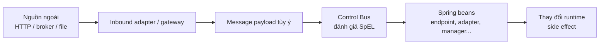
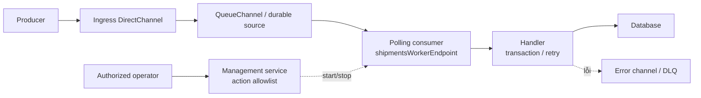
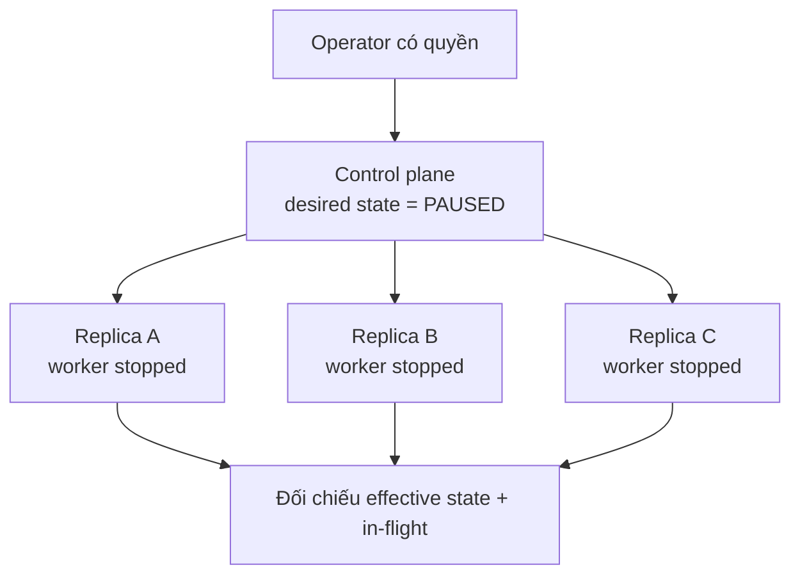

# Không expose control bus không kiểm soát

## 1. Bài toán: một lệnh quản trị có thể làm thay đổi cả runtime

Trong Spring Integration, một ứng dụng có thể gồm nhiều `IntegrationFlow`, channel, consumer endpoint, poller, executor, retry advice, error channel và các adapter nối tới database hoặc broker. Việc **start**, **stop**, thay đổi trạng thái hoặc kích hoạt một thành phần khi đang chạy là nhu cầu vận hành hợp lệ. Tuy nhiên, kênh nhận lệnh quản trị khác căn bản với kênh nhận message nghiệp vụ.

Hãy tưởng tượng một dịch vụ nhận yêu cầu vận chuyển. Trong giờ bảo trì, người vận hành muốn tạm ngừng poller `shipmentsWorkerEndpoint` để tránh gọi database. Nếu một API HTTP công khai cho phép người gọi gửi tùy ý nội dung `@shipmentsWorkerEndpoint.stop()` vào Spring Integration **Control Bus**, thì một người không có quyền cũng có thể làm ngừng xử lý đơn hàng. Tệ hơn, khi nội dung được đánh giá như biểu thức, nó có thể nhắm tới **các bean và phương thức khác** có thể truy cập từ ngữ cảnh xử lý, chứ không chỉ những thao tác start/stop mà nhóm phát triển dự định.

Đây là bài học của chương **Control và quản trị** thuộc module **SPRING_INTEGRATION_RUNTIME**. Trọng tâm là bảo vệ **control plane** khi vận hành message flow: ranh giới tin cậy, điều khiển lifecycle, phân quyền, audit, phản ứng lỗi, tính nhất quán giữa nhiều instance, và các phép thử xác nhận cơ chế bảo vệ hoạt động.

> **Quy tắc quan trọng nhất:** không biến payload do người dùng, HTTP request, Kafka/RabbitMQ message hoặc header chưa được xác thực thành biểu thức gửi trực tiếp tới Control Bus. Nơi nhận lệnh quản trị phải là **ranh giới bảo mật**, không đơn thuần là một channel có tên khó đoán.

## 2. Control Bus trong Spring Integration là gì?

**Control Bus** là một endpoint chuyên nhận message biểu diễn **lệnh quản trị**. Trong cách dùng phổ biến, payload được hiểu là **biểu thức Spring Expression Language (SpEL)** để truy cập hoặc thao tác với các Spring bean; chẳng hạn gọi phương thức lifecycle của một endpoint có tên bean tương ứng.

Ví dụ biểu thức điều khiển minh họa:

```text
@shipmentsWorkerEndpoint.stop()
@shipmentsWorkerEndpoint.start()
@shipmentsWorkerEndpoint.isRunning()
```

Các biểu thức ở trên **không phải JSON nghiệp vụ**. Chúng mang ý nghĩa *thực thi một hành động/đọc trạng thái trên bean trong application context* khi được Control Bus đánh giá. Cần dùng đúng bean name của endpoint đã được Spring Integration tạo; `IntegrationFlow` bean, channel bean và endpoint bean có thể có tên khác nhau.

Trong Java DSL, cú pháp ngắn gọn để tạo Control Bus nội bộ thường có dạng:

```java
import org.springframework.context.annotation.Bean;
import org.springframework.context.annotation.Configuration;
import org.springframework.integration.channel.DirectChannel;
import org.springframework.integration.dsl.IntegrationFlow;
import org.springframework.messaging.MessageChannel;

@Configuration
class InternalControlBusConfig {

    @Bean("internal.control.requests")
    MessageChannel controlRequests() {
        return new DirectChannel();
    }

    @Bean
    IntegrationFlow internalControlBusFlow() {
        return IntegrationFlow.from("internal.control.requests")
            .controlBus()
            .get();
    }
}
```

**Điều quan trọng:** `DirectChannel` và tên bean bắt đầu bằng `internal` **không tạo cơ chế xác thực**. Code trên chỉ thiết lập endpoint và channel nội bộ. Bất kỳ thành phần nào trong application có tham chiếu tới channel và khả năng gọi `send` đều có thể thử đưa message vào đó. Nếu một inbound adapter không tin cậy được nối đến channel này, ranh giới bảo mật đã bị vượt qua.

Bởi Control Bus có khả năng đánh giá biểu thức, phải đánh giá nó như **một bề mặt điều khiển đặc quyền**. Không nên mặc định mọi phương thức/bean đều bị giới hạn bởi một allowlist có sẵn; mức truy cập thực tế còn tùy cấu hình framework và evaluation context.

## 3. Tại sao “expose Control Bus” là một rủi ro bảo mật?

Có ba ranh giới khác nhau mà nhóm phát triển đôi khi vô tình nhập làm một:

1. **Data plane:** message nghiệp vụ như đơn hàng, file, thanh toán được phép gửi từ nguồn ngoài vào các flow xử lý đã định.
2. **Control plane:** chỉ các lệnh quản trị có quyền mới được thay đổi trạng thái endpoint, poller hoặc integration flow.
3. **Runtime internals:** các Spring bean, transaction manager, connection factory, message store, executor và hạ tầng khác do application context quản lý.

Nếu một message từ data plane được chuyển thẳng vào Control Bus, dữ liệu do bên ngoài kiểm soát có thể trở thành **biểu thức quản trị** đối với runtime internals.



**Những hậu quả có thể xảy ra** tùy bean và context được truy cập:

- Dừng consumer hoặc inbound adapter quan trọng, làm backlog tăng hoặc khiến message lỗi khi channel không còn subscriber.
- Khởi động một endpoint đáng lẽ đang dừng để bảo trì, làm tiếp tục gửi dữ liệu vào hệ thống chưa sẵn sàng.
- Gọi phương thức của bean không thuộc danh sách tác vụ quản trị được phép; tác dụng thực tế phụ thuộc phương thức mà expression engine có thể truy cập.
- Đọc hoặc thao tác thông tin runtime nhạy cảm nếu các bean hoặc phương thức liên quan có thể được tham chiếu.
- Tạo **denial of service** bằng cách phát lệnh start/stop liên tục hoặc điều khiển nhầm luồng.

Không phải mọi cấu hình đều dẫn tới cùng mức ảnh hưởng, và không nên tuyên bố bất kỳ payload nào cũng có thể thực thi lệnh hệ điều hành. Điều cần bảo vệ là **không cho dữ liệu không tin cậy được đánh giá bằng khả năng điều khiển bean của Control Bus**.

### Một topology cần tránh

```text
HTTP POST /admin/control
    -> Http inbound gateway
    -> payload = nội dung request
    -> DirectChannel
    -> Control Bus
```

Ngay cả khi đặt đường dẫn là `/internal`, che URL, kiểm tra một secret đơn giản trong header hoặc chỉ dùng một topic broker “ít ai biết”, đây vẫn là thiết kế dễ bị lạm dụng. Cần có **xác thực, phân quyền, giới hạn lệnh và phân tách kênh**.

## 4. Threat model: ai có thể gửi lệnh và lệnh đi qua đâu?

Một thiết kế tốt bắt đầu bằng cách kiểm kê luồng dữ liệu, chứ không bắt đầu bằng việc chọn tên channel.

| Nguồn / tác nhân | Mức độ tin cậy | Quy tắc đề xuất |
| --- | --- | --- |
| Internet client, end user | Không tin cậy | Không có đường trực tiếp tới Control Bus hoặc bean điều khiển. |
| API nội bộ từ dịch vụ khác | Tin cậy có điều kiện | Xác thực service identity, phân quyền theo hành động; dữ liệu vẫn phải validate. |
| Kafka/RabbitMQ topic nghiệp vụ | Không phải kênh quản trị | Không route payload vào Control Bus, kể cả khi producer là thành phần nội bộ. |
| Operator có phiên xác thực | Có thể có quyền cụ thể | Chỉ cho phép tác vụ cần thiết, có audit và giới hạn phạm vi. |
| Scheduler/reconciliation job | Thành phần ứng dụng | Gọi API có tập hành động cố định, không tự tạo biểu thức từ config không tin cậy. |
| Plugin/module do bên thứ ba cung cấp | Có thể bị giới hạn quyền | Không trao tham chiếu channel quản trị và quyền truy cập bean rộng khi không cần. |
| Đội vận hành khẩn cấp | Quyền cao theo quy trình | Cần cơ chế break-glass, audit, kiểm soát thay đổi và rollback trạng thái. |

Một số câu hỏi bắt buộc:

- Những endpoint nào **được phép** start/stop? Có endpoint liên quan thanh toán, xoá dữ liệu hoặc reprocess không?
- Lệnh có áp dụng cho **một instance**, một tenant, một cluster hay toàn bộ application?
- Ai được gửi lệnh `STATUS`, ai được `PAUSE`, ai được `RESUME`, và ai được thay đổi topology?
- Người dùng có được truyền **bean name** hoặc **SpEL expression** tự do không?
- Có cách nào để một header như `role=admin` do producer tự đặt bị hiểu thành quyền thật không?
- Lệnh quản trị được log, gắn request ID và đối soát với trạng thái hiệu lực thế nào?
- Khi app restart, trạng thái “đang tạm dừng” có cần được khôi phục không?

**Kết luận thiết kế:** chuyển input từ vùng không tin cậy thành một **lệnh kiểu dữ liệu có cấu trúc, đã xác thực và có allowlist**, sau đó gọi đúng hành động được lập trình sẵn.

## 5. Phương án ưu tiên: không cần Control Bus cho lệnh đơn giản

Nếu nhu cầu chỉ là start/stop một số consumer cụ thể, cách an toàn và dễ kiểm toán thường là **không tạo Control Bus**. Thay vào đó, viết một management service dùng `SmartLifecycle`, với **danh sách endpoint cố định** và **method có tên rõ ràng**.

### 5.1. Tạo polling endpoint có ID ổn định

Ví dụ có một queue nhận công việc và một polling endpoint cần tạm dừng:

```java
import java.time.Duration;

import org.springframework.context.annotation.Bean;
import org.springframework.context.annotation.Configuration;
import org.springframework.integration.channel.QueueChannel;
import org.springframework.integration.config.EnableIntegration;
import org.springframework.integration.dsl.IntegrationFlow;
import org.springframework.integration.dsl.Pollers;
import org.springframework.messaging.PollableChannel;

@Configuration
@EnableIntegration
class ShipmentFlowConfig {

    @Bean("shipments.pending")
    PollableChannel pendingShipments() {
        return new QueueChannel(100);
    }

    @Bean
    IntegrationFlow shipmentWorkerFlow() {
        return IntegrationFlow.from("shipments.pending",
                endpoint -> endpoint
                    .id("shipmentsWorkerEndpoint")
                    .poller(Pollers.fixedDelay(Duration.ofSeconds(1))
                        .maxMessagesPerPoll(1)))
            .handle(String.class, (payload, headers) -> {
                // Demo: xử lý nghiệp vụ; thực tế phải dùng transaction phù hợp.
                System.out.println("Process shipment " + payload);
                return null;
            })
            .get();
    }
}
```

Bean `shipmentsWorkerEndpoint` là **consumer endpoint** có lifecycle. Trong mô hình demo, `QueueChannel` trong bộ nhớ giúp message còn chờ khi poller dừng **trong cùng JVM**, nhưng message sẽ mất khi JVM chết nếu không có nguồn hoặc message store bền vững.

### 5.2. Service với những tác vụ được phép

```java
import org.springframework.context.ApplicationContext;
import org.springframework.context.SmartLifecycle;
import org.springframework.security.access.prepost.PreAuthorize;
import org.springframework.stereotype.Service;

@Service
public class ShipmentAdminService {

    private final ApplicationContext context;

    public ShipmentAdminService(ApplicationContext context) {
        this.context = context;
    }

    // Tên bean là hằng số từ code, KHÔNG lấy từ request.
    private SmartLifecycle worker() {
        return context.getBean(
            "shipmentsWorkerEndpoint", SmartLifecycle.class);
    }

    @PreAuthorize("hasAuthority('integration:manage:shipments')")
    public boolean pause() {
        SmartLifecycle target = worker();
        target.stop();
        return !target.isRunning();
    }

    @PreAuthorize("hasAuthority('integration:manage:shipments')")
    public boolean resume() {
        SmartLifecycle target = worker();
        target.start();
        return target.isRunning();
    }

    @PreAuthorize("hasAuthority('integration:read:shipments')")
    public boolean isRunning() {
        return worker().isRunning();
    }
}
```

Ứng dụng sử dụng Spring Security phải bật **method security**, ví dụ `@EnableMethodSecurity`, và cấu hình authentication thực sự cho đường quản trị. `@PreAuthorize` chỉ phát huy tác dụng khi method được gọi **qua Spring proxy** có kiểm tra method security; tự gọi method trong cùng bean hoặc tạo object bằng `new` có thể bỏ qua cơ chế AOP. Đừng dùng ví dụ này như một security configuration hoàn chỉnh.

Vì **bean name cố định** và tập hành động gồm `pause`/`resume`/`isRunning`, client không thể chỉ bằng việc đổi chuỗi request mà yêu cầu gọi phương thức bất kỳ trên một Spring bean.

### 5.3. Có HTTP endpoint quản trị thì vẫn phải bảo vệ nó

Nếu cần REST API, không nên tạo route kiểu `POST /control?expression=...`. Chỉ expose route có hành động cố định, ví dụ:

```java
import org.springframework.http.ResponseEntity;
import org.springframework.web.bind.annotation.PostMapping;
import org.springframework.web.bind.annotation.RequestMapping;
import org.springframework.web.bind.annotation.RestController;

@RestController
@RequestMapping("/internal/ops/shipments")
class ShipmentAdminController {

    private final ShipmentAdminService admin;

    ShipmentAdminController(ShipmentAdminService admin) {
        this.admin = admin;
    }

    @PostMapping("/pause")
    ResponseEntity<Void> pause() {
        admin.pause();
        return ResponseEntity.noContent().build();
    }

    @PostMapping("/resume")
    ResponseEntity<Void> resume() {
        admin.resume();
        return ResponseEntity.noContent().build();
    }
}
```

Một controller như vậy **vẫn là bề mặt tấn công** và không an toàn chỉ nhờ URL bắt đầu bằng `/internal`. Production cần đồng thời:

- Xác thực đã được cấu hình, chẳng hạn danh tính người vận hành qua SSO/OIDC hoặc danh tính máy qua cơ chế được tổ chức chấp thuận.
- Phân quyền tới **đúng action và resource**, không chỉ nhãn `ADMIN` tổng quát.
- Transport TLS, giới hạn mạng/ingress và bảo vệ CSRF tùy mô hình xác thực.
- Chính sách rate limit, audit, request ID, xác nhận thao tác nguy hiểm và xử lý lỗi rõ ràng.
- Không nhận tên bean, class, expression hay tên method do client tùy ý cung cấp.
- Kiểm tra tác động tới message in-flight và backlog trước khi tuyên bố `pause` thành công về nghiệp vụ.

**Quan trọng:** `ResponseEntity.noContent()` chỉ thể hiện request quản trị được service trả thành công; `isRunning() == false` không chứng minh mọi task đã drain, database đã rollback hoặc broker đã hoàn tất acknowledgement.

## 6. Nếu bắt buộc dùng Control Bus: chỉ phát lệnh cố định từ code tin cậy

Có những hệ thống đã tích hợp Control Bus để quản trị nhiều endpoint. Vẫn có thể giữ cơ chế đó, nhưng cần thiết kế sao cho **không có input tự do nào đi vào biểu thức SpEL**.

### 6.1. Allowlist bằng enum và ánh xạ tĩnh

Giả sử Control Bus của phần 2 đã được tạo, và chỉ có đúng một polling endpoint có thể điều khiển:

```java
import org.springframework.beans.factory.annotation.Qualifier;
import org.springframework.integration.channel.DirectChannel;
import org.springframework.messaging.MessageChannel;
import org.springframework.messaging.support.GenericMessage;
import org.springframework.stereotype.Service;

enum ShipmentControlAction {
    PAUSE, RESUME, STATUS
}

@Service
class TrustedControlDispatcher {

    private final MessageChannel internalControlBus;

    TrustedControlDispatcher(
            @Qualifier("internal.control.requests")
            MessageChannel internalControlBus) {
        this.internalControlBus = internalControlBus;
    }

    void dispatch(ShipmentControlAction action) {
        // Các biểu thức là hằng số từ code, không ghép input từ bên ngoài.
        String expression = switch (action) {
            case PAUSE  -> "@shipmentsWorkerEndpoint.stop()";
            case RESUME -> "@shipmentsWorkerEndpoint.start()";
            case STATUS -> "@shipmentsWorkerEndpoint.isRunning()";
        };

        boolean accepted =
            internalControlBus.send(new GenericMessage<>(expression));

        if (!accepted) {
            throw new IllegalStateException("Control command not accepted");
        }
    }
}
```

**Đoạn này cố ý chưa phải API công khai**: phương thức `dispatch` chỉ thực hiện ánh xạ đã được xác định. Lớp bảo mật ở **cổng vào** vẫn phải xác thực danh tính, kiểm tra quyền với action và endpoint, audit, rate limit rồi mới gọi `dispatch`. Nếu dùng quyền `integration:read` cho `STATUS` và `integration:manage` cho `PAUSE/RESUME`, phải thực thi phân quyền này trước khi gửi vào Control Bus.

Lưu ý `send() == true` chỉ cho biết việc gửi được chấp nhận theo semantics của channel; riêng lệnh `STATUS` còn cần đường reply/đọc kết quả phù hợp để trả về trạng thái thực, không được tự coi `true` là “worker đang chạy”. Nếu cần trạng thái cho API, thường đơn giản hơn khi gọi `SmartLifecycle.isRunning()` qua management service như phần 5.

### 6.2. Điều tuyệt đối không làm

```java
// KHÔNG AN TOÀN: command nhận từ HTTP/broker được coi là SpEL.
String expression = request.getParameter("command");
internalControlBus.send(new GenericMessage<>(expression));

// KHÔNG AN TOÀN: dữ liệu client quyết định bean/method trong expression.
String beanName = request.getParameter("bean");
String expression2 = "@" + beanName + ".stop()";
internalControlBus.send(new GenericMessage<>(expression2));
```

Cách thứ hai dù có thêm `".stop()"` cố định vẫn cho người dùng quyền chọn bean đích. Nó có thể dừng thành phần không được phép, hoặc gây hệ quả ngoài dự kiến do cú pháp và parsing. Hãy dùng **allowlist của resource ID và action**, tạo hằng số expression riêng cho từng tổ hợp được phép; tốt hơn nữa, gọi API lifecycle trực tiếp.

### 6.3. Hạn chế quyền truy cập đường nội bộ

- Không nối HTTP inbound gateway, broker inbound adapter, WebSocket, TCP server hoặc file ingestion trực tiếp tới channel Control Bus.
- Không forward tùy ý một header như `controlCommand`/`spel` từ message nghiệp vụ.
- Không cấp quyền `ApplicationContext` rộng hoặc tham chiếu control channel cho module không đáng tin cậy khi không cần.
- Đặt điểm phát lệnh tại một service tin cậy; kiểm kê các `MessageChannel.send` và route có thể dẫn vào channel đó.
- Tách security policy của operator khỏi logic nghiệp vụ, không cho business events quyết định start/stop dựa trên payload.
- Nếu không có nhu cầu quản trị bằng biểu thức, **loại bỏ endpoint Control Bus** thay vì cố hạn chế bằng tên bean “bí mật”.

## 7. Phân biệt “không expose” với “đã xác thực”

Giấu Control Bus khỏi mạng công khai là cần thiết, nhưng chưa đầy đủ:

| Biện pháp | Giúp gì? | Không giải quyết gì? |
| --- | --- | --- |
| Không tạo HTTP/broker route đến Control Bus | Giảm mạnh bề mặt truy cập trực tiếp | Một flow nội bộ vẫn có thể vô tình route dữ liệu không tin cậy vào đó. |
| Đặt endpoint trên management port riêng | Tách mạng và chính sách ingress | Không tự tạo phân quyền theo từng lệnh. |
| Firewall hoặc service mesh policy | Giới hạn nguồn kết nối | Không bảo đảm payload an toàn hay operator có quyền stop nhánh cụ thể. |
| Authentication | Biết ai đang gửi yêu cầu | Người đã đăng nhập vẫn có thể không có quyền với action/resource. |
| Authorization theo action và resource | Ngăn thao tác ngoài phạm vi | Không chữa lỗi expression injection nếu vẫn cho quyền nhập biểu thức tùy ý. |
| Allowlist lệnh và bean đích | Thu hẹp phạm vi thao tác | Không thay thế xác thực danh tính và audit. |
| Audit, rate limit và approval | Phát hiện/hạn chế lạm dụng | Không tự rollback message in-flight sau một lệnh stop sai. |

**Không tin header tự khai:** một message do producer gửi với header `role=ADMIN`, `userId=operator` hoặc `authorized=true` vẫn chỉ là dữ liệu nếu nó chưa được gắn vào security context qua bước xác thực đáng tin cậy. Không dùng những header do client tự đặt làm bằng chứng phân quyền.

**Không tin source vì “nội bộ”:** topic broker nội bộ, CI job, message từ một microservice cùng mạng hoặc task scheduler có thể cấu hình sai/bị chiếm quyền. Lệnh quản trị vẫn cần định danh và chính sách tác vụ cụ thể.

## 8. Điều khiển lifecycle cần hiểu message đang ở đâu

Ngay cả khi lệnh hợp lệ và được phân quyền, vận hành thiếu hiểu biết về topology vẫn có thể gây mất message hoặc gián đoạn.



### Tác động của `stop` theo từng thành phần

| Thành phần bị dừng | Tác động có thể xảy ra | Điều cần xác minh |
| --- | --- | --- |
| Polling endpoint đọc `QueueChannel` | Không poll message mới sau khi endpoint dừng đúng cách | Backlog, in-flight, queue capacity. |
| Subscriber cuối của `DirectChannel` | Message mới có thể bị lỗi delivery vì không còn subscriber | Producer error handling và các consumer khác. |
| HTTP/Kafka/RabbitMQ inbound adapter | Có thể ngừng thu nhận message mới theo lifecycle của adapter | Ack, offset, partition rebalance, nguồn có lưu bền vững không. |
| Executor-based consumer | Task đang chạy/đang nằm trong executor có semantics riêng | Active threads, queue task, rejection, shutdown policy. |
| Error handler | Lỗi từ business flow có thể không được xử lý | `ErrorMessage`, subscriber của error channel và DLQ. |
| Dynamic `IntegrationFlowRegistration` | Các endpoint do registration quản lý được start/stop theo phạm vi registration | Không tự dừng các flow tĩnh hoặc replica khác. |

**`SmartLifecycle.stop()` không phải transaction rollback**. Một handler có thể đã dequeue message và đang gọi JDBC; nếu operator dừng poller, handler vẫn có thể hoàn tất hoặc thất bại theo cơ chế riêng. Cần quan sát ranh giới `receive → process → commit → acknowledge`; đừng gửi nhiều lệnh stop/restart với hy vọng “reset” một transaction đang lỗi.

### Kênh lỗi cũng là một phần của control plane

Một lệnh quản trị có thể làm dừng một handler đang là subscriber cuối của một `DirectChannel`. Khi producer tiếp tục gửi, lỗi dispatch có thể xuất hiện; nếu hệ thống có `ExecutorChannel` hoặc poller, lỗi có thể được chuyển thành `ErrorMessage` tùy cấu hình. Nếu error handler cũng bị stop, lỗi thứ cấp có thể che khuất lỗi gốc. Vì vậy, không đưa các endpoint lỗi trọng yếu vào cùng tập lệnh stop tự do như worker nghiệp vụ.

## 9. Quản trị dynamic flow: registration khác bean và endpoint

Spring Integration hỗ trợ `IntegrationFlowContext` và `IntegrationFlowRegistration` để đăng ký hoặc dỡ các flow tại runtime. Một registration có thể được `start()`, `stop()` và `destroy()`. Các thao tác này khác mức độ ảnh hưởng.

| API | Phạm vi | Rủi ro nếu không kiểm soát |
| --- | --- | --- |
| `SmartLifecycle.stop()` trên một endpoint | Đúng endpoint được tham chiếu | Đánh nhầm bean name làm dừng nhánh ngoài ý muốn. |
| `IntegrationFlowRegistration.stop()` | Các component lifecycle do registration quản lý | Có thể ngừng cả một dynamic flow, nhiều endpoint cùng lúc. |
| `IntegrationFlowRegistration.start()` | Khởi động registration đã tồn tại | Có thể khởi động lại luồng đang bảo trì hoặc tạo duplicate consumer. |
| `IntegrationFlowRegistration.destroy()` | Gỡ registration và các component do nó sở hữu | Không phải thao tác pause có thể đảo ngược tức thì; cần đăng ký lại. |
| Đóng Spring `ApplicationContext` | Toàn application context | Không phù hợp cho request “pause một worker”. |

Khi có API quản trị dynamic flow, không cho client tự truyền bean ID hoặc tên registration bất kỳ rồi gọi `destroy()`. Tạo tập **flow ID được phép**, tách quyền `pause` khỏi quyền `remove` và yêu cầu approval mạnh hơn cho lệnh phá hủy.

**Điểm cần nhớ về restart:** registration được tạo động trong JVM không tự persist sau crash. Nếu muốn giữ trạng thái `PAUSED` qua restart, cần một nguồn cấu hình bền vững để khôi phục **desired state** và tái tạo flow; không được mặc định bean ID đã từng tồn tại sẽ có sau mỗi lần deploy.

## 10. Nhiều instance: một lệnh stop có thể chỉ dừng một replica

Giả sử có ba instance cùng chạy poller đọc chung một broker. Operator gửi lệnh `pause()` tới instance A. Điều đó **không tự làm B và C dừng**. Nếu UI chỉ thấy A báo `isRunning=false` rồi hiển thị “đã dừng toàn bộ”, đó là kết luận sai.



Một quy trình an toàn hơn:

1. Quản trị viên gửi request đã xác thực, chỉ định **tài nguyên và phạm vi** (ví dụ worker `shipments` ở môi trường staging).
2. Control plane kiểm tra quyền và ghi **desired state** cùng version, operator identity, reason và TTL của thay đổi nếu phù hợp.
3. Mỗi instance reconcile desired state thành effective lifecycle state.
4. Bộ tổng hợp đối chiếu số instance đã áp dụng, worker còn chạy, in-flight và backlog.
5. UI trả trạng thái `PENDING/PARTIAL/APPLIED/FAILED` dựa trên bằng chứng; không tuyên bố APPLIED ngay sau khi gửi lệnh.
6. Instance mới khởi động sau đó phải đọc desired state trước khi cho consumer hoạt động.

**Không đồng nhất desired state với effective state.** Một instance bị mất kết nối control plane có thể tiếp tục chạy theo trạng thái cũ; phải định nghĩa rõ chính sách fail-open/fail-closed theo độ rủi ro nghiệp vụ.

### Race giữa lệnh quản trị

Hai operator có thể đồng thời gửi `pause` và `resume`. Nếu chỉ gọi `start/stop` mà không có version hoặc thứ tự cập nhật mong muốn, một lệnh cũ có thể đến muộn rồi đảo trạng thái. Dùng control-plane store phù hợp, version/compare-and-set và reconcile để quyết định trạng thái cuối cùng.

Không dùng `Thread.sleep` hoặc đổi tên channel như cơ chế đồng bộ quản trị. Các thao tác lifecycle có hiệu ứng trễ và chịu ảnh hưởng của scheduler/worker.

## 11. Audit, correlation và bằng chứng vận hành

Một lệnh quản trị phải trả lời được: **ai** đã làm, **làm gì**, **trên tài nguyên nào**, **tại sao**, **khi nào**, và **tác dụng thực tế ra sao**.

Một audit record tối thiểu nên chứa:

| Trường | Ví dụ | Mục đích |
| --- | --- | --- |
| `commandId` | `cmd-2026-019` | Idempotency/audit của chính lệnh quản trị. |
| `actorId` và `authMethod` | `ops-42 / OIDC` | Nguồn danh tính đã xác thực; không lấy từ header tùy ý. |
| `action` | `PAUSE` | Hành động thuộc allowlist. |
| `resourceId` | `shipments-worker` | Tài nguyên logic được phép điều khiển. |
| `scope` | `staging / instance-A` | Phạm vi ảnh hưởng. |
| `reason` / change ticket | `maintenance-331` | Giải trình, phê duyệt và rollback. |
| `requestedAt` / `completedAt` | Timestamp UTC | Đối chiếu với lỗi và backlog. |
| `priorState` / `desiredState` / `effectiveState` | `RUNNING / PAUSED / PAUSED` | Phân biệt yêu cầu và kết quả. |
| `result` / `errorCode` | `APPLIED` hoặc `PARTIAL` | Theo dõi lỗi. |

`commandId` là correlation key của **lệnh quản trị**, còn `MessageHeaders.ID` hay `correlationId` trên message nghiệp vụ là định danh của **data plane**. Có thể liên kết chúng trong log để chẩn đoán, nhưng không dùng một header correlation do client đặt làm bằng chứng ủy quyền.

**Không log** access token, mật khẩu, toàn bộ biểu thức nguy hiểm được gửi từ nguồn không tin cậy hoặc payload nghiệp vụ nhạy cảm vào audit. Với request bị từ chối, log mã lỗi, nguồn, action dự kiến và một định danh an toàn để điều tra.

### Idempotency của lệnh quản trị

`pause` hoặc `resume` có thể gần như idempotent về trạng thái cuối cùng, nhưng yêu cầu **không nhất thiết có tác dụng tức thì**. Nếu client timeout rồi retry lệnh, cần dùng `commandId` và version để tránh hai workflow quản trị chạy chồng lên nhau, nhất là khi thao tác bao gồm drain, approval hoặc deploy flow mới.

## 12. Rate limiting, circuit breaker và thay đổi nguy hiểm

Một API quản trị được xác thực vẫn có thể gây quá tải nếu cho phép hàng trăm lệnh `start/stop` trong thời gian ngắn:

- Poller liên tục hủy và đặt lại lịch, làm mất nhịp xử lý và tăng backlog.
- Inbound adapter liên tục reconnect/rebalance, tạo độ trễ và lượng log lớn.
- Dynamic registrations tạo rồi destroy dồn dập gây xung đột ID, object lifecycle chưa cleanup hoặc task in-flight.
- Retry/error path chịu thêm tải khi producer gửi vào subscriber đã dừng.

Nên đặt các nguyên tắc:

1. **Rate limit** theo actor, resource và action, không chỉ theo IP.
2. **Serialize hoặc version hóa** các lệnh cùng resource; tránh stop/resume đua nhau.
3. **Cooldown** có kiểm soát cho thao tác thay đổi lifecycle thường xuyên.
4. **Approval/break-glass** cho thao tác diện rộng hoặc có khả năng mất dữ liệu.
5. **Timeout** cho workflow quản trị và báo kết quả dạng `PENDING` nếu chưa xác minh được effective state.
6. **Safety guard**: không cho dừng duy nhất error handler, consumer giám sát hoặc control-plane dependency khi chưa có phương án riêng.
7. **Recovery plan**: ghi trạng thái trước đó, cách resume, xử lý backlog và rollback thay đổi.

Tất cả đều là **hàng rào bổ sung**; không một hàng rào nào thay thế allowlist và phân quyền.

## 13. Liên hệ Actuator, JMX và endpoint quản trị khác

Spring Boot Actuator, JMX hoặc một dashboard vận hành có thể cung cấp các khả năng quản trị/giám sát khác. **Chúng không phải Control Bus**, nhưng đều cần đánh giá như các bề mặt control plane.

- Nếu sử dụng Actuator qua HTTP, chỉ expose những endpoint cần thiết, cấu hình authentication/authorization, cổng/mạng quản trị và TLS phù hợp. Đừng cho rằng chỉ vì một endpoint của Actuator không được expose thì Control Bus đã được bảo vệ.
- Nếu sử dụng JMX, giới hạn connector và quyền truy cập theo môi trường, không coi quản trị từ JVM-local luôn an toàn trong mọi deployment.
- Nếu tự xây REST admin, hãy dùng một tập endpoint/action định nghĩa trước và service-layer authorization, thay vì một điểm nhận chuỗi SpEL chung.
- Nếu dùng console hoặc CLI nội bộ, xác minh đường kết nối tới worker, quyền của service account và audit tương tự HTTP.

**Điểm phân biệt:** đóng cổng HTTP không ngăn một **broker inbound adapter** gửi message vào Control Bus; tắt một broker route cũng không ngăn code nội bộ có tham chiếu control channel tự gửi biểu thức. Phải kiểm soát **tất cả đường vào của channel** và quyền gọi bean quản trị.

## 14. Kiểm thử an toàn của đường điều khiển

Không thể đánh dấu hệ thống an toàn chỉ vì đã tạo enum `PAUSE/RESUME` trong code. Cần kiểm thử từ **đường vào thực** tới endpoint runtime.

| Test ID | Tình huống | Kỳ vọng |
| --- | --- | --- |
| S01 | Người dùng chưa xác thực gọi API quản trị | Request bị từ chối, endpoint không thay đổi trạng thái. |
| S02 | Người dùng chỉ có quyền xem trạng thái gọi `PAUSE` | Bị từ chối; có audit, không có thao tác lifecycle. |
| S03 | Operator có quyền pause đúng worker | Worker được stop, effective state được xác minh. |
| S04 | Operator chọn tài nguyên không có trong allowlist | Bị từ chối trước khi gọi `ApplicationContext.getBean` hay tạo expression. |
| S05 | Payload chứa cú pháp SpEL hoặc tên bean khác | Được xử lý như dữ liệu sai/không hợp lệ; không bao giờ được đánh giá. |
| S06 | Message từ broker nghiệp vụ chứa header `controlCommand` | Không có route tới Control Bus và không thay đổi lifecycle. |
| S07 | Gửi 100 lệnh pause/resume liên tiếp | Rate limit/version/cooldown có hiệu lực; không tạo trạng thái khó đối chiếu. |
| S08 | Stop worker khi message đang xử lý | In-flight/transaction/ack được quan sát, không giả định tự rollback. |
| S09 | Worker stopped, ingress vẫn gửi vào queue | Backlog tăng đến capacity; có backpressure phù hợp, không mất message im lặng. |
| S10 | Có hai replica, chỉ điều khiển A | B vẫn có thể chạy; UI phân biệt local/global scope. |
| S11 | Pause toàn cluster và start replica mới | Instance mới reconcile `PAUSED` trước khi xử lý. |
| S12 | API nhận lệnh hợp lệ nhưng endpoint không tìm thấy | Trả lỗi rõ ràng, audit `FAILED`, không thử bean name thay thế tùy ý. |
| S13 | Control Bus tồn tại nội bộ, inbound HTTP/broker không được nối vào | Không có đường dữ liệu không tin cậy tới control channel. |
| S14 | Restart sau khi đã pause | Desired state có được giữ và áp lại theo chính sách đã định. |

### Assertion với ví dụ `ShipmentAdminService`

Một phép thử có thể thực hiện:

```java
// Trong Spring integration test đã cấu hình method security và test identity.
ShipmentAdminService admin =
    context.getBean(ShipmentAdminService.class);

SmartLifecycle target =
    context.getBean("shipmentsWorkerEndpoint", SmartLifecycle.class);

// Khi có quyền phù hợp:
admin.pause();
assert !target.isRunning();

admin.resume();
assert target.isRunning();
```

Đoạn trên chỉ kiểm tra **lifecycle behavior** với quyền đã được cấu hình. Để kiểm tra **authentication/authorization**, phải gọi qua đường vào được bảo vệ với danh tính test không quyền, chỉ-read và manage, đồng thời assert `403`/`401` theo policy HTTP đang dùng. Không dùng một test gọi trực tiếp service bean như bằng chứng duy nhất rằng HTTP route an toàn.

### Kiểm thử âm tính trên topology

Kiểm kê tất cả inbound gateway/adapter và route, sau đó chứng minh:

- Không có luồng `HTTP payload → controlBus()`.
- Không có luồng `broker message/header → expression builder → controlBus()`.
- Không có thành phần chấp nhận `beanName`/`methodName` tự do để gọi qua SpEL.
- Chỉ service đã được review có tham chiếu tới channel nội bộ; nếu có thêm producer nội bộ mới, phải kiểm thử lại.
- Các hành động chỉ đọc không dùng cùng quyền với các hành động thay đổi trạng thái.

## 15. Chẩn đoán sự cố vận hành và an ninh

| Triệu chứng | Giả thuyết cần kiểm tra | Hành động |
| --- | --- | --- |
| Endpoint tự dừng mà không rõ nguyên nhân | Có đường điều khiển không được audit, deploy/config thay đổi hoặc consumer lỗi | So sánh lifecycle logs, audit, nguồn lệnh và endpoint exceptions. |
| Message business làm thay đổi trạng thái consumer | Payload/header bị route tới Control Bus | Ngắt route không an toàn, tìm nguồn tin cậy và bổ sung allowlist/authorization. |
| Sau khi pause, producer gặp lỗi “no subscribers” | Dừng subscriber cuối trên `DirectChannel` | Điều chỉnh topology, buffer hoặc cơ chế backpressure. |
| Worker được báo stopped nhưng vẫn xử lý | Task in-flight hoặc consumer khác còn chạy | Đo active threads, toàn bộ endpoint IDs và số replica. |
| UI nói “paused” nhưng một replica vẫn nhận message | Chỉ pause instance cục bộ hoặc control plane không reconcile | Kiểm tra desired/effective state của từng instance. |
| Nhiều lệnh start/stop gây backlog tăng | Không rate limit hoặc có race version | Bổ sung serialization/cooldown, giám sát poller/backlog. |
| Admin gọi `STATUS` nhưng nhận kết quả từ `send()==true` | Nhầm xác nhận dispatch với phản hồi evaluation | Đọc `SmartLifecycle.isRunning()` hoặc thiết kế reply channel rõ ràng. |
| Lỗi quản trị bị mất dấu | Thiếu audit, error path hoặc correlation key | Gắn `commandId`, thu thập exception và trạng thái kết quả. |
| Start worker làm xử lý trùng | Broker redelivery, retry hoặc hai consumer cùng xử lý | Kiểm tra idempotency, transaction, ack và số consumer. |
| Restart lại bật worker lẽ ra phải pause | Desired state không persist hoặc không reconcile khi startup | Lưu desired state, áp policy trước khi start consumer. |
| Operator có quyền quá rộng | Chỉ kiểm tra “đã đăng nhập”, cho bean name/action tùy ý | Phân quyền theo resource/action và giảm tập lệnh. |
| Audit chứa token hoặc payload nhạy cảm | Ghi log request thô | Mask/redact, giới hạn truy cập audit và retention. |

### Checklist xử lý khi nghi Control Bus bị lạm dụng

1. Xác định những channel/flow có thể đưa dữ liệu vào Control Bus và lệnh nào đã được chấp nhận.
2. Kiểm tra lịch sử thay đổi trạng thái endpoint, error rate, backlog và consumer count theo từng instance.
3. Thu thập audit, identity, request IDs và log điều khiển; tránh ghi hoặc công khai payload nhạy cảm.
4. Cô lập nguồn gửi lệnh không tin cậy, vô hiệu route không an toàn bằng thay đổi có kiểm soát; không dừng bừa consumer xử lý lỗi.
5. Đánh giá side effect đã xảy ra: message bị dừng, redelivery, retry, transaction đang mở, database/broker state.
6. Khôi phục desired state và restart đúng endpoint sau khi phụ thuộc đã sẵn sàng.
7. Bổ sung kiểm thử âm tính và review code các `Control Bus`, `MessageChannel.send`, `ApplicationContext.getBean` ở đường quản trị.
8. Xác minh sau khắc phục bằng cả phép thử chưa xác thực, không đủ quyền và có quyền.

## 16. Bài thực hành và tự kiểm tra

**Bài 1 — Quản trị không cần Control Bus.** Chạy `ShipmentFlowConfig` và `ShipmentAdminService`. Dừng polling endpoint, gửi vài message vào `shipments.pending`, sau đó resume. Quan sát backlog, thread poller và việc các message đã nhận trước stop có thể vẫn hoàn tất.

**Bài 2 — Phân quyền theo action.** Tạo ba danh tính thử nghiệm: chưa xác thực, chỉ có `integration:read:shipments` và có `integration:manage:shipments`. Kiểm tra `pause`, `resume` và `isRunning` qua đường quản trị thực, không chỉ gọi method trong test.

**Bài 3 — Loại bỏ input expression.** Xây một request DTO chỉ gồm `action` (enum) và `resourceId` (enum/allowlist). Thử gửi một chuỗi không thuộc action, tên bean khác hoặc biểu thức SpEL vào request; xác minh bị từ chối trước khi gọi management service.

**Bài 4 — Kiểm kê đường vào Control Bus.** Với một ứng dụng thử nghiệm có `internal.control.requests`, lập sơ đồ tất cả producer và adapter. Gỡ mọi route từ inbound dữ liệu nghiệp vụ. Giữ một dispatcher nội bộ với expression hằng số và chứng minh producer thông thường không điều khiển được endpoint.

**Bài 5 — Stop sai chỗ.** Dừng subscriber cuối của một `DirectChannel` trong môi trường test và gửi message. Quan sát lỗi dispatch, so sánh với trường hợp có `QueueChannel` buffer và polling consumer đã stop. Đề xuất topology vận hành phù hợp.

**Bài 6 — Pause toàn cluster.** Chạy hai replica. Khi chỉ gọi service ở replica A, xác minh B vẫn có thể consume. Thiết kế desired state và reconcile trước khi khởi động thêm replica C; ghi rõ trạng thái `PARTIAL` trong UI nếu một replica chưa xác nhận.

**Bài 7 — Race giữa hai operator.** Gửi `PAUSE` và `RESUME` gần nhau với hai command ID. Thiết kế version/CAS cho trạng thái mong muốn, rate limit và audit. Kiểm thử lệnh cũ đến muộn không đảo được trạng thái có version mới.

**Bài 8 — Lỗi khi stop đang xử lý.** Tạo một message đang chạy transaction JDBC trong polling worker, gửi lệnh stop rồi kiểm tra in-flight, commit/rollback và acknowledgement. Không coi `isRunning=false` là bằng chứng giao dịch đã dừng.

**Bài 9 — Review an ninh.** Liệt kê tối thiểu năm điểm phải bảo vệ ngoài `@PreAuthorize` (nguồn authentication, ingress/network, allowlist, audit, rate limit, multi-instance scope, CSRF hoặc lifecycle safety). Thử tạo một policy chỉ cho operator quản lý một worker ở staging, không có quyền điều khiển worker production.

### Câu hỏi tự kiểm tra

1. Vì sao message đưa vào Control Bus khác message nghiệp vụ thông thường?
2. Rủi ro của việc chuyển trực tiếp HTTP request payload thành SpEL là gì?
3. Vì sao tên channel có chữ `internal` hoặc endpoint nằm trong mạng nội bộ chưa đủ bảo đảm an toàn?
4. Làm cách nào dùng `SmartLifecycle` để tránh tạo Control Bus khi chỉ cần pause/resume một endpoint?
5. `@PreAuthorize` cần điều kiện nào để có hiệu lực? Vì sao self-invocation có thể là vấn đề?
6. Vì sao không nên nhận `beanName` tự do rồi ghép thành biểu thức `@beanName.stop()`?
7. `MessageHeaders.CORRELATION_ID` hoặc `role=ADMIN` do client tự gửi có chứng minh quyền quản trị không?
8. `send()==true` khi gửi lệnh `STATUS` có chứng minh worker đang chạy không?
9. Stop polling consumer có bảo đảm transaction in-flight rollback và queue không mất message không?
10. Vì sao API pause ở replica A không tương đương pause toàn cluster?
11. Cần ghi những trường nào để audit một lệnh quản trị?
12. Khác biệt giữa `desired state` và `effective state` khi có replica mất kết nối?
13. Phân biệt `stop()` và `destroy()` trên dynamic `IntegrationFlowRegistration`?
14. Vì sao một người vận hành đã xác thực vẫn không nên có quyền thực thi biểu thức SpEL tùy ý?
15. Nếu nghi ngờ lạm dụng Control Bus, bạn kiểm tra những gì trước khi resume toàn bộ flow?

**Nguyên tắc vận hành:** xem Control Bus là **bề mặt thực thi lệnh quản trị đặc quyền**. Không expose nó cho nguồn ngoài hoặc route dữ liệu không tin cậy vào biểu thức. Ưu tiên API quản trị với **hành động và resource được allowlist**, xác thực, phân quyền, audit và giới hạn tốc độ. Khi thay đổi lifecycle, phải hiểu rõ **channel, backlog, in-flight, transaction, retry, acknowledgement, error handling và phạm vi nhiều instance** để bảo vệ cả an ninh lẫn tính đúng của message flow.
