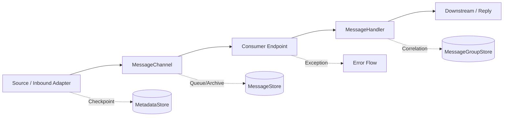
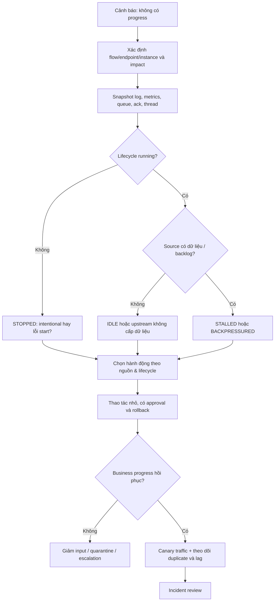
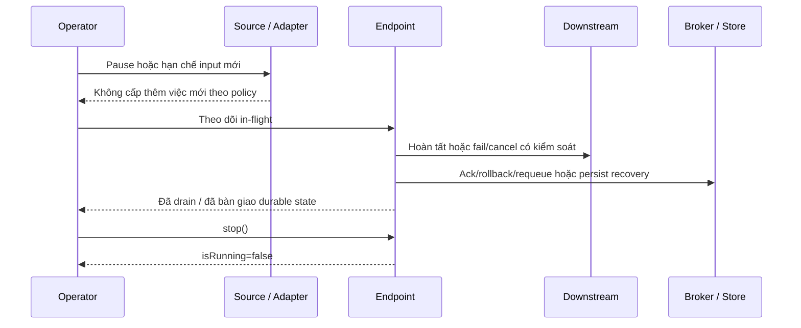

# Runbook cho endpoint bị treo hoặc bị dừng trong Spring Integration

## Mục tiêu học tập

Một `IntegrationFlow` có thể được Spring khởi động thành công nhưng sau đó không xử lý thêm message; cũng có thể một endpoint ở trạng thái `STOPPED` trong khi nguồn message vẫn tiếp tục phát dữ liệu. Khi đó, thao tác restart thiếu chuẩn bị có thể làm mất in-flight message, reset checkpoint, nhân đôi giao dịch hoặc đẩy lỗi lan sang downstream. Người vận hành cần một **runbook có bằng chứng, quyết định và điều kiện xác minh**, không phải một nút “restart để thử”.

Bài **Runbook cho endpoint bị treo hoặc bị dừng** thuộc chương **Control và quản trị** của module **SPRING_INTEGRATION_RUNTIME**. Chúng ta xem luồng thực thi qua channel, endpoint, consumer, poller và executor, kết hợp vòng đời `IntegrationFlow`, transaction, retry, message store, error flow, correlation và hiệu năng để xử lý sự cố runtime an toàn.

Sau bài học, bạn có thể:

- Phân biệt endpoint **STOPPED**, **IDLE**, **STALLED/HUNG**, **BACKPRESSURED**, **FAILING_FAST** và **PAUSED có chủ đích**.
- Tìm đúng endpoint ID và instance; kiểm tra `Lifecycle`/`SmartLifecycle` mà không nhầm cờ running với trạng thái nghiệp vụ.
- Thu log, metrics, thread dump, queue depth/age, retry, checkpoint, transaction và correlation theo một thứ tự ít rủi ro.
- Chọn đường khắc phục cho event-driven consumer, polling consumer, inbound adapter, executor, aggregator và dynamic flow.
- Thao tác start/stop có kiểm soát qua `Lifecycle` hoặc `IntegrationFlowContext`; hiểu phạm vi và rủi ro của Control Bus/JMX.
- Bảo vệ message khi dừng và khởi động lại, tránh ack sai hoặc replay trùng.
- Đặt exit criteria, stop condition, rollback và diễn tập runbook bằng test có chủ đích.

> **Quy tắc:** `isRunning() == true` không chứng minh message đã được xử lý; `stop()` không tự rollback side effect, `start()` không tự phát lại dữ liệu, còn restart JVM không tự bảo đảm exactly-once.

## 1. Xác định triệu chứng trước khi chạm vào runtime

Các Spring Integration endpoint có thể thuộc loại event-driven consumer, polling consumer, inbound adapter, gateway hoặc thành phần đăng ký động. Tùy loại, chúng có cơ chế lifecycle và thread khác nhau.

| Triệu chứng | Quan sát | Chẩn đoán sơ bộ | Điều cần loại trừ |
| --- | --- | --- | --- |
| **STOPPED** | `isRunning=false` | Endpoint chưa start/đã stop/start lỗi | Bảo trì, `autoStartup=false`, rollout có chủ đích |
| **IDLE** | Running, input = 0, queue rỗng | Không có dữ liệu cần xử lý | Source phải có message theo lịch hay không? |
| **STALLED / HUNG** | Running; có in-flight nhưng progress dừng | Handler chặn I/O, lock, deadlock, poller mắc kẹt | Task chỉ đang backoff/đợi theo policy? |
| **BACKPRESSURED** | Running, backlog và queue age tăng | Consumer chậm hơn producer, executor đầy | Downstream quota, DB pool, thread starvation |
| **FAILING FAST** | Handler ít được gọi, error tăng nhanh | Breaker OPEN, validation/rejection lỗi | Message có thật sự tới endpoint không? |
| **PAUSED** | Nguồn không gửi thêm theo quyết định vận hành | Có thể là cơ chế bảo vệ đang hoạt động | Ai pause? Đến khi nào? |
| **PARTIALLY FAILED** | Một nhánh flow có output, nhánh khác không | Routing, correlation, aggregator hoặc error path | Output có nằm ở channel khác không? |

`isRunning` phản ánh vòng đời của đối tượng có giao diện `Lifecycle`; không phản ánh tự động tình trạng broker connection, mức tiến triển của consumer hoặc business commit.

### 1.1. Khoanh vùng theo đường đi của message



Tại mỗi ranh giới, cần phân biệt **message đã được nhận**, **message đã được giao**, **handler đã bắt đầu**, **handler đã hoàn tất** và **nghiệp vụ đã commit**. Tăng số lượng received không có nghĩa output success cũng phải tăng nếu nguồn đang retry hoặc một queue còn backlog.

### 1.2. Ba câu hỏi dẫn dắt

1. Có message mới thực sự đến từ source không? Xem source backlog, lịch poll, inbound adapter, ingress log.
2. Message đã tới endpoint/handler chưa? Xem channel, subscriber, executor queue và handler started counter.
3. Sau handler, **kết quả nghiệp vụ** đã được xác nhận chưa? Xem transaction, DB business key, ack, retry và error archive.

Ba câu trả lời giúp chọn đúng biện pháp. Nếu source rỗng, tăng thread pool không có ích; nếu HTTP client đang treo, restart poller thường chỉ làm thêm message bị đưa vào hàng chờ.

## 2. Mở incident: ảnh hưởng, ownership và điều kiện an toàn

Mục tiêu đầu tiên là tránh để hệ thống tệ hơn trong quá trình điều tra.

### 2.1. Mẫu incident record

```text
incidentId: INC-2026-042
environment: production
service: SPRING_INTEGRATION_RUNTIME
logicalFlow: orders-processing
flowVersion: order-flow-v2
endpointId: ordersHandlerEndpoint
instance: pod-a
symptom: RUNNING_BUT_NO_PROGRESS
firstDetectedAt: 2026-11-22T02:00:00Z
lastBusinessSuccessAt: ...
inputRate: ...
outputRate: ...
queueDepth: ...
oldestMessageAge: ...
inflight: ...
errorRate: ...
sourceAckPolicy: ...
sampleBusinessKey: tenant-a:ORD-42
sampleCorrelationId: corr-42
owner: ...
approvedChange: ...
```

Mẫu này do ứng dụng/tổ chức tự xác định, không phải record do Spring Integration tự sinh. Tránh ghi payload chứa dữ liệu nhạy cảm, token, mật khẩu hoặc toàn bộ headers nếu không cần.

### 2.2. Guardrail trước khi thao tác

- Xác minh **đúng endpoint ID, process/pod, flow version, tenant** và change/incident owner.
- Lưu snapshot trạng thái trước can thiệp: logs, metric window, queue depth/age, source ack status, retry/DLQ, thread dump khi có căn cứ.
- Kiểm tra đã có **durable source** hoặc message store/broker phù hợp chưa; một `ExecutorChannel` với RAM queue không tự bền vững qua restart.
- Xác định side effect có thể đã hoàn tất nhưng acknowledgement chưa được ghi; cần business idempotency key.
- Không xóa `MessageStore`, `MetadataStore`, group store, DLQ, checkpoint hoặc dữ liệu lock để “reset thử”.
- Không tăng retry count/concurrency vô hạn khi downstream đang lỗi.
- Không expose một Control Bus nhận SpEL từ người dùng bên ngoài; thao tác quản trị phải có allowlist, xác thực, phân quyền và audit.

### 2.3. Mức độ ưu tiên

| Mức minh họa | Dấu hiệu | Hành động |
| --- | --- | --- |
| SEV-1 | Nguy cơ mất/nhân đôi tiền hoặc đơn hàng, backlog vượt giới hạn, nhiều luồng dừng | Incident commander, bảo vệ nguồn, phối hợp owner nguồn/đích |
| SEV-2 | Một luồng quan trọng bị kẹt, backlog tăng còn kiểm soát được | On-call xử lý theo runbook, có deadline/escalation |
| SEV-3 | Endpoint hiếm khi có message, hiện rảnh hoặc lỗi đã có fallback hợp đồng | Điều tra theo lịch, tránh thao tác không cần |
| Planned | Endpoint dừng vì bảo trì/change request | Đối chiếu lịch, không start khi chưa hết maintenance |

Ngưỡng cụ thể phải lấy từ SLO/RTO/RPO của hệ thống thật; bảng này không thay thế tiêu chí tổ chức.

## 3. Luồng quyết định nhanh tại thời điểm cảnh báo



**Không** lặp `stop/start/restart` liên tục nếu trạng thái không cải thiện. Lần thứ hai gặp cùng triệu chứng mà không có dữ kiện mới là tín hiệu cần đổi hướng điều tra hoặc escalation.

## 4. Thu thập bằng chứng: log, metrics, graph và thread dump

### 4.1. Các tín hiệu cần nhìn cùng một khoảng thời gian

| Vùng | Dữ liệu quan sát | Câu hỏi |
| --- | --- | --- |
| Lifecycle | `isRunning`, `autoStartup`, startup error | Endpoint đã start thực sự chưa? |
| Inbound adapter | received/sec, source lag, last poll | Nguồn có phát message không? |
| Channel | queue depth, oldest age, send failures | Message đang tồn ở đâu? |
| Consumer | handler started/completed/failed | Handler có tiến triển không? |
| Executor | active threads, pool size, queued/rejected tasks | Worker có bão hòa không? |
| Poller | last scheduled run, poll duration, receive timeout | Lịch poll có còn hoạt động? |
| Transaction | lock wait, rollback, commit duration | Có DB lock/pool exhaustion? |
| Downstream | timeout, 5xx, request latency p95/p99 | Phụ thuộc bên ngoài có chậm? |
| Retry/breaker | attempts, backoff, OPEN rejects | Có retry storm/fail fast? |
| Error flow | `ErrorMessage`, durable archive, DLQ | Lỗi có được lưu/định tuyến đúng không? |
| Correlation | group ID, pending group age | Thiếu nhánh nào, sai key nào? |
| Persistence | checkpoint, message/group store state | Restart có làm mất dữ liệu không? |

Tên metric là **gợi ý để instrument**, không mặc nhiên tồn tại trong mọi bản Spring Integration. Với message ID/correlation ID có cardinality rất cao, nên đưa vào log/tracing có kiểm soát, không đưa mỗi ID thành metric label.

### 4.2. Các bề mặt đọc trạng thái nếu đã cấu hình

Ứng dụng có thể sử dụng Spring Boot Actuator, JMX, Micrometer, Spring Integration graph hoặc logger. Các endpoint quản trị phụ thuộc phiên bản, dependency, cấu hình exposure và quyền truy cập. Ví dụ lệnh chỉ đọc trên management listener nội bộ:

```bash
curl -fsS http://localhost:8080/actuator/health

# Chỉ khi integrationgraph đã được bật và expose:
curl -fsS http://localhost:8080/actuator/integrationgraph

# Trong Kubernetes với quyền được cấp:
kubectl -n <namespace> get pods -l app=<application>
kubectl -n <namespace> logs deploy/<deployment> --since=15m
```

Những lệnh này là ví dụ runbook, **không phải lệnh đã được chạy**. Không tự bật Actuator/JMX công khai để điều tra. `integrationgraph` cũng không phải bằng chứng rằng mọi endpoint đều xử lý message tốt; graph chủ yếu cho cấu trúc và metadata management được hỗ trợ.

### 4.3. Thread dump khi nghi ngờ HUNG

Khi in-flight > 0 nhiều phút nhưng completed không đổi, hoặc executor active luôn ở giới hạn, có thể thu thread dump sau khi được cấp quyền:

```bash
jcmd <pid> Thread.print
```

Nếu cần, thu các bản chụp cách nhau theo quy trình incident để biết một thread luôn mắc ở cùng call stack hay đang thay đổi. Trong container phải chỉ đúng JVM, tránh gửi dump có dữ liệu nhạy cảm lên kênh không được phép.

| Stack / thread state | Khả năng | Cách đối chiếu |
| --- | --- | --- |
| `BLOCKED` trên monitor | Tranh chấp lock / deadlock | Owner lock, lock chain, deadlock detector |
| `WAITING` | Có thể bình thường khi chờ queue/condition | Có nguồn công việc nào cần nó xử lý? |
| `TIMED_WAITING` | Backoff, poll delay hoặc timeout | Thời gian chờ có theo cấu hình? |
| Chờ JDBC connection | Pool cạn hoặc transaction giữ connection | Pool active/idle/wait, slow query |
| Chờ HTTP socket read | Downstream chậm, read timeout thiếu/quá lớn | Downstream latency, timeout client |
| CPU cao ở retry loop | Retry nóng hoặc vòng lặp logic | Exception taxonomy, backoff, rate |
| Poller thread giữ lock | Batch/poll bị nghẽn | Trigger, receive timeout, source transaction |

Một thread đang `WAITING` không tự là lỗi. Phải đối chiếu với nguồn dữ liệu, deadline, throughput và call stack ở nhiều thời điểm.

## 5. Nhánh STOPPED: tìm đúng lifecycle endpoint

### 5.1. Checklist chẩn đoán

1. Xác minh endpoint đã bị stop có chủ đích do bảo trì, change request, blue-green rollout hoặc circuit isolation.
2. Kiểm tra `autoStartup=false`, `SmartLifecycle.phase`, bean dependency và startup failure.
3. Tìm nơi phát lệnh stop: operator, Control Bus, JMX, application code hoặc dynamic flow controller.
4. Xác định đúng **bean endpoint**, không nhầm handler hoặc channel.
5. Đọc source/queue state và khả năng redelivery trước khi mở lại.
6. Nếu start lỗi do broker credentials, DB connection hay invalid config, sửa root cause trước khi thử lại.
7. Start từng endpoint/instance theo approval, rồi kiểm tra business progress.

### 5.2. Đặt endpoint ID rõ ràng từ Java DSL

```java
import org.springframework.context.annotation.Bean;
import org.springframework.integration.dsl.IntegrationFlow;
import org.springframework.messaging.MessageHandler;

@Bean
IntegrationFlow ordersFlow(MessageHandler orderHandler) {
    return IntegrationFlow.from("orders.input")
            .handle(orderHandler,
                    endpoint -> endpoint.id("ordersHandlerEndpoint"))
            .get();
}
```

Ví dụ giả định một `MessageHandler` đã được cấu hình. Cách đặt ID giúp operator tìm một endpoint cụ thể thay vì đoán tên tự sinh. Khi vận hành, vẫn phải xác minh bean ID và loại thực tế trong application context; một handler có thể được tham chiếu từ nhiều endpoint.

### 5.3. Điều khiển qua Lifecycle/SmartLifecycle có kiểm soát

```java
import org.springframework.context.ApplicationContext;
import org.springframework.context.Lifecycle;

final class EndpointRunbookOperator {
    private final ApplicationContext context;

    EndpointRunbookOperator(ApplicationContext context) {
        this.context = context;
    }

    boolean isRunning() {
        Lifecycle endpoint = context.getBean(
                "ordersHandlerEndpoint", Lifecycle.class);
        return endpoint.isRunning();
    }

    void resumeAfterApproval() {
        Lifecycle endpoint = context.getBean(
                "ordersHandlerEndpoint", Lifecycle.class);
        if (!endpoint.isRunning()) {
            endpoint.start();
        }
    }

    void stopAfterApproval() {
        Lifecycle endpoint = context.getBean(
                "ordersHandlerEndpoint", Lifecycle.class);
        if (endpoint.isRunning()) {
            endpoint.stop();
        }
    }
}
```

Đây là **minh họa API nội bộ**, không phải REST controller nên expose ra ngoài. `start()` chỉ yêu cầu lifecycle component chạy; nó không xác nhận downstream healthy hoặc giao dịch đã commit. `stop()` cũng không bảo đảm mọi I/O in-flight được cancel và rollback; điều đó phụ thuộc endpoint, adapter và client.

### 5.4. Dynamic IntegrationFlow có registration ID riêng

Nếu một flow được đăng ký bằng `IntegrationFlowContext`, hãy quản lý đúng registration:

```java
import org.springframework.integration.dsl.context.IntegrationFlowContext;

void resumeDynamicFlow(
        IntegrationFlowContext flowContext,
        String registrationId) {

    var registration = flowContext.getRegistrationById(registrationId);
    if (registration == null) {
        throw new IllegalArgumentException(
                "Unknown flow registration: " + registrationId);
    }

    // Chỉ sau khi đã có authorization/readiness check.
    registration.start();
}
```

Nếu registration đã bị `remove()`, `start()` không tự tái tạo definition cũ. Phải dựng từ manifest/code version phù hợp. Một registration trong pod A không tự tồn tại trong pod B, nên cần kiểm tra observed state của từng instance.

## 6. Nhánh RUNNING nhưng không có progress

### 6.1. Bảng khoanh vùng theo tốc độ

| Source input | Queue depth | Handler started | Handler completed | Nhận định |
| --- | --- | --- | --- | --- |
| 0 | 0 | 0 | 0 | IDLE hoặc upstream bất thường |
| >0 | Tăng | 0/rất thấp | 0 | Consumer, poller, subscriber hoặc executor không lấy task |
| >0 | Tăng | Tăng | Không tăng | Handler/downstream/transaction bị chặn |
| >0 | Không tăng | Tăng | Error tăng | Lỗi nhanh, retry, validation hoặc breaker OPEN |
| Có các phần | Group pending tăng | Có | Không release | Thiếu correlation/sequence hoặc release strategy không thỏa |
| Chỉ một pod lỗi | Không đều | Không đều | Không đều | Local pool/state/config hoặc rollout lệch |

Đừng so output count tổng từ hôm qua với input rate 5 phút gần đây; dùng cùng cửa sổ thời gian để tránh nhận định sai.

### 6.2. Handler block ở HTTP hoặc database

```text
orders.input -> DirectChannel -> ordersHandlerEndpoint
  -> HTTP inventory service
      connection established
      read timeout quá dài hoặc không có
  -> reply không xuất hiện
```

Triệu chứng: `isRunning=true`, handler invocation tăng hoặc giữ in-flight, completion không tăng; thread dump có socket read/DB wait. Remediation ưu tiên xác định dependency, timeout, pool, backpressure và bảo vệ source. Stop endpoint không có nghĩa một HTTP call đã gửi sẽ được hoàn tác.

### 6.3. ExecutorChannel bị cạn tài nguyên

Với `ExecutorChannel`, `send()` có thể trả về trước khi handler chạy. Nếu worker pool đầy hoặc queue đạt giới hạn, có thể có rejection và backlog. Cần kiểm tra:

- Active threads có chạm `maxPoolSize` không?
- Queue task có tăng, tồn bao lâu, có nằm trong RAM không?
- Handler đang chờ DB pool, HTTP hoặc semaphore?
- Rejection policy đưa exception về producer, chạy inline hay bỏ message theo hợp đồng?
- Nguồn có đang ack trước completion không?

**Không** tăng pool size vô hạn khi downstream đã quá tải. Giảm input/prefetch, cô lập blocking operation hoặc thêm durable handoff theo hợp đồng có thể an toàn hơn.

### 6.4. Poller RUNNING nhưng không thực hiện polling có ích

Với `PollingConsumer` hoặc `SourcePollingChannelAdapter`, kiểm tra lịch trigger, thread scheduler, `maxMessagesPerPoll`, receive timeout, transaction/lock và last successful poll. Một poller có thể gọi source đều nhưng nhận 0 message vì `MetadataStore`, persistent file filter hoặc cursor đã đánh dấu dữ liệu cũ là processed.

Đừng xóa toàn bộ checkpoint để “cho poller đọc lại”: nguồn còn dữ liệu cũ sẽ có thể bị reprocess và tạo duplicate. Muốn replay, cần snapshot state, biết business key và dùng quy trình phục hồi có idempotency.

## 7. Lỗi, retry và breaker có thể khiến endpoint trông như treo

Một endpoint nhận message liên tục mà không có business success có thể đang thực thi **retry storm** hoặc fail-fast do circuit breaker OPEN.

```text
Inbound message
   -> Handler + RetryAdvice (attempt 1, 2, 3)
   -> CircuitBreakerAdvice (có thể từ chối nếu OPEN)
   -> Error handler / Recovery
   -> Ack, rollback hoặc DLQ tùy source
```

### 7.1. Phân biệt đường lỗi

- Trong `DirectChannel` đồng bộ, exception thường có thể truyền về caller. Không tự có `ErrorMessage` nếu không có error publisher phù hợp.
- Sau `ExecutorChannel` hoặc poller, error handler tại ranh giới bất đồng bộ có thể đưa exception vào error channel.
- Với broker adapter, ack/nack/redelivery phụ thuộc container, source và transaction.
- Recovery callback bắt lỗi rồi trả bình thường có thể khiến upstream coi handler đã hoàn tất và ack theo cấu hình; phải có durable error record nếu muốn trì hoãn xử lý.

### 7.2. Retry nhiều tầng nhân số attempt

Ví dụ có retry nội bộ 4 lần cho mỗi delivery và broker redelivery 5 lần. Một business message có thể tạo tới 20 lời gọi downstream nếu tất cả attempts đều lỗi. Nếu operator replay thêm, số lời gọi còn tăng. Phải ghi riêng:

```text
retryAttempt     = attempt trong một invocation
deliveryCount    = lượt broker giao message
replayCount      = lượt người vận hành phát lại
businessOutcome  = kết quả commit tại hệ thống đích
```

Không tăng `maxAttempts` khi API ngoài đang timeout hàng loạt; cần phân loại transient/permanent exception, backoff và idempotency. Circuit breaker OPEN có thể đang bảo vệ dependency đúng cách. Reset breaker liên tục có thể gây thêm tải, không giải quyết nguyên nhân.

### 7.3. Correlation và error archive

Một record điều tra nên giữ `MessageHeaders.ID`, `correlationId`, `businessKey`, endpoint ID, flow version, timestamp, retry/delivery count và cause. Message ID có thể khác sau transform/replay; business key ổn định giúp xác minh một đơn hàng đã commit hay chưa.

Nếu aggregator đang giữ một group thiếu phần, kiểm tra `MessageGroupStore`, correlation strategy và release strategy. Không restart aggregator chỉ vì chưa có output: có thể một nhánh đã lỗi và đang nằm trong DLQ.

## 8. Các store ảnh hưởng thế nào tới việc restart?

| Nơi chứa trạng thái | Ví dụ | Restart JVM | Rủi ro nếu thao tác sai |
| --- | --- | --- | --- |
| Thread đang xử lý | HTTP/DB call in-flight | Mất tiến trình JVM, side effect ngoài có thể còn | Replay trùng khi chưa biết commit |
| Executor queue trong RAM | Task chưa được worker lấy | Có thể mất | Kill pod khi source đã ack |
| `SimpleMessageStore` | Message theo UUID | Mất vì in-memory | Không còn payload để recovery |
| Persistent `MessageStore` | Message đã commit | Có thể khôi phục nếu backend/serializer phù hợp | Xóa sớm message đang chờ |
| `MessageGroupStore` | Aggregator pending parts | Còn nếu dùng persistent store đúng | Xóa group thiếu phần không có recovery |
| `MetadataStore` | Checkpoint, dedupe marker | Tùy implementation | Reset cursor/file filter gây đọc lại nguồn |
| Durable broker/DLQ | Delivery chưa ack | Theo contract của broker | Nack/ack/delete hàng loạt gây bão |
| Business DB | Order đã commit | Thường giữ nếu transaction thành công | Khôi phục kỹ thuật nhưng tạo side effect hai lần |

Persistence **không tự tạo replay scheduler**. Message còn trong DB không chứng minh consumer sẽ tự đọc lại; cần poller/worker hoặc component được cấu hình. Transaction ở thread producer thường không tự lan sang thread executor; một HTTP call không tự rollback cùng JDBC transaction.

### 8.1. Khi nào cân nhắc restart cả pod?

Chỉ khi đã loại trừ biện pháp nhỏ hơn hoặc process thực sự hỏng và đã xác định:

1. Source có durable redelivery, hoặc việc mất message là hợp đồng được chấp nhận.
2. Side effect in-flight có được idempotency/compensation bảo vệ.
3. Biết checkpoint và message/group store được khôi phục thế nào.
4. Có rollback plan, giới hạn concurrent restarts và canary monitoring.
5. Dynamic flows và subscription được tái tạo từ desired configuration sau restart.

Pod trở lại HEALTHY **chưa đủ** để đóng incident; cần kiểm tra business progress và backlog.

## 9. Control Bus, JMX và bề mặt quản trị

Spring Integration có cơ chế điều khiển endpoint qua `Lifecycle`, Control Bus hoặc JMX nếu ứng dụng cấu hình. Những bề mặt này có thể tác động mạnh đến runtime; chỉ dùng trong kênh nội bộ có phân quyền.

### 9.1. Ví dụ expression Control Bus

Trong ứng dụng có Control Bus được bật và bean endpoint đúng ID, cú pháp có thể biểu đạt:

```text
@ordersHandlerEndpoint.isRunning()
@ordersHandlerEndpoint.stop()
@ordersHandlerEndpoint.start()
```

Đây là biểu thức **minh họa**, không phải lệnh đã thực thi. Kết quả phụ thuộc bean name, evaluation context và cấu hình Control Bus ở phiên bản đang dùng. Không cho người dùng không tin cậy gửi một expression tùy ý: SpEL có khả năng truy cập bean/method ngoài phạm vi mong muốn.

### 9.2. Một lệnh có trước/sau phải kiểm chứng

```text
BEFORE:
  endpoint = ordersHandlerEndpoint
  instance = pod-a
  changeApproved = CHG-42
  isRunning = false
  source = durable orders queue
  backlog = 240
  downstreamHealth = PASS

ACTION:
  start endpoint đã được allowlist trên pod-a

AFTER:
  isRunning = true
  subscriber hoặc poller active
  handler.completed tăng
  business commit tăng
  oldestQueueAge giảm
  error/duplicate không tăng bất thường
```

Nếu `isRunning=true` mà business commit vẫn không tăng dù có input, việc start chưa đạt mục tiêu. Cần tiếp tục điều tra, không ghi “resolved” chỉ vì API quản trị trả thành công.

### 9.3. Nhiều replica không có một lifecycle chung tự động

JMX, Control Bus hoặc `IntegrationFlowContext` thường điều khiển context/process đang nhận lệnh. Pod A đã start không làm pod B tự start. Với canary/rolling restart, phải biết từng instance và load balancer đang đưa message tới đâu. Không ra lệnh stop/start đồng thời toàn bộ consumer nếu broker dễ rebalance và redelivery storm.

## 10. Hành động khôi phục theo nguyên nhân

### 10.1. STOPPED sau bảo trì

**Điều kiện:** có chứng cứ stop có chủ đích, maintenance kết thúc, nguồn/đích sẵn sàng.

1. Xác minh dependency healthy, endpoint ID và version chính xác.
2. Kiểm tra source backlog, ack policy và message có schema tương thích.
3. Start **một** endpoint/instance theo approval.
4. Gửi canary an toàn hoặc quan sát traffic hợp lệ.
5. Đo business commit, error rate và queue age; sau đó tăng phạm vi theo kế hoạch.

**Không:** start mọi pod khi đối tác/downstream vẫn đang bảo trì.

### 10.2. RUNNING, handler mắc ở downstream

**Điều kiện:** input/in-flight có, completion không tăng, thread/latency chỉ ra I/O.

1. Giới hạn hoặc pause input mới, không để queue RAM tràn.
2. Lưu thread dump và latency/pool metrics.
3. Phối hợp owner downstream; kiểm tra timeout client, kết nối, DB lock.
4. Áp dụng deadline, circuit breaker, backoff/bulkhead theo change policy.
5. Cho in-flight kết thúc hoặc cancel có kiểm soát; không assume cancel hoàn tác side effect.
6. Khi phục hồi, mở input từng bước và kiểm tra business idempotency.

### 10.3. Executor queue đầy

**Điều kiện:** pool active tối đa, queued/rejected tăng, latency xấu.

1. So sánh worker capacity với giới hạn downstream.
2. Giảm ingress/prefetch hoặc dùng durable queue rõ ràng.
3. Tìm tác vụ blocking, deadlock hoặc semaphore bottleneck.
4. Thay đổi pool size/capacity **có giới hạn**, canary và kiểm tra queue age.
5. Escalate nếu throughput không tăng cùng tài nguyên; tránh unbounded buffer.

### 10.4. Poller không tiến

**Điều kiện:** source có dữ liệu nhưng last poll/processed offset không thay đổi.

1. Kiểm tra `isRunning`, trigger, scheduler, `maxMessagesPerPoll` và receive timeout.
2. Kiểm tra source availability, lock/transaction, checkpoint, persistent filter.
3. Nếu checkpoint sai, snapshot và xác định replay có idempotency; không xóa hàng loạt metadata.
4. Resume poller hoặc sửa root cause; xác minh đúng record/file mới được xử lý.

### 10.5. Aggregator chờ nhóm thiếu message

**Điều kiện:** group pending age tăng, không có aggregate output.

1. Lấy group key **thực sự** từ correlation strategy.
2. So sánh message parts, sequence, duplicates và group size.
3. Tìm nhánh thiếu trong error archive/DLQ hoặc channel chưa được consume.
4. Chọn bổ sung phần thiếu, timeout, partial release hoặc quarantine theo business contract.
5. Không force release/xóa group trước khi đánh giá hậu quả.

### 10.6. Dynamic flow bị remove nhầm

**Điều kiện:** message vẫn pin v1, nhưng registration v1 không còn, v2 chưa nhận được hợp lệ.

1. Kiểm tra version registry, instance và active route.
2. Ngừng đưa message pin v1 vào flow không còn tồn tại.
3. Tái tạo v1 từ định nghĩa đã version hóa hoặc có kế hoạch upcast/migrate an toàn.
4. Đảm bảo consumer v1/v2 được start đúng, không tạo double subscribers trên một DirectChannel.
5. Drain các message cũ, retry/group và error archive trước khi retire.

## 11. Stop có chủ đích: quiesce → drain → stop

Khi downstream lỗi nặng hoặc cần bảo trì, việc dừng một endpoint có thể là cách bảo vệ hệ thống. Tuy nhiên phải xác định ai sở hữu nguồn và message.



**Quiesce** ngăn công việc mới tại đúng biên; **drain** giải quyết công việc đã nhận hoặc bàn giao sang durable source có owner rõ; rồi mới `stop()`. Không nhầm stop endpoint với pause inbound adapter: một source có thể vẫn nhận message dù handler downstream đã dừng.

### 11.1. Tiêu chí drain theo loại workload

| Thành phần | Trạng thái cần hoàn tất/được bàn giao |
| --- | --- |
| DirectChannel handler | Invocation đang chạy và transaction outcome |
| ExecutorChannel | Active tasks, executor queue và rejection |
| QueueChannel / broker | Queue depth, lag, delivery đang giữ |
| Poller | Batch đang xử lý, last poll và cursor/ack |
| Gateway | Request còn chờ reply, timeout |
| Aggregator | Pending groups, timeout, release/late arrival |
| Retry | Delayed attempts, retry queue, DLQ/error archive |
| Reactive bridge | Subscription và in-flight Mono/future |
| Dynamic flow | Registration đúng version, message pin cũ |

`inflight=0` không chứng minh flow đã drain nếu queue còn 10.000 message. Có thể dừng có chủ đích khi message còn tồn tại **trong queue durable và có consumer khác sở hữu**, nhưng phải ghi rõ điều kiện bàn giao đó.

### 11.2. Thao tác khi drain quá deadline

Nếu một giao dịch vẫn kẹt sau thời gian dự kiến:

- Xác định nó đang thực thi, chờ backoff hay đã side effect nhưng chưa ack.
- Chọn wait thêm, cancel có kiểm soát, durable requeue hoặc quarantine theo business policy.
- Không assume interrupt/kill sẽ rollback HTTP/DB ngoài process.
- Lưu correlation/business key và kết quả kiểm tra trước khi replay.
- Escalate khi không thể xác minh an toàn.

## 12. Exit criteria: thế nào là khôi phục thật sự?

Một lệnh start hoặc restart được coi hoàn tất khi hệ thống xử lý ổn định theo SLO, không chỉ khi management API trả kết quả.

- [ ] Đúng endpoint ID/version/instance đạt trạng thái dự kiến, không restart loop.
- [ ] Source/consumer/poller đã hoạt động đúng contract, có kiểm tra message canary hoặc traffic thật.
- [ ] `handler.started`, `handler.completed` và **business commit** tiến triển.
- [ ] Timeout, retry, breaker reject và error rate không tăng bất thường.
- [ ] Queue depth và **oldest message age** giảm hoặc ở mức chấp nhận.
- [ ] Thread pool, DB connections và transaction duration không nghẽn.
- [ ] Ack/cursor/metadata nhất quán với business state.
- [ ] Message thất bại có durable retry/error record hoặc đã xử lý theo policy.
- [ ] Không có duplicate business effect sau redelivery/replay.
- [ ] Aggregator group không xuất hiện tồn đọng mới do correlation mismatch.
- [ ] Audit log ghi operator action, approval, before/after metrics và thời điểm khôi phục.

Với flow có lưu lượng thấp, “chưa có input” có thể khiến không thể chứng minh end-to-end success ngay. Khi đó chỉ được báo **READY nhưng chưa có đủ traffic để xác minh throughput**, hoặc dùng synthetic canary không gây side effect thật.

## 13. Rollback, stop condition và escalation

Khi remediation làm sự cố lan rộng, phải dừng thao tác. Các tín hiệu buộc rollback/escalate:

- Số duplicate order/payment/inventory reservation tăng sau replay.
- Backlog gần đầy RAM/disk hoặc message age vượt ngưỡng an toàn.
- Nhiều pod restart loop, broker rebalance storm hoặc pool connection cạn.
- Downstream tiếp tục timeout dù concurrency tăng.
- Error archive/DLQ không lưu được trong khi source đang ack.
- Message store deserialize lỗi, correlation/group key thay đổi do deploy mới.
- Active route/version khác nhau giữa các pod; owner chưa thể xác nhận trạng thái.
- Không biết một in-flight operation đã commit hay chưa.

Trong các tình huống này, giảm hoặc pause input mới, giữ durable state, ghi mọi hành động, quay về cấu hình an toàn nếu tương thích và thông báo owner có thẩm quyền. **Không** xóa queue, cursor hoặc phát lại tất cả message để thử.

## 14. Ma trận kiểm thử và diễn tập runbook

Một runbook chỉ đáng tin khi được diễn tập trong môi trường có nguồn giả, message idempotency và khả năng quan sát đủ tốt.

| Kịch bản | Inject lỗi | Bằng chứng mong đợi | Hành động |
| --- | --- | --- | --- |
| Stop chủ động | `Lifecycle.stop()` | `isRunning=false`, source behavior được ghi | Start sau approval, verify progress |
| Input trống | Source không có dữ liệu | Last poll vẫn tiến, queue rỗng | Xác nhận IDLE, không restart |
| HTTP blocking | Fake client chờ vô hạn | In-flight tăng, thread socket wait | Timeout/bulkhead và bảo vệ ingress |
| Executor đầy | Pool nhỏ, producer nhanh | Queue age/rejections tăng | Giảm input, tuning capacity có giới hạn |
| Poller starved | Scheduler bị task khác chiếm | Last poll đứng, thread dump có task blocking | Khôi phục scheduler/root cause |
| Sai checkpoint | Metadata đánh dấu quá sớm | Source còn record nhưng filter bỏ qua | Replay có snapshot/idempotency |
| Breaker OPEN | Downstream luôn lỗi | Reject nhanh, downstream calls giảm | Theo dõi recovery/backoff, không reset mù |
| Retry storm | Nhiều tầng retry không giới hạn phù hợp | Attempts tăng, output success thấp | Sửa retry classification/backoff |
| Aggregator thiếu phần | Gửi 2 trong 3 message | Pending group không release | Tìm nhánh thiếu/correlation |
| Error archive hỏng | Recovery write bị từ chối | Error lưu thất bại, ack risk | Khôi phục durable error path trước resume |
| Crash sau business commit | Kill trước ack | Source redeliver, business record đã có | Dùng idempotency, không ghi trùng |
| Dynamic flow remove | Remove v1 trước drain | Message v1 không tìm flow | Restore version hoặc migration |
| Multi-pod skew | Stop chỉ pod A | A stopped, B running | Per-instance audit/rollout |

### 14.1. Ví dụ kiểm thử Lifecycle trong Spring test context

```java
import org.junit.jupiter.api.Test;
import org.springframework.beans.factory.annotation.Autowired;
import org.springframework.context.ApplicationContext;
import org.springframework.context.Lifecycle;

import static org.junit.jupiter.api.Assertions.*;

class EndpointLifecycleTest {

    @Autowired
    ApplicationContext applicationContext;

    @Test
    void stopThenStartKnownEndpoint() {
        Lifecycle endpoint = applicationContext.getBean(
                "ordersHandlerEndpoint", Lifecycle.class);

        boolean initiallyRunning = endpoint.isRunning();

        try {
            endpoint.stop();
            assertFalse(endpoint.isRunning());

            endpoint.start();
            assertTrue(endpoint.isRunning());
        }
        finally {
            if (initiallyRunning && !endpoint.isRunning()) {
                endpoint.start();
            }
            if (!initiallyRunning && endpoint.isRunning()) {
                endpoint.stop();
            }
        }
    }
}
```

Ví dụ giả định test được chạy trong Spring Test context có endpoint đúng ID; cần annotation context như `@SpringBootTest` hoặc `@SpringJUnitConfig` và dependency JUnit phù hợp. Nó chỉ kiểm tra lifecycle, **không** chứng minh end-to-end business success. Không thực hiện test stop/start này trên production.

### 14.2. Tránh alert giả khi không có traffic

Nếu flow chỉ chạy cuối ngày, output bằng 0 suốt buổi sáng có thể là bình thường. Một logic alert tham khảo:

```text
ExpectedWork =
  (newInput > 0)
  OR (queueDepth > 0)
  OR (inflight > 0)
  OR (pendingGroups > 0)

PotentialStall =
  ExpectedWork
  AND (noBusinessProgressBeyondSLO)
```

Ngưỡng phải xét poll interval, backoff, batch latency và maintenance window. Khi `ExpectedWork=false`, cần thêm tín hiệu nguồn kỳ vọng có dữ liệu mới trước khi kết luận incident.

## 15. Bài thực hành

### Bài A — STOPPED khác với RUNNING

Tạo một `IntegrationFlow` gắn endpoint ID `ordersHandlerEndpoint` với `DirectChannel` và handler giả. Kiểm tra `isRunning()`, gọi `stop()` trong Spring test context, quan sát hành vi gửi và sau đó `start()`.

**Kết quả mong đợi:** biết rõ lifecycle state, trạng thái channel và điều kiện nghiệp vụ thật; không mặc định message được giữ khi không có subscriber.

### Bài B — RUNNING nhưng handler bị block

Thử fake HTTP client không trả response với `DirectChannel` và `ExecutorChannel` riêng. Ghi send latency, thread name, inflight, queue depth và handler completion.

**Kết quả mong đợi:** thấy điểm blocking khác nhau và chọn timeout/backpressure thay vì tăng retry hoặc restart mù.

### Bài C — Phân biệt poller idle và poller stalled

Thiết lập một nguồn thật sự trống và một nguồn có dữ liệu nhưng scheduler worker bị chiếm. Quan sát last poll, poll duration, source backlog và output.

**Kết quả mong đợi:** xây được điều kiện alert không báo động sai khi flow đang idle hợp lệ.

### Bài D — Retry, DLQ và ack

Cho handler phát lỗi transient lẫn validation error. Cấu hình retry giới hạn, fake error archive và broker redelivery. Ghi attempt, delivery, business key và trạng thái commit.

**Kết quả mong đợi:** phân biệt retry trong invocation với redelivery và chứng minh error archive failure có thể làm sai ack nếu recovery nuốt exception.

### Bài E — Aggregator và correlation bị lệch

Cho splitter tạo ba phần nhưng một nhánh đổi kiểu/key correlation; kiểm tra group size, group ID thực tế và release strategy.

**Kết quả mong đợi:** giải quyết nhánh thiếu đúng cách thay vì restart aggregator hoặc force release.

### Bài F — Restart sau business commit

Tạo DB giả có unique key theo order ID; kill worker sau side effect nhưng trước ack. Cho source giao lại, kiểm tra chỉ một business record được tạo.

**Kết quả mong đợi:** redelivery vẫn có thể xảy ra, nhưng idempotency ngăn side effect nhân đôi.

### Bài G — Dynamic flow v1/v2

Tạo v1/v2 qua `IntegrationFlowContext`, chuyển active route sang v2 khi v1 còn pending task. Thử remove sớm, sau đó thêm drain protocol có kiểm tra queue, in-flight, error archive.

**Kết quả mong đợi:** `remove()` không tự di chuyển công việc; version pinning và durable recovery cần được thiết kế.

### Bài H — Diễn tập sự cố end-to-end

Giả lập 500 input msg/s, 0 output, executor active=max, queue age tăng và downstream timeout. On-call thu snapshot, giới hạn input, chẩn đoán dependency, mở lại canary và đo duplicate/error.

**Kết quả mong đợi:** kết luận sự cố chỉ sau khi business progress tăng, backlog trong giới hạn và mọi message thất bại có owner recovery rõ ràng.

## 16. Câu hỏi tự kiểm tra

1. Vì sao `isRunning() == true` không đủ để kết luận endpoint khỏe?
2. Phân biệt STOPPED, IDLE, STALLED, BACKPRESSURED và FAILING_FAST bằng những tín hiệu nào?
3. `DirectChannel.send()` và `ExecutorChannel.send()` khác nhau như thế nào khi handler bị blocking?
4. Trước khi `start()` một endpoint STOPPED, phải xác minh những gì?
5. `Lifecycle.stop()` có tự rollback giao dịch hoặc hủy mọi HTTP request in-flight không?
6. Khi nào nên thu thread dump, và tại sao `WAITING` không luôn là lỗi?
7. Poller không có output thì phân biệt source trống và scheduler bị treo bằng cách nào?
8. Circuit breaker OPEN có đồng nghĩa lifecycle endpoint STOPPED không?
9. Tại sao lỗi của `DirectChannel` có thể không xuất hiện trong error channel?
10. Recovery callback bắt exception và trả bình thường có thể làm sai ack theo cách nào?
11. `SimpleMessageStore` và executor queue trong RAM có rủi ro gì khi restart pod?
12. Vì sao xóa metadata checkpoint để ép poller đọc lại có thể nguy hiểm?
13. Một aggregator có pending group thiếu nhánh có tự phục hồi khi restart không?
14. Tại sao `inflight=0` không đủ để tuyên bố flow đã drain?
15. Sau khi một dynamic registration bị remove, cần gì để tạo lại đúng version?
16. Control Bus cần xác thực, phân quyền và allowlist vì sao?
17. Start endpoint thành công mà business commit vẫn bằng 0: incident đã kết thúc chưa?
18. Sau restart, cần bảo vệ duplicate side effect bằng khóa nào?
19. Metric nào cho biết endpoint đang idle hợp lệ thay vì stalled?
20. Runbook nên đặt stop condition và escalation thế nào để không làm sự cố rộng hơn?

**Ghi nhớ:** Runbook cho endpoint bị treo hoặc bị dừng phải bắt đầu từ **quan sát đường đi của message và trạng thái nghiệp vụ**, không phải thao tác restart. Phân biệt đúng loại endpoint, threading, transaction, retry/error path, persistence và correlation; chỉ dùng `Lifecycle`, Control Bus hoặc `IntegrationFlowContext` khi đã rõ quyền sở hữu, nguồn và hậu quả. Sau remediation, xác nhận bằng **business commit, queue lag, error rate và idempotency**, không chỉ cờ `RUNNING`.

