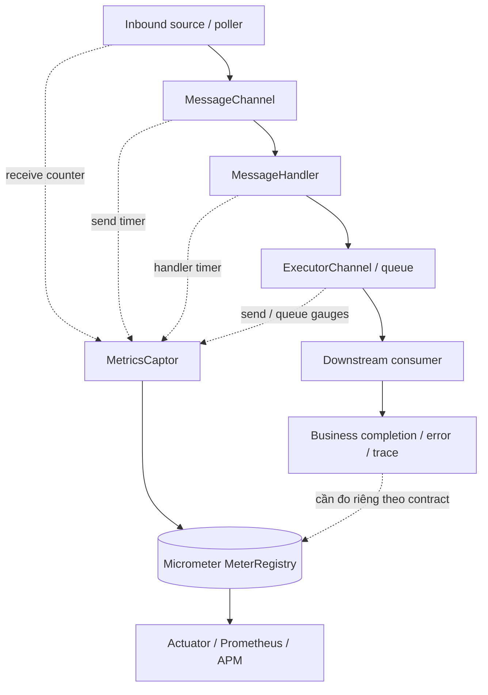
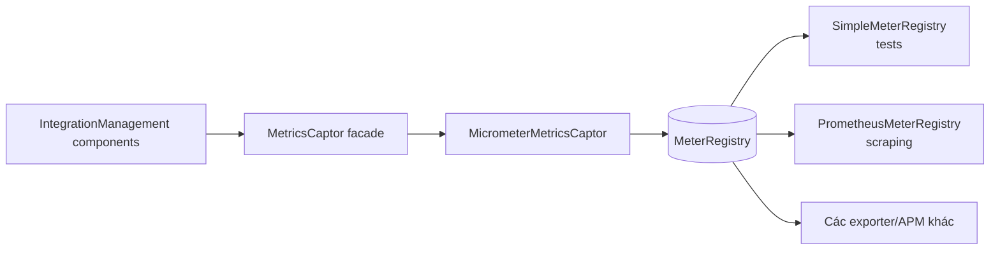
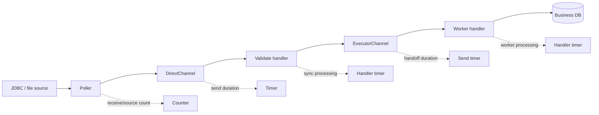

# MetricsCaptor và bộ đo metrics trong Spring Integration Runtime

## 1. Bài toán: flow vẫn chạy nhưng hiệu năng giảm ở đâu?

Một hệ thống nhận message đặt hàng qua inbound adapter, gửi vào `DirectChannel`, gọi handler kiểm tra tồn kho rồi chuyển sang `ExecutorChannel` để xử lý tiếp. Khi độ trễ tăng, chỉ biết “ứng dụng còn sống” chưa đủ. Cần biết **bao nhiêu message được gửi và nhận**, **handler nào chậm**, **queue nào tích tụ**, **lỗi xuất hiện ở đâu** và liệu một lời gọi `send()` thành công có thật sự đồng nghĩa nghiệp vụ hoàn tất hay không.

Trong **SPRING_INTEGRATION_RUNTIME**, observability kết nối trực tiếp với cách Spring Integration điều phối `IntegrationFlow`, channel, endpoint, consumer, poller, executor, retry, transaction, message store và correlation. Một nhóm API quan trọng là `MetricsCaptor` và implementation `MicrometerMetricsCaptor`: chúng cung cấp facade tạo và thu thập **counter**, **timer** và **gauge** từ những integration components.

**Mục tiêu sau bài học:**

1. Hiểu `MetricsCaptor`, `MicrometerMetricsCaptor`, `MeterRegistry` và `IntegrationManagement` phối hợp với nhau thế nào.
2. Phân biệt counter, timer, gauge, sample và timer measurement với business SLI.
3. Biết những meter Spring Integration xuất bản cho channel, handler, message source và `QueueChannel`.
4. Cấu hình và kiểm thử Micrometer metrics bằng Java và `SimpleMeterRegistry`.
5. Phân biệt nhánh `MetricsCaptor` với **Micrometer Observation** (Spring Integration 6.x), tránh đọc sai metric names.
6. Chẩn đoán threading, retry, error handling, transaction, queue backlog, cardinality, meter lifecycle và dynamic flow.

Ví dụ tập trung trên API Spring Integration 6.4.x. API, tên metric và cơ chế instrumentation có thể thay đổi theo phiên bản, nên hãy chọn một phiên bản tài liệu khớp với dependency thực tế.

## 2. Bản đồ observability của một message flow



**Ba câu hỏi vận hành khác nhau:**

| Câu hỏi | Tín hiệu thích hợp | Điều chưa thể kết luận |
| --- | --- | --- |
| Có bao nhiêu lần channel `send()` chạy? | Timer `spring.integration.send` với tag `type=channel` | Không có nghĩa downstream async đã hoàn tất. |
| Có bao nhiêu message source phát ra? | Counter `spring.integration.receive` với tag `type=source` | Không có nghĩa broker ack/DB commit thành công. |
| Queue có tồn đọng không? | `QueueChannel` size gauge và remaining capacity | Không nói đủ về tuổi message, poison message hay consumer lag của broker khác. |
| Handler chậm hay lỗi? | Handler timer `spring.integration.send` với `type=handler` và result/exception | Không mặc nhiên đo cả asynchronous continuation sau khi method trả. |
| Khách hàng có nhận kết quả đúng hạn? | SLI nghiệp vụ từ ingress đến **completion/ack/reply** | Không thể thay bằng mỗi channel send duration. |

Metrics, logs và traces hỗ trợ nhau nhưng có mục đích riêng. Metrics cho xu hướng và cảnh báo; traces cho đường đi một yêu cầu; logs giải thích sự kiện cụ thể. Không đặt `traceId` hoặc `messageId` làm tag của mọi meter chỉ vì hệ thống cần correlation.

## 3. `MetricsCaptor` là gì?

Interface `org.springframework.integration.support.management.metrics.MetricsCaptor` là **facade đo metrics** được Spring Integration giới thiệu từ 5.0.4. Nó không tự quyết định kết quả cần xuất ra Prometheus hay hệ thống APM nào; việc đó thuộc implementation/backend.

Các method chính trên API 6.4.x:

| Method | Trả về | Dùng để |
| --- | --- | --- |
| `counterBuilder(String name)` | `MetricsCaptor.CounterBuilder` | Tạo meter đếm sự kiện. |
| `timerBuilder(String name)` | `MetricsCaptor.TimerBuilder` | Tạo meter đo thời lượng và số lần. |
| `gaugeBuilder(String name, Object obj, ToDoubleFunction<Object> f)` | `MetricsCaptor.GaugeBuilder` | Lấy một giá trị hiện thời từ object nguồn. |
| `start()` | `SampleFacade` | Bắt đầu đo thời gian cho một thao tác. |
| `removeMeter(MeterFacade facade)` | `MeterFacade` hoặc `null` | Gỡ meter đã tạo nếu implementation hỗ trợ. |

```java
// Hợp đồng API khái niệm, tên interface là của Spring Integration:
MetricsCaptor captor;

CounterFacade counter = captor.counterBuilder("demo.events")
        .tag("kind", "accepted")
        .description("Number of accepted events")
        .build();

TimerFacade timer = captor.timerBuilder("demo.step.duration")
        .tag("step", "transform")
        .description("Time spent transforming one message")
        .build();

SampleFacade sample = captor.start();
try {
    // Công việc được đo.
} finally {
    sample.stop(timer);
}
counter.increment();
```

Đây là ví dụ minh họa API, giả định các import, biến và integration setup đã có. Mục 7 sẽ cung cấp class Java đầy đủ hơn.

### 3.1. Những facade liên quan

| Interface | Ý nghĩa |
| --- | --- |
| `CounterFacade` | Có `increment()` để tăng counter theo đơn vị. |
| `TimerFacade` | Có `record(long duration, TimeUnit unit)` để ghi thời lượng. |
| `GaugeFacade` | Đại diện một gauge phản ánh giá trị object được quan sát. |
| `SampleFacade` | Có `stop(TimerFacade)`; truyền mẫu thời gian sang đúng timer. |
| `MeterFacade` | Interface nền, có thao tác `remove()`. |

Builder cho counter/timer có `tag(key, value)`, `description(text)` và `build()`. Gauge builder cũng cung cấp tag/description/build. Không ghi trực tiếp dữ liệu thời lượng bằng `counter.increment()` rồi coi đó là histogram latency.

## 4. `MicrometerMetricsCaptor` kết nối với `MeterRegistry`

Implementation `org.springframework.integration.support.management.micrometer.MicrometerMetricsCaptor` chuyển các lời gọi facade thành Micrometer meters. Constructor của nó nhận `io.micrometer.core.instrument.MeterRegistry`:

```java
import io.micrometer.core.instrument.MeterRegistry;
import org.springframework.integration.support.management.metrics.MetricsCaptor;
import org.springframework.integration.support.management.micrometer.MicrometerMetricsCaptor;

public class CaptorFactory {
    public static MetricsCaptor create(MeterRegistry registry) {
        return new MicrometerMetricsCaptor(registry);
    }
}
```

`MeterRegistry` là nơi quản lý danh tính meter, tags, measurements và việc xuất dữ liệu qua registry backend. Một ứng dụng Spring Boot có thể dùng auto-configuration cho registry của Micrometer và xuất metrics qua Actuator; trong unit test, `SimpleMeterRegistry` giữ metrics trong memory để có thể assert.



**Kết nối này không yêu cầu tự gọi `MetricsCaptor` ở mọi handler.** Với Spring Integration và Micrometer được cấu hình phù hợp, những component có hỗ trợ `IntegrationManagement` tự tạo meter cho các thao tác của chúng. Việc đo thủ công bằng facade chỉ cần khi có **custom business step** hoặc một component riêng cần meter bổ sung.

### 4.1. `IntegrationManagement` giữ vai trò gì?

Interface `IntegrationManagement` cho phép framework inject `MetricsCaptor` hoặc `ObservationRegistry` vào những component hỗ trợ. Các lớp như `AbstractMessageChannel`, `AbstractMessageHandler`, `AbstractMessageSource` triển khai cơ chế đo tương ứng.

`IntegrationManagement.registerMetricsCaptor(captor)` là một phần của contract. Không phải bất kỳ bean nào implement `MessageHandler` cũng tự có timer: **framework nói rõ phạm vi chính áp dụng cho những component kế thừa các lớp Abstract...**. Một POJO hoặc lambda handler tùy chỉnh có thể cần được bọc qua handler chuẩn hoặc instrument riêng.

**Khác biệt về cấu hình:** thêm `MeterRegistry` vào Spring context sẽ kích hoạt hỗ trợ Micrometer tương ứng ở những ứng dụng có Spring Integration management được cấu hình. Trong Java configuration nên khai báo `@EnableIntegrationManagement` rõ ràng khi chủ động quản lý instrumentation; ở Spring Boot, kiểm tra auto-configuration thực tế thay vì tạo trùng registry hoặc management infrastructure.

## 5. Ba loại meter cơ bản và cách đọc

### 5.1. Counter: số lần sự kiện xảy ra

Counter chỉ tăng. Trong một JVM, khi application restart, counter thường bắt đầu lại. Dashboard nên tính **rate/increase trong khoảng thời gian** thay vì xem số tích lũy đã chạy từ nhiều lần deployment.

Ví dụ: số message `MessageSource` nhận thành công trong phút gần nhất hoặc số lỗi retry sau khi hết attempts. Đối với queue backlog, counter không thay gauge vì counter không thể giảm khi message được consume.

### 5.2. Timer: thời lượng cùng số lần

Micrometer `Timer` ghi `count` và `totalTime`; tùy cấu hình/backend có thêm `max`, histogram hoặc percentile. Timer của channel send đo **thời gian lời gọi `send()`**, không phải lúc nào cũng bằng end-to-end processing latency.

Ví dụ:

```text
DirectChannel.send() -> subscriber chạy đồng bộ 30 ms
  channel send timer có thể phản ánh khoảng thời gian đó.

ExecutorChannel.send() -> chỉ handoff sang executor mất 1 ms
  channel send timer ≈ thời gian handoff,
  worker xử lý 400 ms được đo ở ranh giới consumer khác.
```

Một `Timer` không phải `LongTaskTimer`. Với tác vụ rất dài đang diễn ra, muốn biết **có bao nhiêu tác vụ đang chạy** và thời gian đang chạy cần thêm long-task timer hoặc gauge chuyên biệt.

### 5.3. Gauge: trạng thái ở thời điểm lấy mẫu

Gauge mô tả trạng thái có thể tăng hoặc giảm: kích thước queue, dung lượng trống, số message đang xử lý, số component. Gauge thường phản ánh giá trị tại lúc registry được đọc, không phải lịch sử thay đổi. Một spike rất ngắn có thể không xuất hiện nếu scrape interval dài.

Đối với object được dùng để đo gauge, phải quản lý lifecycle/reference: một số Micrometer gauges giữ weak reference tới object; nếu không còn reference đủ lâu, gauge có thể báo giá trị không hợp lệ hoặc không cập nhật.

### 5.4. Tag là một phần của danh tính meter

Ví dụ meter:

```text
name      = spring.integration.send
type      = channel
name tag  = ordersIn
result    = success
exception = none
```

Trong Micrometer, cùng **metric name** với những bộ tag khác nhau là những series khác nhau. Không ghi nhận thống kê lỗi bằng cách chỉ nhìn một series `result=success` rồi cho rằng không có lỗi. Những label `result` và `exception` cần được hiểu theo **vị trí instrument**; lỗi downstream async thường không xuất hiện ở một channel send đã thành công.

## 6. Những meter Spring Integration tự cung cấp (nhánh `MetricsCaptor`)

Khi Micrometer metrics được bật đúng, Spring Integration tạo meter khi những component hỗ trợ bắt đầu được sử dụng. Các tên và tag sau được mô tả trong Spring Integration Reference:

| Component / phép đo | Tên meter | Loại | Tags thường gặp |
| --- | --- | --- | --- |
| `MessageChannel.send(...)` | `spring.integration.send` | Timer | `type=channel`, `name=<componentName>`, `result=success/failure`, `exception=none/<class>` |
| `MessageHandler` (framework handler) | `spring.integration.send` | Timer | `type=handler`, `name=<componentName>`, `result=success/failure`, `exception=none/<class>` |
| `PollableChannel.receive(...)` | `spring.integration.receive` | Counter | `type=channel`, `name=<componentName>`, `result`, `exception` |
| `MessageSource` | `spring.integration.receive` | Counter | `type=source`, `name=<componentName>`, thường `result=success`, `exception=none` |
| Tổng số channels | `spring.integration.channels` | Gauge | Số `MessageChannel` trong application. |
| Tổng số handlers | `spring.integration.handlers` | Gauge | Số `MessageHandler` trong application. |
| Tổng số sources | `spring.integration.sources` | Gauge | Số `MessageSource` trong application. |
| `QueueChannel` đang chứa | `spring.integration.channel.queue.size` | Gauge | `type=channel`, `name=<componentName>` |
| Dung lượng còn lại của `QueueChannel` | `spring.integration.channel.queue.remaining.capacity` | Gauge | `type=channel`, `name=<componentName>` |

**Không lẫn metric name và label name:** trong bảng, `spring.integration.send` là tên metric, còn `name=ordersIn` là **tag** nhận diện component. Cũng một tên metric đó có thể vừa chứa series của channel vừa chứa series của handler; phải filter theo `type`.

### 6.1. `result=failure` có thể có `exception=none`

Với `MessageChannel.send()`, lời gọi có thể **trả `false` mà không ném exception**. Framework vẫn có thể đánh dấu failure với `exception=none`. Khi viết alert, không chỉ đếm exception tags khác `none` vì như vậy có thể bỏ sót trường hợp send bị từ chối.

Ngược lại, `result=success` ở `ExecutorChannel.send()` chỉ có thể có nghĩa **task đã được bàn giao**, không phải downstream business transaction đã commit.

### 6.2. Counter receive không phải broker ack

`spring.integration.receive` của `PollableChannel`/`MessageSource` đo nhận từ component tương ứng. Nó không tự biết một message JMS đã được ack, một offset Kafka đã commit hay một event đã được ghi trong bảng nghiệp vụ. Với poller transaction, nhận thành công và commit successful là hai mốc khác nhau.

Nếu message bị rollback rồi được redeliver, receive count có thể tăng nhiều lần cho cùng business event. Đây không nhất thiết là lỗi metric; nó thể hiện số lần nhận, không phải số **event duy nhất đã hoàn tất**.

### 6.3. Queue gauge là tồn đọng *ở channel đó*

`QueueChannel` in-memory có thể bộc lộ `size` và `remaining.capacity`. Khi hai queue nối với nhau, không được cộng kích thước queue để kết luận chính xác số event unique đang pending; một event có thể tồn tại ở nhiều stage hoặc bị phát lại.

Với `DirectChannel`, không có queue size nội bộ tương đương. Với broker hoặc `JdbcChannelMessageStore`, cần dùng thêm metrics phù hợp backend và loại channel; không suy ra mọi channel đều có gauge dung lượng trống.

## 7. Ví dụ chạy được: instrument `DirectChannel` và handler

Mẫu bên dưới dùng một `SimpleMeterRegistry` cho test, tạo channel và handler do Spring Integration quản lý. Nó không cần Prometheus server.

**`IntegrationMetricsConfiguration.java`**

```java
package demo.metrics;

import io.micrometer.core.instrument.simple.SimpleMeterRegistry;
import org.springframework.context.annotation.Bean;
import org.springframework.context.annotation.Configuration;
import org.springframework.integration.annotation.ServiceActivator;
import org.springframework.integration.channel.DirectChannel;
import org.springframework.integration.config.EnableIntegration;
import org.springframework.integration.config.EnableIntegrationManagement;
import org.springframework.integration.handler.AbstractMessageHandler;
import org.springframework.messaging.Message;
import org.springframework.messaging.MessageChannel;
import org.springframework.messaging.MessageHandler;

@Configuration
@EnableIntegration
@EnableIntegrationManagement
public class IntegrationMetricsConfiguration {

    @Bean
    public SimpleMeterRegistry meterRegistry() {
        return new SimpleMeterRegistry();
    }

    @Bean("ordersIn")
    public MessageChannel ordersIn() {
        return new DirectChannel();
    }

    @Bean
    @ServiceActivator(inputChannel = "ordersIn")
    public MessageHandler orderHandler() {
        // AbstractMessageHandler hỗ trợ IntegrationManagement.
        return new AbstractMessageHandler() {
            @Override
            protected void handleMessageInternal(Message<?> message) {
                String orderId = (String) message.getPayload();
                if (orderId.isBlank()) {
                    throw new IllegalArgumentException("Missing order ID");
                }
                System.out.println("Processing order " + orderId);
            }
        };
    }
}
```

**`RunMetricsDemo.java`**

```java
package demo.metrics;

import io.micrometer.core.instrument.Timer;
import io.micrometer.core.instrument.simple.SimpleMeterRegistry;
import org.springframework.context.annotation.AnnotationConfigApplicationContext;
import org.springframework.messaging.MessageChannel;
import org.springframework.messaging.support.MessageBuilder;

public class RunMetricsDemo {
    public static void main(String[] args) {
        try (var context = new AnnotationConfigApplicationContext(
                IntegrationMetricsConfiguration.class)) {

            MessageChannel input = context.getBean(
                    "ordersIn", MessageChannel.class);
            SimpleMeterRegistry meters = context.getBean(SimpleMeterRegistry.class);

            input.send(MessageBuilder.withPayload("SO-42").build());

            Timer sendSuccess = meters.find("spring.integration.send")
                    .tags("type", "channel",
                          "name", "ordersIn",
                          "result", "success")
                    .timer();

            if (sendSuccess == null) {
                throw new IllegalStateException("No channel send timer");
            }
            System.out.println("send count=" + sendSuccess.count());
            System.out.println("totalTimeMs=" +
                    sendSuccess.totalTime(java.util.concurrent.TimeUnit.MILLISECONDS));
        }
    }
}
```

**Giải thích:**

1. `@EnableIntegration` tạo infrastructure của Spring Integration; `@EnableIntegrationManagement` bật cấu hình management của các component hỗ trợ.
2. `SimpleMeterRegistry` là một `MeterRegistry` thực, giúp các thành phần instrumented ghi meters vào memory.
3. `DirectChannel` có tên bean `ordersIn`; Spring có thể ghi metric cho send operation.
4. `AbstractMessageHandler` cũng có khả năng instrument; `orderHandler` xử lý đồng bộ, vì vậy exception có thể truyền về `send(...)`.
5. Meter của channel và handler có **cùng tên** `spring.integration.send` nhưng khác `type`.
6. Meters thường được tạo khi component lần đầu được dùng; truy vấn quá sớm, trước `send()`, có thể nhận `null`.

Nếu test này không thấy timer, kiểm tra trước: `MeterRegistry` thực sự có trong context không, management được bật chưa, component có hỗ trợ `IntegrationManagement` không, có `ObservationRegistry` được inject thay nhánh captor không, và có `MeterFilter` đang loại meter không.

### 7.1. Kiểm tra `failure`

Trong demo, gửi payload `""` khiến handler ném `IllegalArgumentException`. Với `DirectChannel`, caller có thể nhận exception đồng bộ:

```java
try {
    input.send(MessageBuilder.withPayload("").build());
} catch (Exception ex) {
    System.out.println("Failed as expected: " + ex.getClass().getSimpleName());
}

Timer failures = meters.find("spring.integration.send")
        .tags("type", "channel",
              "name", "ordersIn",
              "result", "failure")
        .timer();

System.out.println("failure timer present=" + (failures != null));
```

Đoạn này đặt trong method sau khi có biến `input` và `meters` từ ví dụ trước; các wrapper exception/exception tags cụ thể phụ thuộc đường gọi và handler. Thực tế có thể xuất hiện meter `type=handler` failure riêng; không cộng cả hai rồi gọi đó là số business requests lỗi **không trùng lặp**.

## 8. Dùng `MetricsCaptor` trực tiếp cho công việc ứng dụng

Không nên tự lặp lại một meter đã có sẵn cho toàn bộ `MessageHandler`. Nhưng có những **sub-step** không được framework đo riêng, chẳng hạn thời gian xác minh chữ ký hoặc số lần lookup cache miss. Trong trường hợp này có thể dùng facade trực tiếp.

**`BusinessStepMetrics.java`**

```java
package demo.metrics;

import io.micrometer.core.instrument.MeterRegistry;
import org.springframework.integration.support.management.metrics.CounterFacade;
import org.springframework.integration.support.management.metrics.MetricsCaptor;
import org.springframework.integration.support.management.metrics.SampleFacade;
import org.springframework.integration.support.management.metrics.TimerFacade;
import org.springframework.integration.support.management.micrometer.MicrometerMetricsCaptor;

public final class BusinessStepMetrics {

    private final MetricsCaptor captor;
    private final TimerFacade validationTimer;
    private final CounterFacade validationFailures;

    public BusinessStepMetrics(MeterRegistry meterRegistry) {
        this.captor = new MicrometerMetricsCaptor(meterRegistry);
        this.validationTimer = captor
                .timerBuilder("app.orders.validation.duration")
                .description("Time to validate an order")
                .tag("step", "validation")
                .build();
        this.validationFailures = captor
                .counterBuilder("app.orders.validation.failures")
                .description("Validation failures")
                .tag("reason", "invalid_input")
                .build();
    }

    public void validate(String orderId) {
        SampleFacade sample = captor.start();
        try {
            if (orderId == null || orderId.isBlank()) {
                validationFailures.increment();
                throw new IllegalArgumentException("Missing order ID");
            }
        } finally {
            sample.stop(validationTimer);
        }
    }
}
```

Đây là một class độc lập có thể được tạo bằng `new BusinessStepMetrics(registry)` hoặc khai báo Spring bean. `timerBuilder(...).build()` và `counterBuilder(...).build()` nên tạo **một lần và tái sử dụng**, không tạo meter ở mỗi message với một tag thay đổi theo `orderId`.

`finally` bảo đảm thời gian validation được ghi cả khi ném exception. Tùy SLI, bạn có thể tách timer success/failure bằng **tag có số giá trị hữu hạn** thay vì cộng dồn chúng vào cùng một series. Với thao tác async, không đo bằng `start()/stop()` quanh **method chỉ tạo `Mono`**; cần đo tới tín hiệu completion thực sự.

### 8.1. Tại sao không dùng trực tiếp `MeterRegistry` cho tất cả?

Micrometer có API trực tiếp như `Counter.builder(...)` và `Timer.builder(...)`, rất phù hợp cho metrics ứng dụng. `MetricsCaptor` tồn tại để Spring Integration có **facade không phụ thuộc trực tiếp vào từng vendor instrument**, và có thể tùy chỉnh cách framework tạo meter.

Trong business code tùy chọn dùng Micrometer trực tiếp cũng hợp lý; quan trọng là **không tạo hai meter cùng ý nghĩa với hai tên khác nhau rồi cộng nhầm** và không làm mất nhãn/ownership của flow.

### 8.2. Ví dụ gauge cho số tác vụ đang xử lý

```java
import java.util.concurrent.atomic.AtomicInteger;
import org.springframework.integration.support.management.metrics.GaugeFacade;

AtomicInteger inFlight = new AtomicInteger();
GaugeFacade gauge = captor
        .gaugeBuilder(
                "app.orders.inflight",
                inFlight,
                value -> ((AtomicInteger) value).get())
        .description("Currently running order operations")
        .tag("stage", "validation")
        .build();

inFlight.incrementAndGet();
try {
    // Xử lý request trong thời gian mà gauge cần theo dõi.
} finally {
    inFlight.decrementAndGet();
}
```

Đoạn trên là fragment dùng `captor` từ class có sẵn. `AtomicInteger` phải sống đủ lâu; gauge giữ/đọc đối tượng theo semantics của meter backend, không lưu mọi giá trị lịch sử. Với async callback, decrement phải chạy tại **completion/cancellation/error**, không đơn giản là ngay khi method trả về publisher.

## 9. Hai đường đo trong Spring Integration 6.x: MetricsCaptor và Observation

Từ Spring Integration **6.0**, framework còn hỗ trợ **Micrometer Observation**, một abstraction có thể tạo **metrics lẫn traces** thông qua các `ObservationHandler` được đăng ký. Đây **không phải** tên gọi khác của `MetricsCaptor`.

### 9.1. Bảng phân biệt

| Điểm so sánh | `MetricsCaptor` / Micrometer metrics | `ObservationRegistry` / Micrometer Observation |
| --- | --- | --- |
| Abstraction | `MetricsCaptor` → counter/timer/gauge facade | `Observation` lifecycle → handler tạo metrics/spans |
| Kích hoạt | Cấu hình Micrometer `MeterRegistry` và integration management | Có `ObservationRegistry`, bật quản lý + chọn components bằng `observationPatterns` |
| Metric names tiêu biểu | `spring.integration.send`, `spring.integration.receive` | `spring.integration.handler`, `spring.integration.producer`, `spring.integration.gateway` |
| Tags | `type`, `name`, `result`, `exception` | Low-cardinality key values như `spring.integration.name`, `spring.integration.type`, outcome theo convention |
| Tracing | Không tự sinh span chỉ vì có Captor | Có thể sinh spans nếu đăng ký tracing handler tương ứng |
| Chi phí | Meters, tags, serialization/export | Metrics/spans và context propagation; cần theo dõi sampling/cardinality |

Khi một `IntegrationManagement` component được inject **`ObservationRegistry`**, API `registerMetricsCaptor(...)` của component đó bị **bỏ qua**. Các meters trong chế độ này được tạo bởi `ObservationHandler` phù hợp, **không thu thập đồng thời độc lập** qua `MetricsCaptor` nữa. Điều này quan trọng khi nâng cấp: dashboard chỉ truy vấn `spring.integration.send` có thể không thấy dữ liệu của một component đã được chuyển sang observation.

**Lưu ý mặc định:** sự hiện diện của `ObservationRegistry` không có nghĩa tất cả components đều instrumented với Observation. Spring Integration dùng `@EnableIntegrationManagement(observationPatterns = "...")`; mặc định pattern rỗng, không có component nào được chọn vô điều kiện. Có thể đặt `"*"` để chọn tất cả integration-management components, hoặc chỉ chọn theo patterns để giới hạn phạm vi.

### 9.2. Ví dụ cấu hình Observation cho một ứng dụng nhỏ

Đây là một **phương án thay thế** cho bài demo MetricsCaptor ở mục 7, không phải cấu hình phải chạy song song trong cùng ví dụ:

```java
import io.micrometer.core.instrument.MeterRegistry;
import io.micrometer.core.instrument.observation.DefaultMeterObservationHandler;
import io.micrometer.observation.ObservationRegistry;
import org.springframework.context.annotation.Bean;
import org.springframework.context.annotation.Configuration;
import org.springframework.integration.config.EnableIntegration;
import org.springframework.integration.config.EnableIntegrationManagement;

@Configuration
@EnableIntegration
@EnableIntegrationManagement(observationPatterns = "*")
public class ObservationConfiguration {

    @Bean
    public ObservationRegistry observationRegistry(MeterRegistry meterRegistry) {
        ObservationRegistry observations = ObservationRegistry.create();
        observations.observationConfig().observationHandler(
                new DefaultMeterObservationHandler(meterRegistry));
        return observations;
    }
}
```

Ví dụ giả định `MeterRegistry` đã được cung cấp (từ Spring Boot, Prometheus registry hoặc `SimpleMeterRegistry`). `DefaultMeterObservationHandler` là adapter tạo Micrometer meters từ Observation; để có distributed traces còn cần tracing handler/propagator và exporter phù hợp.

Không bật `observationPatterns = "*"` cho một hệ thống có hàng chục nghìn component động mà chưa cân nhắc overhead, số series và khả năng export. Có thể chỉ instrument các component quan trọng theo naming/pattern contract.

### 9.3. Meter names trong nhánh Observation

| Component được observe | Tên observation/meter điển hình | Cách hiểu |
| --- | --- | --- |
| Inbound messaging gateway | `spring.integration.gateway` | Timer của request–reply; thường có `spring.integration.gateway.active` nếu cấu hình long-task timer phù hợp. |
| Message handler | `spring.integration.handler` | Thời gian thực thi observation của handler. |
| Channel producer/send | `spring.integration.producer` | Thời gian thao tác producer và bối cảnh tracing. |
| `SourcePollingChannelAdapter` | Hỗ trợ Observation từ **6.5** | Không áp dụng mặc định cho mọi bản 6.4. |

Đối với nhánh Observation, low-cardinality keys bắt đầu bằng prefix `spring.integration.` như `spring.integration.name` hoặc `spring.integration.type`. Gateway còn có outcome theo convention. Các nhãn trên metric thực xuất ra phụ thuộc `ObservationConvention`, `ObservationHandler` và exporter; kiểm tra registry thực tế khi xây dashboard.

**Tránh hiểu nhầm:** `spring.integration.handler` không phải là alias của `spring.integration.send{type="handler"}`. Chúng được sinh từ hai cơ chế instrument khác nhau; không tự cộng chúng lại để tính số request.

## 10. Điều khiển meter bằng `MeterFilter`

Metrics tự động rất hữu ích, nhưng một số channel có traffic cao hoặc được tạo động không cần tất cả series. Micrometer cho phép dùng `MeterFilter` để quyết định meter nào được đăng ký.

Ví dụ Spring Integration Reference minh họa tắt meters cho riêng channel có tên `noMeters`:

```java
import io.micrometer.core.instrument.MeterRegistry;
import io.micrometer.core.instrument.config.MeterFilter;
import org.springframework.context.annotation.Bean;
import org.springframework.context.annotation.Configuration;
import org.springframework.integration.channel.QueueChannel;

@Configuration
public class MeterFilterConfiguration {

    @Bean
    public QueueChannel noMeters() {
        return new QueueChannel(10);
    }

    @Bean
    public MeterFilter muteNoMetersChannel() {
        return MeterFilter.deny(id ->
                "channel".equals(id.getTag("type")) &&
                "noMeters".equals(id.getTag("name")));
    }
}
```

Trong Spring Boot, việc đăng ký `MeterFilter` như bean có thể được auto-applied vào managed registries. Ở ứng dụng thuần Spring không dùng auto-config, cần gọi `registry.config().meterFilter(muteNoMetersChannel)` **trước khi các meters liên quan được tạo**. Không chỉ định một `MeterFilter` bean rồi giả định mọi `MeterRegistry` trong mọi context đều đã nhận nó.

**Phạm vi:** Filter theo `type=channel` và `name=noMeters` trong ví dụ nhắm tới legacy meters. Với nhánh Observation, metric name và tags có cấu trúc khác, nên phải viết filter phù hợp. Không nên copy nguyên filter rồi tuyên bố đã tắt mọi observation.

### 10.1. Tùy chỉnh `MicrometerMetricsCaptor`

Spring Integration cho phép subclass `MicrometerMetricsCaptor` để tùy chỉnh tên/tag của meters framework tạo. Trường hợp đặc biệt có thể override builder methods hoặc các phương thức `build()` trong builder phù hợp. Tuy nhiên, mỗi lần đổi metric name/tag schema cần được xem như **thay đổi hợp đồng quan sát**: dashboards, alerts và truy vấn lịch sử có thể bị gãy.

Nếu chỉ cần thêm một counter nghiệp vụ, tạo meter riêng thường đơn giản hơn việc subclass toàn bộ captor. Nếu mục tiêu là tracing và conventions thống nhất, cân nhắc dùng Observation API thay vì cố đưa trace context vào tags của legacy meters.

## 11. Expose metrics qua Spring Boot Actuator hoặc backend khác

`SimpleMeterRegistry` thích hợp cho unit test hoặc demo, không phải hệ thống lưu time series lâu dài. Trong production, Micrometer được nối vào một backend như Prometheus, Datadog, Graphite, OTLP metrics collector hoặc hệ thống do tổ chức sử dụng.

Với **Spring Boot Actuator** và Prometheus, quy trình thường là:

1. Có Spring Integration và Micrometer/Actuator dependencies phù hợp.
2. Thêm `micrometer-registry-prometheus` vào runtime dependencies.
3. Cấu hình Actuator expose `prometheus` endpoint.
4. Chạy flow để meters được tạo khi sử dụng.
5. Cho Prometheus scrape endpoint, gắn alerts/dashboards theo metric names/tags thực tế.

Ví dụ cấu hình Spring Boot:

```yaml
management:
  endpoints:
    web:
      exposure:
        include: "health,info,metrics,prometheus"
  metrics:
    tags:
      application: "orders-integration"
```

Đây là **cấu hình ứng dụng mẫu**, không phải file cần sửa trong bài học. Phiên bản Spring Boot, dependencies, actuator security, management port và cách xuất metrics thực tế có thể khác. Không expose `/actuator/prometheus` ra Internet công khai nếu chưa bảo vệ bằng network/security policy phù hợp.

### 11.1. Prometheus tên metric có thể được chuẩn hóa

Micrometer sử dụng tên dạng dấu chấm, ví dụ `spring.integration.send`. Prometheus thường hiển thị timer theo base unit seconds với tên triển khai dạng `spring_integration_send_seconds_count` và `spring_integration_send_seconds_sum`. Hãy **kiểm tra endpoint thực**: version của registry và naming convention có thể làm tên cuối thay đổi.

Ví dụ truy vấn minh họa, giả định đúng series đang tồn tại:

```promql
# Số lượt channel send thành công mỗi giây trong 5 phút
sum(rate(spring_integration_send_seconds_count{
  type="channel", result="success"
}[5m]))

# Độ trễ send trung bình (giây) của một handler cụ thể
sum(rate(spring_integration_send_seconds_sum{
  type="handler", name="orderHandler"
}[5m]))
/
sum(rate(spring_integration_send_seconds_count{
  type="handler", name="orderHandler"
}[5m]))
```

Không suy ra percentile p95/p99 từ tỷ lệ `sum/count`; biểu thức này chỉ ra **mean latency**. Muốn percentile, phải cấu hình histogram/percentile distribution theo Micrometer/backend và dùng truy vấn `histogram_quantile` trên các buckets phù hợp. Đừng lấy mức `max` tại một scrape làm p99.

### 11.2. Những điều metrics không thay thế được

Một exporter hoạt động không có nghĩa business đang đúng. Ví dụ:

- `send` metric thành công, nhưng downstream worker bị lỗi và gửi `ErrorMessage` sau đó.
- `receive` tăng, nhưng transaction của poller rollback và source redeliver.
- Queue gauge gần 0, nhưng một `ExecutorChannel` đã bàn giao 10.000 tasks vào executor queue khác.
- Handler timer nhanh, nhưng một cold `Mono` chưa subscribe hoặc đang chờ I/O ở reactive scheduler.
- Gateway nhận được reply, nhưng nghiệp vụ downstream cần hoàn tất compensation.

Vì thế production cần thêm **completion outcome**, **business event ID** và **end-to-end latency** theo đúng đơn vị nghiệp vụ, không chỉ lấy các meters cấp channel làm SLA.

## 12. Channel, poller và executor: một metric được đo đến đâu?



### 12.1. `DirectChannel`: thời gian send có thể gồm handler

`DirectChannel` gọi subscriber đồng bộ trên thread sender. Khi channel send vào handler mất 40 ms và handler ném exception, channel send timer có thể phản ánh phần thời gian này và báo failure. Tuy nhiên, nếu handler chỉ trả một `Mono` chưa được xử lý, timer có thể đo **thời gian tạo publisher**, không phản ánh việc xử lý đã hoàn tất sau đó.

### 12.2. `ExecutorChannel`: timer của handoff không phải xử lý nền

`ExecutorChannel` bàn giao message vào executor. Lời gọi `send()` có thể thành công khi task được chấp nhận; downstream handler chạy trên thread khác. Do vậy:

- `type=channel` send success chỉ chứng minh ranh giới gửi **được chấp nhận** theo semantics của channel.
- Lỗi ở worker về sau không nhất thiết làm series send trước đó đổi thành failure.
- Latency của worker cần được instrument tại handler/completion của worker.
- Executor queue depth, active threads và rejected tasks có thể cần **Micrometer executor binding hoặc metrics riêng**, không tự xuất hiện đầy đủ từ channel timer.

Nếu task bị từ chối ngay tại handoff, có thể thấy failure/exception ở sender. Nếu task được nhận rồi fail về sau, lỗi thường đi qua cơ chế async error handling, không thể sửa ngược một meter đã ghi.

### 12.3. `QueueChannel` và poller tạo hai chặng riêng

`QueueChannel.send()` đo enqueue. `QueueChannel.receive()` đo dequeue. Giữa hai thời điểm có thể có **thời gian đợi queue** dài mà cả hai phép đo send/receive riêng không phản ánh đầy đủ.

Để đo queue wait:

1. Gắn timestamp an toàn khi enqueue (hoặc metadata riêng).
2. Khi dequeue, đo `dequeueTime − enqueueTime`.
3. Phân biệt queue wait với handler processing và transaction commit.
4. Không dùng clock của hai node chưa đồng bộ để đo latency chính xác nếu timestamp đến từ những máy khác nhau.

`receiveTimeout` của poller cũng có thể làm thread chờ message; việc đo timer ở endpoint hoặc nguồn tùy implementation có thể bao gồm hoặc loại trừ khoảng chờ. Khi điều tra poller, cần kết hợp `poll trigger interval`, `receive duration`, `handler duration` và backlog, thay vì suy ra hiệu năng từ một meter.

### 12.4. Mọi handler chưa chắc có native timer

Không nên suy luận “có `MessageHandler` bean” là luôn xuất hiện meter. Những thành phần kế thừa `AbstractMessageHandler` và được quản lý bởi integration infrastructure có hỗ trợ instrumentation; một custom implementation chỉ triển khai interface `MessageHandler` có thể không có đo native.

Nếu hệ thống sử dụng Spring Integration adapters hoặc endpoint types khác, hãy kiểm tra `IntegrationManagement`, bean lifecycle và metrics thực tế. Thiếu meter có thể do **component type** chứ không nhất thiết do lỗi Prometheus.

## 13. Transaction, rollback và cách diễn giải outcome

Một transaction của poller có thể bắt đầu trước `receive()`, nhưng `receive()`, DB update và broker acknowledgement có thể thuộc những resource/transaction manager khác nhau. Metrics tại channel/handler không có khả năng tự suy ra commit cuối cùng.

```text
Poller:
  receive message         -> receive counter +1
  send to DirectChannel   -> channel timer count +1
  handler updates DB      -> handler timer success
  COMMIT DB               -> exception / rollback-only
  broker/source redelivery may happen later
```

Trong trường hợp commit lỗi, handler timer vẫn có thể ghi success vì lỗi xuất hiện **sau khi handler trả về**. Đây không phải bug của timer; nó đo ranh giới khác. Để xác định xử lý nghiệp vụ thành công cần instrument:

- `transaction completion` hoặc trạng thái commit của business operation.
- Ack/offset commit từ adapter nguồn.
- Bản ghi business/event ID đã xử lý theo transaction.
- Error flow sau commit/rollback, nếu có.

**Không đếm mỗi `spring.integration.send{result="success"}` như một đơn hàng hoàn tất.**

### 13.1. Đọc metrics khi transaction được thử lại

Ví dụ một order cần hai attempts:

```text
Attempt 1: handler called -> transient DB error -> rollback
Attempt 2: handler called -> success -> commit
Result: 1 business event, 2 handler invocations
```

Handler invocation metrics đúng khi count = 2; business success nên = 1. Muốn tính retry rate, cần metric **attempt count** riêng theo loại retryable failure. Nếu broker cũng phát lại, có thể có thêm nhiều delivery của cùng event ID.

## 14. Retry, recovery và ErrorMessage

Trong Spring Integration, `RequestHandlerRetryAdvice` có thể gọi lại handler mà nó bao quanh. Mỗi attempt có thể được đo ở một tầng handler, nhưng việc framework timer nằm **ngoài** hay **trong** retry advice phụ thuộc cấu hình advice/endpoint cụ thể. Vì vậy không nên khẳng định mọi timer luôn đếm từng attempt mà chưa kiểm tra bằng test.

| Cơ chế | Điều cần đếm/đo | Rủi ro khi diễn giải |
| --- | --- | --- |
| Retry trong JVM | Attempts, exhausted retries, backoff duration | Một business event có nhiều handler invocations. |
| Broker redelivery | Delivery attempts, lag, DLQ | Không phải mọi attempt đều đi qua cùng một JVM. |
| Recovery callback | Success/recovery outcome, rethrow vs swallow | Recoverer thành công không chứng minh source đã rollback. |
| ErrorMessage flow | Số lỗi theo endpoint, exception family | Một lỗi có thể được publish/forward ở nhiều stage. |
| Transaction rollback | Rollback count, commit failure | Handler timer success không loại trừ rollback ở boundary ngoài. |
| Remote API timeout | Timeout count và request state | Timeout không chứng minh side effect chưa xảy ra ở phía remote. |

### 14.1. Định nghĩa rõ số lượng cần alert

Ví dụ một hệ thống có:

```text
100 business event IDs
120 source receives (20 redeliveries)
145 handler attempts (25 retries thêm)
99 commits, 1 dead-letter
```

Ở đây chỉ báo “145 messages processed” là mơ hồ. Nên đặt tên:

- `source_delivery_total` — số lần nhận, tính cả redelivery.
- `handler_attempt_total` — số lần thử handler.
- `business_completion_total` — số event unique đạt business completion.
- `business_failure_total` — số event unique cuối cùng không hoàn tất.
- `recovery_dead_letter_total` — số event đưa vào DLQ.

Đây là **tên metrics đề xuất của ứng dụng**, không phải tên framework tự tạo. Dữ liệu unique business events phải lấy từ event ID/DB state hợp lệ; counter thông thường tự nó không deduplicate event.

### 14.2. Không dùng payload/exception message làm tags

Tag `exception=IllegalArgumentException` là giá trị hữu hạn trong phạm vi Java exception class thường dùng. Tag chứa `exception.getMessage()` có thể thay đổi theo mỗi dữ liệu đầu vào, làm tăng số series rất lớn và vô tình lộ PII. Chỉ ghi exception message chi tiết trong log được phân quyền, có redaction và sampling nếu cần.

## 15. Correlation và trace: nên gắn metadata ở đâu?

Spring messages thường có `MessageHeaders.ID`, `CORRELATION_ID`, `REPLY_CHANNEL`, `ERROR_CHANNEL` và các header nghiệp vụ như `eventId`. Chúng rất hữu ích để nối các log/traces xuyên qua channel và endpoint, nhưng **không phù hợp làm metric tags cho mỗi message**.

| Dữ liệu | Nên đặt ở đâu? | Lý do |
| --- | --- | --- |
| `component=ordersValidator` | Metric tag | Cardinality thấp, ổn định qua nhiều messages. |
| `result=success/failure` | Metric tag | Ít giá trị, hữu ích để alert. |
| `exception=DeadlockException` | Metric tag phân loại | Cần kiểm soát số loại; tránh message/payload. |
| `traceId`, `spanId` | Distributed trace/log context | Thay đổi theo request; tag metric sẽ nổ cardinality. |
| `eventId=E-123` | Log/trace hoặc DB state | Có thể duy nhất cho mỗi message. |
| `tenantId` | Thường là log/trace; chỉ metric nếu cardinality được giới hạn và cho phép | Nhiều tenants hoặc tên nhạy cảm làm series tăng và rò dữ liệu. |
| `orderId`, customer email | Không dùng metric tag | High-cardinality và dữ liệu cá nhân. |

### 15.1. ThreadLocal/MDC có thể mất qua executor

`DirectChannel` thường chạy cùng thread; `ExecutorChannel`/Reactor scheduler chạy thread khác. `MDC`/`ThreadLocal` không tự đi theo mọi async boundary. Spring Integration Observation cùng tracing infrastructure có thể hỗ trợ propagation khi được cấu hình đúng; nếu không, dùng context propagation hoặc truyền metadata rõ ràng theo message.

Không phát biểu “có Micrometer metrics thì trace tự động hoạt động”. `MicrometerMetricsCaptor` tạo metrics, còn tracing cần `ObservationRegistry`, tracing handlers, propagator và backend exporter tương ứng.

### 15.2. Những nơi dễ bị mất correlation

`HttpInboundGateway`, JMS/Kafka header mapper, custom transformer hoặc một flow động tạo lại `Message<?>` có thể làm mất/sửa headers. Khi lỗi xảy ra, `ErrorMessage.getOriginalMessage()` và `MessagingException.getFailedMessage()` có thể không cùng bản message hoặc có thể `null`. Để nối incident, nên giữ stable `eventId` và flow/component ID trong log/trace, với validation và bảo mật theo nguồn.

## 16. Dynamic IntegrationFlow và vòng đời meters

`IntegrationFlowContext` cho phép tạo và hủy flow động tại runtime. Mỗi flow có thể sinh channel/handler với tên riêng; nếu hệ thống tạo hàng nghìn flow và mỗi flow có nhiều metric tag series, **số series trong registry/backend** có thể tăng ngay cả khi lưu lượng nhỏ.

```text
tenant-001.importFlow -> channel send success/failure timers
tenant-001.validator  -> handler success/failure timers
tenant-002.importFlow -> các series tương tự, khác component name
...
tenant-10000.*        -> hàng chục nghìn meter identities
```

### 16.1. Quản lý lifecycle

1. Khi register flow: instrument components qua management configuration đúng phiên bản.
2. Khi start flow: các meters có thể được tạo lần đầu khi component xử lý message.
3. Khi stop: meter không nhất thiết biến mất; registration còn tồn tại.
4. Khi destroy/remove: framework/implementation có cơ chế cleanup nhưng **cần xác minh** meter lifecycle thực tế, nhất là với custom metrics.
5. Với meter do ứng dụng tạo trực tiếp, phải quản lý ownership và cleanup nếu không muốn registry giữ metadata/tags của flow đã bị xóa.

`MetricsCaptor.removeMeter(meterFacade)` và `MeterFacade.remove()` cung cấp API hỗ trợ gỡ meter facade. Với Micrometer direct API còn có `MeterRegistry.remove(...)`. Tuy nhiên, không tự xóa một meter **đang được chia sẻ** bởi nhiều flow. Nhiều meter names/tags trùng nhau có thể cùng tham chiếu một meter; xóa sai có thể làm thống kê của component khác biến mất.

### 16.2. Vì sao không gắn `flowId` vô hạn vào mọi meter?

Một ứng dụng có 50.000 flow IDs và 4 kết quả/tên metric có thể tạo nhiều trăm nghìn series khi kết hợp với `exception`, `type` và các tags khác. Memory registry, scrape payload, Prometheus cardinality và chi phí remote storage tăng mạnh.

Ưu tiên:

- Tag `flowType=orders` hoặc `integrationDomain=warehouse` có số giá trị giới hạn.
- Chỉ tag flow ID cho tập flow trọng yếu với ngân sách series được duyệt.
- Dùng log/tracing/registry API để tra cứu đúng flow ID của incident.
- Dùng `MeterFilter`, naming convention và cleanup lifecycle có chủ đích.
- Có alert `meter count`/`series cardinality` và test khi onboarding nhiều tenants.

Không chỉ dựa vào `IntegrationGraphServer` để lấy metric: graph giúp quan sát topology, còn `MeterRegistry` lưu time-series measurements. Hai nguồn nên được nối bằng component names ổn định nhưng không thay thế nhau.

## 17. Thiết kế SLI và dashboard có ích cho người vận hành

Nếu dashboard chỉ có “total messages sent” và CPU, nó có thể bỏ sót hệ thống đang **nhận nhanh nhưng hoàn tất chậm**. Đối với từng flow trọng yếu, nên tách bốn nhóm tín hiệu:

| Nhóm | Tín hiệu | Cách dùng |
| --- | --- | --- |
| **Traffic** | Source receive rate, ingress delivery rate, business event count | Biết nguồn có đang phát dữ liệu không. |
| **Latency** | Handler timer, channel send duration, queue wait, end-to-end completion latency | Phân biệt chậm ở thread, queue, external API hoặc commit. |
| **Errors** | Send failures, handler failures, retries, timeouts, DLQ, commit failures | Nhận diện lỗi phát sinh và mức độ tác động tới nghiệp vụ. |
| **Saturation** | Queue size/capacity, executor active/queued, pool connection usage, in-flight publisher | Biết hệ thống đã gần giới hạn tài nguyên chưa. |

### 17.1. Ví dụ: tính SLI thành công đúng

Một SLI nghiệp vụ khả thi:

```text
Successful order completion ratio =
  số order/event ID độc nhất đã commit và có outcome SUCCESS
  -----------------------------------------------------------
  tổng số order/event ID độc nhất hợp lệ nhận vào trong cửa sổ
```

Không lấy `spring.integration.send` count làm tử số nếu flow có async worker, retry hoặc rollback. Có thể tạo counter nghiệp vụ ở **sau business commit hoặc được bảo vệ bởi idempotent completion state**; nếu instrumentation chạy sau commit mà crash trước increment, metric đếm vẫn có thể thiếu, nên SLI chính xác cao có thể cần xuất từ DB/domain events đã commit thay vì một bộ đếm trong memory.

### 17.2. Ví dụ: tính latency SLI đúng

Đối với flow `HTTP gateway → DirectChannel → ExecutorChannel → DB`:

```text
Ingress timestamp
  → channel send (2 ms)
  → executor queue wait (150 ms)
  → handler processing (80 ms)
  → DB commit (20 ms)
  → reply delivery (10 ms)

End-to-end ≈ 262 ms (ví dụ số liệu minh họa)
```

Timer `spring.integration.send{type=channel}` ở executor boundary có thể chỉ thấy khoảng 2 ms đầu. Để đặt SLO `p95 < 500ms`, phải đo từ ingress tới kết quả cuối; không ghép timer của các stage bằng cách cộng p95 của từng stage, vì percentile của tổng không bằng tổng các percentiles.

### 17.3. Cảnh báo ưu tiên theo tác động

Một dashboard vận hành tốt nên có:

1. **Error budget / completion success ratio** theo loại flow.
2. **p95/p99 end-to-end latency** so với SLO.
3. **Queue backlog + age of oldest message**; hàng đợi lớn nhưng tiêu thụ nhanh khác hàng đợi nhỏ bị treo.
4. **Retries/attempts per business event** để phát hiện retry storm.
5. **DLQ/poison message** và **transaction rollback** rates.
6. **Executor/DB/broker saturation** khi throughput giảm.
7. **Flow lifecycle**: start/stop, missing subscriber, source stopped, scheduler failures.

Các chỉ báo thêm ngoài Spring Integration native meters là do ứng dụng hoặc backend cung cấp. Không giả định framework tự có age of oldest message cho mọi queue.

## 18. Troubleshooting: có metric nhưng hiểu sai, hoặc hoàn toàn không thấy metric

| Triệu chứng | Nguyên nhân có thể | Cách kiểm tra |
| --- | --- | --- |
| Không có `spring.integration.send` | Chưa có `MeterRegistry`/management, component chưa được dùng, `MeterFilter` deny, đang dùng Observation | Kiểm tra bean registry, instrumentation mode, component class và thử send thực. |
| Có `spring.integration.handler` nhưng không có `spring.integration.send{type=handler}` | Component dùng `ObservationRegistry` thay MetricsCaptor | Kiểm tra `observationPatterns` và ObservationHandlers. |
| Channel có timer nhưng custom handler không có | Handler chỉ là implementation `MessageHandler`, không thuộc lớp Abstract có instrumentation | Dùng handler chuẩn hoặc meter riêng trong custom code. |
| Source receive count tăng nhưng không có business result | Retry/rollback, async fail, filter/transformer discard, missing reply | Truy vết end-to-end ID và kiểm tra error flow. |
| `result=success` vẫn đi kèm incident | Thành công là của `send()`, không phải worker/commit/broker ack | Xác định boundary đo, quan sát downstream completion. |
| Timer count tăng nhưng latency rất nhỏ | Đang đo handoff hoặc thời gian tạo `Mono` | Đo async completion và queue wait. |
| `spring.integration.channel.queue.size` luôn 0 | Channel khác loại, poll nhanh, scrape interval lớn | Xác định đúng queue, đo sampling và broker/executor backlog. |
| Handler fail nhưng result tag vẫn success | Exception được catch/recover hoặc lỗi xảy ra ngoài timer | Kiểm tra retry/recovery, onErrorResume và transaction commit. |
| Prometheus không thấy p95 | Histogram/percentiles chưa bật, metric suffix/query sai | Kiểm tra cấu hình distribution và dữ liệu scrape thực. |
| Một handler bị tính count hai lần trên dashboard | Query cộng cả channel `type=channel` và handler `type=handler` | Lọc đúng `type`, thống nhất nghĩa của một operation. |
| Sau deployment series count tăng | Dynamic flow/component names mới, meters cũ chưa cleanup | Kiểm tra meter identities, flow lifecycle, GC và filter. |
| Memory usage tăng theo số tenants | Cardinality quá cao, labels chứa tenant/orderId | Kiểm toán tag schema, bỏ high-cardinality labels. |
| Metrics chậm hoặc exporter lỗi | Backend scrape chậm, queue/buffer lớn, high cardinality | Theo dõi exporter, registry và pipeline metrics. |
| Runtime graph có flow nhưng không có meter | Component chưa xử lý, instrumentation chưa bật, graph là topology | Kiểm tra lifecycle/send thực, MeterRegistry và loại component. |
| Metrics hiển thị còn flow đã remove | Meter registry chưa remove custom meter hoặc backend giữ time-series lịch sử | Phân biệt active registry với retention trong backend. |

### 18.1. Quy trình điều tra theo thứ tự

1. **Xác nhận nguồn số liệu:** nhánh `MetricsCaptor` hay `ObservationRegistry`? `MeterRegistry` nào đang hoạt động?
2. **Xác nhận tên component:** `ordersIn`, `orderHandler` hay generated name của dynamic flow?
3. **Tạo một message test:** đảm bảo component thực sự được sử dụng; thử success và failure.
4. **Liệt kê meter identities:** tìm `name`, `type`, `result`, `exception`, count và tags bằng `SimpleMeterRegistry` hoặc Actuator.
5. **Vẽ thread/flow:** xác định chỗ đồng bộ và `ExecutorChannel`/poller/`Mono` continuation.
6. **Kiểm tra error + transaction:** handler có throw không, error được recover không, commit/ack xảy ra khi nào?
7. **Kiểm tra exporter + filters:** meter có trong local registry nhưng mất trên Prometheus không?
8. **Kiểm tra performance/cardinality:** số meter, scrape cost, số flow động, tag values và queue saturation.

### 18.2. Dump danh tính meter trong test

```java
import io.micrometer.core.instrument.Meter;
import io.micrometer.core.instrument.MeterRegistry;

public static void printMeterIds(MeterRegistry registry) {
    for (Meter meter : registry.getMeters()) {
        System.out.println(
                "name=" + meter.getId().getName() +
                " tags=" + meter.getId().getTags() +
                " type=" + meter.getId().getType());
    }
}
```

Đây là utility chẩn đoán cho **test/điều tra có kiểm soát**, không nên in mọi meter liên tục trong production. Meter tags có thể chứa component/tenant identity; lọc dữ liệu phù hợp khi ghi log.

## 19. Kiểm thử bằng `SimpleMeterRegistry`

Không cần chờ Prometheus để biết timer có được ghi đúng không. Có thể kiểm thử trong application context với registry trong memory:

```java
package demo.metrics;

import static org.junit.jupiter.api.Assertions.*;

import io.micrometer.core.instrument.Timer;
import io.micrometer.core.instrument.simple.SimpleMeterRegistry;
import org.junit.jupiter.api.Test;
import org.springframework.context.annotation.AnnotationConfigApplicationContext;
import org.springframework.messaging.MessageChannel;
import org.springframework.messaging.support.MessageBuilder;

class IntegrationMetricsTest {

    @Test
    void sendingMessageRecordsChannelTimer() {
        try (var context = new AnnotationConfigApplicationContext(
                IntegrationMetricsConfiguration.class)) {

            MessageChannel input = context.getBean(
                    "ordersIn", MessageChannel.class);
            SimpleMeterRegistry registry =
                    context.getBean(SimpleMeterRegistry.class);

            assertTrue(input.send(
                    MessageBuilder.withPayload("SO-42").build()));

            Timer timer = registry.find("spring.integration.send")
                    .tags("type", "channel",
                          "name", "ordersIn",
                          "result", "success")
                    .timer();

            assertNotNull(timer);
            assertEquals(1L, timer.count());
            assertTrue(timer.totalTime(
                    java.util.concurrent.TimeUnit.NANOSECONDS) >= 0);
        }
    }
}
```

Test trên giả định cùng configuration ở mục 7 và JUnit Jupiter. Tên series `spring.integration.send` áp dụng cho **nhánh MetricsCaptor**; nếu thêm `ObservationRegistry` với observation patterns tương ứng, phải sửa test theo metric name và labels của nhánh Observation.

### 19.1. Test cả số lần gọi và độ trễ không đồng bộ

Một integration test đầy đủ nên có:

| Case | Kỳ vọng |
| --- | --- |
| Gửi 1 message vào `DirectChannel` đồng bộ thành công | Channel send timer tăng đúng 1; handler hoạt động. |
| Gửi message làm handler ném exception | Failure meter có thể xuất hiện theo boundary; caller quan sát exception đồng bộ. |
| Chuyển sang `ExecutorChannel` | Sender return trước worker; đo riêng worker completion. |
| Poller với `QueueChannel` | Receive counter tăng khi poll; queue size giảm sau dequeue. |
| Retry 2 attempts | Phân biệt số invocation và số business event unique. |
| Lỗi commit transaction sau handler | Business failure metric phản ánh rollback, không nhầm handler success. |
| Async `Mono.error` sau method return | Error flow + completion metrics đúng; không dựa vào sender timer. |
| Thêm/xóa flow động | Metric cardinality/cleanup phù hợp lifecycle. |
| Bật `ObservationRegistry` | Các meter dùng convention `spring.integration.handler/producer/gateway` đúng pattern. |
| `MeterFilter` chặn một component | Series mục tiêu bị deny, các series khác vẫn được ghi. |

Với test async, dùng latch/await có timeout hữu hạn và xác nhận tín hiệu completion thực tế; không dùng `Thread.sleep(...)` để “đoán” rằng handler đã xử lý xong. Trong test histogram/percentile, xác minh cấu hình export và distribution riêng vì `SimpleMeterRegistry` không thể thay thế hoàn toàn hành vi của Prometheus backend.

## 20. Bài tập thực hành

### Bài A — Nhìn thấy meters mặc định

1. Tạo `DirectChannel` và một `AbstractMessageHandler` như mục 7.
2. Gửi ba message hợp lệ và một message làm handler ném lỗi.
3. Liệt kê meter IDs từ `SimpleMeterRegistry`; tìm `spring.integration.send` và phân biệt `type=channel` với `type=handler`.
4. Tính success/failure ratio của **send attempts** và giải thích vì sao chưa phải business success ratio.
5. Dùng `MeterFilter` chỉ deny channel cụ thể, không deny handler metrics.

### Bài B — Queue backlog và polling

1. Thay một nhánh bằng `QueueChannel(20)` và cấu hình poller xử lý một message mỗi lần.
2. Tạm dừng consumer, gửi 10 messages, đọc `queue.size` và `remaining.capacity` gauge nếu loại channel hỗ trợ.
3. Start poller, đo receive count và thời gian queue drain.
4. Gây lỗi tại handler rồi cho retry/rollback; so sánh source receive count và số event unique đã commit.
5. Đề xuất metric `oldestMessageAge` nếu queue size nhỏ nhưng có message mắc kẹt lâu.

### Bài C — Async handoff

1. Đo `DirectChannel` dẫn tới handler đồng bộ mất khoảng 200 ms.
2. Chuyển sang `ExecutorChannel` với worker xử lý 200 ms; so sánh timer send với completion latency.
3. Thêm meter in-flight và executor queue depth; quan sát saturation khi tăng producer rate.
4. Gắn stable `eventId` vào message để đối chiếu log, nhưng **không dùng eventId làm meter tag**.

### Bài D — MetricsCaptor so với Observation

1. Chạy cấu hình `SimpleMeterRegistry` + `@EnableIntegrationManagement`, xác nhận legacy meters.
2. Tạo configuration riêng có `ObservationRegistry`, `DefaultMeterObservationHandler` và `observationPatterns="*"`.
3. Chạy lại flow tương tự, so sánh metric names, tags và available series.
4. Viết dashboard/query tương ứng với từng chế độ; không cộng hai tên metric mà coi đó là hai phép đo độc lập của cùng business event.
5. Thử giới hạn observation patterns theo component name.

### Câu hỏi tự đánh giá

1. `MetricsCaptor` giải quyết vấn đề nào, còn `MeterRegistry` giải quyết vấn đề nào?
2. `SampleFacade.stop(TimerFacade)` khác `CounterFacade.increment()` ra sao?
3. Vì sao `spring.integration.send` có thể vừa đại diện channel vừa đại diện handler?
4. `result=failure` với `exception=none` trên channel có thể xảy ra khi nào?
5. Vì sao `ExecutorChannel.send()` success không chứng minh worker đã hoàn tất?
6. `QueueChannel` size gauge khác receive counter ở điểm nào?
7. Vì sao `MessageSource` receive count không tương đương số business events unique?
8. Khi `ObservationRegistry` được inject, vì sao legacy `MetricsCaptor` có thể bị bỏ qua?
9. `observationPatterns="*"` có nghĩa gì? Trạng thái mặc định khi không cấu hình patterns là gì?
10. Thời gian method tạo `Mono` có phải end-to-end reactive latency không?
11. Vì sao không dùng `traceId` và `orderId` làm Prometheus metric labels?
12. Sau khi gỡ hàng nghìn dynamic flows, cần kiểm tra gì về meter lifecycle và registry memory?
13. Vì sao tổng success channel timer count không dùng trực tiếp làm numerator của order completion SLI?
14. Một histogram p95 khác độ trễ trung bình như thế nào?

## 21. Checklist trước khi đưa metrics vào production

1. Chọn **một chiến lược instrumentation rõ ràng** cho từng component: `MetricsCaptor` hoặc Observation; hiểu metric names của nó.
2. Có `MeterRegistry`, exporter và management configuration phù hợp Spring Integration/Boot version.
3. Instrument chính xác channel, handler, source và business completion; tránh double-count.
4. Có metric cho **async completion** ngoài send/handoff timer nếu workflow bất đồng bộ.
5. Đo **queue backlog/age**, executor saturation và downstream pool saturation.
6. Theo dõi retry attempts, source redeliveries, transaction commit/rollback và DLQ riêng.
7. Giữ metric tags **low cardinality**; để traceId/eventId/orderId trong log/traces.
8. Có `MeterFilter`/distribution configuration có chủ đích và test naming convention của backend.
9. Đo và giới hạn **series cardinality** khi dùng `IntegrationFlowContext` đăng ký flow động.
10. Không expose metrics endpoint hoặc log chứa thông tin nhạy cảm cho bên không được phép.
11. Viết integration tests cho success, failure, async, rollback và observation switching.
12. Thiết kế alert theo business SLO, không chỉ số lần `send()` hoặc trạng thái `UP` của ứng dụng.

## 22. Tài liệu tham khảo

- [Spring Integration Reference — Metrics and Management](https://docs.spring.io/spring-integration/reference/metrics.html)
- [Spring Integration API 6.4.2 — MetricsCaptor](https://docs.spring.io/spring-integration/docs/6.4.2/api/org/springframework/integration/support/management/metrics/MetricsCaptor.html)
- [Spring Integration API 6.4.2 — MicrometerMetricsCaptor](https://docs.spring.io/spring-integration/docs/6.4.2/api/org/springframework/integration/support/management/micrometer/MicrometerMetricsCaptor.html)
- [Spring Integration API 6.4.2 — CounterFacade](https://docs.spring.io/spring-integration/docs/6.4.2/api/org/springframework/integration/support/management/metrics/CounterFacade.html)
- [Spring Integration API 6.4.2 — TimerFacade](https://docs.spring.io/spring-integration/docs/6.4.2/api/org/springframework/integration/support/management/metrics/TimerFacade.html)
- [Spring Integration API 6.4.2 — SampleFacade](https://docs.spring.io/spring-integration/docs/6.4.2/api/org/springframework/integration/support/management/metrics/SampleFacade.html)
- [Spring Integration API 6.5 — EnableIntegrationManagement](https://docs.spring.io/spring-integration/docs/6.5.0/api/org/springframework/integration/config/EnableIntegrationManagement.html)
- [Micrometer Reference — Meter concepts](https://docs.micrometer.io/micrometer/reference/concepts/meters.html)
- [Micrometer Reference — Observation Components](https://docs.micrometer.io/micrometer/reference/observation/components.html)
- [Spring Integration Reference — Error Handling](https://docs.spring.io/spring-integration/reference/error-handling.html)
- [Spring Integration Reference — Reactive Streams Support](https://docs.spring.io/spring-integration/reference/reactive-streams.html)
