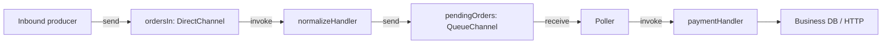
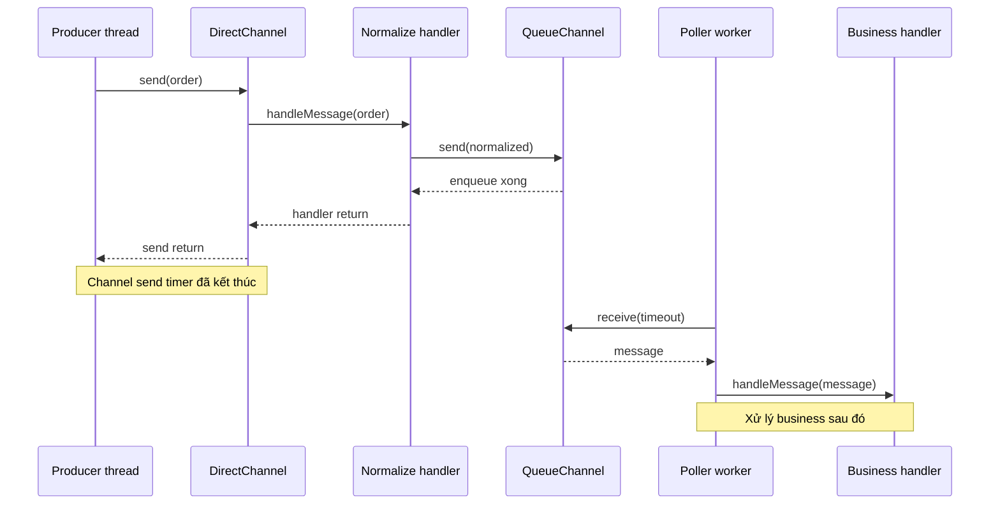
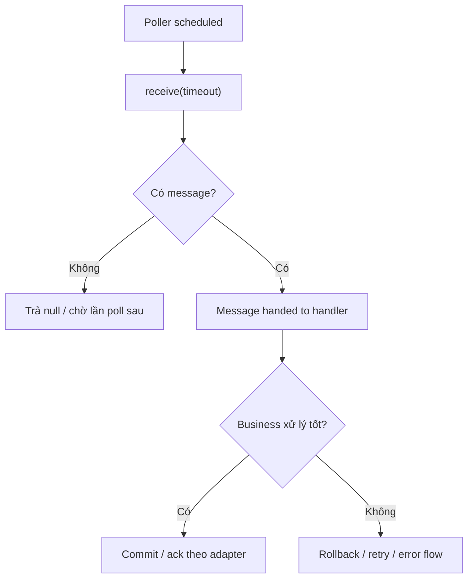

# Metrics channel send, receive và handler trong Spring Integration

## Mục tiêu và bối cảnh

Trong module **SPRING_INTEGRATION_RUNTIME**, một message có thể được gửi qua `DirectChannel`, chuyển vào `QueueChannel`, lấy ra bởi poller, xử lý tại `ServiceActivator`, chuyển sang `ExecutorChannel` rồi tới hệ thống bên ngoài. Những thành phần này có **các ranh giới runtime khác nhau**: việc gửi vào channel thành công không nhất thiết đồng nghĩa handler đã hoàn thành; việc lấy message khỏi queue không có nghĩa transaction nghiệp vụ đã commit.

Chương **Observability** cần các phép đo tách bạch để chẩn đoán chính xác những ranh giới đó. Chủ đề trực tiếp của bài là **Metrics channel send, receive và handler** trong Spring Integration.

> **Nguyên tắc:** Đọc một metric phải biết *nó được ghi ở component nào, khi thao tác nào kết thúc, đơn vị đo là gì, tag nào phân biệt loại component và liệu processing có đồng bộ hay không*. Không dùng một counter ở channel để suy ra số giao dịch nghiệp vụ đã hoàn thành.

Sau bài học, bạn có thể:

- Phân biệt `channel send`, `pollable channel receive`, `message source receive` và `handler invocation`.
- Hiểu hai cơ chế instrument có trong Spring Integration 6.5: **Micrometer meters trực tiếp** và **Micrometer Observation** (có thể sinh cả metrics lẫn tracing).
- Nhớ đúng tên và loại meter: `spring.integration.send`, `spring.integration.receive`, `spring.integration.producer`, `spring.integration.handler`, cùng các gauge của queue.
- Đọc các tag `name`, `type`, `result`, `exception`; trong Observation dùng các low-cardinality keys có prefix `spring.integration.`.
- Dùng `MeterRegistry` để xem meters, Spring Boot Actuator để truy vấn, Prometheus/Grafana để vẽ throughput, latency và error rate.
- Diễn giải sự khác nhau giữa `DirectChannel`, `ExecutorChannel`, `QueueChannel`, poller, retry advice, transaction và asynchronous error flow.
- Viết test có thể kiểm tra meter name/type và tăng số lần đo sau thao tác thực tế.
- Chẩn đoán channel bị nghẽn, handler chậm, retry nhiều, queue backlog, metrics bị thiếu và series có cardinality quá cao.

Tài liệu hướng tới **Spring Integration 6.5.x**, Java 17+, Micrometer và Spring Boot 3.5.x cho ví dụ Actuator. Một số tên/format xuất ra Prometheus do phiên bản registry và cấu hình exporter quyết định; luôn xác nhận bằng dữ liệu đang chạy.

## 1. Hình dung đường đi và vị trí đặt đồng hồ

Xét một flow nhận và chuẩn hóa đơn hàng:



Ở đây có ít nhất bốn thao tác khác nhau đáng quan sát:

1. `ordersIn.send(message)` — đo **gửi vào channel**. Với `DirectChannel`, lệnh này thường chạy consumer đồng bộ, nên có thể mất thời gian gần bằng cả chuỗi downstream.
2. `normalizeHandler.handleMessage(message)` — đo **thời gian của handler**; không nhất thiết là toàn bộ latency của request.
3. `pendingOrders.send(message)` — đo **enqueue** vào channel, có thể trả về trước khi xử lý business.
4. `pendingOrders.receive(timeout)` — đo **sự kiện nhận/lấy message** ở pollable channel. Đây là counter receive, không phải một Timer chờ queue.
5. `paymentHandler` — có thể chạy sau ở **poller thread**, một transaction và một lifecycle khác.



**Không cộng trực tiếp các timers ở từng component để tính end-to-end latency.** Đoạn thời gian của handler có thể nằm bên trong timer của `DirectChannel.send()`, dẫn đến đếm trùng (*inclusive durations*). Muốn đo một request/message xuyên nhiều chặng, dùng tracing, correlation ID hoặc một timer nghiệp vụ rõ điểm bắt đầu/kết thúc.

## 2. Hai chế độ metrics phải phân biệt

Từ Spring Integration 5.0.3, một `MeterRegistry` trong ApplicationContext có thể kích hoạt Micrometer meter collection truyền thống. Từ **Spring Integration 6.0**, framework còn hỗ trợ **Micrometer Observation**, có thể tạo metrics và spans thông qua `ObservationHandler`. Tài liệu 6.5 mô tả cả hai cơ chế.

| Đặc điểm | Micrometer meters trực tiếp | Micrometer Observation |
|---|---|---|
| Điều kiện chính | `MeterRegistry` + các integration components được quản lý | `ObservationRegistry`, `@EnableIntegrationManagement` với `observationPatterns` phù hợp, handlers đo |
| Channel send | Timer `spring.integration.send`, tag `type=channel` | Timer `spring.integration.producer` |
| Handler | Timer `spring.integration.send`, tag `type=handler` | Timer `spring.integration.handler` |
| Pollable channel receive | Counter `spring.integration.receive`, tag `type=channel` | Không có meter `spring.integration.receive` tương ứng được liệt kê trong bộ *Observation conventions* |
| Message source receive | Counter `spring.integration.receive`, tag `type=source` | Một số inbound endpoints có handler observation; `SourcePollingChannelAdapter` được bổ sung từ 6.5 |
| Gateway | Không dùng tên Observation gateway trong bảng direct meter này | `spring.integration.gateway` và `.active` |
| Thành phần active | Theo direct meter API | Long task timer `spring.integration.producer.active`, `spring.integration.handler.active`, `spring.integration.gateway.active` |
| Tags | `type`, `name`, `result`, `exception` | `spring.integration.name`, `spring.integration.type`, có thể thêm `spring.integration.outcome` theo convention |
| Tracing | Metrics không tự tạo trace spans | Observation có thể được nối với tracing bridge/handler phù hợp |

**Lưu ý trọng yếu:** Khi components chạy ở chế độ Observation, tài liệu nói meters không còn được thu thập **độc lập** theo đường direct meters; chúng được ủy nhiệm cho `ObservationHandler` đã đăng ký. Vì vậy, đừng cấu hình dashboard mặc định đòi cả `spring.integration.send{type="handler"}` **và** `spring.integration.handler` cùng tồn tại cho một component.

Khi sửa monitoring sau khi bật Observation, cần chuyển đổi panel/query có kiểm soát, không đơn giản “cộng hai chuỗi” vì dễ đếm đôi.

### Kế hoạch chọn chế độ

- **Ứng dụng Micrometer hiện hữu:** nếu đang đo direct meters tốt và chưa cần distributed traces, hiểu rõ semantics `send/receive` rồi giữ tên thống nhất.
- **Ứng dụng Spring Boot có Observation/Tracing:** ưu tiên mô hình Observation chính thức, xem các tên `producer/handler/gateway` và những quy ước đặt tags.
- **Migrating dashboard:** kiểm tra thực tế `/actuator/metrics` hoặc `MeterRegistry.getMeters()` để biết mode nào đang xuất hiện, sau đó chuyển alert/recording rules.
- **Khi cần queue receive rate:** dù dùng Observation cho handlers/channels, hãy kiểm tra nguồn receive counter đang có; có thể cần đo trực tiếp message store/poller hoặc thêm business counter có contract rõ.

## 3. Micrometer trực tiếp: các meter tên gì?

### 3.1. `spring.integration.send` — channel send Timer

Theo Spring Integration 6.5, Timer cho các operation `send()` trên channel có:

| Thuộc tính | Giá trị |
|---|---|
| `name` | `spring.integration.send` |
| Meter type | `Timer` |
| `type` | `channel` |
| `name` tag | Tên integration component, ví dụ `ordersIn` |
| `result` | `success` hoặc `failure` |
| `exception` | `none` hoặc tên class exception đơn giản |
| Ý nghĩa | Thời gian thực hiện thao tác send của channel |

Một `send()` trả `false` có thể tạo measurement `result=failure, exception=none`; đây **không** phải dữ liệu bị xử lý lỗi bằng exception, mà là channel không chấp nhận message theo contract `send`.

Timer trong Micrometer có ít nhất:

- `count`: số lần thao tác được ghi nhận cho **bộ tags cụ thể**.
- `totalTime`/`sum`: tổng thời gian các lần đó.
- `max`: giá trị lớn nhất theo cửa sổ đo/implementation, không phải maximum kể từ khi ứng dụng khởi động ở mọi registry.
- Percentile/histogram nếu cấu hình distribution statistics tương ứng.

**Một Timer không phải Counter duy nhất:** cùng tên meter nhưng khác `type`, `name`, `result` hoặc `exception` sẽ thành các time series khác nhau.

### 3.2. `spring.integration.receive` — receive Counter của channel

Theo docs:

| Thuộc tính | Giá trị |
|---|---|
| `name` | `spring.integration.receive` |
| Meter type | `Counter` |
| `type` | `channel` |
| `name` tag | Tên pollable channel, ví dụ `pendingOrders` |
| `result` | `success` hoặc `failure` |
| `exception` | `none` hoặc exception type |
| Ý nghĩa | Ghi nhận thao tác nhận message tại **pollable message channel** |

`DirectChannel` không có `receive()` theo `PollableChannel` API, nên đừng đòi receive counter của nó giống `QueueChannel`.

Một lần gọi `receive(timeout)` có thể **không lấy được message**, hoặc có thể thất bại vì exception. Khi phân tích `result` cần xem implementation và response thực tế của channel; không mặc định mọi `failure` đồng nghĩa mất dữ liệu nghiệp vụ. Counter receive không trực tiếp cho biết **thời gian đợi** trong queue hay **thời gian xử lý handler**.

### 3.3. `spring.integration.send` — Timer của handler

Handler cũng có Timer tên `spring.integration.send` trong **đường direct meter**, nhưng dùng `type=handler`:

```text
spring.integration.send
  type=handler
  name=normalizeHandler
  result=success | failure
  exception=none | ExceptionType
```

Nó đo invocation của một `AbstractMessageHandler`; không có nghĩa message đã được commit vào business DB, đã ack ở broker hoặc đã xử lý xong phần async tự sinh sau khi handler return.

**Điểm dễ nhầm:** tên metric của handler trong đường direct **không** phải `spring.integration.handler`. Tên `spring.integration.handler` thuộc **đường Micrometer Observation**.

### 3.4. `spring.integration.receive` — Counter của source

Một số `AbstractMessageSource` có receive Counter:

```text
spring.integration.receive
  type=source
  name=<source component>
  result=success
  exception=none
```

Đây là hoạt động của `MessageSource`, không tự bằng số message đã gửi sang handler hoặc đã commit nghiệp vụ. Một poller có thể nhận được message, gửi vào channel nhưng handler sau đó lỗi. Retry/rollback/redelivery có thể tăng số lần gọi dù chỉ một business event.

### 3.5. Count gauges và queue gauges

Spring Integration 6.5 còn nêu:

| Meter | Loại | Ý nghĩa |
|---|---|---|
| `spring.integration.channels` | Gauge | Số `MessageChannel` trong application |
| `spring.integration.handlers` | Gauge | Số `MessageHandler` |
| `spring.integration.sources` | Gauge | Số `MessageSource` |
| `spring.integration.channel.queue.size` | Gauge | Số phần tử hiện ở `QueueChannel` hỗ trợ gauge |
| `spring.integration.channel.queue.remaining.capacity` | Gauge | Sức chứa còn lại của queue |

Các gauge queue được bổ sung từ 5.1.13; thường có tags `type=channel` và `name=<channelName>`.

**Gauge là ảnh chụp thời điểm thu thập**, không phải số message đã xử lý trong một khoảng. Queue size bằng 0 không chứng minh không có message đang ở **in-flight handler**, trong broker ngoài, trong JDBC store khác hoặc đã được consumer poll lấy ra nhưng chưa commit.

Số lượng `channels/handlers/sources` là cấu trúc ApplicationContext, không phải throughput. Những gauge cấu trúc này cũng không nên dùng để quyết định một consumer endpoint đang running nếu có `SmartLifecycle`/dynamic flows.

## 4. Đọc đúng “channel send” theo loại channel

Một measurement chỉ có ý nghĩa khi biết loại channel và ranh giới xử lý.

| Channel | `send()` được tính ở đâu? | Có thể suy ra gì? | Không thể suy ra gì? |
|---|---|---|---|
| `DirectChannel` | Gọi consumer đồng bộ trong thread gửi thông thường | Latency send có thể phản ánh cả handler đồng bộ | Không đo độc lập backlog hoặc thời gian downstream async |
| `PublishSubscribeChannel` đồng bộ | Dispatch tới subscribers theo cấu hình | Một send có thể bao thời gian nhiều subscribers | Không đồng nghĩa chỉ một business effect |
| `ExecutorChannel` | Submit/dispatch task sang executor | Latency scheduling, khả năng chấp nhận task | Handler worker hoàn thành sau bao lâu |
| `QueueChannel` | Đưa message vào queue | Enqueue nhanh/chậm, full-capacity, timeout/false | Thời gian đợi queue hoặc DB processing đã commit |
| `FluxMessageChannel` | Giao tiếp với reactive pipeline | Khả năng gửi trong API channel | Reactor subscription/completion của downstream async được bảo đảm |
| Remote/broker-backed channel | Hành vi phụ thuộc adapter/implementation | Thời gian send theo contract adapter | Remote consumer đã xử lý/ack nghiệp vụ |

`DirectChannel` là ví dụ dễ làm operator kết luận sai: `spring.integration.send{type="channel"}` chậm 500 ms có thể là do **handler phía sau gọi REST mất 500 ms**, không phải bản thân channel có hàng đợi 500 ms.

Với `ExecutorChannel`, channel timer chỉ bao quá trình giao task theo contract; một timer 1 ms có thể đi cùng handler chậm 2 giây ở worker. Muốn latency business, quan sát handler, queue wait hoặc tạo timer end-to-end riêng.

### Ví dụ timeline

```text
DirectChannel:
send start ───────── handler 300 ms ──────── send return
              handler timer có thể nằm trong send timer

QueueChannel:
send start ─ 2 ms ─ return
                   [queue wait 800 ms]
                                 receive → handler 100 ms → ack/commit
```

Do các khoảng thời gian có thể **lồng nhau** hoặc **tách rời**, không lấy `sendTime + handlerTime` để tính một request latency khi chưa xác định chính xác boundaries.

## 5. Đọc đúng receive Counter và poller

`receive` là một thao tác của `PollableChannel` hoặc `MessageSource`, còn **polling** là một vòng lặp/lịch do endpoint thực hiện. Nhiều poll có thể không tìm thấy message; tùy component, timeout và configuration, chúng không nhất thiết có cùng cách đếm result.



Đặc biệt:

- `receive Counter` không tự đo khoảng **poller delay** giữa các tick.
- `receive success` không đồng nghĩa **business success** hoặc broker đã ack.
- Nếu một message được redeliver, nhận hai lần có thể làm counter tăng hai lần.
- Với `QueueChannel` và transaction/persistent store, thời điểm remove/commit phải được xem theo transaction advice.
- Với `SourcePollingChannelAdapter`, kết quả cuối của source, channel send và handler có thể thuộc các thời điểm/threads khác nhau.
- Khi bạn cần **empty poll rate** hoặc thời gian chờ `receive()`, có thể phải bổ sung custom Timer/Counter quanh adapter/poller; không suy rằng `spring.integration.receive` đã là queue latency metric.

### Cách chọn metric cho queue bottleneck

| Câu hỏi | Metric phù hợp |
|---|---|
| Queue có đang tích tụ không? | `spring.integration.channel.queue.size` + queue oldest age |
| Gửi vào queue có thất bại không? | `spring.integration.send{type=channel, name=... , result=failure}` |
| Consumer có lấy ra không? | `spring.integration.receive{type=channel, name=...}` |
| Handler có chạy và mất bao lâu? | Handler timer hoặc Observation `spring.integration.handler` |
| Poller có chạy đúng lịch không? | Poller/scheduler metrics, logs và lifecycle |
| Messages đã commit vào business DB chưa? | Custom business success metric hoặc DB/audit counters |
| Broker lag có giảm không? | Metrics của broker/consumer group, không chỉ local QueueChannel |

## 6. Ví dụ A: Micrometer meters trực tiếp trong Spring Context

Ví dụ tự chứa sau dùng một `MeterRegistry` kiểu `SimpleMeterRegistry`, `DirectChannel`, `QueueChannel` và một `ServiceActivator`. Không định nghĩa `ObservationRegistry` hoặc bật `observationPatterns` trong demo này, để dễ quan sát các meter **truyền thống**.

```java
import java.util.Locale;

import io.micrometer.core.instrument.MeterRegistry;
import io.micrometer.core.instrument.simple.SimpleMeterRegistry;

import org.springframework.context.annotation.AnnotationConfigApplicationContext;
import org.springframework.context.annotation.Bean;
import org.springframework.context.annotation.Configuration;
import org.springframework.integration.annotation.ServiceActivator;
import org.springframework.integration.channel.DirectChannel;
import org.springframework.integration.channel.QueueChannel;
import org.springframework.integration.config.EnableIntegration;
import org.springframework.integration.config.EnableIntegrationManagement;
import org.springframework.messaging.Message;
import org.springframework.messaging.MessageChannel;
import org.springframework.messaging.support.GenericMessage;

@Configuration
@EnableIntegration
@EnableIntegrationManagement
public class ChannelHandlerMetricsDemo {

    @Bean
    public MeterRegistry meterRegistry() {
        return new SimpleMeterRegistry();
    }

    @Bean
    public MessageChannel ordersIn() {
        return new DirectChannel();
    }

    @Bean
    public QueueChannel pendingOrders() {
        return new QueueChannel(16);
    }

    @Bean
    public NormalizeHandler normalizeHandler() {
        return new NormalizeHandler();
    }

    public static class NormalizeHandler {

        @ServiceActivator(
                inputChannel = "ordersIn",
                outputChannel = "pendingOrders")
        public String normalize(String orderId) {
            return orderId.trim().toUpperCase(Locale.ROOT);
        }
    }

    public static void main(String[] args) {
        try (var context = new AnnotationConfigApplicationContext(
                ChannelHandlerMetricsDemo.class)) {

            MessageChannel input =
                    context.getBean("ordersIn", MessageChannel.class);
            QueueChannel queue =
                    context.getBean("pendingOrders", QueueChannel.class);
            MeterRegistry registry =
                    context.getBean(MeterRegistry.class);

            boolean accepted =
                    input.send(new GenericMessage<>(" ord-101 "));
            Message<?> received = queue.receive(1_000L);

            System.out.println("accepted=" + accepted);
            System.out.println("received=" +
                    (received == null ? "<none>" : received.getPayload()));

            // In tất cả meter series đã có dữ liệu, gồm cả tag sets.
            registry.getMeters().stream()
                    .filter(meter ->
                            meter.getId().getName()
                                    .startsWith("spring.integration."))
                    .forEach(meter ->
                            System.out.println(meter.getId()));

            // Kiểm tra loại Timer, không chỉ kiểm tra metric name.
            registry.find("spring.integration.send")
                    .tag("type", "channel")
                    .tag("name", "ordersIn")
                    .timers()
                    .forEach(timer ->
                            System.out.println(
                                    "ordersIn send count=" + timer.count()));

            registry.find("spring.integration.send")
                    .tag("type", "handler")
                    .timers()
                    .forEach(timer ->
                            System.out.println(
                                    "handler count=" + timer.count()));

            registry.find("spring.integration.receive")
                    .tag("type", "channel")
                    .tag("name", "pendingOrders")
                    .counters()
                    .forEach(counter ->
                            System.out.println(
                                    "pendingOrders receive=" + counter.count()));
        }
    }
}
```

#### Kỳ vọng và giới hạn

- `ordersIn.send` thường trả `true` vì có subscriber Service Activator đang xử lý bình thường.
- Handler trả chuỗi `ORD-101` và gửi tới `pendingOrders`; `receive` lấy ra message đó.
- Một hoặc nhiều Timer `spring.integration.send` có `type=channel`, và Timer của handler có `type=handler` khi các components được instrument đúng.
- Counter `spring.integration.receive` của `pendingOrders` ghi nhận receive theo semantics implementation.
- `MeterRegistry.Search.timers()/counters()` có thể trả nhiều time series do `result/exception` khác nhau; in `getId()` trước khi khẳng định tất cả thuộc một loại operation.
- Meters được đăng ký **khi dùng lần đầu**. Chỉ khởi tạo bean mà không gửi/nhận message có thể chưa tạo series tương ứng.

**Điều kiện để chạy:** Spring Framework, Spring Integration, `micrometer-core` và Java 17+ được quản lý phiên bản tương thích. Đây là ví dụ Java độc lập không dùng Spring Boot Actuator. `SimpleMeterRegistry` lưu meters trong tiến trình để test/demo, không xuất metrics lên Prometheus tự động.

### Cách truy vấn đúng trong code

```java
var channelTimers = registry.find("spring.integration.send")
        .tags("type", "channel", "name", "ordersIn")
        .timers();

var handlerTimers = registry.find("spring.integration.send")
        .tag("type", "handler")
        .timers();

var receiveCounters = registry.find("spring.integration.receive")
        .tags("type", "channel", "name", "pendingOrders")
        .counters();

double successfulChannelSends = channelTimers.stream()
        .filter(t -> "success".equals(t.getId().getTag("result")))
        .mapToLong(io.micrometer.core.instrument.Timer::count)
        .sum();
```

Đoạn này giả định đã có biến `registry` trong ví dụ trên. Những `name` của handler có thể do endpoint naming tạo ra; khi cần dashboard ổn định, đặt endpoint IDs có ý nghĩa thay vì hardcode tên tự sinh.

**Không khẳng định `Timer.count()` là số đơn hàng khác nhau.** Một event có thể qua nhiều channels/handlers và được retry/redeliver; tất cả đều là thao tác runtime được đo.

## 7. Ví dụ B: Micrometer Observation trên Spring Integration 6.5

Spring Integration từ 6.0 có logic Observation cho `IntegrationManagement` components. Theo tài liệu 6.5, cần `ObservationRegistry` trong ApplicationContext và `@EnableIntegrationManagement` với `observationPatterns` phù hợp; mặc định không instrument tất cả components bằng Observation chỉ vì có registry.

### Bật Observation có kiểm soát

```java
import org.springframework.boot.autoconfigure.SpringBootApplication;
import org.springframework.boot.SpringApplication;
import org.springframework.integration.config.EnableIntegration;
import org.springframework.integration.config.EnableIntegrationManagement;

@SpringBootApplication
@EnableIntegration
@EnableIntegrationManagement(observationPatterns = "*")
public class ObservedIntegrationApplication {

    public static void main(String[] args) {
        SpringApplication.run(ObservedIntegrationApplication.class, args);
    }
}
```

Ví dụ giả định dự án Spring Boot có `spring-boot-starter-integration`, `spring-boot-starter-actuator` và Spring Integration flow beans/handlers được đăng ký. Auto-configuration và `ObservationHandler` phụ thuộc Boot/Micrometer setup; **nếu Observation không có meter handler**, chỉ có ObservationRegistry chưa đủ để thấy timer xuất ra.

`observationPatterns = "*"` instrument rộng để minh họa. Với application lớn, nên chọn patterns theo component names để tránh số lượng spans/timers quá nhiều; xem Javadoc của `EnableIntegrationManagement.observationPatterns()` đúng version.

### Meter names của Observation

| Loại observation | Timer | Long task timer | Low-cardinality tags mặc định |
|---|---|---|---|
| Producer/channel send | `spring.integration.producer` | `spring.integration.producer.active` | `spring.integration.name`, `spring.integration.type=producer` |
| Handler/consumer | `spring.integration.handler` | `spring.integration.handler.active` | `spring.integration.name`, `spring.integration.type=handler` |
| Inbound gateway | `spring.integration.gateway` | `spring.integration.gateway.active` | `spring.integration.name`, `spring.integration.type=gateway`, `spring.integration.outcome` |
 
Đường Observation còn áp dụng với các inbound `MessageProducerSupport`, `MessagingGatewaySupport`, `AbstractMessageChannel.send`, `AbstractMessageHandler` và từ Spring Integration 6.5 có `SourcePollingChannelAdapter` trong nhóm handler observations. Tên producer được dùng với channel vì `send()` được xem là hoạt động producer theo semantics tracing.

`*.active` là **long task timer**: cho thấy hoạt động đang diễn ra, khác timer `count` của các lần đã hoàn thành. Một số key/value chỉ được xác định sau lúc start observation sẽ không xuất hiện đầy đủ trong active series.

**Quan trọng:** `spring.integration.handler` ở chế độ Observation **khác** `spring.integration.send{type=handler}` ở chế độ direct. Khi chuyển mode, đổi query/dashboard và kiểm tra tag names đã đổi từ `name/type` sang các key có prefix `spring.integration.`.

### Lưu ý Observation và channel receive

Danh mục Observation metrics chính thức liệt kê `producer`, `handler`, `gateway`; **không có một Observation meter cho `receive()` của pollable channel với tên `spring.integration.receive` tương ứng trong danh mục convention đó**. Khi cần biết actual poll/dequeue rate, kiểm tra trực tiếp bộ meters đang còn hoạt động hoặc bổ sung instrumentation ở channel/source/poller phù hợp. Không suy ra “receive đã được đo” chỉ vì có `spring.integration.producer`.

## 8. Spring Boot Actuator: xem metrics từ runtime

Đối với Spring Boot, các dependencies thường gồm:

```text
spring-boot-starter-integration
spring-boot-starter-actuator
micrometer-registry-prometheus    # khi cần /actuator/prometheus
```

Phụ thuộc cụ thể có thể có phiên bản được quản lý bởi Spring Boot BOM. Không thêm đồng thời hai version Micrometer không tương thích.

### Cấu hình Actuator tham khảo

```yaml
spring:
  application:
    name: orders-runtime

management:
  endpoints:
    web:
      exposure:
        include: "health,info,metrics,prometheus"
  endpoint:
    health:
      show-details: when_authorized
```

`/actuator/metrics` và `/actuator/prometheus` chỉ có khi endpoint được expose, dependency exporter hiện diện, permission cho phép và management port/base path phù hợp.

**Không expose tất cả management endpoints ra internet.** Dùng authentication, network segmentation, TLS và chính sách thông tin nhạy cảm cho metrics. Metrics tags có thể tiết lộ tên hệ thống, consumer hoặc route dù không chứa payload.

### Lệnh truy vấn trong hai chế độ

Micrometer trực tiếp:

```bash
curl -s http://localhost:8080/actuator/metrics/spring.integration.send
curl -s "http://localhost:8080/actuator/metrics/spring.integration.send?tag=type:channel"
curl -s "http://localhost:8080/actuator/metrics/spring.integration.send?tag=type:handler"
curl -s "http://localhost:8080/actuator/metrics/spring.integration.receive?tag=type:channel"
curl -s http://localhost:8080/actuator/metrics/spring.integration.channel.queue.size
```

Micrometer Observation:

```bash
curl -s http://localhost:8080/actuator/metrics/spring.integration.producer
curl -s http://localhost:8080/actuator/metrics/spring.integration.handler
curl -s http://localhost:8080/actuator/metrics/spring.integration.gateway
curl -s http://localhost:8080/actuator/metrics/spring.integration.handler.active
```

Nếu response là 404 hoặc metric name không có trong danh sách, kiểm tra **chế độ instrumentation**, có message nào thật sự chạy chưa, filter/observationPatterns có loại nó không, và registry exporter đã được cấu hình chưa. Đừng chỉ đổi URL cho tới khi “có số”.

#### Cách đọc response Actuator

Một endpoint meter có thể trả mẫu như:

```json
{
  "name": "spring.integration.send",
  "measurements": [
    { "statistic": "COUNT", "value": 25.0 },
    { "statistic": "TOTAL_TIME", "value": 1.27 },
    { "statistic": "MAX", "value": 0.09 }
  ],
  "availableTags": [
    { "tag": "type", "values": ["channel", "handler"] },
    { "tag": "result", "values": ["success", "failure"] }
  ]
}
```

Đây là **JSON minh họa về cấu trúc Actuator**, không phải số liệu thực hay guarantee rằng mọi registry đều xuất `MAX`. Khi query không có filters, measurements có thể **tổng hợp qua nhiều tag combinations**. Để phân biệt channel với handler, dùng `?tag=type:channel` hoặc filter qua `MeterRegistry`.

### Prometheus exposition là lớp ánh xạ riêng

Micrometer chuyển dotted names thành Prometheus-compatible names. Ví dụ trong hệ thống có direct timers:

```text
spring.integration.send (Timer)
  → spring_integration_send_seconds_count
  → spring_integration_send_seconds_sum
  → có thể có spring_integration_send_seconds_max

spring.integration.receive (Counter)
  → spring_integration_receive_total
```

Trong Observation, `spring.integration.handler` thường thành các series dạng `spring_integration_handler_seconds_count` và `spring_integration_handler_seconds_sum`. **Không hardcode exporter naming cho mọi registry**: kiểm tra raw output của `GET /actuator/prometheus`, labels và suffix thực tế trước khi viết PromQL.

## 9. Công thức throughput, latency và error rate

### 9.1. Throughput send/receive

Đối với direct meters và Prometheus naming thông thường:

```promql
# Số lần gửi vào channels mỗi giây, chia theo channel name:
sum by (name) (
  rate(spring_integration_send_seconds_count{type="channel",result="success"}[5m])
)

# Số lần channel send thất bại mỗi giây:
sum by (name) (
  rate(spring_integration_send_seconds_count{type="channel",result="failure"}[5m])
)

# Receive operations mỗi giây trên pollable channels:
sum by (name, result) (
  rate(spring_integration_receive_total{type="channel"}[5m])
)
```

Lưu ý `send_seconds_count` của Timer **không** có nghĩa mỗi message cần một giây. Suffix `_count` là số lần quan sát, còn `_seconds_sum` mới là tổng thời gian.

**Không trừ một cách máy móc send rate − receive rate để suy queue backlog.** Một message có thể qua nhiều channels, được multicast, lọc, route, retry, redeliver hoặc gửi vào queue mà consumer đang xử lý. Với queue cụ thể, so sánh **send và receive của cùng channel**, rồi đối chiếu queue gauge và in-flight state; ngay cả thế cũng phải hiểu ack semantics và thời điểm reset.

### 9.2. Trung bình thời gian send hoặc handler

Với Timer:

```text
Average latency = rate(Timer totalTime) / rate(Timer count)
```

PromQL cho direct channel send latency (đơn vị thường là giây):

```promql
sum by (name) (
  rate(spring_integration_send_seconds_sum{type="channel",result="success"}[5m])
)
/
sum by (name) (
  rate(spring_integration_send_seconds_count{type="channel",result="success"}[5m])
)
```

Nếu rate(count)=0, biểu thức không có ý nghĩa; dashboard cần xử lý no-traffic/NaN. Với `DirectChannel`, giá trị có thể **bao handler downstream đồng bộ**, không phải thời gian di chuyển của message qua channel.

### 9.3. Handler error ratio

```promql
sum by (name) (
  rate(spring_integration_send_seconds_count{type="handler",result="failure"}[5m])
)
/
clamp_min(
  sum by (name) (
    rate(spring_integration_send_seconds_count{type="handler"}[5m])
  ), 0.000001
)
```

Tỷ lệ này nói về **exception/failure mà handler instrumented nhìn thấy**, không nhất thiết là business failure. Nếu recovery callback biến lỗi thành kết quả “handled”, metric có thể được ghi như success. Nếu timeout/exception xảy ra ở bước async **sau khi handler return**, handler timer có thể đã kết thúc trước lỗi đó.

Với Observation, cần kiểm tra conventions/tags `spring.integration.outcome` thực tế: docs mặc định cho `handler` chỉ yêu cầu `spring.integration.name` và `spring.integration.type`. Không giả định luôn có tag `result=failure` giống direct meters.

### 9.4. Observation handler throughput/latency

Khi exporter ánh xạ dotted keys thành `spring_integration_name`:

```promql
# Completed handler observations mỗi giây:
sum by (spring_integration_name) (
  rate(spring_integration_handler_seconds_count[5m])
)

# Average handler duration:
sum by (spring_integration_name) (
  rate(spring_integration_handler_seconds_sum[5m])
)
/
sum by (spring_integration_name) (
  rate(spring_integration_handler_seconds_count[5m])
)
```

Các query là **mẫu**; hãy đối chiếu tên label thực tế, thêm namespace/application/instance filters và tránh gộp mọi instance nếu cần debug một pod.

### 9.5. Percentile p95/p99

Một Timer mặc định không nhất thiết có histogram buckets để tính percentiles trong Prometheus. Cần cấu hình distribution statistics cho meter phù hợp. Nếu `spring_integration_handler_seconds_bucket` thực sự tồn tại:

```promql
histogram_quantile(
  0.95,
  sum by (le, spring_integration_name) (
    rate(spring_integration_handler_seconds_bucket[5m])
  )
)
```

Nếu không có `_bucket`, query không thể tự tạo p95. Đừng lấy MAX làm p95. Khi bật histogram cho quá nhiều components và labels, cardinality/bộ nhớ/export size tăng đáng kể. Nên chọn những handlers quan trọng nhất hoặc dùng SLO buckets có kiểm soát.

## 10. Tag/cardinality: quan sát đủ mà không làm nổ series

Tags giúp tách metrics theo component, nhưng một registry lưu time series cho **mỗi tổ hợp tags**.

### Cardinality tương đối an toàn

| Tag | Ví dụ | Lý do |
|---|---|---|
| `name` / `spring.integration.name` | `ordersIn`, `paymentHandler` | Số components có giới hạn, trừ flow động vô hạn |
| `type` / `spring.integration.type` | `channel`, `handler`, `producer` | Tập giá trị nhỏ |
| `result` | `success`, `failure` | Tập giá trị nhỏ |
| `exception` | `TimeoutException`, `none` | Thường nhỏ hơn event IDs, nhưng cần theo dõi nếu nhiều custom types |
| `application`, `region` | `orders-service`, `ap-southeast` | Dùng cho dashboard/cluster khi số giá trị kiểm soát được |

### Tránh dùng làm tag

- `messageId`, `correlationId` hoặc business `orderId` cho từng message.
- Customer email, số điện thoại, PII, access token hoặc raw payload.
- Một URL chứa order ID hoặc `tenantId` không giới hạn số lượng.
- Mỗi retry attempt ID hoặc exception message tùy ý.
- Dynamic flow ID được tạo mới cho mỗi request mà không cleanup.

Ví dụ: 100 handlers × 2 outcomes × 5 exception types × 2.000 tenants có thể tạo **2 triệu combinations** trước cả labels pod/region/histogram buckets. Đây là rủi ro tốn memory, tăng thời gian scrape và chi phí lưu trữ.

**Thực hành:** Cho ID chi tiết vào logs/traces có chính sách bảo vệ; metrics dùng tên component, loại lỗi và outcome có số giá trị giới hạn.

### Chặn một meter bằng MeterFilter

Trong đường direct metrics, Spring Integration docs dùng `MeterFilter` để deny theo name và tags:

```java
import io.micrometer.core.instrument.MeterRegistry;
import io.micrometer.core.instrument.config.MeterFilter;

@Bean
public MeterFilter dropNoisyChannelMeters() {
    return MeterFilter.deny(id ->
            "spring.integration.send".equals(id.getName())
            && "channel".equals(id.getTag("type"))
            && "noisyInternalChannel".equals(id.getTag("name")));
}
```

Với Spring Boot, `MeterFilter` là bean mà Boot có thể áp vào configured MeterRegistry. Với plain Spring context, có thể đăng ký trực tiếp:

```java
registry.config().meterFilter(
        MeterFilter.deny(id ->
                "channel".equals(id.getTag("type"))
                && "noisyInternalChannel".equals(id.getTag("name"))));
```

**Đăng ký filter trước khi meters được tạo**. Filtering áp dụng tại meter registration, không nên kỳ vọng đăng ký filter muộn sẽ xóa an toàn tất cả series đã tồn tại. Trong Observation mode, tên/tag khác; không copy filter direct mode mà không kiểm tra.

## 11. Retry, transaction và error flow làm metrics khác kỳ vọng ra sao?

### 11.1. RetryAdvice có thể tăng số handler attempts

`RequestHandlerRetryAdvice` có thể gọi lại handler nhiều lần trước khi một message thành công:

```text
Input business event EV-42
    ├─ handler attempt 1 → TimeoutException
    ├─ retry backoff
    ├─ handler attempt 2 → TimeoutException
    └─ handler attempt 3 → success
```

Các phép đo có thể ghi nhận **lời gọi handler/endpoint** chứ không phải một unique business event. Con số thực tế phụ thuộc nơi advice nằm so với instrumented handler và operation bao quanh. Để biết số retries, nên thêm metric retry-attempt **riêng** với tags nguyên nhân có cardinality thấp hoặc dùng Spring Retry events/listeners.

Nếu một handler timer bao toàn bộ retry advice, duration có thể bao cả backoff. Nếu một timer nằm bên trong advice, bạn có thể có nhiều durations tương ứng từng attempt. Đừng suy thứ tự chỉ từ tên meter; vẽ **advice chain** và đo trong integration test.

### 11.2. Recovery callback có thể biến lỗi thành “success”

`ErrorMessageSendingRecoverer` hoặc recovery callback sau khi hết attempts có thể chuyển lỗi thành một `ErrorMessage` rồi trả về bình thường. Khi outer handler không còn ném exception, result metrics ở lớp ngoài có thể là `success`, trong khi business transaction **chưa hoàn tất**.

Cần ít nhất hai loại đo:

- **Technical outcome:** send/handler đã trả về hay ném exception?
- **Business outcome:** order/payment đã xử lý, retry scheduled, chuyển DLQ hay cần manual review?

Không chỉ dùng `result=success` của channel để báo cáo payment success rate.

### 11.3. Transaction rollback không hiện đầy đủ trong send metric

Một handler có thể trả về trước khi transaction bao ngoài commit; lỗi xảy ra khi commit khiến operation đã được tính là success ở một component nhưng transaction thực tế rollback. Hoặc channel send có thể thành công rồi broker redeliver do ack chưa hoàn tất.

Với business critical flow, đo thêm:

- Count/success/failure khi transaction business thực sự commit.
- DB rollback/lock-wait/connection-pool metrics.
- Event ID/inbox/outbox trạng thái xử lý (sử dụng metrics tổng hợp, không tag ID).
- Ack/nack/redelivery và DLQ metrics từ broker/source.

### 11.4. Error channel là một flow riêng

Khi exception được publish vào `errorChannel`, bạn có thể thấy:

```text
Main flow handler failure
   → errorChannel.send(ErrorMessage)
   → errorHandler handles recovery
```

`errorChannel` và `errorHandler` có metrics **của riêng chúng**. Không cộng main-handler failure và error-handler success rồi gọi là tổng số business events. Một lỗi có thể sinh thêm một hoặc nhiều messages để xử lý recovery. Nếu error channel là async, việc publish thành công không đảm bảo recovery hoàn tất.

## 12. Threading: đo latency nào trên DirectChannel, ExecutorChannel và poller?

| Thành phần | Khi timer dừng | Những thứ dễ bị bỏ sót |
|---|---|---|
| `DirectChannel.send` | Sau khi hoàn thành phần dispatch đồng bộ | Xử lý async được kích hoạt từ handler sau khi return |
| `ExecutorChannel.send` | Khi task được chấp nhận/giao đi theo channel implementation | Worker execution, queue wait, retries sau đó |
| `QueueChannel.send` | Khi message enqueue xong hoặc failed/timeout | Thời gian chờ consumer, xử lý sau receive |
| `QueueChannel.receive` | Counter tại thao tác receive | Processing duration hoặc transaction commit |
| `ServiceActivator` | Khi lời gọi handler nằm trong phạm vi instrumented kết thúc | Side effects/async tasks hoàn tất muộn |
| `SourcePollingChannelAdapter` | Phụ thuộc receive/poll/Observation scope | Offset/ack, downstream commit, empty polls |
| `ReactiveMessageHandler` | Phụ thuộc subscribe/completion semantics của endpoint | Một `Mono` chưa subscribe hoặc fire-and-forget inner subscription |

### Ví dụ hệ thống tưởng nhanh nhưng thực tế bị nghẽn

Giả sử:

- `ordersQueue.send` mất 0,5 ms mỗi lần.
- Input 200 messages/s.
- Một poller xử lý 50 messages/s.
- `ordersQueue.size` tăng liên tục.

Channel send latency thấp **không** phải bằng chứng hệ thống nhanh. Đây là **producer nhanh hơn consumer**. Nếu tốc độ ổn định, queue tăng khoảng 150 messages/s, tới khi chạm capacity và bắt đầu xảy ra timeout/false/failure.

Để xử lý, kiểm tra poller concurrency, executor thread pool, transaction lock, remote latency, retry backoff, handler success rate và khả năng broker/store. Đừng chỉ tối ưu `send` vốn đã dưới 1 ms.

## 13. Kết hợp Metrics với tracing, message history và Integration Graph

Metrics trả lời “bao nhiêu, nhanh/chậm tới mức nào”. Những câu hỏi khác cần công cụ khác:

| Nguồn quan sát | Câu hỏi chính |
|---|---|
| Micrometer metrics | Throughput, failure ratio, duration, queue size |
| Micrometer Observation/Tracing | Một request/message đi qua những spans nào, mất thời gian ở đâu? |
| `IntegrationGraphServer` | Những channels/endpoints/links nào được đăng ký ở runtime? |
| Message history | Message đã đi qua những components nào nếu bật history? |
| Structured logs | Event ID/correlation ID và nguyên nhân cụ thể |
| Thread dump | Worker đợi lock, sleep backoff, DB/HTTP I/O hay deadlock? |
| Broker/JDBC store | Lag, in-flight, message age, redelivery, transaction state |
| Spring `SmartLifecycle` | Endpoint/poller đang running hay đã stop? |

`IntegrationGraphServer` dựng topology, không có nghĩa tự đo mọi channel. `observed` trên graph metadata thể hiện trạng thái instrumentation theo framework, không phải success/failure của một business event.

### Observation propagation qua channel

Với Observation và tracing bridge, Spring Integration có thể inject trace headers trong channel sender context rồi consumer khôi phục bằng receiver context. Điều này quan trọng khi `MessageChannel` persistent/distributed hoặc đổi thread. Để trace thành chuỗi liên tục, **both producer channel và consumer** phải được instrument đúng phạm vi; chỉ bật một đầu có thể làm mất parent-child relationship.

Không copy `MDC` bằng cách giữ một `ThreadLocal` trên worker thread rồi dùng chung cho mọi message. Trong reactive/async flow, context propagation phải dùng chuẩn instrumentation, message headers và scope/cleanup phù hợp.

### Từ graph tới panel metrics

Một workflow hiệu quả:

1. Từ graph lấy danh sách named channel/handlers.
2. Xác nhận loại channel (`DirectChannel`, `QueueChannel`, `ExecutorChannel`).
3. Truy vấn meter theo `name` + `type` cho direct mode, hoặc `spring.integration.name/type` cho Observation.
4. Nếu channel có output nhưng không thấy handler completion, xem worker queue, consumer lifecycle và error flow.
5. Gắn trace/correlation ID trong logs để tìm message cụ thể.
6. Xác nhận lỗi/retry/transaction outcome ở cấp business, không dừng ở `send returned true`.

## 14. Dashboard và SLO thực hành

Một dashboard cho flow `ordersIn → normalizeHandler → pendingOrders → paymentHandler` có thể gồm:

| Panel | Nguồn | Công dụng |
|---|---|---|
| Ingress sends/s | `ordersIn` send Timer count | Độ lớn tải đầu vào |
| Channel failure rate | `ordersIn` send `result=failure` | Gửi thất bại |
| Handler p95 duration | Handler Timer/Observation + histogram | Thời gian xử lý endpoint |
| Queue size + remaining capacity | `pendingOrders` queue gauges | Backlog/áp lực sức chứa |
| Queue receive/s | `pendingOrders` receive Counter hoặc poller metric | Tốc độ lấy ra |
| Business completion/s | Custom business counter | Số đơn xử lý thực sự |
| Retries/s | Custom retry/recovery metric | Bất ổn downstream |
| DLQ/outbox oldest age | Broker/store metrics | Công việc tồn đọng quá SLA |
| JVM CPU/GC + DB pool | Spring Boot/System/DB metrics | Hạn chế tài nguyên |

### Tình huống cảnh báo ví dụ

- Queue size tăng liên tục trong 10 phút **và** handler completion rate thấp hơn ingress rate.
- P95 latency handler vượt SLO trong 5 phút, khi traffic đủ lớn để tín hiệu có ý nghĩa.
- Channel send failure rate cao hơn 1% với tối thiểu một số lượng attempts để tránh cảnh báo nhiễu.
- Outbox event già nhất quá hạn xử lý theo nghiệp vụ.
- Không có source receive khi upstream được kỳ vọng có dữ liệu và endpoint vẫn `isRunning=true`.

Các ngưỡng trên chỉ là **ví dụ để thiết kế alert**, không phải mức khuyến nghị cố định cho mọi sản phẩm.

### Một phép tính dung lượng

Input = 100 messages/s, consumer xử lý = 80 messages/s trong 60 giây:

```text
Tăng queue ≈ (100 − 80) × 60 = 1.200 messages
```

Nếu queue capacity = 1.000, giả định đơn giản này dự báo queue sẽ chạm capacity trước một phút khi không có backpressure/flow control khác. Thực tế còn có burst, retry, batching, in-flight messages, transaction rollback và concurrency.

**Không dùng metrics time series cumulative trực tiếp** để so sánh tốc độ; lấy `rate`/`increase` theo cửa sổ, xem reset khi process restart và đảm bảo các series được lọc theo cùng application/instance.

## 15. Kiểm thử các meters trong Spring Integration

Một integration test nên xác minh **operation thực** làm meter xuất hiện, không chỉ test có bean `MeterRegistry`.

### Test Micrometer trực tiếp

```java
import static org.assertj.core.api.Assertions.assertThat;

import io.micrometer.core.instrument.MeterRegistry;
import org.junit.jupiter.api.Test;
import org.springframework.beans.factory.annotation.Autowired;
import org.springframework.messaging.MessageChannel;
import org.springframework.messaging.support.GenericMessage;
import org.springframework.integration.channel.QueueChannel;
import org.springframework.test.context.junit.jupiter.SpringJUnitConfig;

@SpringJUnitConfig(ChannelHandlerMetricsDemo.class)
class IntegrationMetricsTest {

    @Autowired
    MessageChannel ordersIn;

    @Autowired
    QueueChannel pendingOrders;

    @Autowired
    MeterRegistry registry;

    @Test
    void sendReceiveAndHandlerMetersAreRecorded() {
        assertThat(ordersIn.send(new GenericMessage<>(" ord-201 ")))
                .isTrue();

        var message = pendingOrders.receive(1_000L);
        assertThat(message).isNotNull();
        assertThat(message.getPayload()).isEqualTo("ORD-201");

        var channelTimers = registry.find("spring.integration.send")
                .tags("type", "channel", "name", "ordersIn")
                .timers();

        var handlerTimers = registry.find("spring.integration.send")
                .tag("type", "handler")
                .timers();

        var receiveCounters = registry.find("spring.integration.receive")
                .tags("type", "channel", "name", "pendingOrders")
                .counters();

        assertThat(channelTimers).anyMatch(timer -> timer.count() >= 1);
        assertThat(handlerTimers).anyMatch(timer -> timer.count() >= 1);
        assertThat(receiveCounters).anyMatch(c -> c.count() >= 1);
    }
}
```

Ví dụ yêu cầu `spring-test`/JUnit 5/AssertJ và source `ChannelHandlerMetricsDemo` từ mục 6. Nếu instrumentation config hoặc mode khác, phải điều chỉnh expected meter name; không cố ép cả direct và Observation metrics xuất hiện cùng lúc.

**Độ bền của test:** tránh assert giá trị timer totalTime chính xác tới nano/millis vì CI scheduling và JIT khác nhau. Kiểm tra count tăng, tag đúng và không bị missing series; để benchmark/latency SLO cho môi trường phù hợp.

### Test receive failure/timeout

1. Dùng `QueueChannel` rỗng và gọi `receive(timeout)` với timeout nhỏ.
2. Quan sát result tags và Counter theo implementation/version thật.
3. Gửi một message rồi nhận lại.
4. So sánh `result=success` và `result=failure`, **không tự giả định** cách null receive được đếm giống thrown exception.
5. Thử queue đầy (bounded capacity), gọi `send(message, timeout)` theo contract, xem failure result không có exception khi API trả false.

### Test handler exception và retry

1. Tạo handler ném một exception được kiểm soát.
2. Gửi qua `DirectChannel`, bắt exception ở test.
3. Kiểm tra `spring.integration.send{type=handler,result=failure}` khi direct mode instrumented.
4. Thêm `RequestHandlerRetryAdvice`, kiểm tra số lần handler thật được gọi và measurement scope.
5. Thêm recovery callback, so sánh outer success metrics với một **business failure counter**.
6. Lặp lại qua `ExecutorChannel` để xác nhận lỗi chuyển sang async error flow thay vì caller catch trực tiếp.

### Test Observation riêng biệt

Trong context có `ObservationRegistry` và `@EnableIntegrationManagement(observationPatterns="*")`:

- Gửi message qua named channel và handler.
- Kiểm tra `spring.integration.producer` và `spring.integration.handler` qua registry/Actuator nếu đã có meter ObservationHandler.
- Kiểm tra low-cardinality keys `spring.integration.name`, `spring.integration.type`.
- Nếu có tracing bridge/exporter, xác nhận spans nối đúng producer → consumer.
- Không assert `spring.integration.receive` như một Observation convention bắt buộc nếu chưa có instrumentation receive khác.

## 16. Quy trình debug khi metrics không giống kỳ vọng

| Triệu chứng | Nguyên nhân thường gặp | Cách xử lý |
|---|---|---|
| Không có `spring.integration.send` | Đang dùng Observation mode, chưa có message, không có MeterRegistry hoặc meter bị filter | Kiểm tra mode, bean, tag, event phát sinh |
| Không có `spring.integration.handler` | Đang dùng direct meters, chưa instrument handler, ObservationRegistry/handler thiếu | Kiểm tra `@EnableIntegrationManagement`/`observationPatterns` |
| Send count lớn hơn business completion | Có nhiều hops, retries, redelivery hoặc business chưa commit | Tách kỹ thuật vs business counters |
| Handler timer thấp nhưng request chậm | Async worker/queue wait/remote processing không trong timer đang xem | Queue metrics, trace E2E, executor metrics |
| `DirectChannel.send` chậm | Downstream handler đồng bộ chậm hoặc transaction/remote call | Thread dump, handler spans, DB/HTTP timer |
| Queue send nhanh nhưng backlog tăng | Consumer/poller theo không kịp | Receive rate, handler p95, active threads |
| Receive counter tăng nhưng business thất bại | Nhận message khác với commit/ack | Business outcome, transaction, error flow |
| Send `result=failure, exception=none` | Channel `send` trả false thay vì throw | Kiểm tra timeout, capacity, subscribers |
| Handler failures không tăng dù có lỗi nghiệp vụ | Recovery nuốt exception; async exception hoặc custom return trạng thái lỗi | Error channel, retry metrics, business counter |
| Prometheus query rỗng | Exporter name/labels khác, histogram chưa bật, series chưa tạo | Xem raw `/actuator/prometheus` |
| Metrics rất nhiều time series | Tags high cardinality, dynamic IDs hoặc histogram mọi component | Giảm tags, MeterFilter, quy hoạch naming |
| Metrics mất sau restart | Registry/Prometheus cumulative counter reset, application identity đổi | Dùng rate/increase, instance label và scrape health |
| `/actuator/metrics` trả 404 | Endpoint không expose hoặc thiếu Actuator | Dependency, security, management base path |
| Timer max giảm bất ngờ | Backend/registry dùng sliding time window | Dùng histogram/percentiles phù hợp, không coi MAX lifetime |
| Hệ thống bị chậm khi instrument rộng | Tracing/observation/exporter overhead cao | Chọn observationPatterns, sample tracing, đo overhead |

### Checklist triage trong 5 bước

1. **Xác nhận component:** loại channel, tên bean/endpoint, thread model, có `MessageHandler` instrumentation hay không.
2. **Xác nhận mode:** direct meters hoặc Observation; liệt kê meters cùng tags sau ít nhất một message thật.
3. **Xác nhận phép đo:** operation đo là send, receive, handler hay source; timer/counter/gauge?
4. **Xác nhận outcomes:** error flow, retry, ack, transaction commit, business success có khớp với metric kỹ thuật không?
5. **Xác nhận exporter:** Actuator metrics, Prometheus naming, labels, histogram/distribution config và quyền truy cập.

## 17. Checklist production

- [ ] Chọn rõ direct Micrometer meters hay Observation và có kế hoạch migrate dashboards.
- [ ] Nhớ `spring.integration.send` là **Timer** cho cả channel và handler trong direct mode; phân biệt bằng tag `type`.
- [ ] Nhớ `spring.integration.receive` là **Counter** cho pollable channel/message source trong direct mode, không phải Timer latency.
- [ ] Biết QueueChannel có gauges `queue.size` và `queue.remaining.capacity` nếu được instrument/hỗ trợ.
- [ ] Với Observation, dùng `spring.integration.producer` và `spring.integration.handler` cùng low-cardinality keys `spring.integration.*`.
- [ ] Không mặc định `spring.integration.receive` là một Observation convention đã có cho mọi pollable channel.
- [ ] `MeterRegistry`/`ObservationRegistry` và `@EnableIntegrationManagement`/`observationPatterns` được cấu hình theo mode.
- [ ] Có một traffic sample thực tế trước khi xác nhận metric tồn tại; meters có thể đăng ký lazily.
- [ ] Tách channel send latency khỏi handler latency và E2E latency; tránh cộng inclusive durations.
- [ ] Với async channel, đo queue wait/in-flight và worker completion riêng.
- [ ] Với poller, theo dõi receive, empty polls, source delay và lifecycle nếu cần.
- [ ] Có business outcome metric bên cạnh technical result, đặc biệt khi recovery/rollback.
- [ ] Các retry/redelivery được quan sát riêng; không dùng Timer count như unique event count.
- [ ] Không đưa orderId/messageId/correlationId/PII/raw payload vào metric tags.
- [ ] Chỉ bật histograms/percentiles cho meter quan trọng với chính sách capacity hợp lý.
- [ ] Bảo vệ Actuator endpoints và Prometheus scrape; quản lý exporter overhead.
- [ ] Truy vấn PromQL dựa trên tên labels được kiểm tra từ raw exporter.
- [ ] Kết hợp metrics với `IntegrationGraphServer`, tracing, logs, thread dump và broker/DB store metrics.
- [ ] Test send success/failure, receive behavior, handler exception, retry recovery, queue backlog và Observation mode.

## Tài liệu tham khảo

- [Spring Integration 6.5 — Metrics and Management](https://docs.spring.io/spring-integration/reference/6.5/metrics.html): tên/tags Micrometer direct meters, queue gauges, Observation API, conventions và observation propagation.
- [Spring Integration Reference — Message Channels](https://docs.spring.io/spring-integration/reference/6.5/channel.html): đồng bộ/bất đồng bộ, `DirectChannel`, `QueueChannel` và `ExecutorChannel`.
- [Spring Integration Reference — Polling Consumer](https://docs.spring.io/spring-integration/reference/6.5/endpoint.html): poller, consumer endpoints và scheduler.
- [Spring Integration Reference — Message Handler Advice](https://docs.spring.io/spring-integration/reference/6.5/handler-advice.html): retry/error recovery và handler boundaries.
- [Spring Integration Reference — Error Handling](https://docs.spring.io/spring-integration/reference/6.5/error-handling.html): synchronous/async failures và `errorChannel`.
- [Spring Integration Reference — Integration Graph](https://docs.spring.io/spring-integration/reference/6.5/graph.html): runtime topology và component names.
- [Micrometer — Timers](https://docs.micrometer.io/micrometer/reference/concepts/timers.html): `count`, `totalTime`, `max` và distribution statistics.
- [Micrometer — Counters](https://docs.micrometer.io/micrometer/reference/concepts/counters.html): Counter và rate.
- [Micrometer — Meter Filters](https://docs.micrometer.io/micrometer/reference/concepts/meter-filters.html): filter và giới hạn cardinality.
- [Spring Boot 3.5 — Actuator Metrics](https://docs.spring.io/spring-boot/3.5/reference/actuator/metrics.html): `MeterRegistry`, Actuator `metrics` và Prometheus.
- [Prometheus — Query Functions](https://prometheus.io/docs/prometheus/latest/querying/functions/): `rate`, `increase`, `histogram_quantile`.

**Ghi nhớ:** Trong Spring Integration, `channel.send()`, `pollableChannel.receive()` và `handler invocation` là **ba phép đo khác nhau**. Với Micrometer trực tiếp, `spring.integration.send` dùng `type=channel` hoặc `type=handler`, còn `spring.integration.receive` là Counter; với Observation, theo dõi `spring.integration.producer` và `spring.integration.handler`. Đọc metric theo đúng thread/transaction/async boundary, kết hợp queue gauges và business success metrics để không nhầm **“đã gửi”** thành **“đã xử lý xong”**.

