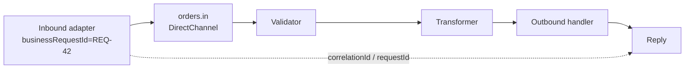
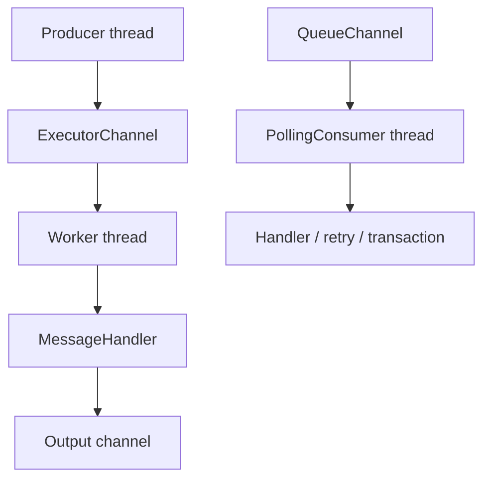
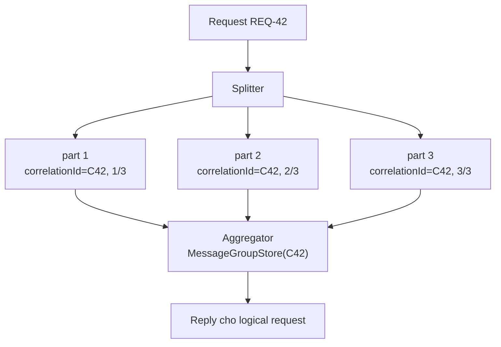
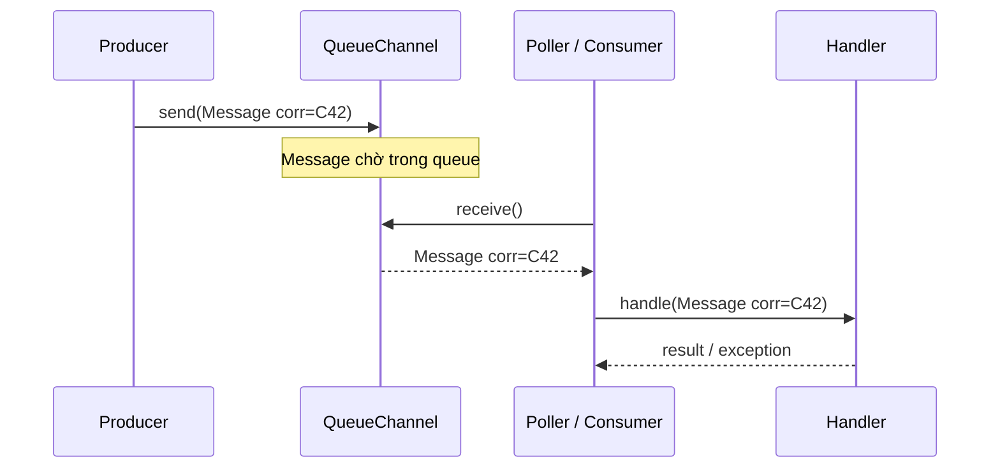
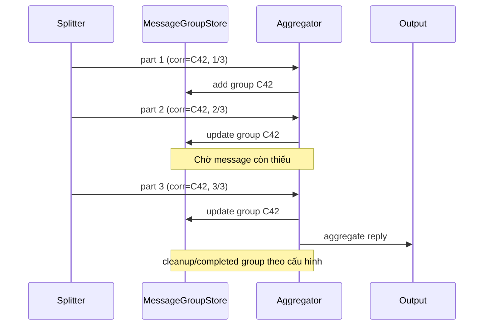

# Tracing message qua correlation id trong Spring Integration Runtime

## 1. Vì sao cần correlation ID khi quan sát message flow?

Một message vào Spring Integration có thể đi qua nhiều `MessageChannel`, consumer endpoint, transformer, router, splitter, aggregator, outbound gateway và error handler. Một số chặng chạy đồng bộ trên cùng thread; các chặng khác chuyển sang `ExecutorChannel`, poller, broker hoặc reactive subscriber. Khi flow gặp lỗi hoặc tăng độ trễ, câu hỏi quan trọng không chỉ là “handler nào báo lỗi?”, mà còn là:

- Message đầu vào thuộc **request nghiệp vụ** nào?
- Các message được tạo từ một lần split có liên hệ với nhau ra sao?
- Retry và redelivery thuộc lần xử lý nào, đã tạo side effect chưa?
- Message đã đi qua những endpoint, channel và instance nào?
- Reply của gateway có quay về đúng request đang đợi?
- Có xảy ra collision giữa hai nhóm correlation hoặc bị mất header ở async boundary không?
- Độ trễ nằm ở poller, queue, executor, external API hay message group đang chờ release?

**Correlation ID** giúp nối các message có quan hệ logic, nhất là qua các chặng chia nhỏ–gom nhóm. Khi kết hợp với **structured logging**, **MessageHistory**, **Micrometer Observation**, distributed tracing và business identifiers, nó trở thành một công cụ điều tra hành trình message trong môi trường production.

Bài **Tracing message qua correlation id**, thuộc chương **Observability** của module **`SPRING_INTEGRATION_RUNTIME`**, tập trung vào cách Spring Integration thực sự điều phối message qua channel, endpoint, consumer, poller và executor; đồng thời theo dõi vòng đời `IntegrationFlow`, transaction, retry, message store, error, correlation, threading, hiệu năng và trạng thái runtime.

**Sau bài học, bạn có thể:**

1. Phân biệt `correlationId`, `MessageHeaders.ID`, business request ID, trace ID và span ID.
2. Gắn và truyền correlation key đúng cách qua handler, splitter, aggregator và gateway.
3. Tạo log có correlation ID bằng SLF4J MDC mà không làm rò ngữ cảnh giữa các thread.
4. Dùng `@EnableMessageHistory` để xem các component message đã đi qua.
5. Hiểu cách cấu hình Micrometer Observation/tracing trong Spring Integration 6.x.
6. Truy lỗi ở `ErrorMessage`, retry, redelivery, queue, transaction và persistent `MessageStore`.
7. Viết integration test xác nhận header tồn tại xuyên chặng và triển khai quy trình chẩn đoán.

**Phiên bản tham chiếu:** Spring Integration **6.5.x**, Java 17+, Spring Framework 6.x; Micrometer/SLF4J theo dependency management của dự án. Các ví dụ có thể điều chỉnh cho Spring Boot hoặc cấu hình Java thuần. Chú ý bản 7.x có thay đổi, không tự mặc định API mới đã có ở 6.x.

## 2. Năm loại ID không được đánh đồng

### 2.1. Bảng phân biệt nhanh

| Định danh | Nguồn/cơ chế | Phạm vi và mục đích | Có tự thay đổi? |
|---|---|---|---|
| **Message ID** (`MessageHeaders.ID`) | `MessageHeaders`, thông thường là UUID | Nhận diện một message instance | Có thể đổi khi tạo message khác |
| **Correlation ID** (`IntegrationMessageHeaderAccessor.CORRELATION_ID`) | Splitter/upstream/custom `CorrelationStrategy` | Nhóm nhiều message liên quan | Giữ ổn định trong cùng nhóm; có thể được đặt lại ở nested flow |
| **Business request ID** (custom `businessRequestId`) | API gateway/workflow coordinator | Theo dõi một request nghiệp vụ đầu-cuối | Thường cố định cho một logical request |
| **Trace ID** | Distributed tracing (Micrometer/OTel/Brave) | Một distributed trace gồm nhiều spans | Thường giữ giữa các spans thuộc cùng trace |
| **Span ID** | Tracing instrumenter | Nhận diện một operation/span cụ thể | Thay đổi giữa các spans |

**Điểm cốt lõi:** `CORRELATION_ID` trong Spring Integration là một header phục vụ tương quan và grouping. Nó **không tự biến thành W3C trace ID**, cũng không tự sinh span hoặc được backend tracing thu thập nếu chưa có instrumentation.

Với một flow có splitter:

```text
HTTP request: businessRequestId = REQ-42
Trace context: traceId = 4f... (từ Micrometer/OTel)

Input Message M0: messageId = UUID-0

Splitter tạo ba message:
  M1: messageId = UUID-1, correlationId = GROUP-42, seq=1/3
  M2: messageId = UUID-2, correlationId = GROUP-42, seq=2/3
  M3: messageId = UUID-3, correlationId = GROUP-42, seq=3/3

Aggregator dùng correlationId = GROUP-42 để gom nhóm.
Span IDs của các operation có thể khác nhau trong cùng trace.
```

Sơ đồ minh họa sự khác nhau giữa **message instance**, **logical group** và **distributed trace**. Không phải lúc nào `CORRELATION_ID` mặc định cũng bằng business request ID do caller gửi; splitter có thể tạo correlation ID từ message nguồn theo quy tắc của framework.

### 2.2. Spring Integration header API

Từ Spring Integration 4.x, các hằng số headers riêng của Spring Integration được đặt ở:

```java
import org.springframework.integration.IntegrationMessageHeaderAccessor;

String correlationHeader =
        IntegrationMessageHeaderAccessor.CORRELATION_ID;
String sequenceNumberHeader =
        IntegrationMessageHeaderAccessor.SEQUENCE_NUMBER;
String sequenceSizeHeader =
        IntegrationMessageHeaderAccessor.SEQUENCE_SIZE;
```

Đọc correlation ID:

```java
import org.springframework.integration.IntegrationMessageHeaderAccessor;
import org.springframework.messaging.Message;

Object correlationId =
        message.getHeaders().get(
                IntegrationMessageHeaderAccessor.CORRELATION_ID);

if (correlationId == null) {
    throw new IllegalArgumentException(
            "Missing correlationId for this flow");
}
```

Loại của `CORRELATION_ID` là **`Object`**, không mặc định luôn là `String` hay UUID. Tùy producer, nó có thể là UUID, String hoặc composite key có `equals/hashCode` phù hợp. Khi viết log có thể format thành string; khi lưu/nhóm phải giữ semantics của **giá trị gốc**, không thay bằng `String.valueOf` mà không kiểm tra kiểu và encoding.

### 2.3. Correlation khác causation

- **Correlation:** “Những message này thuộc cùng một nhóm/lượt xử lý nào?”
- **Causation:** “Message nào **gây ra** message này?”

Ví dụ một order tạo ba command gọi kho và thanh toán. Cả ba cùng `correlationId` nhưng có các parent/causation ID khác nhau. Nếu cần dựng đồ thị nhân-quả chính xác, nên thêm custom `causationId` hoặc span links/context; correlation ID chỉ là **khóa liên hệ**, không tự chứng minh parent–child hay thứ tự thực thi.

## 3. Correlation ID chạy qua message flow thế nào?

### 3.1. Flow đồng bộ



Trên `DirectChannel`, handler thường chạy trong thread của producer. Nếu mọi bước giữ đúng header, log có thể được nối theo correlation key. Tuy nhiên, việc cùng thread trong ví dụ đơn giản **không phải yêu cầu** của correlation: header phải tồn tại trong **message** để vẫn truy được khi chuyển sang thread khác.

### 3.2. Chuyển thread bằng executor hoặc poller



Sau khi chuyển thread:

- `MessageHeaders` vẫn mang các giá trị đã được giữ nguyên qua message/transport.
- `MDC` trong SLF4J là ngữ cảnh theo thread; **không tự luôn đi theo message**.
- Context tracing dùng `ThreadLocal` cũng cần cơ chế propagation ở async boundary hoặc được tái tạo từ carrier message.
- Poller/executor có thể đổi thứ tự message đến handler.
- Cần log **messageId + correlationId + component + thread/instance** để biết message nào được xử lý ở đâu.

### 3.3. Splitter và aggregator

`AbstractMessageSplitter` gắn các header:

- `CORRELATION_ID`
- `SEQUENCE_NUMBER`
- `SEQUENCE_SIZE`

Các header này được dùng bởi aggregator/resequencer cho quá trình correlation/release. Splitter mặc định xử lý sequence semantics, còn `PublishSubscribeChannel` và recipient list router **không tự thêm sequence headers** trừ khi bật `applySequence` trong kịch bản cần chúng.



`AggregatingMessageHandler` mặc định nhóm theo `CORRELATION_ID` thông qua `HeaderAttributeCorrelationStrategy`. Khi nhóm có đủ sequence theo release strategy, nó tạo message đầu ra.

**Không coi correlation ID là một mã “tracing duy nhất toàn hệ thống”.** Có thể có hai order cùng số `42` từ hai tenant hoặc hai lượt xử lý lại cùng order. Nếu custom strategy nhóm chỉ theo `orderId`, các message có thể bị gộp sai. Một khóa an toàn thường bao gồm `tenantId + businessKey + processingRunId + stage`, hoặc một opaque run ID có uniqueness trong scope `MessageGroupStore`.

### 3.4. Correlation header của nested splitter/aggregator

Spring Integration hỗ trợ nested sequence details. Khi một aggregator hoàn tất, `AbstractCorrelatingMessageHandler` có thể thực hiện `MessageBuilder.popSequenceDetails()` để khôi phục ngữ cảnh sequence của tầng ngoài, tùy loại output và cấu hình `popSequence`.

Điều này có nghĩa **correlation header quan sát ở tầng sau có thể không trùng khóa của một nhóm lồng bên trong**, nhưng vẫn đúng với nesting semantics. Muốn theo dõi request đầu-cuối, nên có thêm **businessRequestId** ổn định, tách biệt với correlation ID nhóm hiện hành.

## 4. Bộ công cụ quan sát: correlation log, MessageHistory, metrics, tracing

### 4.1. Bốn loại thông tin phục vụ bốn câu hỏi

| Cơ chế | Trả lời tốt nhất | Hạn chế |
|---|---|---|
| **Structured log + correlationId** | “Request/nhóm này có những log nào, tại service/endpoint nào?” | Log bị thiếu hoặc mất header thì đường đi đứt |
| **MessageHistory** | “Message đã đi qua các component có tên nào?” | Không thay thế span timing, có overhead header |
| **Micrometer metrics** | “Endpoint/channel nào chậm, lỗi, queue đầy?” | Không nên tag theo từng correlation ID |
| **Distributed traces** | “Operation nào mất bao lâu, span cha-con, liên service thế nào?” | Cần propagation/tracer/exporter, có sampling |

Có thể bổ sung **IntegrationGraphServer** để biết topology **có thể đi qua**; nhưng graph không chứng minh một message cụ thể **đã thực sự đi qua** node nào. Khi điều tra, dùng graph để hiểu đường khả dĩ, MessageHistory/log/trace để hiểu đường đã xảy ra.

### 4.2. Correlation log và distributed trace bổ sung cho nhau

```text
Flow: orders.in -> validate -> executor -> outbound HTTP -> reply

Structured log:
  correlationId=group-42 businessRequestId=req-42 handler=validate
  correlationId=group-42 businessRequestId=req-42 handler=outbound

Distributed trace:
  traceId=TRACE-9
    span=receive-order
       span=validate
       span=send-http
       span=remote-service-consume

MessageHistory (đối với một message nếu được giữ):
  [{name=orders.in, type=channel, ...},
   {name=validate, type=service-activator, ...}]
```

Đây là **ví dụ minh họa**; tên span, loại component và cách MessageHistory ghi node tùy cấu hình thật. Correlation key có thể là `group-42`, trace ID là một giá trị khác. Không đánh đồng timestamp trong MessageHistory với toàn bộ timing của từng span.

## 5. Ví dụ Java: gắn correlation ID, log và giữ qua handler

Ví dụ dưới đây dùng **`@ServiceActivator`, `DirectChannel` và `QueueChannel`** để quan sát một message đồng bộ và kiểm tra reply. Đồng thời bật `@EnableMessageHistory` để ghi hành trình các component có tên.

### 5.1. Cấu hình Spring Integration

```java
import org.springframework.context.annotation.Bean;
import org.springframework.context.annotation.Configuration;
import org.springframework.integration.channel.DirectChannel;
import org.springframework.integration.channel.QueueChannel;
import org.springframework.integration.config.EnableIntegration;
import org.springframework.integration.config.EnableMessageHistory;
import org.springframework.messaging.MessageChannel;
import org.springframework.messaging.PollableChannel;

@Configuration
@EnableIntegration
@EnableMessageHistory
public class TraceFlowConfig {

    @Bean("trace.input")
    MessageChannel input() {
        return new DirectChannel();
    }

    @Bean("trace.output")
    PollableChannel output() {
        return new QueueChannel();
    }

    @Bean
    TraceOrderHandler traceOrderHandler() {
        return new TraceOrderHandler();
    }
}
```

`@EnableMessageHistory` kích hoạt ghi history cho các component có tên theo cấu hình. Để giảm chi phí ở production, có thể chỉ theo dõi một danh sách component/pattern thay vì mọi endpoint.

### 5.2. Handler log correlation ID

```java
import org.slf4j.Logger;
import org.slf4j.LoggerFactory;
import org.slf4j.MDC;
import org.springframework.integration.IntegrationMessageHeaderAccessor;
import org.springframework.integration.annotation.ServiceActivator;
import org.springframework.integration.history.MessageHistory;
import org.springframework.messaging.Message;
import org.springframework.messaging.support.MessageBuilder;

public class TraceOrderHandler {

    private static final Logger log =
            LoggerFactory.getLogger(TraceOrderHandler.class);

    @ServiceActivator(
            inputChannel = "trace.input",
            outputChannel = "trace.output")
    public Message<String> handle(Message<String> request) {
        Object raw = request.getHeaders().get(
                IntegrationMessageHeaderAccessor.CORRELATION_ID);
        if (raw == null) {
            throw new IllegalArgumentException("Missing correlationId");
        }

        String correlationId = raw.toString();
        Object businessRequestId =
                request.getHeaders().get("businessRequestId");

        // MDC là ThreadLocal: chỉ giữ trong scope của handler.
        try (MDC.MDCCloseable ignored =
                     MDC.putCloseable("correlationId", correlationId)) {

            log.info("event=order_received correlationId={} "
                            + "businessRequestId={} messageId={}",
                    correlationId,
                    businessRequestId,
                    request.getHeaders().getId());

            MessageHistory history = MessageHistory.read(request);
            if (history != null) {
                log.debug("messageHistory={}", history);
            }

            // Chủ động giữ những identity headers cần cho output.
            return MessageBuilder
                    .withPayload("processed:" + request.getPayload())
                    .setHeader(
                            IntegrationMessageHeaderAccessor.CORRELATION_ID,
                            raw)
                    .setHeader("businessRequestId", businessRequestId)
                    .build();
        }
    }
}
```

**Vì sao code viết như vậy?**

- `raw` được lấy từ header chính thức thay vì tự tạo lại key từ payload.
- `businessRequestId` là header nghiệp vụ ổn định để nối cả request khi splitter thay correlation ID của group.
- `MessageHistory.read(request)` cho biết component đã được theo dõi **tới thời điểm handler nhận message**; không có nghĩa đã có thông tin về endpoint downstream chưa chạy.
- `MDC.putCloseable()` tự khôi phục/xóa key trong scope hiện tại. Không để correlation ID của request trước bị giữ trong executor thread dùng lại.
- Reply message **chủ động giữ** correlationId/businessRequestId; không phụ thuộc việc POJO return value có được framework copy headers hay không.

**Giới hạn:** ví dụ dùng `outputChannel` cố định nên không cần chuyển động `replyChannel` từ request. Với dynamic gateway/reply-channel routing, phải kiểm tra việc propagate `replyChannel`/`errorChannel` và tính đúng đắn của request–reply; không copy mù những object headers qua ranh giới persistence.

### 5.3. Gửi và nhận message để tự kiểm tra

```java
import org.springframework.context.annotation.AnnotationConfigApplicationContext;
import org.springframework.integration.IntegrationMessageHeaderAccessor;
import org.springframework.messaging.Message;
import org.springframework.messaging.MessageChannel;
import org.springframework.messaging.PollableChannel;
import org.springframework.messaging.support.MessageBuilder;

public class TraceFlowDemo {

    public static void main(String[] args) {
        try (var context =
                new AnnotationConfigApplicationContext(
                        TraceFlowConfig.class)) {

            MessageChannel input =
                    context.getBean("trace.input", MessageChannel.class);
            PollableChannel output =
                    context.getBean("trace.output", PollableChannel.class);

            Message<String> request = MessageBuilder
                    .withPayload("ORD-42")
                    .setHeader(
                            IntegrationMessageHeaderAccessor.CORRELATION_ID,
                            "payment-run-9")
                    .setHeader("businessRequestId", "REQ-42")
                    .build();

            if (!input.send(request)) {
                throw new IllegalStateException("Input send rejected");
            }

            Message<?> reply = output.receive(1_000);
            if (reply == null) {
                throw new IllegalStateException("No reply");
            }

            System.out.println(reply.getPayload());
            // processed:ORD-42

            System.out.println(reply.getHeaders().get(
                    IntegrationMessageHeaderAccessor.CORRELATION_ID));
            // payment-run-9
        }
    }
}
```

Bạn có thể xem log handler, ID gốc của message và correlation key ở reply. Tại đây `DirectChannel` xử lý đồng bộ; đổi sang `ExecutorChannel` hoặc poller sẽ thay timing/threading, **không được làm mất identity header** đã được propagate.

### 5.4. Cách kiểm tra header mất giữa các bước

Bọc một bước trung gian bằng logger chỉ đọc:

```java
static void logIdentity(Message<?> message) {
    Object corr = message.getHeaders().get(
            IntegrationMessageHeaderAccessor.CORRELATION_ID);
    Object requestId = message.getHeaders().get("businessRequestId");

    System.out.printf(
            "msgId=%s corr=%s requestId=%s%n",
            message.getHeaders().getId(), corr, requestId);
}
```

Gọi ở entry/exit những endpoint quan trọng và so **giá trị header được giữ**, không khẳng định `MessageHeaders.ID` phải giữ nguyên. Transformer, splitter, aggregator hay gateway có thể tạo message mới.

## 6. MessageHistory: nhìn đường message đi qua component

### 6.1. Bật MessageHistory

Trong Java configuration:

```java
import org.springframework.context.annotation.Configuration;
import org.springframework.integration.config.EnableIntegration;
import org.springframework.integration.config.EnableMessageHistory;

@Configuration
@EnableIntegration
@EnableMessageHistory
class IntegrationHistoryConfig {}
```

Tương đương XML (bên trong cấu hình Spring Integration có khai báo namespace phù hợp):

```xml
<int:message-history/>
```

Spring Integration sẽ gắn header `MessageHistory.HEADER_NAME` (giá trị header `history`) và cập nhật khi message đi qua component được theo dõi.

Theo tài liệu Spring Integration 6.5, mặc định các component **có tên (ID)** sẽ được track. Muốn giới hạn:

```java
@Configuration
@EnableIntegration
@EnableMessageHistory({"orders*", "*Gateway", "paymentHandler"})
class TargetedHistoryConfig {}
```

Chỉ khai báo **một** nguồn `@EnableMessageHistory` hoặc `<message-history/>` trong cùng ApplicationContext; tránh nhiều configurer cạnh tranh.

### 6.2. Đọc MessageHistory

```java
import java.util.Properties;
import org.springframework.integration.history.MessageHistory;
import org.springframework.messaging.Message;

static void printHistory(Message<?> message) {
    MessageHistory history = MessageHistory.read(message);
    if (history == null) {
        System.out.println("No message history enabled or available");
        return;
    }

    for (Properties entry : history) {
        System.out.println("name=" + entry.getProperty("name")
                + ", type=" + entry.getProperty("type")
                + ", timestamp=" + entry.getProperty("timestamp"));
    }
}
```

Các entry điển hình ghi tên, loại component và timestamp; **không** chứa business request ID trừ khi bạn ghi nó ở header/log khác. `MessageHistory` là history của message tại **điểm quan sát**; khi message được tạo mới hoặc đi qua external serializer không giữ header, history có thể bị mất.

### 6.3. Chú ý version 6.3+: append-only và branch copying

Kể từ Spring Integration **6.3**, `MessageHistory` được cập nhật ở chế độ **append-only** để tránh tạo bản sao message mỗi lần ghi history, giảm overhead đáng kể.

Khi message được gửi sang nhiều consumers hoặc nhiều nhánh `PublishSubscribeChannel`, router, `WireTap` hay splitter, framework có các xử lý clone history để các nhánh không ghi chồng lên cùng một container. Đối với code **tự tạo nhiều message con ngoài cơ chế framework**, dùng API `AbstractIntegrationMessageBuilder.cloneMessageHistoryIfAny()` khi phù hợp.

**Quan trọng:** đừng lưu reference tới một `MessageHistory` rồi giả định nó là snapshot immutable trong mọi trường hợp. Khi cần audit/compare, chụp snapshot ở thời điểm cần quan sát. Không tự sửa nội dung history để “điều chỉnh đường đi”; nó là dữ liệu chẩn đoán.

### 6.4. MessageHistory có thay thế distributed tracing không?

Không. Message history giúp biết tên component đã đi qua **trong phạm vi header được duy trì**. Nó không xây span parent-child, không tự truyền `traceparent` qua HTTP/JMS/Kafka, không tự tính toàn bộ latency giữa các service và không tự xuất dữ liệu tới Jaeger/Tempo/Zipkin.

Dùng kết hợp:

- `MessageHistory` cho dấu vết **Spring Integration component hops**.
- `correlationId` + log cho **lọc một nhóm/request**.
- Distributed tracing cho **thời gian và causal context qua process**.
- `IntegrationGraphServer` cho topology **có thể đi qua**, khác với đường thực tế trong MessageHistory.

## 7. MDC: giữ và dọn correlation ID đúng cách

### 7.1. MDC là ngữ cảnh thread, không phải dữ liệu message

SLF4J MDC hữu ích để in cùng một key lên mọi log trong một đoạn thực thi:

```java
try (MDC.MDCCloseable ignored =
             MDC.putCloseable("correlationId", correlationId)) {
    log.info("start processing");
    processBusiness();
    log.info("end processing");
}
```

Ở backend/log layout phù hợp, log có thể chứa `correlationId` qua pattern `%X{correlationId}` hoặc JSON structured logs. Nhưng MDC thường lưu theo **thread**. `ExecutorChannel`, `ThreadPoolTaskExecutor`, poller và reactive scheduler có thể sử dụng threads khác nhau.

Một ví dụ bug:

```text
worker-1 xử lý request A:
   MDC.correlationId = A
   handler ném exception, quên clear

worker-1 được tái sử dụng để xử lý request B:
   log đầu handler mang correlationId=A
   → log hai requests bị trộn mặc dù headers của B đúng
```

Sửa bằng `try/finally` hoặc `MDC.putCloseable()`, **luôn khôi phục trạng thái trước đó**. Đừng chỉ `MDC.put()` rồi quên `remove()`.

### 7.2. Rehydrate từ header sau khi đổi thread

Khi vào mỗi handler chạy trên executor/poller, lấy `correlationId` từ **`Message<?>`** và đặt MDC trong scope đó:

```java
static void withCorrelation(
        Message<?> message, Runnable work) {

    Object value = message.getHeaders().get(
            IntegrationMessageHeaderAccessor.CORRELATION_ID);

    String correlation = value == null ? "unknown" : value.toString();

    try (MDC.MDCCloseable ignored =
                 MDC.putCloseable("correlationId", correlation)) {
        work.run();
    }
}
```

Ở code production, nếu correlation ID là bắt buộc, có thể **fail fast** thay vì sử dụng `"unknown"`. Giá trị mặc định phục vụ logging **không được tái sử dụng làm group ID** cho aggregator vì sẽ gây correlation collision.

Đừng vô điều kiện sao chép toàn bộ MDC của request thread sang worker thread nếu chứa thông tin nhạy cảm hoặc key cũ. Hãy định nghĩa rõ keys được phép và dọn sau khi xử lý.

### 7.3. Reactor context và tracing context

Reactive pipelines có thể đổi thread nhiều lần mà không có quan hệ một-một giữa thread và logical request. Reactor dùng **Context** cho dữ liệu theo subscription; Micrometer Context Propagation và các tracing bridge có thể giúp liên kết tracing/MDC theo quy ước đã cấu hình.

Tuy nhiên, một handler custom gọi `subscribe()` độc lập, một callback executor không được quản lý, hoặc một object header bị loại trong transformer vẫn có thể làm đứt ngữ cảnh. Khi phân tích, tách:

- **Business/correlation headers:** dữ liệu đi cùng `Message`.
- **Reactor Context:** ngữ cảnh theo subscription.
- **MDC/ThreadLocal:** ngữ cảnh theo thread hiện tại.
- **Tracing context:** span/trace context do instrumenter quản lý, cần propagation qua carrier.

Chỉ vì log cùng `correlationId` không có nghĩa các spans đã kết nối đúng trace tree.

## 8. Truy vết qua QueueChannel, poller, executor và reactive runtime

### 8.1. QueueChannel không phải nơi tự tạo trace

`QueueChannel` giữ message cho tới khi một polling consumer lấy ra. `correlationId` được mang trong `MessageHeaders` khi message ở queue, nhưng hành trình thực tế có thêm khoảng thời gian **chờ** chưa được phản ánh nếu chỉ đo thời gian thực thi handler.



Khi phân tích một request chậm, cần ghi riêng:

- `enqueue timestamp`: thời điểm message được chấp nhận vào queue.
- `dequeue timestamp`: thời điểm poller thực sự lấy ra.
- `handler start/end`: thời gian xử lý nghiệp vụ.
- `retry/backoff duration`: khoảng chờ giữa attempts.
- `reply timestamp`: thời điểm gateway/caller nhận được kết quả.

Ví dụ:

```text
correlationId=C42
queued_at=10:00:00.000
dequeued_at=10:00:04.500
handler_started=10:00:04.501
handler_ended=10:00:04.580
reply_at=10:00:04.590

Queue wait ≈ 4.5 s
Business handler ≈ 79 ms
End-to-end ≈ 4.59 s
```

Nếu chỉ nhìn latency của handler, hệ thống tưởng có hiệu năng tốt nhưng người dùng vẫn đợi gần năm giây. Hãy theo dõi `QueueChannel` size/remaining capacity, poller frequency, `maxMessagesPerPoll`, concurrency và oldest message age.

### 8.2. Đo queue wait bằng header riêng

Một `enqueueTime` header có thể giúp đo thời gian chờ, nếu producer và consumer thống nhất time source:

```java
import org.springframework.messaging.Message;
import org.springframework.messaging.support.MessageBuilder;

Message<String> queuedMessage = MessageBuilder
        .withPayload("ORD-42")
        .setHeader("enqueueEpochMillis", System.currentTimeMillis())
        .setHeader(
                IntegrationMessageHeaderAccessor.CORRELATION_ID,
                "batch-42")
        .build();
```

Ở consumer:

```java
Object timestamp = message.getHeaders().get("enqueueEpochMillis");
if (timestamp instanceof Number number) {
    long waitMillis = System.currentTimeMillis() - number.longValue();
    // Chỉ dùng dưới dạng quan sát, có thể chịu clock skew khi qua JVM khác.
    queueWaitTimer.record(Math.max(0L, waitMillis),
            java.util.concurrent.TimeUnit.MILLISECONDS);
}
```

`queueWaitTimer` là một `io.micrometer.core.instrument.Timer` do ứng dụng đã đăng ký; đây là đoạn code minh họa cho metric custom, không phải metric mà Spring Integration tự động tạo theo tên này.

Trong cùng một JVM, `System.nanoTime()` thường phù hợp đo interval; qua nhiều process, cần timestamp wall-clock và đồng bộ thời gian (NTP/chrony), đồng thời chấp nhận sai số clock skew. Đừng lấy chênh lệch của hai `nanoTime()` từ **hai JVM khác nhau**.

### 8.3. ExecutorChannel và MDC bị đứt

`ExecutorChannel` có thể chuyển message sang thread worker; header correlation còn trong `Message<?>` nếu được giữ, nhưng MDC của thread producer có thể không đi theo.

Khi cần log trong executor, hãy đặt MDC **tại handler entry** hoặc dùng task decoration/context propagation có kiểm thử. Không dựa vào việc một `ThreadLocal` đã set ở HTTP controller sẽ vẫn có mặt trong mọi handler async, scheduled task, polling consumer hoặc reactive callback.

Nếu dùng `TaskDecorator` để copy context, phải:

1. Lấy snapshot từ thread submit tại thời điểm dispatch.
2. Restore snapshot ở worker trong scope task.
3. **Restore/xóa context cũ** ở finally.
4. Không mang nhầm `replyChannel` hoặc thông tin nhạy cảm thành MDC.
5. Test thread reuse và task submission khi context nguồn đã khác.

Với message được tạo ra từ broker vào một poller mới, **không có ThreadLocal của producer cũ để copy**; cần lấy identity từ carrier message.

### 8.4. Tracing trong ReactiveMessageHandler

Trong Reactor, đổi thread qua `publishOn`/`subscribeOn` và `flatMap` có thể làm log dựa trên MDC không ổn định nếu chưa cấu hình context propagation.

Giữ nguyên `businessRequestId` và `correlationId` trên message; dùng Reactor Context hoặc Micrometer Context Propagation/Observation được cấu hình phù hợp cho trace context. Mọi callback async tự tạo ở ngoài chain (ví dụ nested `subscribe()`) cần được xem xét vì có thể không thuộc trace/lifecycle của flow cha.

Khi downstream `cancel()`, một số inner operations vẫn có thể hoàn tất side effect. Trace có thể kết thúc ở upstream nhưng business operation chưa chắc đã được rollback. Vì vậy luôn nối trace với **businessRequestId** để thực hiện reconciliation.

## 9. Đi qua ranh giới service và transport: đâu là carrier?

### 9.1. Trong JVM và giữa JVM khác nhau

Trong cùng JVM, `MessageHeaders` là dữ liệu trong object message. Khi qua HTTP, AMQP, Kafka, JMS, Redis, JDBC message store hoặc một serialization layer, các headers cần được **chuyển thành định dạng mà transport hỗ trợ**.

| Ranh giới | Cách giữ correlation | Điểm dễ bị mất |
|---|---|---|
| `DirectChannel` / `ExecutorChannel` | Header trên `Message<?>` | Custom transformer tự tạo message bỏ headers |
| `QueueChannel` trong RAM | Message object còn header | Restart làm mất queue state in-memory |
| Persistent `MessageStore` | Serializer/store lưu headers tương thích | Header có object không serializable; version migration |
| HTTP gateway/client | Custom HTTP header hoặc metadata trong body | Header mapper chưa whitelist/định tuyến |
| Kafka/AMQP/JMS | Transport message headers / correlation field theo adapter | Adapter mapping, conversion, header type |
| Reactive/WebFlux | Message + Reactor/trace context | Nested subscribe, custom scheduler, missing propagator |
| External service không dùng Spring | Protocol header thống nhất | Bên nhận không biết custom `correlationId` |

**Không giả định mọi Spring Integration adapter đều truyền toàn bộ Java object headers sang transport.** Cần kiểm tra `HeaderMapper`/`MessageConverter`, serialization, security và bộ nhận.

### 9.2. Dùng W3C trace context cho distributed spans

Với distributed tracing, tiêu chuẩn W3C Trace Context thường sử dụng:

```http
traceparent: 00-<32-hex-trace-id>-<16-hex-parent-span-id>-01
tracestate: <vendor-state-if-any>
```

Đây là **cú pháp mô tả**, không phải giá trị HTTP header thực tế để paste. Trong ứng dụng, không tự tạo traceparent từ `CORRELATION_ID`. Hãy dùng Tracing/Propagator của Micrometer/OpenTelemetry để inject/extract trace context, vì trace ID/span ID có format, sampling và parent–child semantics riêng.

Có thể giữ một business header riêng, ví dụ:

```http
X-Business-Request-Id: REQ-42
X-Processing-Run-Id: RUN-9
```

Nếu dùng header kiểu trên, phía nhận phải validate độ dài, ký tự hợp lệ, ký tự điều khiển, nguồn tin cậy và policy bảo mật. Đừng để client tùy ý gán correlation group key nội bộ mà không kiểm tra tenant/authorization.

### 9.3. Chiến lược naming thực tế

Một hợp đồng đơn giản:

- `businessRequestId`: cấp ở gateway/workflow coordinator, ổn định xuyên services.
- `processingRunId`: cấp khi bắt đầu một logical run, giữ qua retry/redelivery của **cùng run**.
- `correlationId`: giá trị group key mà splitter/aggregator dùng tại stage hiện hành.
- `causationId`: ID của event/message cha nếu cần dựng graph nhân quả.
- `traceparent`: do distributed tracer quản lý.

Nếu request đi qua nested splitter/aggregator, `correlationId` có thể thay đổi theo level; `businessRequestId` vẫn giúp lọc tất cả sự kiện của cùng request.

### 9.4. Data lineage khi một message phát nhiều message con

Ví dụ:

```text
REQ-42
  └── M0 messageId=uuid0
      ├── M1 messageId=uuid1, correlationId=C42, seq=1/3
      ├── M2 messageId=uuid2, correlationId=C42, seq=2/3
      └── M3 messageId=uuid3, correlationId=C42, seq=3/3
          └── aggregator reply messageId=uuid4
```

Nếu chỉ log correlation ID, bạn biết các message thuộc cùng group nhưng không chắc message nào là parent. Ghi thêm `messageId`, `causationId`, `sequenceNumber` và `processingRunId` tại các bước thay đổi topology, tùy yêu cầu audit.

Đừng dùng `MessageHeaders.ID` làm business idempotency key cho sự kiện có thể được tái dựng thành message khác ID khi retry/replay.

## 10. ErrorMessage, retry và recovery: giữ correlation khi thất bại

### 10.1. Một lỗi có thể có message gốc bên trong

Khi handler lỗi, Spring Integration có thể đưa `MessagingException` và `failedMessage` vào error path, hoặc tạo `ErrorMessage`. Với flow async/polling, `ErrorMessage` có thể được gửi qua header `errorChannel` hoặc global error channel tùy endpoint. Ở `DirectChannel` đồng bộ, exception thường lan về thread gọi thay vì tự có `ErrorMessage` ở mọi trường hợp.

Mẫu đọc correlation ID từ `ErrorMessage`:

```java
import org.springframework.integration.IntegrationMessageHeaderAccessor;
import org.springframework.integration.annotation.ServiceActivator;
import org.springframework.messaging.Message;
import org.springframework.messaging.MessagingException;
import org.springframework.messaging.support.ErrorMessage;

public class TraceErrorHandler {

    @ServiceActivator(inputChannel = "trace.errors")
    public void observe(ErrorMessage errorMessage) {
        Throwable problem = errorMessage.getPayload();

        Message<?> failed = null;
        if (problem instanceof MessagingException messagingFailure) {
            failed = messagingFailure.getFailedMessage();
        }
        if (failed == null) {
            failed = errorMessage.getOriginalMessage();
        }

        Object correlationId = failed == null ? null
                : failed.getHeaders().get(
                        IntegrationMessageHeaderAccessor.CORRELATION_ID);

        Object businessRequestId = failed == null ? null
                : failed.getHeaders().get("businessRequestId");

        System.err.printf(
                "error=%s corr=%s request=%s%n",
                problem.getClass().getSimpleName(),
                correlationId, businessRequestId);
    }
}
```

Đây là ví dụ một service activator **được đăng ký trong context và nối tới channel `trace.errors`**; không phải error handler mặc định của mọi flow. Đường lỗi thực tế cần được wire đúng cho endpoint/advice đang dùng. Một `MessagingException` lồng nhiều cause có thể cần duyệt sâu hơn để tìm failed message thích hợp; không tin rằng `getOriginalMessage()` luôn khác null.

### 10.2. ErrorMessage có ID riêng

Một `ErrorMessage` bản thân cũng là một `Message<Throwable>`, thường có ID của error envelope khác với original failed message. Nếu log chỉ `errorMessage.getHeaders().getId()`, bạn có thể mất liên kết với request nghiệp vụ.

**Ưu tiên trích correlation ID từ failed/original message**, rồi log thêm error-envelope ID để đối chiếu error handling. Các thông tin nên có:

```text
event=message_failed
businessRequestId=REQ-42
correlationId=RUN-9
failedMessageId=uuid-original
errorMessageId=uuid-error-envelope
endpoint=partnerOutbound
exception=TimeoutException
attempt=2
```

Đây là **schema log đề xuất**, không phải log framework tự tạo nguyên văn.

### 10.3. Retry attempt không nhất thiết tạo message mới

`RequestHandlerRetryAdvice` có thể gọi lại cùng handler với cùng message trong các attempts. Tùy cách retry/redelivery diễn ra, bạn có thể thấy:

- Cùng `MessageHeaders.ID` và correlation ID qua nhiều attempts.
- Một message mới có ID khác nhưng cùng business event ID sau broker redelivery/reconstruction.
- Một `ErrorMessage` chứa exception stack/cause chain mới.
- Nhiều outbound HTTP calls tương ứng một request logic.

Vì vậy nên log **attempt number** riêng, chẳng hạn từ `RetryContext` hoặc header `IntegrationMessageHeaderAccessor.DELIVERY_ATTEMPT` nếu adapter hỗ trợ. **Không mặc định header deliveryAttempt luôn tồn tại hoặc số attempt của broker luôn bằng số attempt của retry advice.**

### 10.4. Retry cạn và recovery

`RequestHandlerRetryAdvice` có thể dùng `ErrorMessageSendingRecoverer` để phát `ErrorMessage` sau khi retry cạn. Khi đó phải xác nhận recovery channel có consumer, log/metrics và chính sách xử lý.

Một chain gồm:

```text
Input M0 (corr=C42)
  -> handler attempt 1: lỗi
  -> handler attempt 2: lỗi
  -> recovery: ErrorMessage(cause + context của M0)
  -> trace.errors / DLQ / reconciliation
```

**Correlation ID giúp nhóm log của các attempts**, nhưng không đảm bảo rằng remote operation chưa tạo side effect. Nếu HTTP timeout xảy ra sau khi server đã commit, retry có thể gọi lại và tạo duplicate. Hãy dùng business idempotency key và reconciliation.

### 10.5. Gateway timeout và reply đến muộn

Một `@MessagingGateway` chờ reply theo `replyTimeout`. Nếu downstream ở `QueueChannel`, executor hoặc aggregator cần nhiều thời gian, caller có thể timeout trước khi message được xử lý xong.

Để debug:

1. Log `businessRequestId` và `correlationId` ở **gateway request**.
2. Log thời gian enqueue/dequeue, handler start/end và reply dispatch.
3. Phân biệt caller timeout với downstream handler exception.
4. Kiểm tra reply channel còn tồn tại/hợp lệ sau timeout.
5. Kiểm tra business side effect, không replay chỉ vì caller không nhận reply.

**Một message vẫn còn chạy sau gateway timeout** có thể tạo kết quả muộn. Correlation ID giúp nối kết quả đó với caller cũ nhưng không tự đảm bảo caller còn có thể nhận.

## 11. Correlation trong Aggregator và MessageGroupStore

### 11.1. Tracing group khác tracing từng message

Aggregator giữ nhiều message theo một group ID, thường là `CORRELATION_ID`, và chỉ phát đầu ra khi release strategy quyết định đủ điều kiện.



Nếu group chờ lâu, log có cùng correlation ID nhưng **không đủ** để biết vì sao bị kẹt. Cần thêm group metrics:

- `MessageGroupStore.getMessageGroupCount()`, group count.
- `messageGroupSize(groupId)`, số phần đã đến.
- Thời điểm tạo/last modified group và tuổi group.
- `SEQUENCE_SIZE` kỳ vọng, `SEQUENCE_NUMBER` đã nhận.
- `ReleaseStrategy` outcome, group timeout/expiry và discard count.
- Lock wait/hold time khi có `LockRegistry` và nhiều worker.

Với `SimpleMessageStore`, nhóm nằm trong heap; với `JdbcMessageStore` hay backend khác, state có thể persistent và cần thêm visibility về transactions, serialization, lock và expiry.

### 11.2. Correlation key collision: nguy hiểm hơn thiếu log

Hai tenant dùng chung `orderId="42"` nhưng aggregator chỉ group theo `orderId` sẽ khiến phần của hai request khác nhau bị nhập cùng `MessageGroup`.

Một khóa composite có thể được thiết kế theo:

```java
record GroupKey(
        String stage,
        String tenantId,
        String orderId,
        String processingRunId) {}
```

Để làm key của persistent store, cần cân nhắc loại Java object, serializer và version compatibility. Hoặc upstream tạo **opaque group ID duy nhất** và giữ mapping đến metadata nghiệp vụ.

Quy tắc:

- **Cùng logical group → cùng key.**
- **Hai logical groups độc lập trong scope cùng store → khác key.**
- Không generate UUID mới trên **mỗi part** nếu muốn chúng gom thành một group.
- Không dùng constant `"unknown"` hoặc tenant-only làm group key fallback.
- Không vô tình dùng một `correlationId` của tầng nested split cho một aggregator khác mà không tính sequence scope.

### 11.3. Completed groups và late messages

`expireGroupsUponCompletion` và group reaper ảnh hưởng cách xử lý message đến muộn:

- Giữ metadata completed group có thể giúp nhận diện/discard late arrivals nhưng làm key reuse của run mới nguy hiểm.
- Xóa group khi completed cho phép key cũ tạo group mới, nhưng late message của run cũ có thể lẫn vào nhóm mới.
- Timeout/expiry không bảo đảm mọi message đã được xử lý thành công; nó có thể phát partial result hoặc discard tùy cấu hình.

Khi điều tra, cần log `processingRunId` và group lifecycle events, không chỉ correlation key. Một business request ID ổn định giúp nối log của nhóm cũ và nhóm mới, nhưng cần **generation/run ID** để phân biệt.

### 11.4. Sau restart có giữ được trace không?

Persistent message store có thể giữ `MessageHeaders` đã serialize, nhưng log MDC/ThreadLocal cũ và active span context trong memory **không tồn tại sau restart**.

Nếu message header vẫn chứa business/correlation IDs thì có thể nối log trước/sau restart. Nếu muốn nối distributed tracing spans qua durable queue, cần kiểm tra propagation/extraction từ serialized message và chính sách về span lifecycle. Không tự suy ra rằng traceparent hoặc toàn bộ `MessageHistory` đã được persist an toàn khi đổi serializer/backend.

## 12. Micrometer Observation và distributed tracing

### 12.1. Spring Integration 6.x hỗ trợ Observation

Từ Spring Integration **6.0**, framework tích hợp Micrometer Observation để phát metrics và tracing thông qua các `ObservationHandler` phù hợp.

Theo reference 6.5, quan sát `IntegrationManagement` được kích hoạt khi:

1. ApplicationContext có bean `ObservationRegistry`.
2. `@EnableIntegrationManagement` được cấu hình.
3. `observationPatterns` chọn những component cần instrument (mặc định không chọn component nào).

Ví dụ Java configuration:

```java
import io.micrometer.observation.ObservationRegistry;
import org.springframework.context.annotation.Bean;
import org.springframework.context.annotation.Configuration;
import org.springframework.integration.config.EnableIntegration;
import org.springframework.integration.config.EnableIntegrationManagement;

@Configuration
@EnableIntegration
@EnableIntegrationManagement(observationPatterns = "*")
public class TraceObservationConfig {

    @Bean
    ObservationRegistry observationRegistry() {
        return ObservationRegistry.create();
    }
}
```

**Cảnh báo quan trọng:** bean `ObservationRegistry.create()` thuần túy **chưa đủ** để export spans hoặc metrics ra Jaeger/Tempo/Zipkin/Prometheus. Cần đăng ký `ObservationHandler`, tracing bridge/exporter, `MeterRegistry` và cấu hình vận hành tương ứng. Trong Spring Boot có Actuator/Micrometer Tracing autoconfiguration, thường nên dùng các bean đã được Spring Boot cấu hình, tránh định nghĩa `ObservationRegistry` trùng hoặc làm mất các observation handlers.

### 12.2. Component nào được instrument?

Tài liệu Spring Integration 6.5 mô tả observation ở các thành phần tiêu biểu:

| Component | Operation/span type | Ý nghĩa |
|---|---|---|
| `MessageProducerSupport` inbound | Consumer-style observation | Nhận message từ external source |
| `MessagingGatewaySupport` inbound | Server-style observation | Request/reply entrypoint |
| `AbstractMessageChannel.send()` | Producer-style observation | Gửi message, có khả năng inject trace headers |
| `AbstractMessageHandler` | Consumer-style observation | Handler xử lý message |
| `SourcePollingChannelAdapter` từ 6.5 | Consumer-style observation | Đường inbound polling |

Các tên metric observation mặc định bao gồm `spring.integration.gateway`, `spring.integration.handler` và `spring.integration.producer`; active metrics có suffix `.active`. Metrics chính xác ở backend tùy naming convention, Observation handlers và hệ thống export.

Đừng kết luận “đã bật tracing” chỉ từ việc thấy `spring.integration.*` timers. Tracing còn cần **span recording/export, sampling và context propagation**; metrics và spans là hai lớp dữ liệu khác nhau.

### 12.3. Khác biệt với Micrometer meters cũ

Spring Integration còn có tích hợp `MeterRegistry` với tên meter như `spring.integration.send`, `spring.integration.receive` và queue gauges (`spring.integration.channel.queue.size`, `spring.integration.channel.queue.remaining.capacity`), tùy component/version.

Khi bật **Observation** cho các component, việc thu thập meter có thể đi qua observation handlers thay vì được tính độc lập theo đường legacy. Vì vậy đừng vội cộng hai bộ timers để tính tổng requests: có thể gây đếm đôi hoặc cùng operation nhưng hai instrumentation mechanisms khác nhau.

### 12.4. Distributed tracing không nên dựa vào correlation ID làm trace ID

Giả sử nhóm aggregator `C42` có 3 parts, được xử lý trên ba worker threads, rồi gọi 2 downstream services. Chỉ có cùng `correlationId=C42` trong logs **không tự tạo parent-child spans**.

Một distributed trace đúng cần:

- Được tạo/extract trace context tại ingress.
- Tạo các spans phù hợp tại channel/handler/client.
- Inject/extract trace headers qua HTTP/Kafka/AMQP/JMS theo instrumenter/transport.
- Có sampling/exporter và backend tracing.
- Giữ quan hệ context qua executor/poller/reactive boundaries.
- Có log correlation sang `traceId`, `spanId` và `businessRequestId` khi cần.

Dùng business correlation ID như một **log field/span attribute** có thể hữu ích, nhưng không đặt nó thành **metric label high-cardinality**. Nếu muốn tìm trace theo business ID, cân nhắc chính sách indexing/retention, data classification và truy cập tracing backend.

## 13. Metrics, dashboards và logging an toàn

### 13.1. Đề xuất bộ chỉ số theo chặng

| Chỉ số | Trả lời câu hỏi | Kiểu dữ liệu nên dùng |
|---|---|---|
| Requests accepted/rejected | Upstream được chấp nhận bao nhiêu? | Counter có component/outcome tags |
| Channel send/receive latency | Chặng dispatch nào chậm? | Timer theo channel |
| Queue depth/oldest age | Message đang chờ bao lâu? | Gauge, histogram |
| Handler latency p50/p95/p99 | Nghiệp vụ chậm ở đâu? | Timer theo handler |
| Retry attempts/recoveries | Một logical request bị thử lại bao nhiêu lần? | Counter theo policy/outcome |
| Gateway reply timeouts | Caller đã timeout ở chặng nào? | Counter theo gateway |
| In-flight handler tasks | Executor đang xử lý bao nhiêu message? | Gauge/long task timer |
| Message group size/age | Aggregator có đang giữ nhóm quá lâu? | Gauge/timer/sampled diagnostics |
| ErrorMessage throughput | Lỗi có được đưa vào recovery không? | Counter theo error type |
| Trace sampling/export failures | Traces có đang bị drop không? | Telemetry pipeline metrics |
| Correlation header missing/mismatch | Header bị mất ở endpoint nào? | Counter theo endpoint, không tag raw ID |

**Không nên dùng `correlationId` làm tag của Prometheus/Micrometer time series.** Nếu mỗi request có ID khác nhau, số lượng series tăng theo lưu lượng, gây chi phí bộ nhớ, lưu trữ và truy vấn lớn.

Đối với logs và spans, có thể đưa correlation ID vào thuộc tính có cardinality cao nhưng cần điều chỉnh sampling, retention, redaction và phân quyền phù hợp. Không ghi token, credentials, dữ liệu thanh toán hay payload nguyên bản chỉ để debug.

### 13.2. Quy ước structured log

Một log gợi ý:

```text
time=2026-11-22T09:00:00+07:00
service=orders-runtime
flowVersion=v2
event=message_handled
component=orders.validate
instance=pod-3
thread=pool-4-thread-2
businessRequestId=REQ-42
correlationId=RUN-9
messageId=uuid-91
traceId=4a1b...
spanId=0f2c...
outcome=success
durationMs=43
```

Đây là **mẫu dữ liệu đề xuất**, không phải output tự động của Spring Integration. Có thể:

- Dùng MDC để in `businessRequestId`/`correlationId` trong một handler.
- Dùng Micrometer Tracing để in `traceId`/`spanId` trong log pattern.
- Ghi timestamp theo ISO 8601 và kèm timezone.
- Chọn `flowVersion`/component name ổn định để tra theo triển khai động.

### 13.3. Trace budget và retention

Không bật log payload/full headers cho mọi message tải cao vì:

- Có nguy cơ tiết lộ PII/secrets.
- Tăng GC, I/O và chi phí log backend.
- `MessageHistory` có thêm overhead trên headers.
- Export tất cả spans có thể vượt budget.
- Correlation ID chưa validate có thể là input độc hại (log injection/cardinality).

Dùng sampling có kiểm soát, audit event gọn, hạn chế nội dung nhạy cảm và retention phù hợp. Với incident cụ thể, có thể **tăng tạm thời** tracing/logging cho nhóm endpoint theo chính sách, rồi hạ lại khi xong.

### 13.4. Quan sát quá trình start/stop IntegrationFlow

Trong hệ thống có đăng ký/hủy `IntegrationFlow` động, log:

```text
event=flow_registered flowId=payment-v2
event=flow_started flowId=payment-v2
event=flow_draining flowId=payment-v1
event=flow_destroyed flowId=payment-v1
```

Đừng mặc định một correlation ID chứa đầy đủ lịch sử khi flow bị tháo giữa chừng. Cần ghép:

- `IntegrationGraphServer.rebuild()` để thấy cấu trúc đang có.
- Log/metrics theo `flowId` và `flowVersion`.
- Pending messages và state của `QueueChannel`, `MessageStore`.
- Trace/log tương ứng `businessRequestId`/`processingRunId`.
- Thời điểm router cutover, consumer stop/start và executor shutdown.

## 14. Kiểm thử correlation ID xuyên chặng

### 14.1. JUnit 5: giữ correlation ở reply

Dùng `@SpringJUnitConfig`, `spring-test` và JUnit Jupiter để chạy flow trong `TraceFlowConfig` ở mục 5. Phép thử dưới đây dùng endpoint thật trong Spring context nhưng không gọi external API.

```java
import static org.junit.jupiter.api.Assertions.*;

import org.junit.jupiter.api.Test;
import org.springframework.beans.factory.annotation.Autowired;
import org.springframework.beans.factory.annotation.Qualifier;
import org.springframework.integration.IntegrationMessageHeaderAccessor;
import org.springframework.messaging.Message;
import org.springframework.messaging.MessageChannel;
import org.springframework.messaging.PollableChannel;
import org.springframework.messaging.support.MessageBuilder;
import org.springframework.test.context.junit.jupiter.SpringJUnitConfig;

@SpringJUnitConfig(classes = TraceFlowConfig.class)
class TraceFlowTest {

    @Autowired
    @Qualifier("trace.input")
    MessageChannel input;

    @Autowired
    @Qualifier("trace.output")
    PollableChannel output;

    @Test
    void preservesCorrelationAcrossHandler() {
        Message<String> request = MessageBuilder
                .withPayload("ORD-101")
                .setHeader(
                        IntegrationMessageHeaderAccessor.CORRELATION_ID,
                        "payment-run-101")
                .setHeader("businessRequestId", "REQ-101")
                .build();

        assertTrue(input.send(request));

        Message<?> reply = output.receive(1_000);
        assertNotNull(reply);
        assertEquals("processed:ORD-101", reply.getPayload());
        assertEquals("payment-run-101",
                reply.getHeaders().get(
                        IntegrationMessageHeaderAccessor.CORRELATION_ID));
        assertEquals("REQ-101",
                reply.getHeaders().get("businessRequestId"));
    }

    @Test
    void rejectsMissingCorrelationBeforeBusinessProcessing() {
        Message<String> invalid =
                MessageBuilder.withPayload("ORD-INVALID").build();

        // DirectChannel đồng bộ; Spring có thể bọc lỗi của handler.
        assertThrows(RuntimeException.class, () -> input.send(invalid));
    }
}
```

Hai test xác nhận **hợp đồng của flow ví dụ**: input cần có correlation header, handler không bỏ header khi tạo reply. Với flow thật có splitter tự sinh `CORRELATION_ID`, có thể chỉ kiểm tra header **sau splitter hoặc trước aggregator**, không áp yêu cầu này lên mọi ingress.

Một số test chạy song song có thể dùng chung `QueueChannel` trong ApplicationContext đã cache; cần dọn queue hoặc tách context để tránh message của test trước lọt sang test sau.

### 14.2. Test MessageHistory với component name ổn định

Đọc history tại endpoint cần chẩn đoán:

```java
import org.springframework.integration.history.MessageHistory;
import org.springframework.messaging.Message;

static boolean passedThrough(
        Message<?> message, String componentName) {

    MessageHistory history = MessageHistory.read(message);
    if (history == null) {
        return false;
    }

    return history.stream().anyMatch(entry ->
            componentName.equals(entry.getProperty("name")));
}
```

Các component có tên rõ ràng giúp test ít phụ thuộc autogenerated bean IDs. Một test tốt kiểm tra “đã đi qua validator” và “không đi qua nhánh reject”, thay vì assert mọi entry/độ dài history bằng số cố định khi flow có các infrastructure nodes khác.

Kể từ Spring Integration 6.3, history append-only; nếu giữ reference live để so snapshot trước/sau, cần copy entries tại thời điểm quan sát. Với flow nhiều nhánh custom, kiểm tra logic clone `MessageHistory` để các nhánh không ghi đè lịch sử nhau.

### 14.3. Test MDC được dọn sau xử lý và thread reuse

`MDC` thường dựa vào ThreadLocal. Có thể viết unit test độc lập với Spring Integration để khẳng định handler không làm rò correlation ID sang task tiếp theo:

```java
import static org.junit.jupiter.api.Assertions.*;

import java.util.concurrent.*;
import org.junit.jupiter.api.Test;
import org.slf4j.MDC;

class CorrelationMdcTest {

    @Test
    void restoresMdcOnReusedWorker() throws Exception {
        ExecutorService executor = Executors.newSingleThreadExecutor();

        try {
            Future<String> first = executor.submit(() -> {
                try (MDC.MDCCloseable ignored =
                             MDC.putCloseable("correlationId", "REQ-1")) {
                    assertEquals("REQ-1", MDC.get("correlationId"));
                }
                return MDC.get("correlationId");
            });

            assertNull(first.get(2, TimeUnit.SECONDS));

            Future<String> next =
                    executor.submit(() -> MDC.get("correlationId"));
            assertNull(next.get(2, TimeUnit.SECONDS));
        }
        finally {
            executor.shutdownNow();
        }
    }
}
```

Test trên chứng minh cleanup, **không** chứng minh MDC tự propagate qua `ExecutorChannel`. Cần thêm integration test xác nhận consumer đọc lại correlation từ header rồi đặt MDC đúng scope.

### 14.4. Test splitter, aggregator và key collision

| Kịch bản | Input | Kỳ vọng |
|---|---|---|
| Một run ba parts | `RUN-1`, seq 1/3, 2/3, 3/3 | Một nhóm, một kết quả |
| Hai tenant cùng `orderId` | A/42 và B/42 | Hai nhóm độc lập |
| Cùng order, hai `processingRunId` | run-1, run-2 | Hai nhóm |
| Parts đến đảo thứ tự | 3,1,2 | Vẫn release đúng khi đủ |
| Thiếu một part | 1,3 của ba | Chờ/expire đúng policy |
| Duplicate redelivery | Hai lần part 2 | Không duplicate side effect |
| Late arrival sau complete | Part cũ đến sau | Không trộn với run mới |
| Nested splitter | Group cấp ngoài/cấp trong | Correlation scope đúng từng cấp |
| Header bị mất giữa chặng | Transformer bỏ `CORRELATION_ID` | Test fail đúng vị trí |
| Correlation sai kiểu sau serialization | String và UUID/object | Không group nhầm hay lỗi ngầm |

Ở bài thử aggregator, cần kiểm tra **MessageGroupStore state và reply thực tế**, không chỉ log correlation ID. Một group bị trộn hai tenant có thể release mà không ném exception; test phải assert identity của từng message trong kết quả.

### 14.5. Test lỗi và recovery

Tạo handler cố tình thất bại:

1. Với `DirectChannel`, kiểm tra exception lan về producer.
2. Với `ExecutorChannel` hoặc poller, cấu hình error channel test và nhận `ErrorMessage`.
3. Lấy `failedMessage`/`originalMessage`, assert `businessRequestId`/`correlationId` vẫn tồn tại.
4. Dùng `RequestHandlerRetryAdvice`, xác minh số attempts thực tế và business ID giữ nguyên.
5. Sau khi retry cạn, xác nhận recovery channel nhận được lỗi và có thể nối lại với original message.
6. Kiểm tra message được redeliver từ broker có thể có **message ID mới**, nhưng không được mất stable business event ID.

Không viết test dựa trên giả định rằng mọi lỗi sẽ tự xuất bản vào global `errorChannel`. Ngữ nghĩa phụ thuộc channel, consumer endpoint và advice.

## 15. Chẩn đoán correlation ID bị mất hoặc không nối được trace

### 15.1. Bảng triệu chứng

| Triệu chứng | Nguyên nhân thường gặp | Cách xác minh |
|---|---|---|
| Log một request có hai correlation IDs | Nested split, header enrichment hoặc ID bị overwrite | Kiểm tra sequence scope và transformer |
| Mất `CORRELATION_ID` sau một handler | Tự tạo `Message` mới nhưng không giữ header | So headers trước/sau handler |
| Tất cả lỗi dùng `correlationId=unknown` | Thiếu identity header và fallback chung | Validate tại ingress/grouping |
| Request B có log mang ID của A | Quên clear MDC ở thread pool | Test reuse worker thread |
| `MessageHistory` rỗng | Chưa bật annotation, pattern không khớp, mất header | Xem `@EnableMessageHistory` và IDs |
| History có đường lẫn giữa hai nhánh | Custom branching không clone history | Xem cách tạo message con |
| Spans đứt sau executor | Thiếu tracing context propagation | Kiểm tra executor decoration/instrumentation |
| Có `spring.integration.*` metrics nhưng không có traces | Chưa cấu hình tracing bridge, handler hoặc exporter | Xem ObservationRegistry handlers |
| Correlation tồn tại nhưng không tìm được trace | Correlation ID không phải trace ID | Đọc traceId/spanId riêng và sampling |
| Group chứa message của hai tenant | Correlation key collision | Kiểm tra tenant/run/stage trong group |
| Aggregator chờ mãi | Missing part, wrong key hoặc release strategy | Group size/age và sequence headers |
| Gateway timeout nhưng downstream thành công | Queue wait, backoff, reply đến muộn | Dựng end-to-end timeline |
| `ErrorMessage` không có custom header trên envelope | Chỉ xem outer error headers | Đọc failed/original message |
| Broker consumer làm mất request ID | Header mapper/serialization không truyền field | So transport headers ingress/egress |
| Trace có nhiều root spans trong một request | Không inject/extract traceparent đúng | Kiểm tra client/adapter propagators |
| Metrics cardinality quá cao | Raw correlation ID trở thành tag | MeterFilter, convention và retention |
| Mất log sau cutover | Flow v1/v2 đổi route, thiếu version tag | `IntegrationGraphServer.rebuild()`, lifecycle |
| Handler p99 thấp nhưng request p99 cao | Thời gian queue/async chờ chưa được đo | Enqueue/dequeue/poller/backoff metrics |

### 15.2. Runbook: request timeout không có reply

Giả sử người dùng báo `businessRequestId=REQ-42` timeout.

1. **Bắt đầu bằng business request ID** tại ingress, không mặc định `CORRELATION_ID` của nhóm hiện tại bằng ID này.
2. Lấy message ID gốc, timestamp, tên channel, flowVersion và pod/instance.
3. Truy log theo business ID để tìm các message con; nếu có `causationId`, dựng parent–child graph.
4. Kiểm tra correlation key từng stage: splitter hoặc nested aggregator có thay ID theo semantics không?
5. Dùng `MessageHistory` để xem các component **đã đi qua**; dùng `IntegrationGraphServer` để xem các route **có thể đi qua**.
6. Đo queue wait, poller lag, executor queue và handler duration. Không kết luận “không có log” là chưa xử lý nếu MDC bị mất.
7. Kiểm tra số retry attempts và outbound API status; đặc biệt HTTP timeout/429 và phản hồi đến muộn.
8. Với `ErrorMessage`, truy failed/original message để lấy correlation.
9. Với aggregator, xem group ID/size, release, expiry, late arrivals, lock contention và potential key collision.
10. Phân biệt gateway reply timeout với business state: caller có thể timeout dù DB/external API đã commit.
11. Trước khi replay, kiểm tra idempotency key và đối soát side effects.
12. Tổng hợp timeline, trạng thái cuối và hành động phục hồi, lưu bằng chứng theo chính sách bảo mật.

Ví dụ timeline giả lập:

```text
09:00:00.000  ingress   msg=M0 corr=RUN-9 request=REQ-42
09:00:00.010  enqueue   msg=M1 corr=RUN-9
09:00:02.000  gateway   caller replyTimeout
09:00:02.900  dequeue   msg=M1 corr=RUN-9
09:00:02.910  outbound  attempt=1 timeout
09:00:03.200  outbound  attempt=2 success
09:00:03.220  reply     msg=M2 corr=RUN-9; caller no longer waiting

Kết luận: queue wait + retry vượt gateway deadline,
không phải handler chưa chạy.
```

Đây là **dữ liệu minh họa**, không phải sự kiện thực. Khi ghép log từ nhiều JVM cần timestamp có timezone, NTP/clock skew allowance và phân biệt event time với receive/ingest time của logging backend.

## 16. Bài tập thực hành

### Bài 1 — So sánh identity headers

Từ `TraceFlowDemo`, log `MessageHeaders.ID`, `CORRELATION_ID` và `businessRequestId` ở input/output. Giải thích vì sao message ID có thể đổi nhưng business request ID nên giữ ổn định.

### Bài 2 — MessageHistory trước/sau bật tracking

Bật `@EnableMessageHistory`, cho message đi qua ba named endpoints, in các `Properties` entries. Đổi sang `@EnableMessageHistory({"trace*", "*Gateway"})`, quan sát số component được ghi và đo overhead trong tải thử.

### Bài 3 — Transformer làm mất correlation

Thêm transformer trả về `Message<?>` mới nhưng chỉ copy payload. Viết regression test để phát hiện thiếu `CORRELATION_ID`, sau đó sửa transformer. Lặp lại với `businessRequestId` và `errorChannel` tùy hợp đồng flow.

### Bài 4 — Executor và MDC

Chuyển một chặng sang `ExecutorChannel` với một worker. Cố ý không cleanup MDC và gửi hai messages khác IDs; tái hiện log nhiễm ID. Dùng `MDC.putCloseable()` hoặc `finally` để sửa và test thread reuse.

### Bài 5 — Splitter/Aggregator trong nhiều tenant

Tạo hai logical runs có cùng `orderId` nhưng khác tenant. Dùng một correlation strategy chỉ theo order ID để tái hiện collision, sau đó dùng composite key/opaque group ID. Kiểm tra group size, release và late arrival.

### Bài 6 — Persistent store và restart

Cho message vào `QueueChannel` hoặc aggregator có persistent store, restart process, kiểm tra headers còn serialize/deserialize đúng. Xác minh MDC và in-memory spans không tồn tại qua restart nếu không có propagation/recovery.

### Bài 7 — ErrorMessage và retry attempts

Gây lỗi ở handler, bật retry advice và recovery. Lấy correlation từ `failedMessage`/`originalMessage`, đối chiếu original message ID, error-envelope ID, attempt count và actual downstream calls.

### Bài 8 — Bật distributed tracing

Cấu hình `ObservationRegistry`, `@EnableIntegrationManagement(observationPatterns="*")`, Micrometer Tracing bridge và exporter trong môi trường thử. Kiểm tra traceparent qua HTTP hoặc broker và đối chiếu `traceId`/`spanId` với correlation ID trong log.

### Bài 9 — Dựng queue latency

Tạo `QueueChannel` bounded có producer nhanh hơn poller, đo enqueue/dequeue, handler duration và gateway timeout. Chứng minh handler p99 có thể thấp nhưng end-to-end p99 rất cao.

### Bài 10 — Điều tra một incident

Chuẩn bị log giả từ hai pods có retry, error channel và gateway timeout. Dựng timeline của `REQ-42` theo businessRequestId, phân nhóm bằng correlationId và theo dõi message IDs. Tìm chặng đầu tiên thiếu header hoặc bị đổi sai.

## 17. Checklist sản xuất

1. **Không đánh đồng** message ID, correlation ID, business request ID và distributed trace ID.
2. **Xác định chính sách tạo ID:** stable request/run ID cấp tại coordinator; group key theo đúng scope correlation.
3. **Propagate headers có chủ đích** qua transformer, router, async, persistent store và transport mapping.
4. **Giữ MDC theo scope thread**, restore/clear trong `finally`; test reused worker thread.
5. **Bật MessageHistory có chọn lọc**, dùng tên component ổn định; hiểu append-only/branch-copy từ 6.3.
6. **Instrument Observation đúng cách** với registry, patterns, tracing handlers/exporter và sampling.
7. **Dùng W3C Trace Context** để propagate spans giữa processes; không tự chế `traceparent` từ correlation ID.
8. **Ghi correlation ở error path** bằng failed/original message, không chỉ outer error envelope.
9. **Đo end-to-end**: queue wait, poller lag, executor tasks, handler, retry/backoff, reply timeout.
10. **Quan sát MessageGroupStore**: group size/age, release/expiry, late arrivals và key collision.
11. **Bảo vệ thông tin nhạy cảm**: không dump payload/raw headers, mask IDs khi cần.
12. **Tránh high-cardinality metric tags** theo mỗi request/correlation ID.
13. **Kiểm thử thực tế**: success, failure, retry, restart, async, nested split, multi-tenant và tracing qua transport.
14. **Đối chiếu business state khi caller timeout**, không replay mù chỉ vì thiếu reply.
15. **Log flowVersion/lifecycle** khi thay đổi IntegrationFlow động; không xem graph cache cũ là topology hiện tại.

**Kết luận:** `CORRELATION_ID` giúp liên hệ các message trong một group hoặc lượt xử lý, nhưng **không phải distributed trace**. Để quan sát Spring Integration Runtime đáng tin cậy, cần kết hợp correlation/business IDs, `MessageHistory`, Micrometer metrics/spans và trạng thái queue, retry, transaction, message store, gateway.

## 18. Tài liệu tham khảo chính thức

- [Spring Integration 6.5 — Message History](https://docs.spring.io/spring-integration/reference/6.5/message-history.html): `@EnableMessageHistory`, tracked components, append-only từ 6.3, branch copying.
- [Spring Integration 6.5 — Metrics and Management](https://docs.spring.io/spring-integration/reference/6.5/metrics.html): Micrometer meters, `@EnableIntegrationManagement`, `observationPatterns` và tracing.
- [IntegrationMessageHeaderAccessor — Spring Integration 6.5 Javadoc](https://docs.spring.io/spring-integration/docs/6.5.x/api/org/springframework/integration/IntegrationMessageHeaderAccessor.html): `CORRELATION_ID`, `SEQUENCE_NUMBER`, `SEQUENCE_SIZE` và `DELIVERY_ATTEMPT`.
- [MessageHistory — Spring Integration 6.5 Javadoc](https://docs.spring.io/spring-integration/docs/6.5.x/api/org/springframework/integration/history/MessageHistory.html): `HEADER_NAME` và `read()`.
- [Spring Integration 6.5 — Splitter](https://docs.spring.io/spring-integration/reference/6.5/splitter.html): correlation/sequence headers sau splitting.
- [Spring Integration 6.5 — Aggregator](https://docs.spring.io/spring-integration/reference/6.5/aggregator.html): `CorrelationStrategy`, `ReleaseStrategy`, `MessageGroupStore` và late arrivals.
- [Spring Integration 6.5 — Message Store](https://docs.spring.io/spring-integration/reference/6.5/message-store.html): queue/group persistence và serialization.
- [Spring Integration 6.5 — Error Handling](https://docs.spring.io/spring-integration/reference/6.5/error-handling.html): `MessagingException`, `ErrorMessage`, error channels.
- [Spring Integration 6.5 — Message](https://docs.spring.io/spring-integration/reference/6.5/message.html): `MessageHeaders` và message ID generation.
- [Spring Integration 6.5 — Message Channels](https://docs.spring.io/spring-integration/reference/6.5/channel.html): `DirectChannel`, `ExecutorChannel`, `QueueChannel` và threading.
- [Spring Framework — Observability Support](https://docs.spring.io/spring-framework/reference/integration/observability.html): `ObservationRegistry`, metrics/traces, low/high cardinality.
- [Micrometer Tracing Documentation](https://docs.micrometer.io/tracing/reference/): tracing bridge, propagation và exporters.
- [W3C Trace Context](https://www.w3.org/TR/trace-context/): `traceparent`, `tracestate` và propagation giữa các services.
