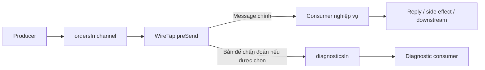
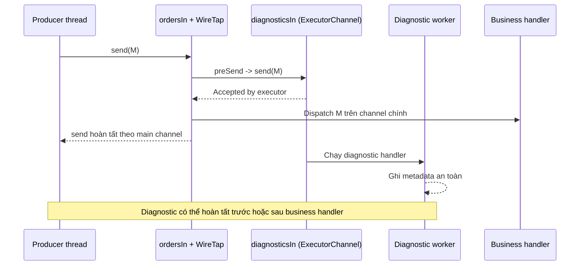
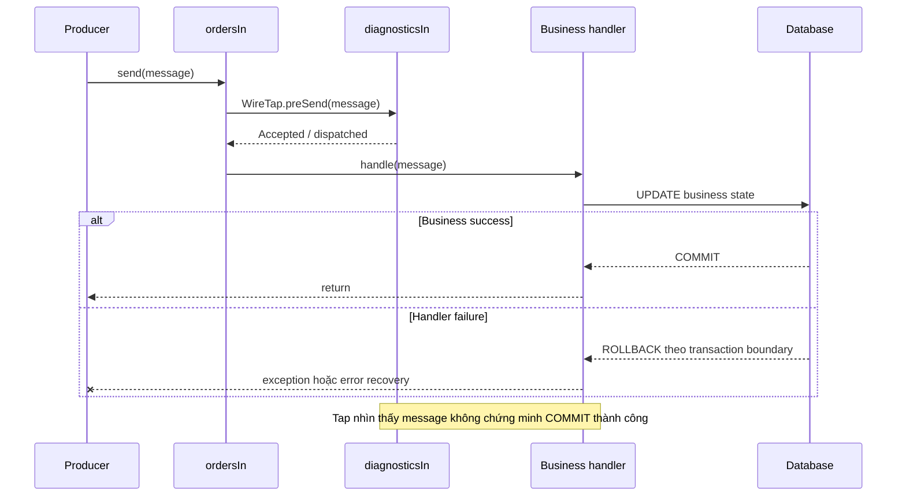

# Wire tap cho chẩn đoán có kiểm soát trong Spring Integration

## 1. Bài toán: quan sát message mà không làm xáo trộn luồng nghiệp vụ

Trong mô-đun `SPRING_INTEGRATION_RUNTIME`, message được điều phối qua channel, endpoint, consumer, poller và executor. Một hệ thống có thể cần phân tích transaction, retry, lỗi, correlation hoặc hành vi sau restart mà không muốn biến từng handler nghiệp vụ thành nơi ghi log. **Wire Tap** là một mẫu Enterprise Integration Pattern giúp **tạo một nhánh quan sát** tại một channel: message tiếp tục đến consumer nghiệp vụ, đồng thời một bản message được gửi đến kênh phụ để chẩn đoán.

Ví dụ, đơn hàng từ `ordersIn` đi vào `OrderHandler`. Khi một khách hàng phản ánh độ trễ, đội vận hành muốn theo dõi đúng một số `traceId`, quan sát luồng xử lý và thời gian chạy mà không in toàn bộ thông tin cá nhân hay ghi mọi payload ra log.

Giải pháp ngây thơ là bật `DEBUG` cho tất cả message trong production. Điều này có thể gây rò rỉ dữ liệu, tăng CPU/I/O, kéo dài transaction và bùng nổ dung lượng log. Thay vào đó, một **wire tap có kiểm soát** cần các ràng buộc:

- **Phạm vi hẹp:** chọn chính xác channel cần quan sát, không tap toàn bộ application context.
- **Điều kiện chọn:** chỉ gửi message được phê duyệt theo tenant/trace/correlation, hoặc lấy mẫu ở tỷ lệ hữu hạn.
- **Dữ liệu tối thiểu:** log metadata an toàn, không vô tình gọi `toString()` trên payload/header chứa PII, token hay bí mật.
- **Tài nguyên có giới hạn:** nhánh diagnostic có executor/queue được kiểm soát, không tạo buffer vô hạn.
- **Vòng đời và hậu quả lỗi rõ ràng:** hiểu khi nào tap chặn main flow, khi nào diagnostic consumer chạy ở thread khác và cách tắt tap.
- **Khả năng đo:** theo dõi event được chọn, được gửi, bị từ chối, lỗi, độ trễ và overhead.

Sau bài học, bạn cần giải thích được `WireTap` là một `ChannelInterceptor`, dùng nó bằng Java/XML/DSL, kiểm thử đúng ranh giới thread, và vận hành sao cho việc chẩn đoán **không tự trở thành một sự cố mới**.

## 2. WireTap nằm ở đâu trong vòng đời channel?

Spring Integration triển khai wire tap bằng class `org.springframework.integration.channel.interceptor.WireTap`. Class này là một `ChannelInterceptor`: khi message được gửi qua channel bị intercept, `preSend(...)` kiểm tra điều kiện `MessageSelector` (nếu có) rồi thử gửi message đến **secondary channel**. Message chính vẫn được gửi qua channel gốc theo cơ chế dispatch của channel đó.



Sơ đồ tập trung vào **hai nhánh logic**. Thứ tự gọi thực tế là `WireTap.preSend` được thực thi **trước** khi channel gốc dispatch message đến consumer; nhánh phụ có thể hoàn tất sớm hơn, muộn hơn hoặc gặp lỗi độc lập, tùy loại channel và thread.

### Những điều WireTap làm và không làm

| Điều quan sát | Hành vi đúng cần hiểu |
|---|---|
| Gắn tap vào `ordersIn` | Interceptor nhận message tại điểm gửi vào channel đó, trước khi nó được dispatch trên channel chính. |
| Có `MessageSelector` | Chỉ message được selector chấp nhận mới được gửi vào diagnostic channel. |
| Tap không có selector | Mặc định mọi message đi qua điểm intercept có thể được chọn. |
| Consumer phụ đọc message | Nó nhận message để quan sát; main flow không được chuyển thành một flow “đi vòng” qua diagnostic consumer. |
| Tap tạo “copy” | Không phải deep clone payload; payload và các object tham chiếu có thể được chia sẻ. Không được chỉnh sửa object mutable từ nhánh diagnostic. |
| Tap đang chạy | Có nghĩa interceptor có thể hoạt động ở lần gửi tiếp theo, không có nghĩa nguồn đã ngừng hoặc hệ thống đã lưu message bền vững. |
| Tap được tắt | Không chọn thêm message mới tại điểm tap; task đã enqueue/chạy ở nhánh phụ có thể còn hoàn tất sau đó. |

**Chú ý về mục tiêu đo:** tap một channel ở giữa flow ghi nhận những message **đến được channel đó**, không phải mọi message đã đi vào ứng dụng, cũng không phải số nghiệp vụ đã commit. Nếu có filter/router trước điểm tap, message bị loại trước đó không xuất hiện. Nếu tap ở đầu flow, message được thấy ở tap nhưng handler phía sau vẫn có thể thất bại.

### Message ID, correlation ID và trace ID

- `MessageHeaders.ID` định danh một instance message; khi qua transformer/enricher hoặc adapter, instance mới có thể được tạo với ID mới.
- `correlationId` và `sequenceNumber` có ý nghĩa đặc biệt với splitter/aggregator/resequencer; chúng không tự là trace ID toàn tuyến.
- `traceId` là thông tin nối log/trace theo quy ước observability. Có thể dùng Micrometer Tracing hoặc header do ứng dụng quản lý.
- Business event ID phải được giữ ổn định khi retry/redelivery nếu cần phân tích một nghiệp vụ xuyên nhiều message instance.

Vì vậy, log diagnostic nên có **business event ID hoặc trace ID an toàn**, channel/endpoint, thời điểm, outcome và thread; không dựa vào một message UUID để kết luận hai lần xử lý có phải duplicate hay không.

## 3. Wire tap không tự bất đồng bộ

Một nhầm lẫn phổ biến là “tap chỉ là log nên chắc chắn chạy nền”. Thực tế `WireTap` gọi `send` tới **channel phụ** ở trong `preSend`. Chính **loại diagnostic channel** quyết định việc dispatch tới consumer diễn ra ở thread nào.

| Diagnostic target | Khi gửi message vào tap | Tác động có thể thấy trên main flow |
|---|---|---|
| `DirectChannel` | Subscriber phụ chạy đồng bộ ngay trong lời gọi `send` của producer | Log/JSON serialization/HTTP call chậm sẽ tăng latency; exception từ consumer phụ có thể lan về đường gửi chính. |
| `ExecutorChannel` | Giao công việc sang `TaskExecutor` rồi worker xử lý sau | Giảm thời gian chạy handler phụ trên thread chính, nhưng **việc submit task vẫn có thể fail/reject** nếu pool hoặc queue đầy. |
| `QueueChannel` | Ghi vào queue để polling consumer lấy sau | Có thể block/timeout khi queue đầy; queue trong RAM không bền qua restart nếu không có persistent store. |
| `PublishSubscribeChannel` không executor | Gửi đồng bộ tới nhiều subscriber phụ | Một subscriber chậm/lỗi có thể ảnh hưởng lời gọi gửi. |
| Channel qua broker/storage | Phụ thuộc adapter và transaction/ack | Thêm I/O, rủi ro lỗi gửi hoặc lặp message; không mặc định tách khỏi transaction. |



**Không tuyên bố “tap luôn fail-open”.** Lỗi xảy ra khi `WireTap` đang resolve channel hoặc gọi `send` sang nhánh phụ có thể đi ngược vào `preSend` và ảnh hưởng lần gửi chính. Dù dùng `ExecutorChannel`, việc executor từ chối task khi quá tải vẫn có thể phát sinh ngay trên thread gửi.

Khi thật sự yêu cầu diagnostic không bao giờ được làm thất bại nghiệp vụ, thiết kế **best-effort interception** một cách tường minh: xác định rõ exception nào được phép nuốt, đếm lỗi, có bounded buffer hoặc non-blocking handoff, kiểm thử ở trạng thái overload. Nếu audit là **bắt buộc** cho tuân thủ, chính sách lại có thể là **fail-closed**, lưu audit bền vững trong transaction/outbox phù hợp. Không dùng cùng một cấu hình cho cả hai mục tiêu.

## 4. Mô hình quan sát có kiểm soát

Trước khi viết code, nên đi từ một **quyết định vận hành** thay vì “log tất cả”:

| Câu hỏi | Ví dụ quyết định |
|---|---|
| Tap ở đâu? | Chỉ `ordersIn` trước handler xác nhận đơn hàng. |
| Tại sao cần tap? | Phân biệt chậm do dispatch, queue hay business handler. |
| Chọn message nào? | Trace ID được operator phê duyệt, một số message thử nghiệm, hoặc sample 1%. |
| Ai được bật? | Control-plane nội bộ được xác thực và audit; header điều khiển do ứng dụng gắn, không tin đầu vào client. |
| Ghi dữ liệu nào? | Event type, opaque trace ID, message ID, channel, thread, timestamp, thời gian; không ghi payload. |
| Lưu bao lâu? | Thời hạn diagnostic ngắn, có retention, quota và quyền truy cập. |
| Lúc collector lỗi? | Với diagnostic best-effort: đếm dropped/rejected, cảnh báo; với audit bắt buộc: dùng outbox/transaction. |
| Khi nào tắt? | Khi hết incident window; có metric xác nhận tap đang bật/tắt. |

### Lớp chọn lọc ≠ lớp khử nhạy cảm

`MessageSelector` chỉ quyết định **có chuyển nguyên message tới tap channel hay không**. Nó không tự che hoặc bỏ các trường nhạy cảm khỏi message. Ngay cả khi diagnostic consumer chỉ ghi `traceId`, message đầy đủ vẫn đã đi vào diagnostic channel và có thể bị giữ trong queue/executor, heap dump hoặc error log của nhánh phụ.

Nếu tổ chức **không cho phép payload nhạy cảm đi vào diagnostic subsystem**, chỉ selector là **không đủ**. Phải tạo **sanitized message** chứa allowlist metadata trước ranh giới đáng tin cậy, dùng custom interceptor hoặc một bước transformer/producer nội bộ có kiểm soát. Không đưa nguyên payload vào queue diagnostic rồi mới mong logger loại bỏ hết rủi ro.

## 5. Ví dụ Java: tap chọn lọc trên DirectChannel, nhánh quan sát tách thread

Ví dụ chạy trong ứng dụng Spring có `spring-integration-core`, Spring Context và SLF4J; dùng Java 17+ cho `record`. Đặt các `public class`/`record` dưới đây trong **những file Java riêng** của package `example.integration`.

Topology:

```text
Producer ----> ordersIn (DirectChannel) ------> OrderEndpoints.process()
                  |
                  +-- ordersWireTap (selector)
                         |
                         v
                 diagnosticsIn (ExecutorChannel)
                         |
                         v
                 OrderEndpoints.diagnose()
```

Giả định payload là một DTO demo không có thông tin cá nhân. Khi dùng với nghiệp vụ thật, vẫn phải áp dụng chính sách dữ liệu ở mục 4.

### 5.1. Cấu hình channel, executor hữu hạn và WireTap

```java
package example.integration;

import org.springframework.beans.factory.annotation.Qualifier;
import org.springframework.context.annotation.Bean;
import org.springframework.context.annotation.ComponentScan;
import org.springframework.context.annotation.Configuration;
import org.springframework.integration.channel.DirectChannel;
import org.springframework.integration.channel.ExecutorChannel;
import org.springframework.integration.channel.interceptor.WireTap;
import org.springframework.integration.config.EnableIntegration;
import org.springframework.integration.core.MessageSelector;
import org.springframework.messaging.MessageChannel;
import org.springframework.scheduling.concurrent.ThreadPoolTaskExecutor;

@Configuration
@EnableIntegration
@ComponentScan(basePackageClasses = OrderEndpoints.class)
public class ControlledWireTapConfig {

    @Bean("diagnosticExecutor")
    public ThreadPoolTaskExecutor diagnosticExecutor() {
        ThreadPoolTaskExecutor executor = new ThreadPoolTaskExecutor();
        executor.setThreadNamePrefix("diagnostic-");
        executor.setCorePoolSize(1);
        executor.setMaxPoolSize(2);
        executor.setQueueCapacity(64);
        return executor;
    }

    @Bean("diagnosticsIn")
    public MessageChannel diagnosticsIn(
            @Qualifier("diagnosticExecutor")
            ThreadPoolTaskExecutor diagnosticExecutor) {

        return new ExecutorChannel(diagnosticExecutor);
    }

    @Bean("ordersWireTap")
    public WireTap ordersWireTap(
            @Qualifier("diagnosticsIn") MessageChannel diagnosticsIn) {

        MessageSelector selector = message -> {
            boolean allowed = Boolean.TRUE.equals(
                    message.getHeaders().get("diagnosticsApproved"));

            Object traceId = message.getHeaders().get("traceId");
            return allowed
                    && traceId instanceof String
                    && ((String) traceId).startsWith("diag-");
        };

        WireTap tap = new WireTap(diagnosticsIn, selector);
        tap.setTimeout(0);
        return tap;
    }

    @Bean("ordersIn")
    public DirectChannel ordersIn(
            @Qualifier("ordersWireTap") WireTap ordersWireTap) {

        DirectChannel mainChannel = new DirectChannel();
        mainChannel.addInterceptor(ordersWireTap);
        return mainChannel;
    }
}
```

**Vì sao dùng bean riêng cho `WireTap`?** Để ứng dụng có thể inject cùng instance của interceptor, kiểm tra `isRunning()` hoặc gọi `stop()/start()` khi có quy trình cho phép. Không tạo nhiều `WireTap` khác nhau rồi tưởng đang điều khiển đúng instance gắn vào channel.

**Vì sao `setTimeout(0)` không phải bảo đảm fail-open?** Timeout gửi đến kênh phụ tính bằng mili-giây; ở một số target như queue, thời gian chờ gửi có thể ảnh hưởng blocking. Nhưng executor rejection, lỗi channel resolution, exception từ interceptor/selector hoặc cấu hình downstream vẫn có thể ảnh hưởng đường gửi chính. Muốn policy “không để diagnostic fail phá business”, cần thiết kế/kiểm thử cơ chế cách ly riêng.

**Vì sao bounded executor?** `queueCapacity=64` và giới hạn worker tránh tích tụ task không kiểm soát trong diagnostic executor. Khi pool/queue đầy, policy từ chối task phải được **quan sát và xử lý**; cấu hình này không tự bỏ message an toàn. Không dùng một executor vô hạn cho cả business và diagnostic vì nhánh quan sát có thể chiếm tài nguyên của nghiệp vụ chính.

### 5.2. Payload demo và handler

```java
package example.integration;

public record OrderEvent(String eventId, long totalCents) {}
```

```java
package example.integration;

import java.util.concurrent.atomic.AtomicInteger;

import org.slf4j.Logger;
import org.slf4j.LoggerFactory;
import org.springframework.integration.annotation.MessageEndpoint;
import org.springframework.integration.annotation.ServiceActivator;
import org.springframework.messaging.Message;

@MessageEndpoint
public class OrderEndpoints {

    private static final Logger log =
            LoggerFactory.getLogger(OrderEndpoints.class);

    private final AtomicInteger businessCount = new AtomicInteger();
    private final AtomicInteger diagnosticCount = new AtomicInteger();

    @ServiceActivator(inputChannel = "ordersIn")
    public void process(Message<OrderEvent> message) {
        // Demo: không ghi toàn bộ payload, không có external side effect.
        businessCount.incrementAndGet();
    }

    @ServiceActivator(inputChannel = "diagnosticsIn")
    public void diagnose(Message<?> message) {
        // Allowlist metadata. KHÔNG log message.toString() hoặc payload.
        diagnosticCount.incrementAndGet();

        log.info("wiretap eventType={} traceId={} messageId={} thread={}",
                message.getHeaders().getOrDefault("eventType", "unknown"),
                message.getHeaders().getOrDefault("traceId", "missing"),
                message.getHeaders().getId(),
                Thread.currentThread().getName());
    }

    public int getBusinessCount() {
        return businessCount.get();
    }

    public int getDiagnosticCount() {
        return diagnosticCount.get();
    }
}
```

Nhánh diagnostic **không thay đổi** `Message<?>`, không trả reply, không gửi tiếp message vào `ordersIn`. Nó chỉ ghi **allowlisted metadata**. Trong production, ngay cả header `traceId` hoặc `eventType` cũng cần kiểm soát nguồn tạo và định dạng (ví dụ độ dài/character allowlist), tránh log injection hoặc lộ thông tin nghiệp vụ.

### 5.3. Gửi ba message để kiểm tra selector

Từ một bean có `ApplicationContext context`, gọi:

```java
import example.integration.OrderEvent;

import org.springframework.context.ApplicationContext;
import org.springframework.messaging.MessageChannel;
import org.springframework.messaging.support.MessageBuilder;

MessageChannel input =
        context.getBean("ordersIn", MessageChannel.class);

input.send(MessageBuilder
        .withPayload(new OrderEvent("evt-101", 1200L))
        .setHeader("eventType", "ORDER_CREATED")
        .setHeader("traceId", "diag-101")
        .setHeader("diagnosticsApproved", true)
        .build());

input.send(MessageBuilder
        .withPayload(new OrderEvent("evt-102", 2300L))
        .setHeader("eventType", "ORDER_CREATED")
        .setHeader("traceId", "trace-102")
        .setHeader("diagnosticsApproved", false)
        .build());

input.send(MessageBuilder
        .withPayload(new OrderEvent("evt-103", 3400L))
        .setHeader("eventType", "ORDER_CREATED")
        .setHeader("traceId", "diag-103")
        .setHeader("diagnosticsApproved", true)
        .build());
```

Kết quả mong đợi sau khi diagnostic executor xử lý xong:

| Message | Business consumer | Diagnostic consumer |
|---|---|---|
| `evt-101`, `diag-101`, approved | Có | Có |
| `evt-102`, không approved | Có | Không |
| `evt-103`, `diag-103`, approved | Có | Có |

Bộ đếm nghiệp vụ sẽ là **3**; bộ đếm diagnostic cuối cùng là **2** nếu không có rejection/lỗi. Hai bộ đếm **không nhất thiết đạt giá trị đó cùng thời điểm**: `ordersIn` là `DirectChannel`, còn `diagnosticsIn` dùng executor. Khi viết test, hãy **chờ có điều kiện với timeout hữu hạn** thay vì assert diagnostic count ngay lập tức sau `send()`.

**Cảnh báo bảo mật quan trọng:** ví dụ minh họa `diagnosticsApproved` trong message. Với nguồn bên ngoài không tin cậy, **không được** lấy giá trị này trực tiếp từ request client để quyết định ghi chép. Thành phần nội bộ đã xác thực và phê duyệt incident cần quyết định có tap hay không; tốt hơn có thể dùng một allowlist trong control-plane nội bộ, không phụ thuộc header do caller tùy ý đặt.

## 6. Quản lý bật/tắt và lựa chọn message có kiểm soát

`WireTap` triển khai interface lifecycle; các phương thức `isRunning()`, `stop()` và `start()` cho phép điều khiển việc intercept.

Ví dụ gọi trực tiếp từ code quản trị nội bộ có phân quyền:

```java
import org.springframework.integration.channel.interceptor.WireTap;

WireTap tap = context.getBean("ordersWireTap", WireTap.class);

tap.stop();                  // Không tạo thêm bản tap cho các send sau.
boolean enabled = tap.isRunning();

tap.start();                 // Bật lại khi có phê duyệt.
```

**Không biến đoạn code này thành một HTTP endpoint công khai.** Nút “bật logging” có thể tăng log volume và mở rộng khả năng truy cập metadata. Cần xác thực, phân quyền, audit ai bật và vì sao, thời điểm hết hạn, metric đếm số lần bật và cơ chế khôi phục cấu hình sau deploy.

Các giới hạn lifecycle:

- Tap dừng không có nghĩa **consumer business** dừng.
- Tap dừng không xóa message đã enqueue vào diagnostic executor/queue.
- Tap bật lại không replay những message đã chạy qua channel khi tap đang tắt.
- Một `WireTap` bean là cấu hình **của JVM/context đó**. Nếu có 5 pod, bật ở một pod không tự bật ở 4 pod còn lại.
- `start()/stop()` và trạng thái runtime cần kiểm tra theo phiên bản; không dùng lifecycle như một giao thức audit bền vững sau restart.

### 6.1. Selector động có giới hạn

Đối với sản phẩm thật, có thể thay Boolean header bằng một `MessageSelector` đọc một **allowlist bất biến được cập nhật nguyên tử** hoặc snapshot cấu hình từ control-plane nội bộ. Cần giới hạn TTL và kích thước allowlist, không giữ mã sự kiện vô hạn trong RAM.

Một chiến lược sampling ổn định theo business event ID:

```java
MessageSelector onePercent = message -> {
    Object eventId = message.getHeaders().get("businessEventId");
    if (!(eventId instanceof String)) {
        return false;
    }
    int bucket = Math.floorMod(((String) eventId).hashCode(), 100);
    return bucket < 1;
};
```

Đây chỉ là **xấp xỉ 1% theo phân bố hash**, không phải bảo đảm chính xác 1% trên một batch nhỏ. Lợi thế: cùng event ID được replay thường rơi cùng bucket, giúp đối chiếu dễ hơn. Nhược điểm: `String.hashCode()` không phải hash bảo mật; nếu adversary điều khiển event ID, không dùng nó làm cơ sở cấp quyền truy cập.

**Sampling khác authorization:** ngay cả trong mẫu 1%, dữ liệu vẫn phải được khử nhạy cảm và chỉ cho người có quyền truy cập.

## 7. Các cách gắn WireTap: local, DSL, global và XML

### 7.1. Local interception bằng Java

Mục 5 cho thấy cách gọi `mainChannel.addInterceptor(tap)`. Nó có lợi thế **phạm vi rõ ràng**: chỉ một channel bị tap. Đây là lựa chọn tốt khi debug một incident xác định.

### 7.2. Java DSL với `MessageChannelSpec.wireTap()`

Spring Integration Java DSL hỗ trợ gắn tap khi dựng channel:

```java
import org.springframework.context.annotation.Bean;
import org.springframework.integration.channel.QueueChannel;
import org.springframework.integration.dsl.MessageChannels;

@Bean
public QueueChannel watchedQueue() {
    return MessageChannels.queue()
            .wireTap("diagnosticsIn")
            .get();
}
```

Ở đây `diagnosticsIn` là bean `MessageChannel` tồn tại trong context. `MessageChannels.queue()` tạo một channel polling; nếu không cấu hình giới hạn/persistent store phù hợp, queue trong RAM có nguy cơ backlog mất khi restart hoặc tăng bộ nhớ. Ví dụ chỉ minh họa API `wireTap()`, không phải khuyến nghị queue vô hạn cho production.

Cũng có thể dùng operator DSL `.wireTap(...)` hoặc `.log(...)` trong `IntegrationFlow`. Khi cần operator trên channel **không** triển khai `InterceptableChannel`, DSL có thể đưa vào một `DirectChannel` trung gian cùng bridge để đặt interceptor. Vì vậy **vị trí tap thực tế** trong topology có thể khác sơ đồ ban đầu nếu bạn nhìn mỗi chuỗi DSL mà không quan sát graph.

### 7.3. Global wire tap theo pattern

Khi cần theo dõi một tập channel, có thể dùng `@GlobalChannelInterceptor`:

```java
import org.springframework.context.annotation.Bean;
import org.springframework.integration.channel.interceptor.WireTap;
import org.springframework.integration.config.GlobalChannelInterceptor;
import org.springframework.messaging.MessageChannel;

@Bean
@GlobalChannelInterceptor(patterns = "ordersIn", order = 3)
public WireTap scopedOrdersTap(MessageChannel diagnosticsIn) {
    return new WireTap(diagnosticsIn);
}
```

Đây là **phương án thay thế** cách gắn local ở mục 5; không đặt cả hai cùng lúc nếu không muốn tap hai lần. Spring Integration hỗ trợ pattern và thứ tự interceptor, có thể bao gồm nhiều channel nhưng cần loại trừ diagnostic channel để tránh vòng lặp.

**Không dùng `patterns = "*"` chỉ để debug một channel**: nó có thể intercept `errorChannel`, các channel nội bộ hoặc chính `diagnosticsIn`, gây log amplification hoặc vòng lặp. Dù `WireTap` có cơ chế veto tự bảo vệ với một số cấu hình circular reference, vẫn phải đặt scope/namespace rõ và kiểm thử topology.

### 7.4. XML namespace và selector

```xml
<int:channel id="ordersIn">
    <int:interceptors>
        <int:wire-tap channel="diagnosticsIn"
                      selector="approvedTapSelector"/>
    </int:interceptors>
</int:channel>

<int:channel id="diagnosticsIn">
    <int:dispatcher task-executor="diagnosticExecutor"/>
</int:channel>
```

Fragment cần namespaces `int`, bean `approvedTapSelector` triển khai `MessageSelector` và bean `diagnosticExecutor` đã cấu hình. Có thể dùng `selector-expression` thay cho `selector` để viết SpEL boolean. Tránh đưa biểu thức tùy ý từ request người dùng vào SpEL của selector.

Tài liệu cũng hỗ trợ top-level `<int:wire-tap pattern="..." channel="..."/>` cho global wire tap. Chỉ áp dụng một strategy gắn tap tại một điểm, trừ khi chủ ý cần nhiều nhánh độc lập.

## 8. Vì sao “copy message” không có nghĩa bản sao dữ liệu độc lập?

Một `Message<?>` có headers dạng immutable interface và payload reference. Khi đưa cùng message vào main/diagnostic flow, **payload object có thể được chia sẻ**. Nếu payload là `byte[]`, `List` mutable hoặc DTO có setter, diagnostic consumer có thể nhìn thấy cùng một instance đang được business handler dùng.

Ví dụ **phản mẫu**:

```java
@ServiceActivator(inputChannel = "diagnosticsIn")
public void unsafe(Message<byte[]> message) {
    byte[] payload = message.getPayload();
    payload[0] = 0;  // Sai: có thể thay đổi cả dữ liệu main flow.
}
```

Đây là ví dụ **không được chạy**; nó minh họa tại sao “wire tap copy” không hứa **deep copy**. Quy tắc:

1. Diagnostic handler phải **read-only** đối với payload và headers.
2. Không giữ reference payload mutable trong cache dùng lâu khi chỉ cần metadata.
3. Nếu cần snapshot dữ liệu để tái hiện lỗi, tạo representation **đã khử nhạy cảm và có version** tại ranh giới trusted, không mutate message gốc.
4. Nếu chẩn đoán byte payload, tính checksum/hash trên bản đọc an toàn, kiểm soát chi phí CPU và chính sách dữ liệu; không log nguyên byte.
5. Với payload lazy/stream, đọc payload ở nhánh tap có thể tiêu thụ stream khiến business không đọc được; cần thay thiết kế payload replayable hoặc reference storage.

**Đây là rủi ro dữ liệu, không phải chỉ rủi ro logging.** Sự cố “bật tap thì flow lỗi” có thể đến từ handler phụ thay đổi object hoặc tiêu thụ một `InputStream` vốn chỉ đọc được một lần.

## 9. Ranh giới transaction, retry và ErrorMessage

Wire tap nằm tại **lúc gửi message qua channel**, không tại “business transaction commit”.

### 9.1. Thời điểm quan sát



Với `DirectChannel`, handler business có thể chạy trên thread của producer; tap cũng thực hiện `preSend` trong thread đó, trước handler. Nếu diagnostic target là `DirectChannel`, diagnostic handler cùng thread có thể nằm trong **transaction thread-bound hiện có**. Nếu target là `ExecutorChannel`, diagnostic handler chạy trên thread khác và **không tự kế thừa** JDBC transaction của caller.

### 9.2. Tap thành công nhưng nghiệp vụ thất bại

Nếu tap đã ghi log cho message rồi handler ném exception:

- Log tap là bằng chứng **message tới điểm intercept**, không phải bằng chứng đã xử lý thành công.
- Business transaction có thể rollback, trong khi log/metric ngoài DB không thể rollback.
- Source hoặc retry advice có thể phát lại message và tap lại lần nữa.
- Số lượt diagnostic có thể **lớn hơn** số business commit, ngay cả khi tap không bị duplicate ở cấp channel.

Để phân tích chính xác, nối event bằng `businessEventId` và ghi **attempt number**, business commit outcome, ack và error/recovery channel. Nếu cần audit nghiệp vụ “đã hoàn tất”, nên phát audit event **sau commit theo một thiết kế tin cậy**, ví dụ transactional outbox, thay vì coi tap tại input là audit success.

### 9.3. Lỗi từ chính diagnostic branch

| Loại lỗi | Có thể xảy ra ở đâu? | Tác động |
|---|---|---|
| Selector ném exception | `WireTap.preSend` trên thread gửi | Có nguy cơ làm fail đường send chính. |
| Target diagnostic không tồn tại/resolve thất bại | Lúc WireTap tìm channel | Có nguy cơ exception ở nhánh tap ngay khi gửi. |
| Executor pool đầy hoặc từ chối task | Khi `diagnosticsIn.send` cố dispatch | Có thể thất bại ngay trong `preSend`. |
| Diagnostic handler ném trên executor thread | Sau khi tap send đã trả về | Exception theo error handler/error channel của async dispatch; không tự rollback business. |
| Queue diagnostic đầy | Khi enqueue, theo timeout/capacity | Có thể block, trả false hoặc fail theo hợp đồng channel; phải đo. |
| Diagnostic sink/log server ngừng | Consumer phụ đang ghi log/HTTP | Nếu chạy đồng bộ có thể kéo main flow chậm; nếu async có thể dồn backlog/retry. |

Không ghi log exception chứa toàn bộ payload `MessageHandlingException#getFailedMessage()` ở nhánh diagnostic một cách vô điều kiện; error log cũng có thể rò rỉ dữ liệu.

### 9.4. Không thay thế `errorChannel`

`WireTap` quan sát message tại **channel đang gửi**. `errorChannel`/`ErrorMessage` là đường báo lỗi khi có cơ chế bắt và publish exception. Muốn nhìn lỗi mà không chạm payload thường, có thể instrument error channel hoặc error handler riêng với **redacted exception summary**, nhưng cần tránh global tap tạo vòng lặp khi chính error handler phát message mới.

**Không sử dụng tap như một retry handler**: gửi message lại vào `ordersIn` từ diagnostic consumer để “thử thêm lần nữa” dễ tạo vòng lặp/duplicate. Retry phải là policy tường minh ở endpoint, broker hoặc recovery flow, với idempotency và giới hạn attempt.

## 10. Thiết kế “fail-open” hay “fail-closed” một cách có trách nhiệm

Hai mục tiêu vận hành khác nhau:

| Mục tiêu | Chính sách được chấp nhận | Thiết kế |
|---|---|---|
| **Diagnostic best-effort** | Mất một số quan sát được phép; business không được hỏng vì debug | Sampling, redacted metadata, bounded queue, timeout, metric drop/reject, cơ chế cách ly lỗi được kiểm chứng. |
| **Audit bắt buộc** | Không được commit nghiệp vụ nếu audit marker bắt buộc chưa được lưu đúng contract | Transactional audit/outbox cùng DB hoặc hạ tầng audit bền vững; fail-closed có chủ đích, retention và reconciliation. |
| **Security monitoring** | Cần tránh lộ payload, đồng thời có bằng chứng về sự kiện cần kiểm tra | Allowlist trường, access control, tamper-evident storage khi cần, retention và audit truy cập. |

Với diagnostic best-effort, chỉ thay `DirectChannel` của tap bằng `ExecutorChannel` **không đủ** để tuyên bố mọi lỗi đã được cách ly. Nếu muốn chính sách bỏ qua khi nhánh phụ lỗi, hãy tạo interceptor/trình phát phụ chuyên dụng có **try/catch hẹp**, giới hạn tài nguyên, metric ghi nhận drop và bài kiểm thử khi target đầy. Không nuốt cả lỗi chương trình như `OutOfMemoryError`; không che lỗi khi yêu cầu audit bắt buộc.

Một thiết kế khác là **tách sẵn dữ liệu an toàn** trước lúc gửi vào diagnostic queue:

```java
public record SafeDiagnosticEvent(
        String businessEventId,
        String traceId,
        String sourceChannel,
        String eventType
) {}
```

Nếu organization không cho phép diagnostic subsystem thấy payload, `SafeDiagnosticEvent` cần được tạo bằng bước trusted có **allowlist dữ liệu** và đưa vào channel phụ. `WireTap` gốc chỉ chuyển message được intercept, **không tự chuyển đổi payload thành record này**; cần cấu hình transformer/custom interceptor ngoài WireTap để đạt mục tiêu.

## 11. Sampling, giới hạn bộ nhớ và tác động hiệu năng

### 11.1. Ước lượng chi phí

Giả sử tốc độ vào `λ = 20.000 message/giây`, sampling `p = 2%`, mỗi log metadata an toàn khoảng 300 byte:

\[
\lambda_{\text{tap}} \approx \lambda \times p = 400\ \text{messages/giây}
\]

\[
D_{\text{raw}} \approx 400 \times 300 = 120.000\ \text{byte/giây}
\]

Nếu giữ 24 giờ, dữ liệu thô khoảng **10,4 GB** trước khi cộng log envelope, index, replication, metadata và compression. Con số minh họa nhấn mạnh rằng sampling vẫn có thể tạo dung lượng lớn khi throughput cao.

Nếu **tất cả** message 2 MiB đi qua diagnostic queue trong RAM với 64 slots, riêng payload reference hoặc bản copy có thể gây áp lực khác nhau tùy thiết kế. Đừng tính buffer chỉ bằng `queueCapacity` mà bỏ qua **serialized message size, object retention, số bản sao và vòng đời xử lý**.

### 11.2. Các metric nên instrument

| Metric đề xuất | Ý nghĩa |
|---|---|
| `wiretap_selected_total` | Số message selector cho phép tap. |
| `wiretap_forwarded_total` | Số lượt gửi sang target thành công theo contract của channel. |
| `wiretap_rejected_total` | Nhánh diagnostic quá tải hoặc enqueue fail. |
| `wiretap_handler_failures_total` | Consumer diagnostic bị lỗi sau dispatch. |
| `wiretap_diagnostic_queue_depth` | Độ sâu queue/executor phía diagnostic hiện tại. |
| `wiretap_selection_latency` | Chi phí selector trên đường gửi chính. |
| `wiretap_send_latency` | Thời gian thực hiện tap send; quan trọng cả khi target async. |
| `business_channel_send_latency` | Đo tác động lên main flow trước/sau khi bật tap. |
| `wiretap_enabled` | Trạng thái enable thực tế của từng instance. |
| `diagnostic_log_bytes_total` | Ước lượng chi phí storage/logging. |

Các tên này là **đề xuất metric của ứng dụng**, không phải tên Spring Integration/Micrometer tự tạo sẵn. Kết hợp với metrics có sẵn của Spring Integration (channel send/receive, handler duration) theo phiên bản framework thực tế.

### 11.3. Ưu tiên dữ liệu đo trước khi tăng mức chẩn đoán

Trong nhiều trường hợp, **Micrometer counters/timers, Observation/tracing và structured log nhẹ** đủ xác định vấn đề mà không cần giữ nội dung message. Chỉ bật tap chi tiết nếu tồn tại một câu hỏi mà metrics/trace không trả lời được, ví dụ “message có đến channel B trước khi router chọn nhánh C không?”.

Để giảm overhead:

- Selector phải nhẹ, không gọi DB/HTTP hoặc parse payload lớn trong `preSend`.
- Không gọi `message.toString()` hoặc serialize DTO lớn để viết log cho mọi message.
- Tách executor của diagnostic khỏi executor business; đặt queue hữu hạn và giám sát rejection.
- Dùng allowlist trace/event cụ thể với thời hạn; tránh để tap chạy vĩnh viễn sau sự cố.
- Đặt quota byte, retention, rate limit và các quy tắc truy cập log.
- Kiểm tra overhead khi `p=0`, `p=1%`, `p=100%` trong test; báo cáo p95/p99 main latency.

## 12. JMX và runtime lifecycle của tap

`WireTap` hỗ trợ `start()`, `stop()` và `isRunning()`. Các method được chú thích quản lý trong một số phiên bản; để gọi qua JMX, đối tượng phải thực sự được **export thành MBean** bởi cấu hình quản trị phù hợp. Không chỉ thấy method Java rồi suy ra nó tự xuất hiện trong JConsole.

Với `IntegrationMBeanExporter`, nhiệm vụ chính là export channel/handler/source. Nếu cần quản trị chính bean `WireTap` qua JMX, xác minh Bean/ObjectName/registration thực tế hoặc tạo một control-plane nội bộ riêng có xác thực. Tránh cho người không có quyền gọi `stop()`/`start()` và phát tán dữ liệu chẩn đoán không giới hạn.

### Tắt diagnostic có an toàn với message đang chờ không?

Giả sử `WireTap.stop()` được gọi lúc executor đã nhận 100 diagnostic tasks:

- Các task đã được enqueue có thể **tiếp tục hoàn tất**, tùy lifecycle của target executor.
- Những message business mới có thể tiếp tục đi qua channel chính mà **không** bị tap theo cơ chế stop.
- Nếu shutdown của application diễn ra ngay sau đó, diagnostic task có thể còn dở; không xem diagnostic logs là transaction ledger.
- Nếu mục tiêu là drain log thật sự, cần phối hợp lifecycle executor/log sink riêng, timeout và metric in-flight.

Đừng tắt cả `ordersIn` hoặc stopping business endpoint khi mục đích chỉ là giảm logging; quản lý đúng bean interceptor thay vì toàn bộ flow.

## 13. Bảo mật: dữ liệu nào được phép xuất hiện ở nhánh diagnostic?

Nhánh tap thường được bật trong lúc sự cố, khi đội vận hành có xu hướng muốn nhìn “mọi thứ”. Đây cũng là thời điểm dễ lộ dữ liệu nhất.

### Checklist dữ liệu

| Dữ liệu | Hướng xử lý |
|---|---|
| Access token, refresh token, API key, password, cookie | Không sao chép vào hệ log chẩn đoán; loại bỏ ở ranh giới trusted. |
| PII như email, số điện thoại, địa chỉ | Không log nguyên giá trị; dùng opaque ID hoặc giá trị đã masking nếu chính sách cho phép. |
| Payment/card/health data | Chính sách hạn chế nghiêm ngặt; ưu tiên trace/metric, tránh tap payload. |
| `replyChannel`/`errorChannel` header | Có thể chứa đối tượng channel hoặc tên định tuyến nhạy cảm; không log toàn bộ headers. |
| Business ID / trace ID | Kiểm tra source, character allowlist, length limit, retention và access control. |
| Exception | Chọn exception class, code, stack trace có kiểm soát; tránh in full `failedMessage`/payload. |

`log-full-message="true"` trong logging channel adapter có thể in thêm headers; ngay cả mặc định chỉ in payload cũng có thể lộ thông tin nhạy cảm. Chính sách an toàn hơn là **không dùng full-message logging** trên production. Chọn biểu thức/handler được thiết kế chỉ xuất allowlisted metadata.

Các biện pháp bổ sung: audit người bật tap, giới hạn role có quyền đọc sink, mã hóa log trong lưu trữ/truyền tải, retention ngắn, cơ chế xóa theo chính sách, và test dữ liệu nhạy cảm không xuất hiện trong log khi fail/retry.

## 14. Chẩn đoán theo triệu chứng

| Triệu chứng | Nguyên nhân có thể | Cách xác minh |
|---|---|---|
| Tap không có message | Chưa gắn vào channel đang chạy, selector trả false, tap đã stop, bean target không có consumer | Kiểm tra channel name, `tap.isRunning()`, selector và topology thực. |
| Main handler chậm ngay khi bật tap | Diagnostic target dùng `DirectChannel`/logging sync hoặc selector/serialization tốn CPU | Đo thời gian `preSend`, thread name, call stack và sink latency. |
| Main flow fail khi nhánh debug đầy | Executor reject hoặc queue gửi fail ở `preSend` | Kiểm tra RejectedExecutionException, queue capacity, timeout, error logs. |
| Diagnostic log có trước business success | Tap chạy trước main dispatch, không phải post-commit hook | Gắn thêm business outcome event/metric tại đúng điểm commit. |
| Diagnostic log xuất hiện nhiều lần cho một event | Retry, broker redelivery, message đi qua nhiều channel tap hoặc gắn tap trùng | Nối `businessEventId`, `MessageHeaders.ID`, attempt và list interceptor. |
| Tap không nhận những event đã filter trước đó | Tap đặt **sau** filter/router | Di chuyển điểm quan sát có kiểm soát hoặc instrument điểm bị loại. |
| Event tap trông sai dữ liệu | Mutable payload bị sửa hoặc stream bị tiêu thụ qua hai nhánh | Kiểm tra sharing reference, serializer, defensive read và payload type. |
| Message phụ tự xuất hiện mãi trong tap | Global pattern bao cả diagnostic channel, loop do nhánh phụ republish | Hạn chế pattern, kiểm tra veto và đường gửi từ diagnostic consumer. |
| Missing trace/correlation | Header bị loại/đổi qua transformer, adapter hoặc broker | Kiểm tra header từng ranh giới, không dùng UUID mới thay business ID. |
| Diagnostic handler lỗi nhưng business vẫn thành công | Nhánh phụ async, error handling riêng | Kiểm tra error channel của diagnostic executor và metric side branch. |
| Dừng tap vẫn thấy log | Task diagnostic đã enqueue trước `stop()` | Xem thời điểm enqueue, executor backlog và in-flight count. |
| Rò rỉ PII trong log | Ghi payload/full message, error logger in failedMessage, untrusted header | Audit log pipeline và áp dụng allowlist/redaction trước diagnostic boundary. |

### Một quy trình điều tra có thể lặp lại

1. Xác nhận **đúng instance, channel name và điểm gắn tap**.
2. Dùng một message thử có `traceId` nội bộ được phê duyệt và một message **không** được phê duyệt.
3. Ghi thời điểm `preSend`, main handler nhận, diagnostic consumer nhận và business commit nếu có.
4. Kiểm tra `Thread.currentThread().getName()` ở hai nhánh để phân biệt sync/async.
5. Bật lỗi có chủ đích ở diagnostic handler, rồi ở bước submit executor; ghi lại ảnh hưởng tới main flow.
6. So số business messages, số selected messages và số diagnostic processed; chấp nhận kết quả eventual cho nhánh async.
7. Kiểm tra payload/headers có bị log ngoài allowlist hoặc bị giữ lâu trong queue/heap không.
8. Tắt tap, xác nhận main flow không thay đổi topology và log phụ chỉ còn các task đã enqueue.
9. Lưu lại cấu hình incident window, quota, retention và cách revert.

## 15. Bài thực hành: kiểm chứng cả hiệu năng, an toàn và recovery

Bắt đầu từ các class Java ở mục 5, thêm một tập test phát event trên môi trường không có dữ liệu khách hàng thật:

1. **Điểm tap đúng:** gửi ba message ở mục 5.3; chờ `businessCount=3` và `diagnosticCount=2` bằng condition-based wait có timeout.
2. **Thứ tự:** log timestamp và thread của `WireTap.preSend`/hai handler; giải thích vì sao diagnostic có thể ghi trước business và vì sao nó không biểu thị commit.
3. **Selector:** thay `diagnosticsApproved=false` trên message đã phê duyệt, kiểm tra main handler vẫn nhận message trong khi diagnostic không nhận.
4. **Lifecycle:** gọi `tap.stop()` rồi gửi một event mới; xác nhận main handler còn nhận. Gọi `tap.start()` rồi thử lại.
5. **Direct vs Executor:** đổi `diagnosticsIn` thành `DirectChannel` trong một cấu hình thử độc lập, thêm độ trễ 200 ms ở diagnostic handler; so p95 latency của `ordersIn.send`.
6. **Quá tải:** cấu hình diagnostic executor queue rất nhỏ, chặn worker có kiểm soát và gửi burst; xác nhận policy rejection/failure và metric, không tuyên bố “async luôn fail-open”.
7. **Thử vòng lặp:** tạo một global tap chỉ trên `ordersIn`, rồi chủ động thử pattern bao `diagnosticsIn` trong test; quan sát cơ chế ngăn loop hoặc tác động bất thường để giải thích vì sao phải scope rõ.
8. **Mutable payload:** dùng `byte[]` và một consumer phụ chỉ đọc; so với phản mẫu cố thay payload (chỉ trong test cô lập). Sau đó sửa thiết kế bằng payload immutable/defensive copy nếu thật sự cần.
9. **Retry:** cho business handler ném exception sau khi tap đã ghi; kích hoạt retry hữu hạn và kiểm tra event xuất hiện ở tap bao nhiêu lần.
10. **Bảo mật:** tạo payload chứa dữ liệu giả lập nhạy cảm và kiểm tra log output **không chứa** email/token giả lập, kể cả khi exception xảy ra.
11. **Cluster:** chạy hai JVM có cùng tap config, bật `stop()` ở một JVM; xác minh trạng thái không tự lan sang JVM thứ hai.
12. **Recovery:** kill app khi diagnostic executor còn backlog; giải thích tại sao log phụ có thể mất nhưng business message phải được phục hồi theo nguồn durable riêng nếu yêu cầu không mất dữ liệu.

Mỗi ca ghi:

| Bằng chứng | Giá trị cần thu thập |
|---|---|
| Event/trace ID | ID nghiệp vụ ổn định và được phê duyệt để theo dõi |
| Channel và interceptor | Đúng `ordersIn`? Có gắn tap trùng không? |
| Thread | Producer, business handler, diagnostic handler |
| Counts | Received, selected, forwarded, processed, rejected |
| Latency | p50/p95/p99 main send và diagnostic handoff |
| Lỗi/retry | Exception và vị trí trong call stack; attempt number |
| Bảo mật | Field nào thực sự xuất hiện trong log/sink/queue |
| Lifecycle | Tap enable, time-to-disable, backlog còn lại |
| Recovery | Sau restart có message replay hay diagnostic data bị mất? |

## 16. Các quy tắc chốt khi đưa WireTap vào production

- `WireTap` là **`ChannelInterceptor` ở `preSend`**, dùng để quan sát message tại **một điểm channel**; nó không có nghĩa nghiệp vụ đã hoàn tất.
- **Không tự async.** `DirectChannel` nhánh phụ có thể block và ném exception ngay trên thread chính; `ExecutorChannel`/`QueueChannel` tách xử lý nhưng vẫn có lỗi handoff/capacity.
- **Chọn lọc có chủ đích.** Dùng `MessageSelector`, pattern hẹp và sampling hữu hạn; không tin header “enable diagnostics” do request ngoài gửi.
- **Copy không phải deep copy.** Diagnostic consumer phải read-only, tránh mutate payload hoặc tiêu thụ stream dùng chung.
- **Không log payload đầy đủ.** Đặc biệt cẩn thận với `failedMessage`, `toString()`, `log-full-message` và headers chứa token/PII.
- **Đặt giới hạn.** Executor/queue, số sự kiện, byte/giây, độ dài retention, thời gian bật và control-plane access đều có policy.
- **Phân biệt audit và debug.** Nếu audit bắt buộc phải bền và atomic, thiết kế outbox/transaction; không dựa vào tap best-effort.
- **Đo tác động trước và sau.** Main throughput/latency, diagnostic drops/errors, memory và recovery quan trọng hơn việc “có log”.
- **Tắt/khôi phục có kiểm soát.** `WireTap.start()/stop()` chỉ tác động interceptor của instance hiện tại, không tự drain task phụ, không thay broker ack/transaction.

### Tài liệu tham khảo chính thức

- [Spring Integration Reference — Configuring Message Channels / Wire Tap](https://docs.spring.io/spring-integration/reference/channel/configuration.html): `WireTap`, interceptor, conditional selector, global tap, async theo channel và XML.
- [Spring Integration Reference — MessageChannelSpec.wireTap()](https://docs.spring.io/spring-integration/reference/dsl/java-wiretap.html): cấu hình tap qua Java DSL và tác động lên channel trung gian.
- [Spring Integration Reference — Operator log()](https://docs.spring.io/spring-integration/reference/dsl/java-log.html): DSL logging dựa trên wire tap và lưu ý về phần cuối flow.
- [Spring Integration API — WireTap](https://docs.spring.io/spring-integration/api/org/springframework/integration/channel/interceptor/WireTap.html): constructor với `MessageSelector`, `setTimeout`, `preSend`, `start` và `stop`.
- [Spring Integration API — MessageSelector](https://docs.spring.io/spring-integration/api/org/springframework/integration/core/MessageSelector.html): interface để chọn message được tap.
- [Spring Integration Reference — Error Handling](https://docs.spring.io/spring-integration/reference/error-handling.html): error publisher và `ErrorMessage` trong xử lý bất đồng bộ.
- [Spring Integration Reference — Metrics and Management](https://docs.spring.io/spring-integration/reference/metrics.html): Micrometer, observation và cách bổ sung metrics cho channel/handler.
